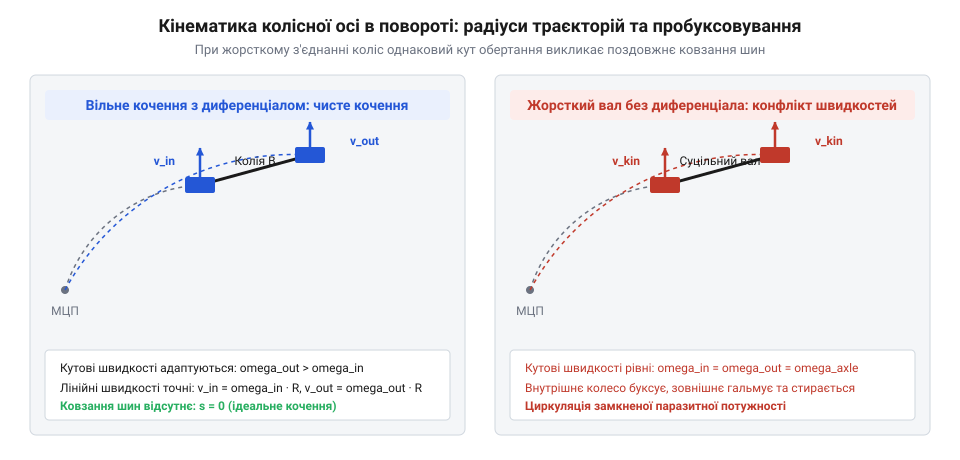
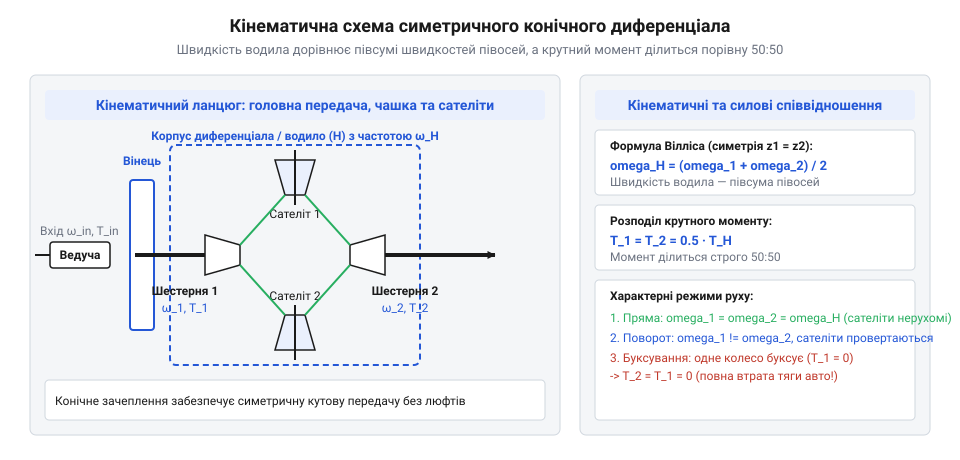
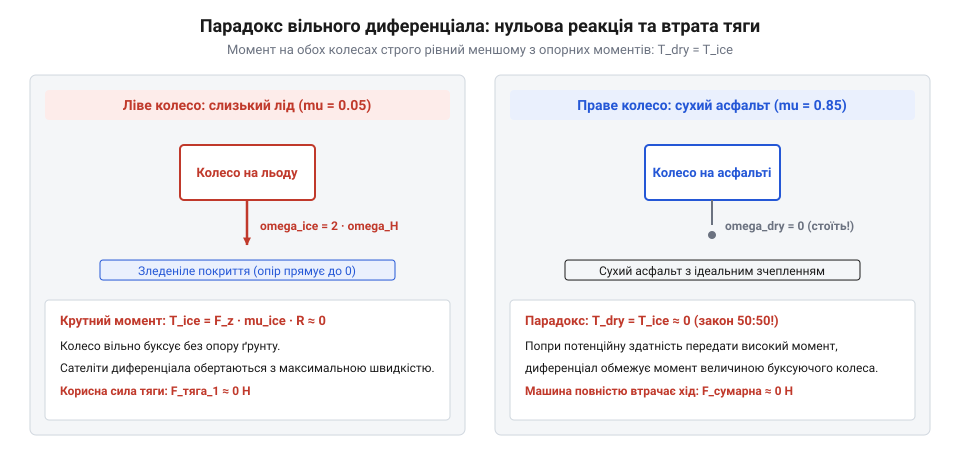
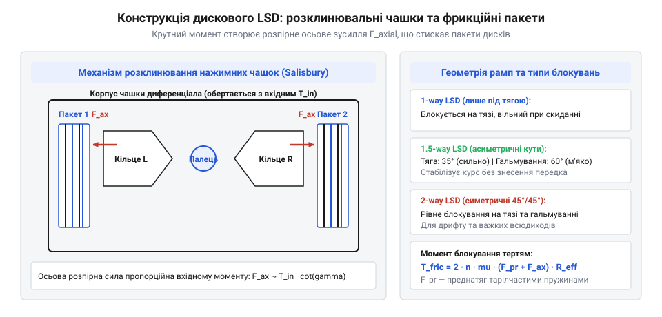
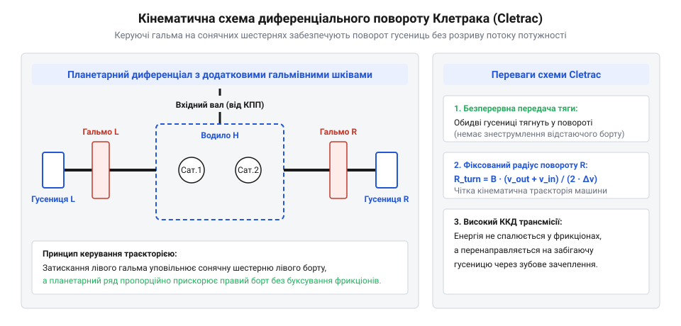

# Механічний диференціал і диференціальні механізми повороту: вільні, блоковані, LSD та схеми Клетрака

<preknowlist>
- [Планетарний редуктор](root:hw-motion/planetary-gearbox) — планетарний ряд, поняття водила та сателітів
</preknowlist>

## Чому жорстка вісь перешкоджає вільному повороту машини

Коли чотириколісний мобільний робот або автомобіль рухається по прямій лінії, ліве і праве колеса котяться з однаковою швидкістю й долають однакову дистанцію. Проте в момент входу в дугу повороту геометрія руху змінюється: зовнішнє колесо описує дугу значно більшого радіуса R_out, ніж внутрішнє колесо, радіус траєкторії якого дорівнює R_in.

Різниця радіусів траєкторій залежить від ширини колії машини B:

```
R_out = R_in + B
```

Якщо колеса жорстко зафіксовані на спільній суцільній осі, вони вимушені робити однакову кількість обертів за одиницю часу. Оскільки геометрична довжина шляху зовнішнього колеса значно довша, виникає кінематична невідповідність. Одне з коліс (або обидва одночасно) змушене безперервно прослизати по дорожньому покриттю з тертям ковзання.


*Різниця радіусів та дуг шляху зовнішнього й внутрішнього коліс на повороті: відсутність компенсації швидкості призводить до примусового зриву протектора в юз.*

На жорсткому сухому покритті (асфальт, бетон) це призводить до катастрофічних наслідків:
- Інтенсивне стирання та руйнування гумового протектора коліс через постійний юз.
- Виникнення паразитного циркулюючого крутного моменту, що закручує півосі наче торсіони та спричиняє втомні тріщини шліців.
- Погіршення керованості: машина чинить опір повороту керма, прагнучи їхати прямо, що на високій швидкості загрожує перекиданням.

> 🔧 **Навіщо це.**
> Транспортному засобу потрібен пристрій, який дозволяє лівому та правому ведучим колесам обертатися з різними кутовими швидкостями на поворотах, але при цьому не перериває постійну передачу тягового моменту від двигуна до обох коліс.

Для розв'язання цієї суперечності виникла інженерна концепція диференціального механізму, про витоки якої оповідає [історія винайдення конічного диференціала Онесіфором Пеккером](root:hw-motion/mechanical-differential/hist-differential-pecqueur-cletrac.md).

## Будова та кінематика симетричного конічного диференціала

Механічний диференціал — це планетарна передача особливого типу з двома ступенями вільності, де функцію сонячних коліс виконують півосьові шестерні коліс, а водилом слугує обертовий корпус (чашка) диференціала.

Крутний момент від карданного вала або коробки передач подається на ведучу шестерню головної передачі, яка обертає велику відому конічну шестерню (вінець). До цього вінця жорстко прикріплено корпус диференціала. Усередині корпусу на поперечних осях вільно посаджено конічні шестерні-сателіти, які входять у зачеплення з двома півосьовими шестернями лівого та правого коліс.


*Конічна планетарна схема диференціала: обертання сателітів на власних шипах дозволяє півосям обертатися з довільною різницею швидкостей при фіксованій середній швидкості.*

Кінематика диференціального ряду описується класичним рівнянням Вілліса, детально проаналізованим у статті [кінематичний аналіз за рівнянням Вілліса](root:hw-motion/mechanical-differential/math-differential-kinematics-bias-ratio.md). Для симетричного конічного диференціала зі співвідношенням зубів півосьових коліс 1:1 кутова швидкість обертання корпусу водила omega_carrier дорівнює півсумі кутових швидкостей лівої omega_left та правої omega_right півосей:

```
omega_carrier = (omega_left + omega_right) / 2
```

або у розгорнутому вигляді:

```
2 · omega_carrier = omega_left + omega_right
```

Розглянемо кінематику обертання самих сателітів навколо власних шипів на осі корпусу. Кутова швидкість сателіта відносно корпусу omega_sat_rel пропорційна різниці швидкостей коліс:

```
omega_sat_rel = (omega_left - omega_right) · (z_side / (2 · z_sat))
```

де z_side — кількість зубів півосьової шестерні, а z_sat — кількість зубів конічного сателіта.

З цього кінематичного рівняння випливають три базові режими роботи:
1. **Прямолінійний рух:** обидва колеса мають однаковий опір, тому omega_left = omega_right = omega_carrier. Різниця швидкостей дорівнює нулю, отже omega_sat_rel = 0. Сателіти не обертаються навколо власних осей, а працюють як нерухомі клини, обертаючи обидві півосі як єдине ціле.
2. **Рух у повороті:** якщо зовнішнє колесо прискорюється на дельта_omega, сателіти починають обертатися на своїх осях. Внутрішнє колесо сповільнюється строго на таку саму величину дельта_omega. Середня швидкість залишається незмінною.
3. **Одне колесо зупинене:** якщо праве колесо заблоковане (omega_right = 0), ліве колесо обертається з подвійною швидкістю корпусу: omega_left = 2 · omega_carrier. Сателіти інтенсивно обертаються на осях із максимальною швидкістю.

> 🔧 **Навіщо це.**
> Подібно до того, як [планетарний редуктор](root:hw-motion/planetary-gearbox) розподіляє зусилля між сателітами, конічний диференціал дозволяє колесам самостійно підлаштовувати свої кутові швидкості під геометрію дуги дороги без ковзання шин і втрат на тертя.

## Силовий розподіл і фундаментальний парадокс вільного диференціала

Попри кінематичну досконалість симетричного конічного диференціала, його силові властивості несуть у собі прихований парадокс, який може повністю знерухомити транспортний засіб.

Крутний момент від двигуна передається через корпус диференціала на осі сателітів. Оскільки сателіт спирається на дві однакові півосьові шестерні на рівних радіусах, він діє як симетричний важіль із плечима 1:1. Тому вільний симетричний диференціал завжди ділить вхідний крутний момент між лівим T_left і правим T_right колесами строго навпіл:

```
T_left = T_right = 0.5 · T_carrier
```

Звідси випливає фундаментальний закон: крутний момент на колесі визначається не потужністю двигуна, а здатністю опорної поверхні сприйняти це зусилля без пробуксовування (@@en|traction limit@@). Максимальний момент на колесі обмежений силою зчеплення шини з ґрунтом:

```
T_max = F_normal · mu · r_wheel
```

де mu — коефіцієнт зчеплення шини з дорогою.


*Парадокс симетричного диференціала: оскільки сателіти вільно балансують момент 50:50, падіння опорного моменту на слизькому колесі до нуля позбавляє тяги й протилежне колесо.*

Уявімо типову позашляхову ситуацію: ліве колесо стоїть на сухому бетоні з високим коефіцієнтом тертя (mu = 0.8), а праве колесо потрапило на мокрий лід або висить у повітрі (mu ≈ 0). 
- Праве колесо не має опори і починає буксувати. Момент на ньому падає майже до нуля: T_right ≈ 0.
- Оскільки сателіти є вільним важелем, момент на лівому колесі автоматично падає до такого ж нульового значення: T_left = T_right ≈ 0.

> 🔧 **Навіщо це.**
> Розуміння парадокса 50:50 пояснює, чому відкритий диференціал непридатний для позашляховиків та всюдихідних роботів без спеціальних засобів блокування: втрата зчеплення хоча б одним колесом повністю паралізує тягу всього автомобіля.

## Примусове блокування та диференціали підвищеного тертя (LSD)

Щоб подолати парадокс відкритого диференціала, інженери розробили механізми, які тимчасово обмежують або повністю блокують взаємне обертання півосей.

Найпростішим і найжорсткішим методом є примусове 100% блокування (@@en|locking differential@@ або @@en|spool@@). Зубчаста або кулачкова муфта механічно з'єднує корпус диференціала з однією з півосей за допомогою пневматичного, гідравлічного або електромагнітного приводу. Сателіти перестають обертатися, а обидві півосі стають єдиною жорсткою балкою. Машина вибирається з пастки, але на твердому покритті таке блокування необхідно негайно вимикати, інакше виникне поломка півосей.

Для автоматичного регулювання моменту без втручання водія застосовують диференціали підвищеного тертя (@@en|Limited Slip Differential, LSD@@). Найпоширенішою класичною схемою є дисковий фрикційний диференціал (@@en|clutch-pack LSD@@).


*Самоблокований диференціал із фрикційними пакетами (LSD): осьові сили розпирання конічних сателітів стискають диски, блокуючи відносне прокручування півосей.*

У цій конструкції між кожною півосьовою шестернею та корпусом встановлено пакет чергованих сталевих та фрикційних дисків. Осі сателітів розташовано у V-подібних пазах розпірних чашок із кутом скосу гамма (зазвичай від 30° до 60°). 

Коли водій додає газ і на корпус передається вхідний момент T_carrier, вісь сателіта піднімається по V-подібному скосу, створюючи потужну розпірну осьову силу:

```
F_axial = (T_carrier / (2 · r_ramp)) · cot(gamma)
```

Ця осьова сила міцно стискає фрикційні пакети, створюючи момент внутрішнього тертя:

```
T_friction = 2 · mu_clutch · z_surfaces · F_axial · r_friction_mean
```

де z_surfaces — кількість пар тертя, а mu_clutch — коефіцієнт тертя фрикційного матеріалу. 

Здатність диференціала передавати більший момент на колесо з кращим зчепленням виражається коефіцієнтом блокування (@@en|Torque Bias Ratio, TBR@@):

```
TBR = T_max / T_min = (1 + k_lock) / (1 - k_lock)
```

Типові дискові LSD забезпечують значення TBR від 2.0:1 до 4.5:1, що дозволяє передавати на колесо з хорошим зчепленням до 70–80% сумарної тяги двигуна.

> 🔧 **Навіщо це.**
> Диференціал LSD автоматично забезпечує передачу тяги на колесо, що не ковзає, дозволяючи роботу чи автомобілю впевнено рухатися по болоту, снігу та крутих підйомах без ризику поломки трансмісії на поворотах.

Огляд різних модифікацій фрикційних та конусних блокувань представлено у матеріалі [промислові класи диференціалів обмеженого тертя](root:hw-motion/mechanical-differential/comp-limited-slip-differential.md), а приклад побудови керованого диференціала для колісного шасі — у [проєктуванні диференціала мобільного робота](root:hw-motion/mechanical-differential/proj-robot-differential-steering.md).

## Черв'ячні та гвинтові самоблоковані механізми: прогресивні диференціали Torsen і Quaife

Фрикційні диференціали LSD з дисковими пакетами мають істотний недолік: фрикційні накладки неминуче зношуються, вимагаючи регулярної заміни мастила зі спеціальними присадками та регулювання натягу. Крім того, дисковий LSD має момент тертя спокою, через що на малих кутах повороту керма може виникати неприємне клацання та опір.

Альтернативою стали суто механічні самоблоковані диференціали без фрикційних пластин, розроблені на базі косозубих та черв'ячних передач. Найвідомішим представником цієї родини є диференціал Торсен (@@en|Torsen@@, скорочення від @@en|Torque Sensing@@).

В основі конструкції лежить використання ефекту тертя в черв'ячному зачепленні або радіально-осьового розпирання гвинтових шестерень:
1. **Torsen Type 1:** використовує пари черв'як-колесо. Черв'як може обертати колесо, але колесо не може легко обертати черв'як через малий кут підйому гвинтової лінії (явище часткового самогальмування).
2. **Torsen Type 2 та диференціали Quaife:** використовують паралельні косозубі сателіти, розташовані в кишенях корпусу. Коли виникає різниця крутних моментів, косі зуби шестерень створюють осьові та радіальні сили, які притискають торці та циліндричні верхівки зубів сателітів до стінок корпусу диференціала.

Тертя сателітів об корпус створює плавний прогресивний опір пробуксовуванню. Чим більше крутного моменту подає двигун, тим сильніше розпирає шестерні, і тим вищим стає блокуючий ефект.

Ключові переваги гвинтових диференціалів:
- Миттєве, плавне спрацьовування без поштовхів та запізнень (механічна реакція).
- Відсутність зношуваних деталей: ресурс диференціала дорівнює ресурсу всієї трансмісії.
- Повна сумісність з електронними антиблокувальними системами гальм (ABS).

Проте Torsen зберігає одну ваду відкритого диференціала: оскільки він є помножувачем крутного моменту (T_max = TBR · T_min), якщо одне колесо повністю відірвалося від землі (T_min = 0), добуток дорівнює нулю. Для виходу з такої ситуації потрібне легке натискання на робочі гальма для створення штучного опорного опору.

> 🔧 **Навіщо це.**
> Гвинтові диференціали типу Torsen є ідеальним рішенням для швидкісних повноприводних колісних робоплатформ та міжосьових трансмісій, де потрібне стабільне керування тягою без ризику заклинювання на твердому покритті.

## Диференціальні механізми повороту гусеничних машин: схема Клетрака

Гусеничні роботи та всюдихідні машини принципово відрізняються від колісних: у них немає поворотних коліс, а зміна напрямку руху відбувається за рахунок різниці швидкостей лівої та правої гусеничних стрічок.

Найпростіший спосіб повернути гусеничну машину — вимкнути бортовий фрикціон однієї зі сторін і затиснути її стрічковим гальмом. Проте ця схема надзвичайно марнотратна:
- Вся кінетична енергія забетонованої гусениці перетворюється на руйнівний нагрів гальм.
- Двигун втрачає половину підведеної потужності, через що машина різко втрачає швидкість на повороті.

Для розв'язання цієї проблеми американська компанія Cleveland Tractor Company у 1916 році створила кінематичну схему повороту без розриву потоку потужності — механізм Клетрака (@@en|Cletrac steering system@@).


*Кінематична схема механізму повороту Клетрака з додатковими керуючими гальмами сонячних шестерень планетарного ряду.*

Схема використовує симетричний диференціал, доповнений з обох боків двоелементними планетарними передачами керування. Півосі жорстко пов'язані з сонячними шестернями допоміжних планетарних рядів, а сателіти цих рядів зв'язані перехресними валами.

Коли обидва керуючі гальма відпущені, допоміжні планетарні передачі вільно обертаються, і машина їде прямо, розподіляючи потужність 50:50. Коли оператор затягує гальмо повороту з одного боку, планетарний ряд примусово перерозподіляє швидкість:
- Швидкість внутрішньої гусениці зменшується на фіксоване передавальне відношення i_steer.
- Швидкість зовнішньої гусениці завдяки диференціалу пропорційно зростає рівно на таку саму величину.

> 🔧 **Навіщо це.**
> Механізм Клетрака забезпечує поворот гусеничного робота з фіксованим радіусом без розриву потоку потужності: кінетична енергія сповільненої гусениці механічно рекуперується й передається на прискорення забігаючої гусениці.

## Інженерний розрахунок, баланс тяги та електронні системи диференціала

Проєктування та налаштування диференціальної трансмісії для мобільного колісного робота чи автомобіля вимагає точного узгодження міжколісного та міжосьового розподілу тяги, розрахунку теплових втрат та взаємодії з електронними системами допомоги.

### 1. Баланс тяги при повному приводі (AWD)
У повноприводних шасі крутний момент від силової установки спершу ділиться міжосьовим диференціалом між переднім і заднім мостами, а потім — міжколісними диференціалами між лівим і правим колесами.

Якщо міжосьовий диференціал є вільним конічним (50:50), пробуксовування хоча б одного з чотирьох коліс призводить до зупинки всієї машини. Тому в центральній роздавальній коробці завжди встановлюють самоблокований диференціал (Torsen або дисковий LSD) або в'язкісну віскомуфту, яка автоматично блокує міжосьовий зв'язок при виникненні різниці обертів осей.

### 2. Тепловий режим фрикційних пакетів
Під час тривалого буксування в диференціалах LSD із пакетами зчеплення виділяється значна потужність тертя ковзання:

```
P_friction = T_friction · |omega_left - omega_right|
```

Якщо робоплатформа довго намагається виїхати з піщаної пастки, температура трансмісійного мастила в картері моста може піднятися понад 130 °C. Це спричиняє спікання фрикційних накладок і деструкцію присадок мастила. Для диференціалів LSD обов'язково застосовують трансмісійні оливи стандарту API GL-5 із маркуванням LS (Limited Slip), що містять модифікатори тертя на базі сірчано-фосфорних сполук для запобігання вібраційного схоплювання (@@en|stick-slip phenomenon@@).

### 3. Електронне підгальмовування (eLSD)
Сучасна колісна робототехніка часто поєднує простий, легкий і надійний відкритий диференціал із алгоритмічним підгальмовуванням коліс (@@en|electronic LSD, eLSD@@).

Коли датчик швидкості колеса (енкодер) фіксує початок пробуксовування правого колеса, гідроакумулятор або електропривід гальмівного супорта притискає гальмівні колодки буксуючого диска. 

Гальмо штучно створює опорний момент T_brake. Оскільки диференціал симетрично балансує момент:

```
T_left = T_right_total = T_traction + T_brake
```

Момент на протилежному лівому колесі з надійним зчепленням негайно зростає рівно на величину T_brake, виштовхуючи машину з перешкоди без застосування дорогих і важких механічних блокувань.

> 🔧 **Навіщо це.**
> Алгоритм eLSD реалізує віртуальне самоблокування засобами стандартної дискової гальмівної системи, знижуючи масу та вартість шасі робота при збереженні високої прохідності.

Загальні основи проектування зубчастих передач описано в статті [редуктори](root:hw-motion/gears-transmission), а активне керування траєкторією за рахунок незалежних двигунів або керованих муфт розглядає [векторизація крутного моменту](root:hw-motion/torque-vectoring).
