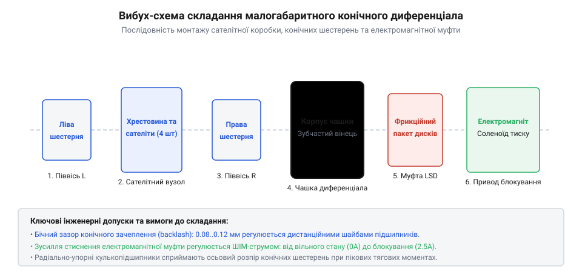
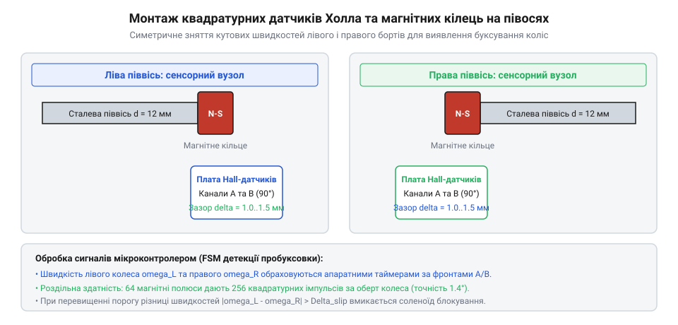
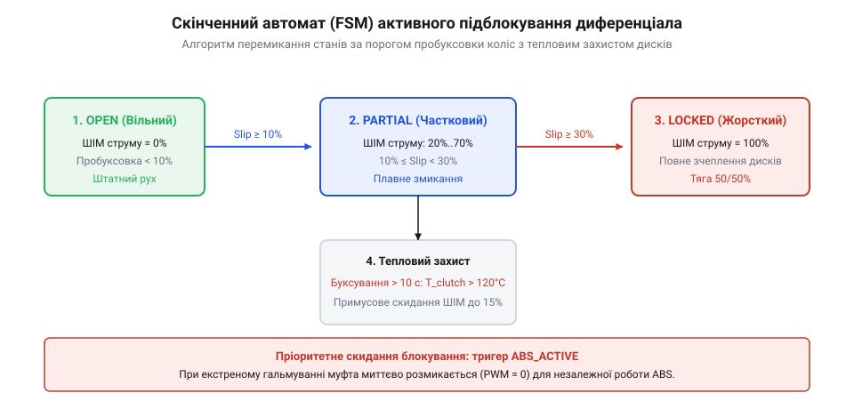

# Механічний диференціал і диференціальні механізми повороту: вільні, блоковані, LSD та схеми Клетрака

<preknowlist>
- [Механічний диференціал](root:hw-motion/mechanical-differential) — кінематика симетричного диференціала та формули кутових швидкостей
</preknowlist>

## Архітектура привода мобільного робота: інтеграція конічного диференціала з керованою електромагнітною кулачковою муфтою

У мобільній наземній робототехніці конструкція трансмісії провідного моста визначає енергоефективність руху та прохідність шасі на складних опорних поверхнях. Класична схема з двома незалежними мотор-редукторами на кожному колесі страждає на асиметрію швидкостей під час прямолінійного руху та вимагає подвійного комплекту силових драйверів FOC і акумуляторної проводки.

Альтернативою для легких автономних платформ є компактна мостова схема з одним тяговим двигуном та симетричним конічним диференціалом. Диференціал автоматично розподіляє крутний момент навпіл між лівим і правим колесами (`T_left = T_right = 0.5 · T_carrier`), забезпечуючи безперешкодне кочення в поворотах без проковзування шин за кінематичною моделлю Аккермана.

Проте вільний симетричний диференціал має критичний недолік: тягове зусилля обох коліс лімітується колесом із найменшим коефіцієнтом зчеплення з ґрунтом. Якщо одне колесо потрапляє на мокру траву, лід або пісок, воно починає безконтрольно буксувати з подвоєною кутовою швидкістю, тоді як колесо з надійним зчепленням повністю зупиняється, позбавляючи робота тяги:

```
T_total_max
= 2.0 · min(T_left_friction, T_right_friction)              [тягова межа вільного диференціала на слизькій поверхні]
= 2.0 · (N_wheel · mu_ice · R_wheel)
= 2.0 · (45.0 · 0.08 · 0.065)                               [маса на колесо 45 Н, коефіцієнт зчеплення льоду 0.08, радіус 65 мм]
= 0.468                                                     [максимальний сумарний тяговий момент становить менше 0.5 Н·м!]
```

Для вирішення цієї проблеми в конструкцію моста інтегровано компактну електромагнітну кулачкову муфту блокування (@@en|electromagnetic dog clutch locker@@). Муфта складається з:
1. **Нерухомого кільцевого електромагнітного соленоїда**, закріпленого на картері моста.
2. **Рухомого сталевого зубчастого вінця (напівмуфти)**, встановленого на шліцах правої півосі з можливістю осьового ковзання.
3. **Зворотних пружин стиску**, що утримують напівмуфту у розімкненому стані при відсутності струму в соленоїді (нормально відкритий диференціал, @@en|open differential@@).
4. **Відповідної кулачкової корони**, виконаної прямо на торці обертової сателітної коробки.

При виявленні пробуксовки мікроконтролер подає імпульс струму на соленоїд: магнітне поле долає зусилля пружин і притискає рухому напівмуфту до сателітної коробки. Кулачки трапецеїдального профілю входять у жорстке зачеплення, механічно з'єднуючи праву піввісь із корпусом диференціала. Це блокує відносне обертання сателітів:

```
omega_left = omega_right = omega_carrier                    [кінематичний стан 100% заблокованого диференціала]
```

Усе тягове зусилля двигуна передається на колесо з надійним зчепленням, дозволяючи роботу подолати слизьку ділянку. Після вирівнювання зчеплення соленоїд знеструмлюється, і пружини повертають муфту у вільний режим, відновлюючи здатність шасі легко входити в круті повороти без зношування гуми.


*3D-модель та вибух-схема складання малогабаритного диференціала робота з електромагнітною муфтою.*

> 🔧 **Навіщо це.** Електромагнітна муфта перетворює відкритий енергоефективний диференціал на жорсткий нерозрізний міст за 15–20 мілісекунд, забезпечуючи максимальну прохідність колісного робота на бездоріжжі без постійних втрат енергії на тертя у фрикційних пакетах.

## Конструювання сателітної коробки та півосей: вибір підшипників кочення, теплових зазорів та плями контакту конічних зубів

Проєктування механічної частини мобільного диференціала вимагає забезпечення просторової жорсткості сателітної коробки під дією сил розклинювання конічного зачеплення.

Кінематичне ядро диференціала утворюють чотири прямозубі конічні шестерні з кутом зачеплення 20°:
- Дві центральні півосьові шестерні з числом зубів `z_side = 16`, модуль `m = 1.5` мм.
- Два сателіти з числом зубів `z_sat = 10`, встановлені на спільній поперечній загартованій сталевій осі діаметром `d_pin = 6.0` мм.
- Кути ділильних конусів шестерень становлять:
```
delta_sat
= arctan(z_sat / z_side)                                    [кут ділильного конуса сателіта конічного диференціала]
= arctan(10 / 16)
= 32.0                                                      [кутова конусність сателіта в градусах]

delta_side
= 90.0° - delta_sat = 58.0°                                 [кут ділильного конуса півосьової шестерні]
```

Особливістю конічного зачеплення є виникнення значних осьових сил, що намагаються виштовхнути шестерні із зачеплення назовні вздовж їхніх осей:

```
F_axial_side
= F_tangential · tan(alpha_pressure) · sin(delta_side)      [осьова сила розпирання півосьової конічної шестерні]
= (T_side / R_mean) · tan(20°) · sin(58°)
= (8.0 / 0.015) · 0.364 · 0.848                             [для моменту 8 Н·м на середньому радіусі конуса 15 мм]
= 533.3 · 0.309
= 164.8                                                     [осьова виштовхувальна сила в ньютонах]
```

Ці осьові зусилля сприймаються полірованими бронзовими упорними шайбами БрОЦС товщиною 1.0 мм, встановленими між тильними площинами шестерень і внутрішніми стінками сателітної коробки.

Опорні вузли сателітної коробки базуються на двох радіально-упорних кулькопідшипниках 7002B або якісних радіальних підшипниках 6002ZZ, встановлених у рознімний картер моста. Точність зачеплення та довговічність пари залежить від правильного регулювання бокового зазору між зубами (@@en|backlash@@) у межах 0.08–0.12 мм за допомогою набору сталевих регулювальних прокладок товщиною 0.05 та 0.10 мм під фланцями підшипників.

Контроль плями контакту виконують за допомогою маркувальної інженерної синьки (@@en|Prussian blue@@):
1. Зубці сателітів покривають тонким шаром пігменту.
2. Піввісь провертають під легким гальмівним моментом на 3–4 оберти вперед і назад.
3. Форма та положення відбитка плями контакту на поверхні зубів оцінюється візуально:
   - **Правильний контакт**: пляма розташована посередині робочої висоти та довжини конічного зуба з плавним сходженням до вершин, займаючи 50–65% площі без концентрації тиску на тонкому внутрішньому кінці (@@en|toe@@) або масивному зовнішньому краї (@@en|heel@@).
   - **Неправильний контакт біля вершини (toe)**: свідчить про надмірне заглиблення конічної шестерні, що усувається видаленням регулювальних шайб відповідної товщини.

> 🔧 **Навіщо це.** Правильне регулювання плями контакту запобігає сколюванню кутів конічних зубців при різких ударних стартах робота та знижує рівень акустичного шуму шестерень редуктора до мінімуму.

## Сенсорний вузол одометрії: встановлення оптичних або магнітних Hall-енкодерів на півосях та вимірювання різниці кутових швидкостей

Надійна робота активного диференціала вимагає незалежного та високоточного вимірювання миттєвих кутових швидкостей лівої та правої півосей. Якщо енкодер встановлено лише на валу тягового двигуна перед диференціалом, система принципово не здатна визначити, яке саме з коліс втратило зчеплення.

Конструкція сенсорного вузла моста:
1. **Мультиполюсні магнітні кільця**: напресовуються безпосередньо на вихідні ділянки півосей біля підшипників маточини коліс. Кільце містить 32 черговані пари магнітних полюсів N-S.
2. **Квадратурні сенсори Холла**: дві здвоєні інтегральні мікросхеми давачів Холла з цифровим виходом (Push-Pull або відкритий колектор) розміщено на друкованій платі під кутом фазового зсуву 90° електричних градусів.
3. **Обробка квадратурного сигналу**: апаратний таймер мікроконтролера в режимі енкодера (Encoder Interface Mode) детектує фронти та спади обох каналів A і B, учетверо збільшуючи роздільну здатність до `N_cpr = 128` відліків на один повний оберт колеса.

Вимірювання кутової швидкості коліс виконується з фіксованим періодом квантування `dt = 0.01` с (частота переривання 100 Гц):

```
omega_meas
= (2.0 · pi · delta_pulses) / (N_cpr · dt)                  [формула дискретного розрахунку кутової швидкості піввісі]
= (2.0 · pi · 18) / (128 · 0.010)                           [для 18 імпульсів за інтервал 10 мс]
= 88.357                                                    [миттєва кутова швидкість колеса в радіанах за секунду]
```

Для фільтрації вимірювальних шумів дискретизації та вібрацій від мікронерівностей ґрунту сирий сигнал кутової швидкості пропускають крізь рекурсивний експоненційний фільтр ковзного середнього (фільтр низьких частот першого порядку):

```
omega_filtered
= alpha_lpf · omega_meas + (1.0 - alpha_lpf) · omega_prev   [низькочастотна цифрова фільтрація кутової швидкості]
= 0.25 · 88.357 + 0.75 · 85.120                             [коефіцієнт згладжування alpha = 0.25]
= 85.929                                                    [відфільтрована кутова швидкість у рад/с]
```

Отримані значення швидкостей `omega_left` та `omega_right` передаються в алгоритм порівняння з кінематичною моделлю повороту Аккермана. Для колісної бази `L_wheelbase = 0.40` м, ширини колії `W_track = 0.35` м та радіуса коліс `R_wheel = 0.065` м теоретична швидкість лівого і правого коліс у повороті з кутом керма `delta_steer` зв'язана строгим співвідношенням:

```
omega_diff_expected
= (v_linear / R_turn) · (W_track / R_wheel)                 [теоретична різниця кутових швидкостей за моделлю Аккермана]
= (v_linear · tan(delta_steer) / L_wheelbase) · (W_track / R_wheel)
```

Будь-яка невідповідність фактичної різниці швидкостей розрахованому значенню свідчить про початок пробуксовки або заносу шасі.


*Схема монтажу магнітних дисків та датчиків Холла на лівій і правій півосях шасі.*

> 🔧 **Навіщо це.** Роздільне вимірювання швидкостей півосей на базі датчиків Холла забезпечує одометричну дискретність керування: контролер виявляє зрив колеса в букс за перші 20–30 мілісекунд, задовго до повної втрати курсової стійкості машини.

## Алгоритм детекції буксування та порогового керування муфтою блокування на мікроконтролері

Програмне ядро системи активного підблокування реалізовано на базі скінченного автомата станів (@@en|Finite State Machine@@, FSM), що запобігає хибним спрацьовуванням муфти та забезпечує тепловий захист котушки соленоїда.

Архітектура автомата керування реалізована в класі `DifferentialSlipController`:

:::code proj-robot-differential-steering/py/diff_slip_controller.py 15-125

Логіка роботи контролера складається з чотирьох послідовних станів:

1. **Стан OPEN (вільний диференціал)**:
   - Соленоїд знеструмлений (`PWM = 0%`), споживання енергії нульове.
   - У кожному циклі (100 Гц) обчислюється абсолютна помилка ковзання:
```
slip_error
= |omega_left - omega_right| - |omega_diff_expected|        [критерій аномальної різниці швидкостей коліс]
```
   - Якщо `slip_error > slip_threshold` (поріг буксування, наприклад `8.0` рад/с) протягом трьох послідовних тактів (захист від поодиноких імпульсних сплесків при наїзді на камінь), автомат переходить у стан замикання муфти.

2. **Стан PULL_IN (форсоване втягування кулачків)**:
   - Електромагнітна сила соленоїда обернено пропорційна квадрату повітряного зазору `F_mag ~ 1 / gap²`. Коли напівмуфта розімкнена, зазор максимальний (3.0 мм), тому для подолання опору зворотних пружин та інерції деталі потрібен короткочасний потужний імпульс сили.
   - Драйвер соленоїда подає повну напругу живлення 12 В (`PWM = 100%`, струм 2.4 А) тривалістю рівно 60 мс.
   - За цей час якір надійно втягується, і кулачки муфти входять у повне зачеплення з сателітною коробкою.

3. **Стан HOLD (енергоощадне утримання блокування)**:
   - Коли повітряний зазор зменшився до нуля, для утримання муфти проти пружин достатньо магнітної сили в рази меншої, ніж для втягування.
   - ШІМ-сигнал перемикається на коефіцієнт заповнення `PWM = 30%` (струм знижується до 0.65 А).
   - Тепловиділення соленоїда зменшується за квадратичним законом струму:
```
P_dissipation
= I_hold² · R_coil                                          [потужність нагріву котушки соленоїда в режимі утримання]
= 0.65² · 5.0                                               [при опорі обмотки соленоїда 5.0 Ом]
= 2.11                                                      [потужність нагріву в режимі HOLD, Вт]
```
   Для порівняння, при 100% ШІМ потужність сягала б `2.4² · 5.0 = 28.8` Вт, що призвело б до перегріву та розплавлення ізоляції котушки за 40–60 секунд.

4. **Умови розблокування та стан COOLDOWN**:
   - Автомат повертає муфту у вільний стан, якщо різниця навантажень зникла (`slip_error < 2.0` рад/с) або кут повороту керма перевищив критичний кут `delta_steer > 25°` (щоб уникнути пошкодження трансмісії циркулюючим паразитним моментом у крутому повороті).
   - Соленоїд знеструмлюється, пружини виштовхують кулачки із зачеплення, і вмикається захисний таймер охолодження (@@en|cooldown timeout@@ 500 мс) до наступного дозволеного спрацьовування.


*Блок-схема скінченного автомата детекції пробуксовки коліс та алгоритму спрацьовування блокування.*

> 🔧 **Навіщо це.** Дворівневе ШІМ-керування соленоїдом (100% форсування плюс 30% утримання) дозволяє використовувати надкомпактну котушку масою всього 80 грамів, усуваючи ризик її перегріву при тривалому буксуванні робота у глибокій багнюці чи снігу.

## Стендові динамічні випробування: оцінка тягового зусилля шасі на асиметричному покритті (асфальт / лід) та захист від перевантаження

Завершальним етапом створення активного моста є верифікація тягово-зчіпних властивостей шасі на експериментальному стенді асиметричного зчеплення (@@en|split-μ surface simulator@@) та налаштування захисних алгоритмів від перевантаження деталей трансмісії.

Конструкція динамічного стенда:
- Роботизоване шасі жорстко фіксується за раму динамометричним тензодатчиком сили тяги (тензобалка S-подібного типу на 200 Н), що вимірює горизонтальне зусилля упору `F_pull`.
- Ліве колесо спирається на гальмівний гумовий валик із високим коефіцієнтом тертя (`mu_high = 0.85`, емуляція сухого шорсткого асфальту).
- Праве колесо спирається на полірований сталевий ролик із нанесеною мильно-гліцериновою емульсією (`mu_low = 0.08`, емуляція мокрого гладкого льоду).
- До ведучого вала моста прикладається постійний крутний момент від серводвигуна.

Результати порівняльних стендових випробувань:

1. **Режим вільного диференціала (соленоїд вимкнений, PWM = 0%)**:
   - Праве колесо миттєво зривається в букс, розганяючись до швидкості `omega_right = 165` рад/с (удвічі швидше за корпус диференціала).
   - Ліве колесо залишається практично нерухомим (`omega_left ≈ 0` рад/с).
   - Через симетричний поділ моменту вільним конічним диференціалом на ліве колесо передається такий самий мізерний момент, що й на буксуюче праве:
```
F_pull_open
= (2.0 · T_right) / R_wheel                                 [тягове зусилля шасі при вільному диференціалі на покритті split-mu]
= 2.0 · (N_wheel · mu_low)
= 2.0 · (45.0 · 0.08)                                       [при нормальному навантаженні 45 Н на кожне колесо]
= 7.2                                                       [тягове зусилля становить усього 7.2 Н]
```
   Такої сили недостатньо навіть для зрушення з місця легкого 12-кілограмового робота.

2. **Режим активного блокування (соленоїд активований FSM-контролером)**:
   - Через 30 мс після фіксації пробуксовки кулачкова муфта надійно замикається.
   - Відносне обертання сателітів блокується, кутові швидкості коліс вирівнюються: `omega_left = omega_right = 82.5` рад/с.
   - Ліве колесо на асфальті реалізує свій повний зчіпний потенціал:
```
F_pull_locked
= (N_wheel · mu_low) + (N_wheel · mu_high)                  [сумарна тяга шасі при жорсткому 100% блокуванні моста]
= 45.0 · 0.08 + 45.0 · 0.85
= 3.6 + 38.25
= 41.85                                                     [підсумкове тягове зусилля шасі зростає до 41.85 Н]
```
   Тягове зусилля зростає у 5.8 раза (майже на 600%), що дозволяє машині миттєво виїхати зі слизької пастки.

Алгоритми захисту трансмісії від механічних перевантажень:
1. **Захист від циркулюючого паразитного моменту в поворотах**:
   - Жорстке блокування диференціала на покритті з високим зчепленням під час крутого маневрування викликає крутильне скручування півосей через різницю довжин дуг траєкторій коліс.
   - Мікроконтролер постійно відстежує сигнал датчика кута повороту керованих коліс `delta_steer`: якщо кут повороту перевищує `18.0°`, активація соленоїда блокується апаратно, а активне блокування примусово розмикається.
2. **Струмовий захист від заклинювання**:
   - При раптовому заклинюванні коліс у камінні або корінні дерев струм двигуна стрибкоподібно перевищує поріг `I_max = 14.0` А. Якщо такий струм утримується понад 150 мс, алгоритм знеструмлює соленоїд блокування та обмежує струм двигуна, захищаючи кулачки муфти та зубці конічних шестерень від зрізання.

> 🔧 **Навіщо це.** Експериментальні стендові випробування на покритті split-mu наочно доводять, що активне підблокування диференціала усуває головну вразливість колісних роботів — повну втрату рухливості при вивішуванні або пробуксовці одного-єдиного колеса.
