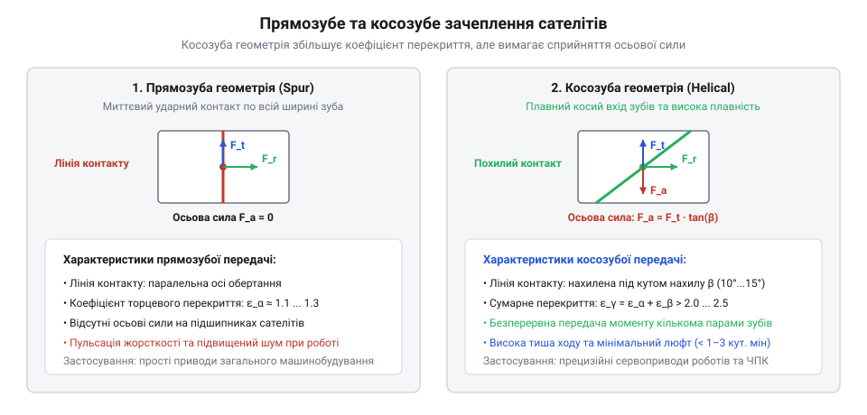
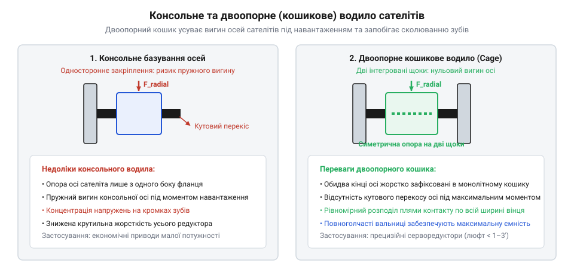

# Планетарний редуктор

<preknowlist>
- [Редуктори](root:hw-motion/gears-transmission) — базові типи зубчастих зачеплень
</preknowlist>

1 | важливість: висока | Прямозубі та косозубі планетарні ступені: компроміс між навантажувальною здатністю, рівнем шуму та люфтом. Порівнюються прямозубі передачі загального промислового призначення та прецизійні серво-редуктори з косозубим зачепленням. Розглядається вплив кута нахилу лінії зуба на коефіцієнт перекриття, плавність входу в контакт, усунення вібрацій на високих швидкостях вала двигуна та появу додаткових осьових сил.

## Прямозубі та косозубі планетарні ступені: компроміс між навантажувальною здатністю, рівнем шуму та люфтом

У конструкції промислових планетарних редукторів тип зубчастого вінця визначає динамічні властивості, акустичний комфорт, крутильну жорсткість та собівартість приводу. Найпростішим і найбільш розповсюдженим рішенням є прямозубі циліндричні передачі, у яких лінії зубів орієнтовані суворо паралельно осі обертання. Проте підвищення швидкохідності вхідних валів сучасних синхронних серводвигунів (понад 3000–6000 об/хв) виявило жорсткі фізичні обмеження прямозубої схеми, що стимулювало перехід на прецизійні косозубі планетарні ступені.


*Порівняння ліній контакту в планетарному зачепленні: у прямозубій передачі контакт виникає миттєво по всій ширині вінця з високим ударним навантаженням; у косозубій лінії контакту входять під кутом нахилу β, забезпечуючи плавне наростання сили ціною появи осьової реакції F_a.*

У прямозубих передачах зачеплення кожного наступного зуба відбувається миттєво по всій контактній довжині зуба `b`. Навіть за прецизійного шліфування профілю миттєвий перехід навантаження з однієї пари зубів на іншу викликає циклічний динамічний удар. Цей удар генерує високочастотний акустичний шум (зазвичай 70–78 дБА на високих обертах) та провокує вібрації всього механічного ланцюга. Коефіцієнт торцевого перекриття прямозубого зачеплення `ε_α` зазвичай лежить у діапазоні 1.2–1.4. Це означає, що протягом значної частини циклу обертання навантаження сприймає лише одна контактна лінія зуба, що обмежує граничний передаваний крутний момент та підвищує ризик втомного викришування (пітингу).

Косозубі планетарні ступені вирішують цю проблему нахилом зубів під кутом `β` (зазвичай від 8° до 15°). Завдяки куту нахилу сумарний коефіцієнт перекриття `ε_γ` обчислюється як сума торцевого `ε_α` та осьового `ε_β` перекриттів:

```
ε_γ
= ε_α + ε_β                      [сумарний коефіцієнт перекриття косозубого зачеплення]
= ε_α + (b · sin(β)) / (π · m_n) [розрахунок осьового перекриття через ширину вінця b і нормальний модуль m_n]
```

Для косозубих планетарних редукторів значення `ε_γ` досягає 2.0–2.8. Зуби входять у контакт поступово, починаючи від однієї крайки й плавно розгортаючись по косій лінії вздовж ширини зуба. Навантаження плавно перерозподіляється між двома або навіть трьома парами зубів, що забезпечує значні інженерні переваги:
- Зниження акустичного шуму на 6–12 дБА (рівень звукового тиску не перевищує 55–60 дБА при 3000 об/хв).
- Збільшення тривалої контактної міцності та навантажувальної здатності за крутним моментом на 25–40% при однакових зовнішніх габаритах ступеня.
- Зниження кінематичної похибки та пульсацій кутової швидкості, що критично для систем позиціонування.

> 🔧 **Навіщо це.**
> Для прецизійних сервоприводів у робототехніці та верстатах ЧПК використовують виключно косозубі редуктори: плавний контакт дозволяє зменшити кутовий люфт до величини менше 1–3 кутових мінут (arcmin) без заклинювання та забезпечує плавність руху на мікрошвидкостях.

Проте платою за переваги косозубого зачеплення є виникнення додаткової осьової сили. Якщо в прямозубому контакті діють лише тангенціальна `F_t` та радіальна `F_r` складові, то в косозубому виникає осьова реакція `F_a`:

```
F_a
= F_t · tan(β)                   [осьова сила в косозубому зачепленні через кут нахилу β]
```

Осьова сила намагається змістити сателіти вздовж їхніх пальців, навантажує підшипникові опори водила й створює осьовий тиск на вал приводного електродвигуна через сонячну шестерню. Для нейтралізації цієї сили інженери змушені застосовувати упорні шайби зі спеціальним антифрикційним покриттям, посилені упорні підшипники або використовувати шевронні (двокосозубі) шестерні, що здорожчує редуктор приблизно на 30–60% порівняно з прямозубим аналогом.

У таблиці наведено порівняння параметрів прямозубих та косозубих редукторів однакового типорозміру:

| Параметр | Прямозубий планетарний редуктор | Косозубий прецизійний серворедуктор |
| :--- | :--- | :--- |
| **Кутовий люфт (Backlash)** | Стандартний: 8–15 кутових мінут | Прецизійний: < 1–3 кутові мінути |
| **Рівень шуму при 3000 об/хв** | 70–78 дБА (помітний гул і свист) | 55–60 дБА (тиха плавна робота) |
| **Сумарне перекриття ε_γ** | 1.2–1.4 (періодичний однозубий контакт) | 2.0–2.8 (постійний багатозубий контакт) |
| **Осьові навантаження** | Відсутні (`F_a = 0`) | Присутні (`F_a = F_t · tan(β)`), вимагають упорних опор |
| **Сфера застосування** | Колісні мотор-маточини, лебідки, конвеєри | Сервоприводи суглобів роботів, поворотні столи ЧПК |

### Тепловий режим, вибір пластичного мастила та обмеження тривалої швидкості

Висока щільність потужності планетарного редуктора створює серйозний тепловий виклик: механічні втрати в зачепленні та підшипниках виділяються у вкрай обмеженому замкненому об'ємі корпусу. Теплова потужність втрат прямо пропорційна вхідній потужності та коефіцієнту втрат:

```
P_loss
= P_in · (1 - η)                 [потужність теплових втрат у редукторі]
```

Для сервоприводу потужністю `1.5 кВт` за ККД `η = 0.95` усередині редуктора безперервно виділяється `75 Вт` тепла. Оскільки площа зовнішньої поверхні алюмінієвого чи сталевого корпусу невелика, за умов природної конвекції (`α_conv ≈ 15...25 Вт/(м²·К)`) перегрів корпусу відносно навколишнього середовища може перевищувати `40–60 °C`. Якщо температура внутрішніх деталей перевищує `90–100 °C`, починається інтенсивна деградація мастильного матеріалу та ущільнень.

У прецизійних серворедукторах малого та середнього розміру практично завжди використовують довічне мащення (sealed-for-life) напіврідкими синтетичними пластичними мастилами консистенції NLGI 00 або NLGI 0. Рідка олива вимагала б складних картерів, сапунів та контролю рівня, що неприпустимо для роботів, орієнтація суглобів яких постійно змінюється в просторі. Натомість стандартне густе консистентне мастило (NLGI 2) під дією відцентрових сил швидко відкидається на стінки коронної шестерні (явище утворення каналу або «channelling»), залишаючи зону зачеплення сонця й сателітів сухою.

Напіврідкі мастила класу NLGI 00 поєднують переваги обох типів:
- Завдяки високій тиксотропності мастило в зоні спокою утримує свою структуру й не витікає крізь щілинні ущільнення.
- У зоні швидкісного контакту зубів під дією високої швидкості зсуву мастило миттєво розріджується до стану рідини, ефективно омиває зуби, формує еластогідродинамічну плівку товщиною `0.5–2.0 мкм` та відводить тепло до стінок корпусу.
- Базовою оливою виступає синтетичний поліальфаолефін (PAO) або синтетичний естер із високим індексом в'язкості, що забезпечує стабільну роботу в діапазоні температур від `-40 °C` до `+120 °C`.

Теплове навантаження безпосередньо обмежує робочу швидкість редуктора. Виробники вказують у паспортах два різних швидкісних параметри:
1. Максимальна механічна швидкість `n_in,max` (зазвичай 6000–8000 об/хв). Вона визначається механічною міцністю сателітів, відцентровими силами тіл кочення та стійкістю деталей до вібрацій; цей режим допустимий лише короткочасно (при розгоні, гальмуванні або в повторно-короткочасному циклі S5 із тривалістю вмикання менше 30%).
2. Номінальна тривала швидкість `n_in,rated` (типово 2500–3500 об/хв при тривалому режимі S1). Це швидкість, за якої теплове виділення `P_loss` строго врівноважується тепловіддачею через корпус без перегріву вище `90 °C`. Якщо серводвигун працює на швидкості понад `n_in,rated` безперервно, в'язкість базової оливи катастрофічно падає, мастильна плівка руйнується, виникає контактний схоплювальний знос зубів (scuffing), а еластомірні ущільнювальні манжети з фторкаучуку (FKM) втрачають еластичність і дають витік.

3 | важливість: середня | Підшипникові вузли сателітів та вихідного вала: повноголчасті вальниці проти роликових конічних опор. Розглядається конструкція опор сателітів на повноголчастих роликових вальницях без сепаратора для максимальної навантажувальної здатності в обмеженому радіальному просторі. Порівнюються типи вихідних опор: подвійні радіально-упорні кулькові підшипники для динамічних сервоприводів та конічні роликові підшипники для високих радіальних і перекидних моментів у колесах мобільних платформ.

## Архітектура водила та компонування багатоступеневих передач

2 | важливість: висока | Архітектура водила та компонування багатоступеневих передач. Порівнюються консольне закріплення сателітів у економічних серіях та двоопорне жорстке водило клітинного типу (cage-type carrier) для високих крутних моментів. Розглядається кінематичне послідовне з'єднання двох і трьох ступенів (передавальні числа до 100:1 і 1000:1), розподіл навантаження між ступенями та оптимізація розмірів деталей першого швидкохідного ступеня.

## Архітектура водила та компонування багатоступеневих передач

Водило планетарного редуктора є ключовим силовим елементом, який сприймає сумарний крутний момент від усіх сателітів і передає його на вихідний вал. На відміну від звичайних передач, де вал відчуває лише чисте кручення або згин від однієї шестерні, водило планетарного механізму зазнає складної просторової деформації під дією тангенціальних і радіальних сил зачеплення, що діють одночасно на кілька рознесених осей сателітів.


*Порівняння конструкцій водила планетарного ступеня: ліворуч — консольне базування пальців сателітів (підвищений перекіс під навантаженням); праворуч — монолітне кошикове водило з двоопорною фіксацією осей та голчастими вальницями сателітів.*

У промисловій практиці існують дві принципові конструктивні схеми виконання водила:
1. Консольне водило (одноопорне). Пальці (осі) сателітів запресовані у фланець лише з одного боку, залишаючи другий кінець пальця вільним у повітрі. Така конструкція значно простіша у виготовленні та збиранні, має меншу матеріалоємність і застосовується в недорогих редукторах загального призначення. Проте під час передачі високого моменту консольний палець деформується як балка із затисненим кінцем: прогин кінця пальця пропорційний кубу його довжини `δ ∝ F_t · L^3 / (3 · E · I)`. Навіть мікроскопічний перекіс осі сателіта на 10–25 мкм призводить до катастрофічного зміщення контактної плями до крайки зубчастого вінця (крайова концентрація напружень). Це викликає локальний перегрів, передчасне викришування зубів та зростання мертвого ходу.
2. Кошикове водило (двоопорне, cage-type carrier). Являє собою монолітну жорстку виливку або фрезеровану конструкцію, що складається з двох паралельних дисків (щік), з'єднаних міцними поздовжніми перемичками. Обидва кінці кожного пальця сателіта жорстко зафіксовані в отворах дисків, перетворюючи палець на двоопорну балку з прогином `δ ∝ F_t · L^3 / (48 · E · I)`. Така схема в 16 разів жорсткіша за консольну, повністю ліквідує кутовий перекіс осей під піковими навантаженнями та забезпечує рівномірне прилягання контактних ліній по всій ширині зуба.

> 🔧 **Навіщо це.**
> Для сервоприводів із високою динамікою розгону та реверсування застосовують виключно двоопорні кошикові водила: вони витримують 3–4-кратні перевантаження за пусковим моментом без деформаційного розкриття зубчастого зачеплення.

Коли одного ступеня недостатньо (одиночний ступінь дає передавальне число від 3:1 до 10:1), інженери використовують багатоступеневе компонування. Для передавальних чисел від 12:1 до 100:1 застосовують двоетапну редукцію, а для чисел від 100:1 до 1000:1 — триступеневу:

```
i_total
= i_1 · i_2 · i_3                [загальне передавальне число багатоступеневого редуктора]
```

Компонування ступенів у спільному циліндричному корпусі має чітку інженерну закономірність:
- Перший ступінь (швидкохідний) обертається зі швидкістю вала двигуна, але навантажений мінімальним крутним моментом. Його сателіти роблять вузькими, з малим модулем, для мінімізації маси та моменту інерції.
- Останній ступінь (тихохідний) передає помножений крутний момент `T_out = T_in · i_total · η`. Його шестерні проектують із більшим модулем, ширшим вінцем і часто збільшують кількість сателітів із 3 до 4 або 5, щоб розподілити гігантську тангенціальну силу між більшою кількістю точок контакту.
- Водило першого ступеня безпосередньо інтегрується або шліцується із сонячною шестернею наступного ступеня, виключаючи проміжні муфти та скорочуючи осьову довжину редуктора.

### Втомний розрахунок ресурсу підшипникових пальців за контактними напруженнями Герца

Оскільки пальці сателітів у прецизійних редукторах виконують роль внутрішніх доріжок кочення повноголчастих вальниць, саме контактні напруження та втомна витривалість поверхневого шару пальця визначають довговічність усього планетарного ступеня. 

Радіальне навантаження на палець одного сателіта складається з тангенціальної `F_t` та радіальної `F_r` сил зачеплення як із боку сонця, так і з боку корони. Сумарна радіальна реакція на палець `F_pin` дорівнює подвоєній силі контакту:

```
F_pin
= 2 · F_t / cos(α_w)             [сумарна радіальна сила, що діє на підшипниковий палець сателіта]
```

Під дією цієї сили навантаження між голчастими роликами розподіляється нерівномірно. За теорією пружного контакту Штрібека максимальна сила `Q_max`, яка припадає на найбільш навантажений центральний ролик:

```
Q_max
= (4.37 · F_pin) / Z_roller      [максимальне навантаження на один ролик за кількості голок Z_roller]
```

Максимальне нормальне контактне напруження Герца `σ_H` на лінії контакту між циліндричною поверхнею голки діаметром `D_w` та пальцем діаметром `d_pin` обчислюється за формулою лінійного контакту:

```
σ_H
= √( (Q_max · E_red) / (π · L_eff · ρ_red) ) [максимальне контактне напруження стиску Герца]
```

де `L_eff` — робоча довжина голки, `E_red ≈ 2.3 · 10^5 МПа` — приведений модуль пружності для підшипникової сталі, а `ρ_red` — приведений радіус кривизни:

```
1 / ρ_red
= (2 / D_w) + (2 / d_pin)        [приведена кривизна контакту двох опуклих циліндрів]
```

Для забезпечення ресурсу понад 20 000 годин роботи тривале еквівалентне напруження `σ_H` не повинно перевищувати допустиму межу контактної витривалості `[σ_H] = 1500–1800 МПа`.

Базовий розрахунковий ресурс підшипникового вузла пальця в мільйонах обертів визначається за стандартом ISO 281 для роликових підшипників з показником степеня `p = 10/3`:

```
L_10
= (C_dyn / F_pin)^(10 / 3)       [номінальний ресурс підшипника сателіта в мільйонах обертів]
```

Переведення ресурсу в години неперервної роботи виконується з урахуванням відносної частоти обертання сателіта на пальці `n_rel = n_g^(H)`:

```
L_10h
= (10^6 / (60 · n_rel)) · (C_dyn / F_pin)^(10 / 3) [ресурс підшипникового вузла сателіта в годинах]
```

Щоб витримати такі екстремальні циклічні контактні навантаження, пальці сателітів виготовляють із легованих цементованих сталей (типу 18CrNiMo7-6 або 20Х2Н4А) з глибиною цементованого шару `0.8–1.2 мм` та поверхневою твердістю `60–64 HRC`. Після термообробки поверхню пальця піддають суперфінішуванню до шорсткості `Ra ≤ 0.08–0.10 мкм`. Будь-яка мікронерівність на доріжці кочення викликає локальну концентрацію напружень і стає осередком підповерхневого втомного зсуву, що призводить до лущення металу (flaking) та передчасного виходу редуктора з ладу.

## Підшипникові вузли сателітів та вихідного вала: повноголчасті вальниці проти роликових конічних опор

Внутрішня компоновка планетарного ступеня диктує екстремальні обмеження на геометрію підшипників. Діаметр внутрішнього отвору сателіта обмежений його ділильним діаметром, а тангенціальні сили контакту створюють велетенські радіальні навантаження на палець. Якщо встановити стандартний кульковий підшипник із сепаратором, кульки вийдуть занадто дрібними й швидко зруйнуються від втомного напруження.

Стандартом промислових прецизійних сателітів є повноголчасті роликові вальниці (full-complement needle bearings) без сепаратора.

У такій конструкції відмовляються від внутрішнього й зовнішнього кілець класичного підшипника:
- Загартована та прецизійно шліфована поверхня пальця водила служить безпосередньо внутрішньою доріжкою кочення.
- Внутрішній розточений отвір сателіта виконує роль зовнішньої доріжки кочення.
- Радіальний зазор повністю заповнюється голчастими роликами високого ступеня точності без сепаратора.

Відсутність сепаратора дозволяє розмістити максимальну кількість тіл кочення (до 20–30 голок на один сателіт). Контакт кочення перетворюється з точкового на протяжну лінію, що збільшує динамічну вантажопідйомність вузла в 3–5 разів порівняно з кульковими аналогами того ж діаметра.

Опори вихідного вала редуктора проектують під зовсім інші вимоги: вони повинні сприймати не лише крутний момент, але й зовнішні поперечні сили від натягу пасів, консольних зірочок або ваги транспортного візка.

Залежно від навантаження застосовують три класи підшипникових схем вихідного вала:

| Тип опор вихідного вала | Конструктивна схема | Навантажувальні характеристики | Застосування |
| :--- | :--- | :--- | :--- |
| **Радіальні кулькові підшипники** | Пара стандартних закритих вальниць | Низька радіальна та осьова стійкість, чутливі до моментів | Бюджетні приводи малої потужності, насоси, легкі конвеєри |
| **Радіально-упорні кулькові підшипники (Back-to-Back, схема «О»)** | Дві вальниці з попереднім натягом, рознесені по базі | Висока частота обертання, висока жорсткість, середні осьові сили | Сервоприводи подачі ЧПК, декартові маніпулятори, позиціонери |
| **Конічні роликові підшипники** | Пара регульованих конічних роликових опор | Екстремальна радіальна міцність, стійкість до величезних перекидних моментів | Мотор-колеса AGV/AMR роверів, поворотні колони важких роботів |

Для важких умов мобільної робототехніки та мотор-коліс роверів саме конічні роликові підшипники забезпечують максимальну довговічність: вони здатні сприймати як ударні радіальні навантаження від нерівностей дороги, так і бічні осьові реакції під час маневрування та розворотів.

### Розрахунок допустимого консольного навантаження вихідного вала при шківному монтажі

На практиці планетарний редуктор рідко з'єднується з робочим органом через ідеально відцентровану пружну муфту. У більшості приводних компонувань на вихідний вал насаджують зубчастий шків пасової передачі, ланцюгову зірочку або прямозубу рейкову шестерню. У таких випадках підшипниковий вузол вихідного вала зазнає колосального консольного радіального навантаження (overhung load).

Поперечна радіальна сила від попереднього натягу та робочого тягового зусилля зубчастого паса `F_r,belt` залежить від передаваного крутного моменту `T_out` та розрахункового ділильного діаметра шківа `d_pulley`:

```
F_r,belt
= (2 · T_out / d_pulley) · k_belt [радіальне консольне зусилля натягу пасової передачі]
```

де `k_belt` — коефіцієнт типу передачі: для зубчастих пасів він становить `1.5–2.0` (необхідний початковий натяг для запобігання перескакуванню зубів), а для клинових пасів сягає `2.5–3.0`.

Наприклад, якщо серворедуктор розвиває крутний момент `T_out = 150 Н·м`, а привід приводить зубчастий пас через шків діаметром `d_pulley = 60 мм`:

```
F_r,belt
= (2 · 150 / 0.060) · 1.8
= 5000 · 1.8
= 9000 Н                         [консольне радіальне навантаження досягає 9 кН]
```

Радіальне зусилля величиною `9 кН` прикладається на плечі вильоту шківа `x` відносно переднього фланця редуктора. Ця сила створює потужний згинальний момент, який намагається перекосити вихідний вал відносно корпусу:

```
M_overhang
= F_r,belt · (x + d_offset)      [перекидний момент на підшипниковій опорі вихідного вала]
```

Паспортне значення допустимого радіального зусилля `F_r,rated` у каталогах виробників вказується строго для точки прикладання на половині довжини вихідного вала (`x = L_shaft / 2`). Якщо шків зміщений далі до кінця вала (`x > L_shaft / 2`), фактичне допустиме зусилля знижується за формулою перерахунку плеча:

```
F_r,allow(x)
= F_r,rated · (c_geom / (c_geom + x - L_shaft / 2)) [коригування допустимого навантаження за вильотом консолі]
```

Під дією перекидного моменту `M_overhang`:
- Стандартні радіальні кулькові підшипники швидко виходять з ладу: плече між доріжками кочення мале, тому реакція на передній підшипник зростає в кілька разів, викликаючи втомне викришування канавок та руйнування сепаратора вже через кілька сотень годин.
- Натомість пара конічних роликових підшипників або радіально-упорних підшипників за схемою «О» (Back-to-Back) утворює широку еквівалентну базу опори. Лінії дії контактних сил розходяться назовні під кутом контакту, що штучно збільшує ефективну міжосьову відстань між опорами в 2–3 рази порівняно з фізичною відстанню між кільцями. Це радикально зменшує реактивні радіальні сили на тіла кочення, усуває мікроперекіс вала та захищає радіальний сальник від передчасної розгерметизації.
