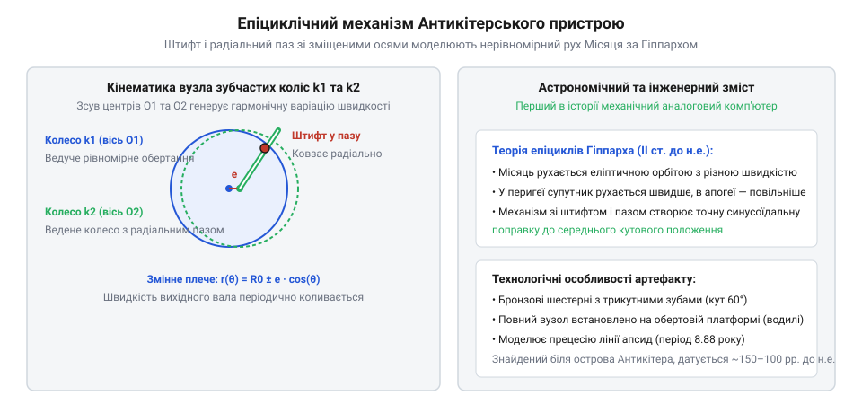
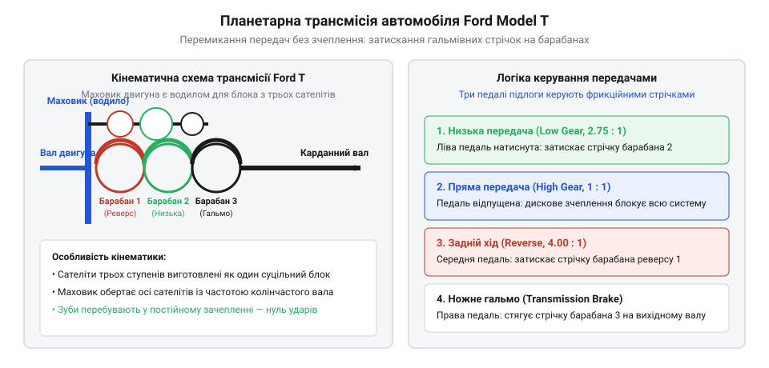

# Планетарний редуктор

<preknowlist>
- [Планетарний редуктор](root:hw-motion/planetary-gearbox) — загальна будова та кінематика планетарного ряду
</preknowlist>

1 | важливість: висока | Антикітерський механізм та диференціальне епіциклічне передавання в астрономічних приладах давнини. Розглядається знахідка біля острова Антикітера (прибл. 150–100 рр. до н.е.) та реконструкція зубчастої передачі Майклом Райтом і командою AMRP. Аналізується епіциклічний механізм із пальцем і пазом для моделювання нерівномірного аномалістичного руху Місяця за теорією Гіппарха та перший відомий в історії диференціальний ряд шестерень.

## Антикітерський механізм та диференціальне епіциклічне передавання в астрономічних приладах давнини

Уявлення про те, що планетарні та диференціальні зубчасті передачі є винаходом промислової революції XVIII–XIX століть, було повністю спростовано археологічними та рентгеноструктурними дослідженнями найвідомішого античного комп'ютера. У 1900–1901 роках грецькі ловці губок виявили біля узбережжя скелястого острова Антикітера затонулий римський торговий корабель I століття до нашої ери. Серед бронзових статуй та монет водолази підняли на поверхню безформні шматки кородованої бронзи, усередині яких просвічувалися контури тонких зубчастих коліс.

Більше півстоліття призначення Антикітерського механізму залишалося загадкою, породивши безліч псевдонаукових міфів про «недоречні артефакти» та невідомі втрачені цивілізації. Проте фундаментальні рентгенівські дослідження Дерека де Солла Прайса в 1970-х роках, робота куратора Лондонського музею науки Майкла Райта та подальше тривимірне мікрофокусне комп'ютерне сканування міжнародного проекту AMRP (Antikythera Mechanism Research Project, 2006 рік) остаточно довели: артефакт був надскладним портативним механічним календарем і астрономічним калькулятором, створеним приблизно між 150 та 100 роками до нашої ери еллінськими майстрами (традиція пов'язує його з астрономічною школою Архімеда або Посідонія та Гіппарха на острові Родос).


*Реконструкція епіциклічного місячного вузла Антикітерського механізму: шестерні k1 та k2 на зміщених осях з'єднані повідцем зі штифтом і радіальним пазом, відтворюючи нерівномірну швидкість Місяця за Кеплером і Гіппархом.*

Найбільш революційним вузлом приладу виявився задній епіциклічний каскад, який моделював видимий рух Місяця. За першим законом Кеплера Місяць рухається навколо Землі по еліптичній орбіті, тому його видима кутова швидкість на небосхилі постійно коливається: він прискорюється в перигеї і сповільнюється в апогеї (так звана перша місячна аномалія з періодом аномалістичного місяця приблизно `27.55` діб). За півтори тисячі років до Кеплера видатний астроном Гіппарх Нікейський математично описав цю нерівномірність за допомогою моделі ексцентрика та малого епіцикла.

Античні механіки зуміли втілити геометрію Гіппарха в бронзі за допомогою геніального кінематичного прийому:
1. Дві бронзові шестерні з однаковою кількістю зубів (`Z = 50`) були змонтовані на паралельних осях, зміщених одна відносно одної на крихітну відстань ексцентриситету `e ≈ 1.1 мм`.
2. Нижня шестерня приводилася в обертання від сонячного приводу й несла на своєму торці штифт (палець).
3. Верхня шестерня мала на своєму тілі відкритий радіальний паз, у який вільно входив штифт нижньої шестерні.
4. Обидва колеса були встановлені на великому обертовому бронзовому диску-водилі, що здійснював повний оберт за 9 років (період прецесії місячного апогею).

Під час обертання водила штифт ковзав уздовж паза на змінному радіусі, періодично випереджаючи або затримуючи ведену шестерню:

```
ω_moon(t)
= ω_mean + Δω · sin(ω_anom · t)   [синусоїдальна модуляція швидкості Місяця через штифтово-пазовий механізм]
```

Це найдавніший задокументований зразок епіциклічної зубчастої передачі в історії людства.

Окрім штифтово-пазового модулятора, механізм містив повноцінний конічний диференціал. Він складався з двох обертових коронних шестерень і проміжного малого сателіта на рухомому водилі. Цей диференціал механічно віднімав кутову швидкість Сонця від кутової швидкості Місяця:

```
θ_synodic
= θ_moon - θ_sun                 [механічне віднімання кутів диференціалом для відображення фаз Місяця]
```

Результат виводився безпосередньо на мініатюрну обертову двоколірну кульку на передній панелі, яка демонструвала поточну фазу Місяця (молодик, перша чверть, повня) та розраховувала сонячні й місячні затемнення за сароським циклом (223 синодичні місяці).

> 🔧 **Навіщо це.**
> Антикітерський механізм наочно демонструє, що планетарний принцип зародився не як силовий редуктор для помноження крутного моменту, а як аналоговий обчислювач для точного додавання та віднімання швидкостей у диференціальних рівняннях небесної механіки.

Після падіння античної цивілізації традиція виготовлення складних епіциклічних передач була тимчасово втрачена в Європі, проте збереглася в наукових центрах ісламського світу. Уже в IX–XI століттях брати Бану Муса в Багдаді та енциклопедист Аль-Біруні створювали диференціальні зубчасті календарі, звідки через арабську Іспанію та Візантію знання повернулися до середньовічної Європи, заклавши підґрунтя для астрономічних годинників епохи Відродження.

### Збереження традиції в ісламському світі: зубчастий календар Аль-Біруні

Довгий час в історіографії панувало хибне переконання, що після загибелі Римської імперії технологія складних зубчастих передач зникла на понад тисячу років і була винайдена заново європейськими годинникарями в XIV столітті. Проте наукові знахідки східних рукописів доводять існування неперервної спадкоємності.

Головним мостом передачі античних механічних знань став золотий вік ісламської науки. У IX столітті в багдадському «Будинку мудрості» брати Бану Муса створили низку автоматичних гідравлічних і зубчастих регуляторів, описаних у фундаментальній «Книзі про дотепні пристрої» (Кітаб аль-Хіял). Найбільш вражаючим розвитком епіциклічного принципу став механічний місячно-сонячний календар видатного хорезмського вченого-енциклопедиста Абу Райхана аль-Біруні, створений близько 1000 року нашої ери.

У своєму астрономічному трактаті Аль-Біруні наводить детальні креслення коробки з вісьмома зубчастими колесами. Центральна вісь приводилася вручну й через зубчасті пари з передавальними числами, розрахованими за періодами Метонового циклу (19 сонячних років = 235 синодичних місяців), рухала вказівники небесних світил. Конструкція містила зубчасті колеса з 19, 59 та іншими нетривіальними числами зубів, змонтовані на рухомому водилі. Ця передача працювала як епіциклічний редуктор, що з високою математичною точністю підсумовував кутові координати Сонця та Місяця без нагромадження похибки.

З ісламських наукових центрів Середньої Азії, Персії та андалуської Іспанії (рукописи Аль-Мураді XI ст. у Кордобі) креслення та принципи розрахунку диференціальних і планетарних передач потрапили до середньовічних університетів Північної Італії та Франції, ставши прямим інженерним підґрунтям для створення перших європейських астрономічних годинників.

## Від середньовічних астраріумів до промислової революції: сонячно-планетарна передача Джеймса Ватта

2 | важливість: висока | Від середньовічних астраріумів до промислової революції: сонячно-планетарна передача Джеймса Ватта. Розглядається відродження епіциклічних механізмів у планетаріях Джованні Донді та розробка сонячно-планетарної передачі Джеймсом Ваттом у 1781 році для обходу патенту Джеймса Піккарда на кривошипно-шатунний механізм. Пояснюється, чому планетарний ряд дозволив подвоїти швидкість обертання вала парової машини за один хід поршня.

## Від середньовічних астраріумів до промислової революції: сонячно-планетарна передача Джеймса Ватта

Після тривалого занепаду знання про епіциклічні передачі відродилися в XIV столітті в Північній Італії. У 1364 році професор астрономії та медицини Падуанського університету Джованні Донді завершив будівництво свого шедевра — Астраріума (Astrarium). Цей семигранний годинниковий механізм містив десятки бронзових зубчастих коліс, включно з овальними шестернями та рухомими епіциклами, що з високою точністю моделювали нерівномірні орбіти відомих на той час планет. Проте протягом століть епіцикли залишалися винятково прерогативою астрономічних приладів та баштових годинників, не маючи жодного застосування у важкій механічній роботі.

Справжній прорив планетарних передач у промисловість відбувся наприкінці XVIII століття в розпал промислової революції в Англії. У 1770-х роках видатний шотландський інженер Джеймс Ватт успішно вдосконалив парову машину Ньюкомена, створивши ізольований конденсатор пари. Проте парова машина Ватта була насосною установкою з коромислом (балансиром): вона здійснювала лише зворотно-поступальний вертикальний рух і не могла обертати верстати, повітродувки чи прядильні машини на фабриках.

Ватту був необхідний надійний механізм перетворення коливального руху балансира в неперервний обертальний рух маховика. Найпростішим і найочевиднішим рішенням був звичайний колінчастий вал (кривошип). Проте в 1780 році конкуруючий винахідник Джеймс Піккард запатентував застосування кривошипа для парових двигунів (британський патент № 1263). Піккард вимагав від Ватта грабіжницьких ліцензійних відрахувань. Ватт категорично відмовився платити, заявивши, що не купуватиме права на те, що вважає загальновідомим принципом.

Щоб обійти патентне блокування, Джеймс Ватт разом зі своїм геніальним помічником Вільямом Мердоком розробив принципово нову силову кінематичну схему — сонячно-планетарну передачу (Sun and Planet Gear), яку Ватт запатентував у 1781 році (патент № 1306).

Механізм складався з двох шестерень однакового діаметра:
- Центральне «сонячне» колесо було жорстко насаджене на вал вихідного маховика парової машини.
- Проміжне «планетарне» колесо було жорстко прикріплене (не на вільному підшипнику, а жорстко зафіксоване болтами) до нижнього кінця довгого шатуна, що спускався від балансира.
- Осі коліс утримувалися на сталій міжосьовій відстані рухомою металевою тягою або напрямним півкільцем.

Оскільки планетарне колесо було жорстко зв'язане з шатуном, воно не могло вільно обертатися навколо своєї осі, а лише здійснювало переносний рух по колу навколо сонячного колеса. Це породило унікальний кінематичний ефект: за один повний хід поршня вгору та вниз (один подвійний рух шатуна) сонячне колесо здійснювало не один оберт, як зі звичайним кривошипом, а рівно ДВА повних оберти:

```
n_sun
= 2 · n_stroke                   [подвоєння обертів вихідного вала парової машини Ватта]
```

Це подвоєння обертів виявилося колосальною перевагою: повільні парові двигуни того часу (15–25 ходів на хвилину) отримали вихідну швидкість вала 30–50 об/хв, що дозволило безпосередньо приводити текстильні верстати без додаткових проміжних редукторів. Ватт успішно будував машини з сонячно-планетарною передачею до 1800 року, поки не закінчився термін дії патенту Піккарда
### Динаміка та нерівномірність обертання: шестерня Ватта проти кривошипа Піккарда

Поряд із подвоєнням вихідної частоти обертання планетарне рішення Ватта мало важливу динамічну особливість. У звичайному кривошипно-шатунному механізмі Піккарда крутний момент на валу маховика двічі за один оберт падає до нуля у «мертвих точках», вимагаючи масивного чавунного колеса для подолання зупинки. У механізмі Ватта планетарна шестерня обкочує сонце по складній епітрохоїдній траєкторії: це змінювало миттєве плече прикладання сили шатуна, роблячи криву передачі крутного моменту дещо більш згладженою, але створювало додаткові високочастотні пульсації на зубах. Проте технологічні труднощі виготовлення литих шестерень великого діаметра з неточним профілем зуба за умов тогочасного чавуноливарного виробництва призводили до сильного гуркоту й вібрацій, що змусило промисловість повернутися до кривошипа, щойно патентне обмеження було знято.

.
### Від стрічкових гальм до автоматичних трансмісій Simpson

Концепція керування планетарним рядом через фрикційне гальмування барабанів виявилася настільки життєздатною, що визначила архітектуру класичних гідромеханічних автоматів на наступні пів століття. Стрічкові гальма Ford Model T з ручним педальним приводом у 1940–1950-х роках були замінені гідравлічними поршнями (сервоприводами) та багатодисковими «мокрими» зчепленнями. У трансмісіях родини Simpson (два однакових планетарних ряди зі спільним сонячним колесом) поєднання гальмівної стрічки для блокування коронного колеса першої передачі та багатодискових муфт для блокування водила дозволило реалізувати три передачі вперед та одну назад автоматично під тиском оливи, зберігаючи головний принцип Ford: безперервність передачі моменту без розриву потоку потужності.

## Планетарна трансмісія Ford Model T та народження сучасних автоматичних коробок передач

На початку XX століття вибуховий розвиток автомобілебудування поставив перед конструкторами критичну проблему: керування механічною трансмісією. Тогочасні автомобілі комплектувалися коробками передач із ковзними прямозубими шестернями (crash gearbox) та сухим зчепленням. Перемикання передач вимагало віртуозного вміння відчувати кутові швидкості валів, підгазовувати та виконувати «подвійний вижим зчеплення». Найменша помилка недосвідченого водія супроводжувалася скреготом металу і виламуванням зубів шестерень.

Генрі Форд, створюючи свій знаменитий народний автомобіль Ford Model T (1908 рік), розумів: машина для мільйонів фермерів і містян повинна мати гранично просте та безвідмовне керування, за якого зламати коробку передач фізично неможливо. Розв'язком стала триланкова двоетапна планетарна коробка передач.


*Кінематична схема планетарної коробки Ford Model T: потрійні сателіти на маховику-водилі та три незалежні гальмівні стрічки керування передачами (низька, реверс, гальмо) без використання зчеплення.*

Конструкція трансмісії Ford Model T геніально об'єднувала маховик двигуна та планетарний редуктор в один компактний блок:
- Масивний маховик двигуна одночасно виконував роль водила, на якому були встановлені три комплекти потрійних блоків сателітів (кожен блок містив три жорстко зблоковані вінці з числами зубів 27, 33 і 24).
- Сателіти постійно перебували в зачепленні з трьома сонячними шестернями різного діаметра, кожна з яких була жорстко з'єднана зі своїм зовнішнім концентричним гальмівним барабаном.
- Навколо кожного барабана була встановлена гнучка гальмівна стрічка з азбестовим фрикційним полотном, з'єднана з відповідною педаллю на підлозі автомобіля.

Керування здійснювалося трьома ножними педалями без класичного важеля куліси:
1. Низька передача (Low gear, `i = 2.75:1`): водій витискав ліву педаль у підлогу, затягуючи стрічку на барабані низької передачі. Барабан і його сонячне колесо зупинялися на корпусі, сателіти починали обкочуватися навколо нього, сповільнюючи обертання вихідного вала й передаючи високий момент на колеса.
2. Пряма передача (High gear, `i = 1:1`): водій відпускав ліву педаль. Важіль ручного гальма відпускав стрічки й замикав багатодискове мокре зчеплення, блокуючи маховик безпосередньо з вихідним карданним валом. Увесь планетарний ряд обертався як єдиний монолітний маховик без взаємного руху зубів, що забезпечувало ККД близький до 100% і тишу під час руху.
3. Задній хід (Reverse): водій натискав середню педаль, яка затягувала стрічку реверсивного барабана. Зупинка іншого сонячного вінця викликала обертання вихідного вала у зворотний бік.
4. Права педаль діяла на третій барабан і служила робочим гальмом автомобіля.

> 🔧 **Навіщо це.**
> Планетарна коробка Ford Model T дозволила перемикати режими під повним навантаженням без розриву потоку потужності та без загрози зрізати зуби шестерень.

Саме принцип затискання гальмівних стрічок та барабанів планетарних рядів, доведений до досконалості на 15 мільйонах екземплярів Ford Model T, став фундаментальною основою перших масових автоматичних гідромеханічних трансмісій GM Hydra-Matic у 1939 році та залишається базовим принципом сучасних багатоступеневих коробок автоматів.
