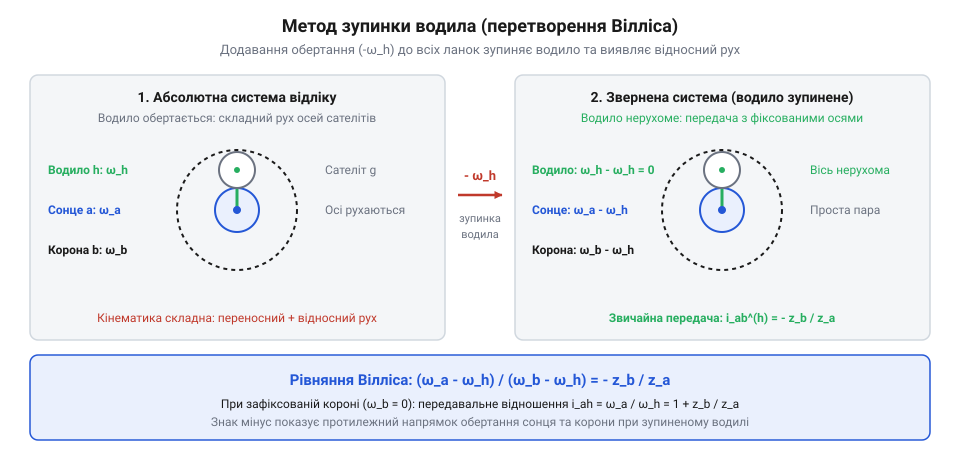
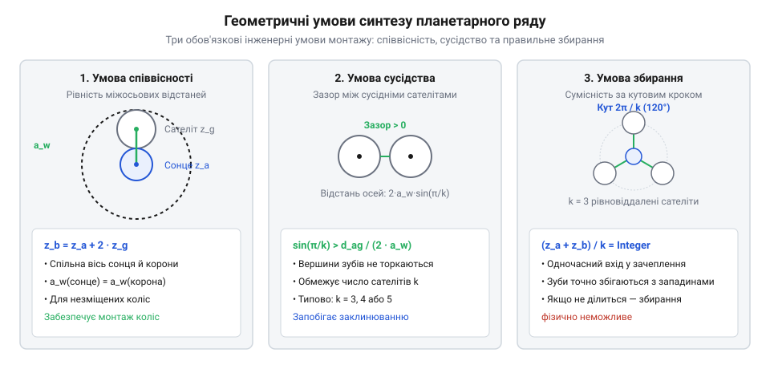

# Планетарний редуктор

<preknowlist>
- [Редуктори](root:hw-motion/gears-transmission) — передавальне відношення та геометрія зубчастого зачеплення
</preknowlist>

1 | важливість: висока | Метод зупинки водила та аналітичне виведення формули Вілліса для триланкового планетарного ряду. Читач на вході знає передавальне відношення звичайних шестерень, але стикається зі складним рухом сателітів із рухомими осями. Розглядається перехід у систему відліку водила з накладанням швидкості -ω_H, що зупиняє водило й зводить задачу до ряду з нерухомими осями. Виводиться базова формула Вілліса (ω_a - ω_H) / (ω_b - ω_H) = - Z_b / Z_a. На виході читач вміє аналітично складати кінематичні рівняння для відносного руху ланок.

## Метод зупинки водила та аналітичне виведення формули Вілліса для триланкового планетарного ряду

У звичайній зубчастій передачі осі всіх коліс зафіксовані в нерухомому корпусі, тому кутова швидкість обчислюється тривіально через відношення радіусів початкових кіл або кількості зубів. Але щойно осі зубчастих коліс встановлюються на обертову деталь — водило, як у планетарному механізмі — рух проміжних коліс (сателітів) стає складеним: сателіт одночасно обертається навколо власної осі та рухається по колу разом із водилом. Спроба розрахувати такий рух безпосередньо в абсолютній нерухомій системі координат призводить до громіздких векторних рівнянь з багатьма невідомими траєкторіями зачеплення.

Щоб позбутися складного переносного руху рухомих осей, застосовують кінематичний прийом Роберта Вілліса — метод зупинки водила (метод редукції або накладання уявного руху). За принципом кінематичної інваріантності взаємного зачеплення, якщо всій механічній системі надати додаткового обертання з кутовою швидкістю `-ω_H`, де `ω_H` — кутова швидкість водила, взаємні лінійні та кутові швидкості ланок і сили взаємодії в зубчастих контактах не зміняться. Проте для спостерігача в такій обертовій системі відліку водило зупиняється.

> 🔧 **Навіщо це.**
> Зупинка водила перетворює планетарну систему з рухомими осями на звичайну зубчасту передачу з нерухомими осями (редукований механізм). Це дозволяє застосовувати класичні формули передавальних відношень простих зубчастих рядів, не розв'язуючи диференціальні рівняння траєкторій епіциклоїд.


*Кінематична схема розкладання руху триланкового планетарного ряду 2K-H: ліворуч — абсолютна система відліку з рухомими осями сателітів; праворуч — редукована система відліку зупиненого водила після накладання швидкості -ω_H.*

Розглянемо базовий триланковий планетарний ряд типу 2K-H, який складається із центрального сонячного колеса `a` із зовнішніми зубами `Z_a`, опорного або вихідного коронного колеса `b` із внутрішніми зубами `Z_b`, водила `H` та одного чи кількох сателітів `g` із кількістю зубів `Z_g`.

Позначимо абсолютні кутові швидкості сонячного колеса, коронного колеса та водила відповідно як `ω_a`, `ω_b` та `ω_H`.

Після переходу в систему відліку, жорстко зв'язану з водилом, відносні кутові швидкості ланок визначаються шляхом віднімання вектора кутової швидкості водила:

```
ω_H^(H)
= ω_H - ω_H                      [накладання уявного зворотного обертання -ω_H на водило]
= 0                              [водило нерухоме в системі відліку H]

ω_a^(H)
= ω_a - ω_H                      [відносна кутова швидкість сонячного колеса відносно водила]

ω_b^(H)
= ω_b - ω_H                      [відносна кутова швидкість коронного колеса відносно водила]
```

Оскільки в цій системі відліку геометричні осі коліс `a`, `b` та сателітів `g` зафіксовані в просторі, передача працює як звичайний співвісний зубчастий ряд із нерухомими осями. Відношення відносних кутових швидкостей сонця `a` та коронної шестерні `b` дорівнює передавальному відношенню редукованого механізму `i_ab^(H)`:

```
i_ab^(H)
= ω_a^(H) / ω_b^(H)              [визначення передавального відношення в системі відліку водила]
= (ω_a - ω_H) / (ω_b - ω_H)      [підстановка відносних кутових швидкостей ланок]
```

Для визначення числового значення `i_ab^(H)` простежимо зачеплення в нерухомому ряду від сонячного колеса `a` до коронного колеса `b` через сателіт `g`.
Зачеплення між сонячним колесом `a` (зовнішні зуби) і сателітом `g` (зовнішні зуби) є зовнішнім: напрямки обертання коліс протилежні, тому передавальне відношення має знак «мінус»: `i_ag^(H) = - Z_g / Z_a`.

Зачеплення між сателітом `g` (зовнішні зуби) і коронним колесом `b` (внутрішні зуби) є внутрішнім: напрямки обертання сателіта й коронного колеса збігаються, тому знак «плюс»: `i_gb^(H) = + Z_b / Z_g`.

Загальне передавальне відношення ряду з послідовним зачепленням дорівнює добутку передавальних відношень ступенів:

```
i_ab^(H)
= i_ag^(H) · i_gb^(H)            [теорема про передавальне відношення послідовного ряду шестерень]
= (- Z_g / Z_a) · (+ Z_b / Z_g)  [підстановка передавальних чисел зовнішнього та внутрішнього зачеплень]
= - Z_b / Z_a                    [скорочення числа зубів сателіта Z_g]
```

Кількість зубів сателіта `Z_g` повністю скорочується і не впливає на кінематичне відношення між сонячним і коронним колесами — сателіт виконує роль проміжного паразитного колеса, що забезпечує лише геометричний зв'язок та передачу моменту.

Прирівнюючи кінематичний вираз до геометричного співвідношення зубів, одержуємо класичне аналітичне рівняння Вілліса для планетарного ряду 2K-H:

```
(ω_a - ω_H) / (ω_b - ω_H)
= - Z_b / Z_a                    [базове рівняння Вілліса для триланкового планетарного ряду]
```

Знак «мінус» у правій частині рівняння є критично важливим: він вказує на те, що в системі відліку нерухомого водила сонячне і коронне колеса обертаються в протилежних напрямках. Це фундаментальне рівняння зв'язує три кінематичні змінні (`ω_a`, `ω_b`, `ω_H`) з геометрією передачі й дозволяє обчислити швидкість будь-якої ланки, якщо задано швидкості двох інших (диференціальний режим), або знайти передавальне число за умови фіксації однієї з ланок.

### Кінематичний аналіз методом планів лінійних швидкостей

Поряд з аналітичним методом Вілліса для глибокого фізичного розуміння розподілу швидкостей у зачепленні застосовують графічний метод планів лінійних швидкостей. Він базується на теоремах кінематики плоского руху твердого тіла та дозволяє безпосередньо визначити вектор швидкості будь-якої точки сателіта, не вдаючись до формальних алгебричних перетворень.

Розглянемо радіальний переріз планетарного ряду вздовж осі одного із сателітів. Позначимо на лінії центрів три ключові геометричні точки:
- Точка `A` — полюс зачеплення між зовнішніми зубами сонячного колеса та сателітом на радіусі початкового кола `r_a = d_a / 2`.
- Точка `B` — полюс зачеплення між сателітом та внутрішніми зубами коронного колеса на радіусі `r_b = d_b / 2`.
- Точка `C` (або `H`) — геометричний центр осі сателіта, що закріплена на водилі на радіусі розташування осей `a_w = (r_a + r_b) / 2`.

Оскільки відрізок `AB` є діаметром початкового кола сателіта довжиною `2 · r_g = r_b - r_a`, геометричний центр осі сателіта `C` лежить рівно посередині між полюсами зачеплення: `AC = CB = r_g`.

Розглянемо випадок нерухомого коронного колеса (`ω_b = 0`). Оскільки коронне колесо нерухоме відносно корпусу, лінійна швидкість матеріальної точки корони в полюсі зачеплення дорівнює нулю. За умови відсутності проковзування зубів у зачепленні, колові швидкості спряжених профілів у полюсі рівні. Це означає, що миттєва швидкість точки `B` на ободі сателіта також дорівнює нулю:

```
v_B
= 0                              [точка контакту сателіта з нерухомою короною є миттєвим центром швидкостей]
```

Таким чином, у системі відліку корпусу точка `B` є миттєвим центром швидкостей (МЦШ) сателіта. Усі точки сателіта в даний момент часу здійснюють суто обертальний рух навколо нерухомого полюса `B` з миттєвою кутовою швидкістю `ω_sat`.

Колова швидкість точки `A` на контакті із сонячним колесом задається обертанням сонця:

```
v_A
= ω_a · r_a                      [лінійна колова швидкість полюса зачеплення сонячного колеса]
```

З іншого боку, оскільки точка `B` є МЦШ сателіта, лінійна швидкість точки `A` визначається обертанням усього тіла сателіта навколо точки `B` на плечі, рівному повному діаметру сателіта `2 · r_g`:

```
v_A
= ω_sat · (2 · r_g)              [лінійна швидкість через кутову швидкість сателіта відносно МЦШ]
```

Центр осі сателіта `C`, через який передається рух на водило `H`, віддалений від МЦШ `B` на відстань одного радіуса сателіта `r_g`. Відповідно, його лінійна швидкість дорівнює:

```
v_H
= v_C                            [швидкість осі сателіта дорівнює швидкості точки водила]
= ω_sat · r_g                    [обертання навколо МЦШ на плечі радіуса сателіта]
= v_A / 2                        [лінійна швидкість осі сателіта становить рівно половину швидкості сонця]
```

Оскільки вісь сателіта жорстко сидить на водилі й рухається по колу радіуса `a_w = (r_a + r_b) / 2` з кутовою швидкістю водила `ω_H`, запишемо вираз для її лінійної швидкості через параметри водила:

```
v_H
= ω_H · a_w                      [лінійна швидкість точки водила через кутову швидкість водила]
= ω_H · (r_a + r_b) / 2          [підстановка радіуса розташування осей водила]
```

Прирівнюючи два незалежні вирази для швидкості `v_H`, отримуємо пряме геометричне співвідношення:

```
ω_H · (r_a + r_b) / 2
= (ω_a · r_a) / 2                [прирівнювання швидкості осі сателіта через параметри сонця і водила]

ω_H · (r_a + r_b)
= ω_a · r_a                      [множення обох частин на 2]

ω_a / ω_H
= (r_a + r_b) / r_a              [вираження кінематичного відношення швидкостей]
= 1 + (r_b / r_a)                [почленне ділення чисельника на радіус сонця]
= 1 + (Z_b / Z_a)                [перехід від початкових радіусів до кількості зубів коліс]
```

Графічний метод планів швидкостей дає абсолютно такий самий результат `i_aH^b = 1 + Z_b / Z_a`, як і аналітична формула Вілліса, але наочно розкриває механіку процесу: сателіт працює як важіль другого роду, де точкою опори є полюс нерухомої корони `B`, точка прикладання рушійної сили — контакт із сонцем `A` з плечем `2 · r_g`, а точка корисного навантаження — вісь водила `C` з плечем `r_g`. Саме подвійне плече важеля геометрично забезпечує двократне зменшення лінійної швидкості осі порівняно з ободом сонячного колеса.

3 | важливість: середня | Інженерні умови геометричного синтезу планетарної передачі: співвісність, сусідство та збирання для k сателітів. Читач на вході розрахував кінематику, але повинен фізично зібрати механізм із кількома сателітами. Виводяться аналітичні умови: співвісності (Z_a + 2·Z_g = Z_b для нульових коліс), сусідства (sin(π/k) > (d_a,g / (d_a + d_g))) для виключення контакту вершин суміжних сателітів та умова збирання ((Z_a + Z_b) / k = ціле число) для рівномірного кроку сателітів. На виході читач синтезує працездатний багатосателітний ряд без заклинювання.

## Три класичні кінематичні конфігурації: передавальні числа при фіксації коронного колеса, сонця або водила

2 | важливість: висока | Три класичні кінематичні конфігурації: передавальні числа при фіксації коронного колеса, сонця або водила. Читач на вході має формулу Вілліса. Розбираються три робочі режими: 1) нерухоме коронне колесо (ω_b = 0, сонце на вході, водило на виході: i_aH = 1 + Z_b/Z_a); 2) нерухоме сонячне колесо (ω_a = 0, коронна шестерня на вході, водило на виході: i_bH = 1 + Z_a/Z_b); 3) нерухоме водило (ω_H = 0, робота як звичайна передача зі зміною знака обертання i_ab = - Z_b/Z_a). На виході читач обирає оптимальну схему під задане передавальне число.

## Три класичні кінематичні конфігурації: передавальні числа при фіксації коронного колеса, сонця або водила

Рівняння Вілліса зв'язує три рухомі ланки планетарного ряду. Якщо всі три ланки залишаються вільними, механізм має два ступені вільності й працює як диференціал, підсумовуючи або розгалужуючи потоки потужності. Щоб перетворити диференціал на редуктор з однозначним передавальним числом і одним ступенем вільності, необхідно накласти механічний зв'язок — закріпити одну з трьох ланок на корпусі передачі.

Вибір закріпленої ланки та розподіл функцій ведучого й веденого валів визначає кінематичну конфігурацію, діапазон передавального числа, ККД та напрямок обертання вихідного вала.

> 🔧 **Навіщо це.**
> З одного й того самого комплекту зубчастих коліс планетарного ряду можна отримати три принципово різні передавальні числа і навіть змінити напрямок обертання на протилежний, лише змінивши точку фіксації до нерухомого корпусу.

Перша і найбільш поширена конфігурація — редуктор із нерухомим коронним колесом (`ω_b = 0`). Вхідний вал двигуна з'єднується з центральним сонячним колесом `a`, а вихідний вал механізму — з водилом `H`. Підставимо умову нерухомості коронного колеса в базове рівняння Вілліса:

```
(ω_a - ω_H) / (0 - ω_H)
= - Z_b / Z_a                    [підстановка умови ω_b = 0 у рівняння Вілліса]

(ω_a - ω_H) / (- ω_H)
= - Z_b / Z_a                    [спрощення знаменника]

- (ω_a / ω_H) + 1
= - Z_b / Z_a                    [почленне ділення лівої частини]

ω_a / ω_H
= 1 + Z_b / Z_a                  [перенесення одиниці та множення на -1]
```

Кінематичне передавальне відношення від сонячного колеса до водила `i_aH^b` дорівнює:

```
i_aH^b
= ω_a / ω_H                      [визначення передавального відношення редуктора]
= 1 + Z_b / Z_a                  [аналітична формула редукції при зафіксованій короні]
```

Оскільки кількість зубів є строго додатним числом, передавальне відношення завжди строго більше одиниці (`i_aH^b > 1`), а знак «плюс» свідчить про те, що сонячне колесо і водило обертаються в одному напрямку. Для одного ступеня типове співвідношення зубів `Z_b / Z_a` становить від 2 до 9, що забезпечує компактну редукцію від 3:1 до 10:1 із високим ККД (до 97–98%).

Друга конфігурація — редуктор із нерухомим сонячним колесом (`ω_a = 0`). Вхідний крутний момент подається на коронне колесо `b`, а вихід знімається з водила `H`. Підставимо умову `ω_a = 0` у рівняння Вілліса:

```
(0 - ω_H) / (ω_b - ω_H)
= - Z_b / Z_a                    [підстановка умови ω_a = 0 у рівняння Вілліса]

- ω_H / (ω_b - ω_H)
= - Z_b / Z_a                    [спрощення чисельника]

(ω_b - ω_H) / ω_H
= Z_a / Z_b                      [взяття оберненого дробу з обох боків]

(ω_b / ω_H) - 1
= Z_a / Z_b                      [почленне ділення лівої частини]

ω_b / ω_H
= 1 + Z_a / Z_b                  [перенесення одиниці в праву частину]
```

Передавальне число `i_bH^a` при вході на коронне колесо та зафіксованому сонці:

```
i_bH^a
= ω_b / ω_H                      [визначення передавального відношення від корони до водила]
= 1 + Z_a / Z_b                  [аналітична формула при зафіксованому сонці]
```

Оскільки в зовнішньому ряду діаметр корони завжди більший за діаметр сонця (`Z_b > Z_a`), дріб `Z_a / Z_b` завжди менший за одиницю (`Z_a / Z_b < 1`). Відповідно, передавальне число лежить у вузькому діапазоні від 1.1 до 1.5. Ця схема рідко використовується як знижувальний редуктор через малий коефіцієнт зниження швидкості, але знаходить застосування в мультиплікаторах або точних вимірювальних пристроях.

Третя конфігурація — режим із нерухомим водилом (`ω_H = 0`). Осі сателітів зупинені відносно корпусу, тому механізм вироджується у звичайну передачу з нерухомими осями. Підставляючи `ω_H = 0` у рівняння Вілліса:

```
(ω_a - 0) / (ω_b - 0)
= - Z_b / Z_a                    [підстановка умови нерухомого водила ω_H = 0]

i_ab^H
= ω_a / ω_b                      [визначення передавального відношення між сонцем і короною]
= - Z_b / Z_a                    [передавальне число звичайної передачі зі зміною знака]
```

У цій конфігурації передача інвертує напрямок обертання: вихідний вал (корона) обертається у зворотний бік відносно вхідного вала (сонця). Сателіти при цьому працюють як проміжні паразитні шестерні, що передають обертання між колесами зовнішнього і внутрішнього зачеплення без зміни осі обертання в просторі.

### Силовий баланс, крутні моменти та коефіцієнт корисної дії (ККД)

Для повного динамічного проектування приводу кінематичного розрахунку недостатньо: необхідно визначити внутрішні крутні моменти на валах та втрати потужності в зачепленні для кожної схеми фіксації. Розподіл сил у планетарному ряді підпорядковується фундаментальним законам статики та термодинаміки.

У сталому режимі обертання без кутового прискорення сума всіх зовнішніх крутних моментів, прикладених до трьох ланок планетарного механізму, повинна дорівнювати нулю за рівнянням рівноваги моментів:

```
T_a + T_b + T_H
= 0                              [рівняння статичної рівноваги крутних моментів планетарного ряду]
```

Це означає, що реактивний опорний момент на нерухомій ланці завжди замикає баланс між вхідним крутним моментом двигуна та вихідним корисним навантаженням: `T_fixed = - (T_in + T_out)`.

Розглянемо коефіцієнт корисної дії (ККД) трьох базових конфігурацій. Втрати потужності в планетарному ряді зумовлені переважно тертям кочення й ковзання в зубчастих контактах «сонце–сателіт» та «сателіт–корона». Позначимо через `η_0` базовий ККД редукованого механізму із зупиненим водилом (типово `η_0 = 0.96...0.97` для якісно відшліфованих коліс).

Для першої схеми (нерухома корона `b`, вхід на сонці `a`, вихід на водилі `H`) передаваний момент на вихідному валу збільшується пропорційно передавальному відношенню:

```
T_H
= - T_a · i_aH^b · η_aH^b        [зв'язок вихідного та вхідного моментів через ККД ступеня]
```

Особливістю планетарної передачі є те, що втрати на тертя в зачепленні виникають не на повну передавану потужність, а лише на ту її частину, яка передається відносним рухом коліс. Розрахунок аналітичного ККД за методом Шульца показує:

```
η_aH^b
= 1 - (1 - η_0) · (Z_b / (Z_a + Z_b))  [аналітична формула ККД схеми із закріпленим коронним колесом]
```

Оскільки геометричний дріб `Z_b / (Z_a + Z_b)` завжди строго менший за одиницю, ККД планетарного редуктора виявляється вищим за базовий ККД звичайного зубчастого ряду! Наприклад, при `η_0 = 0.97`, `Z_a = 20`, `Z_b = 80`:

```
η_aH^b
= 1 - (1 - 0.97) · (80 / (20 + 80))
= 1 - 0.03 · 0.8
= 1 - 0.024
= 0.976                          [ККД планетарного ступеня вищий за ККД простої пари коліс]
```

Для другої схеми (нерухоме сонце `a`, вхід на короні `b`, вихід на водилі `H`) частка потужності відносного руху ще менша, оскільки вона визначається малим сонячним колесом:

```
η_bH^a
= 1 - (1 - η_0) · (Z_a / (Z_a + Z_b))  [аналітична формула ККД схеми із закріпленим сонячним колесом]
```

Оскільки `Z_a / (Z_a + Z_b) ≈ 0.15...0.25`, втрати на тертя мінімальні, а розрахунковий ККД досягає `98.5–99.2%`. Проте через мале передавальне число цей високий ККД реалізується лише за незначної зміни швидкості.

Для третьої схеми (нерухоме водило `H`, звичайна передача) вся потужність безпосередньо передається через зубчасті зачеплення з нерухомими осями:

```
η_ab^H
= η_0                            [ККД при нерухомому водилі дорівнює базовому ККД ряду]
```

ККД у цьому режимі становить стандартні `96–97%`. Крім того, на осі сателітів діють постійні змінні радіальні сили від зачеплення, що викликає підвищений нагрів підшипників водила порівняно з режимом диференціального саморозвантаження.

## Інженерні умови геометричного синтезу планетарної передачі: співвісність, сусідство та збирання для k сателітів

Простого кінематичного розрахунку недостатньо, щоб побудувати надійний механізм. Планетарна передача передає потужність через кілька паралельних сателітів (зазвичай `k = 3, 4` або `5`), що розвантажує зуби та підшипники. Проте встановлення кількох сателітів на спільне водило накладає жорсткі геометричні обмеження: колеса повинні мати спільну вісь обертання, суміжні сателіти не повинні чіплятися вершинами зубів, а зуби всіх сателітів мусять одночасно увійти в зачеплення із сонцем і короною без деформації та натягу.


*Геометричний синтез ряду 2K-H: умова співвісності міжосьових відстаней, умова сусідства вершин суміжних сателітів на водилі та кутова кратність зубів для одночасного складання k сателітів.*

Перша обов'язкова вимога — умова співвісності. Осі центрального сонячного колеса `a`, коронного колеса `b` та самого водила `H` повинні строго збігатися в просторі. Це означає, що міжосьова відстань у зовнішньому зачепленні пари «сонце–сателіт» `a_w,ag` має точно дорівнювати міжосьовій відстані у внутрішньому зачепленні пари «сателіт–корона» `a_w,gb`.

Для немодифікованих (нульових) коліс із модулем `m` виведемо геометричну рівність:

```
a_w,ag
= m · (Z_a + Z_g) / 2            [міжосьова відстань зовнішнього зачеплення сонце-сателіт]

a_w,gb
= m · (Z_b - Z_g) / 2            [міжосьова відстань внутрішнього зачеплення сателіт-корона]

m · (Z_a + Z_g) / 2
= m · (Z_b - Z_g) / 2            [прирівнювання міжосьових відстаней за умовою співвісності]

Z_a + Z_g
= Z_b - Z_g                      [скорочення спільного множника m / 2]

Z_b
= Z_a + 2 · Z_g                  [аналітична умова співвісності для нульових коліс]
```

Якщо це співвідношення не виконується, зібрати передачу без радіального перекосу неможливо. Якщо ж стандартні числа зубів не задовольняють рівність, інженери застосовують кутову корекцію профілю зубів (коефіцієнти зміщення `x_a`, `x_g`, `x_b`), штучно вирівнюючи робочі міжосьові відстані.

Друга вимога — умова сусідства. Щоб сателіти вільно оберталися на водилі, вершини їхніх зубів не повинні торкатися одна одної під час роботи. Мінімальна відстань між осями двох суміжних сателітів, розташованих симетрично на радіусі водила `a_w` із кутовим кроком `γ = 2 · π / k`, повинна перевищувати зовнішній діаметр вершин сателіта `d_a,g`:

```
L_centers
= 2 · a_w · sin(π / k)           [хордова відстань між осями двох суміжних сателітів на колі радіуса a_w]

2 · a_w · sin(π / k)
> d_a,g                          [умова вільного обертання без торкання вершин зубів]

sin(π / k)
> d_a,g / (2 · a_w)              [розв'язок відносно геометричних розмірів коліс]
```

Для прямозубих коліс без зміщення зовнішній діаметр сателіта дорівнює `d_a,g = m · (Z_g + 2)`, а міжосьова відстань `a_w = m · (Z_a + Z_g) / 2`. Підставляючи ці значення, отримуємо безрозмірний критерій сусідства:

```
sin(π / k)
> (Z_g + 2) / (Z_a + Z_g)        [аналітична умова сусідства для прямозубих коліс]
```

На практиці між вершинами зубів сусідніх сателітів завжди закладають конструктивний зазор не менше ніж `0.5 · m`, щоб запобігти гідродинамічному стисненню мастила та випадковому зіткненню при температурному розширенні.

Третя і найбільш тонка вимога — умова збирання. Якщо розмістити перший сателіт у западини між сонцем і короною, зубчасті вінці сонячного та коронного коліс виявляються взаємно зорієнтованими. Кутовий крок між сателітами становить `2 · π / k`. Щоб другий, третій та наступні сателіти одночасно увійшли в зачеплення без примусового провороту ланок, відносний кутовий зсув западин на сонячному і коронному колесах на куті `2 · π / k` повинен відповідати цілому числу кутових кроків зубів.

У системі відліку водила коронне колесо повертається відносно сонця на кут, пропорційний передавальному відношенню `i_ab^(H) = - Z_b / Z_a`. Підсумовуючи кутові зміщення для `k` однакових сателітів, одержуємо обов'язкову умову збирання:

```
(Z_a + Z_b) / k
= q                              [умова збирання планетарного ряду, де q — ціле число]
```

Якщо величина `(Z_a + Z_b) / k` є дробовою, рівномірно розташувати `k` сателітів по колу водила фізично неможливо — зуби наступного сателіта впиратимуться у вершини зубів коліс. У таких випадках конструкторам доводиться або змінювати кількість зубів центральних коліс, або застосовувати нерівномірне кутове розташування сателітів по водилу, що ускладнює балансування та викликає нерівномірні радіальні навантаження на підшипники.

### Наскрізний інженерний розрахунок геометричного синтезу передачі

Щоб закріпити отримані аналітичні залежності, виконаємо повний покроковий геометричний та кінематичний розрахунок реального планетарного ступеня для приводу робототехнічного суглоба.

Вихідні інженерні вимоги: передавальне число `i ≈ 6:1`, кількість сателітів `k = 3`, нормальний модуль зачеплення `m = 1.5 мм`. Обираємо число зубів сонячного колеса `Z_a = 18` та коронного колеса `Z_b = 90`.

Крок 1. Перевірка кінематичного передавального числа зафіксованої корони:

```
i_aH^b
= 1 + Z_b / Z_a                  [формула передавального відношення при нерухомій короні]
= 1 + 90 / 18                    [підстановка обраних чисел зубів]
= 1 + 5
= 6.0                            [ступінь забезпечує точне ціле передавальне число 6:1]
```

Крок 2. Розрахунок числа зубів сателіта за умовою співвісності:
З аналітичної умови співвісності для коліс без висотного зміщення (`Z_b = Z_a + 2 · Z_g`) виразимо необхідну кількість зубів сателіта `Z_g`:

```
Z_g
= (Z_b - Z_a) / 2                [визначення числа зубів сателіта з умови рівності міжосьових відстаней]
= (90 - 18) / 2                  [підстановка чисел зубів центральних коліс]
= 72 / 2
= 36                             [сателіт має рівно 36 зубів]
```

Перевіримо рівність міжосьових відстаней зовнішнього зачеплення «сонце–сателіт» та внутрішнього «сателіт–корона»:

```
a_w,ag
= m · (Z_a + Z_g) / 2
= 1.5 · (18 + 36) / 2
= 1.5 · 54 / 2
= 40.5 мм                        [міжосьова відстань пари сонце-сателіт]

a_w,gb
= m · (Z_b - Z_g) / 2
= 1.5 · (90 - 36) / 2
= 1.5 · 54 / 2
= 40.5 мм                        [міжосьова відстань пари сателіт-корона]
```

Обидві міжосьові відстані строго рівні `40.5 мм`, що гарантує співвісність без потреби застосування кутової корекції профілю.

Крок 3. Перевірка умови сусідства для трьох сателітів (`k = 3`):
Кутовий крок між осями сателітів на водилі дорівнює `γ = 360° / 3 = 120°`. Обчислимо хордову відстань між центрами двох сусідніх сателітів:

```
L_centers
= 2 · a_w · sin(π / 3)           [хордова відстань між суміжними сателітами при k=3]
= 2 · 40.5 · (√3 / 2)
= 40.5 · 1.73205
= 70.15 мм                       [відстань між осями сателітів у просторі]
```

Зовнішній діаметр вершин зубів прямозубого сателіта дорівнює:

```
d_a,g
= m · (Z_g + 2)
= 1.5 · (36 + 2)
= 1.5 · 38
= 57.0 мм                        [діаметр кола вершин зубів сателіта]
```

Мінімальний зазор між вершинами зубів двох сусідніх сателітів:

```
Δ_clearance
= L_centers - d_a,g
= 70.15 - 57.0
= 13.15 мм                       [фактичний зазор між вершинами сусідніх сателітів]
```

Оскільки зазор `13.15 мм` значно більший за технологічний мінімум `0.5 · m = 0.75 мм`, умова сусідства повністю дотримана — небезпека торкання зубів відсутня.

Крок 4. Перевірка умови правильного збирання:
Перевіримо кратність суми зубів сонячного й коронного коліс кількості сателітів:

```
q
= (Z_a + Z_b) / k
= (18 + 90) / 3
= 108 / 3
= 36                             [результат є цілим числом, умова збирання виконується]
```

Оскільки величина `q = 36` є цілим числом, усі три сателіти ідеально увійдуть у зачеплення з рівномірним кутовим розташуванням `120°` на водилі без найменшого натягу або заклинювання.

Крок 5. Розрахунок швидкостей та розподілу сил:
Нехай серводвигун обертає сонячне колесо зі швидкістю `n_a = 3000 об/хв`, розвиваючи крутний момент `T_a = 2.0 Н·м`.
- Швидкість обертання водила: `n_H = n_a / i_aH^b = 3000 / 6 = 500 об/хв`.
- Відносна частота обертання сателіта на пальці водила:
`n_g^(H) = (n_a - n_H) · (Z_a / Z_g) = (3000 - 500) · (18 / 36) = 2500 · 0.5 = 1250 об/хв`.
- Вихідний корисний момент на водилі (при аналітичному ККД `η = 0.976`):
`T_H = T_a · i_aH^b · η = 2.0 · 6 · 0.976 = 11.71 Н·м`.
- Оскільки навантаження ділиться порівну між трьома сателітами, тангенціальна сила на зубчастому вінці одного сателіта становить лише третину загального зусилля:
`F_t,1 = (2 · T_a) / (d_a · k) = (2 · 2.0) / (0.027 · 3) = 4.0 / 0.081 ≈ 49.4 Н`.
Поділ силового потоку на три паралельні лінії дозволяє зменшити контактні напруження та істотно скоротити радіальні габарити ступеня.
