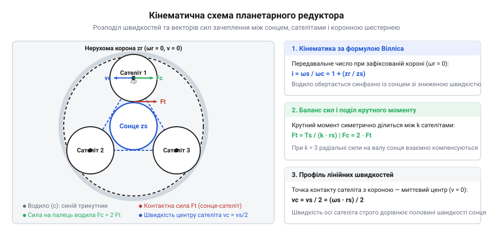
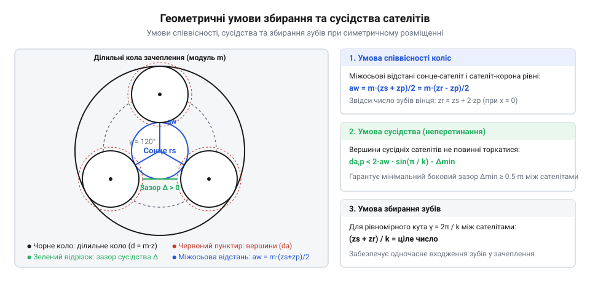
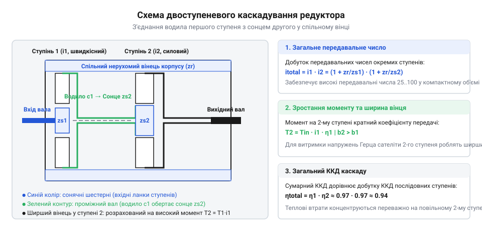
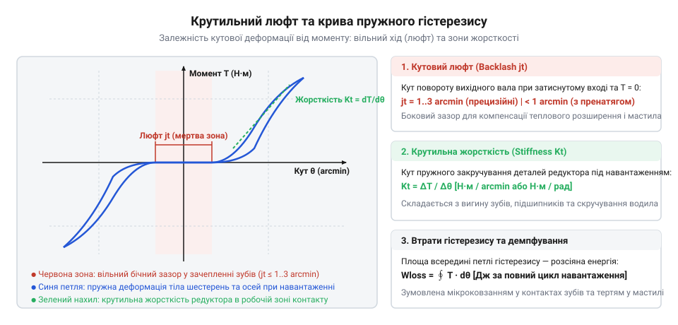

# Планетарний редуктор

<preknowlist>
- [Редуктори](root:hw-motion/gears-transmission) — передавальне число, ККД та базові види зубчастих передач
- [Мотор-редуктор](root:hw-motion/gearmotor) — компонування двигуна з редуктором і вплив люфту на сервопривід
</preknowlist>

## Розподіл моменту та коаксіальна геометрія планетарного зачеплення

Коли електропривід має обертати важке навантаження — колесо всюдихідного шасі, суглоб промислового робота чи шпиндель поворотного столу, — вал двигуна крутиться швидко, але розвиває недостатній крутний момент. Класичне інженерне рішення полягає у встановленні пари циліндричних зубчастих коліс у [редукторі](root:hw-motion/gears-transmission), тоді як для високих передавальних чисел під ударними навантаженнями також розглядають [циклоїдний редуктор](root:hw-motion/cycloidal-drive). Проте зі збільшенням навантаження проста циліндрична передача впирається у жорсткі фізичні межі: уся рушійна сила зосереджена в одній вузькій лінії контакту між парою зубів. Щоб витримати тиск і не зламатися, шестерні доводиться робити широкими й масивними, вали розносити далі один від одного, а підшипники перевантажуються потужними консольними та радіальними силами, які вигинають вал і виламують гнізда корпусу. Загальний габарит такого приводу зростає непропорційно, а вихідний вал виявляється зміщеним відносно осі двигуна.

Планетарний (епіциклічний) механізм розв'язує цю проблему за рахунок симетричного багатопотокового розподілу сил. Замість однієї точки зачеплення крутний момент від центральної шестерні передається одразу через кілька проміжних коліс.

Конструкція складається з трьох головних співвісних елементів:
1. **Сонячна шестерня (Sun gear)** — розташована на центральній осі, жорстко з'єднана з вхідним валом і має найменший діаметр.
2. **Сателіти (Planet gears)** — однакові зубчасті колеса (зазвичай три, чотири або п'ять штук), встановлені на власних осях на рухомій рамці — **водилі (Carrier)**. Сателіти розташовані по колу на однакових кутових відстанях навколо сонця та одночасно входять у зачеплення з ним.
3. **Коронна шестерня (Ring gear / Annulus)** — нерухомий зовнішній зубчастий вінець із внутрішніми зубами, що служить внутрішньою обоймою для сателітів і одночасно виконує роль стінки циліндричного корпусу редуктора.

Оскільки сонячна шестерня затиснута між кількома сателітами симетрично, радіальні вектори сил взаємно врівноважуються. Сумарне радіальне навантаження на підшипники вхідного вала дорівнює нулю: вхідний вал передає виключно чистий крутильний момент. Тангенційне ж зусилля розщеплюється на N контактних зон (де N — число сателітів). При трьох сателітах кожен зуб передає лише третину повного моменту. Це дозволяє зменшити модуль зуба і зробити механізм у кілька разів компактнішим і легшим за класичну прямозубу передачу тієї ж несучої здатності. Корпус набуває форми тонкого співвісного циліндра, що дозволяє монтувати [мотор-редуктор](root:hw-motion/gearmotor) безпосередньо в трубу маніпулятора чи маточину колеса.

Щоб точно розрахувати механіку зачеплення, розглянемо розклад контактних сил у точках дотику зубів сонячної шестерні та сателітів. Якщо на вхідний вал редуктора подається крутний момент T_s, сумарне колове зусилля на ділильному колі сонця діаметром d_s становить:

F_t_total = 2 · T_s / d_s

Завдяки симетричному розташуванню N сателітів це загальне навантаження ділиться на рівні частки. На кожен окремий сателіт у зоні його зовнішнього зачеплення з сонцем припадає тангенційне зусилля:

F_t_sp = F_t_total / N = 2 · T_s / (N · d_s)

Нормальна сила взаємодії зубів F_n діє вздовж лінії зачеплення, нахиленої під стандартним кутом профілю α = 20°. Вона розкладається на колову силу F_t_sp та радіальну силу розпирання:

F_r_sp = F_t_sp · tan(α)

Радіальні сили F_r_sp спрямовані строго вздовж радіусів від точок контакту до центру сонячної шестерні. Оскільки кут між сусідніми сателітами становить рівно 2π / N, векторна сума цих радіальних сил утворює правильний замкнений силовий багатокутник і тотожно дорівнює нулю. Це означає, що вал двигуна взагалі не відчуває згинального зусилля від зачеплення — на опори діє лише чистий крутильний момент.

Тепер простежимо баланс сил на осі самого сателіта. Кожен сателіт перебуває в подвійному зачепленні: зсередини його штовхає сонячна шестерня з силою F_t_sp, а ззовні він спирається на нерухому коронну шестерню. Оскільки коронна шестерня зафіксована у корпусі, вона чинить реактивний опір з рівною за величиною коловою силою F_t_pa = F_t_sp. Обидві колові сили спрямовані в один і той самий бік — за напрямком обертання водила.

В результаті на вісь (палець) кожного сателіта діє подвоєне тангенційне зусилля:

F_pin = F_t_sp + F_t_pa = 2 · F_t_sp = 4 · T_s / (N · d_s)

Ця сумарна сила передається безпосередньо на тіло водила на радіусі осей сателітів r_c = (d_s + d_p) / 2. Якщо просумувати дію всіх N пальців, результуючий крутний момент на вихідному водилі дорівнює:

T_c = N · F_pin · r_c = 4 · T_s / d_s · (d_s + d_p) / 2 = 2 · T_s · (1 + d_p / d_s)

Оскільки для прямозубого зачеплення діаметри пропорційні числам зубів, а геометрія вимагає d_a = d_s + 2 · d_p, вираз у дужках перетворюється на повне передавальне число планетарного ряду i = 1 + Z_a / Z_s. Таким чином, колові сили безпосередньо транслюють вхідний момент у помножений вихідний момент на водилі, зменшуючи механічне напруження в кожному окремому зубі рівно в N разів.

Крім того, необхідно враховувати радіальні сили на пальці сателіта. У внутрішньому зачепленні з коронною шестернею радіальна сила F_r_pa спрямована до центру редуктора, тоді як у зовнішньому зачепленні з сонцем радіальна сила F_r_sp спрямована від центру назовні. Через різницю радіусів кривизни зубів внутрішнього та зовнішнього вінців ці сили частково відрізняються, створюючи невелике результуюче радіальне навантаження на підшипник сателіта. Проте порівняно з масивним тангенційним зусиллям F_pin ця радіальна складова є другорядною.

Такий силовий баланс наочно демонструє головну перевагу планетарної схеми: навантаження на зубчастий контакт зменшується пропорційно числу сателітів, а опори водила сприймають лише тангенціальні сили, що обертають вихідний вал. Навантаження на підшипники осей сателітів визначається головним чином коловими зусиллями, що дозволяє інженерам точно підбирати голчасті ролики під довговічність контактних доріжок кочення при високих швидкостях планетарного руху.

> 🔧 **Навіщо це.** Співвісність вхідного та вихідного валів і врівноваження радіальних сил усувають згинальний момент на підшипниках ротора двигуна. Це дозволяє проектувати ультракомпактні приводи роботів та екзоскелетів, де зовнішній діаметр редуктора точно збігається з діаметром статора двигуна.

Перші зразки подібних зачеплень використовувалися ще у античних механізмах для моделювання руху небесних тіл, що детально описує [історія епіциклічних механізмів від Антикітери до автопрому](root:hw-motion/planetary-gearbox/hist-antikythera-to-ford-model-t.md).

## Кінематика обкочування, формула Вілліса та умови збирання

Кінематика планетарного редуктора визначається тим, що осі сателітів не зафіксовані у просторі, а обертаються разом із водилом навколо центральної осі сонця. Кожен сателіт здійснює складний плоский рух: він обертається навколо власної осі та водночас рухається по внутрішньому колу коронного вінця.

Щоб визначити передавальне число такого механізму, використовують метод зупинки водила (метод оберненого руху), сформульований як теорема або формула Вілліса. Якщо уявно надати всій планетарній системі додаткову кутову швидкість -ω_H (де ω_H — швидкість водила), водило умовно зупиниться. У такій системі відліку планетарний ряд перетворюється на звичайну передачу з нерухомими осями, для якої відношення кутових швидкостей сонця ω_s та коронної шестерні ω_a записується як:

(ω_s - ω_H) / (ω_a - ω_H) = -Z_a / Z_s

де Z_s — кількість зубів сонячної шестерні, Z_a — кількість зубів коронної шестерні (annulus), а знак мінус вказує на внутрішнє зачеплення сателіта з коронною шестернею.

У стандартному редукційному режимі зовнішня коронна шестерня жорстко зафіксована на корпусі (ω_a = 0), вхідним валом служить сонце, а вихідним — водило. Якщо ж жодну з трьох ланок не зафіксувати, механізм отримує два ступені вільності і функціонує як [планетарний диференціал](root:hw-motion/mechanical-differential). Підставивши ω_a = 0, отримуємо передавальне число одного ступеня:

i = ω_s / ω_H = 1 + Z_a / Z_s

З цієї формули видно дві фундаментальні властивості:
1. Передавальне число завжди більше за одиницю (i > 1) і вихідне водило обертається в той самий бік, що й вхідний вал (прямий напрям без інверсії).
2. Число зубів сателітів Z_p у формулу прямо не входить — воно визначає геометричні пропорції, але не передавальне відношення.

Математичний вивід та аналіз інших режимів (наприклад, коли зафіксовано сонце або водило) подано у вставці [кінематика епіциклічних передач і формула Вілліса](root:hw-motion/planetary-gearbox/math-willis-epicyclic-kinematics.md).

Однак сконструювати планетарний ряд із довільними числами зубів неможливо. Геометрія підпорядкована трьом суворим вимогам:
- **Умова співвісності:** щоб ділильні кола сонця, сателітів та корони збігалися без перекосу осей, радіус корони має точно дорівнювати сумі радіуса сонця та подвоєного радіуса сателіта. Для коліс з однаковим модулем зубів це зводиться до співвідношення:
  Z_a = Z_s + 2 · Z_p
- **Умова сусідства:** сателіти розташовані на одному колі водила і не повинні зачіпати один одного вершинами зубів. Максимальний зовнішній діаметр сателіта d_{a,p} має бути меншим за хорду між осями сусідніх сателітів:
  (Z_p + 2) < (Z_s + Z_p) · sin(π / N)
  де N — кількість сателітів.
- **Умова збирання:** при рівномірному розташуванні N сателітів по колу водила через кути 2π / N зуби всіх сателітів мусять одночасно потрапляти у западини сонця та коронної шестерні. Для цього сума зубів сонця та корони має ділитися на число сателітів без залишку:
  (Z_s + Z_a) / N = ціле число

Якщо умова збирання порушена, редуктор просто неможливо скласти: зуби одного з сателітів упруться у вершини зубів вінця.

Щоб оцінити довговічність та динамічні навантаження в зачепленні, необхідно проаналізувати відносні кутові швидкості ланок. Хоча вихідне водило обертається повільніше за вхідне сонце в i разів, сателіти на своїх пальцях рухаються зі значно вищою швидкістю.

У системі координат, пов'язаній із рухомим водилом, сонячна шестерня здійснює відносний рух зі швидкістю (ω_s - ω_H). Оскільки сонце обкочує сателіти з передавальним відношенням Z_s / Z_p, відносна кутова швидкість обертання сателіта навколо власного пальця становить:

ω_rel = - (ω_s - ω_H) · (Z_s / Z_p)

Враховуючи, що для редукційного режиму ω_s - ω_H = ω_H · (Z_a / Z_s), отримуємо пряму залежність від кутової швидкості вихідного водила:

ω_rel = - ω_H · (Z_a / Z_p)

Якщо перевести це у звичайні частоти обертання (об/хв), для швидкісного сервопривода з частотою обертання сонця 3000 об/хв і передавальним числом i = 5 (де Z_s = 18, Z_p = 27, Z_a = 72), частота обертання водила складе n_H = 600 об/хв. При цьому кожен сателіт на власному голчастому підшипнику обертається з відносною швидкістю n_rel = 600 · (72 / 27) = 1600 об/хв. Якщо ж редуктор одноступеневий з великим передавальним числом (i = 9), відносна швидкість сателітів перевищує вхідну швидкість двигуна. Висока частота обертання сателіта під значним радіальним зусиллям від зачеплення генерує інтенсивне гідродинамічне тертя в масляній плівці голчастих вальниць, накладаючи жорсткі межі на тривалу вхідну швидкість.

Другим критичним питанням кінематики є фізичне обмеження на мінімальну кількість зубів сонячної шестерні Z_s. Прагнучи отримати максимальне передавальне число в одному ступені (i = 1 + Z_a / Z_s), інженер намагається зменшити Z_s. Проте в класичному евольвентному зачепленні зі стандартним кутом профілю α = 20° існує жорстка геометрична межа підрізання ніжки зуба:

Z_min = 2 / (sin(α))^2 = 2 / (sin(20°))^2 ≈ 17.1

Якщо виготовити сонячну шестерню з числом зубів Z_s < 17 без геометричного зміщення, інструментальна рейка під час нарізання зріже частину робочої евольвенти біля основи зуба. Це явище називається підрізанням (undercutting). Воно небезпечно зменшує товщину ніжки зуба, створюючи концентратор напружень і знижуючи згинальну міцність у кілька разів.

Щоб запобігти катастрофічному підрізанню на малих шестернях (Z_s = 9 ... 14), конструктори обов'язково застосовують позитивне радіальне виправлення (коригування профілю) з коефіцієнтом зміщення x:

x_min = (17 - Z_s) / 17

Позитивне зміщення відсуває різальну кромку інструмента від центру шестерні, відновлюючи товщину ніжки та збільшуючи радіус кривизни евольвенти. Проте корекція має свою ціну: вершина зуба стає гострішою (небезпека загострення до нульової товщини верхньої площадки), а кут зачеплення зростає, що зменшує коефіцієнт торцевого перекриття ε_α. Якщо коефіцієнт перекриття впаде нижче за одиницю (ε_α < 1.0), безперервність передачі руху порушиться, зуби зустрічатимуться з ударами, а редуктор вийде з ладу через миттєве сколювання зубів. Саме тому практична межа передавального числа якісного одноступеневого редуктора обмежена значенням i ≤ 8 ... 10.

## Статична невизначеність, вирівнювання навантажень та підшипники сателітів

Теоретично передаваний планетарним ступенем крутний момент ділиться між N сателітами строго порівну. Проте в реальному металі це твердження стикається з фундаментальною проблемою машинобудування — статичною невизначеністю багатопотокової системи.

Якщо виготовити сонце, сателіти, водило та коронну шестерню з абсолютно жорстких матеріалів і змонтувати їх на фіксованих осях, через неминучі мікроскопічні похибки виготовлення (відхилення кроку зубів у кілька мікронів, ексцентриситет посадкових отворів під осі у водилі, биття вінців) у зачеплення спочатку увійдуть зуби лише одного-єдиного сателіта. Решта два або три сателіти матимуть мікроскопічні зазори в контактних зонах. У результаті один сателіт сприйматиме до 80–100% всього вхідного моменту, перевантажуючи свої підшипники та зуби, що призводить до швидкого втомного викришування (піттингу) металу та поломки. Решта сателітів увімкнуться в роботу лише тоді, коли перевантажений сателіт і його вісь зазнають достатньої пружної деформації.

Щоб забезпечити рівномірний розподіл навантаження без перевантаження окремих ланок, інженери застосовують спеціальні конструктивні схеми самовстановлення (вирівнювання):
1. **Плаваюче сонце (Floating Sun):** сонячна шестерня не закріплюється у радіальних підшипниках корпуса, а з'єднується з вхідним валом через зубчасту або шліцьову муфту з радіальним зазором. Вона самоцентрується між трьома сателітами: якщо один сателіт тисне сильніше, він відштовхує сонце в бік двох інших, доки зусилля на всіх трьох плямах контакту не зрівноважаться.
2. **Плаваюче водило (Floating Carrier):** водило встановлюється з можливістю мікроскопічного радіального самовстановлення.
3. **Пружні пальці сателітів (Flex-pins):** осі сателітів виконуються у вигляді коаксіальних втулок із контрольованою радіальною пружністю. Під навантаженням вісь сателіта, що сприймає більшу силу, пружно згинається назад, передаючи надлишок сили сусіднім шестерням.

Особливу увагу приділяють опорам самих сателітів. Оскільки сателіти мають малий діаметр і обертаються з високою швидкістю відносно власних осей (n_planet = n_s · Z_s / Z_p), всередину їхнього отвору неможливо помістити стандартний кульковий підшипник із масивними кільцями та сепаратором. У високонавантажених сервоприводах застосовують повнороликові голчасті вальниці без внутрішнього кільця і сепаратора: голки котяться безпосередньо по загартованій і шліфованій осі водила та по внутрішній поверхні отвору сателіта. Детальний аналіз таких вузлів містить вставка [промислові класи планетарних редукторів та конструкція опор](root:hw-motion/planetary-gearbox/comp-planetary-gearhead-types.md).

Щоб забезпечити надійність сателітного вузла під час тривалої роботи, необхідно детально проаналізувати контактні напруження та втомний ресурс голчастих вальниць. Оскільки габарити сателіта обмежені умовою сусідства, його внутрішній отвір має малий діаметр, що змушує підшипник працювати на межі контактної витривалості сталі.

Контактне напруження Герца між роликом-голкою та циліндричною доріжкою кочення визначається лінійною контактною задачею. Для сталевих тіл максимальне напруження стискання на лінії контакту виражається формулою:

σ_H = √( (F_max · E*) / (π · L_eff · ρ_eq) )

де E* — приведений модуль пружності, L_eff — робоча довжина голки, а ρ_eq — еквівалентний радіус кривини контакту циліндрів.

Особливістю безсепараторного (повнороликового) голчастого вузла є те, що голки заповнюють увесь коловий зазор без проміжних перемичок. Це дозволяє розмістити максимальну кількість тіл кочення Z_r, що суттєво зменшує пікове навантаження на найбільш навантажену голку:

F_max ≈ 4.37 · F_pin / Z_r

Проте повна відсутність сепаратора породжує специфічний фізичний ефект: суміжні голки котяться в один бік, а отже, в точці дотику їхні зустрічні поверхні рухаються з подвоєною лінійною швидкістю v_rel = 2 · v_needle. Це створює постійне тертя ковзання метал-по-металу безпосередньо між сусідніми роликами, що вимагає безперервної подачі пластичного мастила з антизадирними присадками (EP-добавками) та обмежує граничну частоту обертання сателіта.

Розрахунок довговічності таких підшипників ведуть за стандартом ISO 281. Номінальний ресурс за втомним викришуванням L_10h (у годинах роботи до появи перших слідів піттингу з імовірністю 90%) описується формулою:

L_10h = (10^6 / (60 · n_rel)) · (C / P)^p

де n_rel — відносна частота обертання сателіта на пальці, C — динамічна вантажопідйомність вузла, P — еквівалентне динамічне навантаження, а показник степеня для роликових підшипників дорівнює p = 10 / 3 ≈ 3.33.

Показник p = 3.33 вказує на надзвичайно високу нелінійну чутливість ресурсу до величини навантаження. Якщо через похибки виготовлення чи деформацію водила навантаження на один із сателітів зросте всього на 20% (P_new = 1.2 · P), розрахунковий ресурс підшипника впаде майже вдвічі:

(1 / 1.2)^3.33 ≈ 0.54

Тобто невеликий перекіс скорочує термін служби на 46%. Саме тому для пальців сателітів застосовують високолеговані підшипникові або цементовані сталі (наприклад, 100Cr6, 18CrNiMo7-6) із загартуванням поверхневого шару до твердості 58–64 HRC та шліфуванням до шорсткості Ra ≤ 0.1 мкм, що запобігає передчасному втомному викришуванню під дією високих циклічних тисків Герца.

Крім динамічної втомної довговічності, критичним параметром підшипників сателітів є статична вантажопідйомність C_0. При виникненні раптових пікових перевантажень або аварійних ударів на вихідному валу контактний тиск під роликами здатний перевищити 4000 МПа. За такого тиску виникає явище бринелювання (Brinelling) — утворення незворотних мікроскопічних вм'ятин на робочих доріжках кочення пальця. Навіть мікронна вм'ятина при подальшій роботі перетворюється на вогнище пульсуючих вібрацій, викликає руйнування масляної плівки та призводить до лавиноподібного викришування металу. Щоб цього уникнути, коефіцієнт статичного запасу міцності s_0 = C_0 / P_max для промислових сервоприводів вибирають не менше 2.0–2.5.

Також важливий температурний баланс голчастих опор. Оскільки ролики котяться всередині тісного закритого простору сателіта без примусової циркуляції оливи, гідродинамічні втрати на перемішування мастила концентруються безпосередньо в зоні контакту. За надмірної в'язкості мастила зростає опір коченню, тоді як недостатня в'язкість при робочій температурі призводить до розриву захисної плівки та схоплювання металевих поверхонь.

> 🔧 **Навіщо це.** Схема з плаваючим сонцем гарантує, що нерівномірність навантаження між сателітами не перевищить 5–10% навіть при нормальних допусках виготовлення. Це дозволяє проектувати редуктор на повну розрахункову потужність без штучного завищення модуля зубів та маси корпусу.

## Каскадування ступенів, множення передавальних чисел і тепловий баланс

Один ступінь планетарного редуктора через геометричні обмеження розмірів зубів і діаметра корони стандартно забезпечує передавальне число від i = 3 до i = 10. Якщо зробити i < 3, сонячна шестерня виявиться занадто великою, а сателіти — замалими, через що їхні зуби не витримають навантаження і сателіти почнуть стикатися. Якщо ж спробувати отримати i > 10 в одному ступені, сонячна шестерня мусить мати всього 8–10 зубів, що призводить до підрізання ніжок зубів, зниження міцності на згин і різкого зростання напружень.

Коли приводу потрібна редукція 20:1, 50:1, 100:1 або вище, застосовують каскадування — послідовне з'єднання кількох планетарних ступенів у спільному корпусі.

Схема каскадування будується коаксіально:
- Водило першого (швидкісного) ступеня жорстко з'єднується з сонячною шестернею другого (тихохідного) ступеня.
- Обидва ступені використовують спільну довгу коронну шестерню, нарізану безпосередньо у внутрішній стінці загального циліндричного корпусу, або дві окремі гільзи однакового діаметра.
- Повне передавальне число редуктора дорівнює добутку передавальних чисел усіх ступенів:
  i_total = i_1 · i_2 · ... · i_k

Проте платою за високе передавальне число є нелінійне падіння ККД і накопичення тепла. Кожен планетарний ступінь має ККД близько η ≈ 0.95 ... 0.97 (з урахуванням втрат на тертя у внутрішньому та зовнішньому зачепленнях, тертя в голчастих підшипниках та перемішування мастила). Для багатоступеневого редуктора повний ККД становить добуток ККД кожного ступеня:
η_total = η_1 · η_2 · ... · η_k

Двоступеневий редуктор має ККД близько 0.95^2 ≈ 0.90, а триступеневий — 0.95^3 ≈ 0.85. До 15–20% механічної потужності двигуна перетворюється на тепло безпосередньо всередині компактного закритого металевого циліндра.

При роботі серводвигуна на вхідних швидкостях 4000–6000 об/хв перша швидкісна сонячна шестерня та її сателіти перетворюються на інтенсивне джерело тепла. Якщо тепловідведення крізь фланець приводу недостатнє, температура всередині перевищує 90–110 °C. Це викликає теплову деградацію пластичного мастила, зниження в'язкості масляної плівки та прискорене схоплювання зубів. Практичний розрахунок теплових втрат та геометричних параметрів ступеня виконується за допомогою алгоритмів із вставки [калькулятор розрахунку планетарного ступеня](root:hw-motion/planetary-gearbox/proj-planetary-gear-sizing-calculator.md).

Щоб зрозуміти теплові обмеження приводу, необхідно скласти рівняння теплового балансу редуктора в режимі тривалої роботи. Теплова потужність, яка безперервно виділяється всередині корпусу, дорівнює механічним втратам:

P_loss = P_in · (1 - η_total)

Наприклад, якщо серводвигун потужністю 1 кВт працює через триступеневий редуктор з ККД η_total = 0.85, усередині металевого циліндра об'ємом менше літра щомиті генерується P_loss = 150 Вт чистого тепла. Це еквівалентно роботі потужного паяльника, поміщеного в герметичний металевий термос.

У стаціонарному тепловому режимі вся втрачена потужність повинна відводитися в навколишнє середовище через зовнішню поверхню корпусу та монтажний фланець:

P_loss = k_t · A_box · (T_box - T_amb) + Q_flange

де k_t — сумарний коефіцієнт тепловіддачі конвекцією та випромінюванням (зазвичай 15–25 Вт/(м²·°C) для спокійного повітря), A_box — площа зовнішньої циліндричної поверхні, T_box — температура корпусу, T_amb — температура навколишнього повітря, а Q_flange — тепловий потік кондукцією крізь опорний фланець у металеву станину верстата чи раму маніпулятора.

Якщо редуктор встановлено без масивного алюмінієвого фланця або в закритому полімерному кожусі робота, де відведення тепла Q_flange заблоковане, різниця температур (T_box - T_amb) здатна перевищити 70–90 °C. За температури повітря +30 °C корпус нагрівається до 110–120 °C.

Такий перегрів запускає катастрофічний механізм руйнування пластичного мастила. Більшість прецизійних редукторів заправляються консистентним мастилом на весь термін експлуатації. Мастило складається з синтетичної базової оливи (поліальфаолефіни або естери) та загусника (літієве мило чи полісечовина). При підвищенні температури понад 90 °C починаються три незворотні процеси:
1. **Термоокислювальна деградація оливи:** за правилом Арреніуса кожні 10 °C підвищення температури вище 80 °C подвоюють швидкість окислення вуглеводнів базової оливи. Це скорочує паспортний термін служби мастила з 20 000 годин до 2 000 годин.
2. **Синєрезис (відділення оливи):** при високій температурі та дії відцентрових сил сателітів рідка олива втрачає зв'язок із мильним каркасом загусника і стікає на дно корпусу, оголюючи контактні зони зубів.
3. **Падіння кінематичної в'язкості:** товщина масляної плівки між зубами зменшується нижче за висоту мікронерівностей шорсткості металу (перехід від гідродинамічного до граничного тертя).

Окремою критичною загрозою при перегріві закритого корпусу є різниця температурних коефіцієнтів лінійного розширення матеріалів. Корпус редуктора нагрівається нерівномірно: центральна сонячна шестерня та сателіти через високу швидкість обертання та відсутність прямого тепловідводу мають температуру на 20–30 °C вищу, ніж зовнішня стінка коронної шестерні. Внаслідок нерівномірного теплового розширення зубчастих вінців початковий бічний зазор у зачепленні зменшується. Якщо початковий монтажний зазор був занадто малим (як у високопрецизійних безлюфтових редукторах), при робочій температурі понад 100 °C зазор зменшується до нуля, викликаючи заклинювання передачі та зминання зубів.

Тому при проектуванні приводів тривалого включення номінальну механічну потужність редуктора обов'язково коригують на тепловий коефіцієнт, знижуючи допустимий тривалий крутний момент на 20–40% від максимального каталожного значення. Регулярний тепловий моніторинг за допомогою вбудованого термодатчика NTC у фланці двигуна дозволяє серводрайверу динамічно обмежувати струм у разі досягнення критичного порогу нагріву корпусу, зберігаючи цілісність зубчастих вінців.

## Механіка люфту, косозубі вінці та зворотна рушійність

У системах точного позиціонування — на осях верстатів із ЧПК, поворотних столах і скануючих головках — якість редуктора вимірюється не передавальним числом, а величиною мертвого ходу (Backlash). У звичайних планетарних редукторах кутовий люфт становить від 10 до 30 кутових мінут (1° = 60'), що для радіуса плеча маніпулятора у 500 мм дає похибку положення інструмента до 2–4 мм.

Кутовий люфт планетарного ступеня складається з трьох незалежних фізичних джерел:
1. **Бічні зазори зубчастих пар:** зазор між зубами сонця і сателітів (j_sp) та між сателітами і коронною шестернею (j_pa).
2. **Радіальні зазори підшипників сателітів:** навіть мікронні люфти голкових роликів дозволяють осям сателітів зміщуватися під дією зміни вектора тангенційної сили.
3. **Крутильна податливість щік водила:** тонкостінне водило під дією максимального вихідного моменту закручується подібно до торсіону.

Для зниження люфту до прецизійного рівня (< 1–3 кутових мінут) виробники переходять від прямозубих шестерень до косозубих із модифікованим евольвентним профілем. Косий зуб входить у зачеплення плавно по довжині контактної лінії, що різко знижує шум і вібрації на високих обертах. Проте косозубість породжує потужні осьові сили F_a = F_t · tan(β), які прагнуть виштовхнути сателіти вздовж осі водила. Це вимагає встановлення прецизійних упорних шайб або конічних підшипників, що дещо ускладнює конструкцію і збільшує тертя.

Окремою критичною характеристикою планетарного приводу є його **зворотна рушійність (Backdrivability)** — здатність редуктора обертатися у зворотному напрямку, коли момент прикладається до вихідного вала. Завдяки високому ККД одного ступеня (η ≈ 97%) одно- та двоступеневі планетарні редуктори з помірними передавальними числами (i ≤ 10 ... 20) мають чудову прозорість для зворотного потоку сили.

Це фундаментально важливо для квазіпрямих приводів (QDD) крокуючих роботів і людино-машинної взаємодії, де привід повинен відчувати удари кінцівки об ґрунт через струм фаз двигуна, що докладно пояснює [зворотна рушійність і квазіпрямий привід (QDD)](root:hw-motion/backdrivability-and-quasi-direct-drive). Натомість три- та чотириступеневі планетарні редуктори з передавальними числами понад 50:1 через накопичення сил тертя та множення приведеної інерції ротора двигуна J_refl = i^2 · J_motor практично втрачають зворотну провідність: зовнішній удар блокується механічно і може зруйнувати зуби тихохідного ступеня.

Щоб обґрунтовано обрати редуктор для високоточного маніпулятора або верстата з ЧПК, інженер повинен кількісно розрахувати сумарну кутову та лінійну похибку виконавчого ланцюга. Повна кутова похибка вихідного вала приводу під навантаженням складається з двох принципово різних фізичних компонентів: кінематичного мертвого ходу (люфту j_t) та пружної торсійної деформації під дією крутного моменту T:

Δθ_total = j_t + (T / C_t)

де j_t — паспортний кутовий люфт редуктора (кутові мінути), а C_t — крутильна (торсійна) жорсткість ступеня (Нм/arcmin або Нм/рад).

Ця кутова похибка безпосередньо транслюється у лінійне відхилення кінцевого робочого органа маніпулятора чи каретки координатного столу. Для плеча робота з радіусом вильоту інструмента L лінійне зміщення розраховується за формулою:

Δx = L · tan(Δθ_total) ≈ L · Δθ_total

де кут виражено в радіанах (1 arcmin = 0.000291 рад).

Розглянемо числовий приклад реального виробничого приводу. Нехай довжина ланки маніпулятора становить L = 800 мм. Якщо встановлено стандартний планетарний редуктор із кутовим люфтом j_t = 12 arcmin (0.00349 рад), лінійне відхилення інструмента на холостому ході складе:

Δx_backlash = 800 · 0.00349 ≈ 2.79 мм

Коли робот починає розгін з масивним вантажем, викликаючи динамічний крутний момент на валу T = 150 Нм, при типовій торсійній жорсткості водила C_t = 25 Нм/arcmin виникає додатковий пружний кут закручування:

Δθ_tors = 150 / 25 = 6 arcmin ≈ 0.00175 рад

Цей кут додає ще Δx_tors = 800 · 0.00175 ≈ 1.40 мм лінійного зміщення. Сумарна динамічна похибка положення робочого інструмента сягає Δx_total = 2.79 + 1.40 = 4.19 мм, що є неприпустимим для прецизійного лазерного різання чи складання мікроелектроніки, де поле допуску не перевищує 0.05 мм.

Для усунення подібних похибок у прецизійних осях застосовують спеціальні конструктивні рішення. Зниження кутового люфту до рівня менше 1–3 кутових мінут досягається прецизійною селективною збіркою з мікронним підбором діаметрів сателітів, застосуванням пружно розрізаних шестерень або ексцентрикових гільз коронного вінця для вибірки зазорів. Високу торсійну жорсткість C_t забезпечують виготовленням водила у вигляді цільної монолітної рамки (Monobloc carrier cage) з жорсткими двосторонніми щоками та монтажем вихідного вала на прецизійних радіально-упорних роликових підшипниках великого базового діаметра.

Особливе значення має вплив мертвого ходу на контур зворотного зв'язку цифрового сервопривода. Коли вихідний енкодер встановлено безпосередньо на навантаженні (система подвійного зворотного зв'язку Dual Loop), наявність люфту j_t між ротором двигуна та датчиком положення розриває прямий зв'язок керування в моменти зміни знаку прискорення. Ротор двигуна починає вільно розганятися в зоні зазору без опору навантаження. Коли зуби обирають зазор, відбувається удар із миттєвим гальмуванням ротора та різким стрибком струму. Цей удар генерує високочастотний акустичний шум і викликає дестабілізацію диференціальної складової ПІД-регулятора. Для придушення ударних коливань при реверсах алгоритми сучасних ЧПК вводять адаптивне згладжування ривка (Jerk Limiting за S-кривою розгону) та обмежують смугу пропускання контуру положення, усуваючи автоколивання приводу.
