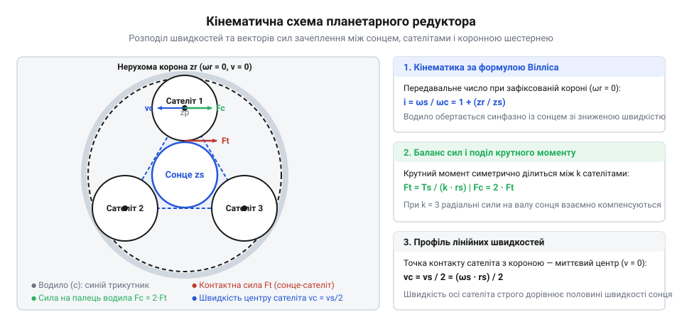
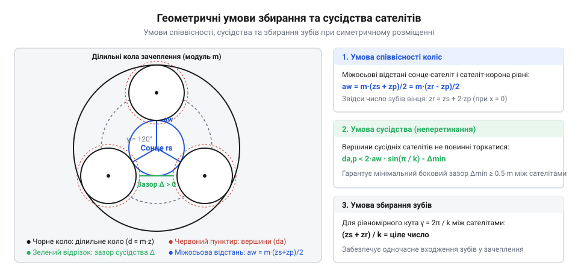
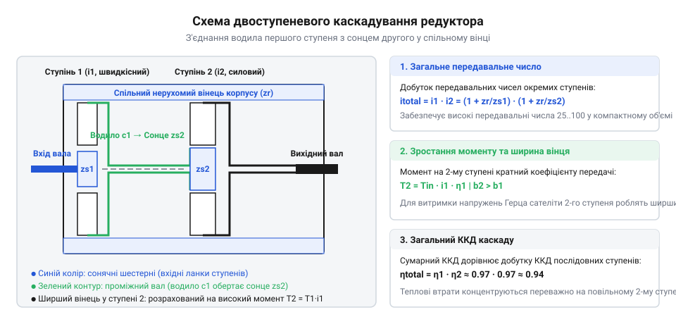
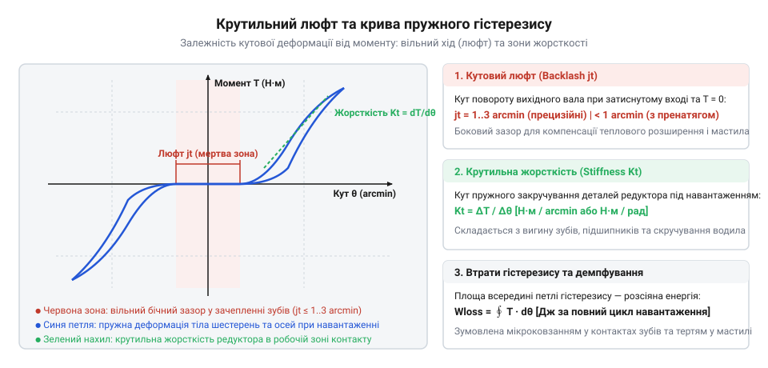

# Планетарний редуктор

<preknowlist>
- [Редуктори](root:hw-motion/gears-transmission) — передавальне число, ККД та базові види зубчастих передач
- [Мотор-редуктор](root:hw-motion/gearmotor) — компонування двигуна з редуктором і вплив люфту на сервопривід
</preknowlist>

## Розподіл моменту та коаксіальна геометрія

Коли електродвигун має приводити в рух важкий суглоб робота, колесо мобільної платформи чи ходовий гвинт верстата, його висока швидкість обертання поєднується з недостатнім вихідним моментом. Класичний спосіб знизити швидкість і підняти момент полягає у встановленні пари циліндричних зубчастих коліс у [редукторі](root:hw-motion/gears-transmission). Проте під високим навантаженням звичайна передача стикається з фізичною межею: уся механічна сила передається через єдину лінію контакту між парою зубів. Щоб зуби не зламалися від контактних напружень, шестерні доводиться робити широкими, а вали розносити вбік, створюючи незручне несиметричне компонування та перевантажуючи підшипники консольними згинальними силами.

Планетарний механізм усуває цей недолік завдяки принципу багатопотокового передавання потужності. Замість однієї точки зачеплення крутний момент розподіляється одночасно між кількома проміжними колесами.



Конструкція будується з трьох співвісних базових ланок:
1. **Сонячна шестерня (Sun gear)** — центральне зубчасте колесо найменшого діаметра, закріплене безпосередньо на вхідному валу.
2. **Сателіти (Planet gears)** — група однакових зубчастих коліс (найчастіше три або чотири), які вільно обертаються на власних підшипникових пальцях рухомого **водила (Carrier)** та рівномірно розподілені навколо сонця.
3. **Коронна шестерня (Ring gear / Annulus)** — нерухоме зовнішнє кільце з внутрішніми зубами, що водночас служить силовим циліндричним корпусом редуктора.

Оскільки сонячне колесо оточене сателітами симетрично, радіальні сили взаємодії зубів діють у протилежних напрямках під рівними кутами і повністю компенсують одна одну. Вхідний вал не зазнає згинальних сил і навантажується виключно крутним моментом. Тангенційне зусилля ділиться між $N$ сателітами: кожен зуб сприймає лише частку $1/N$ повного зусилля. При трьох сателітах навантаження на зуб падає втричі, що дозволяє зменшити габарити корпусу до компактного циліндра, діаметр якого точно повторює фланець [мотор-редуктора](root:hw-motion/gearmotor).

> 🔧 **Навіщо це.** Врівноваження радіальних сил захищає підшипники ротора електродвигуна від консольного перекосу, а коаксіальність валів дозволяє вбудовувати привід безпосередньо всередину трубчастих шарнірів роботів-маніпуляторів.

## Кінематика обкочування та формула Вілліса

Кінематична особливість планетарного ряду полягає в тому, що осі сателітів переміщуються в просторі разом із водилом. Сателіт здійснює одночасно два рухи: обертається навколо своєї осі та обкочується по нерухомому внутрішньому зубчастому вінцю корпусу.

Для визначення передавального числа застосовують аналітичний метод зупинки водила (формулу Вілліса). Якщо уявно надати всій системі кутову швидкість водила зі зворотним знаком `-ω_c`, водило умовно зупиниться, а система перетвориться на звичайну передачу з нерухомими осями:

```
(ω_s - ω_c) / (ω_r - ω_c) = -z_r / z_s
```

де `z_s` — кількість зубів сонячної шестерні, `z_r` — кількість зубів коронного вінця, а знак мінус зумовлений внутрішнім типом зачеплення сателіта з короною. Оскільки в стандартному режимі редукції коронна шестерня зафіксована нерухомо у корпусі (`ω_r = 0`), вираз набуває вигляду:

```
(ω_s - ω_c) / (0 - ω_c) = -z_r / z_s

(ω_s - ω_c) / (-ω_c) = -z_r / z_s

1 - (ω_s / ω_c) = -z_r / z_s

ω_s / ω_c = 1 + (z_r / z_s)
```

Звідси передавальне число від вхідного сонця до вихідного водила виражається фундаментальною формулою:

```
i = ω_s / ω_c = 1 + (z_r / z_s)
```



Передавальне число одноступеневого планетарного ряду завжди перевищує одиницю (`i ≥ 3`), а вихідний вал обертається в той самий бік, що й двигун (без зміни напрямку). Число зубів сателітів `z_p` у формулу передавального числа прямо не входить, однак конструкція підпорядкована трьом суворим геометричним обмеженням, без дотримання яких редуктор неможливо скласти:

1. **Умова співвісності коліс:** осі сонячної шестерні, коронного вінця та водила повинні строго збігатися в просторі. Це означає, що міжосьова відстань між сонцем і сателітом `a_w1 = m · (z_s + z_p) / 2` має точно дорівнювати міжосьовій відстані між сателітом і короною `a_w2 = m · (z_r - z_p) / 2`. Прирівнюючи ці вирази для передач з однаковим модулем `m` і нульовим зміщенням профілю (`x = 0`), отримуємо строге геометричне правило:

```
z_r = z_s + 2 · z_p
```

2. **Умова сусідства сателітів:** сателіти розташовані на спільному колі водила радіусом `a_w`. Щоб сусідні сателіти не стикалися вершинами зубів під час обертання, діаметр їхніх вершин `d_a,p` повинен бути меншим за хорду між осями сусідніх пальців водила з урахуванням гарантованого технологічного зазору `Δ_min ≥ 0.5 · m`:

```
d_a,p < 2 · a_w · sin(π / N) - Δ_min
```

де `N` — кількість сателітів (зазвичай `N = 3` або `N = 4`), а кут між осями сусідніх пальців становить `γ = 2π / N` (для трьох сателітів `γ = 120°`, для чотирьох — `γ = 90°`). Якщо умова сусідства порушена, колеса заклинять ще до завершення монтажу корпусу.

3. **Умова збирання зубів:** при симетричному розміщенні `N` сателітів на однакових кутових інтервалах `2π / N` зуби кожного сателіта мусять одночасно і без перекосу входити у западини сонця та коронної шестерні. Для цього кутовий крок між осями сателітів повинен містити ціле число кутових кроків зубчастого зачеплення. Математично це виражається вимогою кратності суми зубів:

```
(z_s + z_r) / N = ціле число
```

Якщо сума `(z_s + z_r)` не ділиться на кількість сателітів `N` без залишку, один або кілька сателітів опиняться у протифазі: їхні зуби потраплять не у западини, а безпосередньо на вершини зубів сонця чи корони. Зібрати такий редуктор фізично неможливо, якщо не вдатися до нерівномірного асиметричного розміщення пальців на водилі, що різко погіршує балансування радіальних сил.

Крім того, вибір кількості зубів сонця `z_s` обмежений явищем підрізання ніжки зуба. При стандартному куті профілю `α = 20°` мінімальне число зубів без підрізання становить `z_min = 17`. Якщо для отримання більшого передавального числа конструктор обирає мале число зубів (наприклад, `z_s = 11 ... 14`), нарізання обов'язково супроводжують додатнім радіальним зміщенням рейки (`x > 0`), що запобігає ослабленню зуба біля основи.

> 🔧 **Навіщо це.** Перевірка умови збирання та умови сусідства на етапі розрахунку параметрів зачеплення рятує від виробничого браку: навіть мінімальне відхилення кількості зубів унеможливлює складання механізму в симетричному корпусі.

## Багатоступеневе каскадування та температурний баланс

Один ступінь планетарного ряду через геометричні пропорції коліс забезпечує редукцію в діапазоні від `i = 3` до `i = 10`. Менше значення `i < 3` вимагає надмірно великого сонця та мікроскопічних сателітів, які втрачають механічну міцність. Значення `i > 10` в одному ступені змушує зменшувати кількість зубів сонця нижче 14, що спричиняє небезпечне підрізання ніжки зуба або загострення вершин.

Коли приводу потрібна редукція 20:1, 50:1 чи понад 100:1, окремі планетарні ряди з'єднують послідовно в єдиному корпусі.



Схема каскадування будується коаксіально:
- Водило першого швидкісного ступеня жорстко сполучається з сонячною шестернею другого силового ступеня.
- Обидва ступені використовують спільний нерухомий коронний вінець, нарізаний безпосередньо у внутрішній гільзі циліндричного корпусу.
- Повне передавальне число редуктора дорівнює добутку коефіцієнтів усіх ступенів:

```
i_total = i₁ · i₂ · ... · i_k
```

Проте зворотним боком високої редукції є неминуче падіння сумарного ККД. Кожен окремий ступінь має ККД близько `η ≈ 0.95 ... 0.97` через тертя в зачепленнях та опір підшипників сателітів. Для багатоступеневого редуктора повний ККД дорівнює добутку ККД окремих ступенів:

```
η_total = η₁ · η₂ · ... · η_k
```

Для двоступеневого редуктора ККД становить близько `0.95² ≈ 0.90`, а для триступеневого — `0.95³ ≈ 0.85`. Механічні втрати в 10–15% потужності двигуна безпосередньо перетворюються на тепло всередині компактного герметичного корпусу. За відсутності надійного тепловідведення крізь металевий фланець монтажу температура редуктора перевищує 90–100 °C, що прискорює окислення консистентного мастила та загрожує заклинюванням зубів через різницю теплового розширення сонця і корони.

> 🔧 **Навіщо це.** Знання добутку ККД дозволяє закладати реальну потужність електродвигуна з запасом на теплові втрати, а контроль нагріву корпусу запобігає витоку розрідженого мастила через сальникові ущільнення.

## Механіка кутового люфту та зворотна рушійність

У прецизійних сервоприводах якість механічної передачі оцінюють за величиною мертвого ходу (Backlash). У базових планетарних редукторах кутовий люфт вихідного вала становить від 10 до 25 кутових мінут (`1° = 60'`).



Кутовий люфт формується трьома основними фізичними джерелами:
1. **Бічні зазори в зубах:** гарантовані технологічні зазори між зубами сонця, сателітів і корони, необхідні для запобігання заклинюванню при тепловому розширенні.
2. **Радіальні зазори підшипників:** податливість голчастих роликів або втулок осей сателітів при зміні знаку моменту.
3. **Крутильне скручування водила:** пружна кутова деформація щік водила під дією високого вихідного навантаження.

Для зниження люфту до прецизійного рівня (менше 1–3 кутових мінут) виробники застосовують косозубі шестерні з плавним перекриттям або індивідуальну мікронну селекцію сателітів.

Завдяки високому прямому ККД окремого ступеня (`η ≈ 97%`) одно- та двоступеневі планетарні редуктори з помірними передавальними числами (`i ≤ 10 ... 20`) мають високу **зворотну рушійність (Backdrivability)**: вихідний вал можна легко провернути рукою. Це робить їх незамінними у квазіпрямих приводах (QDD) крокуючих роботів та колаборативних маніпуляторів, які мають безпечно взаємодіяти з людиною та амортизувати зовнішні динамічні удари, що детально розкриває [зворотна рушійність і квазіпрямий привід (QDD)](root:hw-motion/backdrivability-and-quasi-direct-drive).

> 🔧 **Навіщо це.** Оцінка кутового люфту та зворотної рушійності визначає межу застосування редуктора: прецизійні малолюфтові версії обирають для контурного позиціонування ЧПК, а зворотнорушійні — для пружної взаємодії та крокуючої робототехніки.
