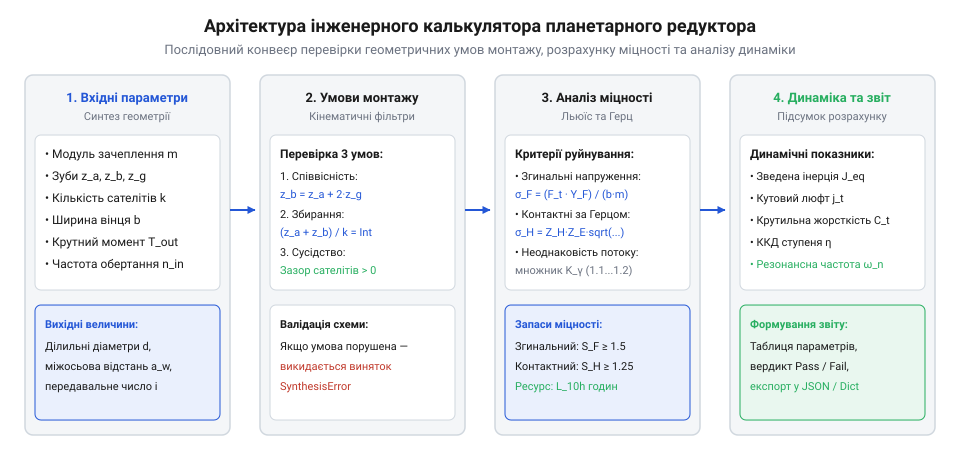
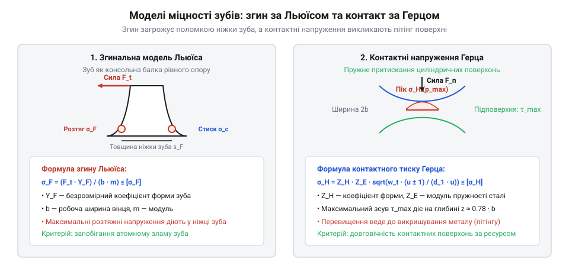

# Планетарний редуктор

<preknowlist>
- [Редуктори](root:hw-motion/gears-transmission) — розрахунок геометрії та сил у зубчастому зачепленні
</preknowlist>

## Архітектура модуля та геометричний синтез планетарного ряду

У прецизійному машинобудуванні проектування планетарного редуктора кардинально відрізняється від звичайних передач із нерухомими осями. Якщо в рядовій зубчастій передачі будь-яку пару коліс можна ввести в зачеплення, підібравши міжосьову відстань, то в планетарному ряді центральне сонячне колесо, коронна шестерня та блок із кількох однакових сателітів утворюють замкнений кінематичний контур. Сателіти повинні одночасно контактувати із зовнішніми зубами сонця та внутрішніми зубами нерухомої корони, перебуваючи на строго фіксованих осях обертового водила. Помилка у виборі числа зубів хоча б на одну одиницю робить фізичне збирання редуктора неможливим або призводить до мертвого заклинювання механізму ще на етапі монтажу.

Для автоматизації проектного пошуку створюється інженерний модуль на Python, архітектура якого будується навколо послідовного розрахункового конвеєра:


*Блок-схема обчислювального конвеєра калькулятора: поетапна фільтрація некоректних конфігурацій, валідація умов монтажу, розрахунок контактної й згинальної витривалості та формування звіту.*

> 🔧 **Навіщо це.** Автоматична перевірка умов геометричного синтезу в коді захищає інженера від фатальних конструкторських помилок: алгоритм миттєво відсікає непрацездатні комбінації чисел зубів ще до побудови 3D-моделі та передачі креслень у виробничий цех.

Практичний вибір модуля `m` на початковому етапі проектування спирається на емпіричну оцінку згинальної міцності найбільш навантаженої шестерні — сонячного колеса `z_a`. Оскільки крутний момент на вході розподіляється між `k` сателітами, номінальний момент, що передається одним контактом, становить `T_a = (T_in · K_gamma) / k`, де `K_gamma ≈ 1.15 ... 1.25` — коефіцієнт нерівномірності навантаження між паралельними гілками. Орієнтовне значення модуля обирається за інженерною залежністю згину:

```text
m ≥ K_m · ((2 · T_a) / (z_a · psi_bd · [sigma_b]))^(1 / 3)
```

де `psi_bd = b / d_a ≈ 0.4 ... 0.8` — коефіцієнт відносної ширини зубчастого вінця, `[sigma_b]` — допустиме згинальне напруження для обраної марки сталі (для цементованих легованих сталей типу 20Х2Н4А або 18CrNiMo7-6 становить `350 ... 450 МПа`), а `K_m ≈ 1.4 ... 1.6` — конструктивний коефіцієнт міцності. Отриманий розрахунковий модуль округлюється до найближчого більшого стандартного значення за рядом переважних чисел ISO (наприклад, 1.0, 1.25, 1.5, 2.0 мм).

Геометричний синтез базового планетарного ряду типу 2K-H (із зафіксованою коронною шестернею) спирається на три обов'язкові інженерні інваріанти:

1. **Умова співвісності (Coaxiality):** осі обертання сонячного колеса `z_a`, коронної шестерні `z_b` та водила `h` повинні суворо збігатися в просторі. Для прямозубих коліс без висотного зміщення вихідного контуру міжосьова відстань пари «сонце — сателіт» `a_w1 = m · (z_a + z_g) / 2` повинна точно дорівнювати міжосьовій відстані внутрішньої пари «сателіт — корона» `a_w2 = m · (z_b - z_g) / 2`. Прирівнюючи ці вирази, отримуємо жорстке геометричне рівняння:

```text
z_b = z_a + 2 · z_g
```

2. **Умова правильного збирання (Assembly condition):** кутовий крок між сателітами на водилі повинен бути кратним кутовому кроку зубів центральних коліс. Якщо сателіти розміщуються на водилі симетрично з однаковим кутом `2π / k`, де `k` — кількість сателітів, сума чисел зубів сонця та корони повинна ділитися на число сателітів без остачі:

```text
(z_a + z_b) / k = ціле число (Integer)
```

Якщо ця умова порушена, зуби другого або третього сателіта фізично не потраплять у западини між зубами корони при одночасному контакті із сонцем.

3. **Умова сусідства (Neighborhood condition):** вершини зубів суміжних сателітів, закріплених на осях водила, не повинні торкатися або перетинатися в процесі взаємного обертання. Лінійна відстань між центрами осей двох сусідніх сателітів по хорді становить `2 · a_w · sin(π / k)`. Ця відстань повинна суворо перевищувати діаметр вершин зубів сателіта `d_ag = m · (z_g + 2)` із гарантованим технологічним зазором не менше 1.0 ... 1.5 мм:

```text
clearance = 2 · a_w · sin(π / k) - m · (z_g + 2) > 0
```

У програмному модулі ці математичні правила інкапсульовані в класі `PlanetaryGearbox`. При створенні екземпляра класу конструктор негайно запускає метод `validate_kinematics()`, який перевіряє всі три умови й у разі порушення викидає спеціалізований виняток `SynthesisError`:

:::code proj-planetary-gear-sizing-calculator/py/planetary_calculator.py 1-88

Клас зберігає геометричні та міцнісні характеристики матеріалу, а також надає методи швидкого розрахунку кінематичного передавального відношення `gear_ratio()` за формулою Вілліса `i_ah = 1 + z_b / z_a` та міжосьової відстані `center_distance()`. Такий модульний підхід гарантує, що жоден подальший симовий або динамічний розрахунок не розпочнеться для кінематично бракованої геометрії.

## Розрахунок напружень у зачепленні: згинальна міцність за Льюїсом та контактна витривалість за Герцом

Після успішного геометричного синтезу передачі другим критичним етапом проектування є перевірка міцності зубів на двох фундаментальних режимах навантаження: згині в небезпечному перерізі ніжки зуба та контактному стиску робочих поверхонь за теорією Герца.


*Схеми розрахунку міцності: консольна модель згину за Льюїсом з концентрацією розтяжних напружень у галтелі та еліптичний розподіл контактного тиску за Герцом.*

Головна силова перевага планетарного ряду — багатопоточність: вихідний крутний момент ділиться між `k` сателітами. Проте через мікропохибки виготовлення міжосьових відстаней та кроку зубів навантаження ніколи не ділиться ідеально порівну. В інженерному розрахунку вводиться коефіцієнт нерівномірності розподілу сил `K_γ` (зазвичай `K_γ = 1.12 ... 1.20` для плаваючих сонячних коліс і до `1.30` для жорстких триопорних схем). Колова сила, що діє на один сателіт, визначається як:

```text
T_sun = T_out / i_ah
F_t_total = (2 · T_sun) / d_a
F_t_sat = (F_t_total / k) · K_γ
```

де `d_a = m · z_a` — ділильний діаметр сонячного колеса.

1. **Згинальні напруження в ніжці зуба (формула Льюїса).** Зуб розглядається як консольна балка рівного опору. Максимальні розтяжні напруження виникають у перехідній галтелі біля кореня зуба:

```text
σ_F = (F_t_sat · Y_F) / (b · m)
```

де `b` — ширина зубчастого вінця, `m` — нормальний модуль, а `Y_F` — безрозмірний коефіцієнт форми зуба, що залежить від еквівалентного числа зубів та зміщення інструменту (для `z_a ≈ 17 ... 25` приймають `Y_F ≈ 0.40`). Допустиме напруження `[σ_F]` визначається границею витривалості сталі на згин із запасом `S_F = σ_F,lim / σ_F ≥ 1.4`.

2. **Контактні напруження поверхонь (формула Герца).** Втомне викришування (пітінг) виникає внаслідок циклічного пружного притискання бокових евольвентних профілів. Для зовнішнього зачеплення сонця із сателітом піковий контактний тиск становить:

```text
σ_H = Z_H · Z_E · √((w_t / d_a) · ((u + 1) / u))
```

де `Z_H ≈ 2.495` — коефіцієнт форми профілю для кута зачеплення 20°, `Z_E = 189.8 √МПа` — коефіцієнт пружності контактуючих сталей, `w_t = F_t_sat / b` — питома колова сила на одиницю ширини вінця, а `u = z_g / z_a` — передавальне відношення пари. Контактні напруження не повинні перевищувати поверхневу витривалість загартованого шару `σ_H ≤ [σ_H]` (запас `S_H ≥ 1.2`).

Особливу увагу при перевірці контактних напружень слід приділяти жорсткості коронного колеса `z_b`. У компактних редукторах вінець корони часто інтегрується безпосередньо в зовнішній тонкостінний корпус. Під дією радіальних сил `F_r = F_t · tan(α)` від `k` сателітів корпус пружно деформується, набуваючи хвилеподібної форми (трикутника для трьох сателітів або чотирикутника для чотирьох). Ця радіальна податливість корисна тим, що дещо вирівнює ділення моменту між гілками, проте при недостатній радіальній жорсткості стінки спричиняє локальний перекіс контактних плям Герца по ширині вінця `b`, що вимагає введення поправочного коефіцієнта концентрації навантаження `K_Hβ ≥ 1.15`.

У класі `PlanetaryGearbox` цей розрахунок реалізовано методом `calculate_stresses()`:

:::code proj-planetary-gear-sizing-calculator/py/planetary_calculator.py 97-130

Метод повертає обчислені напруження та коефіцієнти запасу міцності за згином і контактом.

## Динамічні характеристики та повний інженерний скрипт на Python: приведений момент інерції, крутильна жорсткість і розрахунок люфту

Окрім статичної міцності, високоефективні сервоприводи роботів вимагають мінімального кутового люфту та динамічної узгодженості моментів інерції ротора двигуна й навантаження.

1. **Зведений момент інерції.** Відповідно до закону збереження кінетичної енергії, момент інерції навантаження `J_load` та обертового водила `J_carrier` зменшуються пропорційно квадрату передавального числа `i_ah²`. Одночасно сателіти виконують складний рух: окрім переносного обертання разом із водилом, вони обертаються навколо власних осей із підвищеною кутовою швидкістю `ω_sat = ω_h · (z_b / z_g)`. Сумарний момент інерції, зведений до вала електродвигуна, виражається формулою:

```text
J_eq = J_sun + (J_carrier + J_load) / i_ah² + k · J_planet · (z_b / (z_g · i_ah))²
```

Для стабільного контуру позиціювання сервопривода співвідношення між зведеною інерцією та інерцією ротора двигуна не повинно перевищувати `J_eq / J_motor ≤ 5 ... 10`.

2. **Кутовий люфт ступеня.** Мертвий хід на вихідному валу формується сумою бічних технологічних зазорів у зачепленнях та радіальних люфтів у підшипниках сателітів. Кутовий люфт `j_t` (у кутових мінутах) оцінюється через радіальний зазор `j_rad` та кут тиску `α`:

```text
j_t = ((2 · j_rad · tan(α)) / d_b) · (180 · 60 / π)
```

3. **Тепловий баланс та допустима тривала потужність.** Внаслідок високої питомої компактності планетарного редуктора площа тепловіддачі його корпусу значно менша, ніж у класичних циліндричних коробок передач. Теплові втрати `P_loss = P_in · (1 - η)` виділяються у вузьких зонах контакту зубів та в голчастих вальницях сателітів. За середнього ККД ступеня `η ≈ 0.97 ... 0.98` тривала потужність обмежується граничною температурою мастила `T_oil ≤ 80 ... 90 °C`:

```text
P_loss ≤ K_t · A_housing · (T_oil - T_ambient)
```

де `A_housing` — площа поверхні корпусу редуктора, `T_ambient` — температура навколишнього середовища, а `K_t ≈ 12 ... 18 Вт/(м²·°C)` — коефіцієнт конвективного теплообміну. При перевищенні цієї межі в'язкість мастила катастрофічно падає, викликаючи прискорений знос і задири зубів.

Повна реалізація розрахунку динамічних параметрів, інерції та перевірочного звіту завершує інженерний клас:

:::code proj-planetary-gear-sizing-calculator/py/planetary_calculator.py 131-195

Для демонстрації практичного застосування розрахункового модуля підготовлено скрипт `example.py`, який проектує планетарний редуктор суглоба маніпулятора з вихідним крутним моментом 120 Н·м:

:::code proj-planetary-gear-sizing-calculator/py/example.py

Скрипт автоматично перевіряє геометричні умови збирання, обчислює запаси міцності та формує чіткий інженерний вердикт «PASS / FAIL», гарантуючи повну функціональну надійність спроектованого редуктора.
