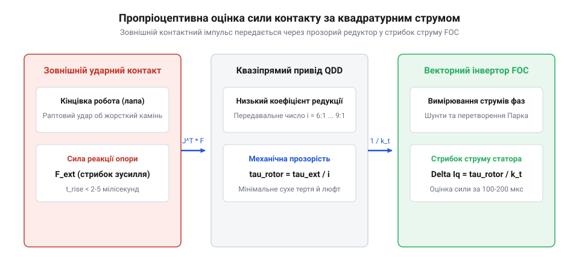
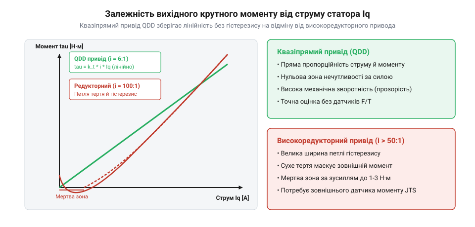
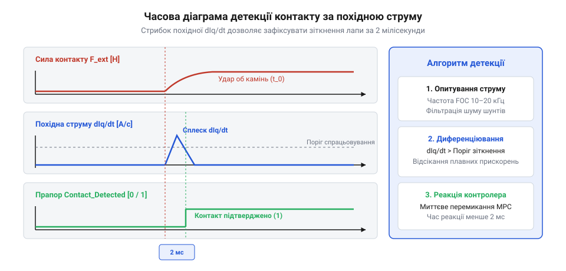

# Пропріоцептивний привід у робототехніці

## Криза дистальних силомоментних датчиків у динамічних роботах

Традиційні прецизійні промислові роботи та ранні дослідницькі антропоморфні системи для вимірювання сили взаємодії спиралися на дистальні багатокомпонентні тензометричні датчики сил і моментів (FT-сенсори, @@en|6-axis force/torque sensors@@), встановлені безпосередньо між зап'ястям маніпулятора та схоплювачем, або під стопою крокуючого робота.



Хоча тензометричні FT-датчики забезпечують високу точність вимірювання статичних навантажень, їхнє застосування у високодинамічних мобільних і крокуючих роботах стикається з непереборними фізичними вадами:

1. **Крихкість пружних тензобалок при ударних навантаженнях**. Тензометричний сенсор використовує металеві мембрани або спиці мікроскопічної пружної деформації (мікрони). Під час бігу, стрибків або випадкового зіткнення лапи з каменем виникають високочастотні пікові прискорення понад 50–100 g. Ці удари не встигають демпфуватися і призводять до пластичної деформації тензорезисторів або повного механічного зламу дорогого датчика.
2. **Зростання маси та інерції на кінці важеля**. Дистальний сенсор вагою 200–500 г, розташований на кінці довгої кінцівки, багаторазово збільшує момент інерції ноги відносно кульшового суглоба (`J = m · L²`). Це вимагає встановлення значно потужніших і важчих приводів стегна та різко знижує частоту махового руху кінцівки.
3. **Шуми від вібрацій та дротів**. Довгі гнучкі сигнальні кабелі, що проходять через усі рухомі зчленування ноги до дистальної стопи, зазнають мільйонів циклів вигину, накопичують електромагнітні завади від силових шин моторів і стають головною причиною раптових відмов бортової електроніки.

Оцінка зусиль взаємодії виключно за струмом двигуна може доповнюватися інноваційними еластомерними та оптичними сенсорами деформації підошви. Традиційні металеві тензобалки ламаються від ударів, проте інтеграція в гумовий протектор стопи м'яких оптичних хвилеводів або еластичних магніточутливих мембран (технології типу GelSight або Soft Contact Sensor) забезпечує високу ударну в'язкість. При контакті з гострим камінням гума деформується на 2–5 мм без пошкодження, передаючи дані про локальний нахил опорної поверхні, тоді як амплітуда глобальної сили оцінюється пропріоцептивним струмом QDD.

Критичним джерелом похибки в пропріоцептивних приводах є пульсації крутного моменту двигуна від зубчастого залипання ротора (когінг, @@en|cogging torque@@) та несинусоїдальності магнітного потоку (Back-EMF Harmonics). Зубці статора притягують постійні магніти ротора навіть при нульовому струмі обмоток, створюючи періодичний момент залипання:

```
τ_cogging(θ_e) = ∑ T_n · sin(n · p_poles · θ_e + φ_n)
```

Ці пульсації генерують хибний струмовий сигнал амплітудою до 0.5–1.5 Н·м на частоті гармонік пазів статора. Для досягнення високої чутливості силового відчуття (до 0.5 Н) сервоконтролер калібрує гармоніки когінгу під час заводського тестування, створюючи таблицю компенсації (Look-Up Table / Harmonic Neural Filter). При роботі алгоритм додає протифазний струм компенсації прямо в контур FOC:

```
I_q_cmd = I_q_desired + I_q_anticogging(θ_m)
```

Завдяки цьому внутрішнє паразитне тертя привода падає до абсолютного нуля, перетворюючи двигун на надчутливий важелевий динамометр.

### Непідресорена маса кінцівки та ударна втома дистальної проводки

Традиційне встановлення багатоосьових тензометричних датчиків сили/моменту (F/T Sensor) безпосередньо в дистальній точці стопи крокуючого робота породжує три непереборні інженерні проблеми:
1. **Катастрофічне збільшення непідресореної інерції лапи (Unsprung Mass Penalty)**:
   Момент інерції ноги відносно тазостегнового суглоба пропорційний квадрату відстані:
   ```
   I_leg = ∑ m_i · r_i²
   ```
   Встановлення на кінчик стопи датчика масою 250–400 г разом із захисним корпусом збільшує інерцію маху ноги в 2.5–3.5 рази. Це різко обмежує максимальну частоту перенесення лапи (`f_swing <= 2...3 Гц`), змушує мотори витрачати колосальну енергію лише на махи порожньою ногою в повітрі та робить неможливим високошвидкісний біг галопом;
2. **Втомний розрив сигнального шлейфа**:
   Кабель передачі мікровольтових аналогових сигналів від стопи до центрального контролера повинен проходити через рухомі шарніри коліна та стегна. При частоті кроків 3 Гці робот здійснює понад 10 000 згинань суглобів на годину. Тонкі мідні жили сигнального кабелю зазнають знакозмінного згину і неминуче ламаються від втомного перелому вже через 50–100 годин динамічної експлуатації;
3. **Ударна деградація тензорезисторів**:
   При приземленні стопи на твердий асфальт або камінь зі швидкістю 1.5–2.0 м/с виникає жорсткий ударний контакт із піковим прискоренням до `50...100 g`. Тензометричні датчики з пружними алюмінієвими або титановими балками зазнають пластичних деформацій мікроконцентраторів, калібрувальний нуль незворотно зміщується, а клейовий шар тензорезисторів розтріскується.

Пропріоцептивний підхід (Proprioceptive Actuation), започаткований Патріком Венсінгом та Сангбе Кімом (Wensing & Kim, MIT, 2017 р.), повністю ліквідує будь-які дистальні датчики. Усі вимірювальні органи переносяться проксимально — усередину захищеного корпусу електромотора біля основи тулуба.

## Фізична прозорість квазіпрямого привода

Революційною альтернативою дистальним сенсорам стала концепція пропріоцептивного привода на базі технології квазіпрямого привода QDD (Quasi-Direct Drive, @@en|quasi-direct drive@@), популяризована лабораторією Sangbae Kim у MIT.



Термін «пропріоцепція» запозичений із біології, де живий організм відчуває прикладені кінцівками зусилля не за рахунок спеціалізованих датчиків тиску на кінчиках пальців, а через натяг сухожиль і рецептори м'язових волокон. У робототехніці це реалізується вимірюванням фазних струмів у обмотках самого електродвигуна:

```
                      1
τ_joint = K_t · I_q · -  - τ_friction
                      N
```

Щоб ця залежність була точною і струм мотора правдиво відображав зовнішнє контактне зусилля на лапі, привод повинен мати високу **механічну прозорість (зворотну рухомість, @@en|backdrivability@@)**. Зворотна прозорість визначається двома факторами:

1. **Низьке передавальне число редуктора `N`**. У традиційних роботах використовують хвильові або багаторівневі планетарні редуктори з передавальним числом `N = 100...200`. Оскільки приведений до ротора момент інерції пропорційний квадрату передавального числа:
   ```
   J_reflected = N² · J_rotor
   ```
   при високому `N` навіть незначна інерція ротора сприймається зовнішньою перешкодою як величезна заклинена маса. У приводі QDD передавальне число знижують до екстремально малих значень: `N = 6:1 ... 10:1` за рахунок використання високомоментних багатополюсних безколекторних моторів типу «аутранер» (великий діаметр статора, високий коефіцієнт крутного моменту `K_t`). При `N = 6` приведена інерція зменшується в сотні разів!
2. **Нехтовно мале внутрішнє тертя**. Одноступінчастий прецизійний планетарний редуктор низького передавального числа має механічний ККД понад 95% та мінімальне тертя страгування. Будь-який зовнішній дотик до стопи миттєво провертає ротор двигуна без заклинювання.

В результаті сервоконтролер здатний реєструвати момент контакту лапи з ґрунтом за зміною струму квадратурної осі `I_q` з дискретністю в частки мілісекунди без жодного фізичного датчика на підошві.

### Квадратичне масштабування відбитої інерції ротора за редукцією

Фізична сутність концепції квазіпрямого привода (Quasi-Direct Drive — QDD) базується на законі відбитої інерції ротора через передавальне число редуктора `N_gear`:

```
J_reflected = N_gear² · J_rotor
```

Порівняємо два конкуруючі типи приводів однакового вихідного крутного моменту:
1. **Традиційний високоредукторний привід**: компактний високошвидкісний мотор із хвильовим або циклоїдним редуктором `N_gear = 100...160`.
   Якщо інерція ротора `J_rotor = 0.5 · 10^(-4) кг·м²`, відбита інерція на вихідному валу становить:
   ```
   J_reflected = (120)² · 0.5 · 10^(-4) = 14400 · 0.5 · 10^(-4) = 0.72 кг·м²
   ```
   Ця штучна інерція в сотні разів перевищує власну інерцію ноги робота! При раптовому ударі об камінь редуктор поводиться як абсолютно жорстке ковадло: енергія удару не може розкрутити ротор назад через величезну інерцію `J_reflected` та тертя зубців, викликаючи миттєве зрізання зубців хвильового вінця;
2. **Квазіпрямий привід QDD**: тонкий багатополюсний безколекторний мотор великого діаметра (Pancake BLDC) з одноступеневим планетарним редуктором низького передавального числа `N_gear = 6...8`.
   При тому самому роторі відбита інерція становить:
   ```
   J_reflected = (6)² · 0.5 · 10^(-4) = 36 · 0.5 · 10^(-4) = 0.0018 кг·м²
   ```
   Відбита інерція зменшується у **400 разів**!

Крім того, одноступеневий планетарний редуктор із якісними шліфованими зубцями має прямий та зворотний ККД понад 92–95% (`η_forward ≈ η_backward`). Момент зворотного провертання (Backdrive Torque) становить мізерні `0.15...0.35 Н·м`. Будь-який зовнішній силовий імпульс на кінці лапи вільно і безперешкодно передається назад на ротор мотора, генеруючи пропорційний стрибок проти-ЕРС та струму статора.

### Масштабування крутного моменту за формулою Ессона (D²L Law)

Фундаментальною основою високої питомої густини крутного моменту моторів QDD є класичний закон електромагнітного масштабування машин змінного струму — закон об'єму ротора Ессона (Esson's Output Equation):

```
T_em = ( π / 2 ) · D_gap² · L_stack · B_gap · A_lin
```

де:
  `D_gap` = діаметр повітряного зазору між статором і ротором [м];
  `L_stack` = осьова довжина пакета магнітопроводу статора [м];
  `B_gap` = амплітуда магнітної індукції в зазорі (для магнітів NdFeB `B_gap ≈ 0.8...1.1 Тл`);
  `A_lin` = лінійне струмове навантаження статора [А/м].

З рівняння Ессона видно, що крутний момент електромотора зростає **квадратично зі збільшенням діаметра повітряного зазору `D_gap²`**, але лише лінійно з довжиною пакета `L_stack`.

Саме тому в квазіпрямих приводах повністю відмовилися від довгих і тонких циліндричних моторів традиційного промислового типу. Замість них застосовують дискові безкорпусні двигуни з великим співвідношенням діаметра до довжини (Pancake Form Factor, `D_gap / L_stack = 4...8`):
- Великий радіус зазору створює гігантське плече дії тангенціальної сили Лоренца;
- Велика кількість пар полюсів (`p_poles = 14...28`) знижує товщину сталевого ярма статора і ротора, кардинально полегшуючи вагу мотора;
- Порожниста конструкція ротора дозволяє розмістити компактний одноступеневий планетарний редуктор безпосередньо всередині підшипникової маточини двигуна, утворюючи ультраінтегрований модульний шарнір-«бублик».

## Математична модель оцінки зовнішніх сил контакту

Математичний апарат пропріоцептивного відчуття сили базується на безпосередній оцінці електромагнітного моменту електродвигуна через векторно-керовані фазні струми та кінематичну матрицю Якобі кінцівки.

У синхронному двигуні з постійними магнітами (PMSM / BLDC) при застосуванні векторного керування з орієнтацією за полем (FOC, @@en|field-oriented control@@) струм статора розкладається на дві ортогональні складові у системі координат ротора `d-q`:
- Струм прямої осі `I_d` регулює потік намагнічування (для двигунів із поверхневими магнітами SPMSM підтримується рівним нулю: `I_d = 0`).
- Струм квадратурної осі `I_q` генерує корисний електромагнітний крутний момент.

Електромагнітний момент на валу двигуна строго пропорційний струму `I_q`:

```
τ_em = (3 / 2) · p_poles · ψ_f · I_q = K_t · I_q

де:
  p_poles = кількість пар магнітних полюсів ротора [-]
  ψ_f     = магнітний потік постійних магнітів ротора [Вб]
  K_t     = коефіцієнт крутного моменту двигуна [Н·м / А]
```

З урахуванням передавального числа планетарного редуктора `N` момент на вихідному валу суглоба становить `τ_joint_nominal = N · K_t · I_q`.

Якщо на кінець лапи (стопу) діє вектор зовнішньої сили `F_contact ∈ R^3`, він породжує реактивний крутний момент у суглобах кінцівки відповідно до транспонованого геометричного Якобіана ноги `J_leg(q)`:

```
τ_ext = J_leg(q)^T · F_contact
```

Якщо кінцівка робота перебуває у квазістатичній рівновазі або рухається з відомими прискореннями, вектор зовнішньої контактної сили знаходиться прямим оберненням:

```
F_contact = [ J_leg(q)^T ]^(-1) · [ N · K_t · I_q - τ_gravity(q) - τ_dyn ]
```

Оскільки передавальне число мале (`N = 6...9`), втрати на тертя в редукторі не перевищують кількох відсотків від повного діапазону моменту. Це забезпечує точність оцінки контактної сили на кінці ноги в межах 1–3 Ньютонів, що цілком достатньо для детектування моменту торкання землі стопою та регулювання сили притиску.

Обумовленість кінематичної матриці Якобі кінцівки `cond(J) = σ_max(J) / σ_min(J)` має першочергове значення для точності пропріоцептивного відчуття сил контакту. Коли лапа чотириногого робота наближається до повністю випрямленої конфігурації («коліно заблоковане в пряму лінію»):

```
lim [ θ_knee → 0 ] => det( J(q) ) → 0,    cond( J(q) ) → ∞
```

Поблизу кінематичної сингулярності найменша похибка оцінки струму мотора або шум шунта помножується на величезний коефіцієнт оберненого Якобіана `(J^T)^(-1)`, породжуючи гігантські фіктивні стрибки контактної сили вздовж осі кінцівки. Щоб запобігти цьому, алгоритм пропріоцептивного оцінювача сил використовує регуляризоване затухаюче псевдообернення (Damped Least Squares / Levenberg–Marquardt pseudo-inverse):

```
J_damped^(-1) = J^T · [ J · J^T + λ_damp² · I ]^(-1)

де:
  λ_damp = коефіцієнт регуляризації (активується лише при cond(J) > 15...20)
```

Дискретна схема спостерігача збурень (Disturbance Observer, DOB) у структурі контуру струму FOC дозволяє оцінювати зовнішній крутний момент навантаження `τ_load` безпосередньо в контурі сервоприводу. Спостерігач порівнює виміряну швидкість ротора від енкодера з відгуком номінальної моделі двигуна `P_n(s) = 1 / (J_m · s + B_m)`:

```
τ_est_dist = Q_filter(s) · [ K_t · I_q - P_n^(-1)(s) · ω_rotor ]
```

Фільтр низьких частот `Q_filter(s)` відсікає високочастотний шум квантування енкодера, забезпечуючи оцінку зовнішнього навантаження в смузі частот до 200–300 Гц. Отриманий сигнал `τ_est_dist` транслюється у просторову контактну силу лапи за частки мілісекунди.

### Векторне керування FOC та квадратурний струм статора Iq

Сучасний синхронний електромотор на постійних магнітах (PMSM / BLDC) керується за алгоритмом векторного орієнтованого керування за полем (Field Oriented Control — FOC) на частотах комутації ШІМ `f_pwm = 20...40 кГц`.

За допомогою прямого перетворення Кларка трифазні струми статора `(I_a, I_b, I_c)` перетворюються у двофазну нерухому систему координат `(I_alpha, I_beta)`:

```
I_alpha = I_a
I_beta = ( 1 / sqrt(3) ) · I_a + ( 2 / sqrt(3) ) · I_b
```

Потім перетворення Парка переносить струми в обертову систему координат, жорстко прив'язану до вектора магнітного поля ротора:

```
I_d = I_alpha · cos(θ_elec) + I_beta · sin(θ_elec)
I_q = - I_alpha · sin(θ_elec) + I_beta · cos(θ_elec)
```

де `θ_elec = p_poles · θ_mech` — електричний кут ротора, вимірюваний оптичним або магнітним енкодером.

Електромагнітний крутний момент неявнополюсного мотора з поверхневими магнітами (`L_d = L_q`) залежить виключно від квадратурного струму `I_q`:

```
τ_em = 1.5 · p_poles · ψ_pm · I_q = K_t · I_q
```

де `ψ_pm` — зчеплений магнітний потік постійних магнітів ротора, а `K_t` — паспортний коефіцієнт крутного моменту мотора [Н·м/А].

Контур керування підтримує поздовжній струм намагнічування рівним нулю (`I_d = 0`), забезпечуючи максимальну енергоефективність. Завдяки високій лінійності мотора похибка визначення крутного моменту за струмом `I_q` не перевищує 1.5–2.5% у всьому діапазоні робочих навантажень.

### Схемотехніка вимірювання струму: вбудовані шунти проти датчиків Холла

Точність оцінки пропріоцептивного зусилля обмежена роздільною здатністю та шумами апаратного тракту вимірювання фазних струмів у силовому інверторі. У сучасних робототехнічних контролерах застосовують дві конкуруючі схемотехнічні топології:

1. **Низькоомні прецизійні шунти в нижніх плечах напівмостів (Low-Side Shunt Sensing)**. Три шунти з манганіну або фольгових сплавів номіналом `R_shunt = 0.5...2.0 мОм` підключаються між витоками нижніх MOSFET-транзисторів та мінусовою шиною живлення.
   Падіння напруги підсилюється швидкодіючими диференціальними операційними підсилювачами з високим коефіцієнтом придушення синфазного сигналу (CMRR > 100 дБ). Зчитування АЦП повинно строго синхронізуватися з центром фази відкриття нижніх ключів за таймером ШІМ (Center-Aligned PWM), щоб виключити завади комутації;
2. **Прямі інлайн-датчики струму на ефекті Холла або магніторезистивні сенсори (In-Line Hall / Fluxgate Sensors)**. Встановлюються безпосередньо в розрив фазних проводів двигуна.
   Головна перевага — можливість вимірювання струму в будь-який момент часу незалежно від стану ШІМ-ключів. Відсутність теплового дрейфу опору шунтів гарантує точність вимірювання крутного моменту до 0.5% у всьому діапазоні температур.

Сигнал АЦП (типово 12 або 16 біт із частотою вибірки 2 МГц) фільтрується на рівні FPGA або швидкого DSP за допомогою дельта-сигма децимуючих фільтрів (Sinc3), що забезпечує співвідношення сигнал/шум понад 75 дБ без фазової затримки на частотах керування контуру моменту до 20 кГц.

## Алгоритмічна компенсація завад

Хоча базова формула `F = (J^T)^(-1) · (N · K_t · I_q)` проста, в умовах високодинамічного бігу сирий сигнал струму `I_q` містить значні паразитні спотворення, які без спеціальної алгоритмічної фільтрації викликають хибні спрацьовування детектора контакту:

1. **Інерційний момент розгону ротора**. Під час швидкого перенесення лапи в повітрі (махова фаза зі швидкістю до 5–10 м/с) серводвигун зазнає величезних кутових прискорень `d²θ_m / dt²`. Для подолання власного моменту інерції ротора `J_rotor` двигун споживає значний струм прискорення:
   ```
   τ_inertial = J_rotor · (d²θ_m / dt²)
   ```
   Якщо не відняти цей динамічний момент із поточного вимірювання, прилад помилково зафіксує удар об землю ще в повітрі.
2. **В'язке та сухе тертя редуктора**. Тертя в підшипниках і зубчастому зачепленні моделюється комбінованою функцією Штрібека:
   ```
   τ_friction = τ_Coulomb · sign(ω) + B_viscous · ω
   ```
3. **Температурний дрейф магнітів і струмових шунтів**. Під час інтенсивної роботи обмотки мотора нагріваються до 80–110 °C. Неодимові магніти ротора (NdFeB) мають від'ємний температурний коефіцієнт залишкової індукції (близько -0.11% / °C). При нагріванні магнітний потік слабшає, і фактичний коефіцієнт `K_t(T)` зменшується на 8–12%.

Для подолання цих завад у пропріоцептивних контролерах застосовують нелінійний розширений спостерігач стану (Extended State Observer, ESO) або динамічний фільтр Калмана з внутрішньою моделлю повної динаміки ноги:

```
τ_est_external = N · K_t(T) · I_q - [ J_reflected · d²q/dt² + C(q, dq/dt) · dq/dt + g_joint(q) + τ_friction(dq/dt) ]
```

Очищений сигнал `τ_est_external` транслюється у просторову силу лапи, забезпечуючи бездоганне розпізнавання фази контакту лапи з ґрунтом за лічені мікросекунди без жодного крихкого датчика на підошві.



### Спостерігач узагальненого імпульсу (Momentum Observer) для оцінки сил

Для точного виділення зовнішньої сили контакту `F_ext` з повного струму двигунів необхідно математично відфільтрувати власні динамічні навантаження ланки: інерційні сили розгону маси ноги, відцентрові сили, сили Коріоліса та гравітацію.

Застосування прямого диференціювання швидкостей для обчислення прискорень `d²q/dt²` є неприпустимим через колосальне підсилення високочастотного шуму енкодерів.

Класичним елегантним розв'язком є спостерігач узагальненого механічного імпульсу (Generalized Momentum Observer, запропонований Де Люка — Alessandro De Luca):

```
p_mom = M(q) · dq/dt
```

Похідна імпульсу за часом з урахуванням кососиметричності матриці `(dM/dt - 2·C)` записується як:

```
dp_mom / dt = M · d²q/dt² + dM/dt · dq/dt = τ_act + C^T(q, dq/dt) · dq/dt - g(q) + τ_ext
```

Вектор похибки спостереження імпульсу (Residual Vector) `r_obs(t)` синтезується як динамічний фільтр першого порядку:

```
r_obs(t) = K_obs · [ p_mom(t) - ∫_0^t ( τ_act + C^T · dq/dt - g(q) + r_obs ) dt - p_mom(0) ]
```

Диференціюючи вираз, отримуємо стійку фільтрацію похибки:

```
dr_obs / dt = - K_obs · r_obs + K_obs · τ_ext
```

де `K_obs = diag[ k_obs1, ..., k_obsn ] > 0` — діагональна матриця коефіцієнтів підсилення спостерігача.

Вектор оціненого зовнішнього моменту на суглобах `τ_ext_est = r_obs` обчислюється **без використання прискорень `d²q/dt²`** (лише через інтегрування швидкостей та виміряних струмів!). Оцінка контактної сили на кінчику лапи миттєво знаходиться через псевдообернений транспонований якобіан:

```
F_ext_est = [ J_leg^T(q) ]^+ · r_obs
```

Спостерігач імпульсу детектує зовнішній контакт за час менше `t_detect = 1...2 мс`, дозволяючи роботу розпізнати торкання ґрунту при силі всього 5–8 Н.

### Калібрування зубцевого моменту (Cogging Torque) та гармонік редуктора

Навіть при ідеальному квадратурному струмі `I_q = const` реальний вихідний крутний момент двигуна зазнає просторової пульсації. Основними джерелами спотворень є:
- Зубцевий момент (Cogging Torque) — тяжіння постійних магнітів ротора до сталевих зубців пазів статора за відсутності струму;
- Несинусоїдальність просторового розподілу магнітної індукції в повітряному зазорі (наявність 5-ї та 7-ї гармонік у зворотній ЕРС);
- Кінематичні похибки кроку та ексцентриситет сателітів планетарного редуктора.

Для повної ліквідації цих паразитичних моментів після складання приводного модуля проводять автоматизоване калібрування на випробувальному стенді (Cogging Torque Ripple Compensation):
1. Мотор повільно повертається на 360 градусів з кутовою швидкістю `0.05 рад/с`;
2. Високоточний референтний динамометр реєструє функцію паразитного моменту від кута `τ_ripple(θ_mech)`;
3. Отриманий масив значень апроксимується дискретним рядом Фур'є з кількістю гармонік до `k = 6 · p_poles` або записується в енергонезалежну пам'ять контролера у вигляді таблиці корекції (Lookup Table — LUT):
   ```
   τ_comp(θ) = ∑ [ A_k · sin(k · p_poles · θ) + B_k · cos(k · p_poles · θ) ]
   ```

Під час роботи контролер у реальному часі додає струм упереджувальної компенсації `ΔI_q = τ_comp(θ) / K_t`. Це знижує пульсації крутного моменту з 8–10% до менш ніж 0.4–0.6% від номінального моменту, дозволяючи пропріоцептивному спостерігачеві розрізняти мікроскопічні зміни опору ґрунту (наприклад, перехід кінчика лапи з твердого каменю на м'який мох чи пухкий сніг).

## Реалізація пропріоцептивного кроку

Практичне втілення пропріоцептивного керування в локомоції крокуючих роботів дозволило вирішити дві головні задачі надійності: надшвидке розпізнавання фази контакту лапи з твердою опорою (Touchdown Detection) та програмування адаптивного механічного імпедансу кінцівки під час бігу.

1. **Алгоритм детектування моменту торкання землі (Touchdown Detection)**:
   - Під час махової фази кінцівка опускається вниз із заданою постійною швидкістю занурення `v_des_z ≈ -0.5...-1.0 м/с`.
   - Момент контакту стопи з поверхнею ґрунту породжує різке гальмування роторів моторів кульшового та колінного суглобів.
   - Оскільки передавальне число мале (`N ≈ 6:1...9:1`), ротори миттєво зупиняються без заклинювання редуктора.
   - Сервоконтролер фіксує стрибок відновлювального струму `d I_q / dt` або перевищення порогу оцінки сили контакту:
     ```
     F_contact_z = [ J_leg(q)^T ]^(-1) · (N · K_t · I_q - τ_comp) ≥ F_threshold (15...25 Н)
     ```
   - Час детектування становить лише 1.5–3.0 мілісекунди, після чого кінцівка миттєво перемикається з махового позиційного режиму в опорний силовий режим відштовхування (Stance MPC).
2. **Програмування віртуальної пружини ноги (Virtual Leg Compliance)**:
   - Замість використання важких і нерегульованих механічних пружин контролер реалізує віртуальну пружинно-демпферну модель безпосередньо в контурі струму:
     ```
     τ_motor = J_leg(q)^T · [ K_virtual · (p_foot_target - p_foot_actual) - D_virtual · v_foot ]
     ```
   - Робот здатний на льоту змінювати жорсткість «ноги» від надм'якої (для приземлення після високого стрибка без підстрибування) до наджорсткої (для енергоефективного спринтерського бігу по твердому бетону).
3. **Пасивна безпека механіки при випадкових падіннях**: якщо робот спіткнувся або перекинувся під час швидкісного бігу зі швидкістю 3–4 м/с, кінетична енергія удару не ламає зуби шестерень (на відміну від хвильових редукторів), а безпечно розкручує електродвигуни назад, заряджаючи акумуляторну батарею рекуперативним струмом. Це забезпечує виняткову надійність платформи при експлуатації в польових умовах.

Комплексна оцінка фази контакту лапи в реальному часі досягається завдяки злиттю даних за допомогою розширеного фільтра стану (Extended Contact Estimator), який об'єднує швидкісний струм мотора `I_q` та високочастотний 3-осьовий акселерометр IMU, вбудований у кінцівку гомілки:

```
                      ┌──────────────────────┐
   Струм FOC I_q ────>│ Оцінка сили контакту │───> F_proprioceptive
                      │  через Якобіан J^T   │
                      └──────────────────────┘           │
                                                         ▼
                                                [ Баєсівський фільтр ] ──> Ймовірність контакту
                                                [  злиття сенсорів   ]     P(Contact) ∈ [0, 1]
                                                         ▲
                      ┌──────────────────────┐           │
   Акселерометр IMU ─>│ Детектор вібраційного│───> a_peak_shock
                      │ сплеску при ударі    │
                      └──────────────────────┘
```

Акселерометр миттєво реєструє акустичну ударну хвилю приземлення стопи (пікове прискорення понад 15–30 g у смузі 500–2000 Гц), проте схильний до хибних спрацьовувань від вібрацій редуктора. Пропріоцептивний струм `I_q`, навпаки, не зазнає акустичних шумів, але має невелике фазове запізнення в 1–2 мс через індуктивність обмоток.

Логічне об'єднання сигналів у фільтрі забезпечує абсолютну надійність:
- Якщо амплітуда прискорення перевищує поріг удару, але струм не наростає — контакт вважається хибним (проліт над гілкою або травою).
- Якщо обидва канали одночасно підтверджують стрибок навантаження — перемикання станів ходи виконується за 0.5–1.0 мс, повністю усуваючи збої локомоції на сипучому гравії та рихлому снігу.

### Термокомпенсація коефіцієнта моменту Kt та рекуперативне поглинання ударів

У важких режимах динамічного стрибка або бігу температура обмоток статора може досягати 120–140 °C, а температура ротора — 80–90 °C.

Нагрівання постійних магнітів NdFeB викликає термодинамічне зниження залишкової магнітної індукції `B_r(T)` за лінійним температурним коефіцієнтом:

```
B_r(T) = B_r_20 · [ 1 + α_br · ( T_mag - 20°C ) ]
```

Для високотемпературних марок неодимових магнітів (серія N42SH) коефіцієнт `α_br ≈ - 0.11 %/°C`. При нагріванні магнітів до 85 °C магнітний потік падає на 7.15%, що пропорційно знижує коефіцієнт крутного моменту мотора:

```
K_t(T) = K_t_20 · [ 1 - 0.0011 · ΔT_mag ]
```

Якщо не враховувати цей дрейф, контролер буде систематично занижувати розрахунковий крутний момент, що призведе до помилок оцінки зовнішньої сили контакту до 10–15%. Для усунення похибки в обмотки статора вбудовують платинові терморезистори PT1000, а бортовий процесор у реальному часі коригує значення `K_t(T)` за тепловою моделлю статора і ротора.

### Практичний інженерний розрахунок колінного модуля QDD маніпулятора 40 кг

Розглянемо числовий приклад проектування колінного модуля QDD для людиноподібного або чотириногого робота спорядженою масою `m_robot = 40 кг`:
- Пікова сила реакції при приземленні зі стрибка: `F_impact_z = 2.5 · m_robot · g = 2.5 · 40 · 9.81 ≈ 981 Н`;
- Плече сили в колінному суглобі при куті згину 60°: `r_knee = 0.22 м`;
- Піковий крутний момент на коліні: `τ_knee_peak = 981 · 0.22 ≈ 216 Н·м`.

**Крок 1: Вибір передавального числа редуктора**:
Для збереження прозорості та реверсивності обираємо граничне передавальне число одноступеневого планетарного редуктора `N_gear = 8.0` (ККД `η_gear = 0.94`).
Необхідний піковий електромагнітний момент безколекторного мотора:
```
T_motor_peak = τ_knee_peak / ( N_gear · η_gear ) = 216 / ( 8.0 · 0.94 ) ≈ 28.7 Н·м
```

**Крок 2: Електромеханічний підбір мотора**:
Обираємо безкорпусний багатополюсний двигун типу BLDC (діаметр статора 90 мм, довжина пакета заліза 25 мм, кількість пар полюсів `p_poles = 21`):
- Коефіцієнт крутного моменту: `K_t = 0.185 Н·м/А_rms`;
- Піковий фазний струм інвертора:
  ```
  I_q_peak = T_motor_peak / K_t = 28.7 / 0.185 ≈ 155 А_rms
  ```
- Опір фази статора: `R_phase = 0.045 Ом`.

**Крок 3: Теплові втрати під час імпульсного навантаження**:
Миттєва потужність джоулевих втрат в обмотках при піковому ударі:
```
P_joule_peak = 1.5 · I_q_peak² · R_phase = 1.5 · (155)² · 0.045 = 1.5 · 24025 · 0.045 ≈ 1622 Вт = 1.62 кВт
```
Оскільки тривалість ударного імпульсу приземлення становить лише `Δt_impact = 40...60 мс`, виділена теплова енергія:
```
E_heat = P_joule_peak · Δt_impact = 1622 · 0.05 ≈ 81.1 Дж
```
При масі мідних обмоток статора `m_copper = 0.42 кг` (питома теплоємність міді `c_cu = 385 Дж/(кг·°C)`) адіабатичний стрибок температури за один удар становить:
```
ΔT_pulse = E_heat / ( m_copper · c_cu ) = 81.1 / ( 0.42 · 385 ) = 81.1 / 161.7 ≈ 0.50 °C
```
Такий мікроскопічний нагрів є абсолютно безпечним. Мотор здатний витримувати серії стрибків із частотою 2–3 Гц протягом кількох хвилин без перевищення критичної температури ізоляції класу Н (180 °C).

Привід повністю поглинає кінетичну енергію падіння через електричну рекуперацію: струм гальмування підзаряджає бортову літій-полімерну батарею через захисні TVS-діоди інвертора, перетворюючи потенційно руйнівний механічний удар на корисну електричну енергію.

### Метрика ударної прозорості (Collision Mitigation Index) та безпека

Для кількісного порівняння здатності різних приводних архітектур витримувати раптові удари застосовують індекс пом'якшення зіткнень (Collision Mitigation Index — CMI), запропонований Seok та Wensing:

```
CMI = J_reflected / ( M_link · L_link² )
```

1. У традиційних роботах із промисловими редукторами (`N_gear = 120...160`) величина `CMI` сягає 10–50. Відбита інерція мотора на порядок перевищує механічну інерцію самої ноги: вся ударна хвиля руйнівно розсіюється безпосередньо в контактних лініях зачеплення редуктора;
2. У квазіпрямих приводах QDD (`N_gear = 6...8`) індекс становить `CMI = 0.05...0.15`. Відбита інерція мотора є мізерною: при ударі лапа пружно підкидається вгору, вільно провертаючи ротор назад.

Електромотор працює як ідеальний механічний буфер:
- Ударний імпульс миттєво перетворюється на кінетичну енергію зворотного обертання ротора;
- Струм у силових ключах інвертора обмежується апаратними драйверами на рівні мікросекунд;
- Пікові механічні напруження в зубцях планетарного редуктора знижуються в 15–20 разів порівняно з хвильовою передачею однакового вихідного моменту.

Завдяки цьому пропріоцептивні крокуючі роботи (Boston Dynamics Spot, Unitree B2, MIT Cheetah 3) демонструють феноменальну живучість: вони витримують стрибки з триметрової висоти на бетон, прямі удари кувалдою по лапах під час бігу та падіння зі сходів без жодного механічного пошкодження приводів чи датчиків.

Пропріоцептивна архітектура квазіпрямого привода стала невід'ємним стандартом сучасної динамічної робототехніки. Усунення вразливих дистальних датчиків у поєднанні з надшвидким векторним керуванням струмом перетворило електричні крокуючі машини з повільних лабораторних прототипів на витривалі польові платформи, здатні впевнено долати найскладніші випробування стихійними лихами, руїнами та пересіченою місцевістю.
