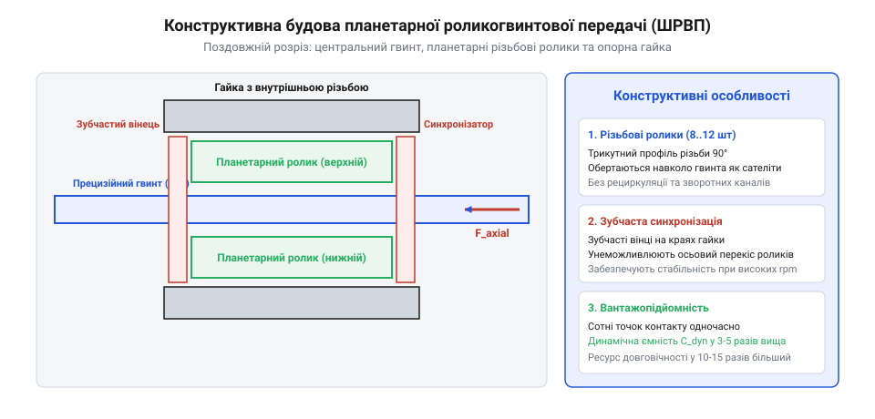
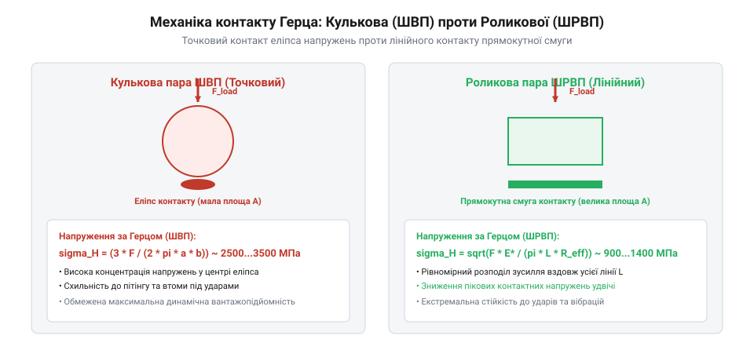
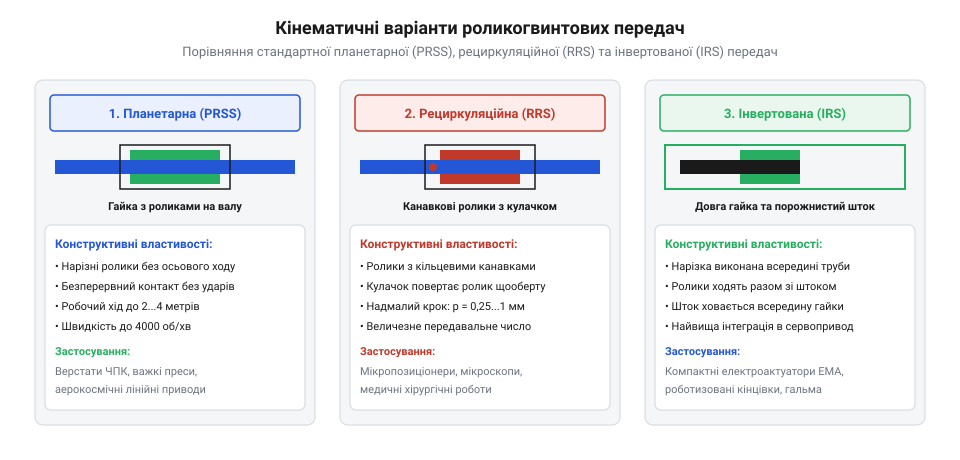

# Роликогвинтова передача (ШРВП)

## Механічні обмеження кулькових гвинтових пар

Кулькові гвинтові передачі (ШВП, @@en|ball screw@@) десятиліттями слугували основним стандартом перетворення обертального руху сервомотора в поступальний рух вихідних ланок. Завдяки заміні тертя ковзання на тертя кочення сталевих кульок по гвинтових канавках готичного профілю досягається високий ККД (понад 90%) та мінімальний пусковий момент. Проте розвиток важких електромеханічних приводів (EMA, @@en|electro-mechanical actuators@@) у промислових роботах великої вантажопідйомності та авіакосмічній техніці виявив критичні межі кулькової технології.



Головним механічним обмеженням ШВП є геометрія контакту:

1. **Точковий контакт Герца**. Сферична кулька торкається увігнутої доріжки кочення у двох точках. Площа контакту є крихітним еліпсом з надвисокою концентрацією контактних напружень. При великих осьових зусиллях тиск у плямі контакту перевищує 3000–3500 МПа, що призводить до пластичної деформації доріжок (бринелювання @@en|brinelling@@) та швидкого втомного пітингу.
2. **Ліміт діаметра та кількості тіл кочення**. У заданих габаритах гайки кількість кульок суворо обмежена внутрішнім простором. Збільшення діаметра кульки покращує навантажувальну здатність, але зменшує їхню кількість у витку, зменшуючи жорсткість і збільшуючи крок різьби.
3. **Обмеження системи рециркуляції**. Кульки повинні безперервно повертатися з кінця робочої зони на початок через зовнішні трубки або внутрішні пластикові вкладиші-дефлектори. На високих швидкостях обертання удари кульок об дефлектор генерують руйнівні імпульсні навантаження. Швидкісний фактор кулькових пар обмежений параметром `d_n = d_nominal · n_rpm ≤ 100 000...150 000 мм·об/хв`.
4. **Низька стійкість до ударів**. Короткочасний ударний імпульс від корисного навантаження вдавлює кульки в доріжки, безповоротно порушуючи плавність ходу та позиційну точність приводу.

Специфічним механізмом руйнування різьбових передач у високоточних сервоприводах із короткими ходами є контактна втома під дією зворотно-поступального мікроруху — фретингова корозія та фретинг-пітинг (@@en|fretting corrosion / false brinelling@@). Коли привід годинами здійснює високочастотні мікроколивання (наприклад, у контурі стабілізації оптичного гіропідвісу чи рульового плавника дрона з амплітудою ходу менше половини кроку різьби `Δx < 0.5 · p`), тіла кочення не роблять повного оберту.

Мастило вичавлюється із зони контакту, захисна оксидна плівка металу безперервно стирається, і мікрозварювання нерівностей генерує тверді оксидні частки заліза (Fe2O3), які діють як абразивна паста. У кулькових парах це знищує доріжку кочення за лічені тижні. У ШРВП довга лінія контакту роликів краще утримує мікрокапілярний шар пластичного мастила, знижуючи швидкість зносу при мікрорухах у 6–10 разів.

Розподіл осьової сили вздовж довжини різьбової гайки має виражену експоненційну нерівномірність внаслідок пружних деформацій тіла вала та гайки. Вал під дією осьової сили стискається (або розтягується), а гайка зазнає протилежної пружної деформації. Згідно з класичним розрахунком М. Жуковського та стандартом ISO 3408, навантаження на перший активний виток гайки досягає максимуму, спадаючи до кінця гайки:

```
F_thread(j) = F_axial · [ sinh(λ · [L_nut - z_j]) / (λ · cosh(λ · L_nut)) ]

де:
  L_nut = довжина гайки [м]
  λ     = коефіцієнт пружного узгодження різьби (λ ∝ sqrt(1 / E_screw + 1 / E_nut))
  z_j   = осьова координата j-го витка [м]
```

Перші 3–4 витки сприймають до 50–65% повного осьового навантаження! Для згладжування цього піку в прецизійних ШРВП застосовують змінний крок нарізання перших витків гайки або спеціальне конічне витончення стінки гайки на вході (м'який фланець), що вирівнює тиск по всіх роликах.

### Руйнування контурів циркуляції та швидкісні ліміти ШВП

Традиційна кулькова гвинтова передача (ШВП / Ball Screw) досягає своєї фізичної межі працездатності при високих швидкостях обертання через кінематику повернення тіл кочення. Щоб кульки здійснювали нескінченний цикл циркуляції, гайка ШВП оснащується внутрішніми відбивачами або зовнішніми поворотними трубками (Recirculation Tubes), які перехоплюють кульку з робочої канавки гвинта та перенаправляють її через тіло гайки назад на початковий виток.

Швидкісний поріг кулькової пари лімітується фактором швидкості `d_m · n`:

```
DN = d_m · n   [мм · об/хв]
```

де `d_m` — середній ділильний діаметр гвинта [мм], а `n` — швидкість обертання [об/хв].

У кулькових парах при значеннях `DN > 120 000...150 000` кульки рухаються в канавці з лінійною швидкістю понад 15–20 м/с. При вході у відбивач кулька зазнає жорсткого тангенціального удару об дефлектор. Центробіжні сили та сили інерційного гальмування породжують втомне сколювання кромок трубки повернення, заклинювання кульок між собою та катастрофічний розрив циркуляційного контуру.

На відміну від ШВП, у планетарних роликогвинтових передачах (ПРГП / Planetary Roller Screw) тіла кочення здійснюють безперервний планетарний рух навколо центрального гвинта без переривання траєкторії. Відсутність зворотного каналу та ударних зон циркуляції дозволяє роликогвинтовим механізмам стабільно працювати при факторах швидкості до `DN = 350 000...450 000` та витримувати лінійні прискорення привода до `30...50 g`, що робить їх незамінними у високодинамічних авіаційних сервоприводах елеронів і ногах крокуючих роботів.

### Порівняльна осьова жорсткість та класи точності

Осьова пружна піддатливість гвинтового привода складається з контактної деформації тіл кочення `δ_contact`, деформації тіла гвинта на розтяг/стиск `δ_screw` та деформації опорних підшипникових вузлів `δ_bearing`:

```
δ_total = δ_contact + δ_screw + δ_bearing
```

У кульковій парі точковий контакт Герца зумовлює нелінійну залежність деформації від осьової сили `F_ax` за законом ступеня 2/3: `δ_contact_ball ∝ (F_ax / n_balls)^(2/3)`. У роликогвинтовій передачі лінійний контакт роликів забезпечує майже лінійну залежність із на порядок меншим коефіцієнтом податливості:

```
δ_contact_roller ≈ 0.25...0.35 · δ_contact_ball
```

Завдяки цьому сумарна осьова жорсткість роликогвинтової гайки в 3–4 рази перевищує жорсткість кулькової пари аналогічного діаметра. Це забезпечує екстремальну кінематичну точність позиціонування під дією змінного зовнішнього навантаження: відхилення кроку за стандартом ISO 3408-3 вкладається у прецизійні класи `G 1` та `G 3` (похибка ходу не більше 6 мкм на довжині 300 мм).

### Зрізання еліпса контакту Герца при граничних кутах навантаження

У кулькових гвинтових парах кут початкового контакту кульки з дуговим профілем канавки «готична арка» зазвичай становить `α_0 = 45°`. Проте під дією великих осьових навантажень `F_ax` кульки зазнають контактної деформації та піднімаються вгору по похилій поверхні витка, внаслідок чого робочий контактний кут зростає:

```
α_work = arccos [ ( cos(α_0) - (δ_axial / (2 · r_groove - d_ball)) ) ]
```

Під великим навантаженням площа точкового контакту Герца розширюється в еліпс із півосями `a_contact` та `b_contact`. Якщо робочий кут наближається до вершини профілю різі (`α_work -> 60°`), верхівка еліпса контакту виходить за межі заокруглення канавки на відкриту циліндричну кромку вершини гвинта (явище обрізання контактного еліпса @@en|contact ellipse truncation@@).

На гострій кромці виникає колосальний концентратор напружень: тиск Герца стрибкоподібно зростає з 2500 МПа до 4500–5000 МПа, перевищуючи межу текучості сталі. Метал кромки зазнає пластичного сплющування, зароджуються мікротріщини, які вже за кілька сотень робочих циклів призводять до катастрофічного відколювання частинок сталі та заклинювання всієї передачі. У роликогвинтових парах за рахунок протяжного лінійного контакту та кута профілю 90° контактний майданчик має десятикратний запас відстані до кромки, що повністю виключає явище зрізання еліпса навіть при триразових перевантаженнях.

## Кінематична архітектура планетарної роликогвинтової передачі

Планетарна роликогвинтова передача (ШРВП, @@en|planetary roller screw / roller screw@@) долає обмеження точкового контакту завдяки принципово іншій кінематичній схемі. Замість хаотично циркулюючих кульок проміжними тілами кочення виступають кілька прецизійних нарізних роликів (зазвичай від 6 до 12 штук), розташованих планетарно навколо центрального ходового гвинта всередині різьбленої гайки.



Кінематична структура класичної стандартної ШРВП складається з чотирьох основних елементів:

1. **Центральний гвинт (ходовий вал)** з багатозахідною трикутною різьбою спеціального радіусного профілю.
2. **Різьбова гайка**, внутрішня порожнина якої має різьбу того ж кроку, що й гвинт.
3. **Планетарні ролики** з однозахідною різьбою, вершини якої відповідають западинам різьби вала й гайки.
4. **Зубчасті вінці синхронізації та дистанційні сепаратори**. По торцях гайки встановлені внутрішні зубчасті вінці, які входять у зачеплення з прямозубими шестернями, нарізаними безпосередньо на кінцях кожного ролика.

```
       +---------------------------------------------+
       |                  ГАЙКА                      |
       |  === Внутрішня багатозахідна різьба ===     |
       |     [Зубчастий вінець синхронізації]        |
       +---------------------------------------------+
             ▲                ▲                ▲
       [Ролик 1]          [Ролик 2]        [Ролик N]  (Лінійний контакт!)
             ▼                ▼                ▼
       +---------------------------------------------+
       |               ЦЕНТРАЛЬНИЙ ВАЛ               |
       |  === Зовнішня багатозахідна різьба ===      |
       +---------------------------------------------+
```

Синхронізація вінцями гарантує суворе збереження взаємного кутового положення роликів без їхнього перекосу, проковзування та осьового забігання вперед. Оскільки крок різьби ролика відповідає кінематиці планетарного кочення, ролики рухаються всередині гайки без осьового зміщення відносно неї — відпадає потреба в системі рециркуляції!

Головна фізична перевага ШРВП — **лінійний контакт уздовж витків різьби**. Площа несучого контакту роликів у 8–15 разів перевищує площу кулькової передачі еквівалентного габариту. Статична навантажувальна здатність `C_0` зростає в 3–5 разів, а розрахункова втомна довговічність за ISO `L_10` — у 10–15 разів, що робить передачу ідеальним серцем важких лінійних сервоактуаторів.

### Профіль різі та геометрія спряження гвинта, ролика і гайки

Прецизійна кінематика планетарної роликогвинтової передачі забезпечується строго узгодженою геометрією профілів нарізки трьох взаємодіючих компонентів:
1. **Центральний гвинт**. Має багатозахідну гвинтову різь трикутного гостроверхого профілю з кутом при вершині `2β = 90°`.
2. **Планетарні ролики**. Несуть однозахідну різь із тим самим кутом профілю `2β = 90°`, проте вершини витків ролика виготовляються з радіусним опуклим заокругленням. Оскільки кут підйому різі ролика дорівнює нулю (або узгоджений із гвинтом), утворюється конформне прилягання з радіусом кривизни в контакті, близьким до нескінченності.
3. **Опорна гайка**. Внутрішній отвір гайки містить багатозахідну внутрішню різь з ідентичним кутом профілю.

Кінематична умова синхронного обертання роликів без осьового блукання вздовж гайки вимагає суворого дотримання геометричного балансу:

```
d_nut = d_screw + 2 · d_roller
```

де `d_screw`, `d_roller`, `d_nut` — ділильні діаметри центрального гвинта, роликів та внутрішньої різі гайки відповідно.

На обох кінцях кожного ролика виточуються прямозубі синхронізуючі шестерні з модулем `m_gear = 0.5...1.0 мм`. Ці вінці входять у зачеплення з внутрішніми зубчастими вінцями, закріпленими всередині корпусу гайки. Зубчасте зачеплення гарантує абсолютно точний планетарний розподіл роликів по колу з рівним кутовим інтервалом:

```
Δφ_roller = 360° / N_rollers
```

Це виключає перекоси роликів, усуває заклинювання під дією радіальних або згинальних сил і забезпечує передачу крутного моменту без люфту в шарнірах редуктора.

### Спінове проковзування та диференціальна кінематика ролика

Контакт циліндричного або бочкоподібного ролика з гвинтовою поверхнею різі не є абсолютно ідеальним чистим коченням. Оскільки радіус точки контакту змінюється по висоті профілю різі від ніжки до вершини, лінійна швидкість точок гвинта варіюється: `v(r) = ω_screw · r`.

Різниця лінійних швидкостей викликає мікроскопічне відносне проковзування (спінове тертя @@en|spin sliding / differential slip@@). Кутова швидкість спіну `ω_spin`, перпендикулярна до площини контакту, описується проекцією відносної кутової швидкості:

```
ω_spin = ω_rel · sin(β_flank) · cos(γ_helix)
```

де `β_flank` — кут нахилу бокової сторони різі (45°), а `γ_helix` — кут підйому різі гвинта.

Спінове проковзування є головним джерелом трибологічних втрат енергії в передачі. За відсутності надійного мастильного клина воно викликає адгезійне стирання робочих граней витків. Для мінімізації спінового тертя в прецизійних передачах радіус кривизни профілю ролика `R_roller_crown` розраховують таким чином, щоб оптимізувати ширину плями контакту, забезпечуючи гідродинамічний режим змащення EHL (еластогідродинамічне тертя з `λ_film > 1.5`).

## Контактна механіка та розподіл навантаження

На відміну від точкового контакту в кулькових парах, геометрія зачеплення планетарної роликогвинтової передачі (ШРВП) створює розтягнуту лінію контакту на кожному витку різьби. Однозахідна різьба роликів має опуклий профіль із радіусом кривизни `r_roller`, який контактує з плоско-вигнутими або трикутними боковими гранями багатозахідної різьби вала та гайки.

Контактна механіка ШРВП описується через просторовий розподіл осьового зусилля `F_axial` між усіма одночасно працюючими витками різьби:

```
            F_axial
F_contact = --------- · K_distribution
             n_threads

де:
  n_threads      = сумарна кількість активних контактних ліній (витків) різьби [-]
  K_distribution = коефіцієнт нерівномірності розподілу навантаження вздовж довжини гайки [-]
```

Оскільки ролики оточують вал по колу (кількість роликів `z_r = 6...12`), а робоча довжина гайки вміщує від 20 до 50 витків, загальна кількість контактних площадок сягає сотень і тисяч. Це зумовлює виняткові силові параметри передачі за стандартом ISO 3408 / DIN 69051:

```
Статична вантажопідйомність C_0:
C_0 = f_0 · z_r · l_contact · cos(α_contact)

Динамічна довговічність L_10 (мільйони обертів):
          /  C  \^3
L_10 = | ----- |
          \ F_m /

де:
  C   = базова динамічна вантажопідйомність ШРВП [Н]
  F_m = еквівалентне динамічне осьове навантаження циклу [Н]
```

Завдяки збереженню суцільної масляної плівки на лінії контакту напруження Герца знижуються в 2–3 рази порівняно з кульковою парою аналогічного діаметра. Статична вантажопідйомність `C_0` зростає до 500–2000 кН у габаритах вала 30–60 мм, що дозволяє передачі сприймати колосальні статичні удари без появи залишкових пластичних вм'ятин на доріжках.

Контактні деформації та розподіл напружень істотно різняться залежно від трибологічної пари матеріалів ходового вала, роликів і гайки. У класичному важкому виконанні всі компоненти виготовляють із високохромистих сталей наскрізного гартування (100Cr6 / 440C / Cronidur 30) із твердістю HRC 58–62:
- Модуль пружності становить `E = 210 ГПа`.
- Висока жорсткість контакту забезпечує максимальну осьову точність позиціонування під змінним навантаженням.
- Проте пара «сталь по сталі» вимагає безперервного мащення та схильна до задирів при нестачі масла.

Для спеціальних безмасляних або високошвидкісних застосувань (аерокосмічні сервоприводи, вакуумні камери) застосовують гібридні пари або гайки з високоміцних олов'яно-фосфористих або алюмінієвих бронз (CuSn12Ni2, CuAl10Fe5Ni5):
- Модуль пружності бронзи становить `E = 110...125 ГПа` (майже вдвічі м'якше за сталь).
- Знижений модуль пружності збільшує площу контактної плями за Герцем, знижуючи пікові контактні напруження та сприяючи рівномірнішому розподілу сил між витками різьби гайки (`K_distribution` наближається до 1.1–1.2).
- Бронза забезпечує високі антифрикційні властивості самозмащування, запобігаючи заїданню при екстремальних температурах.

Діаграма ефективності та втрат на тертя для рециркуляційних механізмів повернення роликів показує наявність додаткових кінематичних втрат: на відміну від нерециркуляційної ШРВП (ККД `η = 90...95%`), механізм скидання та повторного введення роликів у різьбу створює гідродинамічний та ударний опір, знижуючи загальний ККД до `η = 78...85%`, що компенсується ультрамалим кроком подачі та гігантським зусиллям висування.

### Нерівномірний розподіл осьового навантаження по витках різі

У будь-якому навантаженому різьбовому з'єднанні осьова сила розподіляється вздовж лінії витків нерівномірно через різноспрямовану пружну деформацію взаємодіючих елементів. У роликогвинтовій передачі центральний гвинт під дією сили `F_ax` зазнає осьового стиску, тоді як зовнішня гайка — поздовжнього розтягу.

Диференціальне рівняння розподілу погонного навантаження вздовж довжини зачеплення `x` описується класичною моделлю Сопрані–Жуковського:

```
d²q_th/dx² - λ_th² · q_th(x) = 0
```

де параметр податливості системи `λ_th` дорівнює:

```
λ_th = sqrt( c_contact_th · [ ( 1 / (E_screw · A_screw) ) + ( 1 / (E_nut · A_nut) ) ] )
```

де `c_contact_th` — контактна жорсткість одного витка різі [Н/м], а `A_screw`, `A_nut` — площі поперечних перерізів вала та гайки.

Аналітичний розв'язок показує гіперболічний закон розподілу навантаження вздовж довжини контакту:

```
q_th(x) = F_ax · λ_th · [ cosh(λ_th · x) + ( A_screw / A_nut ) · sinh(λ_th · x) ] / sinh(λ_th · L_nut)
```

Внаслідок цього перший навантажений виток різі сприймає до 35–45% від повного осьового зусилля, другий — близько 20–25%, тоді як витки в середній частині гайки несуть менше 3–5% навантаження.

Для вирівнювання навантаження та кратного збільшення ресурсу в прецизійних роликогвинтових передачах застосовують спеціальні конструктивні модифікації:
1. **Змінний крок нарізки різі гайки (Lead Pitch Compensation)**. Крок різі гайки виготовляють із мікроскопічною похибкою `Δp_th = 2...5 мкм` порівняно з гвинтом, так щоб під розрахунковим номінальним навантаженням пружні деформації компенсували геометричну різницю;
2. **Піддатливі тонкостінні розвантажувальні канавки на торцях гайки (Stress Relief Undercut)**, які знижують жорсткість крайніх опорних витків, передаючи зусилля вглиб пакета роликів.

### Втомна довговічність за теорією Лундберга–Пальмгрена

Для глибокої оцінки довговічності поверхневого шару витків роликогвинтової передачі застосовують класичну статистичну теорію контактної втоми Лундберга–Пальмгрена (Lundberg–Palmgren Theory), що лежить в основі стандартів ISO 281 та ISO 3408.

Ймовірність безвідмовної роботи `S_prob` на рівні циклів `N` пов'язана з критичним напруженням зсуву `τ_0`, глибиною його залягання `z_0` та об'ємом напруженого металу `V_vol`:

```
ln( 1 / S_prob ) ∝ ( τ_0^c_exp · N^e_exp ) / ( z_0^h_exp ) · V_vol
```

де:
  `c_exp, e_exp, h_exp` = емпіричні константи втоми загартованої хромистої сталі (`c ≈ 10.3...10.8`, `e ≈ 1.1...1.5`, `h ≈ 2.3...2.4`);
  `τ_0` = максимальне ортогональне підповерхневе напруження зсуву;
  `z_0` = глибина залягання максимального зсуву від поверхні контакту (`z_0 ≈ 0.5...0.78 · b_contact`).

Оскільки у роликогвинтових парах завдяки еліпсу з великим ексцентриситетом напівширина контакту `b_contact` є значно меншою, ніж у кулькових парах аналогічної вантажопідйомності, глибина залягання піка зсуву `z_0` становить лише 40–80 мкм. Це накладає підвищені вимоги до глибини дифузійного зміцненого шару (цементації чи азотування): товщина твердого мартенситного шару з твердістю понад 58–60 HRC повинна становити не менше `1.2...1.8 мм`, що повністю виключає підповерхневе продавлювання та гарантує досягнення теоретичного ресурсу `L_10` у багаторічній промисловій експлуатації.

## Порівняльний аналіз топологій ШРВП

Планетарні роликогвинтові передачі випускаються у трьох принципових конструктивних топологіях, оптимізованих під специфічні інженерні вимоги:

1. **Стандартна планетарна нерециркуляційна ШРВП (PRSS, @@en|planetary roller screw series@@)**. Ролики не мають осьового переміщення відносно гайки. Крок різьби ролика узгоджений із планетарним обертанням навколо вала, а торцеві зубчасті вінці синхронізують кути обертання. Забезпечує максимальну жорсткість, максимальну статичну вантажопідйомність та найбільшу допустиму швидкість обертання (`d_n` до 200 000 мм·об/хв). Ідеальна для приводів керування літаків, ракетних рулів та важких пресових роботів.
2. **Рециркуляційна роликогвинтова передача (RRS, @@en|recirculating roller screw@@)**. Використовує ролики з кільцевими (негвинтовими) канавками або спеціальним кроком, що змушує їх зміщуватися вздовж осі відносно гайки під час обертання. На кінці ходу спеціальний кулачок виводить ролик із контакту та повертає його назад на один крок. Завдяки цьому досягаються екстремально малі кроки подачі (`p = 0.5...1.5 мм`), що забезпечує надвисоку роздільну здатність позиціонування та гігантський коефіцієнт редукції.
3. **Інвертована роликогвинтова передача (IRS, @@en|inverted roller screw@@)**. Конструкція «навиворіт»: довга порожниста гайка слугує ходовим валом великого діаметра, всередині якої обертаються ролики, а вихідний шток меншого діаметра висувається вперед. Дозволяє інтегрувати ротор електродвигуна безпосередньо на зовнішню поверхню гайки, створюючи надкомпактний моноблочний електромеханічний актуатор циліндричної форми без проміжних муфт і ременів.

```
+--------------------------+-----------------------+-------------------------+
| Параметр                 | Стандартна (PRSS)     | Рециркуляційна (RRS)    | Інвертована (IRS)       |
+--------------------------+-----------------------+-------------------------+
| Контакт тіл кочення      | Лінійний стабільний   | Лінійний переривчастий  | Лінійний стабільний     |
| Крок різьби p            | Середній (2...10 мм)  | Ультрамалий (0.5...2 мм)| Середній (2...6 мм)     |
| Механізм повернення      | Відсутній (немає)     | Кулачок скидання        | Відсутній (немає)       |
| Інтеграція в сервомотор  | Зовнішній монтаж      | Зовнішній монтаж        | Пряма моноблочна        |
+--------------------------+-----------------------+-------------------------+
```



### Топологічні відмінності PRSS, RRS, IRS та DRS

Сучасна промисловість випускає чотири спеціалізовані конфігурації роликогвинтових приводів, кожна з яких оптимізована під конкретні вимоги робототехніки:

```
+-------------------+-----------------------+---------------------+---------------------+-----------------------+
| Тип топології     | Хід роликів           | Діапазон кроку p_h  | Питома вантажопідйом| Головне застосування  |
+-------------------+-----------------------+---------------------+---------------------+-----------------------+
| Стандартна PRSS   | Планетарний безперерв.| 2–20 мм             | 100% (базова)       | Важкі ЕМА, авіація,   |
|                   | ний рух               |                     |                     | ноги роботів-гуманоїд.|
| Рециркуляційна RRS| Рециркуляція роликів  | 0.25–2 мм           | 70–80%              | Прецизійні літографи, |
|                   | за один оберт         |                     |                     | субмікронні подачі    |
| Інверсна IRS      | Гайка є ротором,      | 2–10 мм             | 85–90%              | Компактні трубчасті   |
|                   | шток висувається      |                     |                     | електромеханічні цилін|
| Диференціальна DRS| Диференціальний крок  | 0.05–0.5 мм         | 60–70%              | Наноманіпулятори,     |
|                   | двох різей            |                     |                     | оптичні юстировки     |
+-------------------+-----------------------+---------------------+---------------------+-----------------------+
```

1. **Стандартна планетарна передача (PRSS — Planetary Roller Screw)**. Ролики мають довжину, що дорівнює довжині гайки, і постійно залишаються всередині неї. Забезпечує максимальну динамічну вантажопідйомність і швидкість;
2. **Рециркуляційна роликогвинтова передача (RRS — Recirculating Roller Screw)**. Витки роликів мають кільцеві канавки без кута підйому різі (`p_roller = 0`). Після здійснення одного планетарного оберту навколо гвинта спеціальний кулачковий паз у гайці піднімає ролик із зачеплення та зміщує його в осьовому напрямку на один крок назад. Це дозволяє реалізувати мікроскопічні кроки різі (`p_h = 0.5...1.0 мм`), забезпечуючи колосальне редукторне передавальне відношення без проміжного зубчастого редуктора;
3. **Інверсна роликогвинтова передача (IRS — Inverted Roller Screw)**. Різь нарізана вздовж усієї довжини внутрішньої поверхні порожнистого вала, а короткі ролики розташовуються на кінці висувного гладкого штока. Це дозволяє вбудувати ротор серводвигуна безпосередньо на зовнішню поверхню гайки, утворюючи монолітний лінійний сервопривод (Hollow-Shaft Linear Actuator) із мінімальним осьовим габаритом.

### Трибологія та вибір пластичних мастил для екстремальних умов

Надійність планетарної роликогвинтової передачі критично залежить від властивостей мастильного матеріалу. Через велику кількість одночасних контактів та локальні мікропроковзування контактні пари схильні до підвищеного фрикційного нагріву.

У сервоприводах застосовують спеціалізовані синтетичні пластичні мастила на основі синтетичних вуглеводнів (PAO) або перфторполіефірів (PFPE) із комплексом протизадирних присадок Extreme Pressure (EP на основі діалкілдитіофосфату цинку ZnDTP або наночасток дисульфіду молібдену MoS2).

Критерієм достатності в'язкості базової оливи є відношення кінематичної в'язкості `κ_visc = ν_actual / ν_ref`. Для запобігання мікропітингу та фретингу величина `κ_visc` повинна підтримуватися в межах `1.5...3.0` у всьому діапазоні температур. Для космічних та авіаційних актуаторів, де робоча температура коливається від -55 до +120 °C, використовують мастила з високим індексом в'язкості (VI > 180), що виключає застигання приводу на морозі та витікання оливи при пікових навантаженнях.

## Інженерний підбір, довговічність і тепловий баланс

Інженерний розрахунок планетарної роликогвинтової передачі (ШРВП) для заміни традиційних важких гідроциліндрів або модернізації кулькових передач у роботизованих комплексах спирається на три базові інженерні перевірки:

1. **Розрахунок втомного ресурсу під навантажувальним спектром**. Електромеханічний актуатор працює в умовах змінного за часом осьового зусилля `F_i` та швидкості обертання `n_i` протягом робочого циклу тривалістю `T_cycle`. Еквівалентне динамічне навантаження `F_m` обчислюється як середньокубічне зважене:
   ```
          /  ∑ (F_i³ · n_i · t_i)  \^(1/3)
   F_m = | ----------------------- |
          \     ∑ (n_i · t_i)      /
   ```
   Розрахункова довговічність у годинах роботи `L_10h` для базової динамічної вантажопідйомності за каталогом `C` становить:
   ```
              10⁶         /  C  \^3
   L_10h = ----------- · | ----- |  ≥ L_req
            60 · n_avg    \ F_m /
   ```
2. **Осьова жорсткість приводу `K_axial`**. Сумарна жорсткість вузла ШРВП включає пружність контакту витків роликів `K_contact`, пружність на розтяг/стиск тіла гвинта `K_screw` та жорсткість радіально-упорних підшипникових опор вала:
   ```
   1 / K_total = 1 / K_contact + 1 / K_screw + 1 / K_bearings
   ```
   Завдяки лінійному контакту жорсткість `K_contact` роликової передачі у 3–4 рази вища за кулькову, що дозволяє отримувати частоту власного резонансу приводу понад 80–120 Гц, забезпечуючи високу динамічну точність контуру положення.
3. **Тепловий баланс і теплове подовження**. Втрати на тертя кочення та мікроковзання в зачепленні генерують теплову потужність `P_heat = 2 · π · n · T_friction`. Оскільки довгий сталевий вал має коефіцієнт лінійного теплового розширення `α_steel ≈ 11.5 · 10^(-6) 1/K`, нагрівання вала на 20–30 °C призводить до осьового подовження `ΔL = α · L · ΔT` на десятки мікрометрів. Для запобігання заклинюванню використовують плаваючі задні опори вала або попередній натяг гвинта при монтажі.
4. **Конкурентні переваги над гідроприводом**: відсутність витоків мастила, робота при температурах від -50 °C до +150 °C, нульове споживання енергії на холостому ході (гідравліка безперервно прокачує масло через дроселі), пряме підключення до шини живлення 48–400 В без компресорних насосних станцій.

Аналіз критичної швидкості обертання ходового вала за умовою згинального резонансу (критична швидкість Віппла–Ейлера @@en|critical whirling speed@@) є ключовим обмеженням при проектуванні довгохідних електромеханічних лінійних приводів. Довгий тонкий сталевий гвинт діаметром `d_root` та довжиною `L_screw` під дією власної ваги та відцентрових сил при обертанні зазнає поперечних коливань.

Перша резонансна критична швидкість обертання вала `n_crit` визначається за формулою:

```
             f_mount          /   E_steel · I_area   \^(1/2)
n_crit = 60 · ------- · sqrt | -------------------- |
              2 · π          \   ρ_steel · A_cross  /

де:
  f_mount = коефіцієнт схеми закріплення кінців вала:
            - вільний / затиснений (Fixed-Free): f_mount = 3.52 / L_screw²
            - шарнір / шарнір (Supported-Supported): f_mount = π² / L_screw²
            - затиснений / шарнір (Fixed-Supported): f_mount = 15.4 / L_screw²
            - затиснений / затиснений (Fixed-Fixed): f_mount = 22.4 / L_screw²
  E_steel = модуль пружності сталі (2.1 · 10¹¹ Па)
  I_area  = осьовий момент інерції перерізу вала (I = π · d_root⁴ / 64) [м⁴]
  ρ_steel = густина сталі (7850 кг/м³)
```

Для запобігання резонансному биттю максимальна робоча швидкість обертання обмежується значенням `n_max ≤ 0.80 · n_crit`. У приводах із довжиною ходу понад 1.5–2 метри застосовують інвертовані схеми ШРВП (де вал не обертається, а лише висувається поступально) або встановлюють проміжні висувні віброгасні люнети.

### Тепловий розрахунок та термопружні деформації прецизійного гвинта

Під час безперервного циклічного руху сервопривода тертя кочення та спінового ковзання в зонах контакту витків генерує значний тепловий потік:

```
P_loss_heat = 2π · ( n_screw / 60 ) · M_friction
```

де момент тертя холостого ходу та навантаження `M_friction` описується як:

```
M_friction = ( (F_ax · p_lead) / (2π) ) · ( (1 - η_screw) / η_screw ) + M_preload
```

Оскільки роликогвинтова передача має високий ККД (`η_screw = 0.88...0.94`), втрати становлять 6–12% від споживаної потужності. Проте у закритому герметичному корпусі без примусового охолодження температура гвинта може підніматися на `ΔT = 30...50 °C` вище температури навколишнього середовища.

Термічне подовження вала довжиною `L_screw` внаслідок теплового розширення становить:

```
ΔL_thermal = α_thermal_steel · L_screw · ΔT_mean
```

Для сталевого гвинта довжиною 1 метр (`α_thermal_steel = 1.15 · 10^(-5) K^(-1)`) нагрівання на 40 °C викликає абсолютне видовження вала на:

```
ΔL_thermal = 1.15 · 10^(-5) · 1.0 · 40 ≈ 460 мкм = 0.46 мм
```

Така похибка є неприпустимою для верстатів із ЧПК та зварювальних роботів, де точність позиціонування має бути в межах 5–10 мкм.

Для нейтралізації термодеформацій застосовують інженерний метод попереднього механічного розтягу гвинта (Pre-tensioned Fixed-Fixed Mount). При монтажі вал жорстко затискають в обох кінцевих радіально-упорних підшипникових опорах і за допомогою натяжних гайок попередньо розтягують осьовою силою:

```
F_pretension = E_steel · A_screw · α_thermal_steel · ΔT_max
```

При нагріванні під час роботи теплове розширення сталі не призводить до зміни довжини чи прогину вала, а лише поступово розвантажує внутрішнє механічне напруження розтягу, зберігаючи незмінну точність позиціонування каретки у всьому діапазоні теплових режимів.

### Практичний інженерний приклад: розрахунок роликогвинтового привода ЕМА 50 кН

Розглянемо числовий розрахунок лінійного електромеханічного привода (EMA) відхилення керуючої поверхні літака або крокуючого гідравлічно-замінного робота:
- Максимальне статичне осьове зусилля: `F_ax_max = 50 кН`;
- Еквівалентне динамічне навантаження за циклом польоту: `F_m = 22 кН`;
- Максимальна лінійна швидкість штока: `v_lin = 0.15 м/с`;
- Робочий хід штока: `L_stroke = 250 мм`;
- Вимоги до довговічності: `L_10h >= 10 000 годин`.

**Крок 1: Підбір номінального діаметра та кроку різі**:
Для забезпечення високої редукції призначаємо стандартний крок різі `p_lead = 5 мм` (0.005 м).
Необхідна швидкість обертання гвинта для досягнення `v_lin = 0.15 м/с`:
```
n_screw = (v_lin / p_lead) · 60 = (0.15 / 0.005) · 60 = 1800 об/хв
```

**Крок 2: Розрахунок необхідної динамічної вантажопідйомності**:
Сумарна кількість обертів гвинта за 10 000 годин роботи:
```
N_rev_total = 60 · n_screw · L_10h = 60 · 1800 · 10000 = 1.08 · 10^9 обертів
```
Базова динамічна вантажопідйомність за формулою довговічності ISO 3408-5 (показник ступеня для роликів `p_roller = 3` або `10/3 = 3.33`):
```
C_a_req = F_m · [ N_rev_total / 10^6 ]^(1 / 3) = 22000 · [ 1080 ]^(1 / 3) = 22000 · 10.26 ≈ 225.7 кН
```
Обираємо стандартну планетарну передачу PRSS діаметром `d_screw = 32 мм` із 8 планетарними роликами діаметром `d_roller = 10 мм` (довжина гайки 65 мм), динамічна вантажопідйомність якої становить `C_a = 260 кН`, що перевищує розрахункову величину із запасом `K_life = 260 / 225.7 ≈ 1.15`.

**Крок 3: Перевірка вала на поздовжню стійкість (критична сила Ейлера)**:
Для схеми закріплення гвинта «жорстке затискання — шарнірна опора» (Fixed-Supported, коефіцієнт приведення довжини `μ_euler = 0.7`) при довжині гвинта `L_tot = 400 мм` внутрішній діаметр різі гвинта `d_inner = 28 мм`.
Осьовий момент інерції суцільного круглого перерізу:
```
I_screw = (π · d_inner⁴) / 64 = (π · 0.028⁴) / 64 ≈ 3.017 · 10^(-8) м⁴
```
Критична сила поздовжнього вигину Ейлера:
```
F_euler = ( π² · E_steel · I_screw ) / ( μ_euler · L_tot )² = ( 9.87 · 2.1 · 10^11 · 3.017 · 10^(-8) ) / ( 0.7 · 0.4 )² = 62534 / 0.0784 ≈ 797 кН
```
Коефіцієнт запасу стійкості проти вигину становить `S_buckling = F_euler / F_ax_max = 797 / 50 ≈ 15.9`, що повністю виключає ризик поздовжнього прогину під піковим навантаженням.

**Крок 4: Розрахунок необхідного крутного моменту приводного серводвигуна**:
При ККД передачі `η_screw = 0.88` крутний момент, необхідний для подолання осьової сили 50 кН:
```
T_screw_load = ( F_ax_max · p_lead ) / ( 2π · η_screw ) = ( 50000 · 0.005 ) / ( 6.283 · 0.88 ) = 250 / 5.529 ≈ 45.2 Н·м
```
Такий момент легко забезпечується сучасними високощільними синхронними серводвигунами з рідинним охолодженням безпосередньо або через одноступеневий циліндричний редуктор із передавальним числом `i = 3...4`, гарантуючи компактність та рекордну надійність усього вузла.
