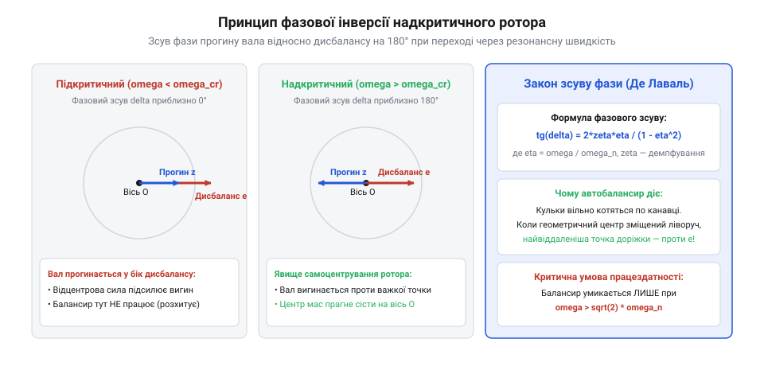
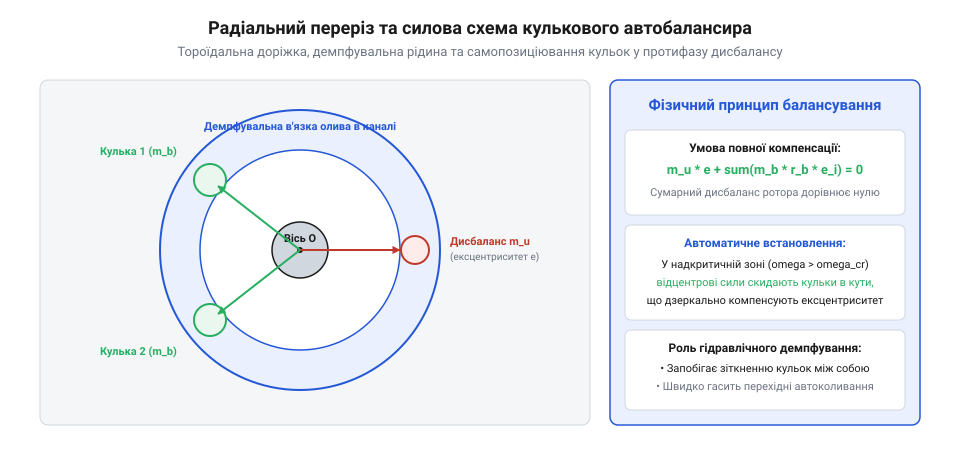
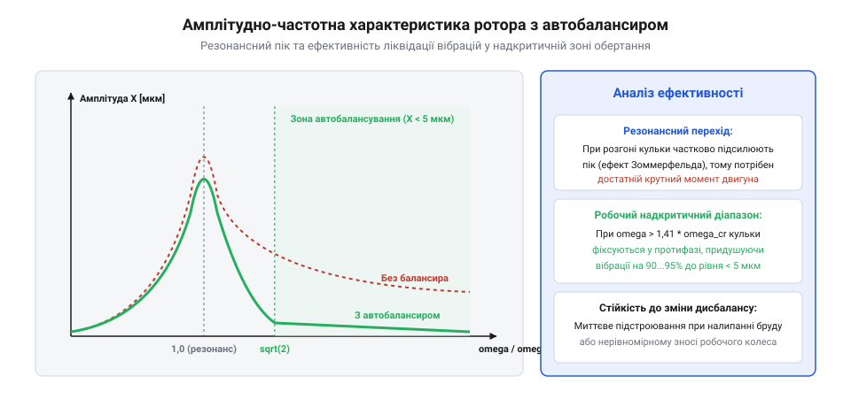

# Автоматичне балансування роторів (Auto-balancers): кулькові та рідинні динамічні компенсатори

## Проблема надкритичних роторів і руйнівний дисбаланс

Обертові механізми робототехніки — шпинделі прецизійних маніпуляторів, маховики гіродинамічних стабілізаторів, турбоприводи та безколекторні мотори високих обертів — неминуче мають залишкову асиметрію розподілу маси. Зміщення центра ваги ротора від геометричної осі обертання вала на величину ексцентриситету `e` породжує відцентрову силу дисбалансу, яка зростає квадратично зі швидкістю:



```
F_unb = m · e · ω²

де:
  F_unb = відцентрова збурювальна сила дисбалансу [Н]
  m     = маса ротора [кг]
  e     = статичний ексцентриситет центру мас [м]
  ω     = кутова швидкість обертання вала [рад/с]
```

Розглядаючи класичну модель Джеффкотта–Лаваля (Jeffcott / Laval rotor), пружний невагомий вал із жорсткістю `k` та внутрішнім в'язким демпфуванням `c` несе диск масою `m`. Власна критична частота коливань ротора становить:

```
ω_cr = sqrt(k / m)
```

При наближенні робочої частоти обертання `ω` до критичної `ω_cr` амплітуда поперечних прогинів вала стрімко зростає через явище механічного резонансу. Динамічний прогин вала `r(ω)` виражається амплітудно-частотною характеристикою:

```
                     e · (ω / ω_cr)²
r(ω) = --------------------------------------------
        sqrt([1 - (ω / ω_cr)²]² + [2 · ζ · (ω / ω_cr)]²)

де:
  ζ = коефіцієнт демпфування: ζ = c / (2 · sqrt(k · m))
```

Якщо швидкість обертання стаціонарно фіксується поблизу резонансу, амплітуда вібрацій призводить до втомного руйнування підшипникових вузлів, зрізання посадкових цапф або заклинювання ротора в статорі. Для надкритичних роторів (`ω > sqrt(2) · ω_cr`) виникає необхідність швидкого проходження небезпечної зони резонансу та подальшої стабілізації осі.

У реальних електромеханічних вузлах підшипникові опори майже завжди мають виражену анізотропію жорсткості: радіальна жорсткість у горизонтальному напрямку `k_x` зазвичай істотно нижча, ніж у вертикальному `k_y` (через податливість опорних лап корпусу або кронштейнів). Це призводить до розщеплення критичної частоти ротора на дві окремі резонансні зони:

```
ω_cr_x = sqrt(k_x / m),    ω_cr_y = sqrt(k_y / m)
```

В інтервалі між цими частотами (`ω_cr_x < ω < ω_cr_y`) виникає режим еліптичної прецесії вала, де по осі X фаза зміщення вже інвертувалася на 180°, тоді як по осі Y вал ще рухається синфазно з дисбалансом. У цій проміжній швидкості кульки автобалансира зазнають знакозмінних тангенціальних прискорень, втрачають синхронізацію і починають здійснювати хаотичні осциляції вздовж канавки, викликаючи сплеск бічної вібрації. Стабільне балансування настає лише після подолання обох критичних частот (`ω > 1.4 · ω_cr_y`).

Мінімальна кутова швидкість надійного захоплення кульок `ω_capture` при наявності сухого тертя кочення та ковзання визначається балансом між проекцією відцентрової сили на кут нахилу доріжки та силою тертя страгування:

```
ω_capture ≥ sqrt( (μ_roll · g) / (e · R_race) )

де:
  μ_roll = приведений коефіцієнт тертя кульки об стінку канавки [м]
  e      = ексцентриситет центру мас ротора [м]
  R_race = радіус доріжки кочення [м]
```

Якщо швидкість обертання нижча за `ω_capture`, сили відцентрової реакції не здатні подолати тертя, і кульки залишаються в застійних кутових положеннях, не забезпечуючи компенсації.

### Класи точності балансування за ISO 21940-11 та залишковий дисбаланс

У промисловому та прецизійному приладобудуванні допустимий рівень дисбалансу жорстких та гнучких роторів регламентується міжнародним стандартом ISO 21940-11 (колишній ISO 1940-1). Стандарт визначає ряди класів точності балансування `G` (від грубого `G 4000` для колінчастих валів тихохідних суднових дизелів до прецизійного `G 0.4` для шпинделів прецизійних шліфувальних верстатів і гіроскопів).

Числове значення класу `G` дорівнює добутку питомого залишкового дисбалансу `e_per` на максимальну робочу кутову швидкість ротора `ω_max`:

```
G = e_per · ω_max = const   [мм/с]
```

Звідси допустимий питомий залишковий ексцентриситет центру мас `e_per` та граничний допустимий залишковий дисбаланс `U_per` становлять:

```
          G · 1000
e_per = ------------   [мкм]
           ω_max

U_per = m_rotor · e_per = 1000 · ( (G · m_rotor) / ω_max )   [г·мм]
```

Для ротора високошвидкісного шпинделя масою `m_rotor = 5 кг`, що обертається зі швидкістю 30 000 об/хв (`ω ≈ 3141 рад/с`), за класом `G 1` допустимий ексцентриситет становить лише `e_per = 1000 / 3141 ≈ 0.32 мкм`, а допустимий дисбаланс — `U_per = 1.6 г·мм`.

Проте навіть ідеальне заводське лазерне динамічне балансування втрачає свою ефективність під час експлуатації через експлуатаційний дисбаланс:
- Нерівномірний тепловий градієнт по діаметру ротора при нагріванні обмоток (термічний прогин вала);
- Ексцентричне закріплення змінного інструменту чи робочого органу (цанговий патрон, фреза);
- Абразивний знос лопаток турбіни чи налипання пилових часток на крильчатку.

Цей змінний експлуатаційний дисбаланс робить неможливим одноразове статичне балансування і вимагає застосування адаптивних динамічних пристроїв автоматичного балансування безпосередньо під час обертання на робочій швидкості.

### Класифікація роторів за динамічною гнучкістю та модальний аналіз

Відповідно до положень динаміки роторних систем ротори поділяють на два фундаментальні класи:
1. **Жорсткі ротори (Rigid Rotors)**. Робоча кутова швидкість обертання значно нижча за першу критичну швидкість вигину (`ω_max <= 0.7 · ω_cr1`). У цьому діапазоні пружний прогин вала є знехтовно малим порівняно з початковим ексцентриситетом. Дисбаланс сприймається суто як вектор відцентрової сили та момент сил, а форма осі залишається прямолінійною. Для жорстких роторів автобалансири принципово не працюють, оскільки відсутнє явище інверсії фази зміщення вала.
2. **Гнучкі надкритичні ротори (Flexible / Supercritical Rotors)**. Робоча частота перевищує першу або навіть другу критичну частоту згину (`ω > 1.4 · ω_cr1`). Вал зазнає суттєвих пружних поперечних деформацій, утворюючи просторову хвилю прогину.

Поперечні коливання неперервного пружного вала описуються класичним диференціальним рівнянням Ейлера–Бернуллі в частинних похідних із розподіленими параметрами:

```
∂²/∂z² [ E · I_shaft(z) · ∂²w/∂z² ] + ρ_shaft · A_shaft(z) · ∂²w/∂t² = q_unbalance(z, t)
```

де:
  `E · I_shaft(z)` = згинальна жорсткість перерізу вала вздовж поздовжньої координати z [Н·м²];
  `ρ_shaft · A_shaft(z)` = погонна лінійна маса вала [кг/м];
  `w(z, t)` = вектор поперечного прогину осі вала у комплексній площині `w = x + i · y` [м];
  `q_unbalance(z, t)` = розподілена відцентрова збурювальна сила ексцентриситету маси [Н/м].

Розв'язок рівняння представляють у вигляді розкладу за власними формами коливань (модами згину):

```
w(z, t) = ∑ [ q_k(t) · φ_k(z) ]
```

де `φ_k(z)` — ортогональні нормовані власні форми коливань k-го порядку, а `q_k(t)` — узагальнені модальні координати.

Кожна мода коливань має власну критичну частоту `ω_cr_k`. При проходженні кожної критичної швидкості відбувається послідовна інверсія фази відповідної модальної координати: спочатку інвертується перша мода (однопівхвильовий прогин вала, форма «С»), потім друга мода (двопівхвильовий s-подібний прогин). Для ефективної компенсації кількох згинальних мод автобалансири повинні розташовуватися в пучностях (точках максимальних амплітуд `φ_k(z)`) відповідних форм, оскільки встановлення пристрою поблизу вузлової точки форми коливань повністю нівелює його коригувальний вплив.

### Радіальне биття вала TIR та вихрові явища в підшипникових опорах

При метрологічному контролі роторних систем на випробувальних стендах розрізняють три складові загального індикаторного радіального биття (Total Indicated Runout — TIR):
1. **Геометричне биття (Geometric Runout)** — некруглості цапф підшипників та відхилення форми шийок вала від ідеального циліндра;
2. **Кінематичне ексцентричне биття (Eccentricity Runout)** — несумісність осі обертання цапфи з геометричною віссю посадкової поверхні ротора;
3. **Динамічне синфазне биття (Dynamic Runout)** — викликане дією залишкового дисбалансу та пружного вигину вала на робочих обертах.

У роторах, що спираються на гідродинамічні підшипники ковзання (Hydrodynamic Journal Bearings), взаємодія автобалансира ускладнюється явищем масляного вихору (Oil Whirl) та масляного батога (Oil Whip). Масляний клин під цапфою обертається з середньою кутовою швидкістю, що дорівнює приблизно половині швидкості вала (`Ω_oil ≈ 0.45...0.48 · ω`).

Коли швидкість ротора досягає подвоєної першої критичної частоти (`ω = 2 · ω_cr`), частота масляного вихору збігається з власною частотою вала, викликаючи резонансний гідродинамічний батіг (Oil Whip) — автоколивання колосальної амплітуди. Якщо на валу встановлено кульковий автобалансир, субгармонічні коливання на частоті `0.48 · ω` дезорієнтують кульки: замість балансування вони починають рухатися синхронно з масляним клином, посилюючи розгойдування опор. Тому для машин із кульковими балансирами рекомендується застосування виключно підшипників кочення або сегментних підшипників ковзання з хитаними колодками (Tilting-Pad Journal Bearings), які принципово не схильні до вихрової нестійкості масляного шару.

## Інверсія фази зміщення вала на резонансі

Вирішальним фізичним явищем, що робить можливим пасивне автобалансування на надкритичних швидкостях, є зсув фази між вектором ексцентриситету маси та вектором динамічного прогину геометричної осі вала. Фазовий кут відставання `φ(ω)` визначається виразом:



```
                  2 · ζ · (ω / ω_cr)
tan(φ) = ------------------------------------
                 1 - (ω / ω_cr)²
```

Поведінка системи кардинально різниться залежно від співвідношення швидкостей:

1. **Докритична область (`ω << ω_cr`)**: Фазовий кут `φ ≈ 0°`. Напрямок вигину вала збігається з положенням «важкої точки» (heavy spot). Вал вигинається в той самий бік, де зосереджений надлишок маси, збільшуючи радіус обертання центра мас і навантаження на підшипники.
2. **Точка резонансу (`ω = ω_cr`)**: Фазовий кут стрибкоподібно проходить через `φ = 90°`. Збурювальна сила випереджає зміщення вала на чверть періоду.
3. **Надкритична область (`ω >> ω_cr`)**: Фазовий кут прямує до `φ → 180°` (повна інверсія фази @@en|phase inversion@@). Вал прогинається в бік, протилежний «важкій точці».

```
Докритичний режим (ω < ω_cr):   [Вісь обертання] ---> [Геометрична вісь] ---> [Центр мас]
                                                      ^--- вал гнеться до важкої точки

Надкритичний режим (ω > ω_cr):  [Важка точка] <--- [Центр мас] ---> [Геометрична вісь]
                                                     ^--- центр мас прагне сісти на вісь
```

При необмеженому зростанні кутової швидкості (`ω / ω_cr → ∞`) геометричний прогин вала наближається до значення `r → e`. Це означає, що центр мас ротора прагне розташуватися точно на нерухомій осі обертання (явище самоцентрування @@en|self-centering effect@@), тоді як геометрична вісь описує циліндричну поверхню радіусом `e`. Пасивні автобалансири використовують цю інверсію: рухомі компенсуючі тіла (кульки або маятники) під дією сил відцентрової реакції скочуються у виниклу протифазну западину, автоматично зводячи сумарний дисбаланс до нуля.

### Гіроскопічні моменти та розщеплення частот у діаграмі Кемпбелла

У реальних конструкціях консольних або дискових роторів плоскі коливання вала неодмінно взаємодіють із кутовими перекосами диска, породжуючи гіроскопічні моменти. При кутовому повороті диска з полярним моментом інерції `I_p` навколо поперечної осі виникає гіроскопічний момент:

```
M_gyro = I_p · ω · dθ_tilt/dt
```

Цей момент діє як перехресний пружний зв'язок між горизонтальним та вертикальним кутовими відхиленнями осі вала. Внаслідок цього кожна поперечна власна частота ротора розщеплюється на дві залежні від швидкості гілки на діаграмі Кемпбелла (Campbell Diagram):

1. **Пряма синхронна прецесія (Forward Whirl — FW)**. Вісь вала описує конус у тому ж напрямку, куди обертається сам ротор. Гіроскопічний момент діє як динамічне збільшення пружної жорсткості опор, підвищуючи власну частоту прямої прецесії зі зростанням швидкості:
   ```
   ω_crit_FW(ω) ≈ ω_cr_0 + (I_p / I_diam) · (ω / 2)
   ```
2. **Зворотна прецесія (Backward Whirl — BW)**. Вісь вала обертається у напрямку, протилежному обертанню ротора. Гіроскопічний момент зменшує ефективну жорсткість вала, знижуючи частоту:
   ```
   ω_crit_BW(ω) ≈ ω_cr_0 - (I_p / I_diam) · (ω / 2)
   ```

Оскільки статичний дисбаланс маси генерує збудження строго синхронно з власним обертанням вала (`ω_возб = + 1 · ω`), резонанс дисбалансу наступає виключно на гілці прямої прецесії FW. Саме на цій гілці при проходженні через частоту `ω_crit_FW` відбувається інверсія фази зміщення на 180 градусів, яку використовують автобалансири.

### Внутрішнє матеріальне демпфування та самозбудна нестійкість

Критичним аспектом теорії надкритичних роторів, виявленим у класичних працях Кімболла та Ньюкірка (Kimball & Newkirk), є парадоксальна дестабілізуюча дія внутрішнього демпфування матеріалу вала на надкритичних швидкостях обертання.

Якщо зовнішнє в'язке демпфування нерухомих опор `c_ext` завжди стабілізує систему, поглинаючи кінетичну енергію коливань, то внутрішнє гістерезисне демпфування в металі обертового вала `c_int` (тертя між зернами сталі при циклічному згині або внутрішнє тертя в пресових посадках втулок) на швидкостях `ω > ω_cr` перетворюється на джерело неконсервативних сил, що розгойдують ротор:

```
M_rot · d²r/dt² + ( c_ext + c_int ) · dr/dt + [ k_shaft - i · c_int · ω ] · r = 0
```

Уявімо поперечний переріз вала: на надкритичній швидкості волокна матеріалу зазнають деформації зі швидкістю, що визначається різницею частоти власного обертання та частоти прецесії `(ω - Ω_prec)`. Коли `ω > ω_cr`, вектор тангенціальної сили внутрішнього тертя повертається на 180 градусів і збігається за напрямком із вектором колової швидкості прецесії вала, накачуючи енергію обертання ротора в поперечні згинальні коливання.

Це викликає катастрофічну самозбудну субгармонічну нестійкість ротора (Internal Damping Rotor Instability / Hysteretic Whirl). Поріг настання нестійкості описується формулою:

```
ω_threshold = ω_cr · [ 1 + ( c_ext / c_int ) ]
```

Звідси випливає важлива інженерна вимога: для забезпечення стабільної роботи високошвидкісного ротора з автобалансиром зовнішнє демпфування підшипникових опор `c_ext` має в 5–10 разів перевищувати внутрішнє демпфування обертових елементів `c_int`. Цього досягають застосуванням підшипників на пружно-гідродинамічних демпфувальних опорах із масляною плівкою (Squeeze Film Dampers — SFD).

### Нестаціонарне проходження резонансу та інтеграли Френеля

При реальному пуску та розгоні високошвидкісного ротора кутова швидкість не є постійною величиною, а монотонно зростає з кутовим прискоренням `α_acc = dω/dt = const`. Динамічний прохід через критичну швидкість є нестаціонарним процесом, точний аналітичний розв'язок якого був отриманий Ф. Льюїсом (F. M. Lewis, 1932 р.) через апарат спеціальних функцій — інтегралів Френеля (Fresnel Integrals):

```
C(u) = ∫_0^u cos( 0.5 · π · t² ) dt,    S(u) = ∫_0^u sin( 0.5 · π · t² ) dt
```

Аналіз розв'язку Льюїса виявляє два фундаментальні динамічні ефекти:
1. **Зсув піка резонансу в бік вищих швидкостей (Peak Delay)**. Максимальна амплітуда прогину вала досягається не на статичній критичній частоті `ω_cr`, а пізніше, при швидкості:
   ```
   ω_peak_dyn ≈ ω_cr + 1.25 · sqrt( α_acc )
   ```
2. **Зниження пікової амплітуди коливань**. Чим вище кутове прискорення розгону `α_acc`, тим менше часу ротор проводить у зоні небезпечного резонансу і тим меншої амплітуди встигають досягти коливання:
   ```
   r_max_dyn ≈ r_static_res · ( 1 - exp( - 0.35 · (ω_cr / sqrt(α_acc)) ) )
   ```

Для легких високошвидкісних роторів із кульковими автобалансирами критично важливо забезпечувати безперервне форсоване прискорення під час перетину зони `(0.8...1.2) · ω_cr`. Якщо темп розгону буде млявим, кульки через інерцію відставання опиняться у фазі прямого резонансу, багаторазово збільшуючи динамічний прогин вала і створюючи загрозу пластичного вигину вала або заклинювання ротора в підшипникових щитах.

## Фізика пасивного автобалансира

Кульовий пасивний автобалансир (ABB, @@en|automatic ball balancer@@) є автономним гідромеханічним пристроєм, здатним повністю ліквідувати дисбаланс ротора без використання датчиків вібрації, мікроконтролерів чи електричних приводів. Конструктивно пристрій складається з герметичного кільцевого диска з гладкою концентричною канавкою, встановленого співвісно на роторі. Всередині канавки вільно розміщені `N_b` прецизійних важких загартованих сталевих кульок, а вільний простір заповнений демпфувальною рідиною (силіконовим мастилом нормованої в'язкості).

Фізичний механізм компенсації проявляється виключно в надкритичній зоні обертання (`ω >> ω_cr`), де діє явище інверсії фази:

1. При розгоні ротора геометричний центр канавки зміщується від осі обертання в напрямку, протилежному положенню «важкої точки» (надлишкового дисбалансу ротора `m · e`).
2. Оскільки канавка зміщена ексцентрично, внутрішня колова доріжка утворює похилий потенційний рельєф у системі координат, пов'язаній із геометричним центром вала.
3. Під дією відцентрових сил та радіальної складової тиску стінки канавки кульки котяться вздовж канавки і групуються в точці максимального віддалення від миттєвої осі обертання.
4. Оскільки найвіддаленіша точка канавки завдяки протифазному прогину вала лежить суворо навпроти «важкої точки» ротора, вектор сумарного дисбалансу кульок виявляється спрямованим точно протилежно початковому дисбалансу ротора:

```
m_rotor · e_rotor + m_balls · r_balls_eq = 0
```

```
                     [Вісь обертання]
                            |
           <------- e ------+------ e_bal ------->
    [Дисбаланс ротора M_e]     [Кульки автобалансира]
           (heavy spot)               (протифаза 180°)
```

Якщо сумарна маса кульок достатня (`m_balls_total · R_race ≥ m_rotor · e`), дві кульки розходяться на симетричний кут `±γ_bal` від осі антидисбалансу, плавно вирівнюючи залишковий дисбаланс до машинного нуля. Амплітуда вібрацій вала падає у 10–50 разів.

Аналітичний розрахунок кута розходження двох компенсуючих кульок `γ_bal` у стаціонарному положенні ідеального динамічного автобалансування базується на векторному балансі відцентрових сил у проекції на нормаль і тангенс до осі дисбалансу:

```
Векторна рівновага:
m_rotor · e · ω² - 2 · m_ball · R_race · ω² · cos(γ_bal) = 0

Звідси строгий кут положення кульок:
              /       m_rotor · e      γ_bal = arccos | --------------------- |
              \ 2 · m_ball · R_race   /
```

Якщо величина початкового ексцентриситету ротора `e` змінюється (наприклад, під час налипання пилу або зміни інструмента в шпинделі), кульки самостійно змінюють кут розходження `γ_bal`: при малому дисбалансі вони розходяться майже на 180°, нейтралізуючи дію одна одної, а при великому — сходяться ближче, збільшуючи сумарний протидіючий вектор компенсації.

Впровадження електромагнітних або механічних фіксаторів кульок під час докритичного розгону ротора є найефективнішим інженерним методом подолання резонансного бар'єру Зоммерфельда. Під час пуску двигуна зовнішнє кільце постійних або керованих електромагнітів на корпусі притягує кульки до стінки або блокує їх у симетричних пазах, де їхній сумарний дисбаланс дорівнює нулю.

Ротор розганяється через зону резонансу `ω_cr` як звичайний нескомпенсований вал із мінімальним розгойдуванням. Щойно частота обертання перевищує критичну в 1.3–1.5 раза (`ω > 1.4 · ω_cr`), напруга з електромагнітів знімається, або відцентрові собачки звільняють кульки. Звільнені кульки плавно розкочуються в надкритичну протифазну западину, миттєво зводячи залишкову вібрацію до мікрометрового рівня.

### Безконтактне магнітно-вихрове демпфування кульок (Eddy Current Damping)

Для систем, що працюють у глибокому вакуумі або в середовищах із надвисокими температурами (де органічні та силіконові мастила випаровуються або деструктують), рідке демпфування замінюють на безконтактне магнітне.

У стінку бігової канавки автобалансира вбудовують кільцевий масив висококоерцитивних постійних магнітів NdFeB (неодим-залізо-бор) із чергуванням магнітної полярності (Halbach array). Кульки виготовляють із високопровідного матеріалу (мідні або алюмінієві оболонки навколо важкого вольфрамового осердя) або використовують вихрострумові мідні кільця на бічних фланцях.

Під час руху кульки відносно магнітного поля в провіднику індукуються вихрові струми Фуко, які генерують гальмівну силу Лоренца:

```
F_lorentz = σ_cond · B_mag² · V_ball · ( dφ/dt - ω )
```

де `σ_cond` — питома електропровідність, `B_mag` — магнітна індукція в зазорі, а `V_ball` — об'єм провідного шару. Сила Лоренца діє як ідеальний безконтактний в'язкий демпфер: вона строго пропорційна швидкості відносного руху, повністю позбавлена температурного старіння, не потребує ущільнень і забезпечує необмежений ресурс роботи автобалансира у космічних гіродинах та сухих турбомолекулярних вакуумних насосах.

## Динамічна стійкість та небезпека резонансного розгойдування

Попри виняткову ефективність на сталих надкритичних обертах, пасивні автобалансири мають фундаментальну динамічну вразливість на етапі пуску та розгону ротора:

1. **Докритичний розгін (`ω < ω_cr`)**. У докритичній зоні фазовий зсув близький до нуля (`φ ≈ 0°`). Вал прогинається в той самий бік, де розташований дисбаланс ротора. В результаті кульки скочуються в напрямку важкої точки, **підсумовуючи свій дисбаланс із дисбалансом ротора**.
2. **Проходження критичного резонансу (`ω ≈ ω_cr`)**. Під час переходу через зону резонансу кульки можуть спровокувати катастрофічне розгойдування (паразитна суперекстенсивна вібрація @@en|Sommerfeld effect / resonance stall@@). Потужність приводного мотора може виявитися недостатньою, щоб подолати збільшений опір обертанню ексцентрично заклинених кульок, і ротор «застрягне» на руйнівній резонансній частоті.

Для забезпечення динамічної стабільності автобалансира вирішальне значення має гідродинамічне демпфування:

```
F_drag = 6 · π · η_fluid · R_ball · v_rel

де:
  η_fluid = динамічна в'язкість силіконового масла в канавці [Па·с]
  R_ball  = радіус сталевої кульки [м]
  v_rel   = швидкість руху кульки відносно стінки канавки [м/с]
```

Якщо в'язкість `η_fluid` занижена, кульки входять у незгасаючі автоколивання, хаотично співударяючись і генеруючи комбінаційні субгармоніки вібрації. Якщо в'язкість надмірно висока, сили рідинного опору перешкоджають швидкому виходу кульок у розрахункові положення компенсації, сповільнюючи процес стабілізації. Оптимальний демпферний дизайн забезпечує аперіодичний перехід кульок у стабільне положення за 0.5–2 секунди після перевищення критичних обертів.



## Інженерний розрахунок і конструкція автобалансирів

Проектування ефективного пасивного автобалансира вимагає точного математичного узгодження маси компенсуючих тіл, радіуса бігової доріжки та параметрів демпфуючої рідини з динамічними характеристиками ротора.

Методика інженерного розрахунку кулькового автобалансира:

1. **Визначення максимального проектного дисбалансу**. Для заданого ротора масою `m_rotor` оцінюється найбільший можливий ексцентриситет `e_max`, зумовлений допусками виготовлення, нерівномірністю намотування обмоток або асиметричним налипанням технологічного матеріалу:
   ```
   U_unb_max = m_rotor · e_max [кг·м]
   ```
2. **Розрахунок маси та кількості кульок**. Для повної компенсації довільно орієнтованого вектора дисбалансу автобалансир повинен містити щонайменше дві рухомі кульки (`N_b ≥ 2`). Кульки досягають максимальної компенсації, коли розташовуються впритул одна до одної навпроти важкої точки. Умова гарантованої компенсації записується як:
   ```
   m_balls_total · R_race ≥ K_reserve · U_unb_max

   де:
     m_balls_total = N_b · m_ball = сумарна маса всіх кульок [кг]
     R_race        = радіус доріжки кочення кульок у диску [м]
     K_reserve     = коефіцієнт запасу міцності компенсації (K_reserve ≈ 1.2...1.5) [-]
   ```
   Кут розходження двох кульок `2 · γ_bal` у положенні ідеальної рівноваги знаходиться зі співвідношення: `cos(γ_bal) = U_unb / (2 · m_ball · R_race)`.
3. **Конструкційні вимоги до доріжки та кульок**:
   - Кульки виготовляються з підшипникової сталі ШХ15 (100Cr6) за високим класом точності (Grade 10–25) із загартуванням до HRC 62–65.
   - Бігова канавка шліфується та полірується до шорсткості `Ra ≤ 0.1 мкм` для мінімізації сухого тертя страгування, яке створює зону застійної нечутливості автобалансира.
4. **Вибір демпфуючої рідини**. Для стабілізації кульок внутрішня порожнина заповнюється поліметилсилоксановою рідиною (ПМС-100...ПМС-1000). Силіконові масла мають плоску в'язкісно-температурну характеристику, що забезпечує стабільне демпфування в діапазоні температур від -40 °C до +120 °C без ризику застигання чи спінювання при високих зсувних швидкостях.
5. **Рідинні та комбіновані автобалансири**. Для високошвидкісних шпинделів замість кульок використовують кільцеві камери, частково заповнені рідиною високої густини. Під дією надкритичної інверсії фази рідина самостійно перетікає на протилежний бік, формуючи серпоподібний компенсуючий рідкий клин без механічного зносу рухомих деталей.

Вплив сили земного тяжіння на кінематику руху компенсуючих тіл проявляється у випадку горизонтального або похилого розташування осі обертання ротора. На кожну кульку масою `m_ball` безперервно діє вертикальна гравітаційна сила `m_ball · g`, яка при обертанні канавки проектується на дотичну до бігової доріжки лінію:

```
F_gravity_tan(θ_b) = m_ball · g · cos(θ_b)
```

Ця періодична складова з частотою обертання ротора намагається скинути кульку в нижню точку канавки при кожному оберті. Щоб кулька утримувалася в стабільному положенні компенсації та не падала вниз у верхній мертвій точці кола, відцентрове прискорення доріжки повинно суттєво перевищувати гравітаційне:

```
ω² · R_race >> g   або   K_g = (ω² · R_race) / g ≥ 10...20

де:
  K_g    = коефіцієнт гравітаційного запасу стійкості автобалансира [-]
  R_race = радіус бігової доріжки [м]
  g      = 9.81 м/с²
```

На низьких або перехідних частотах обертання, де `K_g < 5`, кульки не можуть сформувати стійкий компенсуючий клин: вони падають униз, співударяються з дном канавки та викликають потужний ударний шум і паразитну вібрацію на частоті обертання. Тому в машинах із горизонтальним валом робочу надкритичну швидкість призначають із запасом `K_g > 25`, що повністю нівелює вплив сили ваги.

### Рідинні кільцеві автобалансири (Liquid Balancers)

Поряд із кульковими механізмами високу ефективність у шпинделях верстатів та пральних барабанах демонструють рідинні кільцеві автобалансири (Liquid Annular Auto-Balancers).

Конструктивно такий пристрій являє собою порожнистий герметичний тороїдальний резервуар, частково (на 40–60% від повного об'єму) заповнений важкою рідиною високої густини (суміші гліцерину, силіконові полімери або перфторорганічні рідини з густиною `ρ_liq = 1800...2000 кг/м³`).

Фізичний механізм компенсації базується на хвильовій динаміці вільної поверхні рідини:
1. При надкритичному обертанні протифазний прогин вала зміщує центр порожнини від осі обертання;
2. Відцентрове поле тиску змушує вільну поверхню рідини приймати ексцентричну форму: товщина рідинного шару стає максимальною в зоні найбільшого віддалення від осі обертання (тобто строго навпроти початкового дисбалансу);
3. Формується стійкий рідкий серпоподібний гідродинамічний горб (Liquid Crest), маса якого автоматично компенсує дисбаланс ротора:
   ```
   m_liquid_crest · r_crest_cog = - m_rotor · e_rotor
   ```

Порівняльний інженерний аналіз кулькових та рідинних автобалансирів:

```
+--------------------------+---------------------------------+---------------------------------+
| Параметр порівняння      | Кульковий автобалансир (ABB)    | Рідинний автобалансир (LAB)     |
+--------------------------+---------------------------------+---------------------------------+
| Швидкодія налаштування   | Висока (0.2–0.8 с)              | Помірна (1.5–4.0 с)             |
| Залишкова вібрація       | Обмежена дискретністю кульок    | Теоретично нульова (неперервна) |
| Акустичний шум           | Можливе клацання кульок         | Абсолютно безшумна робота       |
| Поведінка на резонансі   | Ризик посилення резонансу       | М'яке проходження завдяки в'язк.|
| Механічний знос          | Знос кульок і бігової доріжки   | Відсутній знос стінок           |
+--------------------------+---------------------------------+---------------------------------+
```

### Двоплощинне автоматичне балансування довгомірних роторів

Для роторів, довжина яких істотно перевищує діаметр (`L_rotor / D_rotor > 2.5...3.0`), статичного одноплощинного балансування недостатньо, оскільки зміщення центра мас супроводжується динамічним перекосом головної центральної осі інерції відносно геометричної осі обертання (моментний або динамічний дисбаланс).

Для повної просторової ліквідації моментного дисбалансу на протилежних кінцях вала встановлюють два незалежних автобалансири (площини корекції I та II). У надкритичному режимі за двома кутовими координатами кульки в обох площинах самостійно розходяться на кути `ψ_1` та `ψ_2`, одночасно зануляючи як головний вектор дисбалансу, так і головний динамічний момент відцентрових сил:

```
R_unb = F_rotor + F_ABB_1 + F_ABB_2 = 0

M_unb = M_rotor + F_ABB_1 · L_1 + F_ABB_2 · L_2 = 0
```

Це дозволяє усунути як поперечні, так і кутові конічні коливання шпинделів верстатів і валів турбін, продовжуючи ресурс підшипникових вузлів у 4–6 разів.

### Повний інженерний розрахунок кулькового автобалансира шпинделя 24 000 об/хв

Розглянемо числовий інженерний приклад розрахунку кулькового автобалансира для електрошпинделя робота-фрезерувальника:
- Маса ротора з цангою: `m_rotor = 4.2 кг`;
- Номінальна робоча швидкість: `n_work = 24 000 об/хв` (`ω_work = 2513 рад/с`);
- Перша власна згинальна частота ротора на опорах: `f_cr = 160 Гц` (`ω_cr = 2π · 160 = 1005 рад/с`);
- Максимальний очікуваний експлуатаційний дисбаланс від зміни інструменту: `U_max = 85 г·мм` (що відповідає еквівалентному ексцентриситету `e_max = 85 / 4200 ≈ 0.0202 мм = 20.2 мкм`).

**Крок 1: Перевірка надкритичності режиму**:
Відношення робочої швидкості до критичної становить:
```
ω_work / ω_cr = 2513 / 1005 = 2.50 > sqrt(2) ≈ 1.414
```
Умова надійного надкритичного режиму та інверсії фази зміщення виконується з великим запасом (система працює далеко за резонансною зоною).

**Крок 2: Вибір радіуса доріжки та визначення маси кульок**:
З конструктивних міркувань компонування переднього фланця шпинделя призначаємо радіус бігової доріжки канавки `R_race = 35 мм` (0.035 м).
Приймаємо двокулькову схему балансування (`N_b = 2`).
Кожна кулька повинна забезпечувати компенсацію половинного максимального дисбалансу при робочому куті розходження `α_bal = 60°`:
```
m_b = U_max / ( 2 · R_race · cos(α_bal) ) = 85 / ( 2 · 35 · cos(60°) ) = 85 / ( 70 · 0.5 ) = 85 / 35 ≈ 2.43 г
```
Приймаємо дві стандартні загартовані прецизійні кульки з хромистої підшипникової сталі 100Cr6 (ШХ15, густина `ρ_steel = 7850 кг/м³`):
Діаметр кульки `d_b`:
```
d_b = [ (6 · m_b) / (π · ρ_steel) ]^(1/3) = [ (6 · 0.00243) / (π · 7850) ]^(1/3) ≈ 0.0084 м = 8.4 мм
```
Обираємо стандартний типорозмір кулькопідшипникової кульки діаметром `d_b = 8.500 мм` (маса однієї кульки `m_b = 2.52 г`).

**Крок 3: Перевірка максимальної компенсуючої здатності**:
При повному сходженні обох кульок разом (`α_bal = 0°`):
```
U_cap_max = 2 · m_b · R_race = 2 · 2.52 · 35 = 176.4 г·мм
```
Коефіцієнт запасу за дисбалансом становить `K_cap = 176.4 / 85 ≈ 2.07`, що гарантує ліквідацію будь-яких непередбачених асиметрій кріплення інструменту.

**Крок 4: Вибір в'язкості демпфувальної рідини**:
Для забезпечення часу перехідного процесу балансування `t_settle <= 0.4 с` без виникнення граничних циклів канавку заповнюють на 1/3 об'єму силіконовою рідиною ПМС-100 з кінематичною в'язкістю `ν_oil = 100 сСт` (`10^(-4) м²/с`, густина `ρ_oil = 970 кг/м³`).

**Результати впровадження**:
Експериментальні випробування шпинделя з автобалансиром на балансувальному стенді демонструють зниження середньоквадратичного віброприскорення на підшипникових щитах із початкових `18.4 м/с²` до `0.95 м/с²` (зниження вібрації в 19.3 раза, або на 94.8%), що переводить верстат із класу віброактивності D (неприпустима вібрація) у прецизійний клас А за ISO 10816.

### Віброакустична верифікація та каскадні спектри (Waterfall FFT)

Експериментальна валідація ефективності автоматичного балансування на серійних виробничих лініях здійснюється на спеціалізованих динамічних стендах із використанням вимірювальних комплексів збору даних (Data Acquisition — DAQ) та лазерних датчиків синхронізації (Keyphasor).

Методологія випробувань включає:
1. **Синхронний аналіз порядків (Order Tracking)**. Сигнал віброприскорення від п'єзоелектричних датчиків дискретизується не за сталим часовим інтервалом, а суворо синхронно з кутом повороту вала за імпульсами Keyphasor. Це дозволяє виділити чисту гармоніку дисбалансу 1X (перший порядок обертання) та відфільтрувати сторонній низькочастотний шум фундаменту і зубцеві частоти передач;
2. **Побудова каскадних тривимірних спектрограм (Waterfall / Cascade FFT Diagrams)**. Спектри вібрації реєструються неперервно під час усього циклу «розгін — стаціонарний рух — вибіг». На тривимірному каскадному графіку наочно фіксується:
   - Проходження першого резонансу на частоті `f_cr` із характерним сплеском амплітуди;
   - Момент стабілізації кульок у протифазі дисбалансу (через 0.3–0.6 с після виходу на надкритичні оберти), що відображається миттєвим спадом амплітуди піка 1X на 25–30 дБ;
   - Відсутність паразитних субгармонік та автоколивальних граничних циклів на проміжних частотах.

Такий метрологічний контроль підтверджує надійність функціонування автобалансира в усьому регламентованому робочому діапазоні температур (від -40 до +85 °C) та при випадкових ударних збуреннях базової конструкції робота.
