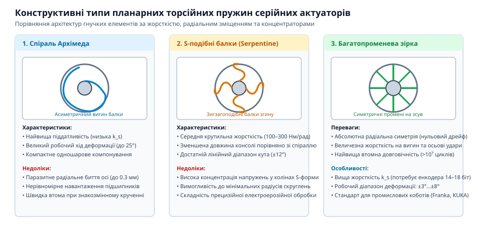
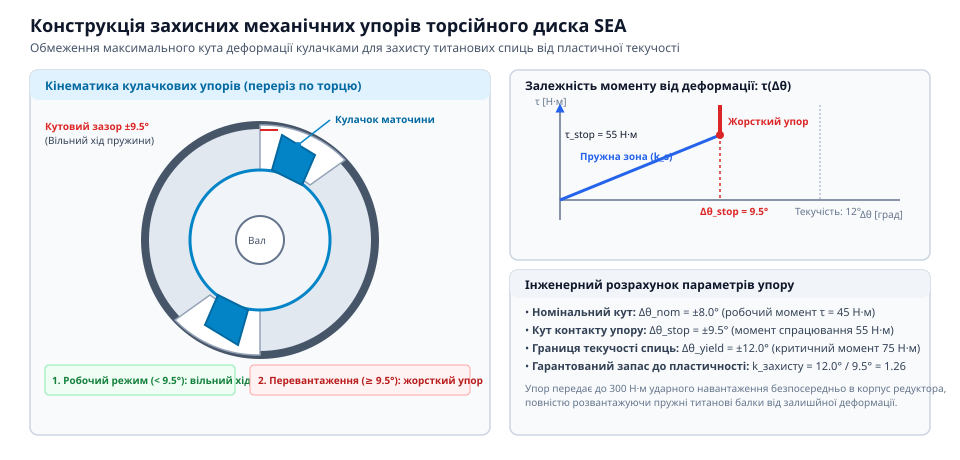

# Серійний пружний актуатор (SEA)

<preknowlist>
- [Серійний пружний актуатор (SEA)](root:hw-motion/series-elastic-actuator) — призначення та роль пружини в приводі SEA
</preknowlist>

## Топологічна класифікація планарних пружин SEA: диски Архімеда, серпантинні S-промені та зірчасті flexure-структури

У серійних пружних актуаторах (SEA) пружний елемент виконує подвійну інженерну функцію: він є одночасно силовим механічним демпфером ударів та прецизійним чутливим елементом вимірювання крутного моменту за законом Гука (`τ = k_s · Δθ`).

Сучасні вимоги робототехніки до компактності та безлюфтовості унеможливлюють застосування традиційних витих пружин зі штоками та напрямними. На зміну їм прийшли монолітні планарні торсійні диски, які виготовляють із суцільної металевої заготовки методом прецизійного електроерозійного різання або ЧПК-фрезерування.

Головним завданням топологічного проєктування пружного диска є забезпечення високої піддатливості в напрямку кручення навколо головної осі Z при збереженні максимальної жорсткості в усіх інших 5 ступенях вільності (велика радіальна жорсткість `K_rad` та осьова жорсткість `K_ax` для уникнення перекосів підшипникових вузлів). За формою деформаційних променів виділяють три базові топологічні класи:

1. **Спіралі Архімеда (Archimedean spiral flexures):**
Пружні балки описуються рівнянням радіуса від кута розгортки `r(θ) = r_0 + a · θ`. Завдяки великій довжині криволінійної балки при малому радіальному габариті такі пружини забезпечують найбільший робочий кут закручування (до ±8–12°). Проте одинична спіраль страждає на анізотропію: закручування за годинниковою та проти годинникової стрілки викликає різний напружений стан, а також генерує паразитну радіальну силу зміщення центральної маточини. Для компенсації паразитного зміщення застосовують симетричні багатозахідні спіралі (2, 3 або 4 симетричні промені).

2. **Серпантинні S-подібні балки (Serpentine S-beams):**
Кожен радіальний сектор містить послідовні пружні складки у формі латинської літери S або меандру. Серпантинна форма поєднує високу крутильну піддатливість із повною дзеркальною симетрією: характеристика моменту від кута `τ(Δθ)` є строго непарною й лінійною в обох напрямках обертання. Радіальні та згинальні сили повністю взаємокомпенсуються в структурі диска, захищаючи підшипники ротора від поперечних навантажень.

3. **Багатопроменеві зірчасті flexure-структури (Star spokes):**
Складаються з 4, 6 або 8 прямих чи злегка профільованих тангенціальних балок, що працюють на чистий вигин. Мають найвищу осьову та згинальну стійкість проти викривлення площини диска, проте мають менший діапазон пружної кутової деформації (типово ±1.5–3.5°). Цей тип є домінуючим у важких суглобах людиноподібних роботів (наприклад, NASA Valkyrie), де маса кінцівки створює величезні перекидні моменти на шарнірі.

> 🔧 **Навіщо це.** Правильний вибір топології гарантує, що кутове відхилення енкодера відображає виключно крутний момент суглоба, а не паразитний перекіс вала від зовнішніх консольних сил.


*Конструктивні типи планарних торсійних пружин: спіраль Архімеда, S-подібні балки та багатопроменева зірка.*

### Аналітичний розрахунок жорсткості багатопроменевого диска
Розглянемо плоский диск із `n` симетричними тангенціальними балками прямокутного перерізу:
- `t` — товщина балки в площині згину (м);
- `b` — ширина балки вздовж осьового напрямку Z (м);
- `L` — ефективна довжина вільної ділянки балки (м);
- `R` — радіус розташування середини балки від осі обертання (м);
- `E` — модуль Юнга матеріалу (Па).

Згинальна жорсткість одиничної балки з жорстко затисненими кінцями:
```
k_beam = (12 · E · I_z) / L³ = (E · b · t³) / L³
```
де `I_z = (b · t³) / 12` — момент інерції перерізу при згині в площині диска.

Сумарна крутильна жорсткість усього торсійного диска `k_s` (Н·м/рад):
```
k_s = n · k_beam · R² = n · [ (E · b · t³) / L³ ] · R²
```

Для типового шарнірного модуля робота зовнішнім діаметром 70 мм із титану Ti-6Al-4V (`E = 114 ГПа`):
- кількість балок: `n = 4`;
- осьова ширина: `b = 8.0 мм` (0.008 м);
- товщина променів: `t = 1.2 мм` (0.0012 м);
- довжина балки: `L = 18.0 мм` (0.018 м);
- радіус `R = 26.0 мм` (0.026 м).

Підставимо значення у формулу:
```
k_s = 4 · [ (114 · 10⁹ · 0.008 · (0.0012)³) / (0.018)³ ] · (0.026)²
    = 4 · [ 1.576 / (5.832 · 10⁻⁶) ] · 0.000676
    = 4 · 270233 · 0.000676
    ≈ 730.6 Н·м/рад
```
При дії номінального крутного моменту `τ = 30 Н·м` кутова деформація диска становитиме:
```
Δθ = 30 / 730.6 ≈ 0.0411 рад ≈ 2.35°
```
Кут 2.35° ідеально узгоджується з роздільною здатністю 14-бітного магнітного енкодера (16384 відліки на оберт, тобто 0.022° на відлік), забезпечуючи понад 100 дискретних відліків вимірювання напруженого стану пружини без шуму.

## Матеріалознавство та критерій енергоємності: титанові сплави Ti-6Al-4V проти пружинних сталей 60С2А та 17-4PH

Ключовим показником якості матеріалу для пружин SEA є питома пружна енергоємність — кількість механічної енергії деформації, яку матеріал здатен накопичити в одиниці об'єму або маси без виникнення залишкової пластичної деформації.

Згідно з класичною теорією пружності, максимальна об'ємна густина пружної енергії при деформації розтягу/згину визначається межею текучості `σ_y` та модулем пружності Юнга `E`:
```
u_vol = σ_y² / (2 · E)
```
Питома масова енергоємність з урахуванням густини матеріалу `ρ`:
```
u_mass = σ_y² / (2 · ρ · E)
```

> 🔧 **Навіщо це.** Чим вище співвідношення `σ_y / E`, тим більший кут закручування витримує пружина заданого розміру без мікропластичних зрушень, що визначає довговічність калібрування нуля датчика моменту.

| Матеріал | Межа текучості σ_y, МПа | Модуль Юнга E, ГПа | Густина ρ, кг/м³ | Співвідношення σ_y / E | Питома енергія u_mass, кДж/кг |
| :--- | :--- | :--- | :--- | :--- | :--- |
| **Ti-6Al-4V ELI (титан)** | 950–1100 | 114 | 4430 | 0.0083–0.0096 | 0.95–1.20 |
| **60С2А (кремнієва сталь)**| 1200–1350 | 206 | 7850 | 0.0058–0.0065 | 0.44–0.56 |
| **17-4PH H900 (нержавіюча)**| 1150–1250 | 196 | 7800 | 0.0058–0.0063 | 0.43–0.51 |
| **Д16Т (дюралюміній)** | 320–380 | 72 | 2780 | 0.0044–0.0052 | 0.25–0.36 |

### Переваги титанового сплаву Ti-6Al-4V
Титан є безумовним фаворитом сучасної робототехніки для торсійних елементів SEA. Завдяки низькому модулю пружності (114 ГПа проти 206 ГПа у сталі) при високій межі текучості (>1000 МПа після термообробки), титанова деталь запасає вдвічі більше енергії на одиницю маси, ніж найкраща пружинна сталь. Крім того, Ti-6Al-4V має високу корозійну стійкість та немагнітність, що критично важливо, оскільки високоточні магнітні енкодери розташовані в безпосередній близькості (1–2 мм) від торсійного диска.

### Сфера застосування пружинних сталей 60С2А та 17-4PH
Пружинна кремнієва сталь 60С2А має високу контактну твердість та втомну міцність при знакозмінному крученні. Вона незамінна у важких високотонажних приводах промислових роботів, де потрібна екстремальна абсолютна жорсткість (`k_s > 1000 Н·м/рад`) при помірній вартості заготовки. Нержавіюча дисперсійно-твердіюча сталь 17-4PH (стан H900) забезпечує легкість прецизійної механічної обробки в стані поставки з наступним низькотемпературним старінням без викривлення тонких пружних балок.

## Розрахунок лінійності крутного моменту та аналіз втомної міцності за критеріями Велера й Гудмана

Для точного вимірювання зусилля в актуаторі SEA залежність відновлювального моменту від кута закручування `τ(Δθ)` має бути строго лінійною в усьому робочому діапазоні переміщень. Відхилення від лінійності (нелінійність характеристики пружини) спричиняється геометричною нелінійністю: при великих кутах деформації балки починають працювати не лише на згин, але й на поздовжнє розтягнення (ефект мембранного натягу), що викликає прогресивне наростання жорсткості.

Оцінка механічного стану проводиться методом скінченних елементів (FEA). Еквівалентні напруження за четвертою теорією міцності (фон Мізеса) у кожній точці пружного тіла не повинні перевищувати межі текучості з урахуванням запасу міцності `n_y ≥ 1.5`:
```
σ_vM = sqrt( σ_x² - σ_x · σ_y + σ_y² + 3 · τ_xy² ) ≤ σ_y / n_y
```

> 🔧 **Навіщо це.** Якщо напруження в тонких галтелях перевищать межу плинності хоча б локально, у металі виникне залишкова мікропластична деформація, яка змістить нульову точку енкодерів і призведе до постійної похибки вимірювання сили.

### Оцінка циклічної довговічності за критерієм Гудмана
Робототехнічний суглоб за життєвий цикл здійснює від 10⁶ до 10⁸ знакозмінних коливальних рухів. Для запобігання втомному руйнуванню розрахунок ведуть за діаграмою граничних амплітуд Гудмана (Goodman fatigue relation), яка враховує спільну дію змінної амплітуди напружень `σ_a` та постійної середньої складової `σ_m` (наприклад, від сили гравітації, що утримує вагу кінцівки):
```
(σ_a / σ_e) + (σ_m / σ_u) ≤ 1 / S_f
```
де:
- `σ_e` — межа витривалості матеріалу при симетричному циклі на базі 10⁷ циклів (для полірованого Ti-6Al-4V становить 450–520 МПа; для сталі 60С2А — 400–480 МПа);
- `σ_u` — тимчасовий опір розриву (межа міцності);
- `S_f` — коефіцієнт запасу за втомою (`S_f = 1.6–2.0`).

### Числовий приклад розрахунку втомної міцності суглоба робота
Розглянемо параметри торсійного диска SEA для колінного суглоба маніпулятора з титанового сплаву Ti-6Al-4V ELI:
- Межа текучості: `σ_y = 950 МПа`;
- Межа витривалості на базі 10⁷ циклів: `σ_e = 480 МПа`;
- Тимчасовий опір розриву: `σ_u = 1020 МПа`;
- Змінна амплітуда крутного моменту при ходьбі: `τ_a = 20 Н·м`;
- Постійний гравітаційний момент утримання пози: `τ_m = 10 Н·м`.

При геометрії балок із шириною `b = 10 мм`, товщиною `t = 1.8 мм`, довжиною `L = 20 мм` та радіусом маточини `R = 28 мм`, напруження згину в крайньому волокні балки розраховуються за формулою:
```
σ = (3 · τ · L) / (n · R · b · t²)
```
Підставимо амплітудне та середнє значення навантаження:
- Змінна складова напружень: `σ_a ≈ 240 МПа`;
- Постійна середня складова: `σ_m ≈ 120 МПа`.

Підставимо значення у критерій Гудмана:
```
(240 / 480) + (120 / 1020) = 0.50 + 0.118 = 0.618
```
Фактичний коефіцієнт запасу за втомою:
```
S_f = 1 / 0.618 ≈ 1.62
```
Оскільки `S_f = 1.62 > 1.50`, торсійний пружний елемент гарантує необмежену втомну довговічність (понад 10 000 000 циклів знакозмінного навантаження без зародження мікротріщин).

Критичним фактором для збереження витривалості є якість поверхні. При дротяному електроерозійному різанні (EDM) на поверхні утворюється переплавлений білий шар із мікротріщинами, що знижує межу втоми на 30–50%. Тому обов'язковим фінішним етапом є хімічне травлення або електрополірування до шорсткості `Ra < 0.2` мкм.

## Захист від пластичної деформації та перевантажень: інтегровані механічні упори-обмежувачі ходу

Яким би ретельним не був розрахунок пружного елемента, в експлуатації завжди існує ймовірність аварійного зіткнення: падіння двоногого робота зі сходів, удар маніпулятора об жорсткий верстат або заклинювання редуктора. Енергія такого удару на порядки перевищує розрахункову пружну енергію `E_pot = 0.5 · k_s · Δθ²`.

Без спеціального захисту тонкі пружні спиці диска миттєво зазнають пластичного згину або крихкого зламу. Щоб унеможливити катастрофічну відмову, в конструкцію ротаційного вузла SEA інтегрують **механічні упори-обмежувачі граничного кута (mechanical hard stops)**.

> 🔧 **Навіщо це.** Механічний упор діє як паралельний шунт жорсткості: щойно деформація досягає безпечної межі, зусилля перемикається на масивний металевий корпус, минаючи чутливі пружні балки.


*Конструкція захисних механічних упорів: кулачки обмеження кута закручування для запобігання пластичній деформації.*

Конструктивно захисний механізм реалізують у вигляді:
1. **Інтегрованих секторних кулачків на самому диску:** на внутрішній маточині фрезерують виступи, а на зовнішньому ободі — відповідні пази з точним каліброваним кутовим зазором `±Δθ_stop`.
2. **Штифтових замків у вихідному фланці:** розжарені сталеві штифти входять у фрезеровані овальні прорізи обойми підшипника.

Граничний допустимий кут спрацьовування упорів розраховують за виразом:
```
Δθ_stop = (τ_max_elastic / k_s) · 0.85
```
де `τ_max_elastic` — крутний момент, за якого максимальні напруження досягають 80% від межі текучості `σ_y`.

Коли зовнішній удар спричиняє закручування пружини на кут `Δθ_stop` (типово ±3–5°), кулачки вибирають вільний хід і вступають у жорсткий металевий контакт. З цього моменту подальше зростання навантаження сприймається масивним корпусом суглоба. Актуатор перетворюється на звичайний жорсткий привід. Після зняття перевантаження пружина повертається у вихідний недеформований стан без найменшого зсуву нуля датчиків крутного моменту.
