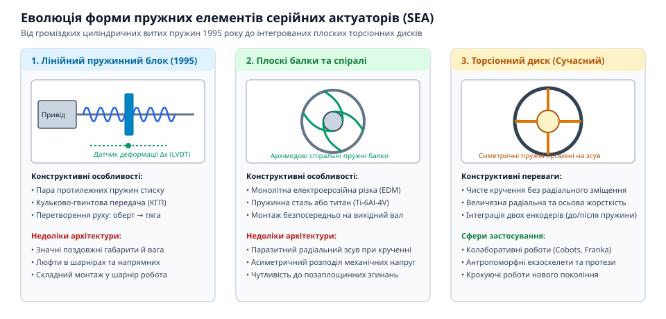
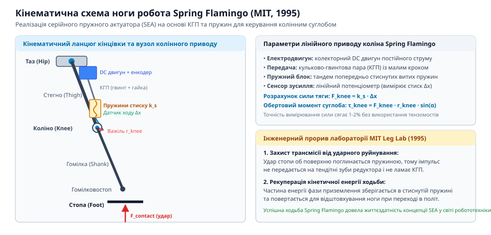

# Серійний пружний актуатор (SEA)

<preknowlist>
- [Серійний пружний актуатор (SEA)](root:hw-motion/series-elastic-actuator) — базовий принцип роботи SEA та формула Гука F = k · x
</preknowlist>

## Криза жорстких приводів у крокуючій робототехніці 1990-х: злам редукторів та шуми датчиків сили у роботі Spring Flamingo

На початку 1990-х років лабораторія вивчення локомоції Массачусетського технологічного інституту (MIT Leg Laboratory), заснована Марком Райбертом, перебувала на передньому краї світової крокуючої робототехніки. Попередні успішні апарати Райберта — знамениті одноногі, двоногі та чотириногі стрибаючі роботи — приводилися в дію потужними гідравлічними циліндрами із сервоклапанами. Гідравліка забезпечувала колосальну питому потужність та природну пружність рідини, але вимагала громіздких компресорних станцій, товстих шлангів високого тиску й вирізнялася високим енергоспоживанням, що унеможливлювало створення повністю автономних мобільних систем.

Прагнучи створити автономного двоногого робота на електричних приводах, інженери зіткнулися з фундаментальним інженерним глухим кутом. У роботі **Spring Flamingo** (1995–1996 роки) конструктори застосували класичну схему електромеханічного привода: високообертові безколекторні двигуни постійного струму в поєднанні з високоредукторними передачами — зокрема прецизійними хвильовими редукторами (harmonic drives) із передавальним числом N від 50 до 100.

> 🔧 **Навіщо це.** Традиційна парадигма промислової робототехніки вимагала абсолютної кінематичної жорсткості: маніпулятор мав позиціонуватися з точністю до десятих часток міліметра, для чого привід конструювали максимально несхильним до будь-якої пружної податливості. Але в локомоції робот безперервно контактує з неідеальною підстильною поверхнею.

Фізична катастрофа жорсткого привода криється в законі масштабування приведеного моменту інерції:
```
J_refl = N² · J_m
```
де `J_m` — момент інерції ротора електродвигуна, а `N` — передавальне число редуктора. Якщо редуктор знижує швидкість у 100 разів, то інерція легкого 200-грамового ротора на вихідному валу множиться на 10 000. 

Під час фази удару стопи об підлогу (heel-strike) вихідна ланка ноги зупиняється практично миттєво — за кілька мілісекунд. Через гігантську приведену інерцію ротор фізично не встигає ані загальмувати, ані прокрутитися назад. Уся кінетична енергія зіткнення концентрується на крихітних зубах хвильового редуктора. Модуль зубів у хвильових редукторах становить менше 0.5 мм. Результатом ударного навантаження ставали постійні зрізання зубів гнучкого вінця (flexspline), викрашування поверхонь кочення та згинання тонкостінних валів. Робот ламався швидше, ніж інженери встигали записати дані експерименту.

Другою критичною проблемою став вимір та регулювання сили. Для керування взаємодією робота з ґрунтом необхідно було вимірювати зусилля в шарнірах. Інженери встановлювали тензометричні датчики сили (load cells) на базі пружних сталевих деформаційних мостів. Оскільки металеві балки тензодатчиків розраховані на мікроскопічні пружні деформації (порядку мікронів), вихідний електричний сигнал мав рівень кількох мілівольтів. 

У реальному роботі потужні ШІМ-інвертори приводів генерували високочастотні електромагнітні наведення, які тонули тензометричний сигнал у шумах. Крім того, жорсткий тензодатчик не володів енергоємністю: будь-який динамічний удар передавався на нього напряму, викликаючи вихід за межу текучості та незворотне зміщення калібрувального нуля. Замкнений контур зворотного зв'язку за зусиллям із жорстким приводом демонстрував високу схильність до автоколивань: щойно нога торкалася твердої підлоги, високий коефіцієнт підсилення приводив до руйнівного дребезгу та резонансної нестабільності.

## Винахід Джеррі Пратта та Метта Вільямсона (MIT Leg Lab, 1995): послідовна пружна ланка як фільтр ударів і механічний динамометр

Вихід із кризи запропонували аспіранти MIT Leg Laboratory **Джіллан «Джеррі» Пратт** (Gill A. Pratt) та **Меттью Вільямсон** (Matthew M. Williamson) у своїй фундаментальній роботі 1995 року *"Series Elastic Actuators"* (представленій на конференції IROS 1995). Вони висунули контрінтуїтивну для тогочасної інженерної спільноти ідею: замість боротьби за максимальну жорсткість привода необхідно навмисно вбудувати між вихідним валом редуктора та робочим навантаженням податливий механічний пружний елемент — торсійну або лінійну пружину з каліброваною жорсткістю `k_s`.

Усі колеги спочатку сприйняли цю ідею скептично, вважаючи, що додавання пружини знизить смугу пропускання актуатора та перетворить робота на некеровану коливальну систему. Проте Пратт і Вільямсон довели, що серійна пружність вирішує одразу чотири фундаментальні проблеми:

> 🔧 **Навіщо це.** Замість спроб придушити удар надшвидкою цифровою електронікою (що фізично неможливо через затримки датчиків та інерцію двигуна), пружна ланка миттєво поглинає енергію удару на рівні механіки пасивним шляхом.

1. **Механічний фільтр низьких частот для ударних навантажень.** Під час контакту стопи з ґрунтом вихідна ланка різко відхиляється, стискаючи або скручуючи серійну пружину. Пікова ударна сила трансформується в потенційну енергію пружної деформації:
```
E_pot = 0.5 · k_s · Δθ²
```
Редуктор та ротор двигуна виявляються механічно ізольованими від високочастотного удару. Замість миттєвого піку на зубах шестерень привід відчуває плавне наростання навантаження, яке двигун устигає відпрацювати у штатному режимі. Зуби редукторів перестали ламатися.

2. **Перетворення регулювання сили на прецизійне вимірювання переміщення.** Замість крихких і зашумлених мілівольтових тензодатчиків вимірювання крутного моменту звелося до закону Гука:
```
τ_out = k_s · (θ_gear - θ_load) = k_s · Δθ
```
Конструктори встановили два стандартні оптичні або магнітні енкодери положення: один на вихідному валу редуктора (`θ_gear`), другий — безпосередньо на керованій ланці робота (`θ_load`). Різниця їхніх показів `Δθ` становить одиниці градусів (або міліметрів для лінійних систем), що в тисячі разів перевищує деформацію тензомостів. Сигнал переміщення з цифрових енкодерів має колосальне співвідношення сигнал/шум (SNR), не боїться електромагнітних завад ШІМ і має практично нульовий дрейф від температури.

3. **Акумуляція та рекуперація енергії.** Подібно до ахіллового сухожилля людини або зв'язок тварин, серійна пружина запасає енергію фази гальмування та повертає її у фазі відштовхування, що дозволило зменшити необхідну пікову потужність двигуна в рази.

4. **Забезпечення низького вихідного імпедансу (Passive Compliance).** За відсутності напруги на двигуні зовнішній об'єкт відчуває привід не як заблоковану важку брилу масою в десятки кілограмів, а як м'яку піддатливу пружину, що гарантувало травмобезпечність для людини поруч.

Успіх експериментів на роботах Spring Flamingo та Spring Turkey став тріумфом концепції SEA, започаткувавши нову еру біоморфної та людино-машинної робототехніки.

## Еволюція конструкцій пружних елементів: від лінійних пружин до компактних плоских торсіонних титанових дисків

Перші робочі прототипи актуаторів SEA у середині 1990-х років спиралися на найпростіші та найдоступніші промислові компоненти — циліндричні виті сталеві пружини стиску. У конструкціях роботів Spring Flamingo та Spring Turkey тягове зусилля від сервопривода передавалося на суглоби через систему сталевих боуден-тросів або шарнірних тяг, у розрив яких інтегрувалися пари пружин, що працювали на стиск у зустрічних напрямках (push-pull конфігурація).

Попри успішну перевірку концепції, лінійні пружинні блоки мали суттєві експлуатаційні вади:
1. **Громіздкі габарити та висока маса.** Блоки лінійних пружин вимагали напрямних штоків, опор ковзання та зовнішніх кожухів, які додавали паразитну масу та займали значний об'єм у кінцівках робота.
2. **Тертя та гістерезис у напрямних.** Під час стискання вита пружина зазнає радіального вигину (buckling), що призводить до тертя витків об внутрішній або зовнішній шток, спотворюючи лінійність вимірювання сили за законом Гука.
3. **Люфти в проміжних механізмах.** Троси та шарнірні наконечники тяг з часом розтягувалися й зношувалися, створюючи мертвий хід (backlash).

> 🔧 **Навіщо це.** Щоб інтегрувати SEA безпосередньо в компактні циліндричні шарніри роботів, інженери відмовилися від лінійних тяг на користь монолітних торсіонних пружин, розташованих на одній осі з редуктором.


*Еволюція форми пружних ланок SEA: від циліндричних витих пружин стиску до багатопроменевих торсіонних дисків.*

Справжнім конструктивним проривом стала розробка **плоских монолітних торсіонних дисків**. Такий диск являє собою єдину металеву деталь, у якій центральна маточина (hub) з'єднана із зовнішнім кріпильним ободом (rim) системою симетричних пружних променів.

Для виготовлення таких дисків застосовують високоточну дротяну електроерозійну обробку (wire EDM) або прецизійне 5-осьове фрезерування на верстатах із ЧПК. Основними матеріалами стали:
- **Титанові сплави високої міцності (зокрема Ti-6Al-4V або Ti-6Al-4V ELI).** Титан має ідеальне співвідношення межі плинності до модуля Юнга (`σ_yield / E`), що дозволяє запасати максимальну кількість пружної енергії на одиницю маси деталі без ризику пластичної деформації.
- **Пружинні та мартенситностаріючі сталі (Maraging steels, 17-4PH, 51CrV4).** Використовуються в потужних промислових суглобах завдяки колосальній контактній витривалості та стійкості до втомних мікротріщин при мільйонах циклів навантаження.

Геометрія пружних променів еволюціонувала від простих радіальних спиць до витончених Архімедових спіралей та S-подібних серпантинних балок (serpentine beams). S-подібна форма забезпечує рівномірний розподіл напружень за фон Мізесом по всій довжині пружної ділянки, усуваючи концентратори напружень на переходах до маточини та вінця. Завдяки наскрізному порожнистому отвору в центрі торсійного диска всередині суглоба вдалося компактно прокласти кабельні джгути шин живлення та зв'язку, сформувавши сучасний вигляд компактного робототехнічного актуатора.

## Тріумф технології в коботах та людиноподібних роботах: NASA Valkyrie, Baxter/Sawyer компанії Rethink Robotics та медичні екзоскелети

Концепція серійного пружного актуатора вийшла за межі академічних лабораторій на початку 2010-х років, спричинивши революцію в галузі безпечної людино-машинної взаємодії (Human-Robot Collaboration). До винаходу SEA промислові роботи мусили працювати за сталевими сітками та світловими бар'єрами: масивні жорсткі маніпулятори при випадковому зіткненні з людиною завдавали летальних травм.

> 🔧 **Навіщо це.** Завдяки пружній ланці робот у разі непередбаченого фізичного контакту з оператором миттєво відхиляється механічно ще до спрацьовування програмних аварійних зупинок, запобігаючи затисканню тіла людини.


*Кінематична схема ноги робота Spring Flamingo (MIT, 1995) із серійним пружним приводом колінного суглоба.*

### Тріумф у колаборативній робототехніці: Baxter та Sawyer
У 2012 році компанія **Rethink Robotics**, співзасновником якої був Родні Брукс (Rodney Brooks), а одним із наукових консультантів — сам Джеррі Пратт, представила першого масового дворукого колаборативного робота **Baxter**, а згодом — його високоточну модифікацію **Sawyer** (2015). Кожен шарнір маніпуляторів Baxter містив серійний пружний актуатор із торсіонною пружиною. Це дозволило:
1. Забезпечити повну безпеку персоналу без захисних кліток і захисних кожухів.
2. Реалізувати інтуїтивне навчання оператором «рука в руку» (zero-gravity teaching): людина вільно бере маніпулятор за кисть і переміщує його в просторі, а робот точно компенсує власну вагу й запам'ятовує траєкторію за деформацією вбудованих пружин.

### Космічні людиноподібні роботи: NASA Valkyrie (R5)
У 2013–2015 роках космічний центр NASA імені Джонсона (Johnson Space Center) презентував гуманоїдного робота нового покоління **Valkyrie (R5)**, призначеного для розгортання баз на Марсі та ліквідації техногенних катастроф. Усі 44 ступені вільності робота Valkyrie побудовані на базі спеціалізованих лінійних та ротаційних приводів SEA. Ротаційні актуатори використовували кастомні торсіонні диски з авіаційного титану, оснащені прецизійними оптичними енкодерами Renishaw. Завдяки серійній пружності Valkyrie здатна стабільно крокувати по нерівному камінню, поглинати удари при спотиканні та надійно маніпулювати важкими інструментами в невагомості й на складному рельєфі.

### Медична реабілітація та екзоскелети
Паралельно SEA стали золотим стандартом у медичній екзоскелетобудуванні (системи Ekso Bionics, ReWalk, Cyberdyne HAL). Рухи людини ніколи не бувають абсолютно жорсткими. Жорсткий привід у моторному ортeзі ламає біомеханічну траєкторію пацієнта та викликає сильний дискомфорт у суглобах. Серійний пружний актуатор забезпечує віртуальний імпеданс: він делікатно підтримує природну ходу пацієнта, підлаштовує ступінь асистування відповідно до зусиль м'язів і миттєво амортизує випадкові спастичні ривки кінцівок.

Сьогодні принципи, закладені Джеррі Праттом і Меттом Вільямсоном, лежать в основі переважної більшості сучасних роботів із тактильним інтелектом і біоморфних крокуючих машин.
