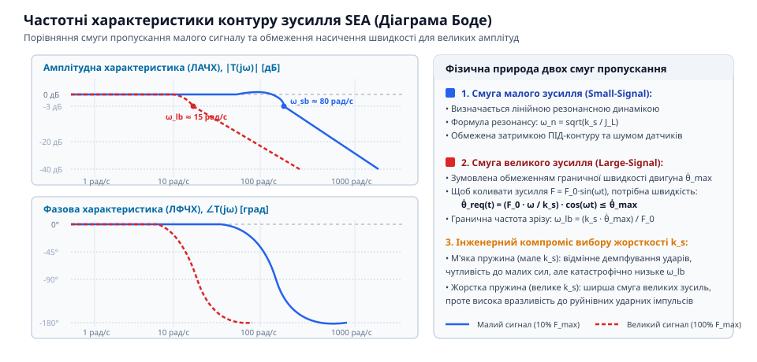
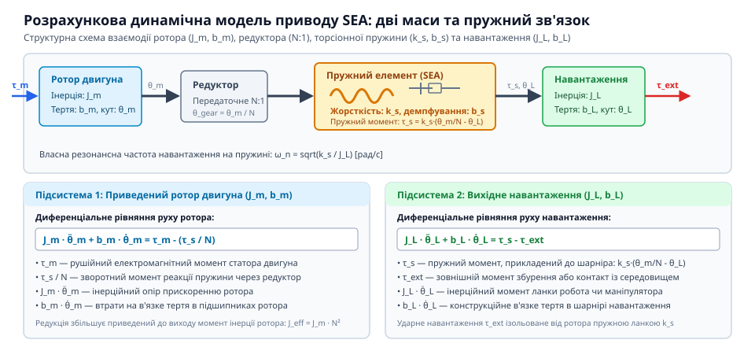

# Серійний пружний актуатор (SEA)

<preknowlist>
- [Серійний пружний актуатор (SEA)](root:hw-motion/series-elastic-actuator) — механічна будова SEA та призначення пружини
</preknowlist>

## Диференціальні рівняння динаміки двомасової системи SEA: зв'язок маси ротора, пружини k_s та навантаження

Серійний пружний актуатор (SEA) у загальному вигляді моделюється як зосереджена динамічна система з двома інерційними масами, з'єднаними пружно-в'язким елементом. Перша маса відповідає ротору електродвигуна з урахуванням редуктора, друга — рухомому навантаженню (ланці маніпулятора або ноги крокуючого робота).

Введемо узагальнені координати та параметри системи:
- `θ_m` — кут повороту ротора електродвигуна (рад);
- `N` — передавальне число понижуючого редуктора (`N > 1`);
- `θ_g = θ_m / N` — кут повороту вихідного вала редуктора (до пружини);
- `θ_L` — кут повороту ланки навантаження (після пружини);
- `J_m` — власний момент інерції ротора двигуна (кг·м²);
- `J_eq = N² · J_m` — приведений до виходу редуктора момент інерції ротора;
- `J_L` — момент інерції керованого навантаження;
- `k_s` — крутильна жорсткість серійної пружини (Н·м/рад);
- `b_s` — коефіцієнт внутрішнього в'язкого демпфування матеріалу пружини (Н·м·с/рад);
- `b_m` — коефіцієнт в'язкого тертя в підшипниках двигуна та редукторі (`b_eq = N² · b_m`);
- `b_L` — коефіцієнт в'язкого опору середовища на ланці навантаження;
- `τ_m` — електромагнітний крутний момент двигуна;
- `τ_eq = N · τ_m` — приведений крутний момент редуктора;
- `τ_ext` — зовнішній момент збурення, прикладений до ланки з навколишнього середовища.

> 🔧 **Навіщо це.** Складання диференціальних рівнянь дозволяє синтезувати стабільний контур керування моментом і точно визначити умови виникнення резонансних коливань при взаємодії з жорсткими об'єктами.

Крутний момент `τ_s`, що передається через серійну пружну ланку на навантаження, визначається відносною деформацією та швидкістю деформації:
```
τ_s = k_s · (θ_g - θ_L) + b_s · (dθ_g/dt - dθ_L/dt)
```

Запишемо рівняння руху за принципом Даламбера або через рівняння Лагранжа II роду окремо для двох вузлів:

1. **Для вузла редуктора (інерція ротора `J_eq`):**
```
J_eq · (d²θ_g / dt²) + b_eq · (dθ_g / dt) + τ_s = τ_eq
```
Підставивши вираз для `τ_s`:
```
J_eq · (d²θ_g / dt²) + (b_eq + b_s) · (dθ_g / dt) + k_s · θ_g - b_s · (dθ_L / dt) - k_s · θ_L = τ_eq
```

2. **Для вузла навантаження (інерція навантаження `J_L`):**
```
J_L · (d²θ_L / dt²) + b_L · (dθ_L / dt) - τ_s = -τ_ext
```
Підставивши вираз для `τ_s`:
```
J_L · (d²θ_L / dt²) + (b_L + b_s) · (dθ_L / dt) + k_s · θ_L - b_s · (dθ_g / dt) - k_s · θ_g = -τ_ext
```

У просторі оператора Лапласа `s` за нульових початкових умов система набуває алгебричного матричного вигляду:
```
[ J_eq · s² + (b_eq + b_s) · s + k_s       -(b_s · s + k_s)               ] [ Θ_g(s) ] = [ Τ_eq(s)   ]
[ -(b_s · s + k_s)                         J_L · s² + (b_L + b_s) · s + k_s ] [ Θ_L(s) ]   [ -Τ_ext(s) ]
```

### Простір станів та характеристичний поліном
Для проєктування багатовимірних цифрових спостерігачів стану (State Observers) та фільтрів Калмана запишемо динаміку SEA у просторі станів:
Вектор стану системи оберемо у вигляді:
```
x = [ θ_g,   ω_g,   θ_L,   ω_L ]^T
```
де `ω_g = dθ_g/dt`, а `ω_L = dθ_L/dt`. Вектор вхідних впливів `u = [ τ_eq,   τ_ext ]^T`.

Диференціальне матричне рівняння має стандартний лінійний вигляд `dx/dt = A · x + B · u`, де матриця динаміки системи `A`:
```
A = [  0             1                0            0          ]
    [ -k_s/J_eq   -(b_eq+b_s)/J_eq   k_s/J_eq     b_s/J_eq    ]
    [  0             0                0            1          ]
    [  k_s/J_L     b_s/J_L          -k_s/J_L   -(b_L+b_s)/J_L ]
```
а матриця входів `B`:
```
B = [ 0          0     ]
    [ 1/J_eq     0     ]
    [ 0          0     ]
    [ 0        -1/J_L  ]
```

Характеристичне рівняння розраховується з визначника матриці `det(s·I - A) = 0`:
```
Δ(s) = s⁴ + a₃ · s³ + a₂ · s² + a₁ · s + a₀ = 0
```
де коефіцієнти визначаються співвідношенням інерцій та жорсткості:
- `a₃ = (b_eq + b_s)/J_eq + (b_L + b_s)/J_L`
- `a₂ = k_s · (1/J_eq + 1/J_L) + (b_eq · b_L + b_s · (b_eq + b_L)) / (J_eq · J_L)`
- `a₁ = k_s · (b_eq + b_L) / (J_eq · J_L)`
- `a₀ = 0` (за відсутності зовнішнього позиційного повертаючого моменту гравітації чи базової пружини).

Корені цього характеристичного полінома містять пару комплексно-спряжених полюсів, що формують слабозатухаючу коливальну моду з частотою `ω_res ≈ sqrt(k_s · (J_eq + J_L) / (J_eq · J_L))`. Знання точних значень матриці `A` дозволяє налаштувати коефіцієнти підсилення контуру зворотного зв'язку так, щоб перемістити власні полюси в глибину лівої півплощини комплексної площини коренів (Root Locus), забезпечуючи аперіодичний характер перехідного процесу.

## Резонансна частота та смуга пропускання зусилля (Force Bandwidth): аналітичний розрахунок omega_n = sqrt(k_s / J_load)

Частотна характеристика контуру регулювання зусилля в SEA принципово залежить від механічного граничного стану вихідної ланки. Розглянемо два крайніх граничних випадки: заблоковане навантаження та вільне навантаження.

### Випадок 1: Заблоковане навантаження (Locked Output, контакт із твердою стіною)
У практиці робототехніки це відповідає ситуації, коли робот спирається стопою на жорсткий бетонований ґрунт або маніпулятор утримує важкий монолітний об'єкт. Тоді `θ_L(t) = 0` та `dθ_L/dt = 0`.

> 🔧 **Навіщо це.** Заблокований вихід є найгіршим випадком для стійкості контуру сили: уся енергія привода замкнена всередині пружини та ротора без розсіювання в переміщення навантаження.

Рівняння вихідного моменту спрощується до:
```
Τ_s(s) = (b_s · s + k_s) · Θ_g(s)
```
Підставивши це в рівняння двигуна:
```
[ J_eq · s² + (b_eq + b_s) · s + k_s ] · Θ_g(s) = Τ_eq(s)
```
Передавальна функція від приведеного моменту двигуна `Τ_eq` до моменту на пружині `Τ_s`:
```
W_locked(s) = Τ_s(s) / Τ_eq(s) = (b_s · s + k_s) / [ J_eq · s² + (b_eq + b_s) · s + k_s ]
```
Власна частота коливань системи із заблокованим виходом визначається жорсткістю пружини та інерцією ротора:
```
ω_locked = sqrt(k_s / J_eq)
```
На частотах `ω << ω_locked` передавальна функція дорівнює 1 (0 дБ) — двигун безпомилково транслює заданий момент. На частоті `ω_locked` спостерігається резонансний підйом (величина якого обернено пропорційна демпфуванню `b_s`), а вище резонансу амплітуда спадає зі швидкістю -40 дБ/декада.

### Випадок 2: Вільне навантаження без зовнішнього опору (Free Motion, рух у повітрі)
Коли кінцева ланка вільно переміщується в повітрі (`τ_ext = 0`), рух ротора передається навантаженню через пружину. З рівняння для навантаження отримуємо:
```
Θ_L(s) / Θ_g(s) = (b_s · s + k_s) / [ J_L · s² + (b_L + b_s) · s + k_s ]
```
Резонансна частота коливань самого навантаження відносно пружини:
```
ω_n = sqrt(k_s / J_L)
```
Для всієї розв'язаної двомасової консервативної системи (нехтуючи тертям `b_eq = b_s = b_L = 0`) характеристичний поліном має вигляд:
```
Δ(s) = s² · [ s² + k_s · (J_eq + J_L) / (J_eq · J_L) ]
```
Звідси загальна власна частота антирезонансу та двомасового резонансу:
```
ω_res = sqrt( k_s · (1/J_eq + 1/J_L) )
```

### Смуга пропускання за малим сигналом (Small-Force Bandwidth)
Смугою пропускання за зусиллям (Force Bandwidth) називають діапазон частот, у якому актуатор здатен генерувати гармонійно змінний момент без завалу амплітуди нижче рівня -3 дБ (або без перевищення фазового зсуву 45–90°).

Для малого сигналу (коли швидкість і струм двигуна далекі від насичення) відкрита смуга зусилля обмежується власною механічною частотою `ω_n`:
```
f_bw = ω_n / (2 · π) = (1 / 2π) · sqrt(k_s / J_L)
```
Якщо обрати занадто м'яку пружину (мале `k_s`), актуатор чудово фільтруватиме удари, але його здатність швидко змінювати момент обмежиться одиницями герц (наприклад, 4–8 Гц), що зробить привід млявим. Якщо ж обрати надто жорстку пружину (велике `k_s`), смуга зросте до 40–50 Гц, але зникнуть захисні властивості SEA, а вимоги до точності енкодерів стануть критичними. Вибір `k_s` — це завжди компроміс між механічною стійкістю до ударів та динамічною швидкодією контуру сили.

## Межа насичення швидкості двигуна та смуга великих зусиль (Large-force bandwidth limit)

У лінійному наближенні за малим сигналом частотна смуга зусилля SEA визначається власною механічною частотою коливань пружини та навантаження `ω_n = sqrt(k_s / J_L)`. Проте на практиці привід ніколи не працює з нескінченними ресурсами: будь-який реальний електродвигун має фізичне обмеження максимальної швидкості обертання ротора `ω_max` (обмеження напругою живлення шини DC та проти-ЕРС) і пікового моменту `τ_max` (обмеження струмом інвертора та магнітним насиченням заліза).

При спробі згенерувати гармонійно змінний крутний момент великої амплітуди:
```
τ_s(t) = T_0 · sin(ω · t)
```
серійна пружина повинна безперервно деформуватися на кут:
```
Δθ(t) = (T_0 / k_s) · sin(ω · t)
```

> 🔧 **Навіщо це.** Розрахунок граничної смуги великих зусиль дозволяє запобігти небезпечній втраті керованості, коли робот не встигає парирувати потужне зовнішнє збурення через насичення швидкості ротора.


*ЛАЧХ/ЛФЧХ контуру зусилля SEA: порівняння частотних смуг малих та великих амплітуд.*

Припустимо, що навантаження заблоковане або має велику інерцію (`θ_L ≈ 0`). Тоді кутове переміщення вихідного вала редуктора має точно відповідати деформації пружини: `θ_g(t) = Δθ(t)`.

Продиференціюємо деформацію за часом, щоб знайти необхідну кутову швидкість вихідного вала редуктора:
```
ω_g(t) = d(Δθ)/dt = (T_0 · ω / k_s) · cos(ω · t)
```
Пікова кутова швидкість на виході редуктора становить:
```
ω_g_peak = (T_0 · ω) / k_s
```
Кутова швидкість вала ротора двигуна до редуктора (з передавальним числом `N`) дорівнює:
```
ω_m_peak = N · ω_g_peak = N · (T_0 · ω) / k_s
```

Оскільки швидкість ротора двигуна жорстко обмежена величиною `ω_max`, отримуємо строгу нерівність:
```
N · (T_0 · ω) / k_s ≤ ω_max
```
Звідси гранична кутова частота, на якій актуатор здатний підтримувати задану амплітуду моменту `T_0` без насичення швидкості двигуна, становить:
```
ω_large = (k_s · ω_max) / (N · T_0)
```
або в герцах:
```
f_large = (k_s · ω_max) / (2 · π · N · T_0)
```

З формули видно фундаментальну властивість SEA: **смуга пропускання зусилля за великим сигналом обернено пропорційна амплітуді заданого зусилля `T_0`**.

### Числовий приклад розрахунку смуги для реального сервомодуля
Розглянемо параметри типового робототехнічного шарніра коліна:
- Максимальна швидкість безколекторного двигуна: `n_max = 6000 об/хв` (`ω_max = 6000 · 2π / 60 ≈ 628.3 рад/с`).
- Передавальне число хвильового редуктора: `N = 50`.
- Максимальна кутова швидкість після редуктора: `ω_g_max = 628.3 / 50 = 12.57 рад/с`.
- Крутильна жорсткість титанового диска SEA: `k_s = 200 Н·м/рад`.
- Момент інерції ланки гомілки: `J_L = 0.02 кг·м²`.

1. **Режим малого сигналу (амплітуда коливань моменту T_0 = 1 Н·м):**
Швидкість двигуна далека від насичення. Гранична смуга за швидкістю складала б:
```
f_large = (200 · 628.3) / (2 · π · 50 · 1) ≈ 400 Гц
```
Проте реальна смуга обмежується власною резонансною частотою пружини та інерції ланки:
```
f_bw = (1 / 2π) · sqrt(k_s / J_L) = (1 / 2π) · sqrt(200 / 0.02) = 100 / (2π) ≈ 15.9 Гц
```
Отже, для малих моментів актуатор здатний відпрацьовувати команди із частотою до 15.9 Гц.

2. **Режим великого сигналу (номінальний ударний момент T_0 = 50 Н·м):**
Підставимо значення у формулу насичення швидкості:
```
f_large = (k_s · ω_max) / (2 · π · N · T_0)
        = (200 · 628.3) / (2 · 3.14159 · 50 · 50)
        = 125660 / 15708
        ≈ 8.0 Гц
```
3. **Режим екстремального перевантаження (T_0 = 100 Н·м):**
```
f_large = 125660 / (2 · π · 50 · 100) ≈ 4.0 Гц
```

Цей розрахунок наочно демонструє інженерний компроміс: при зростанні амплітуди завдання від 1 Н·м до 100 Н·м робоча смуга актуатора спадає з 15.9 Гц до 4.0 Гц. Для збереження динаміки важких кінцівок конструктор зобов'язаний або підвищувати напругу шини живлення двигуна (збільшуючи `ω_max`), або обирати жорсткішу пружину ціною зниження амортизаційних властивостей.

## Синтез замкненого ПІД-контуру керування за зусиллям та аналіз стійкості при взаємодії з жорстким контактом

Для керування крутним моментом актуатора SEA застосовують каскадну схему керування: внутрішній швидкий контур регулювання струму фаз (FOC або ШІМ-підсилювач на частоті 10–20 кГц) та зовнішній контур регулювання зусилля (на частоті 1–2 кГц).

Виміряний крутний момент `τ_meas` обчислюється безпосередньо з різниці показів енкодерів положення виходу редуктора `θ_g` та ланки навантаження `θ_L`:
```
τ_meas = k_s · (θ_g - θ_L)
```
Похибка регулювання крутного моменту:
```
e_τ(t) = τ_ref(t) - τ_meas(t)
```

> 🔧 **Навіщо це.** Синтез коректного закону керування гарантує, що при раптовому переході від вільного польоту маніпулятора до удару об нерухому стіну система збереже абсолютну пасивну стійкість без виникнення контактного брязкоту.


*Розрахункова динамічна схема SEA: дві обертові маси з демпфуванням та пружним елементом k_s.*

Класичний ПІД-регулятор формує завдання швидкості або моменту для двигуна:
```
u(t) = K_p · e_τ(t) + K_i · ∫ e_τ(τ) dτ + K_d · (d e_τ / dt)
```

Для покращення динамічної поведінки при активному русі навантаження контур доповнюють прямим зв'язком за швидкістю навантаження (Velocity Feedforward):
```
u_cmd(t) = u(t) + N · (dθ_L / dt)
```
Цей зв'язок компенсує рух зовнішньої ланки: якщо навантаження швидко повертається, ротор завчасно провертається разом із ним, зберігаючи постійну деформацію пружини `Δθ`.

### Аналіз контактної стійкості (Passivity and Contact Transition)
Найкритичнішим режимом для актуатора SEA є перехідний контакт: вільний рух у просторі (`θ_L` довільне, опір нульовий) раптово змінюється ударом об абсолютно жорстке середовище з жорсткістю `K_env → ∞`.

Відповідно до **критерію пасивності Колейта–Хогана (Colgate & Hogan Passivity Condition)**, система взаємодії робота з довільним пасивним середовищем залишається безумовно стійкою тоді й лише тоді, коли вхідний механічний імпеданс актуатора `Z_in(s)` (або адмітанс `Y(s) = 1/Z_in(s)`) є строго позитивною дійсною функцією (Strictly Positive Real, SPR):
```
Re{ Z_in(jω) } > 0   для всіх ω ≥ 0
```

У жорсткому приводі будь-яка затримка квантування АЦП або фазовий запізнювальний зсув у контурі зусилля порушує позитивну дійсність імпедансу на високих частотах, що призводить до негативного демпфування та миттєвого збудження високочастотних руйнівних коливань (chatter).

У приводі SEA фізична серійна пружина `k_s` діє як пасивний буфер:
1. Фазовий зсув на частотах вище резонансу природно обмежений властивостями механіки другого порядку.
2. Внутрішнє демпфування матеріалу пружини `b_s` та підшипників гарантує гарантований додатний баланс розсіювання енергії:
```
∫ [ τ_contact(t) · ω_contact(t) ] dt ≥ -E_stored(0)
```
3. Щоб запобігти підсиленню шумів енкодера в диференціальній складовій `K_d`, похідну деформації фільтрують аналоговим або цифровим фільтром низьких частот першого чи другого порядку, або використовують зворотний зв'язок за швидкістю ротора з вбудованого енкодера двигуна.

Завдяки цьому правильно налаштований актуатор SEA зберігає стабільність під час контакту зі стіною будь-якої твердості, забезпечуючи плавну та безпечну взаємодію.
