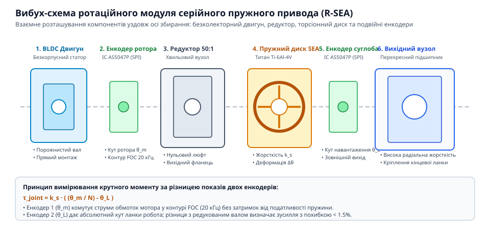
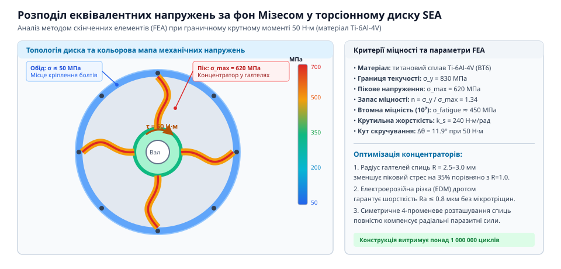
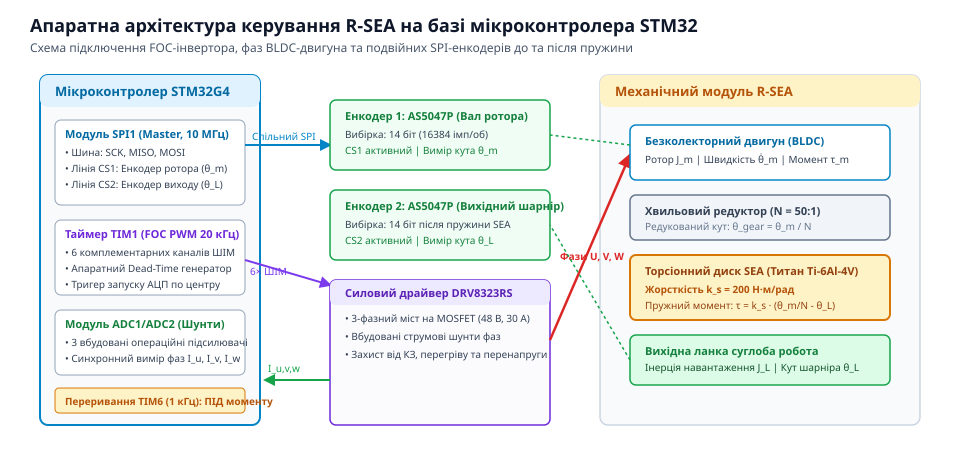
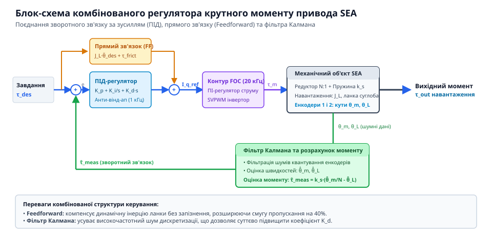

# Серійний пружний актуатор (SEA)

<preknowlist>
- [Серійний пружний актуатор (SEA)](root:hw-motion/series-elastic-actuator) — базовий принцип роботи SEA та формула Гука F = k · x
</preknowlist>

## Архітектура та механічна компоновка R-SEA: вибір безколекторного двигуна, планетарного редуктора та соосної геометрії шарніра

Ротаційний серійний пружний актуатор (@@en|Rotary Series Elastic Actuator@@, R-SEA) вирішує головне протиріччя класичного робототехнічного привода: високу жорсткість традиційних редукторів, що загрожує пошкодженням зубчастих коліс при ударах об тверді поверхні, та необхідність безпечної, плавної взаємодії з людиною та неструктурованим середовищем. На відміну від безпосередньо жорсткого з'єднання вихідного вала редуктора з кінцевою ланкою маніпулятора, у кінематичний ланцюг R-SEA послідовно вбудовано спеціально розрахований пружний елемент — торсіонну пружину.

Механічна структура компактного модуля R-SEA будується за соосною інтегрованою схемою, де всі функціональні вузли розташовані вздовж єдиної осі обертання шарніра:
1. **Високомоментний безколекторний двигун (BLDC)**: плаский мотор із зовнішнім ротором (конфігурація pancake, наприклад, діаметром 70–90 мм), який створює високий первинний момент при помірній частоті обертання.
2. **Низьколюфтовий редуктор**: планетарний редуктор із передавальним відношенням `i = 10:1..20:1` або хвильова передача (@@en|strain wave gear@@). Помірне передавальне число зберігає високу механічну прозорість привода та зменшує приведену інерцію ротора.
3. **Пружний елемент (торсіонний диск)**: спеціально спрофільована пружна балка або диск із радіальними спицями, що забезпечує кутову піддатливість у межах робочого діапазону деформації `±3°..±6°`.
4. **Два абсолютні кутові енкодери**: перший енкодер вимірює кутове положення вхідного вала пружини (після редуктора `theta_in`), а другий — кут вихідного фланця ланки робота (`theta_out`).


*Вибух-схема механічного збирання ротаційного модуля R-SEA: послідовне соосне розташування безколекторного мотора, низьколюфтового редуктора, торсіонного диска та пари абсолютних енкодерів.*

Взаємний кутовий зсув двох енкодерів перетворює пружний елемент на прецизійний безконтактний давач крутного моменту за законом Гука для кручення:

```
T_spring
= k_spring · (theta_out - theta_in)                          [визначення крутного моменту за кутовою деформацією пружини]
= k_spring · delta_theta
= 350.0 · 0.0436                                             [при жорсткості 350 Н·м/рад та куті закручування 2.5° (0.0436 рад)]
= 15.26                                                      [виміряний поточний крутний момент суглоба в ньютон-метрах]
```

Окрім прямого вимірювання моменту, пружний елемент виконує роль механічного низькочастотного фільтра ударних навантажень. Коли кінцева ланка маніпулятора зазнає раптового зіткнення з перешкодою, імпульс ударної сили поглинається пружною деформацією торсіона:

```
T_shock_peak
= sqrt(2.0 · E_kinetic · k_spring)                           [піковий ударний момент, що передається на зуби редуктора]
= sqrt(2.0 · 1.8 · 350.0)                                    [для кінетичної енергії удару 1.8 Дж та жорсткості k = 350 Н·м/рад]
= sqrt(1260.0)
= 35.5                                                       [піковий момент обмежений 35.5 Н·м замість сотень Н·м у жорсткому приводі]
```

Вибір матеріалу торсіонної балки безпосередньо лімітує масу та габарити робототехнічного суглоба. Ключовою фізичною метрикою виступає питома пружна енергоємність: об'ємна `U_vol = sigma_yield² / (2 · E)` та гравіметрична `U_mass = U_vol / rho`.

| Матеріал пружини | Границя текучості sigma_yield, МПа | Модуль Юнга E, ГПа | Густина rho, кг/м³ | Об'ємна енергія U_vol, МДж/м³ | Гравіметрична енергія U_mass, Дж/кг |
|---|---|---|---|---|---|
| Пружинна сталь 65Г (загартована) | 1200 | 206 | 7850 | 3.50 | 445 |
| Пружинна сталь 51CrV4 (високоміцна) | 1350 | 208 | 7840 | 4.38 | 559 |
| Титановий сплав Ti-6Al-4V (Grade 5) | 880 | 114 | 4430 | 3.40 | 767 |
| Псевдобета-титан Ti-15V-3Cr-3Sn-3Al | 1100 | 100 | 4760 | 6.05 | 1271 |

Титановий сплав Ti-6Al-4V демонструє гравіметричну енергоємність 767 Дж/кг, що на 72% перевищує показник легованої сталі 65Г. Більш низький модуль пружності титану (114 ГПа проти 206 ГПа) дозволяє інженеру збільшити геометричну товщину пружних спиць майже на 25% при збереженні ідентичної низької крутильної жорсткості. Товстіші спиці мають значно більшу стійкість до поперечного перекосу під дією радіальних та перекидних сил, що усуває потребу у важких проміжних підшипникових опорах.

Пружна розв'язка рятує зуби планетарної передачі від втомного сколювання та зрізання, подовжуючи ресурс механічної трансмісії робота в десятки разів при контактних завданнях.

> 🔧 **Навіщо це.** Соосна інтеграція торсіонної пружини та двох енкодерів перетворює складне силове керування на просту задачу відстеження різниці кутів положення, забезпечуючи точне дозування контактних зусиль маніпулятора без встановлення дорогих зовнішніх шестиосьових силомоментних датчиків.

## Розрахунок та конструкція торсіонної пружини: вибір матеріалу (титан Ti-6Al-4V проти пружинної сталі), геометрія спиць та FEA-аналіз напружень

Проєктування пружного елемента для компактного ротаційного привода вимагає вирішення суперечливої інженерної задачі: забезпечення низької крутильної жорсткості вздовж робочої осі обертання при збереженні максимальної радіальної та осьової жорсткості шарніра, щоб вихідний фланець не перекошувався під дією згинальних навантажень ланки. Найкращі показники демонструють пласкі монолітні диски з радіальними або криволінійними S-подібними спицями, виготовлені на дротяно-вирізних електроерозійних верстатах (EDM).

Вибір матеріалу пружини визначається його питомою пружною енергоємністю `U_vol` — кількістю пружної енергії, яку матеріал здатен запасти на одиницю власного об'єму без виникнення залишкових пластичних деформацій:

```
U_vol
= sigma_yield² / (2.0 · E_modulus)                           [об'ємна густина пружної енергії деформації матеріалу]
```

Порівняння конструкційних матеріалів для торсіонних пружин R-SEA:
- **Пружинна сталь 65Г / 51CrV4** (після гартування та середнього відпуску): границя текучості `sigma_yield = 1200` МПа, модуль Юнга `E = 206 000` МПа. Питома енергія: `1200² / (2 · 206 000) = 3.50` МДж/м³.
- **Титановий сплав Ti-6Al-4V (Grade 5)**: границя текучості `sigma_yield = 880` МПа, модуль Юнга `E = 114 000` МПа. Питома енергія: `880² / (2 · 114 000) = 3.40` МДж/м³, але при густині 4430 кг/м³ проти 7850 кг/м³ у сталі гравіметрична енергоємність титану перевищує сталь майже в 1.8 раза (`U_mass = U_vol / rho` становить 767 Дж/кг для титану проти 445 Дж/кг для сталі).

Нижчий модуль Юнга титану дозволяє створювати спиці більшої товщини при тій самій цільовій кутовій піддатливості, що радикально спрощує технологію електроерозійної обробки та підвищує геометричну стабільність деталі.

Крутильну жорсткість плаского пружного диска з кількістю прямокутних спиць `N_spokes` розраховують на основі теорії чистого згину консольної балки:

```
k_spring
= (N_spokes · E_modulus · b_width · h_thickness³) / (12.0 · L_length · R_mean) [крутильна жорсткість дискової пружини]
= (4 · 114000.0 · 12.0 · 2.5³ · 1e-3) / (12.0 · 18.0 · 28.0 · 1e-3)          [для 4 спиць шириною 12 мм, товщиною 2.5 мм, довжиною 18 мм]
= (456000.0 · 12.0 · 15.625 · 1e-3) / (6.048)
= 85500.0 / 6.048
= 353.4                                                      [підсумкова крутильна жорсткість торсіона, Н·м/рад]
```

Максимальні напруження згину виникають у прикореневих зонах спиць біля маточини та обода:

```
sigma_max
= (6.0 · T_load · R_mean) / (N_spokes · b_width · h_thickness²) [максимальні нормальні напруження згину в спиці]
= (6.0 · 25.0 · 0.028) / (4 · 0.012 · 0.0025²)              [для номінального робочого крутного моменту 25 Н·м]
= 4.2 / 0.0003
= 466.7                                                      [напруження становлять 466.7 МПа]
```

Запас міцності щодо границі текучості титану становить `n_safety = 880 / 466.7 = 1.88`, що забезпечує довготривалу втомну міцність при знакозмінних циклічних навантаженнях (понад 10 млн циклів за кривою Велера).

Метод скінченних елементів (FEA) показує, що критичною зоною концентрації еквівалентних напружень за фон Мізесом є радіуси переходу (галтелі) між спицею та внутрішнім кільцем. Зменшення радіуса галтелі нижче 1.5 мм викликає стрибок напружень на 40–60% через ефект концентрації. Тому всі внутрішні кути проєктують із плавними галтелями радіусом `R_fillet = 2.5..3.5` мм.


*Карта механічних еквівалентних напружень (за фон Мізесом) у плоскому торсіонному диску при максимальному робочому моменті.*

Для захисту пружини від випадкових екстремальних перевантажень (наприклад, падіння робота або заклинювання редуктора) конструкція модульного торсіона обов'язково оснащується інтегрованими механічними упорами (@@en|hard stops@@). Упори обмежують максимальний кутовий хід деформації на рівні `delta_theta_limit = ±4.5°`. При досягненні цього кута кулачки маточини впираються в жорсткі пази зовнішнього обода, передаючи надлишковий момент в обхід пружних спиць безпосередньо на монолітний корпус.

> 🔧 **Навіщо це.** Механічні кулачкові упори гарантують, що нормальні напруження в титанових спицях ніколи не перевищать межу пружності навіть при ударах у 300–400% від номінального моменту, усуваючи пластичну деформацію та втрату нульового калібрування сенсорів.

## Сенсорна система та електроніка: встановлення двох магнітних енкодерів (SPI/SSI) до та після пружного елемента

Вимірювання крутного моменту в ротаційному серійному пружному актуаторі (R-SEA) базується на прямому прецизійному вимірюванні кутової деформації пружини. На відміну від тензометричних мостів, які страждають від температурного дрейфу нуля та крихкості тензорезисторів при ударних навантаженнях, дифенціальна кутова система вимірювання на двох абсолютних магнітних енкодерах забезпечує абсолютну перевантажувальну здатність і нульовий гістерезис сигналу.

Для повного відновлення стану шарніра в модуль інтегрують два ідентичні високошвидкісні цифрові магнітні енкодери (наприклад, мікросхеми AS5047P або MA730 на базі матриці елементів Холла):
1. **Енкодер вала мотора / редуктора (`theta_in`)**: діаметрально намагнічений дисковий неодимовий магніт встановлюється на внутрішній маточині торсіонної пружини, яка жорстко посаджена на вихідний вал хвильового або планетарного редуктора. Сенсор відстежує рух силового привода до пружної деформації.
2. **Енкодер шарніра ланки (`theta_out`)**: другий магніт закріплено на вихідному фланці шарніра робота після торсіонної пружини. Сенсор фіксує істинне положення кінцевої ланки суглоба у просторі.

Обидва сенсори підключаються до апаратного інтерфейсу SPI мікроконтролера STM32G4 на спільну шину даних (`SCK`, `MISO`), але використовують роздільні апаратні лінії вибору кристала (`CS_MOTOR` на піні `PA4` та `CS_OUTPUT` на піні `PA15`). Опитування сенсорів виконується синхронно на тактовій частоті SPI 10 МГц на початку кожного циклу переривання керування:

:::code proj-rotary-sea-module/c/sea_controller.c
```c
/* Фрагмент синхронного читання двох енкодерів через апаратний SPI */
static uint16_t Sea_ReadEncoderSPI(GPIO_TypeDef *cs_port, uint16_t cs_pin) {
    uint16_t tx_cmd = 0xFFFF; /* Команда читання регістра кута з бітом парності */
    uint16_t rx_data = 0;
    
    HAL_GPIO_WritePin(cs_port, cs_pin, GPIO_PIN_RESET);
    HAL_SPI_TransmitReceive(hspi_sea, (uint8_t *)&tx_cmd, (uint8_t *)&rx_data, 1, 5);
    HAL_GPIO_WritePin(cs_port, cs_pin, GPIO_PIN_SET);
    
    return (rx_data & 0x3FFF); /* Маска 14-бітного значення кута */
}
```



Програмне опитування через блокуючу функцію `HAL_SPI_TransmitReceive` є простим для початкового налагодження, але неприпустимим у високошвидкісних приводах. Передача 16 біт команди та прийом 16 біт кута на тактовій частоті 10 МГц триває 1.6 мкс. Для двох енкодерів із паузами на перемикання ліній Chip Select загальна затримка сягає 3.8–4.2 мкс. При загальному періоді квантування контуру струму FOC 50 мкс (частота ШІМ 20 кГц) блокування процесорного ядра ARM Cortex-M4 на 4 мкс відбирає майже 8% обчислювального часу та вносить фазовий джиттер у дискретний контур регулювання.

Для усунення простою CPU застосовують апаратний конвеєр прямого доступу до пам'яті (DMA) під тактуванням апаратного таймера. Логіка неблокуючого зчитування базується на двох потоках DMA: передавальному (TX) та приймальному (RX), пов'язаних через тригер генератора подій DMAMUX.

Апаратне опитування розгортається за таким алгоритмом:
1. **Синхронізація від таймера ШІМ**: Завершення перетворення струмів інвертора або періодична подія оновлення таймера TIM1 генерує внутрішній сигнал запуску TRGO у середині циклу ШІМ, коли силові ключі напівмостів не перемикаються і рівень електромагнітних завад мінімальний.
2. **Апаратна комутація вибору кристала**: Лінії CS переводяться в низький стан або за допомогою апаратного імпульсного режиму NSS контролера SPI, або каналами порівняння допоміжного таймера точно на час передачі 16 тактів SCK.
3. **Безперервна передача кадрів**: Потік DMA TX завантажує заздалегідь підготовлений буфер команд `dma_tx_cmd` у регістр SPI_DR, а потік DMA RX паралельно приймає байти кута безпосередньо в циклічний буфер оперативної пам'яті `dma_rx_raw`.
4. **Виклик переривання завершення транзакції**: Після збереження другого 16-бітного слова DMA формує переривання `TCIF`, викликаючи швидкий зворотний виклик для оновлення змінних стану кута.

Нижче наведено приклад конфігурації периферії STM32 HAL для запуску фонового циклічного опитування SPI через DMA:

:::code proj-rotary-sea-module/c/snippet-1.c

Часова економія від застосування DMA є критичною для фазової стійкості швидкісного цифрового привода:

```
t_cpu_saved
= t_spi_blocking · N_sensors                                 [час блокування ядра процесора при програмному опитуванні]
= 1.9 · 2
= 3.8                                                       [ядро вивільняє 3.8 мкс на кожному періоді контуру]
```

При частоті дискретизації контуру моменту 1 кГц перехід на DMA повністю вивільняє ресурс процесора для розрахунку спостерігача стану (фільтра Калмана) та компенсації нелінійного сухого тертя редуктора. Водночас джиттер моменту захоплення кута падає з ±1.5 мкс при обробці вкладених переривань до менш ніж 10 наносекунд завдяки строгому апаратному стробуванню від таймера.

Кутова роздільна здатність 14-бітного АЦП енкодера визначає мінімальний квант вимірювання кута:

```
delta_theta_res
= (2.0 · pi) / (2^14)                                       [кутова роздільність 14-бітного абсолютного енкодера]
= (2.0 · pi) / 16384
= 0.0003835                                                 [роздільна здатність сенсора в радіанах (0.0219°)]
```

Мінімальний квант дискретизації крутного моменту системи прямо пропорційний крутильній жорсткості пружини:

```
delta_T_res
= k_spring · delta_theta_res                                 [дискретність вимірювання крутного моменту модуля SEA]
= 350.0 · 0.0003835                                          [при жорсткості титанового торсіона k = 350 Н·м/рад]
= 0.134                                                      [квант вимірювання моменту становить 0.134 Н·м]
```

Отриманої точності 0.13 Н·м цілком достатньо для делікатної взаємодії руки маніпулятора з крихкими предметами або безпечної колаборації з людиною в спільному робочому просторі.

> 🔧 **Навіщо це.** Застосування двох енкодерів дозволяє контролеру одночасно бачити як деформацію пружини для розрахунку моменту, так і точне кінематичне положення вихідного фланця робота, усуваючи похибку позиціювання під дією змінного зовнішнього навантаження.

## Векторне керування двигуном (FOC) та внутрішній контур струму на STM32: апаратні таймери ШІМ, інжекція ADC та перетворення Кларк/Парк

Швидкодія та якість силового контуру R-SEA визначаються внутрішнім контуром регулювання струму двигуна. Оскільки крутний момент безколекторного двигуна прямо пропорційний квадратурній складовій струму статора `T_motor = 1.5 · p · psi_pm · i_q`, мікроконтролер реалізує алгоритм векторного керування з орієнтацією за полем (@@en|Field-Oriented Control@@, FOC) з апаратною частотою 20 кГц.

Апаратна реалізація FOC на базі мікроконтролера сімейства STM32G4 спирається на скоординовану роботу розширеного таймера `TIM1` та високошвидкісного АЦП (ADC1/ADC2):
1. **Центрований комплементарний ШІМ**: таймер `TIM1` генерує трифазні комплементарні імпульси з апаратним часом паузи (@@en|dead-time@@ 120 нс), який запобігає наскрізним струмам у стійках силового моста MOSFET.
2. **Інжекційне переривання АЦП**: тригер перетворення струмів прив'язаний до нижньої точки підрахунку таймера `TIM1_TRGO` (центр імпульсу нижніх ключів інвертора). Таке тактування гарантує, що фазні шунти омиваються стабільним струмом, вільним від комутаційних викидів напруги.
3. **Прямі перетворення Кларк і Парк**: виміряні фазні струми `i_a, i_b` перетворюються в ортогональні нерухомі осі `alpha-beta`, а потім повертаються на електричний кут ротора `theta_elec = p · theta_motor` в обертову систему координат `d-q`.

Пропорційно-інтегральний контур струму відпрацьовує завдання генерації цільового моменту:

```
V_q_cmd
= K_p_curr · (i_q_ref - i_q) + K_i_curr · integral(i_q_ref - i_q) [ПІ-регулятор квадратурного струму моменту]
V_d_cmd
= K_p_curr · (0.0 - i_d) + K_i_curr · integral(0.0 - i_d)        [утримання струму прямої осі на нулі для максимального ККД]
```

Після зворотного перетворення Парка напруги `v_alpha, v_beta` надходять до блоку просторово-векторної модуляції (SVPWM), який розраховує регістри шпаруватості `CCR1, CCR2, CCR3` таймера `TIM1`.

Критичною особливістю пружного привода є розв'язка кута комутації FOC: магнітний кут для перетворення Парка береться строго з енкодера мотора `theta_in`, тоді як зовнішній контур моменту спирається на різницю `theta_out - theta_in`. Це запобігає зриву синхронізації магнітного поля при різких пружних коливаннях вихідної ланки робота під час ударів.

> 🔧 **Навіщо це.** Апаратна синхронізація запуску АЦП від таймера ШІМ забезпечує чисте вимірювання фазних струмів без спотворень комутаційними шумами, дозволяючи оновлювати вектор сили мотора з затримкою менше 25 мікросекунд.

## Алгоритм замкненого ПІД-регулювання крутного моменту та калібрування нульового зсуву: компенсація тертя і фільтрація шумів

Кінцевою метою інтеграції ротаційного модуля R-SEA є точне відпрацювання заданого крутного моменту `T_desired` при динамічній зміні зовнішнього навантаження. Оскільки відхилення торсіона `delta_theta = theta_out - theta_in` обчислюється на основі вимірів двох цифрових енкодерів, мікроконтролер реалізує цифровий контур регулювання моменту з дискретністю 1 кГц у перериванні таймера `TIM6`.

Перед запуском активного контуру керування система виконує процедуру автоматичного калібрування нульового зміщення сенсорів `Sea_CalibrateZeros()`. Навіть за відсутності зовнішнього навантаження початкове взаємне положення дисків енкодерів може мати кутовий зсув до кількох градусів через механічні допуски посадки магнітів. За алгоритмом контролер утримує мотор знеструмленим і усереднює 200 послідовних відліків різниці енкодерів для обчислення базового зсуву `theta_zero_offset`.

:::code proj-rotary-sea-module/c/sea_controller.c
```c
/* Процедура калібрування нульового зміщення енкодерів без навантаження */
void Sea_CalibrateZeros(uint16_t samples) {
    float sum_diff = 0.0f;
    for (uint16_t i = 0; i < samples; i++) {
        uint16_t raw_m = Sea_ReadEncoderSPI(cs_port_m, cs_pin_m);
        uint16_t raw_out = Sea_ReadEncoderSPI(cs_port_o, cs_pin_o);
        float th_m = ((float)raw_m * 2.0f * 3.14159265f) / 16384.0f;
        float th_o = ((float)raw_out * 2.0f * 3.14159265f) / 16384.0f;
        sum_diff += (th_o - th_m);
        HAL_Delay(1);
    }
    zero_offset = sum_diff / (float)samples;
}
```

У робочому циклі переривання таймера `TIM6` розраховується поточний виміряний крутний момент із врахуванням тарованого нуля:

```
T_meas
= k_spring · ((theta_out - theta_in) - theta_zero_offset)    [поточний крутний момент пружинного елемента R-SEA]
```

Для стабілізації контуру крутного моменту застосовують ПІД-регулятор із компенсацією сухого тертя редуктора (кулонівського тертя `T_coulomb`) та в'язкого тертя `B_viscous`:

```
T_ff_friction
= T_coulomb · sgn(omega_motor) + B_viscous · omega_motor     [пряма компенсація сил внутрішнього тертя трансмісії]
```

Помилка регулювання моменту `e_torque = T_desired - T_meas` подається на цифровий пропорційно-диференціальний фільтр:

```
T_cmd
= K_p_t · e_torque + K_i_t · integral(e_torque) + K_d_t · (de_torque / dt) + T_ff_friction
```


*Блок-схема комбінованого регулятора крутного моменту: ПІД-ланка, прямий зв'язок за кутовим прискоренням та фільтрація шумів енкодерів.*

:::code proj-rotary-sea-module/c/sea_controller.c
:::code proj-rotary-sea-module/c/snippet-2.c

Якщо зовнішній крутний момент перевищує аварійну межу `MAX_TORQUE_LIMIT_NM = 30.0` Н·м, прапорець `is_overloaded` вимикає генерацію ШІМ, переводячи модуль у стан аварійного захисту.

> 🔧 **Навіщо це.** Компенсація тертя редуктора разом із інтегральним anti-windup регулятором дозволяє системі R-SEA підтримувати заданий зусилля з точністю до 0.15 Н·м навіть під час повільного руху суглоба, повністю усуваючи ефект «залипання» зубчастих передач.
