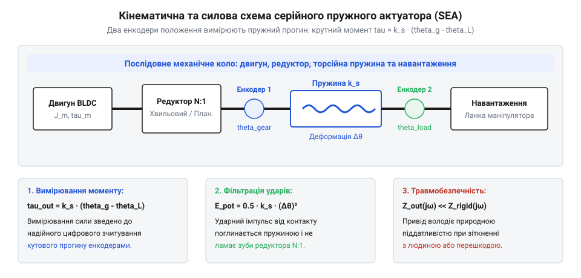
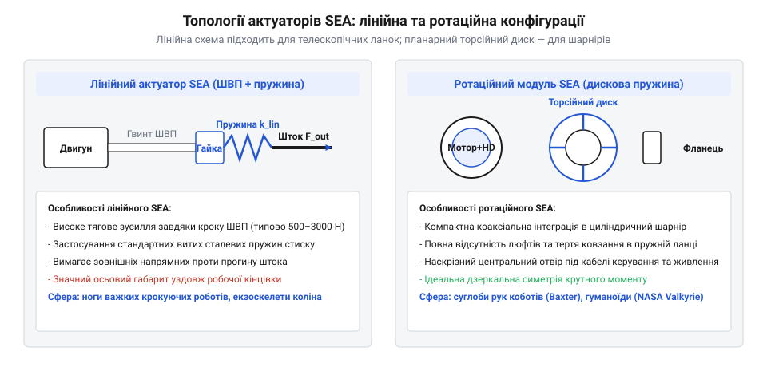
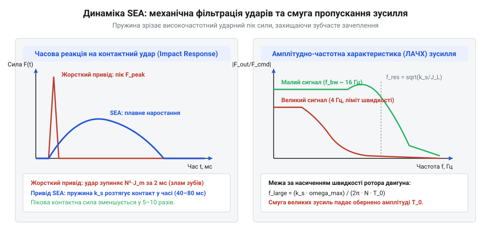
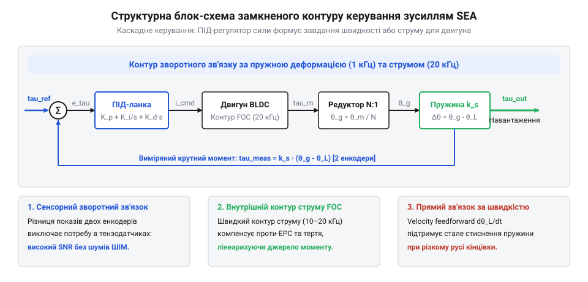

# Серійний пружний актуатор (SEA)

<preknowlist>
- [Сервомеханізм](root:hw-motion/servo) — контур зворотного зв'язку за положенням і швидкістю
- [Цифровий сервопривід](root:hw-motion/servo-digital) — цифрова обробка енкодерів та ШІМ-керування двигуном
</preknowlist>

## Чому абсолютно жорсткі приводи небезпечні та неефективні при динамічній взаємодії

Промислові роботи десятиліттями оптимізували заради єдиного критерію: максимальної позиційної жорсткості та точності позиціонування. Сталеві литі корпуси, попередньо натягнуті підшипники та безлюфтові редуктори створювали актуатори, здатні утримувати задані координати кінцевої точки з точністю до десятих часток міліметра.

Проте абсолютна жорсткість перетворюється на небезпечний недолік, як тільки робот виходить за межі ізольованої огорожі конвеєра:
1. **Катастрофічні ударні сили:** при непередбаченому зіткненні робочого органа з твердою перешкодою час зупинки становить мілісекунди. Кінетична енергія маніпулятора генерує гігантську ударну силу F_impact = m · (dv / dt), яка трощить зуби шестерень або ламає конструкцію.
2. **Небезпека для людини:** жорсткий робот не здатний безпечно розділяти робочий простір із оператором. Будь-який контакт на швидкості призводить до серйозних травм (перевищення меж тиску та сили за стандартом безпеки ISO/TS 15066), оскільки привід не має пасивної піддатливості.
3. **Неефективність біомеханічного руху:** у тваринному світі м'язи та сухожилля діють як енергоємні пружини, акумулюючи пружну енергію при приземленні та віддаючи її під час поштовху. Жорсткий електропривід вимушений гасити всю енергію удару в тепло гальм чи обмоток.

У статті [цифровий сервопривід](root:hw-motion/servo-digital) розглядаються контури контролю положення за сигналами енкодера. Проте програмний контур зворотного зв'язку обмежений частотою опитування та затримками фільтрації і не здатний запобігти піковим ударним хвилям, що поширюються зі швидкістю звуку в металі.

> 🔧 **Навіщо це.**
> Для безпечних колаборативних роботів (коботів), реабілітаційних екзоскелетів і людиноподібних машин потрібен актуатор, здатний пасивно поглинати раптові удари та точно дозувати контактне зусилля взаємодії.

Спроби розв'язати цю проблему за допомогою зовнішніх тензометричних датчиків наштовхувалися на високу зашумленість сигналу та крихкість сенсорів, що спонукало до розробки принципово нової концепції, описаної в [історії створення серійного пружного актуатора](root:hw-motion/series-elastic-actuator/hist-sea-pratt-williamson.md).

## Архітектурний принцип SEA: серійне розміщення каліброваного пружного елемента

Серійний пружний актуатор (@@en|Series Elastic Actuator, SEA@@) докорінно змінює традиційну компоновку приводу. Замість того щоб прагнути максимальної механічної жорсткості, інженери навмисно розміщують між виходом редуктора та навантаженням механічно піддатливий, точно калібрований пружний елемент — торсійну або лінійну пружину з жорсткістю k_s.

Класичний [сервомеханізм](root:hw-motion/servo) сприймає пружність як дефект і паразитну похибку. В актуаторі SEA пружина стає головним функціональним інструментом керування.


*Кінематична та силова схема SEA: калібрований пружний елемент відокремлює редуктор від навантаження, а різниця показів двох енкодерів перетворюється на високоточне вимірювання крутного моменту.*

Архітектура SEA перетворює складну задачу прямого вимірювання сили чи моменту на просту задачу прецизійного вимірювання геометричної деформації пружини за законом Гука:

```
F = k_s · (x_motor - x_load)
```

або для обертального суглоба:

```
tau = k_s · (theta_gear - theta_load)
```

де theta_gear — кут повороту вала після редуктора перед пружиною, theta_load — кут повороту вихідної ланки після пружини, а k_s — коефіцієнт торсійної жорсткості пружини (Н·м/рад).

Вимірюючи ці два кути за допомогою пари оптичних чи магнітних абсолютних енкодерів, контролер дістає точне значення діючого крутного моменту. Оскільки пружний елемент виготовляється зі спеціальних легованих сталей або титану з високою стабільністю модуля пружності, вимірювання є винятково надійним, лінійним і вільним від шумів, притаманних тензорезисторам.

Для виключення похибок від зміни температури навколишнього середовища (термічний дрейф модуля зсуву сталі G становить близько -0.02% на градус Цельсія) у прецизійних SEA застосовують термодатчик на тілі пружини з програмною компенсацією жорсткості:

```
k_s(T) = k_s_nominal · (1 + alpha_T · (T - T_0))
```

> 🔧 **Навіщо це.**
> Пружина виконує функцію механічного низькочастотного фільтра: вона поглинає миттєвий енергетичний удар і захищає крихкі зубчасті вінці редуктора, надаючи системі керування сотні мілісекунд для плавної реакції двигуна.

Фізико-математичний апарат резонансів та частотних меж SEA докладно розкрито у статті [математична модель динаміки та смуги пропускання](root:hw-motion/series-elastic-actuator/math-sea-dynamics-and-bandwidth.md).

## Топології та механічні конструкції серійних пружних актуаторів

Конструктивне виконання серійного пружного актуатора визначається типом руху кінцевої ланки (лінійний чи поворотний) та вимогами до масогабаритних параметрів.

У лінійних актуаторах використовують компактні безколекторні мотори, з'єднані з кульково-гвинтовими парами (КГП). Пружний елемент виконують у вигляді набору тарілчастих пружин або класичної циліндричної пружини стиску/розтягу, розміщеної між гайкою КГП і штоком вихідної ланки. Лінійні SEA широко застосовують у колінних суглобах людиноподібних роботів та активних протезах кінцівок.

Для компактних поворотних шарнірів роботів-маніпуляторів розроблено планарні торсійні пружини. Вони виготовляються методом дротяної електроерозійної обробки (EDM) або високоточного фрезерування зі сталевих або титанових дисків. Пружина має внутрішнє кільце, з'єднане з валом редуктора, та зовнішнє кільце, приєднане до ланки маніпулятора. Між ними розташовано спіральні або багатопроменеві зірчасті спиці.


*Механічні топології SEA: лінійний штовхач із гвинтовою пружиною стиску та компактний поворотний шарнір із плоскою торсійною пружиною архімедівського типу.*

Особливе значення має топологія розташування сенсорів. Для усунення похибок, викликаних люфтом редуктора, застосовують конфігурацію з трьома вимірювачами:
1. Енкодер на валу двигуна — для швидкісної комутації та керування мотором.
2. Енкодер після редуктора перед пружиною (theta_gear) — фіксує вихідний кут редуктора.
3. Енкодер на зовнішній ланці після пружини (theta_load) — фіксує фактичне положення суглоба.

Різниця показів саме другого і третього енкодерів (theta_gear - theta_load) дає чисту механічну деформацію пружини без впливу мертвого ходу шестерень редуктора.

> 🔧 **Навіщо це.**
> Роздільне вимірювання деформації пружини ізолює датчик сили від нелінійностей редуктора, дозволяючи використовувати навіть звичайні редуктори з помірним люфтом без втрати точності контролю зусилля.

Класифікацію та розрахунок надійності пружних елементів викладено в статті [інженерні класи пружин для робототехніки](root:hw-motion/series-elastic-actuator/comp-custom-torsion-springs.md), а приклад збирання поворотного приводу — у [практичній конструкції ротаційного модуля SEA](root:hw-motion/series-elastic-actuator/proj-rotary-sea-module.md).

## Динаміка та смуга пропускання: компроміс між поглинанням ударів і швидкодією

Інтеграція пружного елемента в силову лінію радикально змінює динамічні властивості системи, перетворюючи її на коливальний контур другого порядку.

Власна резонансна частота системи без демпфування визначається жорсткістю пружини k_s та інерцією вихідного навантаження J_load:

```
omega_n = √(k_s / J_load)
```

Ця формула породжує фундаментальний інженерний компроміс SEA:
- **М'яка пружина (мале k_s):** чудово фільтрує високочастотні динамічні удари, володіє високою енергоємністю для накопичення енергії та забезпечує надзвичайно точне вимірювання малих зусиль. Проте власна частота omega_n виходить низькою (порядку 5-10 Гц).
- **Жорстка пружина (велике k_s):** забезпечує високу швидкодію контуру регулювання (@@en|Force Bandwidth@@), але гірше згладжує удари й вимагає надвисокої роздільної здатності енкодерів для детектування крихітних кутових деформацій.


*Частотна характеристика SEA: пружний елемент фільтрує високочастотні динамічні удари, але водночас обмежує смугу пропускання контуру активного регулювання сили.*

Крім малосигнальної смуги пропускання, в SEA виникає ефект обмеження швидкості наростання великого зусилля (@@en|large-force bandwidth limit@@). Щоб створити велику силу, мотор повинен фізично провернутися на значний кут для деформації пружини:

```
(d tau / dt)_max = k_s · omega_motor_max
```

Якщо двигун досяг максимальної кутової швидкості omega_motor_max, швидкість наростання крутного моменту впирається в стелю, визначену жорсткістю k_s.

> 🔧 **Навіщо це.**
> Інженер обирає жорсткість пружини k_s під конкретну задачу: для поглинання кроків робота потрібна м'яка пружність, а для точного прецизійного маніпулятора з тактильним зворотним зв'язком — максимально жорстка.

## Алгоритми керування зусиллям та активне демпфування резонансних коливань

Оскільки датчик сили в актуаторі SEA фізично є пружиною, керування крутним моментом зводиться до високоточного позиціонування вала редуктора відносно зовнішнього навантаження. Проте пряме пропорційно-інтегрально-диференціальне (ПІД) регулювання призводить до виникнення стійких коливань на власній резонансній частоті системи маса-пружина.

Для забезпечення високої якості перехідних процесів та стійкості застосовують каскадну структуру регулювання з активним демпфуванням (@@en|active vibration damping@@).


*Структурна блок-схема контуру керування силою з вимірюванням деформації пружини, ПІД-регулятором та контуром швидкості двигуна.*

Структура контуру керування складається з таких ланок:
1. **Зовнішній контур зусилля:** обчислює похибку сили e_tau = tau_target - tau_measured. Регулятор сили генерує задану швидкість для двигуна.
2. **Внутрішній контур швидкості:** відпрацьовує швидкісне завдання через FOC-інвертор двигуна, нівелюючи нелінійні ефекти тертя спокою у підшипниках та редукторі.
3. **Гілка активного демпфування:** додає до керуючого сигналу складову, пропорційну швидкості деформації пружини (d(delta_theta) / dt). Це штучно вводить у систему в'язке тертя, гасячи коливання за частки періоду без фізичного розсіювання енергії в тепло.

```
tau_motor_cmd = PID(e_tau) - D_active · (omega_gear - omega_load)
```

Для вибору коефіцієнта демпфування D_active розраховують критичне демпфування системи zeta = 1. При еквівалентній масі ланки J_load та жорсткості k_s оптимальне значення коефіцієнта становить:

```
D_crit = 2 · √(k_s · J_load)
```

Встановлення D_active на рівні 0.7–0.9 від D_crit забезпечує найшвидше відпрацювання східчастого стрибка сили без перерегулювання з часом перехідного процесу менше 20 мс.

> 🔧 **Навіщо це.**
> Активне демпфування дозволяє перетворити низькочастотну коливальну систему на аперіодичну з часом відгуку в одиниці мілісекунд, що усуває брязкіт і вібрації суглоба робота при раптових змінах контактного навантаження.

## Режими роботи: рекуперація енергії та режим нульового зусилля

Гнучкість керування актуатором SEA дозволяє роботу функціонувати у двох діаметрально протилежних режимах: енергонакопичувальному та прозорому.

### 1. Режим пружної рекуперації (локомоція)
Під час бігу двоногих або чотириногих людиноподібних роботів кожен крок супроводжується фазою амортизації удару об землю. У момент удару кінетична енергія падіння стискає пружину SEA:

```
E_elastic = 0.5 · k_s · delta_theta²
```

Енергія накопичується в деформації кристалічної ґратки металу без споживання струму з акумулятора. На другій фазі кроку (відштовхування) мотор утримує вал заблокованим, і пружина миттєво віддає накопичену енергію назад, катапультуючи кінцівку вперед. Це збільшує автономність ходи робота у 1.5–2 рази.

### 2. Режим нульового зусилля (Zero-Force Control / Transparent Mode)
У медичних реабілітаційних екзоскелетах головним завданням є непомітність пристрою: пацієнт повинен вільно рухати кінцівкою, не відчуваючи ваги конструкції чи опору редукторів.

Контролер встановлює задане зусилля tau_target = 0. Як тільки людина починає згинати руку чи ногу, пружина деформується на мізерний кут у частки градуса. Контур керування миттєво фіксує відхилення і розганяє двигун так, щоб вихідний вал редуктора наздоганяв рух людини:

```
theta_gear → theta_load  =>  tau_measured → 0
```

У результаті важка конструкція екзоскелета вагою у десятки кілограмів стає практично невідчутною на дотик, дозволяючи пацієнту здійснювати природні рухи.

> 🔧 **Навіщо це.**
> Режим нульового зусилля перетворює жорстку механіку екзоскелета на ідеального асистента, який у разі потреби може миттєво перейти від вільного слідування до силової підтримки чи обмеження небезпечних амплітуд.

Подальшим розвитком концепції адаптивної піддатливості є системи, де коефіцієнт жорсткості регулюється на льоту, про що розповідає стаття [актуатор зі змінною жорсткістю (VSA)](root:hw-motion/variable-stiffness-actuator).

## Інженерна методика підбору параметрів і розрахунку пружного вузла SEA

Проєктування серійного пружного актуатора для суглоба робота або екзоскелета базується на точному розрахунку жорсткості пружного елемента k_s та оцінці його втомної міцності при циклічних деформаціях.

### 1. Розрахунок жорсткості пружини
Значення торсійної жорсткості k_s (Н·м/рад) обирають із компромісу між максимальною деформацією delta_theta_max та смугою пропускання сили:

```
k_s = tau_max / delta_theta_max
```

Типові вимоги до проєктування:
- Максимальна пружна деформація delta_theta_max зазвичай обмежується діапазоном від 2° до 10° (0.035–0.175 рад) при піковому моменті tau_max. Менший кут вимагає надвисокої роздільної здатності енкодерів, більший кут погіршує позиційну керованість і швидкість відновлення рівноваги.
- Резонансна частота системи omega_n = √(k_s / J_load) повинна щонайменше у 3–5 разів перевищувати основну частоту робочих рухів суглоба робота (зазвичай 1.5–3 Гц при крокуванні).

### 2. Вибір матеріалу та втомний розрахунок
Пружний елемент працює в режимі високоциклічного знакозмінного навантаження (понад 10⁷ циклів). 

```
Матеріал    | Модуль зсуву G, ГПа | Границя плинності, МПа | Енергоємність, Дж/кг
------------+---------------------+------------------------+---------------------
Сталь 60С2А | 78                  | 1180                   | ~ 150
Титан Ti-64 | 44                  | 880                    | ~ 320
```

Титан Ti-6Al-4V завдяки меншому модулю зсуву дозволяє створити вдвічі легшу й компактнішу пружину з більшою енергоємністю, але вимагає точнішого електроерозійного фрезерування.

Робочі напруження зсуву або вигину в тілі пружини не повинні перевищувати 50% від границі текучості матеріалу:

```
sigma_max ≤ 0.5 · sigma_yield
```

### 3. Механічні обмежувачі ходу
Для захисту пружини від пластичної деформації при катастрофічних ударних навантаженнях конструкція обов'язково містить паралельні механічні кулачкові упори (@@en|hard stops@@). Якщо кут деформації перевищує розрахунковий максимум на 15–20%, упори замикаються, і надлишковий ударний момент передається безпосередньо через масивний сталевий корпус в обхід пружних пелюсток.

> 🔧 **Навіщо це.**
> Механічні упори гарантують збереження геометричної стабільності пружини навіть при падінні робота з висоти, запобігаючи незворотному порушенню калібрування сенсора зусилля.

Основи побудови класичних сервоприводів викладено у статті [сервомеханізм](root:hw-motion/servo), а приводи зі змінною жорсткістю на ходу розглядає [актуатор зі змінною жорсткістю (VSA)](root:hw-motion/variable-stiffness-actuator).
