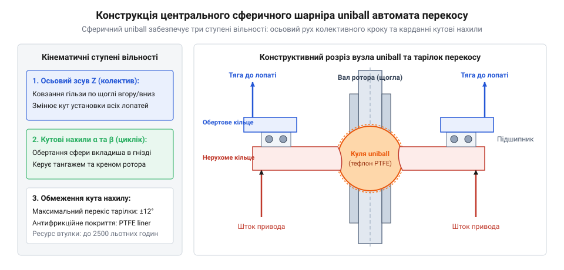
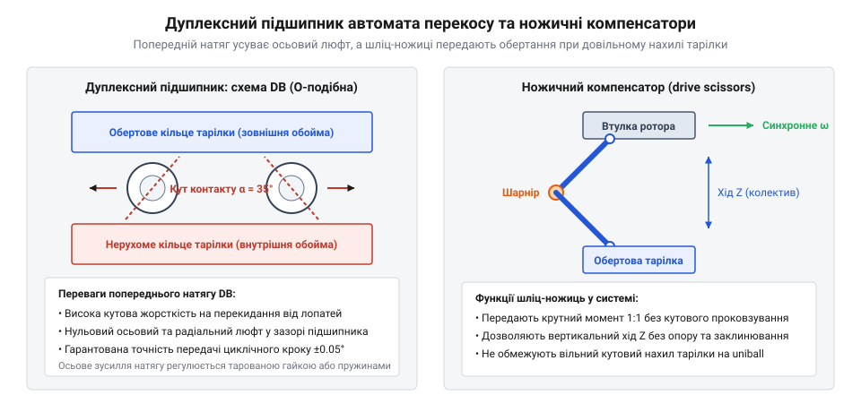
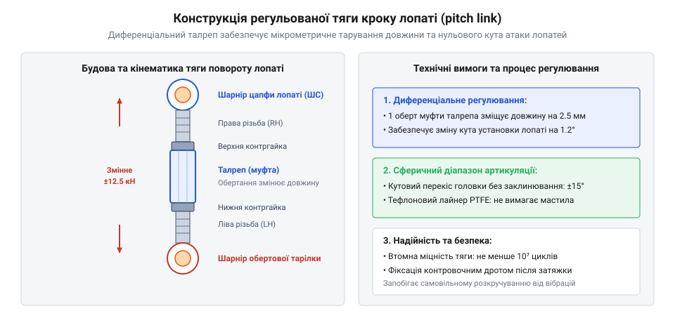

# Автомат перекосу (swashplate)

<preknowlist>
- [Тяги, качалки й люфт рульової поверхні](root:hw-motion/tiahy-kachalky-i-liuft-rulovoi-poverkhni) — кінематика тяг, передавальні відношення важелів та компенсація люфтів.
- [Кулькова гвинтова пара (ШВП) та ходовий гвинт: класи точності, попередній натяг і кінематика люфту](root:hw-motion/ball-screw) — концепція створення попереднього натягу та контактної жорсткості в тілах кочення.
</preknowlist>

## Сферичні шарнірні опори ковзання (uniball): кінематичні ступені вільності, матеріали та мащення

Центральним кінематичним ядром автомата перекосу є сферичний шарнірний вузол ковзання, відомий в авіаційній інженерії як uniball або кульова опора повзуна. Цей вузол розв'язує фундаментальну кінематичну задачу: він одночасно забезпечує лінійне переміщення тарілки вздовж осі вала ротора для керування загальним кроком та всебічний кутовий нахил у будь-якій площині для створення циклічного кроку.


*Конструкція центрального сферичного шарніра uniball та ступені вільності.*

Кінематично вузол uniball складається з двох концентричних елементів:
1. **Циліндричний повзун (слайдер):** внутрішня гільза, що ковзає вздовж нерухомої направляючої труби або безпосередньо по обертовому приводному валу ротора. Цей елемент реалізує один поступальний ступінь вільності вздовж вертикальної осі `Z`, змінюючи висоту тарілки над площиною втулки ротора.
2. **Сферична куля (кульовий шарнір):** прецизійно оброблена сфера із центральним отвором, що сидить на повзуні або виконана з ним як єдине ціле. Зовнішнє кільце автомата перекосу охоплює сферу через сферичну чашку, отримуючи три обертальні ступені вільності (карданне сферичне гойдання за тангажем, креном та азимутом).

Оскільки крутильний рух навколо вертикальної осі блокується зовнішніми ножичними важелями, вузол uniball реалізує три робочі ступені вільності рульового керування: вертикальне переміщення `z_sp` та два взаємно перпендикулярні кути нахилу `α_pitch` і `β_roll`.

> 🔧 **Навіщо це.** Сферична опора uniball ізолює кутові перекоси тарілки від лінійного приводу загального кроку. Без кульової опори спроба нахилити похилу шайбу на циліндричній напрямній призвела б до миттєвого перекосу та заклинювання повзуна під дією поперечних сил.

### Матеріали та трибологічні пари ковзання

Вузол uniball працює в екстремальних трибологічних умовах: високочастотні кутові коливання малої амплітуди (мікрохитання з частотою обертання ротора 4–8 Гц) поєднуються з високими радіальними та осьовими силами від рульових приводів (до 10–30 кН).

В інженерній практиці застосовують два принципово різні класи підшипників ковзання:

1. **Сухі самозмащувальні шарніри з PTFE-лайнером:**
   * Внутрішня сфера виготовляється з нержавіючої сталі високої твердості (17-4PH, 440C або 15-5PH) з поверхневим зміцненням нітридом титану чи твердим хромом (твердість поверхні понад 58–62 HRC, шорсткість `Ra ≤ 0.05 мкм`).
   * Внутрішня поверхня зовнішнього кільця покривається композитним антифрикційним лайнером: плетене полотно з волокон політетрафторетилену (PTFE / Teflon) та зміцнюючих волокон Nomex, просочене термореактивною епоксидною смолою.
   * Лайнер забезпечує коефіцієнт тертя `f = 0.03–0.08` без внесення мастила, стійкий до температур від `-55 °C` до `+150 °C` і не потребує періодичного технічного обслуговування протягом 1500–3000 годин нальоту.

2. **Підшипники з примусовим мащенням:**
   * Пара ковзання «загартована сталь по свинцевистій бронзі» або «сталь по сталі» вимагає регулярного змащування пластичними мастилами через прес-маслянки.
   * Головний недолік рідкого чи пластичного мащення на вертольоті — відцентровий викид мастила при високих обертах та схильність до фретинг-корозії. Під час високочастотних мікроколивань мастильна плівка видавлюється з зони контакту, що спричиняє сухий металевий контакт, окислення та швидке утворення глибинних раковин зносу.

### Трибодинаміка PTFE-лайнера: коефіцієнти тертя спокою і руху при знакозмінному мікрорусі

Під час просторового маневрування та прямолінійного польоту вертольота сферичний шарнір uniball функціонує в специфічному режимі безперервного високочастотного знакозмінного коливання. Кожен повний оберт несучого гвинта (при типовій робочій частоті обертання щогли `Ω = 250–450 об/хв`, що відповідає частоті `f_rot = 4–7.5 Гц`) змушує кулю здійснювати один повний цикл кутового хитання в межах `±2°...±8°`. У крайніх точках реверсу кутової швидкості миттєва відносна швидкість ковзання в шарнірі падає до нуля (`v_rel = 0`), після чого напрямок зсуву змінюється на протилежний. За таких умов знакозмінного мікроруху трибологічна поведінка контакту визначає точність позиціонування та стійкість усього контуру системи автоматичного керування польотом.

У класичних металевих підшипниках ковзання (наприклад, гартована хромована сталь по олов'яно-фосфористій або свинцевистій бронзі CuSn8) статичний коефіцієнт тертя спокою `f_stat` завжди суттєво перевищує кінетичний (динамічний) коефіцієнт тертя руху `f_dyn`:
* Для пари «сталь — бронза» при граничному мащенні: `f_stat = 0.18–0.25`, тоді як `f_dyn = 0.08–0.12`.
* Такий різкий від'ємний нахил кривої тертя на низьких швидкостях (`df/dv < 0`) породжує явище стрибкоподібного фрикційного заїдання (stick-slip phenomenon). Щоразу, коли тарілка автомата перекосу проходить через нульову швидкість або сервоприводи виконують мікроскопічну стабілізуючу корекцію, шток приводу змушений спочатку накопичити пружну деформацію для подолання високого статичного піка рушання:
```
T_breakaway = f_stat · r_sphere · F_N
```
У момент зриву шарніра зі стану спокою сила опору стрибком падає в 2–3 рази, викликаючи динамічний переліт цільової координати (overshoot), виникнення стійких паразитарних автоколивань (граничних циклів) у контурі автопілота та прискорену втому вузлів кріплення сервомеханізмів.

Композитний самозмащувальний вкладиш на основі PTFE демонструє докорінно відмінну фізику трибодинамічного контакту. Завдяки унікальній симетричній будові макромолекул фторопласту, де атоми фтору надійно захищають вуглецевий ланцюг і зумовлюють надзвичайно низькі міжмолекулярні сили когезії, фрикційна поведінка матеріалу має такі інженерні переваги:
1. **Відсутність пускового піка тертя спокою:** у PTFE статичний коефіцієнт тертя практично ідентичний динамічному або навіть виявляється дещо меншим за нього (`f_stat ≤ f_dyn`). За розрахункових вертолітних контактних напружень (`p = 35–70 МПа`) типові виміряні величини становлять `f_stat = 0.025–0.040`, тоді як динамічний коефіцієнт перебуває в межах `f_dyn = 0.035–0.060`.
2. **Невід'ємний градієнт характеристики тертя (`df/dv ≥ 0`):** коефіцієнт тертя плавно зростає зі збільшенням швидкості зсуву від нуля до номінальних робочих значень (0.05–0.25 м/с). Це фундаментально унеможливлює виникнення явища stick-slip: реверс напрямку хитання відбувається плавно, без ривків, мертвої зони опору та стрибків гідравлічного тиску в камерах приводів.

Залежність коефіцієнта тертя PTFE-лайнера від питомого нормального тиску описується емпіричним степеневим законом адгезійного зсуву:
```
f = C_liner · p^(-n)
```
де експоненційний показник `n` для тканих орієнтованих PTFE-волокон лежить у діапазоні `0.25–0.35`. Якщо за низьких навантажень (`p < 5 МПа`) коефіцієнт тертя становить `f ≈ 0.09–0.12`, то при виході на повне робоче навантаження автомата перекосу (`p = 40–80 МПа`) поверхневі молекулярні ланцюги фторопласту вирівнюються за напрямком ковзання, знижуючи тертя до значень `0.020–0.035`.

В процесі припрацювання під знакозмінним навантаженням молекули фторопласту зрізаються і впресовуються в мікронерівності твердої контрсфери, формуючи на сталі надтонку трансферну плівку завтовшки 15–30 нм. Тертя трансформується у взаємодію «PTFE по PTFE». Наявність жорсткого каркаса з волокон Nomex, зв'язаних фенольною смолою, виключає макроскопічну повзучість (холодне текуче витискання матеріалу із зазору) під імпульсними аеродинамічними ударами, забезпечуючи ресурс роботи uniball понад 2000–3000 льотних годин.

### Межі застосування та контактні напруження

Допустимий робочий контактний тиск для сучасних тканинних PTFE-лайнерів становить:
* Статичний тиск: `p_stat ≤ 150–200 МПа`;
* Динамічний тиск при циклічних коливаннях: `p_dyn ≤ 35–50 МПа`.

Граничний кут перекосу сферичної опори uniball геометрично обмежений формою чашки та діаметром центрального вала і зазвичай становить `θ_max = ±12°–15°`. Перевищення цього кута призводить до механічного контакту обойми з повзуном і руйнування рульової проводки, кінематику якої розглянуто у статті [Тяги, качалки й люфт рульової поверхні](root:hw-motion/tiahy-kachalky-i-liuft-rulovoi-poverkhni).

## Прецизійні дуплексні підшипники великого діаметра: опора обертового кільця, жорсткість і попередній натяг

Між нерухомим кільцем автомата перекосу (з'єднаним із сервоприводами системи керування) та зовнішнім обертовим кільцем (з'єднаним повідцями з лопатями ротора) розташована головна механічна опора — великогабаритний прецизійний кульковий підшипник. Цей підшипник працює під постійною частотою обертання вала ротора і передає всі статичні та знакозмінні динамічні зусилля керування кроком.


*Схема дуплексного радіально-упорного підшипника та ножичного повідця drive scissors.*

Підшипник автомата перекосу має специфічні конструктивні особливості:
* **Великий діаметр отвору:** внутрішній діаметр становить від 180 до 500 мм, щоб вільно пропускати всередину щоглу ротора, тяги керування загальним кроком та елементи вібраційного демпфування.
* **Надтонкий радіальний переріз (Thin-Section Bearings):** товщина кілець складає лише 12–25 мм для мінімізації паразитної маси на щоглі несучого ротора.
* **Складне просторове навантаження:** одночасна дія осьової сили від тяги гвинта, радіальних сил та змінного перекидного моменту від тяг повороту лопатей.

> 🔧 **Навіщо це.** Жорсткість підшипникової опори безпосередньо визначає динамічну точність керування кутом атаки лопатей. Будь-який осьовий або кутовий люфт у підшипнику призводить до неконтрольованої зміни кроку лопаті `Δθ = Δz / L_horn`, що викликає аеродинамічну асиметрію ротора та небезпечну високочастотну вібрацію фюзеляжу.

### Схеми дуплексування та забезпечення моментного натягу

Для сприйняття двосторонніх осьових зусиль і високих перекидних моментів застосовують радіально-упорні кулькові підшипники з кутом контакту `α_contact = 25°–35°`, об'єднані в дуплексні пари:

1. **Схема «спина-до-спини» (Back-to-Back, схема DB):**
   * Лінії контакту кульок розходяться назовні від осі підшипника, створюючи максимальну відстань між ефективними центрами реакцій опор.
   * Забезпечує найвищу кутову (моментну) жорсткість на перекіс тарілки, що є критично важливим для протидії крутильним моментам від шарнірів тяг зміни кроку.
   * Є стандартним компонувальним рішенням для більшості автоматів перекосу транспортних та бойових вертольотів.

2. **Схема «віч-на-віч» (Face-to-Face, схема DF):**
   * Лінії контакту сходяться всередину. Схема менш чутлива до кутових неспіввісностей корпусів, проте має помітно меншу моментну жорсткість на перекіс.

3. **Підшипники чотириточкового контакту (Four-Point Contact):**
   * Однорядний підшипник зі стрілчастими доріжками кочення спеціального готичного профілю, що здатен сприймати осьові навантаження в обох напрямках.
   * Вирізняється мінімальною масою та габаритами, проте має підвищене тертя ковзання в точках контакту кульок, що вимагає ефективного відведення тепла.

### Попередній натяг і температурна компенсація

Підшипники автомата перекосу монтуються з обов'язковим попереднім натягом, який повністю виключає внутрішній зазор (люфт дорівнює нулю: `Δ_clearance ≤ 0`). Фізичні принципи створення попереднього натягу та зростання контактної жорсткості детально розглянуто у статті [Кулькова гвинтова пара (ШВП) та ходовий гвинт: класи точності, попередній натяг і кінематика люфту](root:hw-motion/ball-screw).

Попередній натяг створюється прецизійною шліфовкою торцевих зазорів кілець або встановленням каліброваних прокладок між зовнішніми кільцями.

Головна інженерна проблема тонкостінних підшипників великого діаметра — різниця коефіцієнтів теплового лінійного розширення (КТЛР):
* Кільця підшипника виготовляються з високоякісної підшипникової сталі (ШХ15, AISI 52100 або корозійностійкої Cronidur 30) з КТЛР `α_steel ≈ 11 · 10⁻⁶ К⁻¹`;
* Корпуси кілець автомата перекосу виготовляють із легких алюмінієвих (типу В95 / 7075, `α_Al ≈ 23 · 10⁻⁶ К⁻¹`) або титанових сплавів (ВТ6 / Ti-6Al-4V, `α_Ti ≈ 8.6 · 10⁻⁶ К⁻¹`).

При нагріванні від тертя або в умовах високих зовнішніх температур алюмінієвий корпус розширюється вдвічі швидше за сталеве кільце. Це призводить або до послаблення посадки та провертання кільця в гнізді, або до заклинювання кульок при падінні температури до `-50 °C` через надмірне стискання внутрішнього натягу. Для усунення цієї проблеми між алюмінієвим корпусом і підшипником встановлюють тонкостінні проміжні гільзи з нержавіючої сталі або використовують суцільнотитанові корпуси тарілок.

## Ножичні компенсатори обертального моменту (drive scissors): кінематика та силове навантаження

Оскільки автомат перекосу складається з нерухомої та обертової тарілок, конструкція вимагає двох взаємно протилежних механічних обмежень:
1. Нерухоме (нижнє) кільце повинно надійно утримуватися від довільного провертання разом із валом ротора, зберігаючи свободу осьового ковзання та сферичного нахилу;
2. Обертове (верхнє) кільце повинно примусово обертатися суворо синхронно з валом ротора з кутовою швидкістю `ω_rotor`, також зберігаючи свободу осьового переміщення та нахилу.

Обидві ці задачі вирішують ножичні важільні механізми (ножиці проти провертання та повідкові ножиці приводу ротора, відомі в авіації як drive scissors або torque scissors).

Кінематично ножичний компенсатор являє собою плоский дволанковий важільний механізм (шарнірний паралелограм або ножиці-пантограф), що складається з двох однакових важелів, з'єднаних проміжним ліктьовим шарніром. 

Один кінець нижнього важеля шарнірно закріплений на корпусі (для нерухомої тарілки) або на валу ротора (для обертової тарілки), а вільний кінець верхнього важеля шарнірно з'єднаний із відповідним кільцем автомата перекосу.

Шарніри ножиць виконуються на прецизійних голчастих або сферичних підшипниках кочення з ущільнювальними манжетами, що сприймають високі радіальні та осьові навантаження при постійних знакозмінних коливаннях.

> 🔧 **Навіщо це.** Ножичні важелі передають крутний момент або реакцію опору провертанню, не обмежуючи при цьому просторовий рух автомата перекосу. При зміні загального кроку (осьовому підйомі повзуна на `Δz`) ліктьовий шарнір ножиць просто складається або розкладається, а при циклічному нахилі тарілки компенсує просторове кутове відхилення.

### Силові навантаження та динамічний крутний момент

На ножиці приводу обертового кільця діють значні динамічні сили:
1. **Момент тертя головного дуплексного підшипника:** опір коченню кульок та тертя ущільнень під дією осьової сили створюють гальмівний момент на обертовому кільці.
2. **Аеродинамічні шарнірні моменти лопатей:** кожна лопать ротора має змінний аеродинамічний шарнірний момент відносно своєї осі осьового шарніра. Цей момент через тяги зміни кроку (pitch links) передається на периферію обертової тарілки, намагаючись провернути її відносно вала ротора.
3. **Інерційні знакозмінні навантаження:** при різких кутових прискореннях ротора або маневрах вертольота ножиці передають інерційний момент розгону масивної обертової тарілки.

Сумарний крутний момент, що передається через повідкові ножиці сучасного гелікоптера масою 3–5 тонн, може досягати `M_torque = 200–600 Н·м`, що викликає реактивні зусилля в шарнірах ножиць до 3–8 кН.

### Кінематична похибка фази кута установки

Геометричною особливістю ножичного механізму є виникнення незначного паразитного кутового провертання тарілки при зміні її вертикального положення (scissor phase error). 

Коли повзун піднімається вгору, ліктьовий шарнір ножиць випрямляється, що призводить до дугоподібного зміщення кінцевого шарніра та спричиняє малий кутовий поворот тарілки навколо осі вала на кут `Δψ_scissors ≈ 0.5°–1.5°`. Оскільки кут установки лопаті залежить від азимута тарілки, це явище створює паразитний перехресний зв'язок між загальним і циклічним кроком: при зміні загального кроку конус ротора зазнає невеликого некерованого кутового відхилення по фазі.

Для усунення цієї похибки застосовують симетричні зустрічні ножиці або враховують кінематичну криву зміщення у передавальних функціях тяг керування, принципи розрахунку яких наведено у статті [Тяги, качалки й люфт рульової поверхні](root:hw-motion/tiahy-kachalky-i-liuft-rulovoi-poverkhni).

## Регульовані жорсткі тяги зміни кроку (pitch links): шарнірні наконечники, нульовий люфт та втомна міцність

Тяги зміни кроку (pitch links або pitch control rods) є кінцевою критичною ланкою рульового тракту несучого ротора. Вони безпосередньо з'єднують обертову тарілку автомата перекосу з повідцями комлів лопатей (pitch horns), перетворюючи вертикальні та гармонічні коливання периферії тарілки на прецизійний поворот кожної лопаті навколо її поздовжньої осі.


*Будова регульованої тяги зміни кроку з шарнірними наконечниками rod ends.*

Конструктивно регульована тяга зміни кроку складається з таких обов'язкових елементів:
1. **Центральна труба тяги:** тонкостінний трубчастий стрижень із високомодульного вуглепластику (CFRP) або високоміцного деформівного алюмінієвого сплаву (7075-T7351 або 2024-T4). Трубчастий переріз забезпечує максимальну поздовжню жорсткість на розтяг-стиск та високу стійкість проти поздовжнього згину при мінімальній власній масі.
2. **Шарнірні сферичні наконечники (Rod Ends):** монтуються на обох кінцях тяги. Вони являють собою прецизійні сферичні шарніри ковзання з сухим тефлоновим лайнером (PTFE fabric liner), що забезпечують всебічне кутове гойдання на кути до `±15°–18°` при нульовому початковому люфті.
3. **Механізм мікрорегулювання довжини (талреп):** різьбові хвостовики наконечників мають різноспрямовану різьбу — праву на одному кінці та ліву на іншому (або диференціальний різьбовий адаптер). Це дозволяє змінювати точну довжину тяги без демонтажу наконечників, просто обертаючи центральне тіло тяги навколо поздовжньої осі.
4. **Стопорні контргайки та контровочний дріт:** фіксують відрегульовану довжину тяги та повністю виключають можливість самовідгвинчування під дією циклічних вібрацій.

> 🔧 **Навіщо це.** Регулювання довжини тяг зміни кроку є єдиним способом виконання операції динамічного конусування та фазування ротора (Blade Tracking). Якщо через виробничі допуски одна лопать має кут установки всього на `0.1°` більший за інші, вона летить у вищому конусі, генеруючи нестерпну вібрацію на частоті `1/rev` (один удар за оберт). Обертанням тяги крок вирівнюють із точністю до кутових хвилин.

### Вимоги до мертвого ходу та нульового люфту

Особливістю аеродинаміки ротора є екстремальна чутливість підйомної сили до кута атаки лопаті. Навіть мікроскопічний сумарний люфт рульового наконечника `Δ_play = 0.05 мм` при плечі повідця лопаті `L_horn = 80 мм` викликає некероване кутове коливання лопаті:
```
Δθ_play
= (Δ_play / L_horn) · (180° / π)
= (0.05 / 80) · 57.296°
≈ 0.036° (понад 2 кутові мінути)
```
Під дією знакозмінного аеродинамічного моменту лопать починає вільно перекладатися в межах цього люфту двічі за оберт, що призводить до високочастотного ударного вибивання посадкових поверхонь шарніра (фретинг-зносу) та руйнівного тремору ручки керування пілота. 

Тому для тяг зміни кроку стандарт авіаційної безпеки вимагає обов'язкового нульового радіального та осьового зазору (`Δ_play = 0`) за рахунок точного підбору натягу в PTFE-лайнері сферичних голівок.

### Втомна міцність та циклічні знакозмінні навантаження

Тяга зміни кроку є одним із найбільш навантажених елементів конструкції літального апарата за критерієм багатоциклової втоми:
* За одну годину польоту при частоті обертання ротора `n = 360 об/хв` тяга здійснює:
  `360 · 60 = 21 600 циклів` повного розтягу та стиску;
* За типовий міжремонтний ресурс 2000 льотних годин тяга напрацьовує понад `4.3 · 10⁷ циклів` навантаження.

Амплітуда знакозмінної осьової сили при маневрах досягає `F_axial = ±5–15 кН`.

Конструктивні заходи забезпечення втомної довговічності:
1. **Накатана різьба замість нарізаної:** різьбові хвостовики наконечників виготовляють виключно методом пластичного накочування роликами без зняття стружки. Це зберігає суцільність волокон металу та створює сприятливі залишкові напруження стиску у западинах різьби, що підвищує межу витривалості на `30–45%`.
2. **Радіусні переходи (галтелі):** у місцях переходу від різьбової частини до голівки наконечника виконують плавні поліровані галтелі великого радіуса (`R_fillet ≥ 2.5–3.5 мм`), щоб мінімізувати коефіцієнт концентрації напружень.
3. **Діагностика зносу:** шарнірні наконечники регулярно перевіряють на допустимий люфт за допомогою індикаторів годинникового типу; при виявленні радіального люфту понад `0.05–0.08 мм` тяга підлягає негайній заміні для запобігання втомному руйнуванню в польоті.
