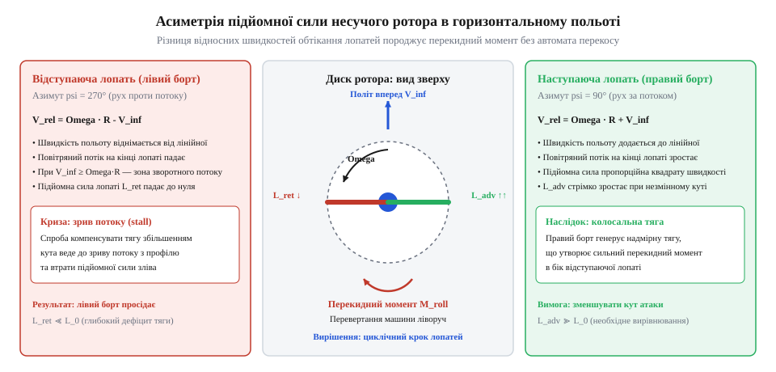
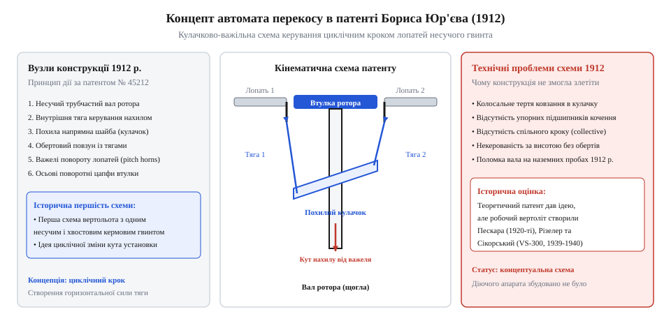
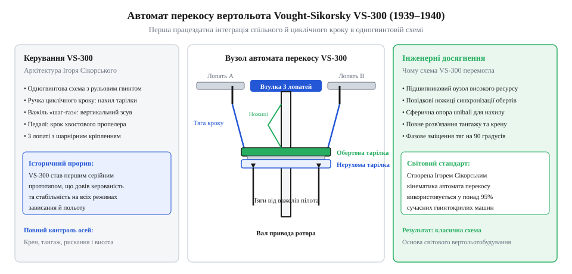

# Автомат перекосу (swashplate)

<preknowlist>
- [Тяги, качалки й люфт рульової поверхні](root:hw-motion/tiahy-kachalky-i-liuft-rulovoi-poverkhni) — кінематика тяг та передача зусиль від важелів керування до виконавчих органів.
- [Карданний шарнір Гука: нерівномірність передачі, пульсація швидкості та здвоєні схеми](root:hw-motion/cardan-hooke-joint) — передача обертання під кутом та компенсація просторових коливань.
</preknowlist>

## Криза керованості перших вертольотів: асиметрія підйомної сили, гіроскопічна прецесія та глухий кут спроб нахилу вала ротора

На зорі авіації перші експериментатори вертикального польоту (Поль Корню в 1907 році, брати Бреге та Шарль Ріше) зуміли відірвати свої конструкції від землі лише на кілька десятків сантиметрів у режимі зависання. Проте щойно виникала потреба здійснити бодай найменший горизонтальний рух уперед чи вбік, усі апарати неминуче втрачали рівновагу і зазнавали катастрофи.

Причина полягала у фундаментальному аеродинамічному явищі — асиметрії обтікання лопатей під час поступального руху вертольота. 


*Схема асиметрії підйомної сили на наступаючій та відступаючій лопатях без автомата перекосу.*

Коли вертоліт летить уперед зі швидкістю `V_flight`, лопаті несучого гвинта перебувають у принципово різних аеродинамічних умовах залежно від азимутального кута обертання:
1. **Наступаюча лопать (Advancing Blade):** рухається вперед назустріч повітряному потоку. Її локальна лінійна швидкість відносно повітря дорівнює сумі швидкостей обертання та польоту:
```
V_adv(r) = ω_rotor · r + V_flight
```
2. **Відступаюча лопать (Retreating Blade):** рухається назад, у напрямку набігаючого потоку, тому швидкість польоту віднімається від колової швидкості лопаті:
```
V_ret(r) = ω_rotor · r - V_flight
```

Оскільки аеродинамічна підйомна сила пропорційна квадрату швидкості обтікання (`Y = (1/2) · ρ · V² · C_y · S`), наступаюча лопать генерує значно більшу підйомну силу, ніж відступаюча:
```
Y_adv / Y_ret ≈ (ω_rotor · r + V_flight)² / (ω_rotor · r - V_flight)²
```
За швидкості польоту всього 50–60 км/год підйомна сила наступаючого борту стає вдвічі-втричі більшою, ніж на відступаючому. На роторі виникає колосальний перекидний креновий момент, який миттєво перевертає апарат.

Перші піонери намагалися парирувати цей момент очевидними інтуїтивними методами: встановленням літакових елеронів і кермів у повітряному потоці під гвинтом або спробами механічного нахилу всієї несучої колони разом із редуктором і важким двигуном. Проте цей шлях завів інженерів у глухий кут:
- **Колосальний гіроскопічний момент:** масивний ротор, що обертається з частотою кількасот обертів на хвилину, є потужним гіроскопом. Спроба примусово нахилити вісь його обертання викликає гіроскопічну прецесію: реакція ротора виникає зі зсувом на 90° відносно прикладеного зусилля, що робило керування абсолютно хаотичним і вивертало важелі з рук пілота.
- **Непомірна вага шарнірів вала:** механізм шарнірного підвісу всього силового агрегату вимагав надмірно масивних рам, шарнірів типу [Карданний шарнір Гука: нерівномірність передачі, пульсація швидкості та здвоєні схеми](root:hw-motion/cardan-hooke-joint) великого перерізу і потужних рульових приводів.

Стало очевидно: боротися з важким обертовим гіроскопом механічною силою неможливо. Єдиним виходом було навчитися аеродинамічно вирівнювати підйомну силу лопатей під час їхнього обертання, циклічно змінюючи їхній кут атаки на кожному оберті — збільшуючи крок на відступаючій лопаті та зменшуючи на наступаючій.

> 🔧 **Навіщо це.** Без безперервного циклічного вирівнювання підйомної сили лопатей вертоліт здатний зависати лише в ідеальний штиль; будь-який порив вітру або спроба набрати горизонтальну швидкість створюють нездоланний перекидний момент.

## Теоретична концепція та патент Бориса Юр'єва 1912 року: перший опис автомата перекосу та межі практичної реалізації

Історично першу завершену інженерну концепцію механізму, здатного передавати команду керування від нерухомих рук пілота до обертових лопатей гвинта, сформулював у 1910–1912 роках студент Імператорського московського технічного училища Борис Юр'єв, учень видатного аеромеханіка Миколи Жуковського.

У травні 1912 року Юр'єв подав офіційну заявку на патент вертольота класичної схеми (з одним несучим та одним рульовим хвостовим гвинтом), ключовим вузлом якого був принципово новий механізм — «автомат перекосу» (swashplate).


*Схема першого патенту Бориса Юр'єва 1912 року з кулачково-важільним керуванням лопатями.*

### Кінематична схема Юр'єва

Конструкція, запропонована Юр'євим, складалася з таких базових елементів:
1. **Ковзна циліндрична муфта:** переміщувалася вгору та вниз уздовж вала несучого гвинта за допомогою тросової передачі, змінюючи одночасно кут установки всіх лопатей (загальний крок ротора);
2. **Нерухоме кільце нахилу:** встановлювалося на муфті за допомогою карданного шарніра і могло нахилятися в будь-якому напрямку під дією ручки керування пілота через [Тяги, качалки й люфт рульової поверхні](root:hw-motion/tiahy-kachalky-i-liuft-rulovoi-poverkhni);
3. **Обертове кільце на підшипнику:** спиралося на нерухоме кільце і оберталося синхронно з валом гвинта. Від цього кільця до осьових важелів (поворотних повідків) кожної лопаті йшли вертикальні жорсткі тяги.

Коли нерухоме кільце стояло горизонтально, лопаті оберталися з незмінним кутом установки. Коли ж пілот нахиляв ручку (наприклад, уперед), нерухоме кільце перекошувалося. Обертова тарілка, ковзаючи по похилому кільцю, змушувала вертикальні тяги здійснювати синусоїдальні коливання вгору-вниз: за один повний оберт кут установки лопаті досягав максимуму в одній точці азимута і плавно знижувався до мінімуму в протилежній. Це давало змогу нахиляти результуючий вектор тяги ротора без нахилу самого вала двигуна.

### Межі практичної реалізації та причини невдачі 1912 року

Незважаючи на бездоганність теоретичного задуму, побудований Юр'євим у 1912 році натурний вертоліт так і не зміг піднятися в повітря:
1. **Катастрофічна ненадійність силової установки:** встановлений ротативний двигун «Гном» (Gnome) потужністю всього 30 к.с. перегрівався за лічені хвилини. Під час наземних випробувань у травні 1912 року головний вал редуктора зламався через вібрації, а грошей на ремонт у студента-винахідника не залишилося.
2. **Жорстке кріплення лопатей (відсутність горизонтальних шарнірів):** у схемі Юр'єва лопаті були жорстко затиснені у втулці і могли лише скручуватися вздовж поздовжньої осі. Циклічна зміна підйомної сили при жорстких лопатях генерувала колосальні знакозмінні згинальні моменти в комлях лопатей, що призводило до їхньої миттєвої втомної руйнації.
3. **Незнання фазового зсуву маху:** теорія динаміки лопаті на той час ще не була створена. Юр'єв вважав, що максимальний крок лопаті треба задавати в тій же точці, де потрібна максимальна підйомна сила, ігноруючи аеродинамічно-інерційне запізнення маху на 90°. Спроба реального польоту з такою фазою призвела б до перекидання апарата під прямим кутом до команди пілота.

Таким чином, патент Юр'єва 1912 року залишився блискучим conceptual-проривом і першим патентним свідоцтвом принципу автомата перекосу, але практичний шлях до створення керованого вертольота вимагав ще майже трьох десятиліть пошуків, відкриття шарнірного підвісу лопатей та подолання вібраційного бар'єра.

> 🔧 **Навіщо це.** Відокремлення нерухомого кільця пілота від обертової тарілки ротора через упорний кулькопідшипник є тим фундаментальним принципом, який застосовується в абсолютно всіх сучасних гвинтокрилих апаратах — від мініатюрних FPV-дронів вертолітного типу до важких транспортних вертольотів.

## Експерименти 1920-х років: співвісні вертольоти Рауля Патераса де Пескари, автомат циклічного кроку Вальтера Різелера та шарнірний ротор Хуана де ла Сьєрви

На початку 1920-х років інженери-авіатори усвідомили, що керувати вертольотом за допомогою звичайних аеродинамічних рулів чи спроб силового нахилу вала ротора в повітряному потоці неможливо. Перші успішні кроки до створення працездатних механізмів циклічного зміни кута лопатей відбулися у Франції, Німеччині та Іспанії.

Аргентинський винахідник Рауль Патерас де Пескара (Raúl Pateras Pescara), працюючи в Барселоні та Парижі, зосередився на співвісній схемі роторів. У 1919–1924 роках він збудував серію експериментальних вертольотів, найвідомішим з яких став апарат Pescara No. 2-R (1922–1924 рр.). Два співвісні ротори оберталися назустріч один одному, повністю взаємно компенсуючи реактивні обертальні моменти без потреби в хвостовому гвинті. Кожен ротор складався з чотирьох біпланних лопатей, з'єднаних просторовими фермами.

Для керування апаратом за курсом, тангажем і креном Пескара розробив систему примусового викривлення та циклічного повороту лопатей безпосередньо в польоті. Керуючі зусилля від ручки пілота передавалися через [Тяги, качалки й люфт рульової поверхні](root:hw-motion/tiahy-kachalky-i-liuft-rulovoi-poverkhni) до внутрішнього кулачкового механізму, змонтованого всередині концентричних валів ротора. Зміна кута лопатей під час обертання вперше дала керовану асиметрію підйомної сили, яка нахиляла сумарний вектор тяги в потрібний бік.

18 квітня 1924 року в Іссі-ле-Муліно Пескара встановив офіційний світовий рекорд дальності польоту для вертольотів за класифікацією FAI (Міжнародної авіаційної федерації): його апарат пролетів по прямій 736 метрів за 4 хвилини 11 секунд на висоті близько 1.8 метра. Хоча біпланна фермена конструкція лопатей була занадто важкою, а керування — виснажливо тугим для пілота, експерименти Пескари довели на практиці: періодична зміна кута лопаті за один оберт дає змогу ефективно керувати поступальним рухом вертольота.

Паралельно в Німеччині інженер Вальтер Різелер (Walter Rieseler) розробляв геометрично чистіший та компактніший принцип керування циклічним кроком. У 1922–1925 роках Різелер запатентував кулачково-кільцевий автомат перекосу для гвинтокрилих машин (зокрема німецький патент DE 408253). Конструкція Різелера містила нерухоме кільце, шарнірно закріплене на карданному підвісі навколо вала ротора, та обертове кільце, з'єднане тягами з повідцями лопатей. При нахилі нерухомого кільця обертове кільце змушувало повідці лопатей підніматися та опускатися двічі за оберт, змінюючи кут установки за суто гармонічним законом. Механізм Різелера ліг в основу кінематики автожирів та експериментальних вертольотів наступного десятиліття.

Проте всі спроби встановити автомат перекосу на ротори з жорсткими суцільними лопатями неминуче завершувалися руйнуванням конструкції або диким рівнем вібрацій. Розв'язання цієї фундаментальної проблеми знайшов іспанський інженер Хуан де ла Сьєрва (Juan de la Cierva). Створюючи свій перший автожир C.4 у 1923 році, Сьєрва відкрив, що лопаті ротора повинні мати свободу махового руху.

Сьєрва додав у корінь кожної лопаті два взаємно перпендикулярні шарніри:
1. **Горизонтальний шарнір маху (flapping hinge):** дозволяє лопаті вільно коливатися вгору та вниз під дією аеродинамічної підйомної сили та доцентрової сили. Наступаюча лопать сама злітає вгору, зменшуючи ефективний кут атаки, а відступаюча лопать опускається вниз, збільшуючи кут атаки, завдяки чому підйомна сила природно вирівнюється по дисках ротора.
2. **Вертикальний шарнір коливань (lead-lag hinge):** дозволяє лопаті коливатися вперед-назад у площині обертання, знімаючи колосальні згинальні моменти від коріолісових сил, що виникають під час маху.

Саме шарнірна втулка Сьєрви підготувала фізичний ґрунт для автомата перекосу: лише на шарнірно підвішеній лопаті примусова циклічна зміна кроку не ламала лопать біля кореня, а створювала стабільний динамічний відгук ротора.

## Тріумф одногвинтової схеми: Ігор Сікорський, вертоліт Vought-Sikorsky VS-300 (1939–1940) та народження сучасної гвинтокрилої авіації

Вирішальний прорив, що перетворив автомат перекосу на основу світового вертольотобудування, здійснив видатний київський та американський авіаконструктор Ігор Сікорський. Свої перші два вертольоти Сікорський спроєктував і побудував ще у 1909–1910 роках у Києві. Проте через слабкість тогочасних двигунів Anzani потужністю лише 25 к.с. та відсутність теоретичної бази керованості ці апарати не змогли піднятися в повітря.

Після еміграції до Сполучених Штатів і заснування компанії Sikorsky Aero Engineering Corporation конструктор створив легендарні багатомоторні пасажирські літаки та літаючі човни-амфібії. Наприкінці 1930-х років, уважно проаналізувавши результати автожирів Сьєрви та німецьких експериментів Гайнріха Фокке з двогвинтовим Fw 61, Сікорський повернувся до своєї головної юнацької мрії — вертикального польоту.

Сікорський обрав найбільш аеродинамічно елегантну, але водночас найскладнішу в реалізації компоновку: один трилопатевий несучий ротор над фюзеляжем та один невеликий вертикальний рульовий гвинт на хвостовій балці для парирування реактивного моменту та керування курсом.


*Кінематична схема автомата перекосу вертольота Vought-Sikorsky VS-300: нерухоме та обертове кільця.*

Перший політ прототипу Vought-Sikorsky VS-300 на прив'язі відбувся 14 вересня 1939 року. Початковий варіант виявився надзвичайно чутливим і складним у балансуванні: конструктор тимчасово встановив на хвості додаткові горизонтальні гвинти для керування тангажем і креном. Проте протягом літа 1940 року Сікорський разом зі своєю інженерною групою остаточно довів кінематику головного вузла — повнофункціонального автомата перекосу несучого ротора.

Конструкція автомата перекосу VS-300 складалася з таких фундаментальних компонентів:
1. **Сферичний шарнірний повзун (uniball):** масивна кульова опора ковзала вздовж вертикального приводного вала ротора. Вона забезпечувала одночасно два ступені вільності: поздовжнє осьове переміщення вгору-вниз для зміни загального кроку (collective pitch) та всебічний сферичний нахил у будь-якій площині для циклічного кроку (cyclic pitch).
2. **Нерухоме кільце керування:** монтувалося на зовнішньому ободі кульової опори. Воно утримувалося від обертання ножичним важелем, з'єднаним із нерухомим силовим редуктором, і нахилялося за допомогою жорстких тяг від важелів керування пілота в кабіні.
3. **Обертова тарілка:** встановлювалася на нерухомому кільці через прецизійний радіально-упорний кульковий підшипник великого діаметра. Обертова тарілка оберталася синхронно з валом несучого гвинта за допомогою повідкових ножиць (drive scissors).
4. **Регульовані тяги зміни кроку (pitch links):** передавали лінійні коливання від обертової тарілки безпосередньо на повідці комлів лопатей, повертаючи кожну лопать в її осьовому шарнірі на заданий кут залежно від поточного азимута.

У травні 1940 року Сікорський здійснив перший вільний політ на VS-300 без допоміжних підтримуючих тросів, а 6 травня 1941 року вертоліт встановив світовий рекорд тривалості польоту — 1 годину 32 хвилини 26 секунд. Поєднання автомата перекосу з хвостовим рульовим гвинтом усунуло потребу у важких та громіздких багатороторних схемах, заклавши основу класичної одногвинтової конфігурації, за якою сьогодні будують понад 90% вертольотів усього світу.

## Розвінчання міфу про «одноосібного винахідника», внесок Рауля Хафнера та еволюція до сучасних шарнірних і безшарнірних втулок ротора

Історія створення автомата перекосу в другій половині XX століття зазнала значних політичних та ідеологічних спотворень. У радянській історіографії та технічній літературі починаючи з кінця 1940-х років (період боротьби з «низькопоклонством перед Заходом») утвердився категоричний наратив про те, що студент Імператорського технічного училища Борис Юр'єв у 1912 році буцімто одноосібно винайшов вертоліт сучасної схеми та автомат перекосу.

Реальний історико-технічний аналіз вимагає чіткого розрізнення між абстрактною кінематичною ідеєю, патентною заявкою та працездатним літальним апаратом:
1. **Теоретична схема Юр'єва 1912 року** була блискучим ескізним концептом, проте збудований на її основі натурний гелікоптер навіть не зміг виконати пробіжку через руйнування конічних шестерень приводу й був розібраний. У конструкції Юр'єва були відсутні розрахунки динамічної компенсації гіроскопічного моменту ротора, не було шарнірного підвісу лопатей (без якого лопаті ламалися від махових напружень), а кулачковий механізм мав нежиттєздатний рівень тертя.
2. **Міжнародний характер винаходу:** реальний автомат перекосу виник як результат послідовного колективного внеску інженерів багатьох країн: концептуальна ідея Юр'єва (1912, Російська імперія), практичний перекіс лопатей Пескари (1922, Франція/Іспанія), кільцевий автомат циклічного кроку Різелера (1924, Німеччина), шарнірний ротор Сьєрви (1923, Іспанія), прецизійне керування кроком Хафнера (1935, Велика Британія) та доведена одногвинтова система Сікорського (1940, США). Приписування всього комплексу технологій одній людині є класичним продуктом державної міфотворчості.

Особливе місце в еволюції кінематики автомата перекосу посідає австрійсько-британський інженер Рауль Хафнер (Raoul Hafner). У 1935 році у Великій Британії Хафнер побудував автожир Hafner A.R.III, де реалізував концепцію павукоподібного автомата перекосу («spider swashplate»). Замість важких підшипників в осьових шарнірах лопатей Хафнер застосував тонкі торсіонні сталеві стрижні (tie-bars), що працювали на кручення. Вони легко сприймали відцентрові сили в кілька тонн, забезпечуючи плавний поворот лопаті навколо поздовжньої осі майже без тертя й мертвого люфту. Ця система суттєво зменшила навантаження на ручку пілота і довела необхідність високої механічної жорсткості проводки керування.

У другій половині XX століття втулка несучого ротора пройшла еволюцію від класичних тришарнірних конструкцій до сучасних безшарнірних та безпідшипникових систем:
* **Класичні шарнірні втулки (Articulated Rotors):** містять окремі горизонтальні, вертикальні та осьові шарніри на голчастих і конічних підшипниках кочення. Така схема вирізняється великою масою, наявністю сотень прецизійних деталей і необхідністю регулярного змащування та постійної заміни сальників через витікання мастила під дією відцентрових прискорень до 500–800 g.
* **Безшарнірні втулки (Hingeless Rotors):** горизонтальні та вертикальні шарніри замінені пружними титановими або склопластиковими балками-лонжеронами, що згинаються під дією підйомної сили, зберігаючи лише осьовий підшипник зміни кроку.
* **Безпідшипникові втулки з еластомірними опорами (Bearingless Rotors):** сучасний стандарт (наприклад, у вертольотах Eurocopter EC135 або Sikorsky UH-60M). Усі підшипники кочення замінено пакетами еластоміру, що складаються з чергованих шарів гуми та металевих пластин, або композитними торсіонними лонжеронами. Еластомірний шарнір сприймає колосальні розтягуючі навантаження від відцентрової сили лопаті, одночасно допускаючи кутовий поворот на 15–20° за рахунок внутрішнього зсуву пружних шарів без жодного змащення чи рідкого мастила.
