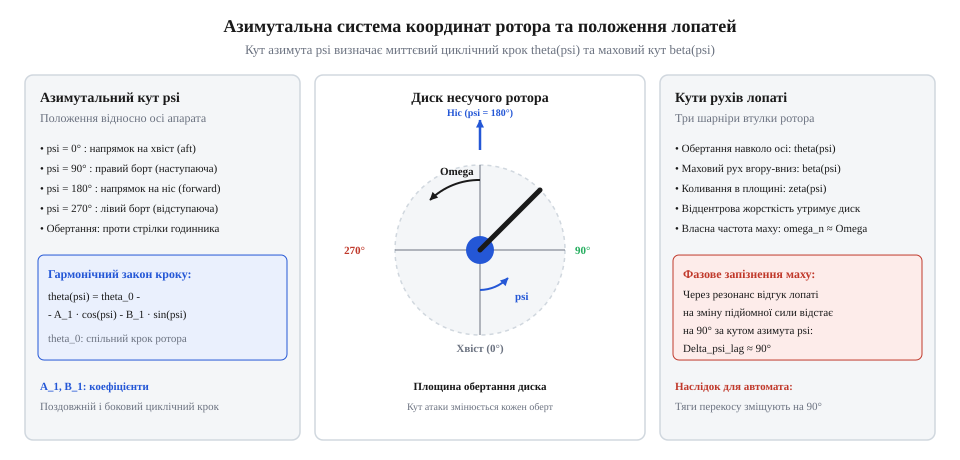
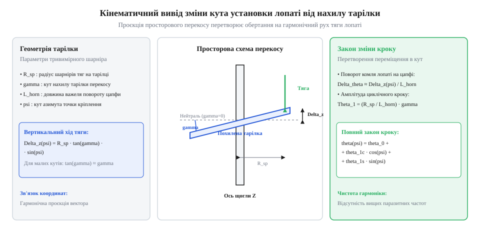
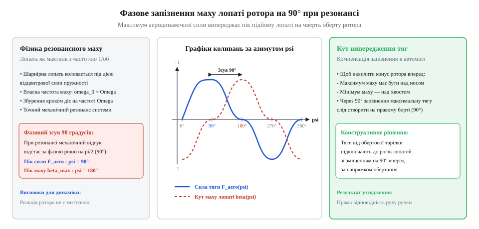
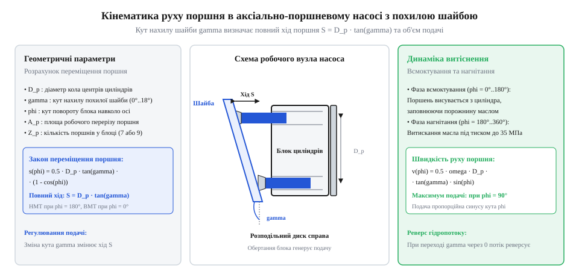

# Автомат перекосу (swashplate)

<preknowlist>
- [Тяги, качалки й люфт рульової поверхні](root:hw-motion/tiahy-kachalky-i-liuft-rulovoi-poverkhni) — розрахунок важільних передач та передавальних відношень тяг керування.
- [Карданний шарнір Гука: нерівномірність передачі, пульсація швидкості та здвоєні схеми](root:hw-motion/cardan-hooke-joint) — просторова кінематика та зв'язок кутів нахилу валів.
</preknowlist>

## Постановка задачі: циклічне керування підйомною силою та азимутальна параметризація положення лопаті

Під час горизонтального польоту вертольота несучий ротор обертається в набігаючому повітряному потоці, що створює різку просторову асиметрію швидкостей обтікання лопатей. Для аналізу кінематики та динаміки ротора вводиться полярна система координат у площині обертання, прив'язана до осі вала несучого гвинта.


*Сферична система координат ротора та азимутальний кут лопаті psi.*

Положення лопаті в довільний момент часу описується азимутальним кутом `ψ`, що відлічується від напрямку за польотом (над хвостовою балкою апарата) у напрямку обертання ротора:
* `ψ = 0°`: лопать спрямована назад уздовж поздовжньої осі фюзеляжу;
* `ψ = 90°`: наступаюча лопать (Advancing Blade), що рухається вперед назустріч набігаючому потоку (правий борт для ротора, що обертається проти годинникової стрілки при погляді зверху);
* `ψ = 180°`: лопать спрямована вперед уздовж осі польоту;
* `ψ = 270°`: відступаюча лопать (Retreating Blade), що рухається назад у напрямку набігаючого потоку (лівий борт).

При постійній кутовій швидкості обертання ротора `ω_rotor` зв'язок азимута із часом описується кінематичним рівнянням:
```
ψ(t)
= ω_rotor · t                                                [рівномірне обертання ротора]
```

Якщо вертоліт летить у горизонтальній площині зі швидкістю `V_flight`, лінійна тангенціальна швидкість повітряного потоку, що обтікає елемент лопаті на радіусі `r` від осі обертання, визначається векторним додаванням колової та поступальної швидкостей:
```
V_tangent(r, ψ)
= ω_rotor · r + V_flight · sin(ψ)                            [проєкція швидкості польоту на тангенс траєкторії]
```

Швидкісний напір `q(r, ψ)` на елементі лопаті пропорційний квадрату результуючої тангенціальної швидкості:
```
q(r, ψ)
= (1 / 2) · ρ · (V_tangent(r, ψ))²                           [визначення аеродинамічного швидкісного напору]
= (1 / 2) · ρ · (ω_rotor · r + V_flight · sin(ψ))²           [підстановка формули результуючої швидкості]
```

Асиметрія швидкостей обтікання накладає жорстке фізичне обмеження на максимальну швидкість горизонтального польоту через виникнення навколозвукових явищ на кінцях наступаючих лопатей. 

Лінійна швидкість кінця наступаючої лопаті (`r = R_tip`, `ψ = 90°`) складається з колової швидкості обертання та швидкості польоту апарата:
```
V_tip_adv
= ω_rotor · R_tip + V_flight                                 [пікова швидкість наступаючого кінця лопаті]
```

Локальне число Маха на кінці наступаючої лопаті визначається відношенням сумарної швидкості потоку до місцевої швидкості звуку `a_sound`:
```
M_tip_adv
= V_tip_adv / a_sound                                        [визначення числа Маха наступаючого кінця]
= (ω_rotor · R_tip + V_flight) / a_sound                     [розгорнутий вираз через параметри ротора]
```
де швидкість звуку в повітрі при стандартній атмосфері ISA на рівні моря (температура `T = 288.15 К`, показник адіабати `γ = 1.4`, газова стала `R_air = 287.05 Дж/(кг·К)`) становить `a_sound = √(γ · R_air · T) ≈ 340.3 м/с`.

Якщо місцеве число Маха на профілі перевищує критичне значення `M_crit ≈ 0.80–0.85`, на верхній поверхні лопаті виникає місцева надзвукова зона із замикаючим стрибком ущільнення (ударною хвилею). Це призводить до хвильового кризового зриву потоку, різкого зростання аеродинамічного опору (хвильового опору), трясіння лопатей та втрати поздовжньої керованості.

**Числовий приклад розрахунку числа Маха наступаючої лопаті:**

Вихідні параметри типового середнього вертольота:
* Радіус несучого ротора: `R_tip = 6.00 м`;
* Частота обертання ротора: `n = 300 об/хв`, що відповідає кутовій швидкості `ω_rotor = 2 · π · (300 / 60) ≈ 31.416 рад/с`;
* Колова швидкість кінця лопаті при зависанні: `V_tip_hover = ω_rotor · R_tip = 31.416 · 6.00 = 188.50 м/с`;
* Швидкість горизонтального польоту: `V_flight = 288 км/год = 80.00 м/с`;
* Швидкість звуку: `a_sound = 340.30 м/с`.

Покроковий розрахунок:
```
V_tip_adv
= ω_rotor · R_tip + V_flight
= 188.50 + 80.00
= 268.50 м/с                                                 [пікова лінійна швидкість на азимуті 90°]

M_tip_adv
= V_tip_adv / a_sound
= 268.50 / 340.30
= 0.7890                                                     [докритичне число Маха наступаючого кінця]
```

Якщо швидкість польоту вертольота зростає до `V_flight = 324 км/год = 90.00 м/с`:
```
V_tip_adv
= 188.50 + 90.00
= 278.50 м/с                                                 [підвищена швидкість наступаючого кінця]

M_tip_adv
= 278.50 / 340.30
= 0.8184                                                     [вхід у зону критичного числа Маха]
```
При числі Маха `M_tip_adv ≈ 0.82` вертоліт входить у режим хвильового зриву на правому борті.

Водночас на протилежному, відступаючому борті (`ψ = 270°`) швидкість кінця лопаті падає до:
```
V_tip_ret
= ω_rotor · R_tip - V_flight
= 188.50 - 80.00
= 108.50 м/с                                                 [мінімальна лінійна швидкість на азимуті 270°]

M_tip_ret
= 108.50 / 340.30
= 0.3188                                                     [глибоко дозвукове число Маха]
```

Співвідношення швидкісних напорів на кінцях лопатей при швидкості `V_flight = 80 м/с` досягає колосальної величини:
```
q_adv / q_ret
= (V_tip_adv / V_tip_ret)²
= (268.50 / 108.50)²
= (2.4747)²
= 6.124                                                      [перепад швидкісного напору понад 6 разів]
```

Щоб зрівноважити підйомні сили при такому перепаді напорів, автомат перекосу змушений зменшувати циклічний кут установки лопаті на наступаючому борті до мінімуму (до `2°–3°`), а на відступаючому борті — збільшувати до критичних кутів (`14°–16°`). Коли кут атаки на відступаючому борті перевищує кут зриву, настає «зрив потоку на відступаючій лопаті» (retreating blade stall). Поєднання навколозвукового хвильового опору на наступаючій лопаті та зривного звалювання на відступаючій встановлює абсолютну фізичну межу швидкості класичного вертольота на рівні близько 300–350 км/год.

Оскільки на наступаючому борті (`ψ = 90°`) швидкість обтікання максимальна `(ω_rotor · r + V_flight)`, а на відступаючому (`ψ = 270°`) — мінімальна `(ω_rotor · r - V_flight)`, однаковий кут установки лопаті призвів би до колосального перекидного моменту по крену. Щоб забезпечити рівновагу вертольота або створити керований момент для нахилу фюзеляжу в довільному напрямку, кут установки лопаті `θ` необхідно безперервно змінювати за період одного повного оберту.

Математично необхідний періодичний закон зміни кута установки лопаті розкладається у гармонічний ряд Фур'є за азимутом `ψ`. Обмежуючись гармоніками першого порядку (оскільки вищі гармоніки фільтруються інерцією лопаті), отримуємо класичне рівняння кута установки:
```
θ(ψ)
= θ_0 + θ_1c · cos(ψ) + θ_1s · sin(ψ)                        [перша гармоніка циклічного кроку]
```
де:
* `θ_0` — загальний крок (collective pitch), що визначає середній кут атаки всіх лопатей для створення вертикальної підйомної сили ротора;
* `θ_1c` — косинусна складова циклічного кроку (бічний циклічний крок);
* `θ_1s` — синусна складова циклічного кроку (поздовжній циклічний крок).

Завдання механізму автомата перекосу полягає у фізичній просторовій реалізації цієї гармонічної функції: перетворенні лінійних та кутових переміщень нерухомих приводів пілота в циклічні кутові коливання лопатей, що обертаються разом із ротором.

## Просторова кінематика похилої шайби: зв'язок кутів нахилу кілець тарілки з кутом установки лопаті

Кінематичну задачу гармонічної зміни кута установки лопаті розв'язує автомат перекосу, що складається з двох кілець: внутрішнього (нерухомого відносно обертання вала) та зовнішнього (обертового разом із ротором). Обидва кільця утворюють жорстку похилу площину, положення якої в просторі задається трьома кінематичними координатами: осьовим підйомом `z_sp` та двома кутами нахилу.


*Геометричний вивід гармонічної зміни кута установки лопаті від нахилу тарілки.*

Нехай система координат `Oxyz` прив'язана до вала ротора: вісь `z` спрямована вгору вздовж вала, вісь `x` — назад уздовж хвостової балки, вісь `y` — праворуч по борту. Точка шарнірного центра тарілки `O_sp` може зміщуватися вздовж осі `z` на величину `z_sp`. 

Положення площини кілець визначається двома послідовними малими поворотами:
1. Кутом поздовжнього нахилу (тангажу) `α_pitch` навколо поперечної осі `y`;
2. Кутом поперечного нахилу (крену) `β_roll` навколо поздовжньої осі `x`.

Точка кріплення рульової тяги (pitch link) до обертового кільця тарілки розташована на радіусі `R_sp` і в процесі обертання має просторові координати в горизонтальній площині:
```
x_sp(ψ) = R_sp · cos(ψ)
y_sp(ψ) = R_sp · sin(ψ)
```

Для малих кутів нахилу площини (`sin(α) ≈ α`, `sin(β) ≈ β`) висота точки кріплення повідця на обертовому кільці `z_ring(ψ)` над опорною площиною описується лінеаризованим рівнянням похилої площини:
```
z_ring(ψ)
= z_sp - x_sp(ψ) · α_pitch + y_sp(ψ) · β_roll                [рівняння площини в лінійному наближенні]
= z_sp - R_sp · α_pitch · cos(ψ) + R_sp · β_roll · sin(ψ)     [підстановка координат радіуса тарілки]
```

Вертикальне переміщення точки кільця передається жорсткою тягою на важіль повідця комля лопаті (pitch horn). Важіль повідця має ефективну довжину `L_horn` і розташований перпендикулярно до осі осьового шарніра лопаті. Якщо при нейтральному положенні тарілки (`z_sp = 0`, `α_pitch = 0`, `β_roll = 0`) лопать має базовий кут установки `θ_neutral`, то при вертикальному зміщенні тяги на `(z_ring(ψ) - z_neutral)` поворот лопаті навколо своєї поздовжньої осі становить:
```
tan(θ(ψ) - θ_neutral)
= (z_ring(ψ) - z_neutral) / L_horn                           [геометрія плеча повідця лопаті]
```

Для робочих діапазонів кутів установки лопаті (`θ ≤ 25°`) кутова деформація лінійно пропорційна вертикальному ходу тяги з точністю вище 98% (`tan(Δθ) ≈ Δθ`):
```
θ(ψ)
= θ_neutral + (z_ring(ψ) - z_neutral) / L_horn               [лінеаризація тангенса малого кута]
= θ_neutral + (z_sp - z_neutral) / L_horn - (R_sp / L_horn) · α_pitch · cos(ψ) + (R_sp / L_horn) · β_roll · sin(ψ) [підстановка z_ring]
= θ_0 + θ_1c · cos(ψ) + θ_1s · sin(ψ)                        [зведення до канонічного ряду Фур'є]
```

Зіставляючи коефіцієнти, отримуємо аналітичний вираз параметрів кроку лопаті через геометричні параметри автомата перекосу:
```
θ_0
= θ_neutral + (z_sp - z_neutral) / L_horn                    [визначення загального кроку]

θ_1c
= - (R_sp / L_horn) · α_pitch                                [визначення косинусної амплітуди]

θ_1s
= (R_sp / L_horn) · β_roll                                   [визначення синусної амплітуди]
```

Відношення `k_pitch = R_sp / L_horn` являє собою безрозмірний кінематичний коефіцієнт передачі автомата перекосу: він показує, у скільки разів кутовий нахил тарілки підсилюється при повороті лопаті навколо осьового шарніра. При типових значеннях `R_sp = 0.240 м` та `L_horn = 0.080 м` коефіцієнт передачі дорівнює `k_pitch = 0.240 / 0.080 = 3.0`.

Зв'язок керуючих тяг із ручками пілота та кінематичні похибки люфтів детально розглянуто у статті [Тяги, качалки й люфт рульової поверхні](root:hw-motion/tiahy-kachalky-i-liuft-rulovoi-poverkhni).

**Приклад числового розрахунку кінематики кроку:**

Вихідні параметри механізму:
* Радіус обертового кільця тарілки: `R_sp = 0.240 м`;
* Плече повідця комля лопаті: `L_horn = 0.080 м`;
* Базовий кут установки лопаті: `θ_neutral = 8.0°`;
* Осьовий підйом повзуна від нейтралі: `z_sp - z_neutral = 0.016 м`;
* Кут поздовжнього перекосу тарілки: `α_pitch = 2.0°` (`0.03491 рад`);
* Кут бічного перекосу тарілки: `β_roll = 1.5°` (`0.02618 рад`).

Покроковий розрахунок амплітуд:
```
k_pitch
= R_sp / L_horn
= 0.240 / 0.080
= 3.000                                                      [кінематичне передавальне відношення]

θ_0
= θ_neutral + ((z_sp - z_neutral) / L_horn) · (180° / π)
= 8.0° + (0.016 / 0.080) · 57.296°
= 8.0° + 0.200 · 57.296°
= 8.0° + 11.46°
= 19.46°                                                     [загальний крок ротора]

θ_1c
= - k_pitch · α_pitch
= - 3.000 · 2.0°
= - 6.00°                                                    [косинусна амплітуда циклічного кроку]

θ_1s
= k_pitch · β_roll
= 3.000 · 1.5°
= 4.50°                                                      [синусна амплітуда циклічного кроку]
```

Значення миттєвого кута установки лопаті `θ(ψ)` на чотирьох кардинальних азимутах:
* При `ψ = 0°` (хвостовий азимут): `θ(0°) = 19.46° - 6.00° · 1.0 + 4.50° · 0.0 = 13.46°`;
* При `ψ = 90°` (наступаючий борт): `θ(90°) = 19.46° - 6.00° · 0.0 + 4.50° · 1.0 = 23.96°`;
* При `ψ = 180°` (носовий азимут): `θ(180°) = 19.46° - 6.00° · (-1.0) + 4.50° · 0.0 = 25.46°`;
* При `ψ = 270°` (відступаючий борт): `θ(270°) = 19.46° - 6.00° · 0.0 + 4.50° · (-1.0) = 14.96°`.

Таким чином, комбінація осьового підйому повзуна та кутового перекосу кілець точно формує гармонічну просторову траєкторію кута атаки кожної лопаті.

## Динамічне та аеродинамічне фазове запізнення маху лопаті: природа канонічного фазового зсуву на 90°

Інтуїтивне уявлення про керування вертольотом підказує, що для нахилу конуса ротора вперед (створення моменту на пікірування) потрібно збільшити крок лопаті над хвостовою балкою (`ψ = 0°`) і зменшити над носовою частиною (`ψ = 180°`). Проте в реальному роторі спроба подати максимальний аеродинамічний крок на хвості призведе не до поздовжнього нахилу, а до сильного бічного крену на лівий борт.

Причина полягає у фазовому запізненні махового руху шарнірної лопаті відносно фази прикладеної аеродинамічної сили.


*Графіки циклічного кроку, аеродинамічної сили та траєкторії маху лопаті з фазовим зсувом 90°.*

Розглянемо рух лопаті масою `m_blade`, закріпленої на горизонтальному шарнірі маху (flapping hinge) на відстані `e_hinge ≈ 0` від осі обертання. Кут відхилення лопаті вгору від горизонтальної площини обертання позначається `β(t)`.

На лопать, що обертається з кутовою швидкістю `ω_rotor`, діють два головні силові моменти навколо горизонтального шарніра:
1. **Збуджуючий аеродинамічний момент підйомної сили `M_aero(t)`:** намагається підняти лопать угору;
2. **Відновлювальний відцентровий момент `M_cf(t)`:** відцентрові сили інерції прагнуть повернути лопать у площину обертання, діючи як ідеальна торсіонна пружина.

Момент відцентрових сил при куті маху `β` становить:
```
M_cf(t)
= I_flap · ω_rotor² · sin(β)                                 [момент відцентрових сил навколо шарніра]
≈ I_flap · ω_rotor² · β                                      [лінеаризація для малих кутів маху]
```
де `I_flap` — момент інерції лопаті відносно осі горизонтального шарніра маху.

Диференціальне рівняння балансу динамічних моментів навколо шарніра маху має вигляд:
```
I_flap · (d²β / dt²) + I_flap · ω_rotor² · β
= M_aero(t)                                                  [динамічне рівняння коливань лопаті]
```

Поділивши обидві частини на момент інерції `I_flap`, отримуємо канонічне рівняння лінійного гармонічного осцилятора:
```
(d²β / dt²) + ω_flap² · β
= M_aero(t) / I_flap                                         [канонічний вигляд осцилятора]
```
де власна частота махових коливань лопаті `ω_flap` дорівнює:
```
ω_flap
= √(I_flap · ω_rotor² / I_flap)
= ω_rotor                                                    [рівність власної частоти частоті ротора]
```

Це найважливіший фундаментальний висновок теорії гвинтокрилих машин: власна частота коливань лопаті на центральному горизонтальному шарнірі строго дорівнює частоті обертання самого ротора (`ω_flap = 1.0 · ω_rotor`).

Оскільки зміна циклічного кроку лопаті відбувається один раз за оберт ротора, збуджуюча аеродинамічна сила діє на лопать із частотою обертання:
```
M_aero(t)
= M_0 + M_1 · cos(ω_rotor · t - ψ_force)                     [гармонічне аеродинамічне збудження]
```

Лопать несучого ротора працює в умовах точного механічного резонансу, коли частота збудження збігається із власною частотою системи (`ω_drive = ω_flap`). З класичної теорії коливань відомо, що в резонансному режимі між гармонічною силою та викликаним нею механічним переміщенням виникає фазовий зсув рівно `Δψ = 90°` (`π / 2` радіана):
```
β(t)
= β_0 + β_1 · cos(ω_rotor · t - ψ_force - 90°)               [фазовий зсув коливань при резонансі]
= β_0 + β_1 · sin(ω_rotor · t - ψ_force)                     [тригонометричне перетворення зсуву на 90°]
```

Фізичний наслідок фазового запізнення на 90°:
* Максимальне переміщення лопаті вгору (`β = β_max`) досягається рівно через чверть оберту (90° за азимутом) ПІСЛЯ точки прикладання максимальної підйомної сили.
* Якщо вертоліт повинен нахилити диск ротора вперед (максимальний підйом лопаті ззаду на `ψ = 0°`, мінімальний попереду на `ψ = 180°`), автомат перекосу має створити максимальний кут атаки лопаті на азимуті `ψ = 270°` (на лівому, відступаючому борті) і мінімальний кут атаки на азимуті `ψ = 90°` (на правому, наступаючому борті).

У реальних конструкціях втулок ротора горизонтальний шарнір виносять від осі обертання на відстань `e_hinge` (зазвичай 2–5% радіуса гвинта `R`). Крім того, на рух лопаті впливає сильне аеродинамічне демпфування (число Локка `γ_Lock ≈ 8–10`). Через винос шарніра відцентрова жорсткість зростає, тому власна частота маху дещо перевищує частоту ротора:
```
ω_flap
= ω_rotor · √(1 + (e_hinge · S_blade) / I_flap)              [власна частота з урахуванням виносу шарніра]
≈ 1.03–1.08 · ω_rotor
```
Це зменшує дійсний кут фазового запізнення з теоретичних 90° до `75°–85°`. Щоб керування залишалося природним для пілота (ручка вперед — нахил суворо вперед), конструктори зміщують повідці лопатей або повертають автомат перекосу на кут випередження `δ_lead = 90° - Δψ`.

### Коріолісів зв'язок маху з коливаннями в площині обертання та роль демпфера lead-lag

Маховий рух лопаті навколо горизонтального шарніра не є ізольованим: він фундаментально та нерозривно пов'язаний із коливаннями лопаті в площині обертання (lead-lag motion) через кінематичні сили Коріоліса.

Коли лопать під дією циклічного кроку піднімається вгору на кут маху `β(t)`, її центр мас наближається до осі обертання ротора. Ефективний радіус обертання елемента маси лопаті зменшується:
```
r_eff(t)
= r · cos(β(t))                                              [зменшення радіуса обертання при маху]
≈ r · (1 - (β(t))² / 2)                                      [розклад косинуса малого кута в ряд]
```

Згідно із законом збереження моменту кількості руху, зменшення радіуса обертання неминуче викликає тангенціальне прискорення лопаті вперед (за напрямком обертання ротора). Диференціюючи закон зміни радіуса, отримуємо радіальну швидкість зміщення маси:
```
v_radial
= dr_eff / dt
= - r · sin(β) · (dβ / dt)
≈ - r · β · (dβ / dt)                                        [радіальна швидкість зближення з віссю]
```

Цей рух у системі координат, що обертається з кутовою швидкістю `ω_rotor`, породжує коріолісове прискорення в площині обертання диска:
```
a_coriolis
= 2 · ω_rotor · v_radial
= - 2 · ω_rotor · r · β · (dβ / dt)                          [коріолісове тангенціальне прискорення]
```

Оскільки швидкість маху `dβ / dt` коливається з частотою обертання ротора `1 · ω_rotor`, коріолісова сила створює періодичний знакозмінний момент у площині обертання лопаті з тією самою частотою. Якщо лопать жорстко закріплена в площині обертання, цей момент створює гігантські циклічні згинальні напруження в комлі, що призводить до швидкої втомної руйнації лонжерона.

Для зняття цих напружень у втулку введено вертикальний шарнір коливань (lead-lag drag hinge), який дозволяє лопаті вільно відхилятися вперед і назад у площині обертання на кут `ζ(t)`.

Проте вільний вертикальний шарнір породжує смертельну небезпеку — катастрофічне явище аеропружного самозбудження, відоме як «земний резонанс» (Ground Resonance). Власна частота коливань лопаті у площині обертання на вертикальному шарнірі зазвичай становить `ω_lag ≈ 0.25–0.30 · ω_rotor`. Коли вертоліт торкається землі шасі, коливання лопатей у площині обертання зсувають центр мас ротора від осі вала. Цей ексцентриситет центру мас входить у синергетичний резонанс із власними пружними коливаннями фюзеляжу на амортизаторах шасі, і ротор розносить конструкцію вертольота за лічені секунди.

Єдиним захистом від земного резонансу є встановлення демпфера коливань (lead-lag damper) між комлем кожної лопаті та корпусом втулки ротора.

Демпфер є спеціалізованим гідравлічним або еластомірним пристроєм в'язкісного тертя, що створює опірний момент, пропорційний кутовій швидкості коливань лопаті в площині обертання:
```
M_damper
= C_lag · (dζ / dt)                                          [в'язкісний момент опору демпфера]
```
де `C_lag` — коефіцієнт лінійного чи нелінійного гідравлічного демпфування.

Демпфер виконує три критичні функції в кінематиці ротора:
1. **Придушення земного резонансу:** вносить демпфування з безрозмірним коефіцієнтом згасання `ξ_lag ≥ 0.25–0.35`, що повністю унеможливлює самозбудження ротора на землі.
2. **Фазова стабілізація циклічного кроку:** оскільки поводок тяги зміни кроку (pitch link) закріплений на комлі лопаті за вертикальним шарніром, кутові коливання лопаті у площині обертання `ζ(t)` безпосередньо змінюють кінематичне плече тяги. Демпфер фіксує середнє положення лопаті, усуваючи фазові похибки між нахилом автомата перекосу та результуючим кутом установки лопаті.
3. **Фільтрація коріолісових навантажень:** поглинає механічну енергію, що передається від махового руху в площину обертання, перетворюючи її на тепло та захищаючи рульові тяги від високочастотних знакозмінних ударів.

## Кінематика похилої шайби в аксіально-поршневих гідромашинах: хід поршня, миттєва швидкість та пульсація подачі

Принцип похилої шайби (swashplate) є фундаментальною кінематичною основою не лише гвинтокрилих літальних апаратів, але й найпоширенішого класу силової гідравліки високого тиску — аксіально-поршневих гідронасосів і гідромоторів. У гідромашинах похила шайба перетворює обертальний рух приводного вала на зворотно-поступальний рух групи поршнів, розташованих паралельно до осі обертання блока циліндрів.


*Геометрія переміщення поршня у циліндровому блоці під дією похилої шайби.*

Нехай блок циліндрів обертається з кутовою швидкістю `ω_pump`. У блоці рівномірно по колу радіуса `R_pitch` розміщено `Z` циліндрів діаметром `d_piston`. Опорні башмаки (ковзаючі підп'ятники) поршнів притиснуті гідростатичним розвантаженням до торцевої поверхні нерухомої похилої шайби, нахиленої до площини обертання блока на кут `γ_swash`.

При повороті блока циліндрів на кут `φ = ω_pump · t` торцева поверхня поршня ковзає по еліптичній траєкторії на похилій площині. Осьове положення поршня `s(φ)` у циліндрі відраховується від точки крайнього втягнутого положення (нижня мертва точка, НМТ при `φ = 0°`):
```
s(φ)
= R_pitch · tan(γ_swash) · (1 - cos(φ))                      [рівняння осьового ходу поршня]
```

Повний робочий хід поршня за пів оберту від НМТ (`φ = 0°`) до верхньої мертвої точки (ВМТ при `φ = 180°`) визначається формулою:
```
S_max
= s(180°) - s(0°)
= R_pitch · tan(γ_swash) · (1 - (-1))
= 2 · R_pitch · tan(γ_swash)                                 [максимальний хід поршня]
```

Диференціюючи закон переміщення за часом, отримуємо миттєву лінійну швидкість руху поршня `v_piston(φ)` уздовж осі циліндра:
```
v_piston(φ)
= ds / dt
= (ds / dφ) · (dφ / dt)
= R_pitch · tan(γ_swash) · sin(φ) · ω_pump                   [миттєва швидкість поршня]
```
Максимальна лінійна швидкість досягається в середині ходу при `φ = 90°` та `φ = 270°`, коли `sin(φ) = ±1`, а в мертвих точках швидкість спадає до нуля.

Площа робочого торця поршня дорівнює:
```
A_piston
= (π · d_piston²) / 4                                        [площа поперечного перерізу поршня]
```

Миттєва подача рідини одним окремим поршнем під час фази нагнітання (`0 ≤ φ ≤ π`):
```
Q_single(φ)
= A_piston · v_piston(φ)
= ((π · d_piston²) / 4) · R_pitch · tan(γ_swash) · ω_pump · sin(φ) [подача одного циліндра]
```

Сумарна миттєва подача гідронасоса `Q_pump(φ)` є сумою миттєвих подач усіх поршнів, які в даний момент перебувають у зоні вікна нагнітання торцевого розподільника:
```
Q_pump(φ)
= ∑ Q_single(φ_i)                                            [сумарна миттєва подача насоса]
```

Кінематична нерівномірність подачі рідини критично залежить від парності кількості поршнів `Z`:
1. **При парній кількості поршнів (наприклад, Z = 6 або 8):** поршні заходять у вікна нагнітання та всмоктування попарно одночасно. Коефіцієнт пульсації подачі `δ_pulse = (Q_max - Q_min) / Q_avg` є високим і досягає приблизно `14.0%` для `Z = 6`.
2. **При непарній кількості поршнів (наприклад, Z = 7 або 9):** комутація поршнів відбувається почергово зі зсувом фази на `π / Z`. Завдяки взаємній компенсації синусоїдальних вершин пульсація подачі падає в рази: для `Z = 7` пульсація становить лише `2.5%`, а для `Z = 9` — близько `1.5%`.

Саме тому в промислових аксіально-поршневих гідромашинах практично завжди застосовують непарне число циліндрів (7 або 9).

**Числовий приклад розрахунку робочих параметрів аксіального насоса:**

Вихідні інженерні параметри:
* Радіус розташування осей циліндрів: `R_pitch = 0.045 м` (діаметр кола `D = 90 мм`);
* Діаметр кожного поршня: `d_piston = 0.020 м` (20 мм);
* Кут нахилу похилої шайби: `γ_swash = 16.0°` (`0.27925 рад`);
* Частота обертання вала: `n = 1500 об/хв`, звідки кутова швидкість `ω_pump = 2 · π · (1500 / 60) ≈ 157.08 рад/с`;
* Кількість поршнів у блоці: `Z = 9` (непарне число).

Покроковий розрахунок:
```
A_piston
= (π · d_piston²) / 4
= (3.14159 · 0.020²) / 4
= (3.14159 · 0.000400) / 4
= 0.00031416 м²                                              [площа робочого торця поршня]

S_max
= 2 · R_pitch · tan(γ_swash)
= 2 · 0.045 · tan(16.0°)
= 0.090 · 0.28675
= 0.02581 м                                                  [робочий хід поршня: 25.81 мм]

v_max
= R_pitch · tan(γ_swash) · ω_pump
= 0.045 · 0.28675 · 157.08
= 0.012904 · 157.08
= 2.027 м/с                                                  [пікова лінійна швидкість поршня]

V_rev
= Z · A_piston · S_max
= 9 · 0.00031416 · 0.02581
= 0.00007297 м³/об
= 72.97 см³/об                                               [робочий об'єм насоса за оберт]

Q_avg
= V_rev · (n / 60) · 60000
= 0.00007297 · 25 · 60000
= 109.45 л/хв                                                [середня продуктивність подачі]
```

Зміна кута нахилу шайби `γ_swash` за допомогою гідравлічного сервопоршня дозволяє плавно регулювати робочий об'єм насоса `V_rev` від нуля (`γ_swash = 0°`, нульова подача) до максимального значення, забезпечуючи керування швидкістю гідромоторів без дросельних втрат.
