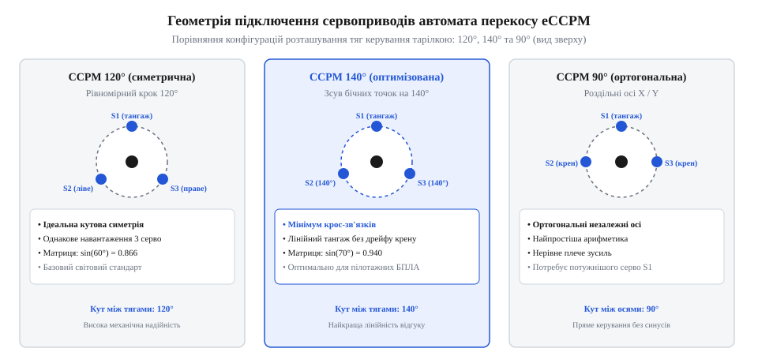
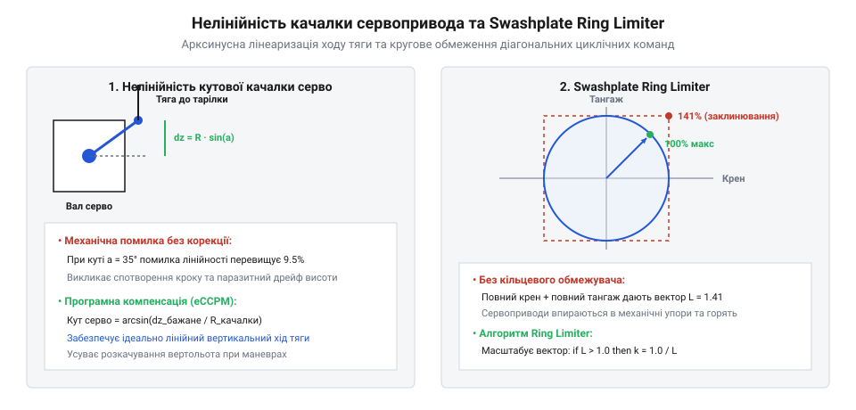

# Автомат перекосу (swashplate)

<preknowlist>
- [Тяги, качалки й люфт рульової поверхні](root:hw-motion/tiahy-kachalky-i-liuft-rulovoi-poverkhni) — кінематика передачі зусиль від качалок сервоприводів до тарілки.
</preknowlist>

## Постановка задачі: перетворення каналів керування польотом у переміщення сервоприводів тарілки (CCPM) та проблема геометричного взаємозв'язку

Керування просторовою орієнтацією вертольота або безпілотного апарата класичної схеми базується на безперервному узгодженому зміщенні несучих лопатей. Пілот або автопілот формує три некорельовані вхідні команди керування: загальний крок (@@en|collective pitch@@) для створення вертикальної підйомної сили, поздовжній циклічний крок (@@en|cyclic pitch / elevator@@) для нахилу машини вперед чи назад (тангаж) та поперечний циклічний крок (@@en|cyclic roll / aileron@@) для крену ліворуч чи праворуч.

У ранніх конструкціях гвинтокрилих машин керування реалізувалося механічним змішуванням (mCCPM) за допомогою важких багатоважільних систем із повзунами та дифмашинками, що створювало паразитні люфти та істотно збільшувало масу вузла. У сучасній робототехніці та БПЛА домінує електронне мікшування eCCPM (@@en|Electronic Cyclic/Collective Pitch Mixing@@), де три або чотири сервоприводи під'єднуються безпосередньо до нерухомої тарілки автомата перекосу.


*Геометрія підключення сервоприводів автомата перекосу: порівняння симетричної схеми 120°, оптимізованої 140° та ортогональної 90°.*

Головний виклик прямого керування полягає в геометричній інтерференції тяг (@@en|cross-coupling@@). Оскільки сервоприводи розташовані по колу опорного кільця, чистий кутовий нахил тарілки навколо осі крену змушує бічні сервоприводи рухатися в протилежні боки, що за несиметричної кінематики або кутових похибок викликає паразитне вертикальне зміщення центру кулі (мимовільну зміну спільного кроку) або небажаний зв'язок між креном і тангажем.

Окрім чистої кінематики розміщення сервоприводів, алгоритм мікшування повинен враховувати складну аеродинаміку та гіроскопічну динаміку несучого гвинта. Внаслідок гіроскопічної прецесії обертової маси лопатей та аеродинамічного запізнення махового руху максимальний циклічний підйом лопаті досягається зі зсувом за фазою на кут близько 75°–90° після точки прикладання максимального кута установки. У сучасних безфлайбарних роторах із жорсткими безшарнірними втулками (@@en|rigid / hingeless rotor heads@@) через високу кутову жорсткість комбінованих торсіонів цей кут часто зменшується до 72°–82°. Якщо тяги від обертового кільця тарілки до повідців лопатей конструктивно не забезпечують точного кута фазування, виникає паразитний кут неспіввісності delta_psi_phase (@@en|virtual rotor phase angle@@).

За наявності фазової похибки чиста команда пілота на поздовжній рух (нахил тангажу вперед) викликає не лише рух машини носом донизу, але й небажаний паразитний крен убік. Для усунення цієї перехресної взаємодії мікшер eCCPM виконує попередній віртуальний ортогональний розворот координат у двовимірній системі керування:

```
pitch_rot
= pitch · cos(delta_psi) - roll · sin(delta_psi)                [фазово скоригована команда поздовжнього тангажу]
```

```
roll_rot
= pitch · sin(delta_psi) + roll · cos(delta_psi)                [фазово скоригована команда поперечного крену]
```

Другим критичним фактором є механічний люфт у редукторах сервоприводів (@@en|gear backlash@@). При кожній зміні напрямку обертання качалки двигун витрачає частину ходу на вибирання зазору в зубчастому зачепленні delta_pwm_backlash (типово 4–12 мкс тривалості імпульсу ШІМ). Це породжує фазове запізнення та високочастотні граничні автоколивання тарілки.

У контурі польотного контролера (частота опитування 300–500 Гц) диференційна складова PID-регулятора намагається компенсувати відсутність відгуку в мертвій зоні, що провокує паразитне деренчання тяг та передчасний знос шестерень. Для стабілізації контуру мікшер реалізує алгоритм програмної гістерезисної компенсації люфту: відстежуючи зміну знака швидкості зміни вхідної команди `sign(d(command)/dt)`, блок миттєво додає до вихідного сигналу сервопривода каліброване стрибкоподібне зміщення `±delta_backlash`.

Це вибирає зазор шестерень у момент реверсу ще до того, як тяга почне сприймати аеродинамічне навантаження від ротора. Величину мертвої зони визначають на етапі статичного калібрування стенда за допомогою цифрового кутоміра на лопатях, фіксуючи мінімальний приріст сигналу ШІМ, необхідний для зрушення тарілки з мертвої точки.

> 🔧 **Навіщо це.** Програмне розділення каналів eCCPM замінює кілограми важільних механічних диференціалів легким мікроконтролерним алгоритмом, дозволяючи отримувати ідеально чистий відгук ротора без взаємного перехресного збурення каналів.

## Математична матриця мікшування для топологій тарілок 120°, 140° та 90°

Просторове положення нерухомої тарілки в системі координат щогли визначається лінійним рівнянням площини, що проходить через центральну сферичну опору uniball. При малих кутах нахилу (до ±15°) тангенс кута з високою точністю дорівнює самому куту в радіанах:

```
z_i
= z_coll + R_swash · sin(psi_i) · theta_pitch + R_swash · cos(psi_i) · theta_roll  [лінійне переміщення точки кріплення i-ї тяги]
```

де psi_i — кутове розташування i-го сервопривода на колі радіуса R_swash відносно поздовжньої осі апарата. Залежно від компонування рами та жорсткості проводки застосовують три базові кінематичні топології:

1. **CCPM 120° (симетрична схема)**: сервоприводи рознесені з рівним кроком 120°. Серво 1 (S1) розташоване позаду (psi_1 = 90°), серво 2 (S2) — спереду ліворуч (psi_2 = 210°), серво 3 (S3) — спереду праворуч (psi_3 = 330°). Оскільки `sin(90°) = 1.0`, `cos(90°) = 0`, а `sin(210°) = sin(330°) = -0.5`, `cos(210°) = -0.866`, `cos(330°) = 0.866`, матриця перетворення має вигляд:

```
s1 = c_mm + p_mm                                                [задній сервопривод поздовжнього тангажу]
s2 = c_mm - 0.5 · p_mm + 0.866 · r_mm                           [передній лівий сервопривод змішаного керування]
s3 = c_mm - 0.5 · p_mm - 0.866 · r_mm                           [передній правий сервопривод змішаного керування]
```

2. **CCPM 140° (оптимізована схема)**: бічні точки кріплення зміщені назад до кута 140° між передніми та бічними тягами (кут 70° до осі симетрії). Це усуває нелінійну асиметрію плечей і зводить до нуля паразитний зв'язок тангажу з креном:

```
s1 = c_mm + p_mm                                                [задній сервопривод тангажу]
s2 = c_mm - cos(70°) · p_mm + sin(70°) · r_mm                   [лівий оптимізований сервопривод: cos(70°) ≈ 0.342, sin(70°) ≈ 0.940]
s3 = c_mm - cos(70°) · p_mm - sin(70°) · r_mm                   [правий оптимізований сервопривод]
```

3. **CCPM 90° (ортогональна схема)**: сервоприводи стоять під кутом 90° один до одного (одне серво на поздовжній тангаж, два диференційні — на крен):

```
s1 = c_mm + p_mm                                                [незалежний канал тангажу]
s2 = c_mm + r_mm                                                [лівий канал крену]
s3 = c_mm - r_mm                                                [правий канал крену]
```

:::code proj-swashplate-cyclic-collective-mixer/cpp/swashplate_mixer.cpp 56-89

Точність реалізації розрахованої матриці мікшування та стабільність кутової орієнтації площини тарілки критично залежать від радіальної жорсткості центрального сферичного підшипника uniball. Центральна куля виконує подвійну кінематичну функцію: вона забезпечує поступальний осьовий рух уздовж щогли несучого гвинта для зміни спільного кроку та слугує геометричним шарнірним центром, навколо якого нерухоме й обертове кільця здійснюють кутовий нахил по тангажу й клену.

Під час польоту на високій швидкості або при різких маневрах циклічні аеродинамічні сили на лопатях створюють значний перекидний момент, який через тяги повідців передається на зовнішнє кільце тарілки. Цей момент разом із силами натягу й стиску тяг сервоприводів прикладає до центральної кулі uniball потужну радіальну зсувну силу F_radial, спрямовану перпендикулярно до осі щогли. Якщо сферична опора має скінченну радіальну жорсткість K_uniball (через пружну деформацію полімерного вкладиша з тефлону PTFE або дельріну, чи внаслідок накопиченого механічного люфту delta_uniball), куля зміщується вбік від геометричної осі вала:

```
delta_r
= F_radial / K_uniball + delta_uniball                          [радіальне зміщення центра сферичної опори під навантаженням, мм]
```

Ця паразитна радіальна деформація безпосередньо спотворює кутовий нахил тарілки. Оскільки плече дії тяг дорівнює радіусу тарілки R_swash, бічне зміщення центру сфери призводить до кутової похибки нахилу площини керування delta_theta:

```
delta_theta
= delta_r / R_swash                                             [кутова похибка просторового нахилу площини тарілки автомата перекосу, рад]
```

Для типової тарілки невеликого безпілотного вертольота з радіусом розташування тяг R_swash = 45 мм радіальне зміщення кулі всього на 0.12 мм викликає кутову похибку установки тарілки `delta_theta = 0.12 / 45 ≈ 0.0027 рад ≈ 0.15°`. Оскільки передавальне відношення від тарілки до цапфи лопаті зазвичай становить 1.2–1.5, похибка циклічного кута атаки лопатей досягає 0.2°–0.25°, що спричиняє відчутний перехресний дрейф каналів (мимовільний крен при дачі тангажу) та падіння чуйності автопілота.

Більше того, у швидкісному польоті радіальний люфт кулі uniball у поєднанні з аеродинамічною пружністю лопатей може провокувати автоколивання тарілки перекосу на частотах 15–25 Гц (флаттер тарілки). Щоб гарантувати кутову точність нахилу в межах сотих часток градуса, в авіаційних автоматах перекосу застосовують сталеві кулі з попередньо натягнутими бронзовими або композитними сферичними вкладишами з регулювальними різьбовими гайками вибирання люфту, що забезпечують радіальну жорсткість вузла понад 120–180 Н/мкм.

> 🔧 **Навіщо це.** Матричне подання мікшування обчислюється в мікроконтролері за кілька десятків тактів процесора, гарантуючи детермінований час виконання циклу автопілота на частотах від 400 Гц до 1 кГц.

## Компенсація геометричної нелінійності: усунення тригонометричного защемлення гойдалок сервоприводів та обмежувач Swashplate Ring Limiter

У базовій лінійній матриці мікшування передбачається, що вертикальне переміщення точки підвісу тарілки строго пропорційне куту повороту вала сервомашинки. Проте стандартний поворотний сервопривод є кутовим актуатором: кульовий наконечник тяги закріплений на плечі радіусом R_arm, яке здійснює круговий рух у вертикальній площині. Вертикальний підйом шарніра delta_z підпорядковується закону синуса:

```
delta_z
= R_arm · sin(alpha)                                            [тригонометричний зв'язок вертикального переміщення кульового наконечника]
```

Для малих кутів нахилу (`alpha < 10°`) відхилення синуса від лінійної дуги не перевищує одного відсотка. Проте в пілотажних БПЛА та маневрових вертольотах кути відхилення качалок досягають `±45°` і навіть `±60°`. При куті `alpha = 45°` (0.785 рад) значення `sin(45°) = 0.707`, що дає геометричну похибку недоходу понад 10%. Якщо сервопривод просто повертати на кут, пропорційний командному сигналу, тарілка автомата перекосу на краях ходу втрачає розрахунковий нахил, викликаючи паразитне просідання загального кроку та порушення синхронності фазового відгуку. Кінематика таких важільних передач детально описана в [[root:hw-motion/tiahy-kachalky-i-liuft-rulovoi-poverkhni|Тяги, качалки й люфт рульової поверхні]].

Для відновлення строго лінійного переміщення тяги застосовують інверсну тригонометричну корекцію:

```
alpha
= arcsin(delta_z / R_arm)                                        [інверсна арксинусна компенсація нелінійності кутового важеля]
```

Оскільки відношення `delta_z / R_arm` через обмеження довжини важеля не може перевищувати одиницю, програмний модуль виконує безпечне насичення (@@en|clamping@@) аргументу в діапазоні `[-1.0, 1.0]`, усуваючи збої математичної функції обчислення арксинуса:

:::code proj-swashplate-cyclic-collective-mixer/cpp/swashplate_mixer.cpp 31-38

:::code proj-swashplate-cyclic-collective-mixer/py/swashplate_model.py 83-92

Важливим фактором точності лінеаризації є скінченна довжина тяги керування L_rod. Базова арксинусна формула припускає нескінченно довгу тягу, за якої кульовий шарнір здійснює рух строго паралельно до осі щогли несучого гвинта. Проте в реальному компонуванні довжина тяги співмірна з радіусом гойдалки сервопривода R_arm, а її безрозмірне геометричне співвідношення lambda_arm визначає додаткову вторинну нелінійність кінематичного ланцюга:

```
lambda_arm
= R_arm / L_rod                                                 [безрозмірний геометричний фактор короткої тяги привода]
```

Під час повороту качалки на кут alpha наконечник описує дугу й зміщується не лише по вертикалі, але й горизонтально на відстань `delta_x = R_arm · (1 - cos(alpha))`. Цей поперечний зсув змушує тягу нахилятися під кутом beta_rod, викликаючи паразитне опускання верхнього шарніра тарілки на величину `delta_z_rod = L_rod · (1 - cos(beta_rod))`. Точне вертикальне переміщення точки підвісу тарілки визначається співвідношенням:

```
delta_z_exact
= R_arm · sin(alpha) - L_rod · (1 - sqrt(1 - lambda_arm² · (1 - cos(alpha))²))  [точне вертикальне переміщення з урахуванням нахилу короткої тяги]
```

Аналіз похибки кута гойдалки показує істотну різницю поведінки привода для різних значень геометричного параметра lambda_arm:
- При `lambda_arm = 0.20` (довга тяга, L_rod = 5 · R_arm) кутова похибка не перевищує 1.2°, і синусна апроксимація залишається прийнятною для більшості аматорських моделей;
- При `lambda_arm = 0.35..0.50` (компактне компонування гоночних або промислових БПЛА з короткою базою) вторинний нахил тяги вносить асиметричну похибку ходу понад 4.5°–6.0°, спричиняючи помітне викривлення площини тарілки та паразитне розфазування каналів крену й тангажу.

Тому прецизійні мікшери автопілотів містять блок повної кінематичної інверсії формули короткої тяги, забезпечуючи симетричне зміщення точок тарілки вгору й униз навіть за екстремально стиснутого компонування сервоприводного відсіку.

Другою критичною проблемою просторового керування є загроза механічного заклинювання (@@en|mechanical binding@@). Конструкція автомата перекосу має жорстке фізичне обмеження максимального кутового перекосу навколо центрального шарніра uniball та щогли ротора:

```
theta_max_cyclic
= const                                                         [кругова симетрія граничного механічного зазору тарілки]
```

Якщо пілот або польотний контролер подає роздільні максимальні команди за тангажем (`pitch = 1.0`) та за креном (`roll = 1.0`), у кутах квадратної зони відхилення джойстика сумарний вектор зміщення досягає діагонального значення:

```
R_mag
= sqrt(pitch² + roll²)
= sqrt(1.0² + 1.0²)
= 1.414                                                         [діагональне перевантаження робочого простору тарілки на 41.4%]
```


*Геометрична нелінійність качалки сервопривода та обмеження робочого простору: арксинусна корекція вильоту тяги та круговий обмежувач Swashplate Ring Limiter для запобігання заклинюванню тарілки.*

Без програмного захисту таке діагональне перевантаження призводить до упору рухомого кільця тарілки в нерухомі напрямні рами чи вал. Сервоприводи зупиняються під навантаженням (@@en|servo stall@@), споживання струму стрибає в 5–8 разів, що загрожує вигорянням силових ключів живлення та зрізанням зубів редуктора.

Для запобігання аварії алгоритм мікшера містить векторний фільтр `Swashplate Ring Limiter`:

```
scale
= R_lim / R_mag                                                  [коефіцієнт радіального масштабування при виході за кругове вікно]
```

```
pitch_lim
= pitch · scale                                                  [нормалізована команда поздовжнього циклічного кроку]
```

```
roll_lim
= roll · scale                                                   [нормалізована команда поперечного циклічного кроку]
```

Коли довжина сумарного вектора перевищує радіус кругового обмеження `R_lim`, алгоритм пропорційно зменшує обидві складові, проєктуючи команду на коло граничного ходу без спотворення напрямку кутового нахилу ротора:

:::code proj-swashplate-cyclic-collective-mixer/cpp/swashplate_mixer.cpp 8-29

:::code proj-swashplate-cyclic-collective-mixer/py/swashplate_model.py 32-42

> 🔧 **Навіщо це.** Круговий обмежувач Swashplate Ring Limiter захищає механіку від заклинювання та перегорання серводвигунів під час різких діагональних маневрів пілота, а арксинусна лінеаризація гарантує незмінність фазового відгуку на великих кутах перекосу.

## Програмна реалізація, калібрування нейтралей та верифікація мікшера на реальних сигналах керування

У системах керування польотом БПЛА мікшер автомата перекосу функціонує як детермінований компонент основного циклу стабілізації на частоті 200–500 Гц. Для виключення неконтрольованих затримок обчислення виконуються без динамічного виділення пам'яті, а математичні перетворення повністю оптимізовані під апаратну підтримку чисел із плаваючою комою:

```
PWM_us
= PWM_center + (alpha / alpha_max) · PWM_half_range              [перетворення кута повороту вала в тривалість імпульсу ШІМ]
```

де `PWM_center = 1500 мкс`, `PWM_half_range = 500 мкс`, що відповідає стандартному діапазону імпульсів цифрових сервоприводів 1000–2000 мкс.

Надійне функціонування мікшера вимагає виконання покрокової процедури механічного та програмного калібрування нейтралей:

1. **Виставлення електричних нулів і субтримерів**: у режимі калібрування на сервоприводи подають сигнал 1500 мкс. Важелі сервомашинок встановлюють на шліцах якомога ближче до кута 90° відносно вертикальних тяг. Залишкову кутову похибку усувають точним налаштуванням програмних субтримерів у конфігураторі.
2. **Механічне вирівнювання горизонту тарілки**: за допомогою високоточної вирівнювальної насадки (@@en|swashplate leveler tool@@) регулюють довжину різьбових тяг від сервоприводів до тарілки. У всьому діапазоні загального кроку (від мінімуму до максимуму) площина тарілки повинна залишатися строго перпендикулярною до осі основного вала ротора.
3. **Нульовий крок лопатей**: при положенні ручки загального кроку 50% (команда collective = 0.0) кути установки обох лопатей виставляють строго на 0.0° за допомогою цифрового кутоміра (@@en|pitch gauge@@).

:::code proj-swashplate-cyclic-collective-mixer/cpp/main.cpp 16-41

Для верифікації повної відсутності перехресного зв'язку між каналами (@@en|cross-coupling verification@@) застосовують скрипт числового моделювання. Алгоритм сканує повну двовимірну сітку вхідних команд і контролює три критерії розв'язки:

- **Стабільність спільного кроку**: при зміні тангажу або крену середнє положення трьох точок підвісу `(s1 + s2 + s3) / 3` повинно зберігати постійну висоту без вертикального дрейфу.
- **Дзеркальна симетрія крену**: при чистому відхиленні поперечного каналу ліве та праве серво повинні рухатися з рівними за модулем та протилежними за знаком амплітудами.
- **Діагональне насичення**: при перевищенні сумарного вектора більше 1.0 радіальний обмежувач повинен залишати результуючий модуль рівно на одиниці.

:::code proj-swashplate-cyclic-collective-mixer/py/calibrate_and_plot.py 11-62

> 🔧 **Навіщо це.** Ретельне калібрування нулів і верифікація декуплінгу каналів усувають невидимий для ока перехресний дрейф тарілки, запобігаючи неконтрольованій просадці висоти вертольота під час різкого крену.
