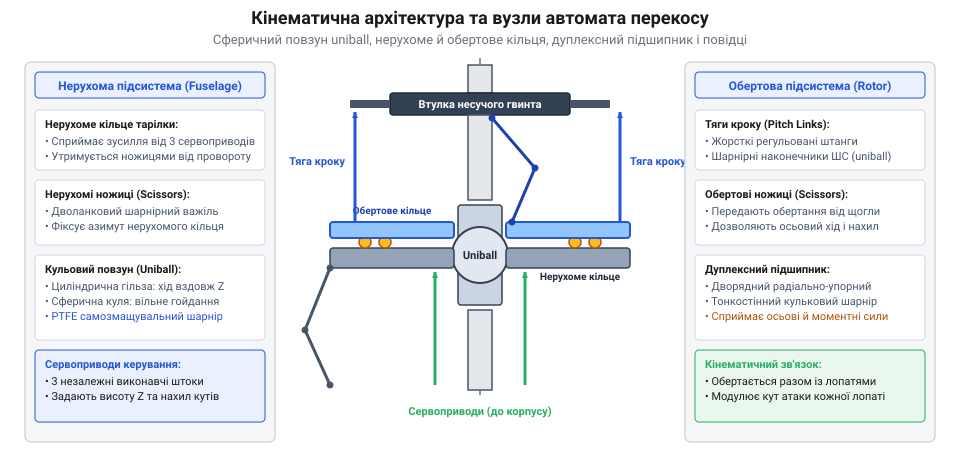
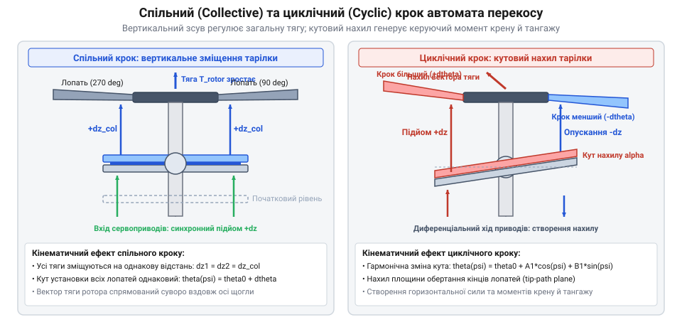
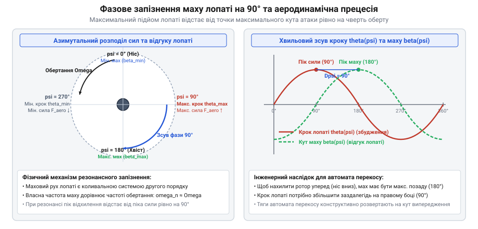
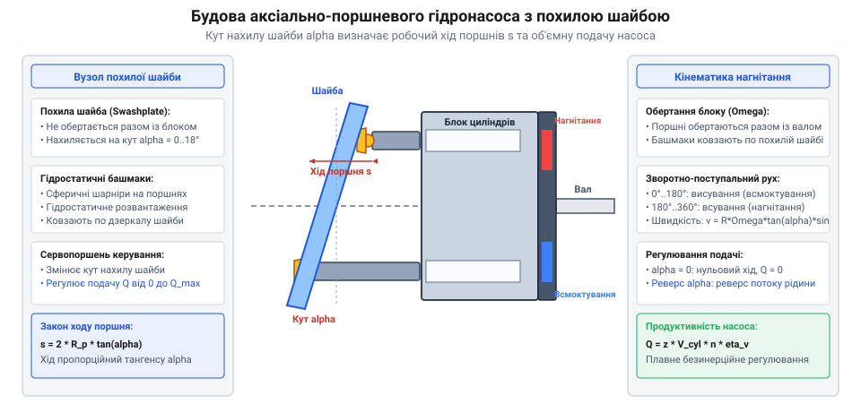

# Автомат перекосу (swashplate)

<preknowlist>
- [Редуктори](root:hw-motion/gears-transmission) — базові поняття передачі обертання, кутової швидкості та механічних зв'язків.
</preknowlist>

## Проблема керування вектором тяги несучого гвинта: чому не можна просто нахилити весь вертоліт мотором

Керування польотом апаратів вертолітного типу докорінно відрізняється від літаків із нерухомим крилом: на режимі зависання вертоліт не має набігаючого повітряного потоку, тож звичайні аеродинамічні керма (елерони, рулі висоти та напрямку) виявляються абсолютно марними. Єдиним джерелом підйомної сили, тяги для горизонтального польоту та моментів просторової стабілізації є його несучий гвинт (ротор).

Наївна інженерна спроба нахиляти весь несучий гвинт разом із приводним валом або нахиляти весь фюзеляж стикається з непереборними фізичними законами:
1. **Колосальний гіроскопічний момент:** несучий гвинт вертольота — це масивне обертове тіло з діаметром від 1 до 20 метрів, що обертається з великою окружною швидкістю кінців лопатей (180–220 м/с). Полярний момент інерції такого диска J_polar величезний. При спробі примусово нахилити вал гвинта виникає реактивний гіроскопічний момент M_gyro = J_polar · (omega_rot × Omega_tilt). Цей момент діє не в бік нахилу, а під кутом 90° до нього, прагнучи виламати редуктор зі станини фюзеляжу та породжуючи некероване перекидання апарата.
2. **Інерційність фюзеляжу:** апарат масою сотні кілограмів чи тонни не здатен блискавично реагувати на пориви вітру або команди пілота; пряме повертання корпусу потребувало б гігантських приводів і займало б секунди, що призводило б до миттєвого падіння машини.

Єдиним фізично життєздатним шляхом є керування вектором аеродинамічної тяги гвинта без нахилу його вала — за рахунок індивідуальної зміни кута атаки (кута установки) кожної лопаті безпосередньо в процесі її обертання. Якщо під час проходження лопаттю хвостової частини кола збільшувати її кут атаки, підйомна сила ззаду зросте, а якщо спереду зменшувати — підйомна сила спереду впаде. Сумарний диск гвинта нахилиться вперед, створюючи горизонтальну складову тяги для польоту.

Проте це породжує складну кінематичну проблему: як передати механічні зусилля від нерухомих важелів пілота чи сервоприводів автопілота на лопаті, які обертаються зі швидкістю кілька сотень обертів на хвилину, гарантуючи циклічну зміну їхнього кута установки за кожен оберт?

> 🔧 **Навіщо це.**
> Розуміння неможливості прямого силового нахилу вала ротора захищає розробника безпілотників від глухих конструктивних тупиків: маневреність великого ротора досягається виключно аеродинамічним нахилом диска через крок лопатей, а не механічним повертанням мотоустановки.

## Будова автомата перекосу: нерухоме кільце, обертове кільце, кульова опора (uniball) та ножиці

Геніальним механічним вузлом, що розв'язує задачу передачі керуючих рухів із нерухомої системи координат в обертову, є автомат перекосу (@@en|swashplate@@). Його кінематична схема складається з двох концентричних кілець, розділених великогабаритним дуплексним підшипником і змонтованих на центральній щоглі несучого гвинта.

*Просторова будова автомата перекосу: щогла, сферичний повзун uniball, нерухоме й обертове кільця, дуплексний підшипник, ножиці та тяги керування кроком лопатей.*

Конструкція містить такі ключові компоненти:
1. **Кульова опора (Uniball / Spherical Bearing):** на центральну обертову щоглу гвинта насаджено прецизійну втулку-повзун із зовнішньою сферичною поверхнею. Ця опора має два ступені вільності відносно щогли: вона може ковзати вгору-вниз уздовж вертикальної осі Z і вільно повертатися (нахилятися) в будь-якому радіальному напрямку навколо центру сфери на кути до ±12°..15°.
2. **Нерухоме кільце (Stationary Ring):** внутрішнє (або нижнє) кільце автомата встановлене на кульову опору. До нього приєднано штоки трьох або чотирьох сервоприводів чи гідропідсилювачів керування. Щоб обертовий вал і сили тертя підшипника не захопили нерухоме кільце в паразитно обертовий рух, його з'єднують із нерухомим корпусом редуктора через важільний паралелограм — нижні ножиці (stationary scissors link). Ножиці блокують обертання навколо вертикальної осі, але не заважають кільцю ковзати вгору-вниз і нахилятися.
3. **Дуплексний радіально-упорний кулькопідшипник:** монтується між нерухомим і обертовим кільцями. Він сприймає колосальні осьові навантаження від натягу тяг лопатей і радіальні сили, забезпечуючи плавне прецизійне обертання верхнього кільця відносно нижнього без найменшого осьового люфту.
4. **Обертове кільце (Rotating Ring):** зовнішнє (або верхнє) кільце спирається на зовнішню обойму підшипника й обертається синхронно з щоглою та лопатями гвинта. Синхронізація обертання здійснюється через верхні ножиці (rotating scissors link), які одним кінцем закріплені на втулці ротора, а другим — на верхньому кільці.
5. **Тяги зміни кроку (Pitch Links):** від периферії обертового кільця відходять вертикальні регульовані тяги на кульових наконечниках, які з'єднуються з повідками осьових шарнірів комлевої частини лопатей.

Геометричний зв'язок між кутом нахилу тарілки beta_tilt та результуючим кутом закрутки лопаті theta_blade визначається радіусом розташування тяг на тарілці R_swash = D_swash / 2 та довжиною комлевого повідка лопаті L_horn:
- Вертикальний хід точки кріплення тяги при нахилі тарілки на кут beta_tilt:
  delta_z_max = R_swash · sin(beta_tilt) ≈ (D_swash / 2) · beta_tilt;
- Кут закрутки лопаті в комлевому шарнірі:
  tg(theta_blade,max) = delta_z_max / L_horn = (D_swash / (2 · L_horn)) · sin(beta_tilt);
- При малих кутах коефіцієнт кінематичного передатного відношення становить:
  k_swash = theta_blade / beta_tilt ≈ D_swash / (2 · L_horn).

Коли нерухоме кільце зміщується чи нахиляється під дією сервоприводів, обертове кільце, затиснуте в підшипнику, дзеркально повторює цю просторову площину. Обертаючись разом із ротором, воно змушує тяги лопатей здійснювати зворотно-поступальний рух вгору-вниз за кожен оберт, циклічно змінюючи аеродинамічний крок лопатей відповідно до поточного кута нахилу тарілки.

> 🔧 **Навіщо це.**
> Розділення на нерухоме й обертове кільця дозволяє розмістити всі важкі сервоприводи, гідравліку й датчики зворотного зв'язку на нерухомому корпусі вертольота, не обтяжуючи ротор рухомою масою.

## Розділення каналів керування: спільний (collective) та циклічний (cyclic) крок

Кінематика автомата перекосу дозволяє незалежно керувати двома принципово різними просторовими параметрами руху несучого гвинта за допомогою єдиного механічного вузла:
1. **Спільний крок (Collective Pitch):** одночасна зміна кута установки всіх лопатей на однакову величину для регулювання сумарної підйомної сили (тяги) ротора;
2. **Циклічний крок (Cyclic Pitch):** періодична зміна кута кожної лопаті залежно від її поточного азимутального положення для нахилу результуючого диска тяги та створення перекидних керуючих моментів за тангажем і креном.

*Порівняння кінематики приводів спільного та циклічного кроку: вертикальний зсув та кутовий перекіс автомата перекосу.*

Керування спільним кроком здійснюється за рахунок суцільного вертикального зміщення нерухомого кільця автомата перекосу вгору чи вниз уздовж осі щогли. При цьому кульовий повзун uniball ковзає напрямною втулкою, не змінюючи свого кутового нахилу. Оскільки всі тяги лопатей одночасно зміщуються на однакову висоту delta_z, кути установки всіх лопатей синхронно збільшуються (або зменшуються) на кут delta_theta_coll. Сумарна аеродинамічна тяга гвинта T_rotor зростає або падає, забезпечуючи підйом або зниження апарата по вертикалі.

Керування циклічним кроком реалізується за рахунок нахилу площини нерухомого кільця відносно центру сферичної опори. Кут нахилу тарілки beta_swash та азимутальний напрямок цього нахилу задаються диференціальним висуванням штоків сервоприводів. За один повний оберт ротора (азимут psi змінюється від 0° до 360°) точка приєднання тяги кожної лопаті на обертовому кільці описує синусоїдальну траєкторію у вертикальній площині.

Результуючий кут установки лопаті theta(psi) як функція азимута описується класичним гармонійним рівнянням першого порядку:

theta(psi) = theta_0 - theta_1c · cos(psi) - theta_1s · sin(psi)

де:
- theta_0 — складова спільного кроку;
- theta_1c — амплітуда циклічного кроку за креном (нахил ліворуч/праворуч);
- theta_1s — амплітуда циклічного кроку за тангажем (нахил уперед/назад);
- psi — азимутальний кут лопаті, що відлічується від напрямку назад (над хвостовою балкою).

Завдяки суперпозиції цих двох рухів автомат перекосу дозволяє пілоту чи системі автопілота неперервно регулювати висоту зависання вертольота, одночасно здійснюючи стрімкі розгони, гальмування та віражі.

> 🔧 **Навіщо це.**
> Елегантність механіки автомата перекосу полягає в тому, що три або чотири сервоприводи на нерухомому корпусі повністю формують шестивимірну динаміку просторового руху літального апарата через зміну параметрів theta_0, theta_1c та theta_1s.

## Гіроскопічна прецесія та аеродинамічне запізнення: фазовий зсув на 90 градусів і випередження вводу

Кожен інженер, який уперше стикається з конструюванням гвинтокрилих машин, стикається з парадоксом, який здається протиприродним: *якщо нахилити автомат перекосу строго вперед, вертоліт полетить не вперед, а різко звалиться вбік — праворуч або ліворуч!*

Причиною цього є явище фазового запізнення маху лопаті (@@en|blade flapping phase lag@@), яке є комбінацією законів коливань гармонічного осцилятора та гіроскопічної прецесії.

*Фазовий зсув реакції несучого гвинта: маховий відгук лопаті з фазовим запізненням 90 градусів відносно точки прикладання циклічного кроку.*

Лопать несучого гвинта не закріплена жорстко — вона з'єднана з втулкою через горизонтальний шарнір маху (або за рахунок пружного згину гнучкого титанового/композитного торсіона). Під час обертання на лопать діють дві колосальні сили: відцентрова сила розтягу F_centrifugal та аеродинамічна підйомна сила F_lift. Під їхньою спільною дією лопать піднімається вгору, утворюючи так званий конус ротора.

Коли автомат перекосу змінює крок лопаті за синусоїдою theta(psi), аеродинамічна сила починає періодично штовхати лопать угору та вниз із частотою, яка в точності дорівнює частоті обертання ротора: omega_force = omega_rot. Лопать у шарнірі маху являє собою класичний механічний маятник (осцилятор другого порядку) без зовнішнього пружинного повернення, де роль відновлювальної пружини виконує відцентрова сила.

Власна частота коливань маху ідеально шарнірної лопаті дорівнює частоті обертання ротора:

omega_flap = omega_rot

З теорії коливань відомо, що коли лінійна коливальна система збуджується гармонійною силою на своїй власній резонансній частоті (omega_force = omega_flap), фазовий зсув між піком збуджуючої сили та піком результуючого зміщення становить рівно 90 градусів (pi / 2 радіан)!

Розглянемо класичний приклад напівжорсткого дволопатевого ротора Bell із загальним гойдалковим шарніром (teetering rotor):
- Обидві лопаті утворюють єдину нерозривну балку, закріплену на щоглі через центральний горизонтальний шарнір (кулісу);
- Оскільки шарнір розташований строго на осі обертання щогли (зміщення шарніра e_hinge = 0), відновлювальний момент створюється виключно відцентровими силами обертання;
- Власна частота маху гойдалкового ротора строго і незмінно дорівнює omega_flap = 1.000 · omega_rot за будь-якої частоти обертання гвинта;
- Фазовий кут запізнення маху delta_flap становить строго delta_flap = arctg( (2 · zeta · (omega_force / omega_flap)) / (1 - (omega_force / omega_flap)²) ) = arctg( inf ) = 90.0°;
- Це означає, що для нахилу площини обертання ротора Bell уперед нахил автомата перекосу повинен бути зміщений рівно на 90° за азимутом (вправо для гвинта лівого обертання або вліво для гвинта правого обертання). Аеродинамічне демпфування маху (число Локка gamma ≈ 6..10) забезпечує плавний рух без розгойдування.

У безшарнірних жорстких композитних роторах (де пружний корінь лопаті має власну частоту трохи вищу за резонанс: omega_flap ≈ 1.05..1.12 · omega_rot) реальний фазовий зсув становить не 90°, а 75°–83°, що потребує точного підлаштування кута фазування в алгоритмах польотного контролера.

> 🔧 **Навіщо це.**
> Порушення кута фазового випередження в системі стабілізації автопілота вертольота перетворює контур керування креном на некерований тангаж, що робить автоматичний політ фізично нестійким.

## Споріднена механіка: похила шайба в регульованих аксіально-поршневих насосах та гідромоторах

Кінематичний принцип нерухомої похилої площини, що взаємодіє з колом обертових точок, виявився настільки універсальним і потужним, що знайшов друге фундаментальне застосування в машинобудуванні — у гідростатичних приводах високого тиску у формі [аксіально-поршневих гідронасосів і гідромоторів із похилою шайбою](root:hw-motion/axial-piston-pump-swashplate) (@@en|axial piston pump with swashplate@@).

Якщо у вертольоті автомат перекосу служить для керування просторовим аеродинамічним вектором, то в гідравліці похила шайба перетворює механічну енергію обертання вала на потік стисненої рідини під тиском до 350–450 бар.

*Кінематика аксіально-поршневого насоса з регульованою похилою шайбою: зміна кута нахилу шайби, регулювання робочого об'єму та реверс потоку рідини.*

Конструкція аксіально-поршневого насоса містить:
1. **Блок циліндрів:** масивний барабан, у якому по колу на радіусі R_pitch паралельно до осі обертання виконано від 7 до 9 прецизійних циліндричних отворів. Барабан жорстко насаджений на приводний вал і обертається разом із ним;
2. **Поршні з гідростатичними башмаками:** у кожен циліндр вставлено загартований плунжер. Сферичний кінець плунжера з'єднаний із бронзовим башмаком (slipper pad), який притискається до поверхні похилої шайби;
3. **Похила шайба (Swashplate):** нерухома плоска деталь із загартованою дзеркальною поверхнею, встановлена під регульованим кутом alpha_swash відносно осі обертання вала;
4. **Розподільчий диск (Valve plate):** нерухомий торець із двома напівмісячними вікнами — вікном всмоктування низького тиску та вікном нагнітання високого тиску.

Кінематика руху кожного поршня за один оберт блоку циліндрів є строго гармонійною. Хід поршня s (довжина поступального переміщення від крайньої нижньої до крайньої верхньої точки) прямо пропорційний діаметру розташування поршнів D_pitch = 2 · R_pitch та тангенсу кута нахилу шайби:

s = D_pitch · tg(alpha_swash)

Миттєва швидкість поршня описується синусоїдою, а робочий об'єм насоса V_disp (см³/оберт) визначається формулою:

V_disp = z_pistons · (pi · d_piston² / 4) · D_pitch · tg(alpha_swash)

Розглянемо зусилля, необхідне для зміни кута нахилу шайби: кожен поршень у зоні нагнітання притискається до шайби з гідравлічною силою F_piston = p_work · (pi · d_piston² / 4). Для насоса з робочим тиском p_work = 300 бар (30 МПа) та діаметром поршня d_piston = 20 мм (площа A_p = 3.14 см²) зусилля одного поршня становить F_p = 30 · 10⁶ Па · 3.14 · 10⁻⁴ м² = 9420 Н!
Оскільки одночасно під тиском нагнітання перебуває половина поршнів (4 з 9), сумарна сила досягає майже 38 кН. Сумарний гідродинамічний перекидний момент на цапфах шайби на плечі R_moment = 40 мм сягає M_tilt ≈ 750 Н·м. Для подолання цього моменту та швидкої зміни кута шайби за 0.05..0.1 с сервоциліндр керування з плечем L_servo = 80 мм повинен розвивати кероване зусилля F_servo = M_tilt / L_servo ≈ 9400 Н, що реалізується гідравлічним пропорційним золотниковим сервоприводом.

Головна інженерна цінність цієї схеми полягає у безступеневому регулюванні:
- Якщо шайба стоїть строго перпендикулярно до вала (alpha_swash = 0), хід поршнів дорівнює нулю (s = 0): вал обертається, але подача рідини дорівнює нулю;
- При нахилі шайби в один бік поршні починають перекачувати рідину з лінії A в лінію B, причому витрата плавно регулюється кутом нахилу;
- Якщо перехилити шайбу через нуль у протилежний бік (-alpha_swash), потік рідини миттєво змінює напрямок на зворотний без зупинки приводного двигуна та без перемикання золотників!

Така система лежить в основі всіх сучасних замкнених гідростатичних трансмісій важких будівельних екскаваторів, комбайнів і лісозаготівельних машин.

> 🔧 **Навіщо це.**
> Похила шайба насоса реалізує ідеальну безступеневу гідростатичну коробку передач: плавна зміна кута шайби сервоциліндром змінює швидкість руху важкої гусеничної машини від нуля до максимуму за постійних обертів дизеля.

## Динамічні навантаження, флаттер тяг, шарнірні наконечники та втомне руйнування

Умови експлуатації автомата перекосу в гвинтокрилих машинах відносяться до категорії екстремально напружених: вузол працює в зоні найпотужніших пульсуючих сил, а його механічне пошкодження веде до миттєвої та повної втрати керованості літального апарата.

На автомат перекосу діють три класи навантажень:
1. **Постійні аеродинамічні зусилля:** виникають від сумарної підйомної сили лопатей і передаються через комлеві важелі як постійна стискальна або розтягувальна сила на штоки тяг (до кількох кілоньютонів на лопать);
2. **Швидкісні високочастотні гармонійні сили:** через циклічну зміну кута атаки та нерівномірність набігаючого потоку аеродинамічний шарнірний момент лопаті M_hinge пульсує з гармоніками 1/оберт, 2/оберт і вище. Тяги зазнають знакозмінного циклічного навантаження з частотою 5–30 Гц, накопичуючи мільйони циклів напружень за лічені сотні годин польоту;
3. **Відцентрові сили інерції обертового кільця та тяг:** діють на дуплексний підшипник, викликаючи перекіс кілець і високі контактні напруження.

Найстрашнішою загрозою для автомата перекосу є аеропружний крутильний флаттер (@@en|blade pitch flutter@@). Якщо в шарнірних наконечниках тяг зміни кроку (pitch links) з'являється навіть мінімальний люфт (0.2–0.5 мм), або якщо жорсткість тяги на розтяг недостатня, лопать набуває свободи неконтрольованих крутильних коливань навколо своєї поздовжньої осі.

На високих швидкостях польоту виникає позитивний зворотний зв'язок між пружною закруткою лопаті та миттєвою аеродинамічною силою. Амплітуда коливань наростає за частки секунди (вибуховий флаттер), зусилля в тязі перевищує границю міцності металу, тяга розривається, і лопать переходить у некерований політ, руйнуючи весь вертоліт.

Для запобігання катастрофам висуваються безкомпромісні інженерні вимоги:
- **Тяги зміни кроку:** виготовляються з високоміцних титанових сплавів або безшовних товстостінних авіаційних алюмінієвих труб (типу Д16Т/7075-T6) великого діаметра для максимізації осьової та згинальної жорсткості;
- **Шарнірні наконечники (Rod Ends):** застосовують прецизійні сферичні підшипники ковзання (ШС) із вкладишами з металофторопластової стрічки (PTFE fabric liners), які не мають зазору, не потребують рідкого змащування й гарантують високу контактну витривалість;
- **Суворий регламент ресурсу:** деталі автомата перекосу мають обмежений втомний ресурс (TBO — time between overhauls) зазвичай від 1000 до 3000 льотних годин, після чого підлягають обов'язковому неруйнівному дефектоскопічному контролю (магнітно-порошковому чи ультразвуковому) або повній превентивній заміні.

> 🔧 **Навіщо це.**
> Регулярний передполітний контроль осьового люфту шарнірних наконечників автомата перекосу — критична операція обслуговування: виявлення люфту понад 0.1 мм рятує життя екіпажу від катастрофічного флаттера в польоті.

## Інженерний розрахунок кінематики, підбір ходів сервоприводів та електронне мікшування CCPM

Проектування приводу автомата перекосу вертольота або безпілотника вимагає точного розрахунку кінематичного зв'язку між лінійними переміщеннями штоків сервоприводів та результуючими кутами установки лопатей ротора.

У сучасних гвинтокрилих апаратах практично повсюдно відмовилися від складних і важких механічних мікшерів важелів (схем Белла-Гіллера) на користь прямого електронного мікшування циклічного та спільного кроку — системи CCPM (@@en|Cyclic/Collective Pitch Mixing@@). Нерухоме кільце автомата перекосу спирається безпосередньо на штоки трьох (або чотирьох) високошвидкісних цифрових сервоприводів, а всі просторові перетворення обчислює мікроконтролер польотного контролера.

Найпоширенішою інженерною схемою є триточкова 120-градусна тарілка CCPM (120° Swashplate), де три сервоприводи S1, S2, S3 розташовані по колу радіуса R_servo з кутовим кроком 120°:
- Сервопривід S1 розташований ззаду (азимут 0°);
- Сервопривід S2 розташований спереду-ліворуч (азимут 120°);
- Сервопривід S3 розташований спереду-праворуч (азимут 240°).

Нехай z_coll — необхідне вертикальне зміщення для спільного кроку (мм), a_pitch — кутовий нахил тарілки за тангажем (рад), а b_roll — кутовий нахил тарілки за креном (рад). Лінійні положення штоків сервоприводів z_1, z_2, z_3 розраховуються за прямою матрицею кінематики:

z_1 = z_coll + R_servo · a_pitch
z_2 = z_coll - 0.5 · R_servo · a_pitch + (√3 / 2) · R_servo · b_roll
z_3 = z_coll - 0.5 · R_servo · a_pitch - (√3 / 2) · R_servo · b_roll

Для важких вертольотів та безпілотників із підвищеними вимогами до надійності альтернативою є чотириточкова 90-градусна схема CCPM (4-Servo 90°), де приводи встановлено хрестоподібно на радіусі R_servo:
- Штоки поздовжнього каналу (тангаж): z_rear = z_coll + R_servo · a_pitch, z_front = z_coll - R_servo · a_pitch;
- Штоки поперечного каналу (крен): z_left = z_coll + R_servo · b_roll, z_right = z_coll - R_servo · b_roll.

Порівняння схем демонструє чіткі інженерні переваги кожної:
- **Схема 120° (3 сервоприводи):** легша за масою на 25%, має менше деталей, проте при відмові будь-якого одного сервоприводу автомат перекосу повністю втрачає керованість;
- **Схема 90° (4 сервоприводи):** має повне геометричне розв'язання каналів крену й тангажу (відсутність множників √3/2 у коді контролера) та допускає алгоритмічну реконфігурацію для аварійної посадки при відмові одного з приводів.

При переході від тарілки до лопатей результуючий кут закрутки лопаті theta_blade визначається довжиною повідка комля лопаті L_horn:

theta_blade ≈ tg(theta_blade) = delta_z_link / L_horn

де delta_z_link — вертикальне переміщення точки кріплення тяги на обертовому кільці.

При підборі сервоприводів автомата перекосу керуються двома критичними критеріями:
1. **Швидкодія сервоприводу (Transit Speed):** повинна становити не більше 0.05..0.08 с на кут 60°, що відповідає смузі пропускання контуру стабілізації автопілота не менше 15–20 Гц для ефективного придушення поривів вітру;
2. **Зусилля блокування (Stall Torque):** крутний момент сервоприводу повинен із запасом перекривати максимальний шарнірний аеродинамічний момент лопаті на граничній швидкості пікірування машини: M_servo ≥ S_safety · (sum(F_hinge) · R_horn), де S_safety ≥ 2.5..3.0.

> 🔧 **Навіщо це.**
> Математична модель 120-градусного мікшування CCPM дозволяє польотному контролеру компенсувати геометричну нелінійність кутових качалок сервоприводів, гарантуючи абсолютно чистий вертикальний підйом ротора без паразитних перекосів за креном і тангажем.
