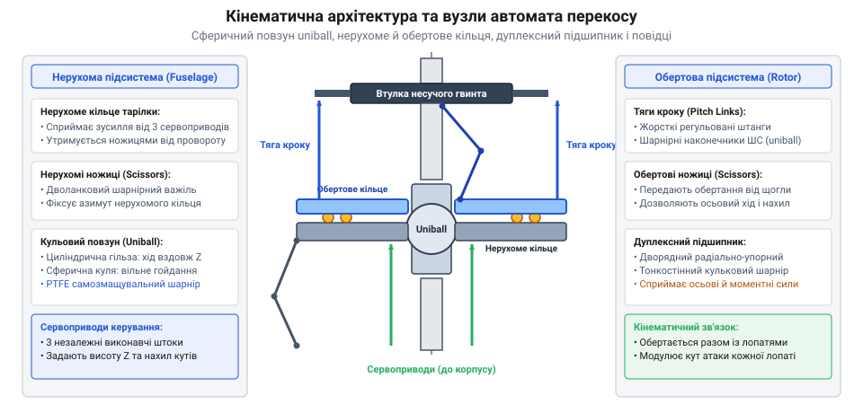
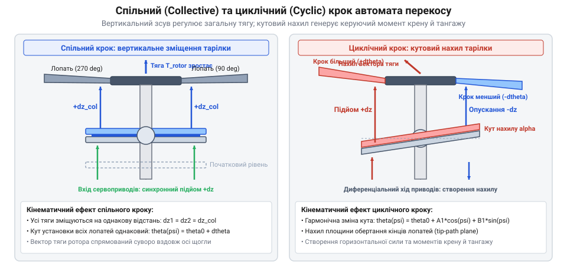
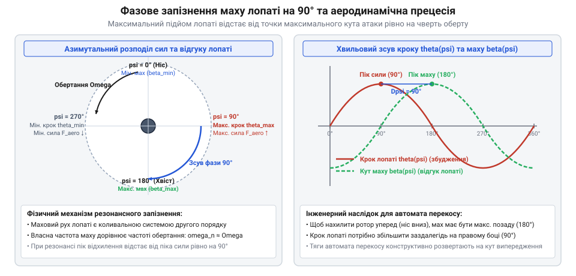

# Автомат перекосу (swashplate)

## Архітектура та принцип передачі руху: нерухоме й обертове кільця, кульова опора uniball та розділення стаціонарних приводів і обертового ротора

Автомат перекосу (@@en|swashplate@@) є просторовим шарнірно-важільним механізмом несучого гвинта вертольота, який вирішує фундаментальну проблему аеромеханіки вертикального польоту: як передати неперервні керуючі зусилля від нерухомих приводів фюзеляжу (гідропідсилювачів або електромеханічних сервоприводів системи Fly-by-Wire) на лопаті, що обертаються зі швидкістю 250–500 об/хв у змінному повітряному потоці. Механізм повинен одночасно виконувати дві незалежні функції: синхронно змінювати установчий кут усіх лопатей на однакове значення для регулювання загальної вертикальної тяги та циклічно змінювати кут кожної окремої лопаті за один повний оберт для створення векторів моменту тангажу й крену.

Кінематичну основу автомата перекосу складають чотири базові функціональні вузли, змонтовані навколо вертикального приводного вала (щогли) ротора:
1. **Центральна напрямна гільза зі сферичним шарніром uniball**: бронзова або сталева гільза вільно ковзає вгору та вниз по прецизійній шліфованій циліндричній поверхні щогли ротора, задаючи поступальний рух. На зовнішній поверхні гільзи жорстко закріплено або виточено монолітну сферичну кулю (@@en|uniball spherical bearing@@), облицьовану зносостійким антифрикційним шаром політетрафторетилену (PTFE / тефлоновий лайнер). Сферична опора дозволяє встановленим на ній кільцям нахилятися в будь-якій діаметральній площині на просторовий кут до `±10°..±14°` без виникнення люфтів чи перекосів.
2. **Нерухоме кільце (стаціонарна тарілка)**: внутрішнє кільце автомата перекосу, центральна чаша якого спирається безпосередньо на сферичний шарнір uniball. Кільце з'єднане з фюзеляжем трьома або чотирма нерухомими сервоприводами керування через шарнірні наконечники. Щоб нерухома тарілка не оберталася разом із валом внаслідок тертя у підшипнику, її шарнірно з'єднують із нерухомим картером головного редуктора за допомогою ножичного компенсатора — нерухомого шліц-шарніра (@@en|stationary drive scissors@@), який дозволяє тарілці рухатися вгору-вниз та нахилятися, але блокує її обертання навколо вертикальної осі.
3. **Дуплексний радіально-упорний кулькопідшипник**: високопрецизійний тонкостінний підшипник великого діаметра, що розділяє нерухоме та обертове кільця. Підшипник розрахований на одночасне сприйняття масивних змінних осьових навантажень від аеродинамічної сили тяги ротора (до десятків кілоньютонів) та динамічних перекидних моментів від кожної лопаті.
4. **Обертове кільце (роторна тарілка)**: зовнішня обойма, закріплена на рухомому кільці підшипника. Тарілка обертається синхронно з несучим валом завдяки обертовому шліц-шарніру (@@en|rotating drive scissors@@), шарнірно зв'язаному з втулкою ротора. Від радіальних виступів обертового кільця відходять регульовані жорсткі тяги повороту лопатей (@@en|pitch links@@), які з'єднуються з рогами цапф (@@en|pitch horns@@) комлевих частин лопатей.


*Кінематична схема та підшипникові вузли автомата перекосу: взаємне розташування нерухомої й обертової тарілок, центрального сферичного шарніра uniball та повідкових ножиць.*

Коли льотчик чи система автопілота подає сигнал на одночасне висування всіх приводів, нерухома гільза зміщується вертикально вздовж щогли на величину `Delta_z`. Кульовий uniball піднімає обидві тарілки паралельно горизонту:

```
Delta_theta_coll
= arctan(Delta_z / L_horn)                                  [зміна спільного кроку лопатей при осьовому зміщенні тарілки]
= arctan(15.0 / 120.0)                                      [при вертикальному ході тарілки 15 мм та плечі рога лопаті 120 мм]
= 7.125                                                     [синхронний приріст кута атаки лопатей у градусах]
```

Якщо приводи висуваються диференційно (наприклад, передній шток втягується, а задній висувається), нерухома тарілка повертається на сфері uniball на кут `alpha_tilt`. Обертова тарілка набуває такого ж просторового перекосу. Під час обертання ротора шарнір кріплення кожної тяги здійснює гармонічне коливання вздовж осі щогли, безперервно змінюючи установчий кут кожної лопаті за синусоїдальним законом:

```
theta_blade(psi)
= theta_coll - A_cyclic · cos(psi) - B_cyclic · sin(psi)     [гармонічна функція зміни циклічного кроку від азимута psi]
```

де `psi` — миттєвий азимутальний кут положення лопаті, `A_cyclic` та `B_cyclic` — амплітуди перекосу в поздовжній та поперечній площинах.

> 🔧 **Навіщо це.** Сферичний шарнір uniball поєднує поступальний рух спільного кроку та тривимірні нахили циклічного керування в єдиному вузлі, виключаючи важкі багатоланкові карданні шарніри та забезпечуючи миттєвий відгук гвинта на дії пілота.

## Спільний та циклічний крок: вертикальне зміщення для зміни підйомної сили проти кутового нахилу площини для формування векторів тангажу й крену

Керування польотом вертольота вимагає роздільного вирішення двох взаємопов'язаних динамічних завдань: створення вертикальної підйомної сили для набору чи зниження висоти та формування поздовжніх і поперечних керуючих моментів для польоту вперед, назад або вбік. Автомат перекосу реалізує це розділення за допомогою двох незалежних геометричних рухів тарілок — поступального вертикального зсуву та кутового перекосу.

Режим спільного (колективного) кроку (@@en|collective pitch@@) змінює кут установки всіх лопатей ротора абсолютно синхронно на однакове значення. Коли льотчик тягне вгору важіль «шаг-газ» (важіль спільного кроку), система сервоприводів одночасно й рівномірно піднімає нерухому тарілку вздовж осі щогли несучого вала. Куля uniball разом із обертовою тарілкою зміщується вгору, і всі тяги керування лопатями виштовхуються на однакову відстань. Кут атаки кожної лопаті зростає:

```
T_rotor
= 0.5 · rho_air · C_T · A_disc · (omega_rotor · R_tip)²      [загальна аеродинамічна сила тяги несучого ротора]
```

Збільшення спільного кроку викликає миттєвий приріст сумарної підйомної сили без зміни нахилу диска ротора, забезпечуючи вертикальний підйом апарата.


*Спільний та циклічний крок: вертикальне зміщення для зміни підйомної сили проти кутового нахилу площини для формування векторів тангажу й крену.*

Режим циклічного кроку (@@en|cyclic pitch@@) відповідає за просторове маневрування вертольота по горизонталі. Коли льотчик відхиляє ручку керування (ручку циклічного кроку), сервоприводи перекошують нерухому тарілку відносно центральної сфери uniball. Обертова тарілка набуває такого ж кутового нахилу у просторі. При обертанні несучого гвинта кожна тяга лопаті описує похилу траєкторію: у найнижчій точці тарілки установчий кут лопаті мінімальний, а через пів оберту (180° азимута) у найвищій точці — досягає максимуму:

```
alpha_blade(psi)
= theta_0 - A_1 · cos(psi) - B_1 · sin(psi)                  [циклічна зміна кута атаки лопаті залежно від азимутального кута psi]
```

Нерівномірний розподіл кутів атаки по колу обертання створює асиметрію підйомної сили: одна половина диска ротора створює більшу тягу, ніж протилежна. Це породжує результуючий перекидний аеродинамічний момент, який нахиляє конус обертання гвинта у потрібному напрямку, створюючи горизонтальну складову тяги для прискорення машини.

> 🔧 **Навіщо це.** Розділення керування на спільний і циклічний крок в єдиному шарнірному механізмі дозволяє вертольоту зависати на місці, плавно змінювати висоту та розганятися в будь-якому напрямку без зміни оборотів турбовального двигуна.

## Фазове запізнення на 90° та похила шайба гідронасосів: аеродинамічна прецесія ротора вертольота і безступінчасте дозування подачі в аксіально-поршневих машинах

При проєктуванні привода автомата перекосу інженери враховують фундаментальну динамічну властивість шарнірного несучого гвинта — маховий рух лопаті має 90-градусне фазове запізнення щодо прикладеної сили. Лопать, з'єднана з втулкою через горизонтальний шарнір, під час обертання являє собою резонансний механічний осцилятор, власна частота коливань якого відцентровою силою налаштована точно на частоту обертання вала (1/об).

За законами динаміки коливальних систем, відгук контуру на гармонічне збурення в точці резонансу відстає за фазою рівно на 90 градусів. Коли автомат перекосу збільшує кут атаки лопаті, наприклад, на правому боці вертольота (азимут 90°), аеродинамічна підйомна сила досягає максимуму саме тут. Проте максимальне переміщення лопаті вгору (маховий рух) завершується лише через чверть оберту — над носовою частиною машини (азимут 180°):

```
beta_flap(psi)
= beta_0 - a_1 · cos(psi - 90°) - b_1 · sin(psi - 90°)       [маховий рух лопаті з фазовим кутовим відставанням на 90 градусів]
```

Щоб нахилити ротор строго вперед (для польоту вперед), автомат перекосу повинен створювати максимальний циклічний кут лопатей не спереду чи ззаду, а на правому боці. Для цього точки кріплення тяг до обертової тарілки конструктивно зміщують по колу на 90° вперед за напрямком обертання вала (кут випередження проводки керування).


*Фазове запізнення на 90°: аеродинамічна сила досягає максимуму за чверть оберту до найвищої точки махового руху лопаті.*

Принцип автомата перекосу знаходить надзвичайно широке застосування за межами авіації — у промисловій гідроавтоматиці та робототехніці у формі похилої шайби (@@en|swashplate pump@@) аксіально-поршневих насосів і гідромоторів. Усередині нерухомого картера навколо вала обертається блок циліндрів із 7 або 9 поршнями, штоки яких спираються на похилу сталеву пластину через бронзові гідростатичні підп'ятники.

Коли шайба нахилена на кут `gamma_swash`, обертання блока змушує поршні здійснювати зворотно-поступальний рух у гільзах:

```
V_displacement
= Z_pistons · A_piston · (D_pitch · tan(gamma_swash))        [робочий об'єм насоса за один оберт блока циліндрів]
```

Зміна кута нахилу шайби від `0°` до `+18°` дозволяє безступінчасто регулювати гідравлічну подачу рідини від нуля до максимуму, а перехід кута через нуль у мінусову зону реверсує потік масла без перемикання клапанів і без зміни напрямку обертання двигуна.

> 🔧 **Навіщо це.** Розуміння 90-градусного фазового зсуву позбавляє від хибного уявлення, ніби ротор реагує на тяги миттєво: правильне кутове випередження тяг автомата перекосу забезпечує інтуїтивне та стійке керування польотом вертольота.
