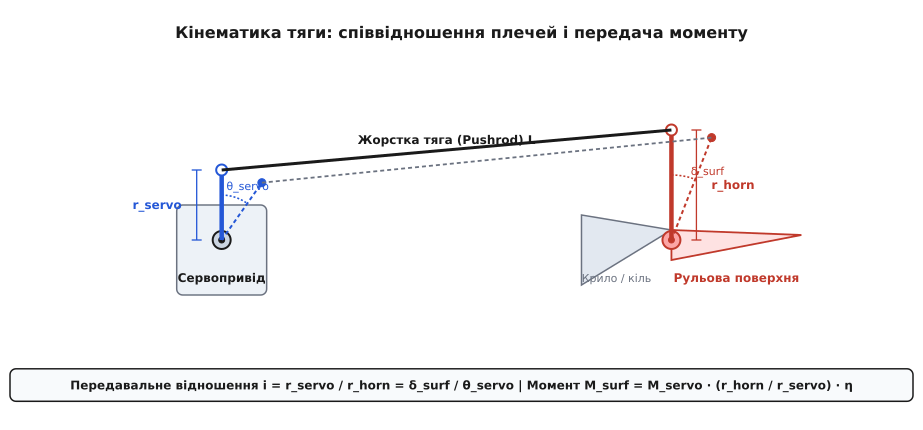
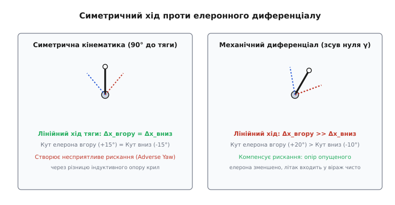
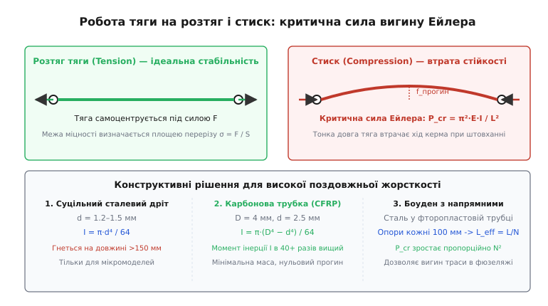
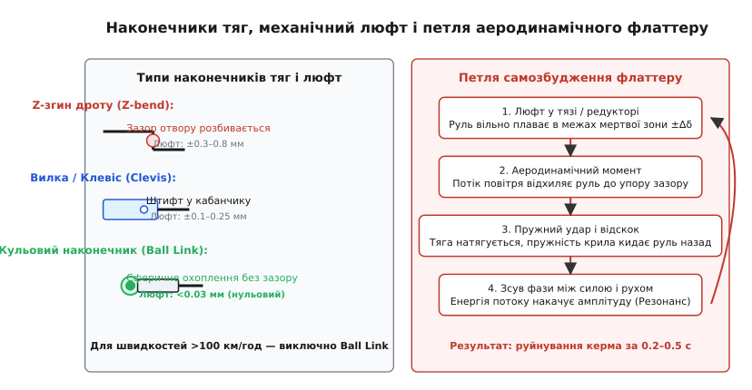

# Тяги, качалки й люфт рульової поверхні

<preknowlist>
- [Сервопривід](root:hw-motion/hobby-servo) — будова сервоприводу, вихідний вал із шліцами, контур утримання кута та крутний момент.
- [Момент сили](root:ph-mechanics/torque) — поняття плеча важеля, момент як добуток сили на відстань і правило рівноваги.
- [Закон Гука](root:ph-mechanics/hookes-law) — лінійна пружна деформація стрижня, модуль Юнга та розтяг під дією осьових зусиль.
- [Серво-роги](root:cat-hw-actuators/servo-horns) — геометрія пластикових і металевих качалок сервоприводів та отвори під наконечники.
</preknowlist>

Безпілотний літак вагою чотири кілограми розганяється на пікіруванні до 150 км/год. Автопілот дає команду елеронам вирівняти крен, сервопривід слухняно провертає свій вихідний вал на 20° і надійно тримає заданий кут. Проте крило раптово охоплює дике гудіння з частотою сорок герців, за три десятих секунди пластикові шестерні редуктора зрізає начисто, а площину елерона відриває від завіс разом зі шматком задньої крайки крила. Аварійна комісія фіксує: сам сервопривід був повністю справним, зусилля двигуна вистачало з запасом, але в шарнірі наконечника тяги був люфт усього 0.4 мм, а тонка півтораміліметрова сталева тяга довжиною двадцять сантиметрів під час штовхання просто вигнулася дугою, втративши подовжню жорсткість.

Будь-який рульовий привод літального апарата чи поворотний вузол маніпулятора складається з трьох послідовних ланок: виконавчого двигуна (сервоприводу), проміжної передавальної лінії (качалок і тяги) та керованого робочого органа (елерона, керма висоти, поворотного пера). Електрична частина сервоприводу гарантує точний кут власного вала, але повітряному потоку протистоїть не вал, а рульова поверхня. Якщо механічна лінія між ними має зазори, піддатливість на стиск або хибну геометрію плечей, система втрачає керованість. Розберімо механіку передачі руху від вала до руля — від співвідношення плечей і тригонометричної нелінійності до розрахунку стійкості тяг за Ейлером та фізики руйнівного аеродинамічного флаттеру.

## Кінематика важільного зв'язку: плечі та кутове передавальне відношення

Сервопривід створює обертальний рух свого вала, а рульова поверхня повинна обертатися навколо власної осі завіс. Найпростіший і найлегший спосіб з'єднати дві обертові осі, рознесені в просторі, — перетворити обертання вала на лінійне переміщення жорсткого стрижня (тяги), а на іншому кінці знову перетворити це переміщення на обертання руля.

Для цього на вихідний вал сервоприводу встановлюють важіль — качалку сервоприводу (англ. *servo horn*) з робочим радіусом `r_servo` від осі обертання вала до отвору кріплення тяги. На рульову поверхню жорстко монтують зустрічний важіль — кабанчик, або качанку руля (англ. *control horn*) з робочим радіусом `r_horn` від осі шарніра завіси до точки фіксації тяги. Обидва важелі з'єднує поздовжня тяга (штовхач, англ. *pushrod*).


*Схема чотириланкового механізму: кутове переміщення качалки сервоприводу перетворюється на лінійний рух жорсткої тяги та повертає кабанчик рульової поверхні. Співвідношення плечей визначає передавальне відношення швидкості, кута й крутного моменту.*

У нейтральному положенні, коли обидві качалки розташовані перпендикулярно до лінії тяги, малий кутовий поворот сервоприводу на кут `θ_servo` (у радіанах) зміщує точку кріплення тяги на лінійну відстань:

```
Δx = r_servo · sin(θ_servo) ≈ r_servo · θ_servo   [малі кути повороту вала]
```

Цей самий лінійний зсув `Δx` штовхає або тягне кабанчик рульової поверхні, змушуючи його повернутися навколо власної осі завіси на кут `δ_surf`:

```
Δx = r_horn · sin(δ_surf) ≈ r_horn · δ_surf       [малі кути відхилення руля]
```

Прирівнюючи лінійні переміщення, одержуємо базове кінематичне співвідношення для кутового передавального відношення механізму `i`:

```
i = δ_surf / θ_servo = r_servo / r_horn           [кутове передавальне відношення]
```

З механічного правила важеля та закону збереження енергії (нехтуючи тертям у шарнірах) робота сил на обох кінцях тяги однакова. Отже, співвідношення моментів сил обернене до співвідношення кутів. Сила вздовж тяги `F_rod` дорівнює моменту сервоприводу `M_servo`, поділеному на його плече `r_servo`. Ця сама сила діє на плече кабанчика `r_horn`, створюючи на осі рульової поверхні момент `M_surf`:

```
F_rod = M_servo / r_servo                         [осьове зусилля в тязі]
M_surf = F_rod · r_horn · η_mech                  [момент на осі рульової поверхні]
M_surf = M_servo · (r_horn / r_servo) · η_mech    [трансформація крутного моменту]
```

де `η_mech` — механічний коефіцієнт корисної дії шарнірних з'єднань (для якісних підшипників чи наконечників без заклинювання `η_mech ≈ 0.90–0.95`).

### Ціна вибору отвору на качалці: дискретність проти сили

На практиці стандартна пластикова або алюмінієва качалка сервоприводу має від трьох до шести отворів, розташованих на відстані від 8 мм до 25 мм від центру. Кабанчик на рулі також містить кілька отворів на висоті від 12 мм до 35 мм над віссю обертання. Вибір комбінації отворів визначає компроміс між трьома критичними характеристиками:

1. **Максимальний кутовий хід руля:** Якщо зачепити тягу за найдальший отвір сервоприводу (`r_servo = 24 мм`) і найближчий отвір руля (`r_horn = 12 мм`), передавальне відношення становитиме `i = 2.0`. Сервопривід повернеться на 30°, а руль відхилиться на 60°. Це забезпечує швидку реакцію та великі кути для акробатичного 3D-пілотажу.
2. **Крутний момент утримання:** За відношення `i = 2.0` момент сили на рулі падає вдвічі порівняно з моментом сервоприводу: `M_surf = 0.5 · M_servo`. На високій швидкості набігаючий потік повітря тисне на руль з величезною силою, і слабкий сервопривід просто не зможе втримати поверхню — виникне так званий аеродинамічний віддув (англ. *blowback*), коли руль самовільно повертається до нейтралі під тиском потоку.
3. **Кутова роздільна здатність (дискретність):** Стандартний широтно-імпульсний сигнал керування сервоприводом формується таймером мікроконтролера з дискретністю близько 1 мкс. При робочому діапазоні 1000–2000 мкс (хід 1000 мкс на 90° повороту вала) один мікросекундний крок відповідає повороту вала на `0.09°`. Якщо `i = 2.0`, мінімальний крок відхилення рульової поверхні становитиме `0.18°`. Якщо ж зменшити `r_servo` до 10 мм, а `r_horn` збільшити до 20 мм (`i = 0.5`), крок позиціювання руля стане `0.045°`, а момент зросте вдвічі.

Головне інженерне правило проектування тяг полягає в тому, щоб **використовувати 100% робочого кутового ходу сервоприводу**. Якщо для стабілізації літака чи крила потрібен хід елерона лише ±12°, категорично заборонено ставити довгу качалку сервоприводу і програмно обмежувати сигнал у прошивці до 20% ходу. За такого обмеження роздільна здатність контуру керування падає вп'ятеро, а будь-який мікроскопічний люфт редуктора сервоприводу транслюється на руль у подвійному масштабі. Правильне рішення — переставити тягу на внутрішній отвір сервоприводу і зовнішній отвір кабанчика, змусивши сервопривід відпрацьовувати свої повні ±45° ходу для досягнення потрібних ±12° на кермі.

## Тригонометрична нелінійність та елеронний диференціал

Коли кути відхилення перевищують 15–20°, лінійне наближення `sin(θ) ≈ θ` перестає працювати. Траєкторія кінця качалки — це дуга кола, а не пряма лінія. Лінійне зміщення точки кріплення тяги вздовж осі тяги зменшується на краях ходу, оскільки вектор швидкості качалки повертається і втрачає паралельність до тяги.

### Умова строго симетричного ходу

Щоб лінійне переміщення тяги в бік штовхання (вниз) дорівнювало переміщенню в бік тяги (вгору), мають одночасно виконуватися три геометричні вимоги:
- У нейтральному положенні (нульовий сигнал сервоприводу і нейтраль руля) вісь качалки сервоприводу повинна утворювати кут рівно 90° з лінією тяги.
- Кабанчик рульової поверхні в нейтралі повинен утворювати кут рівно 90° з лінією тяги.
- Отвори кріплення наконечника на кабанчику повинні розташовуватися строго над лінією обертання шарнірів завіси. Якщо отвір кабанчика зміщений назад або вперед від осі завіси, плече `r_horn` змінює свій ефективний кут, і хід в один бік стане відчутно більшим, ніж в інший.


*Порівняння кінематики: ліворуч — нейтраль 90° дає однаковий хід тяги в обидва боки; праворуч — нахил качалки на кут γ створює механічний диференціал: хід на витягування суттєво переважає хід на штовхання.*

### Механічний диференціал елеронів і несприятливе рискання

У класичній аеродинаміці літака однакове за величиною відхилення лівого й правого елеронів породжує небезпечне явище — **несприятливе рискання** (англ. *adverse yaw*). Коли лівий елерон опускається вниз, щоб підняти ліве крило, кривина профілю і локальний коефіцієнт підіймальної сили `C_L` зростають. Проте разом із підіймальною силою різко зростає індуктивний опір крила, пропорційний квадрату підіймальної сили:

```
C_d_ind = C_L² / (π · e · AR)                      [індуктивний опір крила]
```

Правий елерон у цей самий час піднімається вгору: підіймальна сила правого крила падає, а індуктивний опір зменшується. У результаті на лівому напівкрилі виникає гальмівна сила опору, яка розвертає ніс літака ліворуч — якраз у протилежний бік від запланованого правого розвороту. Літак розвертає боком проти потоку, збільшуючи загальний опір і погіршуючи керованість.

Щоб компенсувати цей ефект, застосовують **диференціал елеронів**: елерон, що піднімається вгору, повинен відхилятися на значно більший кут (наприклад, +25°), ніж елерон, що опускається вниз (наприклад, -12°). Піднятий на великий кут елерон виходить глибоко в потік і створює додатковий опір форми, який зрівноважує індуктивний опір опущеного крила.

Диференціал можна налаштувати програмно, якщо на кожен елерон встановлено окремий сервопривід. Але в механіці класичних БПЛА з одним сервоприводом на обидва елерони або для збереження повної роздільної здатності застосовують **геометричний диференціал**. Для цього качалку сервоприводу в нейтральному положенні встановлюють не під кутом 90° до тяги, а нахиляють уперед за напрямком тяги на кут `γ = 25°–35°`.

Аналітичний розрахунок переміщення тяги з початковим кутом зміщення `γ` при повороті вала на кут `θ` має вигляд:

```
Δx_up   = r_servo · (sin(γ + θ) - sin(γ))          [тяга натягується — елерон вгору]
Δx_down = r_servo · (sin(γ) - sin(γ - θ))          [тяга штовхається — елерон вниз]
```

Оскільки похідна функції синуса біля 0° максимальна, а біля 90° спадає до нуля, поворот качалки в бік збільшення загального кута дає великий приріст лінійного ходу `Δx_up`. Рух у протилежний бік зміщує важіль ближче до «мертвої точки», через що лінійний хід `Δx_down` виявляється в 1.8–2.5 раза меншим. Цей простий механічний трюк повністю усуває несприятливе рискання без ускладнення електроніки.

## Поздовжня жорсткість тяг і критична сила вигину Ейлера

Найпідступніша небезпека механічної проводки керування криється в асиметрії роботи матеріалу на розтяг і на стиск. Коли сервопривід тягне руль на себе, тяга працює на чистий розтяг. Під дією розтягуючої сили стрижень автоматично вирівнюється в ідеальну пряму лінію, а граничне навантаження обмежується виключно площею поперечного перерізу та границею текучості металу. Навіть тонкий сталевий дріт діаметром 1.2 мм витримує на розтяг понад 800 Н (близько 80 кгс) сили без пластичної деформації.

Але коли сервопривід штовхає руль від себе, тяга опиняється під дією осьового стиску. Довгий тонкий стрижень під стиском втрачає пружну стійкість задовго до досягнення межі міцності матеріалу. Стрижень раптово вигинається вбік дугою — відбувається **поздовжній вигин** (англ. *Euler column buckling*).


*Механіка поздовжнього навантаження: під розтягом тяга стабільна; під стиском тонка тяга втрачає стійкість за критичної сили Ейлера P_cr. Карбонова трубка завдяки більшому моменту інерції перерізу I збільшує критичну силу в десятки разів.*

### Формула Ейлера для шарнірно опертого стрижня

Обидва кінці тяги закріплені в шарнірних наконечниках (кульових або вилочних), які вільно обертаються на осях. Для стрижня з вільними шарнірними опорами на кінцях критична осьова сила `P_cr`, за якої стрижень втрачає прямолінійну форму і вигинається, описується класичною формулою Ейлера:

```
P_cr = (π² · E · I) / L²                          [критична сила втрати стійкості]
```

де:
- `E` — модуль поздовжньої пружності матеріалу (модуль Юнга), Па;
- `I` — осьовий момент інерції поперечного перерізу стрижня, м⁴;
- `L` — вільна (незакріплена) довжина тяги між наконечниками, м.

Осьовий момент інерції перерізу `I` визначає опір геометричної форми згину:
- Для суцільного круглого стрижня діаметром `d`:

```
I_solid = (π · d⁴) / 64                           [момент інерції суцільного кола]
```

- Для тонкостінної круглої трубки із зовнішнім діаметром `D` та внутрішнім діаметром `d`:

```
I_tube = (π · (D⁴ - d⁴)) / 64                     [момент інерції порожнистої трубки]
```

### Порівняльний розрахунок: сталевий дріт проти карбонової трубки

Зіставимо реальні параметри двох тяг однакової довжини `L = 250 мм` (0.25 м), які типово встановлюють у фюзеляжі безпілотника:

**Варіант А: Суцільний пружинний сталевий дріт (Овсинка / Музичний дріт)**
- Зовнішній діаметр: `d = 1.5 мм` = `0.0015 м`
- Модуль Юнга сталі: `E_steel = 210 ГПа` = `2.1 · 10¹¹ Па`
- Момент інерції перерізу:

```
I_steel = (π · (0.0015)⁴) / 64                    [підстановка діаметра сталі]
        = (π · 5.0625 · 10⁻¹²) / 64               [обчислення степеня]
        = 2.485 · 10⁻¹³ м⁴                        [осьовий момент інерції]
```

- Критична сила Ейлера:

```
P_cr_steel = (π² · 2.1 · 10¹¹ · 2.485 · 10⁻¹³) / (0.25)²   [підстановка у формулу Ейлера]
           = (5.150 · 10⁻¹) / 0.0625                       [спрощення чисельника й знаменника]
           = 8.24 Н ≈ 0.84 кгс                             [критична сила втрати стійкості]
```

Сила всього 8.2 Н (менше 1 кг зусилля на качалці!) призводить до того, що сталева тяга втрачає стійкість і вигинається на 5–10 мм убік. Сервопривід видає повний робочий хід, але замість відхилення руля його зусилля витрачається на згинання дуги дроту. Руль опускається лише на третину заданого кута.

**Варіант Б: Вуглепластикова (карбонова) трубка (CFRP)**
- Зовнішній діаметр: `D = 4.0 мм` = `0.004 м`
- Внутрішній діаметр: `d = 2.5 мм` = `0.0025 м`
- Модуль Юнга вуглепластику вздовж волокон: `E_carbon = 130 ГПа` = `1.3 · 10¹¹ Па`
- Момент інерції перерізу:

```
I_carbon = (π · ((0.004)⁴ - (0.0025)⁴)) / 64      [підстановка діаметрів трубки]
         = (π · (2.56 · 10⁻¹¹ - 3.906 · 10⁻¹²)) / 64 [обчислення різниці степенів]
         = (π · 2.169 · 10⁻¹¹) / 64               [множення на пі]
         = 1.065 · 10⁻¹¹ м⁴                       [момент інерції трубки]
```

- Критична сила Ейлера:

```
P_cr_carbon = (π² · 1.3 · 10¹¹ · 1.065 · 10⁻¹¹) / (0.25)²  [підстановка параметрів карбону]
            = 13.66 / 0.0625                               [спрощення]
            = 218.6 Н ≈ 22.3 кгс                           [критична сила втрати стійкості]
```

Момент інерції трубки більший у 43 рази, а критична сила зросла з 8.2 Н до 218 Н (у 26 разів!). При цьому погонна маса карбонової трубки менша за суцільний сталевий дріт. Карбонова тяга зберігає абсолютну лінійну пружність під максимальним тиском аеродинамічного потоку.

### Боудени та проміжні напрямні

Якщо тяга проходить крізь вигнутий фюзеляж або має довжину понад 500 мм, пряму жорстку трубку встановити неможливо. Тоді використовують гнучкі передачі — **боудени** (англ. *Bowden cable*), де сталева струна або карбоновий пруток ковзає всередині жорстко зафіксованої пластикової (фторопластової/PTFE) оболонки.

Головний закон проектування боудена — **зовнішня сорочка повинна бути нерухомо приклеєна до силових шпангоутів фюзеляжу по всій довжині**. Якщо оболонка боудена висить у повітрі, вона сама працює як гнучка пружина: при спробі штовхнути кермо сорочка вигинається змійкою всередині корпусу, накопичуючи лінійну деформацію і створюючи величезну мертву зону керування. Якщо ж сорочка закріплена через кожні 80–100 мм, вільна довжина `L` у формулі Ейлера зменшується до відстані між опорами `L_eff = L / N`, що збільшує критичну силу стійкості пропорційно квадрату кількості опор `N²`.

## Вузли шарнірних з'єднань, механічний люфт і небезпека флаттеру

Перетворення зусилля між тягою та качалками відбувається через кінцеві шарніри. Будь-який механічний шарнір має виробничий зазор або пружну піддатливість. Сума всіх зазорів у системі утворює **механічний люфт** (мертвий хід, англ. *backlash* / *slop*).


*Конструкція наконечників і фізика аеропружних автоколивань: механічний люфт у завісі розриває замкнений контур утримання сервоприводу, створюючи умови для незгасаючого резонансу під дією зсуву фаз швидкісного напору.*

### Порівняння типів наконечників тяг

1. **Z-подібний згин дроту (Z-bend):** Дріт на кінці згинають плоскогубцями у формі літери «Z» і вставляють в отвір пластикової качалки. Це найдешевше безгвинтове рішення для легких пінопластових моделей. Проте сталевий дріт діаметром 1.0 мм у стандартному отворі 1.2–1.5 мм одразу має початковий люфт 0.2–0.5 мм. Під час вібрацій сталь швидко розбиває м'який пластик качалки, перетворюючи круглий отвір на поздовжній овал. Люфт зростає до 0.8–1.2 мм, що неприпустимо для апаратів зі швидкістю понад 60 км/год.
2. **Вилочний наконечник (Клевіс, Clevis):** Металева або нейлонова U-подібна вилка, яка накручується по різьбі М2/М3 на кінець тяги й фіксується на кабанчику сталевим штифтом із заскочкою. Забезпечує високу міцність і зручне механічне регулювання довжини тяги під час тримування нуля. Зазор між штифтом і отвором кабанчика становить близько 0.05–0.15 мм. Головний недолік клевіса — він працює строго в одній площині. Якщо осі обертання сервоприводу та руля не строго паралельні, вилка працює на злам і створює паразитне тертя або заклинювання.
3. **Кульовий шарнір (Ball Link):** Сталева кулька з отвором під кріпильний гвинт встановлюється на качалку, а на різьбовий кінець тяги накручується наконечник із прецизійним сферичним гніздом із капролону або зносостійкого поліоксиметилену (POM/Delrin). Кульовий наконечник надівається на кульку з легким клацанням із нульовим зазором (радіальний люфт `< 0.02 мм`). Він вільно повертається на кути до ±25° у будь-якій площині без вигину тяги. Для швидкісних безпілотників та критичних вузлів керування кульові шарніри є єдиним надійним промисловим стандартом.

### Фізика руйнівного аеродинамічного флаттеру

Найбільш катастрофічний наслідок люфту в тягах — **аеродинамічний флаттер** (англ. *control surface flutter*). Флаттер — це самозбудні незагасні коливання рульової поверхні та пружної конструкції крила чи оперення, які виникають під дією швидкісного напору повітря.

Механізм розвитку флаттеру через люфт розгортається за такою послідовністю:
1. За наявності люфту в шарнірах `±Δx` або зазору між зубами редуктора сервоприводу рульова поверхня має кутовий діапазон вільного ходу `±Δδ` (зазвичай від 0.5° до 3°), всередині якого сервопривід не чинить жодного механічного опору рухові руля.
2. Коли літак досягає критичної швидкості польоту `v_crit`, випадковий вихор або турбулентність повітря зміщує руль на край вільного зазору. Набігаючий потік створює на відхиленому рулі відновлювальний аеродинамічний шарнірний момент `M_hinge`, який штовхає руль назад.
3. Руль пролітає нейтральне положення за інерцією власної маси, вибирає зазор в інший бік і з ударом зупиняється на протилежному кінці тяги. Пружна хвиля від удару деформує задню крайку крила на кручення.
4. В аеродинаміці нестаціонарного обтікання зміна циркуляції та вихровий слід позаду профілю відстають за фазою від миттєвого кута відхилення руля (фазовий зсув Тідорсена). Через цей зсув фази аеродинамічна сила здійснює **додатну механічну роботу над поверхнею за кожен період коливань**:

```
W_cycle = ∮ M_aero(t) · dδ(t) > 0                 [накачування енергії в коливання]
```

Енергія швидкісного напору безперервно перекачується в кінетичну енергію коливань руля. Коли швидкість перевищує критичну межу `v_crit`, аеродинамічне демпфування стає від'ємним. Амплітуда автоколивань лавиноподібно наростає за 5–10 періодів (частота 30–80 Гц). Перевантаження на кабанчику перевищують 50g, що призводить до зрізання зубів сервоприводу, виривання завіс або миттєвого відриву консолі крила внаслідок крутильно-згинального резонансу.

### Заходи запобігання флаттеру

- **Повна ліквідація люфтів:** Заміна Z-згинів на безлюфтові кульові наконечники (Ball Links), розгортання отворів качалок розгорткою точно під діаметр гвинта без овальності.
- **Використання безлюфтових цифрових сервоприводів:** Сервоприводи з металевими гартованими шестернями (титан/сталь), безколекторними моторами та вузькою мертвою зоною (deadband `< 1 мкс`).
- **Підвищення жорсткості тяг:** Перехід на вуглепластикові трубки діаметром 4–6 мм для виключення пружного вигину під навантаженням.
- **Вагове балансування рульових поверхонь:** Встановлення свинцевого противаги на винесеному вперед рогоподібному кронштейні перед віссю обертання завіси. Балансир зміщує центр мас рульової поверхні безпосередньо на вісь або попереду осі завіс, завдяки чому прискорювальні коливання крила припиняють закручувати руль навколо осі.

## Інженерний розрахунок зусилля сервоприводу за аеродинамічним моментом

Щоб обрати сервопривід із достатнім моментом утримання і не перевантажувати бортову мережу зайвою вагою та струмом, необхідно розрахувати максимальний шарнірний момент, який потік повітря діє на рульову поверхню в найгіршому польотному режимі.

### Аеродинамічний шарнірний момент

Шарнірний момент рульової поверхні `M_hinge` залежить від швидкісного напору повітря `q`, площі поверхні `S_ctrl`, її середньої аеродинамічної хорди `c_ctrl` та безрозмірного коефіцієнта шарнірного моменту `C_h`:

```
q = (1/2) · ρ · v²                                [швидкісний динамічний напір]
M_hinge = q · S_ctrl · c_ctrl · C_h(α, δ)          [аеродинамічний шарнірний момент]
```

де:
- `ρ` — густина повітря (на рівні моря за стандартних умов `ρ = 1.225 кг/м³`);
- `v` — максимальна швидкість польоту апарата (швидкість пікірування `v_ne` — *never exceed speed*), м/с;
- `S_ctrl` — площа рульової поверхні позаду лінії завіс, м²;
- `c_ctrl` — середня хорда рульової поверхні (відстань від осі завіси до задньої крайки), м;
- `C_h` — коефіцієнт шарнірного моменту. Для плоскої пластини або симетричного руля при відхиленні на кут `δ` (у радіанах) на нульовому куті атаки: `C_h ≈ C_h_delta · δ`, де типове значення похідної становить `C_h_delta ≈ 0.003–0.005 на градус` (`0.17–0.28 на радіан`).

Знаючи максимальний шарнірний момент `M_hinge`, необхідний момент на валу сервоприводу з урахуванням передавального відношення качалок `i` та запасу по надійності `k_margin` дорівнює:

```
M_servo_req = (M_hinge / η_mech) · (r_servo / r_horn) · k_margin
```

Коефіцієнт запасу по моменту повинен становити не менше `k_margin = 2.0–2.5`. Сервопривід не повинен працювати на межі свого пускового моменту зупинки (англ. *stall torque*), оскільки при тривалому навантаженні понад 50% від моменту зупинки обмотки електродвигуна зазнають перегріву, а струм споживання зростає в кілька разів, що загрожує осіданням напруги в бортовій шині живлення BEC.

### Програмна реалізація розрахунку параметрів тяги та сервоприводу

Нижче наведено повний інженерний калькулятор, що обчислює шарнірний момент руля, необхідне зусилля сервоприводу, критичну силу втрати стійкості тяги за Ейлером та коефіцієнт запасу за міцністю.

:::tabs

:::code tiahy-kachalky-i-liuft-rulovoi-poverkhni-d/c/main.c

:::code tiahy-kachalky-i-liuft-rulovoi-poverkhni-d/cpp/main.cpp

:::

## Діагностика та регламент перевірки рульового тракту

Перед кожним вильотом швидкісного безпілотного апарата або введенням в експлуатацію нового маніпулятора рульовий тракт обов'язково тестують за чотирма інженерними перевірками:

1. **Тактильна перевірка люфту під навантаженням:** При увімкненому живленні борту сервопривід переводиться в режим активного утримання нейтралі. Оператор береться двома пальцями за задню крайку рульової поверхні й обережно хитає її вгору-вниз із зусиллям близько 1–2 Н. Якщо кінчик руля має вільний люфт понад `0.5 мм`, виявляють джерело: зазор штифта в кабанчику, люфт качалки на шліцах вала чи зношення шестерень редуктора сервоприводу.
2. **Тест на пружний вигин тяги при реверсі:** До рульової поверхні прикладають постійне зустрічне зусилля рукою (близько 5–10 Н), після чого з пульту або станції керування дають команду на повне відхилення в бік штовхання. Якщо тяга помітно вигинається дугою, а руль не доходить до кінцевого упору — товщина або спосіб кріплення тяги незадовільні.
3. **Перевірка нейтралі під кутом 90°:** Оглядають положення качалки сервоприводу при нейтральному імпульсі 1500 мкс. Качалка повинна стояти строго під прямим кутом до тяги. Будь-яке тримування зсуву нуля в польотному контролері має бути мінімальним (не більше ±3% від повної шкали). Якщо для нейтралі руля потрібен субтрим 15–20%, це свідчить про грубу помилку механічної довжини тяги, яку необхідно усунути обертанням наконечника по різьбі.
4. **Струмовий тест на відсутність механічного заклинювання (Binding):** До лінії живлення сервоприводу підключають амперметр. У крайніх положеннях ходу руля струм споживання сервоприводу в стані спокою не повинен перевищувати струм холостого ходу (типово 50–120 мА). Якщо в крайній точці струм раптово підскакує до 1.5–2.5 А, це означає, що кабанчик руля вперся в механічний обмежувач завіси, або наконечник тяги зігнувся до критичного кута. Подібне заклинювання спалює мотор сервоприводу за кілька хвилин польоту.
