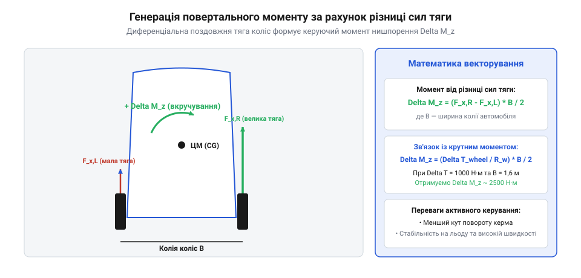
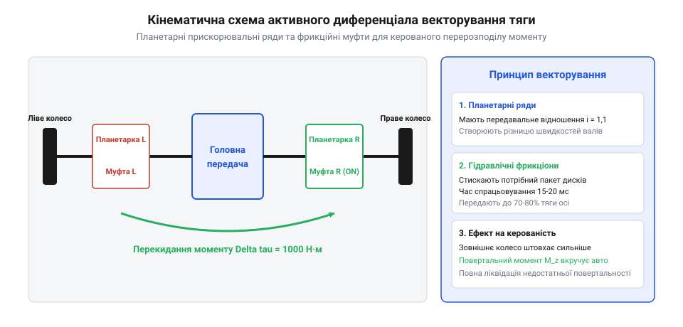
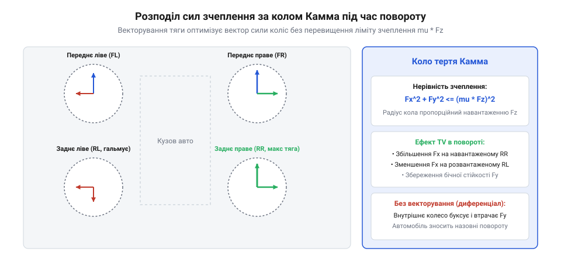

# Векторизація крутного моменту

## Проблема керованості мобільних платформ на високій швидкості

Під час руху багатоколісних робототехнічних комплексів та швидкісних безпілотних шасі на швидкостях понад 5–10 м/с проста кінематична модель повороту Аккермана перестає відповідати дійсності. На високих швидкостях виникають суттєві бічні сили інерції, які змушують еластичні пневматичні або поліуретанові шини деформуватися в зоні контакту з опорною поверхнею. Виникає бічний кут відведення шини `α_slip` (@@en|tire slip angle@@) — кут між вектором швидкості колісного диска та напрямком фактичного переміщення плями контакту.



Згідно з напівемпіричною моделлю шини Пасейки (Pacejka Magic Formula), бічна сила зчеплення колеса `F_y` нелінійно залежить від кута відведення:

```
F_y(α) = D · sin(C · arctan(B · α - E · (B · α - arctan(B · α))))
```

При малих кутах відведення зв'язок є лінійним (`F_y ≈ C_α · α`), проте зі збільшенням кута наростання сили сповільнюється і досягає насичення при досягненні границі зчеплення за кулонівським тертям `F_y_max = μ · F_z`.

Наслідком насичення бічних сил є небезпечні відхилення курсової стійкості:
1. **Недостатня повертальність (снос передньої осі, @@en|understeer@@)**: кути відведення передніх коліс перевищують кути задніх (`α_front > α_rear`). Робот не вписується в траєкторію і випрямляє поворот назовні радіуса, втрачаючи реакцію на кермо.
2. **Надлишкова повертальність (занос задньої осі, @@en|oversteer@@)**: задні колеса втрачають бічне зчеплення раніше передніх (`α_rear > α_front`), створюючи дестабілізуючий обертальний момент, що призводить до неконтрольованого закручування (розвороту навколо вертикальної осі).

У традиційному шасі з механічним міжосьовим і міжколісним диференціалом кермовий привод передніх коліс виявляється безсилим у критичних режимах: поворот коліс лише збільшує кут відведення, заводячи шини в глибоке насичення з повним зривом у ковзання.

Експлуатація мобільних комплексів у реальних умовах неминуче стикається з проблемою нерівномірного зносу протектора та різниці тиску в шинах між бортами. Якщо висота протектора або жорсткість боковини лівих і правих коліс відрізняється лише на 10–15%, коефіцієнти моделі Пасейки зазнають істотного дрейфу:
- Кутова жорсткість відведення зношеної шини `C_α = B · C · D` падає на 20–30%.
- Піковий коефіцієнт зчеплення `μ` зміщується в бік інших кутів ковзання.

У результаті при однаковому завданні кута повороту коліс шасі набуває паразитного моменту самовільного відведення вбік. Адаптивний контур Torque Vectoring виявляє цю асиметрію через розширений фільтр стану: контролер безперервно оцінює бічні сили кожної шини `F_y_i` та автоматично вводить постійне компенсуюче зміщення тяги бортів `ΔFx_trim`, відновлюючи нейтральну керованість без участі верхнього планувальника траєкторії.

Критичним фактором надійності цифрової системи керування є часова затримка та фазовий джитер у шині зв'язку CAN / CAN-FD між центральним контролером руху (VCU) та тяговими інверторами. Якщо період оновлення повідомлень становить `T_can = 10...20 мс`, фазове запізнення команди моменту на частоті нишпорення `f_yaw = 2...3 Гц` досягає:

```
φ_delay = 2 · π · f_yaw · T_can ≈ 15...25°
```

Така затримка суттєво зменшує фазовий запас стійкості замкненого контуру стабілізації. При спробі парирувати різкий занос на кризі запізніла подача стабілізуючого моменту потрапляє у фазу резонансного розгойдування («водійське / машинне розгойдування» @@en|controller-induced oscillation@@), посилюючи амплітуду заносу. Для ліквідації запізнення в сучасних приводах використовують протокол EtherCAT або переносять локальний контур стабілізації нишпорення безпосередньо в прошивку ведучого інвертора осі з часом квантування 1 мс.

### Лінійна двохколісна модель велосипеда та градієнт повертальності

Фундаментальний математичний опис бічної динаміки наземного колісного робота базується на класичній двохколісній моделі велосипеда Міллікена (Bicycle Model). Припускається, що шасі рухається в горизонтальній площині, а колеса кожного моста об'єднані в одне еквівалентне колесо по поздовжній осі симетрії.

Диференціальні рівняння плоского руху для кута знесення кузова `β` (Sideslip angle) та швидкості рискання `r = dψ/dt` (Yaw rate) записуються як:

```
m_veh · v_x · ( dβ/dt + r ) = F_yf + F_yr

I_z · dr/dt = a_front · F_yf - b_rear · F_yr + ΔM_z
```

де:
  `m_veh` = повна маса транспортного засобу [кг];
  `I_z` = момент інерції платформи відносно вертикальної осі рискання Z [кг·м²];
  `v_x` = поздовжня швидкість руху [м/с];
  `a_front, b_rear` = відстані від центра мас до передньої та задньої осей відповідно [м];
  `F_yf, F_yr` = бічні сили взаємодії шин переднього та заднього мостів із дорогою [Н];
  `ΔM_z` = зовнішній керуючий момент нишпорення, створений векторизацією тяги [Н·м].

У лінійній області малих кутів бічного відведення (`α_slip <= 4°`) бічні сили пропорційні кутам знесення коліс: `F_yf = - C_alpha_f · α_f`, `F_yr = - C_alpha_r · α_r`, де `C_alpha` — коефіцієнт кутової жорсткості шини (Cornering Stiffness).

Характер поведінки шасі в повороті визначається безрозмірним градієнтом повертальності (Understeer Gradient) `K_us`:

```
          m_veh       b_rear            a_front
K_us = ----------- · [ ------------- - ------------- ]
        L_base²        C_alpha_f         C_alpha_r
```

1. **Недостатня повертальність (`K_us > 0`)**: Машина стабільна на будь-яких швидкостях. Зі збільшенням швидкості радіус траєкторії зростає, робот розпрямляє поворот, вимагаючи більшого кута повороту керма;
2. **Нейтральна повертальність (`K_us = 0`)**: Кут керма для утримання фіксованого радіуса не залежить від швидкості руху;
3. **Надлишкова повертальність (`K_us < 0`)**: Зі зростанням швидкості задній міст зносить сильніше за передній. Існує критична швидкість зносу:
   ```
   v_crit = sqrt( L_base / ( - K_us ) )
   ```
   При досягненні `v_crit` система стає лінійно нестійкою: будь-яке випадкове збурення викликає незворотне розкручування машини навколо вертикальної осі (Spin-Out / занос) із перевертанням набік. Векторизація тяги `ΔM_z` дозволяє синтезувати віртуальний позитивний градієнт `K_us_virtual > 0`, роблячи будь-яке динамічно нестійке шасі абсолютно стабільним на довільних швидкостях.

### Фазова площина рискання та область притягання стійкості (Basin of Attraction)

Для дослідження глобальної динамічної стійкості шасі при екстремальних маневрах використовують фазовий аналіз на площині «кут знесення кузова `β` — швидкість знесення `dβ/dt`» або «кут знесення `β` — швидкість рискання `r`».

Нелінійна система диференціальних рівнянь руху має три особливі точки (положення рівноваги):
1. **Стійкий фокус (Stable Focus) у початку координат**. Відповідає стабільному прямолінійному або криволінійному руху з помірними кутами ковзання;
2. **Два сідлові нестабільні вузли (Unstable Saddles) на периферії**. Визначають критичні пороги зчеплення шин заднього та переднього мостів.

Сепаратриси (криві переходу), що проходять через ці сідлові точки, формують замкнену межу — область притягання (Basin of Attraction). Якщо під дією зовнішнього збурення (наїзд на крижану пляму під час обгону, різкий бічний порив вітру) фазова траєкторія стану робота виходить за межі сепаратриси:

```
| β(t) | > β_boundary( r(t), v_x, μ_road )
```

траєкторія стає дивергентною. Без зовнішнього втручання колеса повністю втрачають бічне зчеплення, кут знесення стрімко зростає до 90 градусів, і машина виходить з-під контролю водія чи автопілота.

Векторизація тяги діє як фазовий коректор: активний момент `ΔM_z` змінює топологію фазового портрета, зміщуючи сепаратриси в бік більших кутів та деформуючи фазові траєкторії таким чином, що вони закручуються назад до початку координат навіть при вихідних кутах знесення `β > 15...20°`.

## Фізика формування керуючого моменту нишпорення

Векторизація тяги (Torque Vectoring, @@en|torque vectoring@@) вирішує кризу керованості шляхом активного й незалежного розподілу поздовжніх тягових або гальмівних сил між правими та лівими колесами шасі. Якщо ліве та праве колесо осі розвивають різні поздовжні сили `F_x_left` та `F_x_right`, результуюча пара сил створює безпосередній керований момент нишпорення (кускання) навколо вертикальної осі робота:



```
                      / B_track ΔM_z = (F_x_right - F_x_left) · | ------- |
                      \    2    /

де:
  ΔM_z    = компенсуючий або допоміжний момент нишпорення [Н·м]
  F_x     = поздовжня сила тяги чи гальмування відповідного борта [Н]
  B_track = колія шасі (поперечна відстань між колесами) [м]
```

Фізична сутність концепції прямого керування моментом нишпорення (DYC, @@en|direct yaw control@@) полягає в тому, що стабілізуючий момент `ΔM_z` прикладається до рами робота миттєво, без очікування розвитку бічних сил відведення шин. Більше того, робота підпорядковується правилу кола зчеплення Камма (@@en|Kamm's friction circle@@):

```
F_x² + F_y² ≤ (μ · F_z)²
```

Коли внутрішнє колесо повороту підгальмовується, його поздовжня сила стає від'ємною (`-F_x`), а зовнішнє колесо довантажується додатною силою (`+F_x`). Завдяки цьому:
- При недостатній повертальності система генерує додатковий вкручуючий момент `ΔM_z`, що спрямовує ніс машини всередину кривизни без надлишкового кута повороту керма.
- При виникненні заносу вектор тяги миттєво змінює знак, створюючи протидіючий момент і парируючи занос ще до того, як кутова швидкість нишпорення `r = dψ/dt` вийде за межі стабільності фазового портрета руху.

### Нелінійна магічна формула Пасейки (Pacejka Magic Formula) та коло Камма

При динамічному проходженні віражів на межі зчеплення лінійна модель шини перестає діяти. Бічна сила `F_y` підпорядковується емпіричному закону Ганса Пасейки (MF-Tyre):

```
F_y(α) = D_tire · sin( C_tire · arctan( B_tire · α_slip - E_tire · [ B_tire · α_slip - arctan(B_tire · α_slip) ] ) )
```

де:
  `D_tire = μ_peak · F_z` — пікова сила зчеплення за даного вертикального навантаження `F_z`;
  `C_tire` — фактор форми кривої (Shape factor, для бічної сили `C ≈ 1.30`);
  `B_tire` — фактор жорсткості (Stiffness factor);
  `E_tire` — фактор кривизни (Curvature factor).

Коли до колеса одночасно прикладається як бічна сила `F_y`, так і поздовжня сила тяги або гальмування `F_x`, сумарне зусилля обмежене еліпсом зчеплення (колом тертя Камма @@en|Kamm's friction circle@@):

```
( F_x / F_x_max )² + ( F_y / F_y_max )² <= 1
```

де `F_x_max = μ_x · F_z`, `F_y_max = μ_y · F_z`.

Критичним фізичним явищем є дегресивність коефіцієнта тертя гуми від вертикального навантаження: зі зростанням нормальної сили `F_z` питомий коефіцієнт зчеплення `μ` не залишається постійним, а монотонно падає:

```
μ(F_z) = μ_0 - k_load · F_z
```

Під час повороту під дією відцентрової сили `m · v² / R` кузов нахиляється, перерозподіляючи вагу на зовнішні колеса (`F_z_outer > F_z_inner`). Через дегресивність тертя приріст бічної сили на навантаженому зовнішньому колесі виявляється меншим за втрату сили на розвантаженому внутрішньому колесі. Сумарна бічна несуча здатність моста падає.

Векторизація тяги усуває цей дефіцит: збільшуючи тяговий момент на зовнішньому колесі та пригальмовуючи внутрішнє, система створює активну пару сил `ΔF_x = F_x_right - F_x_left`, яка формує прямий повертальний момент навколо центру мас безпосередньо через поздовжні сили, розвантажуючи бокові кромки шин від небезпечного перевантаження.

### Ідентифікація шин на стенді «плаский трек» (MTS Flat-Trac)

Точність роботи математичних моделей шини Пасейки безпосередньо залежить від якості метрологічного калібрування коефіцієнтів. У автомобільній інженерії параметри визначають на спеціалізованих стендах типу «плаский трек» (Flat-Trac Tire Testing System).

Колесо з випробувальною шиною притискається заданим нормальним навантаженням `F_z = 2...12 кН` до безперервної сталевої стрічки з абразивним покриттям типу «корунд», що імітує дорожній асфальт і рухається зі швидкістю до 250 км/год.

Стенд оснащений шестикомпонентним тензометричним динамометром у маточині, який одночасно вимірює:
- Поздовжню силу `F_x` та бічну силу `F_y`;
- Нормальну силу реакції `F_z`;
- Перекидаючий момент `M_x`, момент опору коченню `M_y` та самовирівнювальний момент шини (Self-Aligning Torque) `M_z`.

Під час тестування кут відведення `α_slip` неперервно коливається в діапазоні від -15° до +15°, а кутова швидкість обертання колеса модулюється для створення поздовжнього ковзання від повного блокування (`s_x = -1.0`) до 100% пробуксовування (`s_x = +1.0`). Отримані масиви експериментальних точок апроксимуються нелінійним методом найменших квадратів (Левенберга–Марквардта), формуючи паспортні коефіцієнти моделі шини для бортового комп'ютера шасі.

## Електромеханічні топології реалізації

Для практичного генерування асиметричних поздовжніх сил тяги на лівому та правому бортах застосовують дві головні апаратні архітектури:

1. **Індивідуальні тягові електроприводи (мотор-колеса або бортові редуктори)**. Найбільш гнучка та швидкодіюча схема, характерна для багатоколісних робототехнічних комплексів та платформ 4WD/6WD. Кожне колесо або борт з'єднується з власним синхронним електродвигуном із постійними магнітами (PMSM). Керування струмами моторів виконується незалежними векторними частотними інверторами (FOC). Час реакції контуру крутного моменту становить 1–3 мс, що дозволяє реалізувати будь-який закон розподілу моментів без механічних муфт.
2. **Активні диференціали з керованим підкручуванням (Active Yaw Control / Active Differential)**. Застосовуються в гібридних або важких шасі зі спільним потужним двигуном. Механічний диференціал доповнюється двома планетарними рядами прискорення/сповільнення півосей та фрикційними муфтами або допоміжним серводвигуном підкручування (steering motor). Регулюючи натяг муфти, система примусово перекидає до 70–90% тягового моменту на одне з коліс, створюючи різницю моментів `ΔM_z`.

```
Схема індивідуального бортового привода (4-моторна схема):
 [Мотор FL] ======= (Переднє ліве)     (Переднє праве) ======= [Мотор FR]
       ▲                                                              ▲
       |                                                              |
   [Інвертор FL] <--- CAN / EtherCAT керування моментів ---> [Інвертор FR]
       |                                                              |
       ▼                                                              ▼
 [Мотор RL] ======= (Заднє ліве)         (Заднє праве) ======= [Мотор RR]
```

Індивідуальні мотори мають вирішальну енергетичну перевагу: під час швидкісного проходження віражу внутрішнє колесо переводиться в режим рекуперативного генераторного гальмування, повертаючи кінетичну енергію в батарею або безпосередньо живлячи зовнішній прискорений мотор через спільну шину постійного струму (DC-link).

Аналіз енергетичної ефективності передачі потужності між бортами через спільну шину DC-Link при рекуперативному проходженні поворотів підтверджує значну перевагу над фрикційними диференціалами з керованим тертям муфт. У фрикційному активному диференціалі момент нишпорення створюється за рахунок проковзування дисків зчеплення, де вся енергія різниці швидкостей півосей безповоротно розсіюється у вигляді тепла в трансмісійній оливі, нагріваючи міст до 120–150 °C.

В електричній архітектурі Torque Vectoring електричні машини працюють як реверсивні перетворювачі енергії. Сумарний ККД циклу міжбортової передачі енергії `η_inter_wheel` виражається як добуток ефективностей двох інверторів і моторів:

```
η_inter_wheel = η_inverter_gen · η_motor_gen · η_motor_drive · η_inverter_drive ≈ 0.96 · 0.93 · 0.93 · 0.96 ≈ 0.80 (80%!)
```

До 80% кінетичної енергії гальмування внутрішнього колеса повертається у корисну механічну тягу зовнішнього колеса, перетворюючи систему стабілізації на активний динамічний рекуператор.

Оцінка кута ковзання (бокового відведення) кузова `β_slip` (Side-Slip Angle) є центральним завданням надійної роботи контуру, оскільки пряме вимірювання `β` оптичними сенсорами швидкості руху землі коштує надто дорого і не працює в пилу та багнюці. Контролер застосовує розширений фільтр Калмана (EKF), що об'єднує кінематичні рівняння руху з динамічною моделлю шин:

```
d β / dt = (r) - [ F_y_front + F_y_rear ] / (m · v_x)

де:
  r           = виміряна гіроскопом кутова швидкість нишпорення [рад/с]
  F_y         = бічні сили шин, оцінені за моделлю Пасейки [Н]
  m           = маса платформи [кг]
  v_x         = поздовжня швидкість руху шасі [м/с]
```

Оцінене значення `β_slip` разом із його похідною формує фазову площину керованості (β - dβ/dt Phase Plane), на якій алгоритм виявляє загрозу втрати курсової стійкості за 50–100 мс до фактичного зриву коліс у некерований занос.

### Архітектура чотиримоторного незалежного привода (I-4WD)

Найвищу динамічну ефективність та глибину регулювання моменту забезпечує топологія з чотирма незалежними мотор-колесами або незалежними бортовими електроприводами (Individual All-Wheel Drive — I-4WD).

У такій схемі кожне з 4 коліс з'єднане з власним синхронним тяговим двигуном на постійних магнітах (PMSM) через локальний компактний планетарний редуктор. Механічні диференціали, кардани та міжосьові роздавальні коробки повністю відсутні.

Переваги топології I-4WD для автономних робототехнічних комплексів:
1. **Екстремальна швидкодія контуру моменту**. Час відгуку сучасного силового інвертора на основі карбіду кремнію (SiC MOSFET) на зміну завдання крутного моменту становить `t_response = 2...5 мс` (порівняно з 80–120 мс у гідравлічних гальмівних клапанів ESP). Це дозволяє придушувати зародження мікрозаносів ще до того, як кузов встигне повернутися на частку градуса;
2. **Чотириквадрантне керування енергією**. Кожне колесо може незалежно працювати в тяговому або генераторному режимі. В одному віражі зовнішнє переднє колесо може розганятися на `+ 400 Н·м`, а внутрішнє заднє — гальмувати на `- 400 Н·м`, генеруючи колосальний стабілізуючий момент без зміни середньої поздовжньої швидкості машини;
3. **Функція розвороту на місці (Tank Turn / Crab Walk)**. За рахунок обертання лівого та правого бортів у зустрічних напрямках колісний робот може обертатися навколо свого геометричного центра мас або рухатися боком під кутом при наявності поворотних цапф.

## Алгоритмічний контур стабілізації

Система керування векторизацією тяги базується на двокаскадній архітектурі: верхній рівень оцінює бажаний динамічний стан машини, а нижній розподіляє зусилля за алгоритмом Control Allocation.

Опорною динамічною базою верхнього рівня слугує двоколісна модель руху («велосипедна модель» @@en|bicycle model of vehicle dynamics@@) з двома ступенями вільності (2DOF): бічною швидкістю `v_y` та кутовою швидкістю нишпорення `r = dψ/dt`. Бажана кутова швидкість нишпорення `r_des` розраховується з поточного кута повороту коліс `δ` та поздовжньої швидкості `v_x`:

```
                    v_x
r_des = ----------------------------- · δ
          L_base · [1 + K_us · v_x²]

де:
  L_base = колісна база машини [м]
  K_us   = градієнт недостатньої повертальності (Understeer Gradient) [с²/м²]
  δ      = фактичний кут повороту передніх коліс [рад]
```

Значення `r_des` обов'язково обмежується фізичною межею зчеплення за коефіцієнтом тертя: `|r_des| ≤ (μ · g) / v_x`.

Помилка стеження за нишпоренням `e_r = r_des - r_sensor` подається на пропорційно-диференціальний або ковзний регулятор (SMC, @@en|sliding mode control@@), який обчислює величину коригувального моменту `ΔM_z_cmd`:

```
ΔM_z_cmd = K_p_yaw · (r_des - r_sensor) + K_d_yaw · (d r_des / dt - d r_sensor / dt)
```

На нижньому рівні розрахунковий момент `ΔM_z_cmd` разом із сумарним запитом сили тяги `F_x_total` транслюється в індивідуальні моменти коліс шляхом мінімізації квадратичного критерію використання коефіцієнта зчеплення кожної шини:

```
min ∑ [ (F_xi² + F_yi²) / (μ · F_zi)² ]
```

Це запобігає зриву окремого колеса в буксування та гарантує нейтральну керованість шасі на льоду, снігу та вологому асфальті.



### Оптимізаційний розподіл керуючих зусиль методом квадратичного програмування (QP)

У сучасних контролерах руху векторизація тяги будується за дворівневою схемою:
1. **Верхній рівень (Motion Controller)**. Розраховує сумарну поздовжню тягову силу `F_x_total` та необхідний коригувальний момент нишпорення `ΔM_z_req` за допомогою ковзного режиму (Sliding Mode Control — SMC) або H-нескінченного робастного регулятора;
2. **Нижній рівень (Control Allocation — CA)**. Здійснює оптимальний розподіл узагальнених сил між 4 індивідуальними колесами.

Задача керування формулюється як мінімізація зваженої квадратичної функції вартості (Constrained Quadratic Programming — QP):

```
min J_qp = 0.5 · u^T · W_u · u + 0.5 · ( B_alloc · u - v_des )^T · W_v · ( B_alloc · u - v_des )
```

де вектор керуючих сил коліс `u = [ F_x_fl, F_x_fr, F_x_rl, F_x_rr ]^T`, а матриця конфігурації розподілу `B_alloc` пов'язує сили коліс із вектором бажаного руху `v_des = [ F_x_total, ΔM_z_req ]^T`:

```
          | 1             1            1            1           |
B_alloc = |                                                     |
          | - B_track / 2  B_track / 2 - B_track / 2  B_track / 2 |
```

Оптимізація здійснюється за умови дотримання суворих фізичних обмежень:
- Максимальний крутний момент та потужність приводів: `- T_max / R_w <= F_x_i <= T_max / R_w`;
- Обмеження кола зчеплення Камма для кожного колеса:
  ```
  F_x_i² <= ( μ_i · F_z_i )² - F_y_i²
  ```

Швидкодіючі вбудовані алгоритми розв'язання QP (Active Set Method або операторне розщеплення ADMM) знаходять глобальний оптимум на мікроконтролері з ядром ARM Cortex-M7 за час менше 0.5 мс, гарантуючи повне використання потенціалу зчеплення всіх чотирьох шин.

### Синтез регулятора ковзного режиму (Sliding Mode Controller) за методом Ляпунова

Для гарантування абсолютної робастності контуру стабілізації руху до невизначеності маси робота та невідомого тертя дороги застосовують регулятор ковзного режиму (Sliding Mode Control — SMC).

Поверхню ковзання `S_surf` синтезують як лінійну комбінацію похибок швидкості рискання та кута знесення:

```
S_surf(t) = ( r_meas - r_des ) + λ_smc · ( β_meas - β_des )
```

де `λ_smc > 0` — ваговий коефіцієнт відносної пріоритетності кута знесення.

Функцію Ляпунова обирають у стандартному додатно визначеному квадратичному вигляді:

```
V_lyap = 0.5 · S_surf²
```

Умова асимптотичної стійкості вимагає, щоб похідна функції Ляпунова за часом була строго від'ємною:

```
dV_lyap/dt = S_surf · ( dS_surf/dt ) <= - η_smc · | S_surf |
```

Підставляючи диференціальні рівняння руху шасі, отримуємо аналітичний закон формування необхідного коригувального моменту векторизації тяги:

```
ΔM_z_cmd = I_z · [ dr_des/dt - λ_smc · (dβ_meas/dt - dβ_des/dt) - (a_front · F_yf - b_rear · F_yr) / I_z ] - K_switch · sat( S_surf / ε_boundary )
```

де функція насичення `sat(S / ε_boundary)` усуває високочастотне перемикання силових транзисторів (явище базікання @@en|chattering effect@@) всередині вузького примежового шару шириною `ε_boundary`. Такий регулятор гарантує збіжність помилки траєкторії до нуля за скінченний час навіть при раптовому виїзді колеса на крижану пляму або розриві шини.

### Енергетична ефективність векторизації тяги проти фрикційного гальмування ESP

Традиційні системи динамічної стабілізації ESP генерують стабілізуючий момент виключно за рахунок пригальмовування коліс гідравлічними дисковими гальмами. При цьому кінетична енергія машини безповоротно перетворюється на тепло: робот сповільнюється, а диски розігріваються до 400–600 °C.

На противагу цьому, електромеханічна векторизація тяги в архітектурі I-4WD перенаправляє енергію в межах спільної шини живлення постійного струму (DC-link). Електромотор на пригальмовуваному внутрішньому борту переходить у генераторний режим (рекуперативне гальмування), виробляючи електричну потужність:

```
P_regen = η_inv · η_motor · T_regen · ω_wheel
```

Цей струм безпосередньо надходить на інвертор протилежного зовнішнього борта, підживлюючи тяговий мотор. Батарея покриває лише невелику різницю втрат на ККД перетворення:

```
P_battery_net = P_drive / ( η_inv · η_motor ) - P_regen
```

Енергетичний ККД маневру зростає з 0% (у системі ESP) до 75–85%. Автономний робот зберігає швидкість проходження повороту, не витрачає ресурс гальмівних колодок і збільшує загальний запас ходу на одному заряді акумулятора на 12–18% в умовах активного міського маневрування.

## Інженерна інтеграція та енергетичний баланс

Впровадження систем активної векторизації тяги в архітектуру автономних наземних комплексів вимагає узгодження механічних обмежень зчеплення шин, енергетичного балансу батареї та надійності сенсорної мережі:

1. **Динамічний контроль конуса зчеплення шин**. Алгоритм векторизації не може нескінченно збільшувати поздовжні сили `F_x`, оскільки це призводить до зриву колеса в повну пробуксовку і катастрофічного обнулення бічної сили `F_y`. Контролер реалізує жорстке обмеження тяги за еліпсом зчеплення Камма:
   ```
   F_x_limit = sqrt( max[0, (μ · F_z)² - F_y_est²] )
   ```
   Якщо сенсори фіксують зростання бічного прискорення (високе `F_y`), ліміт поздовжньої сили автоматично знижується, гарантуючи утримання колеса на траєкторії.
2. **Енергетичний баланс та рекуперація при векторизації**. У традиційних системах стабілізації курсової стійкості (ESP) момент нишпорення створюється гідравлічним пригальмовуванням відповідного колеса, при якому вся кінетична енергія безповоротно розсіюється в гальмівних дисках у вигляді тепла. В електричному приводі Torque Vectoring внутрішнє колесо генерує гальмівний момент у режимі генератора, повертаючи струм у бортову мережу:
   ```
   P_net = P_drive_outer - η_regen · P_brake_inner
   ```
   Завдяки спільній шині постійного струму до 60–80% потужності гальмування внутрішнього борту безпосередньо передається на живлення зовнішнього прискореного борту, практично не розряджаючи тягову батарею під час динамічного маневрування на серпантинах.
3. **Отказобезпечність і резервування (Fail-safe architecture)**. Раптова відмова одного з тягових інверторів або обрив фази мотора на швидкості може згенерувати неконтрольований паразитний момент нишпорення, здатний миттєво викинути робота з траси. Система безпеки включає:
   - Апаратні швидкодіючі контактори короткого замикання обмоток (динамічне гальмування) або розмикання фаз за час `< 1 мс`.
   - Автоматичну переконфігурацію матриці розподілу сил Control Allocation: при виході з ладу привода одного колеса навантаження миттєво перерозподіляється між трьома іншими справними рушіями.
4. **Вимоги до сенсорної бази**: для стабільної роботи контуру необхідний 6-осьовий інерційний вимірювальний модуль (IMU) промислового класу з низьким дрейфом гіроскопів (`bias drift < 0.5 °/год`) та висока частота опитування оптичних або магнітних енкодерів коліс (не менше 1000 Гц).

Діаграма потоків потужності в силовому контурі при рекуперативній векторизації тяги наочно ілюструє високу енергетичну досконалість 4-моторної платформи. Під час проходження швидкісного крутого віражу:

```
      [ Тягова акумуляторна батарея 400–800 В ]
                         │
              P_batt_net = P_out - P_in
                         ▼
        [ Спільна шина живлення DC-Link ]
         │                              ▲
         │ Прямий струм живлення         │ Рекуперативний струм
         ▼                              │
  [ Інвертор зовнішнього борту ]   [ Інвертор внутрішнього борту ]
         │                              ▲
         ▼                              │
  ( Мотор FL / RL: ТЯГА )        ( Мотор FR / RR: ГАЛЬМУВАННЯ )
   P_mech_out = +15 кВт           P_mech_in = -8 кВт
```

У той час як інвертор зовнішнього колеса споживає електричну потужність `P_elec_outer = P_mech / η_motor ≈ 16.5 кВт`, інвертор внутрішнього колеса, що створює стабілізуючий момент гальмуванням, генерує струм `P_elec_inner = P_brake · η_gen ≈ 6.8 кВт`.

Завдяки спільній шині DC-Link вироблена енергія миттєво перетікає на зовнішній бік без проходження хімічного циклу заряду-розряду акумулятора, який має власний ККД і теплові втрати. Нетто-споживання від батареї становить лише `P_net = 16.5 - 6.8 = 9.7 кВт` замість повних 16.5 кВт, що збільшує запас автономного ходу швидкісного робота на 20–30% при активному маневруванні.

### Розширений фільтр Калмана (EKF) для оцінки кута знесення та тертя дороги

Надійна робота алгоритмів векторизації тяги вимагає точного знання реального кута знесення кузова `β` та коефіцієнта зчеплення з дорогою `μ_road`. Оскільки встановлення оптичних датчиків швидкості типу Correvit на серійні машини є економічно недоцільним через високу вартість і крихкість, застосовують спостерігачі стану на основі розширеного фільтра Калмана (Extended Kalman Filter — EKF).

Вектор стану системи фільтрації обирається у вигляді:

```
x_state = [ v_x, v_y, r, μ_fl, μ_fr, μ_rl, μ_rr ]^T
```

Вимірювальними входами EKF є:
- Сигнали від триосьового акселерометра (`a_x, a_y`) та гіроскопа швидкості рискання `r` вбудованого IMU;
- Датчики кутових швидкостей кожного колеса (WSS);
- Датчик кута повороту керма `δ_steer`.

На кожному кроці дискретизації `Δt = 1 мс` фільтр здійснює лінеаризацію нелінійної моделі руху через матриці Якобі:

```
x_k|k-1 = f_model( x_k-1|k-1, u_k-1 )
P_k|k-1 = F_jacobian · P_k-1|k-1 · F_jacobian^T + Q_noise

K_kalman = P_k|k-1 · H_jacobian^T · [ H_jacobian · P_k|k-1 · H_jacobian^T + R_noise ]^(-1)
x_k|k = x_k|k-1 + K_kalman · [ z_meas - h_obs( x_k|k-1 ) ]
```

Оцінений кут знесення `β = arctan( v_y / v_x )` використовується в контурі зворотного зв'язку. Якщо `|β|` починає перевищувати критичний поріг стійкості (`|β| > 5...8°`), алгоритм контролю моментально активує протиповоротний стабілізуючий момент, запобігаючи неконтрольованому обертанню машини на слизькій або обледенілій трасі.

### Практичний інженерний розрахунок: маневр ухилення лосиний тест

Розглянемо параметри роботи системи векторизації тяги автономного робота-доставщика спорядженою масою `m_veh = 800 кг` (`I_z = 650 кг·м²`, ширина колії `B_track = 1.3 м`) при виконанні екстреного об'їзду раптової перешкоди (маневр «подвійна переставка» / «лосиний тест») на швидкості `v_x = 72 км/год` (20 м/с):
- Поперечне прискорення досягає піка `a_y = 7.5 м/с²`;
- Кут повороту керма `δ_steer = 0.12 рад`;
- Розрахункова бажана швидкість рискання за моделлю велосипеда: `r_des = 0.35 рад/с`.

У момент зриву задньої осі фактична швидкість рискання зростає до `r_meas = 0.55 рад/с`, а швидкість наростання кута знесення `dβ/dt = 0.20 рад/с`.

Необхідний стабілізуючий антирискальний момент становить:
```
ΔM_z_req = - K_r · ( r_meas - r_des ) - K_beta · β = - 4500 · (0.55 - 0.35) - 3000 · (0.08) = - 900 - 240 = - 1140 Н·м
```

Для реалізації моменту `ΔM_z = - 1140 Н·м` через задню вісь пара сил на колесах повинна становити:
```
ΔF_x_rear = ( 2 · |ΔM_z_req| ) / B_track = ( 2 · 1140 ) / 1.3 ≈ 1754 Н
```

Бортовий контролер прикладає гальмівне зусилля `F_x_outer = - 877 Н` на зовнішнє колесо та тягове зусилля `F_x_inner = + 877 Н` на внутрішнє колесо. За радіуса колеса `R_wheel = 0.28 м` диференціал крутних моментів на моторах становить:
```
ΔT_motors = ΔF_x_rear · R_wheel = 1754 · 0.28 ≈ 491 Н·м
```

Завдяки миттєвому формуванню цього моменту за 8 мс машина миттєво гасить кутову швидкість заносу `dr/dt < 0` і повертається на розрахункову смугу руху без перекидання та знесення з дороги, тоді як аналогічна машина з відкритим пасивним диференціалом зазнає повного розвороту на 180 градусів із вильотом у кювет.

### Функціональна безпека за ISO 26262 (ASIL-D) та детерміновані шини даних

Оскільки система векторизації тяги має прямий вплив на керуючий рух машини і здатна генерувати зусилля, що перевищують фізичні можливості водія чи пасивних механізмів, вона підпадає під найвищий рівень функціональної безпеки — ASIL-D (Automotive Safety Integrity Level D) за міжнародним стандартом ISO 26262.

Апаратна та програмна архітектура системи повинна гарантувати:
1. **Відмовостійкість (Fail-Operational / Fail-Safe)**. При виході з ладу одного з інверторів або датчика положення ротора резольвера система повинна виявити аномалію за час менше `t_fault = 10 мс` (Fault Detection and Reaction Time — FDRT). Контролер автоматично реконфігурує матрицю керування `B_alloc`, відключаючи пошкоджене колесо та перерозподіляючи момент на три справні приводи, щоб уникнути раптового неконтрольованого ривка керма;
2. **Детерміновані комунікаційні протоколи**. Обмін даними між центральним процесором руху (Vehicle Dynamics Controller) та індивідуальними колісними інверторами здійснюється через резервовані шини CAN-FD (з арбітражем пріоритетів і швидкістю до 5 Мбіт/с) або промисловий Ethernet із часовим поділом каналів (Time-Sensitive Networking — TSN / IEEE 802.1Qbv). Джитер доставки повідомлень не перевищує 50 мікросекунд, що унеможливлює фазові затримки в контурі зворотного зв'язку.
