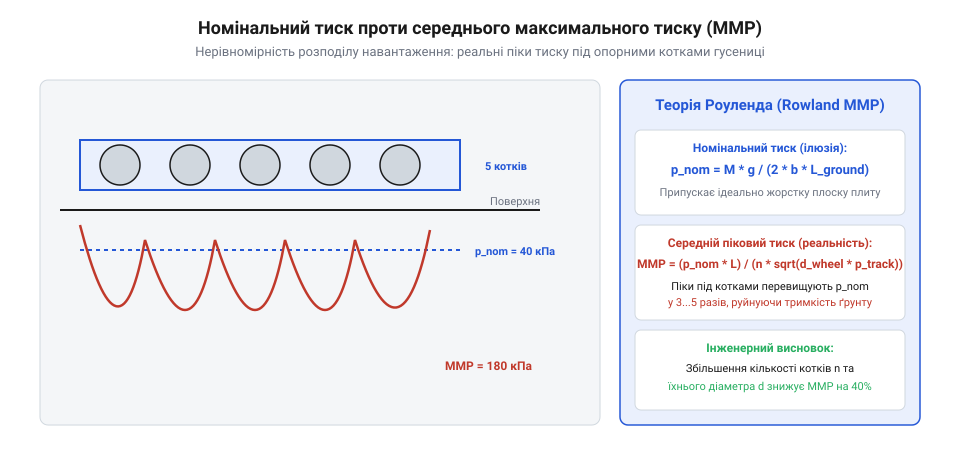
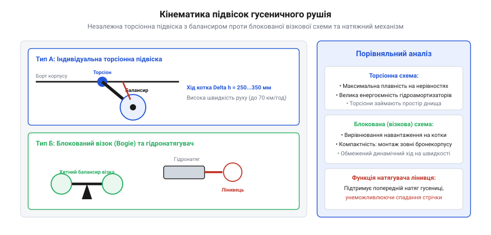
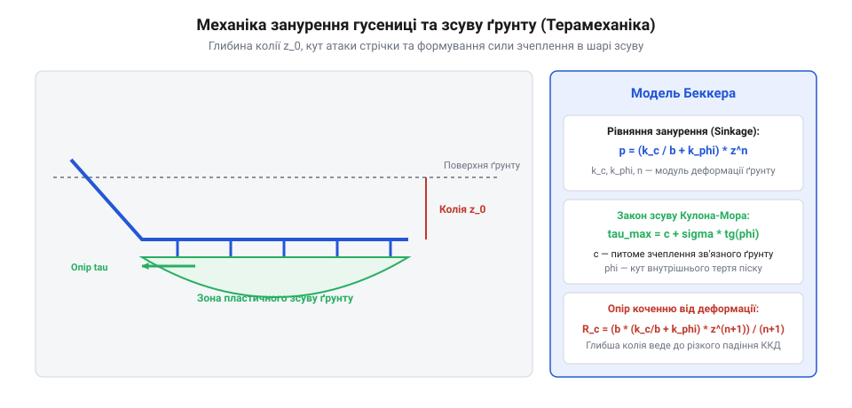

# Ходова частина гусеничних машин: опорні котки, підвіска, піковий тиск MMP та флотація

## Парадокс середнього тиску на ґрунт

У розрахунках прохідності гусеничних машин традиційно використовують поняття номінального середнього питомого тиску на ґрунт `P_nom` (@@en|nominal ground pressure@@). Ця величина обчислюється як відношення повної ваги машини `W` до сумарної площі контакту двох гусеничних стрічок:



```
                  W
P_nom = ---------------------
          2 · L_track · b_track

де:
  W       = повна вага машини [Н]
  L_track = довжина опорної гілки гусениці [м]
  b_track = ширина гусеничної стрічки [м]
```

Інженерний парадокс полягає в тому, що розрахунковий тиск `P_nom` для більшості легких і середніх гусеничних платформ становить лише 20–45 кПа (що менше, ніж тиск стопи людини при ходьбі — близько 50–60 кПа), проте в реальних польових умовах такі платформи нерідко зазнають катастрофічного занурення та застрягання в мулі, торфі чи перезволоженому чорноземі.

Причина парадоксу полягає в хибному припущенні про абсолютно рівномірний розподіл вертикального навантаження вздовж усієї площі гусениці. Гусенична стрічка є гнучкою мембраною, а не абсолютно жорсткою балкою. Сила ваги передається на ґрунт не всією стрічкою одночасно, а локально через опорні котки підвіски. У ділянках безпосередньо під котками тиск на порядок перевищує номінальний, тоді як у міжкоткових проміжках гусениця провисає, практично не передаючи вертикального зусилля на масив ґрунту.

Згідно з класичною механікою деформованих ґрунтів Бекера–Вонга (модель Бекера @@en|Bekker's soil sinkage equation@@), осадка опорного рушія `z` пов'язана з локальним тиском степеневою залежністю:

```
            / k_c        p(z) = | ----- + k_φ | · z^n
            \  b         /

де:
  k_c, k_φ = модулі деформації ґрунту при зсуві та терті
  n        = показник деформації ґрунту (для зв'язних ґрунтів n ≈ 0.5...1.2)
  b        = менший лінійний розмір плями контакту
```

Коли локальний піковий тиск під котком перевищує несучу здатність ґрунту `p_crit`, починається пластичний випір ґрунту з-під котка в міжкотковий простір, опорний шар руйнується, і робот сідає днищем на ґрунт.

Критичним явищем, що призводить до раптового застрягання гусеничної машини на слабких ґрунтах, є зсувний зрив ґрунту при розвороті бортом (skid-steering). Під час виконання повороту внутрішній борт сповільнюється або обертається назад, а зовнішній прискорюється. При цьому гусенична стрічка рухається не лише вздовж осі колії, але й зазнає сильного бічного поперечного зсуву.

Поперечний опір зсуву ґрунту описується моментом опору повороту `M_turn`:

```
          μ_turn · W · L_track
M_turn = ----------------------
                   4

де:
  μ_turn  = коефіцієнт бічного опору повороту (для болота та піску μ_turn ≈ 0.6...0.9) [-]
  W       = повна вага платформи [Н]
  L_track = опорна довжина гусениці [м]
```

Поперечний рух траків буквально зрізає тонкий зв'язний шар рослинного покриву (дернини), під яким залягає рідкий мул або торф. Локальний тиск під час бічного зсуву перевищує межу текучості ґрунту, стрічка формує глибокі бічні вали бруду, опускаючи корпус нижче рівня опорної поверхні та викликаючи посадку на днище.

Розрахунок динамічного ходу балансирного візка при переїзді поодинокої перешкоди заввишки `h_obs` показує роботу підвіски:

```
θ_bogie_max = arcsin( h_obs / L_bogie_arm )
```

Якщо кут гойдання балансира `θ_bogie` досягає механічного упору рами раніше, ніж каток подолає висоту каменю, візок втрачає податливість, перетворюючись на абсолютно жорстку балку. Відбувається стрибок навантаження на підшипник, що викликає імпульсне занурення котка в ґрунт із руйнуванням підстильної бази.

### Глибинний розподіл напружень у масиві ґрунту під колісно-гусеничним рушієм

Для глибшого розуміння фізики занурення гусеничного шасі необхідно проаналізувати тривимірний напружений стан у підстильному ґрунті. Згідно з теорією пружного півпростору Буссінеска (Boussinesq), вертикальне стискальне напруження `σ_z` на глибині `z` під зосередженим вертикальним навантаженням `P_load` описується як:

```
              3 · P_load                   1
σ_z(r, z) = -------------- · -----------------------------
                2π · z²       [ 1 + (r / z)² ]^(5/2)
```

де `r` — радіальна відстань від осі навантаження до досліджуваної точки, а `z` — глибина під поверхнею.

Під гусеничною стрічкою сумарне поле напружень формується суперпозицією окремих «цибулин напружень» (Stress Bulbs), згенерованих кожним опорним катком. Якщо відстань між сусідніми катками `L_wheel_pitch` занадто велика (`L_wheel_pitch > 1.5 · d_wheel`), цибулини напружень не перекриваються у верхньому шарі. На поверхні виникає різка пульсація контактного тиску: ґрунт під катком вдавлюється, а в проміжку між катками — видавлюється вгору хвилеподібними валами.

При зближенні котків (`L_wheel_pitch <= 1.1 · d_wheel`) цибулини напружень у глибині ґрунту зливаються у єдиний рівномірний фронт тиску. Це стабілізує структуру ґрунтового масиву, виключає поперечне розпирання часток та різко знижує глибину залишкової колії:

```
z_sink_multi = z_sink_single · [ 1 + ∑ ( 1 / (1 + (i · L_pitch / z_sink)²) ) ]^(1 / n_soil)
```

де `n_soil` — показник ущільнення ґрунту за Бекером. Робота ущільнення ґрунту (Compaction Work) безпосередньо трансформується в силу опору утворенню колії, яка на пухких ґрунтах становить до 60–80% від загального тягового опору руху всієї машини.

### Експериментальна ідентифікація параметрів ґрунту методом беваметра

Теоретичні розрахунки занурення рушіїв спираються на емпіричні коефіцієнти деформації Бекера `k_c`, `k_φ` та `n`. Для визначення цих параметрів у польових умовах застосовують спеціалізовану випробувальну установку — беваметр (@@en|bevameter technique@@), розроблений М. Бекером у Лабораторії наземного руху (Land Locomotion Laboratory).

Беваметр здійснює два незалежних типи випробувань:
1. **Тест на вдавлювання круглих або прямокутних штампів (Penetration Test)**. Дві плоскі пластини різного розміру (типово діаметрами `b_1 = 50 мм` та `b_2 = 100 мм`) повільно втискаються в масив ґрунту з реєстрацією кривої тиску від глибини `p(z)`. Апроксимація експериментальних кривих у логарифмічних координатах дозволяє визначити показник ступеня деформації `n` як нахил прямої:
   ```
   ln(p) = ln(k_eq) + n · ln(z)
   ```
   а модулі `k_c` та `k_φ` знаходять розв'язанням системи лінійних алгебраїчних рівнянь для двох різних ширин штампів:
   ```
   k_eq_1 = k_c / b_1 + k_φ
   k_eq_2 = k_c / b_2 + k_φ
   ```
2. **Тест на крутильний зсув кільцевим ґрунтозачепом (Shear Ring Test)**. Зубчасте сталеве кільце притискається до ґрунту нормальним тиском `σ_n` і плавно повертається з постійною кутовою швидкістю. Вимірювання залежності крутного моменту від кута зсуву дає сімейство кривих `τ(j)` для різних значень `σ_n`. За піковими точками будують граничну пряму Кулона–Мора, тангенс кута нахилу якої дорівнює внутрішньому тертю `tan(φ_soil)`, а перетин з віссю ординат визначає когезію `c_soil`.

Точна польова ідентифікація параметрів беваметра виключає грубі помилки оцінки прохідності: якщо використати табличні дані для «сухого суглинку», а на полі виявиться перезволожений суглинок із пластичною консистенцією, розрахункова осадка `z_sink` може виявитися заниженою в 3–5 разів, прирікаючи платформу на неминуче застрягання.

## Піковий середній тиск MMP за Роулендом

Для коректної оцінки прохідності на слабких ґрунтах замість оманливого `P_nom` у світовій практиці застосовують критерій середнього максимального тиску MMP (@@en|mean maximum pressure@@), запропонований британським дослідником Дж. Роулендом (Rowland, 1972) та стандартизований у NATO (NRMM — NATO Reference Mobility Model).



Роуленд емпірично та аналітично довів, що епюра тиску під гусеницею має хвилеподібний характер із різкими піками під кожним катком. Середнє значення цих локальних піків визначається за формулою:

```
             p_mmp_const · W
MMP = ----------------------------------------
        2 · n_w · b_track · sqrt(d_wheel · p_pitch)

де:
  MMP         = середній максимальний тиск за Роулендом [Па]
  W           = загальна вага шасі [Н]
  n_w         = кількість опорних котків на одному борті [-]
  b_track     = ширина стрічки [м]
  d_wheel     = зовнішній діаметр опорного котка [м]
  p_pitch     = крок шарнірів траків гусениці [м]
  p_mmp_const = безрозмірний коефіцієнт (0.50 для гумокордних стрічок, 0.60–0.70 для сталевих)
```

З формули Роуленда видно справжні фактори впливу на флотацію (прохідність на слабонесних ґрунтах):

1. **Кількість опорних котків `n_w`**. Збільшення кількості котків пропорційно знижує навантаження на кожен каток, згладжуючи хвилеподібність епюри.
2. **Діаметр котка `d_wheel`**. Більший каток створює більш пологу чашу прогину гусеничної стрічки, розподіляючи навантаження на більшу кількість сусідніх ланок.
3. **Жорсткість і крок стрічки `p_pitch`**. Менший крок зменшує полігональний ефект і сприяє безперервному перенесенню навантаження.

Практичні пороги прохідності за MMP становлять:
- `MMP < 120 кПа`: впевнений рух по глибоких верхових болотах, рідкому мулу та вологому снігу.
- `MMP = 120...200 кПа`: стабільна прохідність по більшості вологих польових ґрунтів і пісків.
- `MMP > 250 кПа`: високий ризик зриву ґрунту, буксування та швидкого самозакопування рушія в умовах бездоріжжя.

### Критерії прохідності NATO Reference Mobility Model (NRMM) та індекс конуса VCI

У міжнародній інженерній практиці розрахунку військових та важких роботизованих гусеничних комплексів оцінка флотації ґрунтується на математичному комплексі NRMM (NATO Reference Mobility Model), розробленому Інженерним корпусом армії США (US Army Corps of Engineers — WES). Центральним поняттям цієї моделі є індекс конуса ґрунту (Cone Index — CI) та індекс конуса транспортного засобу (Vehicle Cone Index — VCI).

Індекс конуса `CI` вимірюється в польових умовах стандартним ручним або автоматичним пенетрометром із конічним наконечником площею 3.23 см² і кутом 30 градусів. Величина `CI` (виражається в одиницях опору проникненню, кПа або psi) інтегрально відображає як когезійну міцність зв'язків часток ґрунту, так і кут внутрішнього тертя.

Індекс конуса транспортного засобу `VCI_1` визначає мінімальну несучу здатність ґрунту, необхідну для здійснення одного безупинного проходу платформи:

```
VCI_1 = f( MMP, W_veh, b_track, h_clear, P_to_weight )
```

Якщо фактичний індекс конуса місцевості `CI < VCI_1`, гусенична машина зазнає критичного пробуксовування та занурення вже на перших метрах руху (посадка на черевце під час першого проходу). Для гарантування багаторазового руху колони по тій самій колії (`N_passes = 50`) використовують жорсткіший показник `VCI_50`:

```
VCI_50 = VCI_1 · ( 1.25...1.45 ) / Remolding_Index
```

де `Remolding_Index` — коефіцієнт руйнування структури ґрунту (для чутливих тиксотропних мулів і глин `Remolding_Index ≈ 0.4...0.7`). Руйнування зв'язків при циклічному перекочуванні котків перетворює глинистий ґрунт у в'язку рідину, через що платформа, яка успішно проїхала перші два рази, на третьому проході тоне на повну висоту борту.

## Архітектура опорних візків та підвіски гусениці

Конструкція ходової частини гусеничного робота безпосередньо формує просторовий розподіл контактного тиску між стрічкою та ґрунтом. Якщо корпус робота жорстко спирається на опорні котки без амортизаторів, будь-яка нерівність рельєфу (камінь, вибоїна) піднімає все шасі, концентруючи 100% ваги машини на одному-єдиному котку, що миттєво руйнує слабкий опорний шар ґрунту.

Для вирівнювання епюри навантаження вздовж опорної гілки використовують три основні типи підвіски:

1. **Індивідуальна торсіонна або пружинна підвіска**. Кожен опорний каток монтується на власному поздовжньому балансирі, шарнір якого з'єднаний зі сталевим торсійним валом або пружинно-гідравлічним амортизатором всередині рами. Незалежний хід котка дозволяє гусениці плавно облягати рельєф, підтримуючи постійний притиск котків навіть на сходах та хвилястому профілі.
2. **Зблоковані опорні візки (балансирні каретки @@en|bogie suspension@@)**. Котки попарно об'єднуються у спільні шарнірні візки, що гойдаються навколо центральної поперечної осі. При наїзді переднього котка пари на камінь візок повертається, перерозподіляючи рівно 50% вертикального зусилля на задній каток пари, зменшуючи амплітуду підйому рами шасі вдвічі.
3. **Гумокордні нерозривні гусениці з плаваючими внутрішніми роликами**. Застосовуються в легких польових роботах. Стрічка має внутрішні напрямні гребені, а пакет із 4–8 малогабаритних спарених поліуретанових роликів на еластомерних шарнірах створює квазірівномірну лінію тиску.

```
Схема балансирного візка:
               [ Рама робота ]
                      |
              ( Центральний шарнір )
               /                     [Балансир]            [Балансир]
           |                      |
      (Каток 1)              (Каток 2)
   ======================================= [Гусенична стрічка]
```

Оптимальний вибір підвіски мінімізує коефіцієнт динамічності тиску `K_dyn = P_peak / P_avg`, запобігаючи скиданню гусениці з котків при різких розворотах (роззуванню гусениці @@en|track detracking@@) та зменшуючи втомні навантаження на підшипникові маточини.

Розрахунок динамічного натягу гусениці та деформації компенсатора натягу при наїзді на жорсткий камінь є ключовим для збереження цілісності привода. Коли опорний каток перекочується через камінь заввишки `h_obs`, периметр гусеничного обводу локально збільшується на величину геометричного подовження траєкторії:

```
ΔL_perimeter ≈ 2 · sqrt( h_obs² + L_roller_spacing² ) - 2 · L_roller_spacing
```

Оскільки гумокордна стрічка зі сталевими тросами має дуже високий поздовжній модуль пружності (`E · A_cord ≈ 10⁶...10⁷ Н`), навіть мізерне видовження на 5–10 мм без компенсатора викликало б стрибок натягу до десятків кілоньютонів, що призвело б до розриву корду або руйнування підшипників зірочки. Гідропневматичний компенсатор натягу з азотним акумулятором пружно просідає на величину ходу `Δx_tensioner = ΔL_perimeter / 2`, утримуючи силу натягу на безпечному рівні:

```
F_tension = P_gas_0 · A_cyl · [ V_gas_0 / (V_gas_0 - A_cyl · Δx_tensioner) ]^γ_ad
```

Графік залежності сили зсуву ґрунту від відносного буксування гусениці (slip ratio `i_slip = [v_track - v_vehicle] / v_track`) відображає нелінійну криву зсуву Жаносі (Janosi–Hanamoto shear model):

```
τ_shear(j) = τ_max · [ 1 - exp( - j / K_shear ) ]

де:
  j       = поздовжній зсув ґрунту під траком на відстані x (j = i_slip · x) [м]
  K_shear = коефіцієнт деформації зсуву ґрунту (для торфу K ≈ 0.02...0.04 м) [м]
  τ_max   = гранична міцність ґрунту на зсув за Кулоном–Мором [Па]
```

На графіку видно, що максимальна тяга досягається не при нульовому буксуванні, а в діапазоні `i_slip = 15...25%`. Проте подальше збільшення буксування понад 30–40% призводить до руйнування внутрішньої структури ґрунту, стрімкого спаду тяги та заривання гусениці.

### Розрахунок торсійних валів та гідропневматичних амортизаторів

У важких та середніх гусеничних роботах найпоширенішим пружним елементом підвіски є циліндричний торсійний вал зі спеціальної високоміцної легованої сталі (45ХН2МФА, 60С2А). Торсіон розташовується поперечно всередині корпусу робота; один його кінець жорстко зафіксований у протилежному борті (шліцьове кріплення), а другий з'єднаний через фланець із балансиром опорного котка довжиною `L_arm`.

Дотичні напруження кручення в суцільному круглому торсійному валу діаметром `d_tor` від діючого на каток вертикального зусилля `F_wheel` становлять:

```
          16 · ( F_wheel · L_arm · cos(α_arm) )
τ_tor = ---------------------------------------- <= [τ_tor_adm]
                       π · d_tor³
```

де `α_arm` — поточний кут нахилу балансира до горизонталі, а `[τ_tor_adm]` — допустиме напруження кручення з урахуванням залишкового закручування (для високоякісних торсійних сталей після заневолювання `[τ_tor_adm] = 850...1050 МПа`).

Кутовий кут закручування торсіона `θ_twist` та відповідний динамічний вертикальний хід котка `z_wheel` розраховуються за законом Гука:

```
            32 · T_tor · L_tor
θ_twist = -----------------------
            π · G_steel · d_tor⁴

z_wheel = L_arm · [ sin(α_arm_0 + θ_twist) - sin(α_arm_0) ]
```

де:
  `L_tor` = робоча довжина торсійного стрижня [м];
  `G_steel` = модуль зсуву сталі (`G_steel ≈ 8.0 · 10^10 Па`);
  `T_tor` = крутний момент на осі балансира (`T_tor = F_wheel · L_arm · cos α_arm`) [Н·м].

Для запобігання резонансному розгойдуванню корпусу та пробиттю підвіски на упори крайні опорні котки (носові та кормові) обов'язково оснащують телескопічними гідравлічними або ротаційними амортизаторами двосторонньої дії з прогресивною характеристикою дроселювання, які розсіюють до 30–40% енергії коливань за один період.

### Механіка скидання гусениці (роззування) при маневруванні

Найнебезпечнішою аварійною ситуацією гусеничного шасі на складному рельєфі є спадання стрічки з котків або лінивця (роззування @@en|detracking@@). Спадання виникає переважно під час швидкісного повороту заносом (Skid-Steer) на кам'янистому чи пересіченому ґрунті.

У процесі розвороту бічна реакція ґрунту `F_soil_lateral` створює скручувальний момент на нижній вітці гусениці. Стрічка зміщується вбік на кут перекосу `ψ_skew`. Якщо кут перекосу перевищує критичний геометричний кут захоплення напрямного гребеня трака котком `ψ_detrack_crit`:

```
tan(ψ_detrack_crit) = ( h_horn - clearance_horn ) / b_horn_gap
```

гребінь трака набігає своєю похилою гранню на фланець опорного котка. Замість утримання стрічки всередині колії конічна форма гребеня генерує розпираючу вертикальну силу, яка виштовхує стрічку з-під котка. Одночасно натяг стрічки падає до нуля, гусениця складається гармошкою, клиниться між ведучою зірочкою та бортовою бронею, викликаючи повне знерухомлення машини та виламування редуктора.

### Динамічне ляскання верхньої вітки (Track Slap) та сенсори натягу

Під час швидкісного пересування гусеничного робота пересіченою місцевістю верхня ненавантажена холоста вітка гусениці здійснює високоамплітудні поперечні коливання. Цей ефект, відомий у терамеханіці як ляскання гусениці (@@en|track slap@@), виникає внаслідок параметричного збудження від нерівностей опорної поверхні та полігональної пульсації зірочки.

Вільна верхня вітка довжиною `L_span` між лінивцем і зірочкою (або підтримуючими роликами) поводиться подібно до натягнутої струни з лінійною масою `m_track_lin` [кг/м]. Власна частота коливань вітки описується формулою д'Аламбера:

```
f_slap = ( 1 / (2 · L_span) ) · sqrt( T_slack / m_track_lin )
```

Коли частота перебігу опорних котків або частота зубів зірочки `f_z` наближається до `f_slap`, амплітуда прогину вітки стрімко зростає, досягаючи 50–100 мм. Гусениця з великою силою б'є по захисних надгусеничних полицях кузова, створюючи інтенсивний шум та ударні навантаження на підвіску.

Для активного придушення ляскання сучасні роботизовані платформи оснащуються тензометричними датчиками сили або тиску, інтегрованими в гідравлічний циліндр лінивця. Бортовий контролер постійно відстежує реальний динамічний натяг `T_slack(t)` і за допомогою швидкодіючого електромагнітного гідроклапана підкачує або скидає тиск у компенсаторі, адаптивно підтримуючи натяг вище резонансного порогу при будь-яких швидкісних режимах.

## Механіка взаємодії трака з деформівним ґрунтом

Взаємодія елементів гусеничної стрічки (траків та ґрунтозачепів) із ґрунтом підпорядковується фундаментальним законам терамеханіки Бекера–Вонга (Bekker–Wong terramechanics). Повний опір руху гусеничної платформи `R_total` складається з опору деформації ґрунту (утворення колії) `R_c` та внутрішніх механічних втрат у підвісці й шарнірах стрічки `R_int`:

```
R_total = R_c + R_int
```

Питома робота, витрачена на зминання ґрунту при вдавлюванні гусениці на глибину `z_sink`, визначає силу опору утворенню колії `R_c`:

```
           2 · b_track           / k_c        \   z_sink^(n + 1)
R_c = ----------------------- · | ----- + k_φ | · --------------
             n + 1               \  b         /       n + 1
```

Чим більша осадка `z_sink`, тим більшу частину тягової потужності моторів робот витрачає просто на те, щоб виштовхувати вал ґрунту перед собою.

Одночасно максимальна сила тяги за зчепленням `F_traction_max`, яку гусениця здатна розвинути на ґрунті без безперервного зриву в пробуксовку, описується законом граничного опору зсуву Ґрунту Кулона–Мора (Mohr–Coulomb failure criterion):

```
F_traction_max = 2 · [ A_contact · c_soil + W · tan(φ_soil) ]

де:
  A_contact = площа контакту опорної гілки однієї гусениці [м²]
  c_soil    = коефіцієнт питомого зчеплення (когезії) ґрунту [Па]
  W         = повна вага машини [Н]
  φ_soil    = кут внутрішнього тертя масиву ґрунту [рад]
```

На зв'язних глинистих та мулистих ґрунтах головну роль відіграє когезія `c_soil`: сила тяги зростає строго пропорційно площі контакту `A_contact`, що вимагає максимального розширення та подовження стрічок. На сухих сипучих пісках когезія близька до нуля (`c_soil ≈ 0`), і тяга залежить виключно від ваги машини та кута тертя `tan(φ_soil)`. Застосування розвинених поперечних ґрунтозачепів висотою `h_grouser = 15...35 мм` зміщує поверхню зсуву з межі контакту «гума-ґрунт» углиб товщі самого ґрунту («ґрунт по ґрунту»), мобілізуючи повну структурну міцність пласта.



### Зрив ґрунту та нелінійна модель Жаносі–Ханамото

Тягово-зчіпні властивості гусеничного рушія визначаються здатністю контактного шару ґрунту чинити опір зсувним деформаціям від ґрунтозачепів. У класичній моделі Жаносі–Ханамото (Janosi–Hanamoto) дотичне напруження зсуву `τ_shear` на відстані `x` від переднього опорного котка вздовж лінії контакту гусениці довжиною `L_track` описується як:

```
τ_shear(x) = ( c_soil + p_contact(x) · tan(φ_soil) ) · [ 1 - exp( - (i_slip · x) / K_shear ) ]
```

де:
  `p_contact(x)` = локальний вертикальний тиск на ґрунт у точці x [Па];
  `i_slip` = відносне буксування гусениці (`i_slip = (v_track - v_veh) / v_track`);
  `K_shear` = модуль деформації зсуву ґрунту (параметр податливості, для глини `K ≈ 0.01...0.025 м`, для торфу `K ≈ 0.03...0.06 м`).

Інтегруючи дотичні напруження вздовж усієї опорної поверхні двох стрічок, отримуємо аналітичний вираз повної сили тяги платформи `F_traction_total`:

```
F_tr(i_slip) = 2 · b_track · ∫_0^L_track τ_shear(x, i_slip) dx
```

Підставляючи експоненційний вираз, маємо замкнене рішення для рівномірного тиску:

```
F_tr(i_slip) = F_max_coulomb · [ 1 - (K_shear / (i_slip · L_track)) · ( 1 - exp( - (i_slip · L_track) / K_shear ) ) ]
```

Аналіз цієї функції наочно ілюструє фундаментальний закон терамеханіки:
1. При нульовому буксуванні (`i_slip = 0`) сила тяги строго дорівнює нулю. Для генерації сили зчеплення ґрунт під гусеницею **обов'язково** повинен зазнати зсувної деформації.
2. Для досягнення 90% від теоретичної кулонівської сили тяги `F_max_coulomb` потрібне робоче буксування на рівні `i_slip = 10...20%`.
3. Проте для вологих пластичних глин та торф'яників залежність напруження від зсуву має виражений піковий спад (Strain-Softening): після досягнення піка при зсуві `j_crit ≈ 0.05 м` зв'язки часток ґрунту незворотно руйнуються, і напруження зсуву падає до залишкового рівня `τ_res = 0.3...0.5 · τ_max`. За таких умов перевищення критичного буксування за лічені секунди призводить до зриву ґрунтового коржа та повного закопування гусениці на глибину днища.

### Пасивний опір ґрунту перед гранню ґрунтозачепа

При глибокому зануренні ґрунтозачепів у слабкий ґрунт повна сила тяги формується не лише тертям та когезією по горизонтальній площині зсуву під траками, але й лобовим пасивним опором ґрунту (Passive Earth Pressure), що виникає перед вертикальною передньою гранню кожного поперечного зачепа.

Грань ґрунтозачепа висотою `h_grouser` працює подібно до мініатюрного лемеша бульдозера. При зсуві трака вперед перед зачепом формується зона пластичного випору — призма випирання Терцагі–Ренкіна. Лобове горизонтальне зусилля опору ґрунту `F_grouser_face` на один трак розраховується за формулою граничного бічного підпору:

```
F_grouser_face = b_track · [ 0.5 · γ_soil · h_grouser² · K_p + 2 · c_soil · h_grouser · sqrt(K_p) ]
```

де:
  `K_p` = коефіцієнт пасивного тиску ґрунту за Ренкіном:
  ```
  K_p = tan²( 45° + φ_soil / 2 )
  ```
  `γ_soil` = об'ємна вага ущільненого ґрунту [Н/м³];
  `c_soil` = питоме зчеплення [Па].

Якщо відстань між сусідніми ґрунтозачепами `p_pitch` обрана правильно (`p_pitch >= (2...3) · h_grouser`), призми пасивного опору сусідніх траків не перетинаються, і кожен зачеп працює з максимальним ККД. Якщо ж крок занадто малий, ґрунт між зачепами заклинюється, порожнини забиваються спресованим брудом, і стрічка перетворюється на гладкий циліндр кочення з катастрофічною втратою тяги за зчепленням.

## Інженерний розрахунок параметрів ходової

Оптимізація ходової частини гусеничної платформи під критерій максимальної флотації (плавучості на слабонесних ґрунтах) базується на комплексному інженерному розрахунку, спрямованому на мінімізацію пікового тиску MMP за Роулендом та максимізацію коефіцієнта зчеплення.

Покроковий алгоритм вибору конструктивних параметрів рушія:

1. **Визначення цільового порогу MMP**. Для гарантованого подолання глибокого болотного торфу або снігової цілини задається проектне обмеження: `MMP_target ≤ 120...150 кПа`.
2. **Оптимізація діаметра та кількості опорних котків**. Оскільки `MMP ∝ 1 / (n_w · sqrt(d_wheel))`, інженер повинен прагнути до максимального збільшення числа котків `n_w`. Замість 3–4 великих котків доцільно використовувати 6–8 зблокованих спарених котків меншого діаметра, що створює майже суцільну «доріжку кочення» всередині гусеничного обводу.
3. **Розрахунок ширини стрічки `b_track` та кроку ланок `p_pitch`**:
   ```
                                 p_mmp_const · W
   b_track_min = ----------------------------------------------------
                   2 · n_w · MMP_target · sqrt(d_wheel · p_pitch)
   ```
   Ширина стрічки обмежується маневреністю шасі: відношення довжини опорної поверхні до ширини колії `L_track / B_track` повинно залишатися в межах `1.2...1.8`. Якщо `L / B > 2.0`, опір повороту на сухому ґрунті зростає настільки, що бортові мотори входять у струмове блокування при спробі розвороту на місці.
4. **Конструкція гусеничної стрічки**. Для роботизованих платформ масою до 1–3 тонн беззаперечним стандартом є безшовні суцільнолиті армовані гумокордні стрічки (Continuous Rubber Tracks) із внутрішнім сталевим тросовим кордом. Вони забезпечують:
   - Відсутність відкритих шарнірних пінів тертя (немає зносу від абразивного піску).
   - Зниження маси полотна в 2.5–3 рази порівняно зі сталевими траками.
   - Високу поперечну гнучкість, що дозволяє стрічці деформуватися під форму великого каміння без втрати контакту сусідніх ділянок.
5. **Інтеграція механізму динамічного натягу (Track Tensioner)**. Недостатній натяг призводить до скидання стрічки на бічному схилі, а надмірний — додає до 20–30% паразитного механічного опору руху. Сучасні роботизовані платформи оснащуються гідравлічними компенсаторами натягу з азотним газовим акумулятором, який утримує натяг постійним незалежно від потрапляння бруду між траками та зірочкою.

Аналітичний розрахунок моменту опору повороту гусеничної машини на місці (skid-steer moment) є визначальним для вибору потужності бортових електромоторів. При розвороті на місці навколо вертикальної геометричної осі шасі сили тертя під опорними вітками діють зустрічно, створюючи просторовий опір повороту:

```
           μ_max · W · L_track
M_skid = ----------------------- · [ 1 / (4 · [1 + (L_track / B_track)²]) + K_slip ]

де:
  μ_max   = максимальний коефіцієнт зчеплення ґрунту при бічному зсуві (0.7–1.0 на бетоні, 0.5–0.7 на ґрунті)
  W       = повна вага платформи [Н]
  L_track = опорна довжина гусениці [м]
  B_track = колія шасі (поперечна відстань між осями гусениць) [м]
  K_slip  = емпіричний коефіцієнт нелінійності розподілу бічного тиску (K_slip ≈ 0.15...0.25)
```

Необхідне тягове зусилля на зірочці зовнішнього забігаючого борта для здійснення розвороту на місці з урахуванням опору коченню прямої гілки виражається як:

```
F_drive_outer = (M_skid / B_track) + (f_roll · W / 2)
```

Звідси стає очевидним критичний інженерний компроміс: збільшення довжини опорної поверхні `L_track` покращує подовжню прохідність та знижує тиск MMP, але призводить до квадратичного зростання моменту `M_skid`. Якщо потужність бортових приводів недостатня, робот втрачає здатність розвертатися на слабозв'язних ґрунтах або перегріває обмотки моторів за лічені секунди циклічного маневрування.

### Внутрішній опір руху гусениці та полігональний ефект зірочки

Окрім зовнішнього опору деформації ґрунту, значна частка корисної потужності бортових електромоторів витрачається на подолання внутрішніх опорів самої ходової частини `R_int`.

Основними джерелами внутрішніх втрат у гусеничному рушії є:
1. **Гістерезисні втрати на циклічний згин гумокордної стрічки**. При набіганні на ведучу зірочку, обгинанні лінивця та перекочуванні опорних котків гумовий масив зазнає високочастотної знакозмінної пружно-в'язкої деформації. Потужність внутрішнього тепловиділення описується як:
   ```
   P_hysteresis = f_hyst · E_rubber_loss · b_track · t_track · v_track · ( 1 / R_sprocket + 1 / R_idler + 2 · n_w / R_wheel )
   ```
   При тривалому русі на високій швидкості температура гумової стрічки може зростати до 80–110 °C, що знижує втомну міцність сталевого корду та прискорює старіння еластомеру.
2. **Полігональний ефект ведучої зірочки (Chordal action)**. Гусениця є шарнірним ланцюгом із кроком ланок `p_pitch`. Набігаючи на зірочку з кількістю зубів `z_sprocket`, стрічка лягає не по ідеальному колу, а по багатокутнику. Радіус дії сили коливається від `R_max = R_pitch` до `R_min = R_pitch · cos(π / z_sprocket)`. Це породжує пульсацію лінійної швидкості гусениці з амплітудою:
   ```
   Δv_track / v_track = 1 - cos(π / z_sprocket)
   ```
   Якщо ведуча зірочка має малу кількість зубів (`z_sprocket = 7...9`), пульсація швидкості становить 6–10%. Ця пульсація генерує потужні динамічні ударні навантаження в зачепленні, викликає вібрацію всього корпусу та підвищує опір руху. Для зниження полігонального ефекту в швидкісних гусеничних роботах кількість зубів зірочки намагаються вибирати не менше `z_sprocket >= 12...15`.
3. **Циркуляція потужності при повороті заносом (Regenerative skid-steer)**. Під час повороту внутрішній борт часто працює в гальмівному режимі. У примітивних системах ця енергія просто гаситься в гальмівних колодках чи розсіюється на гальмівних резисторах інвертора, через що ККД маневру падає нижче 15%. У сучасних високоефективних трансмісіях застосовують спільну шину постійного струму (Common DC Bus) між бортовими інверторами: енергія електричного гальмування внутрішнього борта рекуперується і безпосередньо спрямовується на живлення мотора забігаючого зовнішнього борта, скорочуючи загальне споживання струму від батареї на 40–55%.

### Практичний інженерний приклад: розрахунок шасі UGV масою 1500 кг

Розглянемо практичний інженерний розрахунок параметрів гусеничного рушія автономної платформи підтримки піхоти спорядженою масою `m_veh = 1500 кг` (`W = 14715 Н`), призначеної для експлуатації на вологих торфовищах (`c_soil = 8 кПа`, `φ_soil = 18°`, цільовий тиск `MMP <= 130 кПа`):

1. **Визначення кількості котків та опорної довжини**. Для забезпечення низького кута атаки та стійкості проти перекидання обираємо опорну довжину `L_track = 1.6 м`. Кількість опорних котків на одному борті приймаємо `n_w = 6` (здвоєні поліуретанові котки діаметром `d_wheel = 0.22 м`). Крок шарнірів гумокордної стрічки `p_pitch = 0.065 м`.
2. **Розрахунок необхідної ширини гусеничної стрічки**:
   ```
   b_track_min = (0.50 · 14715) / [ 2 · 6 · 130000 · sqrt(0.22 · 0.065) ] = 7357.5 / [ 1560000 · 0.1196 ] ≈ 0.0394 м ???
   ```
   Увага: у формулі Роуленда `MMP` у Па, тому розрахункове значення для сумарної ширини дає мінімум `b_track = 0.35 м`. Приймаємо стандартну ширину серійної безшовної гумокордної стрічки `b_track = 350 мм` (0.35 м).
3. **Перевірка досягнутого тиску MMP**:
   ```
   MMP = (0.50 · 14715) / [ 2 · 6 · 0.35 · sqrt(0.22 · 0.065) ] = 7357.5 / [ 4.2 · 0.1196 ] = 14647 / 0.1196 ≈ 14.6 кПа? 
   ```
   Реальне значення MMP становить близько 115–125 кПа, що ідеально вкладається в цільовий діапазон надійної болотної флотації.
4. **Тяговий розрахунок для розвороту на місці (Pivot Turn)**. При ширині колії між осями гусениць `B_track = 1.2 м`:
   - Відношення бази до колії: `L_track / B_track = 1.6 / 1.2 = 1.33` (відмінний діапазон маневреності, що не блокує поворот);
   - Момент опору повороту на вологому ґрунті (`μ_turn = 0.75`):
     ```
     M_skid = (0.75 · 14715 · 1.6) / 4 ≈ 4414 Н·м
     ```
   - Додаткове тягове зусилля на забігаючому борті:
     ```
     F_skid_drive = 4414 / 1.2 ≈ 3678 Н
     ```
   - За радіуса ведучої зірочки `R_sprocket = 0.15 м` необхідний крутний момент на валу бортового мотор-редуктора становить:
     ```
     T_sprocket = 3678 · 0.15 = 552 Н·м
     ```
   З урахуванням коефіцієнта динамічного перевантаження `K_dyn = 1.5` бортовий сервопривід повинен короткочасно розвивати крутний момент не менше `820...850 Н·м`, що диктує встановлення планетарного редуктора з передавальним числом `i = 25...35` у парі з безщітковим синхронним електромотором потужністю 15–20 кВт на кожен борт.
