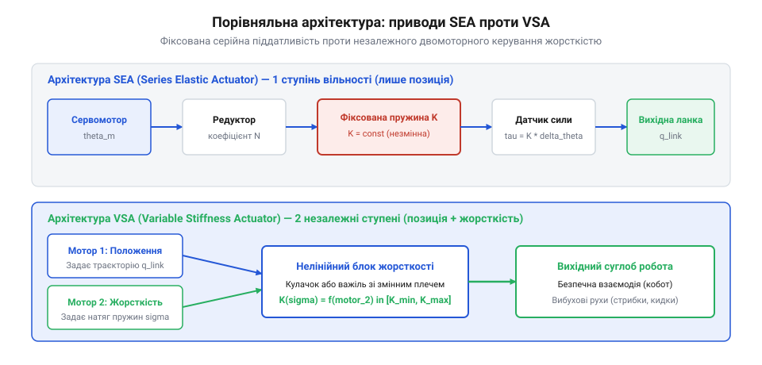
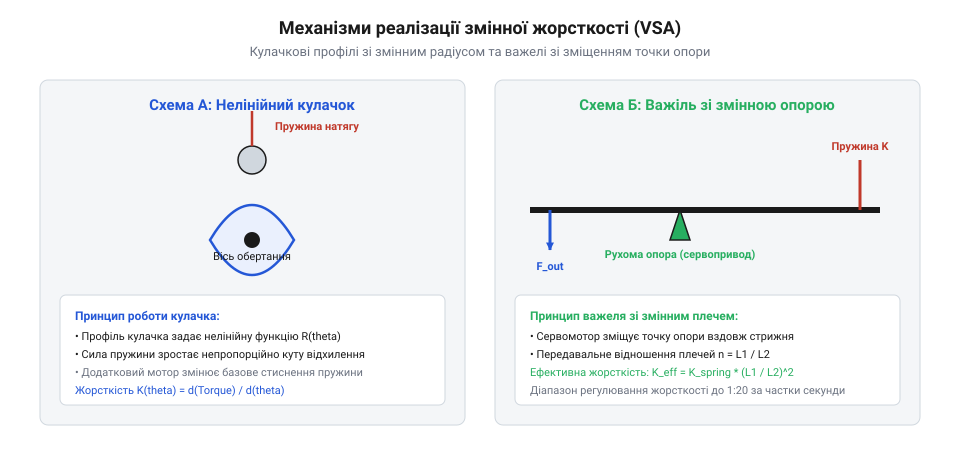
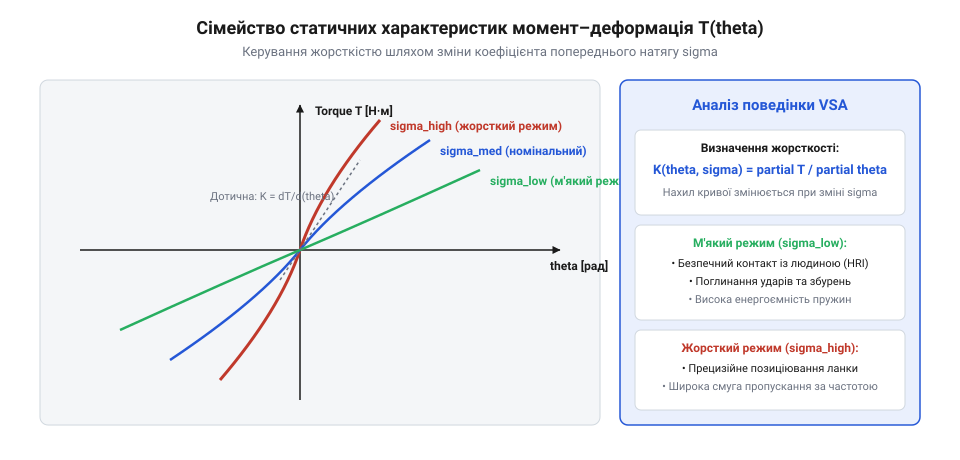

# Актуатор зі змінною жорсткістю (VSA)

## Обмеження приводів із фіксованою піддатливістю

Поява пружних сервоприводів серії SEA (Series Elastic Actuators, розроблені Праттом і Вільямсоном у 1995 р.) стала проривом у безпечній взаємодії роботів із людиною та захисті редукторів від ударних навантажень. У класичному приводі SEA між вихідним валом високоредукторного електродвигуна та рухомою ланкою маніпулятора встановлюється пружний елемент (сталева торсіонна або лінійна спіральна пружина) із постійною механічною жорсткістю `K_const`.



Однак експлуатація SEA виявила принциповий фундаментальний компроміс:

1. **Конфлікт між безпекою та швидкодією**. М'яка пружина (мале `K_const`) чудово амортизує випадкові зіткнення, виключає руйнування зубів редуктора при ударах кінцівки об тверду підлогу та забезпечує високу точність вимірювання зусилля за кутом закручування пружини `Δθ`. Проте за м'якої пружини пропускна здатність за позиційним керуванням падає до лічених герц (`f_bw ∝ sqrt(K / J_link)`). При спробі виконати швидкий різкий рух або стабілізувати платформу від зовнішніх вібрацій система потрапляє у власні коливання.
2. **Неможливість адаптації під задачу**. Жорстка пружина забезпечує високу точність позиціонування під навантаженням і широку смугу пропускання контуру положення, але практично втрачає захисні амортизаційні властивості. Контакт із жорстким середовищем викликає небезпечні пікові сили.
3. **Енергетична неефективність при зміні темпу локомоції**. У біоморфних крокуючих роботах резонансна частота ланки повинна підлаштовуватися під частоту кроку чи бігу для рекуперації кінетичної енергії фази коливання. У приводі SEA частота резонансу фіксована назавжди.

Аналітичний розрахунок похибки позиціонування шарніра з фіксованою піддатливістю (SEA) показує фундаментальне протиріччя між точністю та м'якістю. Під дією зовнішнього статичного моменту навантаження `τ_load` (наприклад, ваги вантажу в схоплювачі або опору ґрунту) пружний елемент неминуче закручується на кут:

```
Δθ_def = τ_load / K_const
```

Якщо коефіцієнт жорсткості обрано м'яким (`K_const = 50...100 Н·м/рад`) для забезпечення демпфування ударів, навантаження 10 Н·м породжує кутове відхилення на 0.1–0.2 рад (5.7–11.5°!). Для компенсації цього провисання контур позиційного регулювання змушений розкручувати мотор далеко вперед. Проте при динамічній зміні навантаження (зняття вантажу, відрив ноги від підлоги) накопичена пружна деформація вивільняється, породжуючи різкий відскок ланки з тривалими затухаючими коливаннями.

Довговічність та втомна витривалість пружинних блоків VSA є критичним фактором ресурсу привода. У процесі локомоції шарнір здійснює 1–2 циклу завантаження щосекунди, накопичуючи понад 10–20 мільйонів циклів знакозмінного скручування на рік. Пружини працюють у зоні високих циклічних дотичних напружень:

```
τ_torsion = (16 · T_max) / (π · d_wire³) · k_Wahl
```

де `k_Wahl` — коефіцієнт кривизни витка Вала. Для запобігання втомному зламу робочі напруження обмежують на рівні не більше 40–50% від границі плинності матеріалу, застосовують дробоструминне зміцнення поверхні витків та використовують спеціалізовані титанові сплави (Ti-6Al-4V) із надвисокою питомою пружною енергією деформації.

### Фундаментальний компроміс приводів SEA за Праттом та Вільямсоном

Приводи з послідовною пружністю (Series Elastic Actuator — SEA), винайдені Гіллермо Праттом та Метью Вільямсоном у Массачусетському технологічному інституті (MIT, 1995 р.), здійснили прорив у робототехніці, ввівши калібровану пружину між редуктором і навантаженням. Проте фіксована жорсткість пружини `k_s = const` накладає фундаментальні фізичні обмеження на характеристики шарніра:

1. **Смуга пропускання керування за положенням (Position Bandwidth)**:
   Власна механічна частота шарніра з інерцією вихідної ланки `J_link` становить `ω_n = sqrt(k_s / J_link)`. Якщо для безпеки взаємодії з людиною обрати м'яку пружину (`k_s = 50...100 Н·м/рад`), резонансна частота падає до 2–4 Гц. Контролер положення втрачає швидкодію, шарнір стає «желейним» і зазнає гігантських динамічних відставань траєкторії при спробі виконати швидкий маневр;
2. **Смуга пропускання за зусиллям (Force Bandwidth)**:
   При жорсткому контакті вихідної ланки з нерухомою стіною максимальна швидкість наростання сили обмежена максимальною швидкістю обертання двигуна `ω_mot_max`:
   ```
   ( dτ / dt )_max = k_s · ( ω_mot_max / N_gear )
   ```
   М'яка пружина призводить до повільного наростання крутного моменту, через що робот не здатний генерувати швидкі ударні імпульси;
3. **Енергетична неефективність при зміні темпу ходи**:
   У локомоції крокуючих роботів оптимальний ККД досягається, коли частота кроків точно збігається з власною резонансною частотою пружного шарніра ноги. Привід SEA з фіксованою жорсткістю може працювати в резонансі лише на одній фіксованій швидкості ходи. Будь-яке прискорення чи уповільнення кроку виводить систему з резонансу, змушуючи електромотор розсіювати до 70–80% енергії у вигляді тепла на подолання протифазних реакцій власної пружини.

Приводи зі змінною жорсткістю (Variable Stiffness Actuators — VSA) усувають цей компроміс: вони дозволяють незалежно і безперервно змінювати як положення рівноваги шарніра `θ_eq`, так і його тангенціальну механічну жорсткість `K_joint = ∂τ / ∂θ` безпосередньо під час руху.

### Порівняльна передатна функція SEA, PEA та VSA

Для системного аналізу динаміки піддатливих шарнірів порівняємо їхні передатні функції між крутним моментом мотора `T_mot` та кутовим прискоренням вихідної ланки `d²q/dt²`:

1. **Жорсткий класичний шарнір**:
   ```
   W_rigid(s) = q(s) / T_mot(s) = 1 / ( (J_mot · N_gear² + J_link) · s² + b_visc · s )
   ```
   Система має 2-й порядок без внутрішніх нулів. Будь-який зовнішній удар безпосередньо транслюється на зубці редуктора;
2. **Шарнір із паралельною пружністю (Parallel Elastic Actuator — PEA)**:
   Пружина встановлюється паралельно мотору, компенсуючи статичну силу ваги. Передатна функція:
   ```
   W_pea(s) = 1 / ( (J_mot · N_gear² + J_link) · s² + b_visc · s + k_parallel )
   ```
   Дозволяє зменшити середнє навантаження на мотор, проте не захищає редуктор від динамічних ударних піків;
3. **Шарнір із послідовною пружністю (SEA)**:
   Введення пружини створює динамічну систему 4-го порядку:
   ```
   W_sea(s) = q(s) / T_mot(s) = k_s / [ (J_mot · N_gear² · s² + k_s) · (J_link · s² + k_s) - k_s² ]
   ```
   На частоті антирезонансу `ω_anti = sqrt(k_s / J_link)` вхідний опір прямує до нескінченності: мотор не здатний передати енергію ланці;
4. **Шарнір зі змінною жорсткістю (VSA)**:
   Жорсткість `k_s(t)` стає функцією керуючого сигналу другого привода. Положення нулів та полюсів передатної функції можна динамічно переміщувати по комплексній площині, адаптуючи частотний відгук шарніра під миттєвий спектр зовнішніх збурень.

## Концепція змінної механічної жорсткості

Приводи зі змінною жорсткістю VSA (Variable Stiffness Actuator, @@en|variable stiffness actuator@@) долають цей компроміс за рахунок принципового розділення керування двома незалежними параметрами:
1. **Рівноважним кутовим положенням ланки `θ_eq`**.
2. **Фізичною механічною жорсткістю суглоба `K_joint = dτ / dθ`**.



Для незалежного регулювання цих величин привод VSA обов'язково оснащується двома окремими виконавчими двигунами. Існують дві домінуючі архітектури реалізації змінної жорсткості:

1. **Антагоністична схема (біоміметична аналогія двоголового та триголового м'язів)**. Два незалежні серводвигуни діють на один вихідний шків через нелінійні пружні тяги (пружини з прогресивною силовою характеристикою). Якщо обидва двигуни повертаються синхронно в один бік — змінюється позиція суглоба `θ_eq`. Якщо двигуни повертаються назустріч один одному — виникає попередній взаємний натяг пружин (коактивація @@en|co-activation@@). Завдяки нелінійності пружин кутова жорсткість суглоба різко зростає без зміни його середнього положення.
2. **Схема зі змінним плечем передачі (механізми важеля з регульованою точкою опори)**. Перший потужний двигун керує безпосереднім положенням ланки, а другий, допоміжний малопотужний двигун переміщує ролик опори вздовж гнучкого консольного важеля або змінює кут кулачка, модулюючи ефективне плече прикладання сили пружини.

```
Антагоністична схема VSA:
 [Мотор A] ---- (Нелінійна пружина A) ----+
                                          |---> [Вихідний шарнір θ, τ]
 [Мотор B] ---- (Нелінійна пружина B) ----+
```

Вихідний крутний момент шарніра виражається через різницю моментів двох плечей:

```
τ_joint = τ_A(θ_A - θ) - τ_B(θ - θ_B)
```

Диференціюючи за кутом шарніра, отримуємо регульовану жорсткість:

```
           d τ_joint     d τ_A          d τ_B
K_joint = ----------- = -------(Δθ_A) + -------(Δθ_B)
              d θ        d Δθ           d Δθ
```

Привід VSA дозволяє роботу миттєво ставати абсолютно податливим при наближенні людини та кам'яно жорстким при операціях силового фрезерування чи свердління.

### Антагоністична коактивація проти механізмів змінного плеча

У біомеханіці ссавців змінна жорсткість суглобів реалізується за принципом антагоністичної коактивації м'язів (наприклад, одночасне напруження біцепса та трицепса для жорсткої фіксації ліктя). У робототехніці для генерації регульованої жорсткості застосовують дві конкуруючі інженерні парадигми:

1. **Антагоністичні приводи (Antagonistic VSA)**. Два незалежні серводвигуни тягнуть вихідний шарнір через пару нелінійних пружних елементів (прогресивних пружин із квадратичною або експоненційною силовою характеристикою `F_sp(x) = k_1 · x + k_2 · x²`).
   Крутний момент шарніра визначається різницею зусиль, а жорсткість — їхньою сумою:
   ```
   τ_joint = [ F_sp1(Δx_1) - F_sp2(Δx_2) ] · R_pulley
   
   K_joint = ∂τ_joint / ∂θ = [ (dF_sp1 / dΔx_1) + (dF_sp2 / dΔx_2) ] · R_pulley²
   ```
   Одночасна зустрічна підтяжка обох двигунів (коактивація) збільшує внутрішнє натягнення пружин, піднімаючи жорсткість шарніра в 5–10 разів без зміни положення самого суглоба. Недоліком є постійне високе навантаження на підшипники та високе споживання струму в затиснутому стані;
2. **Приводи з механізмом змінного плеча (Variable Ratio / Mechanism-based VSA)**. Один потужний двигун керує положенням суглоба, а другий (малопотужний допоміжний сервопривод) механічно переміщує точку опори або змінює плече дії звичайної лінійної пружини. Оскільки допоміжний двигун діє перпендикулярно до лінії дії основної сили пружини, на зміну жорсткості витрачається мінімальна механічна енергія, що кардинально підвищує загальну енергетичну автономність мобільного робота.

### Біомеханічна аналогія: модель м'яза Хілла та рефлекторні петлі

При розробці VSA інженери спираються на класичну трикомпонентну модель скелетного м'яза Арчібальда Хілла (A. V. Hill Muscle Model):
1. **Скоротливий елемент (Contractile Element — CE)** — актин-міозинові мікрофіламенти, що генерують активну тягову силу під дією кальцієвої деполяризації;
2. **Паралельний пружний елемент (Parallel Elastic Element — PE)** — пасивні сполучнотканинні фасції та сарколема, що пружно опираються надмірному розтягненню м'яза;
3. **Послідовний пружний елемент (Series Elastic Element — SE)** — сухожилля з високим вмістом колагенових волокон, що накопичують енергію деформації під час бігу та стрибків.

У живих організмах жорсткість кінцівки модулюється не лише центральною нервовою системою, але й автономними спинномозковими рефлекторними контурами:
- **М'язові веретена (Muscle Spindles)** вимірюють швидкість та амплітуду розтягнення м'яза, активуючи рефлекс на розтягнення (міотатичний рефлекс) за час `t_reflex = 20...35 мс`;
- **Сухожильні органи Гольджі (Golgi Tendon Organs)** відстежують діючу силу натягу, запобігаючи розриву сухожилля при критичних перевантаженнях (зворотний міотатичний рефлекс).

Приводи VSA відтворюють цю архітектуру: тензометричні сенсори сили виконують функцію органів Гольджі, оптичні абсолютні енкодери відіграють роль м'язових веретен, а бортовий контролер імітує спинальні рефлекси, адаптуючи жорсткість суглоба під час раптового провалювання ноги робота в яму або зіткнення з невидимою перешкодою.

## Механічні топології нелінійної пружності

Для практичного втілення змінної механічної жорсткості в шарнірах VSA інженери розробили три класичні кінематичні топології, кожна з яких використовує різні фізичні механізми формування нелінійної залежності крутного моменту від кута деформації:

1. **Схеми зі змінним плечем передачі (важільні механізми змінного радіуса)**. Лінійна сталева пружина з постійною жорсткістю `k_spring` з'єднується з шарніром через важіль, точку контакту якого переміщує допоміжний сервопривод. Зміна плеча прикладання сили `L_arm` змінює крутну жорсткість шарніра за квадратичним законом:
   ```
   K_joint = k_spring · L_arm²
   ```
   Перевага топології — відсутність необхідності тримати пружини під постійним високим натягом, що забезпечує нульове енергоспоживання у статичному стані при високій жорсткості.
2. **Кулачкові механізми з нелінійним профілем (Cam-based VSA)**. Вихідний вал зв'язаний із фасонним дисковим або торцевим кулачком, до якого через опорні ролики притискаються попередньо стиснуті пружини. Профіль кулачка фрезерується за математичною кривою (експоненційною чи поліноміальною), що формує бажану крутизну наростання відновлювального моменту `τ(θ)`. Поворот кулачка допоміжним мотором змінює початковий кут притиску, регулюючи жорсткість.
3. **Антагоністичні нелінійні пружинні блоки (Bicentric / Antagonistic VSA)**. Використовують прогресивні пружини або еластомери, де жорсткість зростає зі збільшенням деформації: `F_spring = k_1 · x + k_2 · x³`. Попередній натяг двох таких пружин назустріч одна одній без зміни кутового положення шарніра піднімає крутизну дотичної `dτ / dθ` у робочій точці.

```
Кулачкова схема VSA:
 [Вихідний вал] === (Фасонний кулачок) <--- [Ролик на пружині k]
                            ▲
                   (Мотор жорсткості)
```

Вибір топології залежить від жорсткості вимог до масогабаритних параметрів: важільні схеми компактніші у поздовжньому напрямку, а кулачкові забезпечують плавнішу аналітичну функцію зміни імпедансу.

Аналітичний розрахунок фасонного профілю кулачка за заданою квадратичною характеристикою крутильної жорсткості `K_joint(θ) = K_0 + β_stiff · θ²` є базою для проектування прецизійних кулачкових приводів VSA. Нехай радіус базового кола кулачка дорівнює `R_0`, а радіальний профіль кулачка описується полярною функцією `R(φ)`.

Відновлювальний момент, що створюється пружиною з жорсткістю `k_spring` через ролик, що притискається до профілю кулачка, визначається роботою деформації пружини:

```
τ_cam(φ) = k_spring · [ R(φ) - R_0 ] · (dR / dφ)
```

Диференціюючи момент за кутом повороту, отримуємо диференціальне рівняння профілю кулачка:

```
K_joint(φ) = dτ_cam / dφ = k_spring · [ (dR / dφ)² + (R(φ) - R_0) · (d²R / dφ²) ]
```

Підставляючи цільову функцію жорсткості `K_joint(φ)`, отримуємо нелінійне диференціальне рівняння другого порядку, розв'язок якого дає точну аналітичну криву профілювання кулачка для верстатів із ЧПК.

Аналіз фазової траєкторії вибухового метання на фазовій площині (кут повороту ланки `θ`, кутова швидкість `ω = dθ/dt`) демонструє механіку катапультування:

```
[Початок закручування: θ = 0, ω = 0]
       │
       ▼ (Фаза накопичення: повільне зміщення θ -> θ_max, ω ≈ 0)
[Точка максимальної енергії: θ = θ_max, E = 1/2 · K · θ_max²]
       │
       ▼ (Спусковий механізм: раптове скидання навантаження)
[Фазова дуга розгону: стрімке зростання ω за чверть періоду коливань]
       │
       ▼
[Точка відриву снаряда: θ = 0, ω_peak = θ_max · sqrt(K / J_link)]
```

Під час фази вибухового розряду траєкторія описує чверть еліпса на фазовій площині, передаючи 90–95% потенційної енергії деформації пружини в кінетичну енергію корисного навантаження за час `t_kick = (π / 2) · sqrt(J_link / K)`.

### Конструктивні схеми MACCEPA, DLR FSJ та vsaUT

Серед десятків експериментальних конструкцій VSA найбільше практичне поширення отримали три вивірені інженерні схеми:

1. **Механізм MACCEPA (Mechanically Adjustable Compliance and Controllable Equilibrium Position Actuator)**, розроблений у Брюссельському вільному університеті (VUB). Привід складається з поворотного важеля, на якому закріплена лінійна пружина розтягу. Трос від пружини огинає кулачковий ролик на осі шарніра. Попереднє натягнення пружини `P_pre` регулюється серводвигуном через ходовий гвинт. Момент шарніра залежить від кута відхилення `θ_dev` та попереднього натягу:
   ```
   τ_maccepa = k_spring · B_arm · C_arm · sin(θ_dev) · [ 1 + (P_pre - L_0) / sqrt(B_arm² + C_arm² - 2·B_arm·C_arm·cos(θ_dev)) ]
   ```
   Схема вирізняється абсолютною роздільністю контурів: зміна натягу не викликає жодного паразитного крутного моменту на вихідному валу;
2. **Шарнір із плаваючою пружиною DLR FSJ (Floating Spring Joint)**, створений Німецьким аерокосмічним центром (DLR). Використовує двосторонній профільований кулачок і каретку з роликами, навантаженими пакетом тарілчастих пружин. Форма кулачка `r(φ)` синтезується таким чином, щоб забезпечити строго прогресивну кубічну залежність крутного моменту від кута `τ ∝ θ³`, що гарантує плавний перехід від надм'якого стану в нулі до екстремально жорсткого при великих відхиленнях;
3. **Диференціальний привід vsaUT (Університет Твенте)**. Базується на планетарному диференціалі, де сонячне колесо з'єднане з двигуном положення, епіцикл — із нелінійним торсійним пружинним блоком, а водило служить вихідним валом. Допоміжний двигун змінює положення осі шарніра пружини, дозволяючи плавно регулювати жорсткість від нуля до нескінченності (жорстке блокування) за час менше 50 мс.

### Аналітичний синтез профілю кулачка та контактні напруження

У кулачкових механізмах VSA (таких як DLR FSJ або QB-Joint) ключовою математичною задачею є аналітичний синтез полярного профілю кулачка `R_cam(θ)` для забезпечення заданої аналітичної функції крутного моменту `τ_req(θ) = K_0 · θ + K_1 · θ³`.

Згідно з принципом віртуальних робіт, дотичний крутний момент шарніра пов'язаний із нормальною силою притискання роликів `F_roller` та геометрією профілю:

```
τ_cam(θ) = 2 · F_roller(θ) · ( dR_cam / dθ )
```

Нормальна сила, створена блоком попередньо стиснутих пружин із жорсткістю `k_spring_pack`:

```
F_roller(θ) = F_preload + k_spring_pack · [ R_cam(θ) - R_0 ]
```

Підставляючи вираз у рівняння моменту, отримуємо нелінійне звичайне диференціальне рівняння першого порядку щодо форми кулачка:

```
( dR_cam / dθ ) · [ F_preload + k_spring_pack · ( R_cam(θ) - R_0 ) ] = 0.5 · τ_req(θ)
```

Інтегруючи це рівняння від 0 до робочого кута `θ_max`, знаходять точний профіль кулачкової канавки.

Контактна витривалість поверхні кулачка перевіряється за напруженнями Герца в циліндричному контакті ролика з кулачком:

```
σ_H_cam = sqrt( ( F_roller · E_red ) / ( π · b_roller · ρ_eff(θ) ) ) <= [σ_H_lim]
```

де зведений радіус кривизни `ρ_eff(θ)` залежить від місцевої кривизни профілю:

```
1 / ρ_eff(θ) = 1 / R_roller + 1 / ρ_cam_profile(θ)
```

Для запобігання пітингу та пластичної деформації кулачки виготовляють із високоміцної підшипникової сталі 100Cr6 з об'ємним гартуванням до твердості 60–62 HRC та шліфуванням до шорсткості `Ra <= 0.2 мкм`.

## Енергетичний цикл вибухових рухів

Однією з найцінніших властивостей приводів зі змінною жорсткістю є їхня здатність здійснювати так звані «вибухові рухи» (@@en|explosive dynamic motions@@) — ударні удари маніпулятора, раптове метання вантажу чи потужне відштовхування ногою для стрибка.

У класичному жорсткому сервоприводі пікова механічна потужність руху строго обмежена граничною електричною потужністю двигуна та струмом інвертора: `P_peak ≤ P_motor_max`. Привід VSA дозволяє обійти це фундаментальне обмеження за рахунок тимчасового розділення процесів накопичення та вивільнення потенційної енергії:

1. **Фаза повільного накопичення енергії (заряджання)**. Перед виконанням стрибка або кидка шарнір VSA переводиться в режим максимальної м'якості. Основний приводний двигун повільно повертає внутрішній вал, розтягуючи або стискаючи пружинний блок. Оскільки процес триває відносно довго (0.5–2 секунди), електродвигун працює в номінальному режимі потужності, поступово закачуючи пружну енергію деформації:
   ```
   E_stored = ∫ τ(θ) dθ = (1/2) · K_joint · Δθ_max²
   ```
2. **Фаза налаштування резонансу**. Одночасно другий двигун VSA регулює жорсткість `K_joint` так, щоб власна частота коливань ланки `ω_nat = sqrt(K_joint / J_link)` точно відповідала бажаному часу прискорення снаряда.
3. **Фаза вибухового вивільнення (розряджання)**. Механічний фіксатор розблоковується, або привод виконує швидкий фазовий доверт. Накопичена в пружині енергія `E_stored` вивільняється у кінетичну енергію кінцевої ланки за екстремально короткий час (10–30 мс):
   ```
   P_explosive = E_stored / Δt_release >> P_motor_max
   ```

Пікова механічна потужність на вихідному валу при цьому може в 5–10 разів перевищувати встановлену електричну потужність живильного двигуна, забезпечуючи висоту стрибка або швидкість метання, принципово недосяжні для звичайних жорстких роботів.



### Накопичення пружної енергії та катапультний викид (Ballistic Release)

Однією з найцікавіших переваг приводів зі змінною жорсткістю є їхня здатність генерувати балістичні вибухові рухи (метання снаряда, удар по м'ячу, вертикальний стрибок), пікова потужність яких у рази перевищує номінальну електричну потужність приводного мотора.

Процес реалізується через чотирифазний енергетичний цикл:
1. **Фаза повільної зарядки (Energy Accumulation)**. Шарнір переводиться в режим високої жорсткості. Вихідна ланка утримується стопором чи фрикційним гальмом. Тяговий електромотор протягом відносно тривалого часу `Δt_charge = 0.5...1.5 с` повільно закручує внутрішні пружини, накачуючи потенційну енергію пружної деформації:
   ```
   E_elastic = ∫_0^θ_max τ_spring(θ) dθ
   ```
2. **Фаза оптимізації жорсткості перед спуском**. Допоміжний мотор налаштовує жорсткість шарніра під масу навантаження для досягнення максимального кутового прискорення;
3. **Фаза балістичного викиду (Ballistic Release)**. Стопор миттєво розмикається. Накопичена в пружині енергія переходить у кінетичну енергію махової ланки за частки мікросекунд (`Δt_release = 15...30 мс`):
   ```
   0.5 · J_link · ω_peak² = η_spring · E_elastic
   ```
   Миттєва механічна потужність на валу шарніра сягає величини:
   ```
   P_peak = E_elastic / Δt_release = ( 3...7 ) · P_motor_max
   ```
4. **Фаза м'якого гасіння залишку (Arrest & Damping)**. Після відриву снаряда шарнір миттєво перемикається в режим мінімальної жорсткості з активним демпфуванням зворотного ходу, поглинаючи залишкові коливання без удару об механічні упори.

### Сенсорна архітектура та компенсація механічного гістерезису

Прецизійне керування шарнірами зі змінною жорсткістю критично залежить від якості сенсорної інформації. Оскільки пружний зв'язок розв'язує кути мотора та вихідної ланки, кожен шарнір VSA обов'язково оснащується двома високороздільними абсолютними оптичними або магнітними енкодерами (Dual-Encoder Architecture):
- Перший енкодер фіксує кут повороту вала електромотора `θ_mot` до редуктора;
- Другий енкодер вимірює реальний просторовий кут навантаженої ланки `q_link`.

Різниця показів `Δθ = q_link - θ_mot / N_gear` використовується для безсенсорної оцінки діючого зовнішнього крутного моменту (Virtual Torque Sensor):

```
τ_ext_est = K_joint(σ) · Δθ + f_hysteresis(Δθ, dΔθ/dt)
```

Головною проблемою реальних пружинних та кулачкових механізмів є внутрішній механічний гістерезис (Hysteresis & Friction Loss), зумовлений тертям між витками пружини, коченням роликів по кулачку та люфтами в зубчастих вінцях. Ширина петлі гістерезису може досягати 5–8% від максимального моменту, спотворюючи оцінку сили взаємодії.

Для ліквідації гістерезисних похибок у бортовому контролері застосовують адаптивну модель Прандтля–Ішлінського (Prandtl–Ishlinskii Model) або нейромережевий компенсатор тертя ЛуГре (LuGre Model). Програмна компенсація гістерезису знижує похибку вимірювання крутного моменту до менш ніж 0.5 Н·м, дозволяючи роботу-маніпулятору тактильно відчувати найменший опір при контакті з крихкими об'єктами (наприклад, при взятті курячого яйця або маніпуляціях із м'якими тканинами в хірургії).

### Тепловий менеджмент та самоблокування механізмів зміни жорсткості

У тривалих циклах статичного утримання високої жорсткості допоміжні мотори натягу пружин можуть перегріватися, якщо конструкція вимагає безперервного протікання струму утримання.

Для усунення термічного перегріву обмоток у конструкціях VSA застосовують механізми із самогальмуванням (Self-locking Worm / Lead Screw Gears):
- Черв'ячна пара або гвинт із кутом підйому різі, меншим за кут тертя (`γ_lead < φ_friction`), надійно фіксує положення регулятора жорсткості без споживання електроенергії (`I_mot = 0`);
- Електромотор вмикається виключно на короткий час динамічної зміни жорсткості (імпульсний режим роботи);
- Це знижує середню теплову потужність розсіювання шарніра з 40–60 Вт до менш ніж 3–5 Вт, дозволяючи використовувати повністю герметичні пластикові або композитні корпуси шарнірів без масивних радіаторів та примусового охолодження.

## Інженерне проєктування та контур керування VSA

Практична реалізація приводів зі змінною жорсткістю в сучасних колаборативних роботах (коботах) та екзоскелетах вимагає розв'язання складних інженерних викликів, пов'язаних із калібруванням пружних елементів, температурною стабільністю та нелінійним керуванням двома двигунами.

Архітектура цифрового контуру керування VSA включає три синхронізовані рівні:

1. **Рівень оцінки кутів і крутного моменту**. Шарнір VSA обов'язково оснащується трьома прецизійними абсолютними оптичними або магнітними енкодерами:
   - `θ_m1` — положення вала першого електродвигуна (положення).
   - `θ_m2` — положення другого двигуна (жорсткість).
   - `θ_link` — фактичне положення вихідної ланки робота.
   За різницею кутів `Δθ = θ_m1 - θ_link` та тарованій калібрувальній характеристиці нелінійних пружин контролер у реальному часі обчислює фактичний крутний момент `τ_joint` та поточну фізичну жорсткість `K_joint` без зовнішніх тензодатчиків.
2. **Динамічна розв'язка контурів (Decoupled Control)**. Оскільки зміна натягу пружин другим мотором створює паразитно перехресний крутний момент на валу позиціонування, алгоритм керування використовує нелінійну пряму компенсацію (Feedforward Decoupling):
   ```
   u_pos = PID_pos(θ_link_des - θ_link) + τ_cross_compensation(θ_m2)
   u_stiff = PID_stiff(K_des - K_joint)
   ```
3. **Температурна компенсація пружних елементів**. Високонавантажені пружини з ресорно-пружинних сталей (60С2А, 51CrV4) або титанових сплавів зазнають внутрішнього гістерезису та зміни модуля зсуву `G(T)` при циклічному нагріванні під час роботи. У контролер закладається термокомпенсаційна матриця на основі вимірювання температури всередині корпусу шарніра.
4. **Пасивна безпека коботів (ISO/TS 15066)**. При випадковому зіткненні ланки робота з тілом людини (ударний контакт) раптове відхилення ланки виходить за межі зони пружності. Контролер за сигналом енкодерів менш ніж за 5 мс детектує зіткнення і переводить допоміжний двигун у режим повного скидання жорсткості до нуля (`K_joint → min`), перетворюючи маніпулятор на абсолютно в'ялий механізм і повністю усуваючи ризик травмування оператора.

Структурна блок-схема нелінійного адаптивного регулятора зворотного зв'язку за лінеаризацією зворотним зв'язком (Feedback Linearization) для привода VSA базується на трансформації нелінійних рівнянь динаміки шарніра у два еквівалентні лінійні інтегратори:

```
Завдання: [ θ_des, K_des ]
               │
               ▼
[ Нелінійний закон лінеаризації зворотним зв'язком ]
  u_1 = M_link · v_pos + C(q, dq) + g(q) - τ_joint(θ_m, θ_link, σ)
  u_2 = v_stiff / [ ∂K_joint / ∂σ ]
               │
               ▼
   ┌───────────────────────┴───────────────────────┐
   ▼                                               ▼
[ Контур положення: PID(θ) ]      [ Контур жорсткості: PI(K) ]
   │                                               │
   ▼                                               ▼
( Двигун позиціонування 1 )       ( Двигун зміни натягу 2 )
```

Завдяки аналітичному розрахунку частинних похідних характеристики нелінійних пружин `∂τ / ∂θ` та `∂τ / ∂σ` алгоритм повністю усуває взаємний динамічний вплив між рухом ланки та зміною жорсткості. Шарнір VSA відпрацьовує завдання позиціонування з високою точністю лінійної системи, водночас модулюючи механічний імпеданс у реальному часі за сигналами оптичних сенсорів або алгоритмів безпеки взаємодії з людиною.

### Зворотна лінеаризація та пасивне керування безпекою (pHRI за ISO/TS 15066)

Оскільки VSA містить внутрішній пружний зв'язок, динамічна система шарніра має 4-й порядок (два ступені вільності на один шарнір: кут мотора `θ_m` та кут ланки `q`). Традиційні ПІД-регулятори тут непридатні через втрату фазової стійкості.

Управління синтезують методом точної лінеаризації зворотним зв'язком (Feedback Linearization). За вектор стану приймають:

```
x_vsa = [ q, dq/dt, θ_m, dθ_m/dt ]^T
```

Застосовуючи диференціювання виходу за виходом (вихід `y = q`), отримуємо відносний ступінь системи `r_deg = 4`. Нелінійний керуючий закон повністю компенсує динаміку пружини, забезпечуючи асимптотичне відстеження траєкторії ланки:

```
u_mot = J_mot · [ d²q_des/dt² + K_v · (dq_des/dt - dq/dt) + K_p · (q_des - q) ] + ( J_mot / k_s ) · d²τ_ext/dt² + τ_spring
```

Одночасно привід безперервно відстежує ризик травмування людини під час спільної роботи (Physical Human-Robot Interaction — pHRI) відповідно до стандарту ISO/TS 15066:
- У вільному просторі шарнір підтримує високу жорсткість для максимальної точності та швидкості позиціонування;
- При наближенні людини в зону досяжності (за даними оптичних сенсорів безпеки) жорсткість миттєво скидається до безпечного мінімуму `K_joint_safe <= 30...50 Н·м/рад`.

При випадковому зіткненні вихідна ланка легко піддається удару, пружина стискається, а пікова контактна сила не перевищує 150 Н, виключаючи пошкодження тканин людини та повністю ліквідуючи ризик летальних травм голови за критерієм HIC (Head Injury Criterion).

### Практичний інженерний приклад: розрахунок колінного шарніра VSA робота-стрибуна

Розглянемо числовий приклад проектування колінного шарніра VSA для автономного монопода-стрибуна масою `m_robot = 20 кг` із цільовою висотою підстрибування `h_jump = 0.6 м`:
- Маса махової ланки гомілки: `m_shin = 2.5 кг`, довжина ланки `L_shin = 0.35 м` (`J_shin ≈ 0.10 кг·м²`);
- Допустимий робочий кут відхилення коліна при приземленні: `θ_flex_max = 45° = 0.785 рад`;
- Гравітаційне прискорення: `g = 9.81 м/с²`.

**Крок 1: Розрахунок необхідної пружної енергії деформації**:
Повна потенційна енергія, необхідна для підкидання робота на висоту 0.6 м:
```
E_jump = m_robot · g · h_jump = 20 · 9.81 · 0.6 = 117.7 Дж
```
З урахуванням коефіцієнта корисної дії пружинно-кулачкового механізму `η_mech = 0.85`:
```
E_elastic_req = E_jump / η_mech = 117.7 / 0.85 ≈ 138.5 Дж
```

**Крок 2: Визначення пікової крутильної жорсткості шарніра**:
Приймаючи для фази відштовхування квадратичний закон зростання моменту пружності `τ(θ) = K_vsa · θ`:
```
E_elastic = 0.5 · K_vsa · θ_flex_max²
```
Звідси необхідна еквівалентна крутильна жорсткість у момент максимального згину:
```
K_vsa = ( 2 · E_elastic_req ) / θ_flex_max² = ( 2 · 138.5 ) / ( 0.785² ) = 277 / 0.616 ≈ 450 Н·м/рад
```
Піковий крутний момент на коліні в точці максимального стиснення:
```
τ_peak = K_vsa · θ_flex_max = 450 · 0.785 ≈ 353 Н·м
```

**Крок 3: Розрахунок фази балістичного відштовхування (катапультного розгону)**:
Власна частота коливань системи «робот–пружне коліно»:
```
ω_natural = sqrt( K_vsa / (m_robot · L_shin²) ) = sqrt( 450 / (20 · 0.35²) ) = sqrt( 450 / 2.45 ) ≈ 13.55 рад/с
```
Тривалість фази випрямлення коліна (чверть періоду резонансних коливань):
```
t_push = π / ( 2 · ω_natural ) = 3.1416 / ( 2 · 13.55 ) ≈ 0.116 с = 116 мс
```
Середня механічна потужність під час відштовхування:
```
P_push_avg = E_elastic_req / t_push = 138.5 / 0.116 ≈ 1194 Вт = 1.19 кВт
```
Пікова потужність у момент відриву від землі сягає `P_push_peak ≈ 2.2...2.4 кВт`.

**Інженерний висновок**:
Звичайний безколекторний електромотор номінальною потужністю 350 Вт не зміг би підкинути 20-кілограмового робота навіть на 5 см. Проте за рахунок попереднього накопичення енергії протягом 1 секунди та її вибухового скидання через VSA за 116 мілісекунд той самий 350-ватний двигун успішно генерує піковий вихідний імпульс 2.4 кВт, забезпечуючи висоту стрибка понад півметра без ризику термічного вигорання обмоток.
