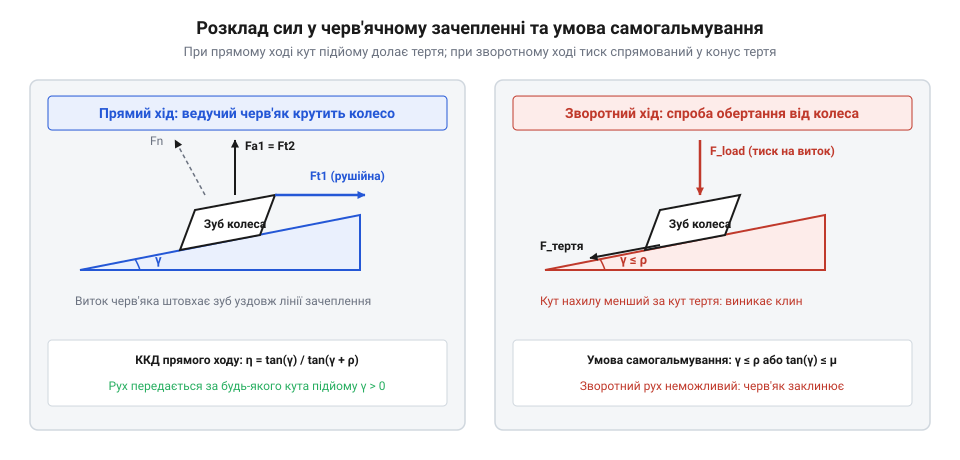
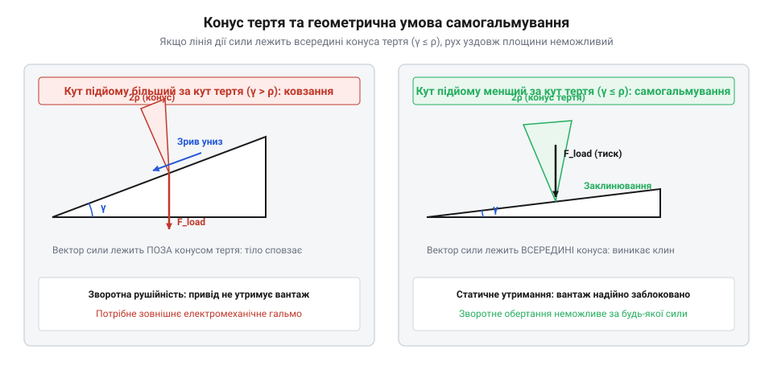
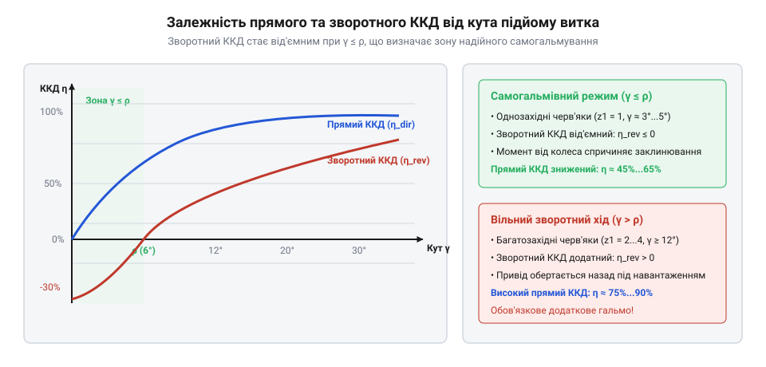
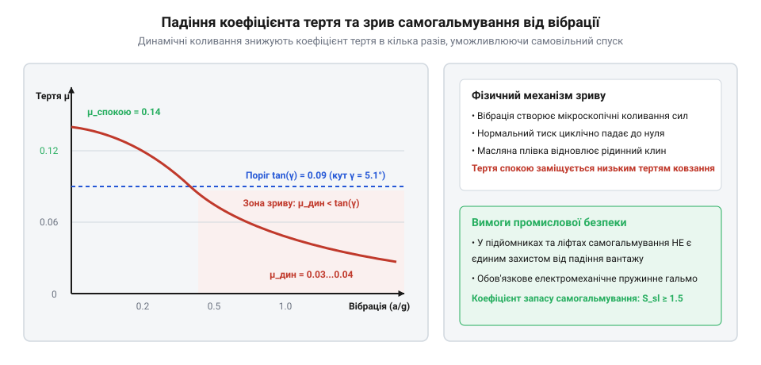

# Самогальмування черв'ячної передачі

<preknowlist>
- [Редуктори](root:hw-motion/gears-transmission) — базові поняття передатного числа, вхідного і вихідного вала та кінематики зубчастих передач
- [Зуб і зачеплення](root:hw-motion/gears-transmission) — поняття лінії зачеплення, нормального тиску та тертя у зачепленні зубів
</preknowlist>

## Фізична природа та геометрія черв\'ячного зачеплення

У класичній інженерній практиці більшість механічних редукторів є двосторонньо рушійними (Backdrivable): якщо прикласти крутний момент до вихідного вала, він через зубчасті колеса почне обертати вхідний вал двигуна у зворотному напрямку. Проте у вантажопідйомних механізмах, промислових лебідках, похилих конвеєрах та шарнірах важких роботів-маніпуляторів така прозорість трансмісії часто стає прямою загрозою катастрофічної аварії. Раптове відключення живлення чи знеструмлення сервопривода під вагою піднятого вантажу може викликати самовільне падіння конструкції зі смертельною небезпекою для персоналу та обладнання. Традиційні циліндричні, конічні та планетарні [редуктори](root:hw-motion/gears-transmission) не мають внутрішнього захисту від зворотного провертання і вимагають обов\'язкового встановлення зовнішніх гальмівних систем.

Кардинально іншу кінематичну й трибологічну поведінку демонструє черв\'ячна передача. Вона складається з двох фундаментальних компонентів: ведучого черв\'яка (гвинта з трапецеїдальною, евольвентною чи архімедовою нарізкою) та веденого черв\'ячного колеса з зубами спеціальної увігнутої форми, що охоплюють циліндр черв\'яка. Осі валів черв\'яка та колеса не перетинаються і є взаємно перпендикулярними (схрещені осі під кутом 90°).

Головна фізична відмінність черв\'ячного зачеплення від звичайних циліндричних зубчастих передач полягає в домінуючому характері відносного руху поверхонь. У звичайних прямозубих чи косозубих колесах контакт зубів зводиться переважно до кочення з незначною часткою ковзання біля ніжки й вершини зуба. Натомість черв\'ячна пара працює за принципом гвинтового клина: виток черв\'яка при обертанні не котиться по зубу колеса, а з високою швидкістю ковзає вздовж його робочої поверхні. 

Коли двигун обертає вхідний вал черв\'яка (прямий хід), гвинтова поверхня витка діє як рухомий клин. Вона штовхає зуб колеса в тангенціальному напрямку, долаючи силу тертя ковзання і викликаючи плавне обертання вихідного вала. Завдяки тому, що один повний оберт однозахідного черв\'яка повертає колесо лише на один зуб, передача забезпечує колосальне передавальне відношення в одному ступені (зазвичай від 10:1 до 80:1 і вище) у надзвичайно компактному корпусі, будову якого розкриває [будова та компоненти промислового черв\'ячного редуктора](root:hw-motion/worm-gear-self-locking/comp-worm-gearbox-drive.md).

Зовсім інша фізична картина розгортається, коли крутний момент прикладається з протилежного боку — до вихідного вала черв\'ячного колеса (спроба зворотного ходу). Зуб колеса починає тиснути на виток черв\'яка. Сила тиску розкладається на дві складові: тангенціальну, яка намагається розкрутити черв\'як навколо його осі, та осьову, спрямовану вздовж вала черв\'яка в бік упорного підшипника.

Якщо кут нахилу гвинтової лінії витка черв\'яка є досить пологим, виникає фундаментальний феномен механічного самогальмування (Self-locking): сила тертя між контактуючими металевими поверхнями перевищує тангенціальну складову рушійної сили. Замість того щоб ковзати по витку і розкручувати черв\'як, зуб колеса мертво впирається в гвинтову поверхню, розпираючи черв\'як в осьовому напрямку. Незалежно від того, наскільки великий крутний момент прикладається до вихідного колеса, система залишається абсолютно нерухомою: навантаження блокує саме себе силою власного тертя.

> 🔧 **Навіщо це.** У промислових підйомниках, регуляторах натягу кабелів та приводах телескопів здатність черв\'ячної передачі самостійно утримувати навантаження без споживання електроенергії двигуном дозволяє будувати енергоефективні та безпечні механізми, які не втрачають положення при аварійному знеструмленні.

Трибологічний режим у контактній зоні черв\'яка та вінця колеса має виразний ковзний характер. Швидкість відносного ковзання поверхонь v_s визначається векторною сумою окружної швидкості черв\'яка v_1 = (π · d_1 · n_1) / (60 · 1000) та окружної швидкості колеса v_2 = (π · d_2 · n_2) / (60 · 1000). Оскільки вали схрещені під прямим кутом, швидкість ковзання вздовж гвинтової лінії виражається формулою:

v_s = v_1 / cos(γ) = sqrt(v_1^2 + v_2^2)

При типових вхідних частотах обертання двигуна 1500 ... 3000 об/хв лінійна швидкість ковзання витка по зубу сягає 2 ... 8 м/с. За таких швидкостей у зачепленні виникає граничне або напіврідкісне тертя. Якщо при прямому ході це ковзання вимагає безперервного відведення тепла та спеціальних протизадирних легуючих присадок у редукторній оливі, то при спробі зворотного ходу (коли навантаження нерухоме і швидкість дорівнює нулю) система спирається на високе сухе або напівсухе тертя спокою.

Повна сила нормального тиску F_n, що діє у точці контакту витка черв\'яка та зуба колеса, розкладається у тривимірному просторі на три взаємно перпендикулярні проекції:
1. **Колова сила черв\'яка F_t1** — дотична до ділильного циліндра черв\'яка, яка при прямому ході є рушійною, а при зворотному — намагається повернути черв\'як.
2. **Осьова сила черв\'яка F_a1** — спрямована вздовж вала черв\'яка. За третім законом Ньютона вона чисельно дорівнює коловій (вихідній) силі колеса: F_a1 = F_t2 = (2 · T_2) / d_2, де T_2 — вихідний крутний момент на валу колеса.
3. **Радіальна сила F_r1** — сила взаємного відштовхування, що розпирає черв\'як і колесо у площині міжвісьової відстані: F_r1 = F_r2 = F_t2 · tan(α_n) / cos(γ).

При спробі зворотного провертання вихідний момент навантаження T_load генерує колосальну осьову силу F_a1, яка втискає виток черв\'яка вздовж його вала. Щоб редуктор не заклинило механічно через вигин вала чи руйнування посадкових місць, вал черв\'яка обов\'язково монтують на потужних дуплексних радіально-упорних роликових або конічних підшипниках, які сприймають цей вектор навантаження без паразитного осьового люфту. Саме жорстке утримання вала в осьовому напрямку забезпечує стабільність кута γ і унеможливлює випадкове розмикання контакту. Якщо опора вала піддасться пружному зміщенню навіть на кілька десятих часток міліметра, кут тиску спотвориться, пляма контакту зміститься на край витка, а концентрація напружень викличе пластичну деформацію або сколювання бронзових зубів.

## Математичний критерій самогальмування та геометрія сил

Щоб строго визначити умови, за яких виникає механічне самогальмування, перейдемо від тривимірної геометрії зачеплення до класичної фізичної моделі руху клина по похилій площині. Уявимо розгортку ділильного циліндра черв\'яка діаметром d_1 на площину.

Гвинтова лінія нарізки черв\'яка на розгортці перетворюється на похилу площину з кутом підйому витка γ (Lead angle). Кут підйому визначається геометрією черв\'яка: відношенням осьового кроку або ходу витка p_z до довжини кола ділильного циліндра π · d_1:

tan(γ) = p_z / (π · d_1) = (z_1 · m) / (q · m) = z_1 / q

де z_1 — число заходів черв\'яка (кількість незалежних гвинтових ниток), m — осьовий модуль зачеплення, а q = d_1 / m — коефіцієнт діаметра черв\'яка. Чим менша кількість заходів z_1 (для самогальмівних передач z_1 = 1, значно рідше z_1 = 2) і чим більший діаметр черв\'яка q, тим меншим є кут підйому витка γ.

У точці взаємодії зуба колеса з похилою площиною витка черв\'яка виникають нормальна сила пружного притискання N та дотична сила сухого тертя F_f. За законом Кулона сила тертя пропорційна нормальній силі:

F_f = μ · N

де μ — коефіцієнт тертя між матеріалами пари тертя. У трибології дію сили тертя зручно описувати через так званий кут тертя φ (Friction angle), тангенс якого чисельно дорівнює коефіцієнту тертя:

tan(φ) = μ

Проте реальний виток черв\'яка не є прямокутним клином: його бічна поверхня нахилена під стандартним кутом профілю α (найчастіше кут зачеплення в нормальному перерізі становить α_n = 20°). Через клиновидну форму западини нормальна сила реакції розклинюється і зростає пропорційно 1 / cos(α_n). Відповідно, ефективний опір ковзанню збільшується. Щоб врахувати цей геометричний ефект, інженери вводять поняття приведеного коефіцієнта тертя μ\' та приведеного кута тертя φ\':

μ\' = μ / cos(α_n)
tan(φ\') = μ\' = μ / cos(α_n)

Тепер розглянемо баланс сил при спробі зворотного руху, коли крутний момент від навантаження прикладається до колеса і штовхає виток черв\'яка. Проектуючи діючі сили на напрямок можливого обертання черв\'яка, отримуємо тангенціальну рушійну складову F_t = F_a · tan(γ) та протидіючу силу тертя F_fr = F_a · tan(φ\'). 

Для того щоб черв\'як почав повертатися під дією зовнішнього моменту на колесі, рушійна сила повинна подолати опір тертя: F_t > F_fr, що відповідає умові tan(γ) > tan(φ\') або γ > φ\'.

Якщо ж кут підйому витка менший або дорівнює приведеному куту тертя спокою, рушійна складова принципово не здатна подолати опір матеріалу:

γ ≤ φ\'

Це і є класичний **математичний критерій статичного самогальмування черв\'ячної передачі**. 

Розглянемо числовий приклад розрахунку реальної промислової пари. Для типового редуктора з однозахідним загартованим шліфованим черв\'яком (сталь 40Х або 18ХГТ) та черв\'ячним колесом з олов\'янистої бронзи (БрО10Ф1) за наявності мінерального редукторного мастила коефіцієнт статичного тертя спокою складає μ_0 ≈ 0.08 ... 0.10. При нормальному куті профілю α_n = 20°:

cos(20°) ≈ 0.9397
μ\'_0 = 0.09 / 0.9397 ≈ 0.0958
φ\'_0 = arctan(0.0958) ≈ 5.47° (або 5° 28\')

Якщо при проектуванні обрано однозахідний черв\'як (z_1 = 1) з коефіцієнтом діаметра q = 12, кут підйому витка складе:

tan(γ) = 1 / 12 ≈ 0.0833
γ = arctan(0.0833) ≈ 4.76° (або 4° 46\')

Оскільки кут підйому витка менший за приведений кут тертя спокою (4.76° < 5.47°), умова γ ≤ φ\'_0 повністю задовольняється. Такий редуктор у нерухомому стані є гарантовано самогальмівним: підвішений на барабані лебідки вантаж не зможе зрушити черв\'як з місця. Докладні аналітичні залежності та варіації для різних мастил наведені у вставці [математична модель трибології та кінематики черв\'ячного зачеплення](root:hw-motion/worm-gear-self-locking/math-worm-lead-angle-and-friction-mechanics.md).

> 🔧 **Навіщо це.** Знання точного співвідношення між γ та φ\' дозволяє конструктору на етапі ескізного проектування обрати число заходів z_1 та діаметр черв\'яка q так, щоб отримати надійне утримання механізму без ризику заклинювання при прямому ході.

Розглянемо детальніше тривимірну векторну геометрію контакту зуба колеса з похилою гвинтовою поверхнею витка. Оскільки контактна грань витка черв\'яка нахилена під кутом профілю α_n (зазвичай α_n = 20° у нормальному перерізі), нормальна сила пружної реакції N діє не в тангенціально-осьовій площині, а має просторовий розвал. Повна нормальна сила притискання поверхонь виражається через осьову силу F_a як:

N = F_a / (cos(α_n) · cos(γ) - μ · sin(α_n))

Саме цей клиновидний розпір змушує контактний тиск значно перевищувати просте осьове зусилля, що й породжує ефект посиленого тертя μ\' = μ / cos(α_n). У спеціальних незворотних черв\'ячних механізмах (наприклад, у ділильних головках прецизійних верстатів або фіксаторах рульових приводів) інженери іноді свідомо зменшують нормальний кут профілю до α_n = 14.5° або навіть 12°, що збільшує клиновий опір і надійно гарантує блокування.

Вирішальним геометричним параметром, що визначає долю самогальмування, є число заходів нарізки черв\'яка z_1. У багатозахідних черв\'яках виток має круту гвинтову лінію:
- Для двозахідного черв\'яка (z_1 = 2) кут підйому витка зростає вдвічі: tan(γ) = 2 / q, що дає γ ≈ 8° ... 11°.
- Для чотиризахідного черв\'яка (z_1 = 4) кут сягає γ ≈ 18° ... 25°.

Оскільки приведений кут тертя сталі по бронзі навіть у сухому стані рідко перевищує φ\' ≈ 6° ... 7°, у будь-якому багатозахідному черв\'яку кут підйому принципово перевищує кут тертя (γ ≫ φ\'). Такі редуктори є повністю зворотними (Backdrivable) і мають високий прямий ККД (до 85%–90%). Натомість для отримання самогальмування конструктор зобов\'язаний обрати строго однозахідний черв\'як (z_1 = 1) і призначити коефіцієнт діаметра q ≥ 10 ... 16. За такої комбінації кут підйому падає нижче 4° ... 5°, що заводить систему в зону беззаперечного статичного блокування.

Крім того, слід враховувати вплив трибологічного стану контакту на коефіцієнт тертя за кривою Штрібека. У момент рушання з місця товщина мастильної плівки дорівнює нулю, контактні вершини мікрошорсткості металів зачеплені безпосередньо, і діє коефіцієнт тертя спокою μ_0. Проте при проектуванні не можна закладати в розрахунок ідеальні умови: при тривалій експлуатації поверхні можуть покритися оксидною або адсорбованою масляною плівкою з граничним тертям, де μ падає до 0.05 ... 0.07. Тому надійний інженерний розрахунок вимагає перевірки умови γ ≤ φ\' не за середнім, а за мінімальним статистичним коефіцієнтом тертя для обраного мастила.

## ККД прямого та зворотного ходу і теплове навантаження

Властивість самогальмування черв\'ячної передачі має зворотний бік, який вимагає від конструктора суворих компромісів: принципово низький коефіцієнт корисної дії (ККД) та високе виділення тепла. Щоб зрозуміти енергетичний баланс редуктора, проаналізуємо аналітичні вирази для ККД за прямого та зворотного потоків потужності.

Коли черв\'як обертається від двигуна і приводить у рух колесо (прямий хід), ККД передачі η визначається класичним співвідношенням:

η = tan(γ) / tan(γ + φ\')

де γ — кут підйому витка черв\'яка, а φ\' — приведений кут тертя в зачепленні. 

Якщо кут підйому малий і наближається до кута тертя (γ ≈ φ\'), знаменник tan(γ + φ\') стає приблизно вдвічі більшим за чисельник tan(γ). З цього випливає фундаментальне термодинамічне правило: **прямий ККД будь-якої надійно самогальмівної черв\'ячної передачі принципово не може перевищувати 50% (η ≤ 0.50)**. Більше половини всієї механічної потужності, яку споживає редуктор від електродвигуна, безповоротно розсіюється у вигляді тепла на плямах тертя між витками й зубами.

Ще виразніше фізична природа самогальмування проявляється в аналітичній формулі ККД зворотного ходу (коли навантаження намагається обертати черв\'як через колесо):

η_rev = tan(γ - φ\') / tan(γ)

Проаналізуємо поведінку цього виразу при зміні геометричного кута γ відносно кута тертя φ\':
1. Якщо γ > φ\', різниця кутів додатна (γ - φ\' > 0), тангенс додатний, і зворотний ККД становить η_rev > 0. Передача є оборотною: вантаж може плавно розкручувати черв\'як у зворотний бік, віддаючи частину потенціальної енергії на вхідний вал.
2. Якщо кут підйому дорівнює куту тертя (γ = φ\'), чисельник перетворюється на нуль: η_rev = 0. Механізм перебуває на границі самогальмування.
3. Якщо ж кут підйому менший за кут тертя (γ < φ\'), різниця кутів стає від\'ємною: γ - φ\' < 0. Відповідно, формально обчислений зворотний ККД стає від\'ємним: η_rev < 0.

Фізичний зміст «від\'ємного ККД» полягає в тому, що зусилля від вантажу не лише не здатне створити корисну роботу на валу черв\'яка, а навпаки — щоб змусити черв\'як провертатися під дією вантажу, до самого черв\'яка необхідно додатково прикласти зовнішній обертовий момент у напрямку спуску, щоб допомогти йому подолати внутрішній опір тертя.

Колосальні втрати потужності P_loss = P_in · (1 - η) безпосередньо переходять у теплову енергію. Якщо привід потужністю 3 кВт працює з ККД 45%, усередині невеликого картера редуктора безперервно виділяється понад 1.6 кВт тепла — еквівалент увімкненого електричного обігрівача. Тепловий баланс картера описується рівнянням Ньютона-Ріхмана:

P_loss = k_t · A · (T_oil - T_amb)

де k_t — коефіцієнт тепловіддачі стінок редуктора у повітря (зазвичай 12 ... 18 Вт/(м²·°C) при природній конвекції), A — площа охолоджуваної поверхні корпусу, T_oil — температура мастильної ванни, а T_amb — температура навколишнього середовища.

Якщо корпус має недостатню площу тепловіддачі A, температура мастила стрімко перевищує критичну межу 90°C ... 100°C. При такому перегріві мінеральне мастило окислюється, втрачає протизадирні присадки та різко розріджується, що веде до руйнування плівки мастила та прискореного абразивного зносу бронзового вінця колеса. Щоб утримати температуру в безпечних межах (T_oil ≤ 80°C), промислові самогальмівні редуктори оснащують розвиненими радіаторними ребрами на корпусі та встановлюють на високошвидкісний вал черв\'яка крильчатку примусового обдуву.

> 🔧 **Навіщо це.** Тепловий розрахунок черв\'ячного редуктора є обов\'язковою умовою проектування: дуже часто розмір корпусу обирають не за міцністю зубів на згин, а саме за площею теплорозсіювання, щоб уникнути перегріву й деградації мастила.

Для практичної оцінки теплового режиму виконаємо детальний числовий розрахунок реального промислового черв\'ячного редуктора. Нехай привід конвеєра споживає від асинхронного електродвигуна вхідну механічну потужність P_1 = 4.0 кВт. Редуктор є одноступеневим самогальмівним із передавальним числом i = 40 та кутом підйому витка γ = 4° 10\'. Через низький кут підйому прямий ККД складає всього η = 0.46 (46%).

Обчислимо потужність теплових втрат, що виділяються безпосередньо в зоні контакту та підшипникових вузлах:

P_loss = P_1 · (1 - η) = 4.0 · (1 - 0.46) = 2.16 кВт

Усередині чавунного чи алюмінієвого картера безперервно виділяється понад дві тисячі ват теплової енергії. Допустима максимальна робоча температура для якісних синтетичних поліальфаолефінових (PAO) або полігліколевих (PAG) редукторних олив становить T_oil,max = 85°C. Приймаючи найнесприятливішу розрахункову температуру цехового повітря влітку T_amb = 35°C, отримуємо гранично допустимий температурний напір:

ΔT = T_oil,max - T_amb = 85 - 35 = 50°C

Якщо картер редуктора охолоджується виключно природною повітряною конвекцією без вентилятора, коефіцієнт тепловіддачі стінок у нерухоме повітря складає приблизно k_t = 14 Вт/(м²·°C). Необхідна площа зовнішньої охолоджуваної поверхні картера становить:

A_req = P_loss / (k_t · ΔT) = 2160 / (14 · 50) = 2160 / 700 ≈ 3.09 м²

Звичайний компактний черв\'ячний редуктор із міжосьовою відстанню a_w = 100 мм має площу гладкого корпусу не більше 0.4 ... 0.5 м². Якби такий редуктор працював без спеціальних засобів інтенсифікації охолодження, температура оливи перевищила б 300°C, що призвело б до закипання мастила, вигорання сальників та повного заклинювання передачі протягом перших 20 хвилин роботи під номінальним навантаженням.

Щоб розв\'язати цю проблему, інженери застосовують комплекс теплотехнічних заходів:
1. **Густе оребрення картера.** Поздовжні та поперечні ребра охолодження товщиною 3–5 мм збільшують фактичну площу теплообміну A у 3–4 рази, доводячи її до 1.5 ... 1.8 м².
2. **Примусовий обдув крильчаткою.** На швидкохідний вал черв\'яка, що обертається з частотою 1500 об/хв, встановлюють відцентровий вентилятор у металевому кожусі, який спрямовує високошвидкісний потік повітря вздовж ребер. Це підвищує коефіцієнт тепловіддачі k_t від 14 до 28 ... 32 Вт/(м²·°C).
3. **Водяні охолоджувальні змійовики.** Для важких приводів потужністю понад 10 кВт у нижню частину картера вбудовують мідний трубчастий змійовик, крізь який циркулює проточна охолоджувальна вода, знімаючи до 70% надлишкового тепла.

## Динамічне розгальмовування під навантаженням і трибологічний зрив

Найнебезпечнішою помилкою інженера є переконання, що раз передача задовольняє геометричну умову статичного самогальмування γ ≤ φ\'_0, вона залишатиметься нерухомою за будь-яких умов експлуатації. У реальних промислових системах статичне самогальмування є нестабільним і може миттєво зникнути під впливом зовнішніх факторів. Цей процес називається **динамічним розгальмовуванням (Vibrational unsticking / loss of self-locking)**.

Причина явища криється у фундаментальній нелінійності сухого та напіврідкісного тертя. Коефіцієнт статичного тертя спокою μ_0, який утримує деталі від початкового зміщення, завжди значно вищий за коефіцієнт кінематичного тертя ковзання μ_dyn. Для пари тертя «загартована сталь — олов\'яниста бронза» коефіцієнт тертя спокою становить μ_0 ≈ 0.08 ... 0.12 (приведений кут φ\'_0 ≈ 5° ... 7°). Проте варто деталям почати відносний рух зі швидкістю понад 0.5 ... 1.0 м/с, як коефіцієнт тертя ковзання стрімко падає до μ_dyn ≈ 0.03 ... 0.05 (приведений кут φ\'_dyn ≈ 2° ... 3°).

Якщо редуктор спроектовано з кутом підйому γ = 4.5°, у стані спокою він надійно заблокований, оскільки γ < φ\'_0 (4.5° < 6.0°). Але якщо виникнуть умови, за яких кут тертя впаде нижче за кут підйому (γ > φ\'_dyn, тобто 4.5° > 2.5°), самогальмування миттєво зникає. Щойно починається найменший рух, опір тертя різко зменшується, і система входить у режим неконтрольованого лавиноподібного розгону під вагою вантажу.

Основними дестабілізуючими факторами, що викликають зрив самогальмування, є:
1. **Зовнішні вібрації та удари.** Робота сусідніх верстатів, вібрація несучої металоконструкції, рух колісного шасі ровера чи удари вантажу об перешкоду генерують високочастотні коливання зусиль у зачепленні. Під час фази коливання, коли нормальна сила N короткочасно падає, контактні плями мікрорельєфу виходять із зачеплення, виникають мікроковзання, і статичне тертя перетворюється на кінетичне. Вібрація амплітудою всього у кілька десятків мікрометрів здатна повністю зняти ефект самогальмування.
2. **Температурне розрідження мастила.** При нагріванні редуктора до робочої температури кінематична в\'язкість оливи знижується в рази. Тонша мастильна плівка легше переходить у режим гідродинамічного клина при мікрозрушеннях, знижуючи коефіцієнт тертя нижче критичного рівня.
3. **Полірування поверхонь (припрацювання).** Новий редуктор із шорсткими поверхнями зубів після нарізання має підвищений коефіцієнт тертя μ_0. Проте після кількох сотень годин експлуатації поверхні притираються до дзеркального блиску (шорсткість Ra знижується від 1.6 мкм до 0.2 мкм), фактичний коефіцієнт тертя падає на 20% ... 40%, і редуктор, який спочатку був самогальмівним, несподівано втрачає цю здатність.

Саме тому в інженерній практиці розрізняють **статичне самогальмування** (надійно лише за повної відсутності вібрацій та ударів) і **динамічне самогальмування**, для забезпечення якого кут підйому витка обирають екстремально малим: γ ≤ 1.5° ... 2.5°. Проте зменшення кута підйому до таких величин вимагає збільшення діаметра черв\'яка або зменшення модуля, що катастрофічно знижує прямий ККД редуктора до 25% ... 35% і збільшує габарити вузла, як описано в практичному розрахунку [проектування черв\'ячного приводу підйомної лебідки або маніпулятора з гарантованим утриманням вантажу](root:hw-motion/worm-gear-self-locking/proj-winch-holding-safety-mechanism.md).

> 🔧 **Навіщо це.** Усвідомлення ризику вібраційного розгальмовування запобігає фатальним аваріям: інженер ніколи не повинен покладатися на черв\'ячний редуктор як на єдиний елемент утримання вантажу в машинах, що зазнають трясіння чи пульсацій.

Особливу фізичну небезпеку становлять явища крутильного резонансу в механічній системі «вал колеса — навантаження». Якщо пружне навантаження (наприклад, довга стріла маніпулятора чи трос кранового поліспаста з підвішеною масою) має власну частоту коливань f_res = 1 / (2π) · sqrt(C_t / J_load), динамічні моменти на вихідному валу можуть у 2–4 рази перевищувати номінальний статичний момент утримання.

У фазі резонансного протитиску, коли навантаження закручує вал у бік розмикання, на зуб колеса діє знакозмінна сила. У моменти переходу через нуль нормальний контактний тиск F_n короткочасно падає до нуля, розриваючи контакт між витком і зубом. У цей мікросекундний інтервал часу тертя спокою повністю зникає, а під дією гравітації вантаж набуває початкової швидкості падіння. Коли зуби знову входять у жорсткий контакт, вони вже перебувають у стані відносного ковзання, де діє значно нижчий коефіцієнт кінематичного тертя μ_dyn, що викликає стрімке незворотне падіння вантажу.

Крім того, критичну роль відіграє трибохімічна деградація граничних мастильних плівок під дією локальних температурних спалахів. На мікроскопічних вершинах нерівностей зубів у моменти мікрозрушень виникають локальні «спалахи температури Флеша» (Flash temperature), що перевищують 150°C ... 180°C. При такій температурі молекули жирних кислот і цинк-диалкілдитіофосфату (ZDDP), які утворюють захисний граничний шар, десорбуються з поверхні бронзи. Оголений ювенільний метал вступає у прямий сухий контакт із загартованою сталлю, що спочатку веде до мікросхоплювання, а потім — до миттєвого задиру та непередбачуваної зміни фрикційних властивостей пари.

Саме тому для машин із підвищеними вимогами до надійності розраховують динамічний коефіцієнт запасу самогальмування за найгіршими експлуатаційними умовами:

S_dyn = tan(φ\'_dyn) / tan(γ)

Якщо S_dyn < 1.0, редуктор вважається динамічно несамогальмівним: будь-який випадковий поштовх або вібрація з амплітудою прискорення понад 0.2g здатні перевести механізм у режим вільного зворотного обертання. Щоб забезпечити гарантоване динамічне утримання (S_dyn ≥ 1.1 ... 1.2), кут підйому витка γ доводиться штучно обмежувати значенням 1° ... 1.5°, що неминуче знижує прямий ККД редуктора до 20% ... 30%. Цей інженерний компроміс вимагає встановлення значно потужнішого приводного електродвигуна лише заради подолання власного тертя трансмісії під час підйому вантажу.

## Інженерні критерії надійності, правила безпеки та комбіновані приводи

При проектуванні вантажопідйомних механізмів, похилих транспортерів та маніпуляторів розробник стикається з критичним питанням: чи дозволяють міжнародні та національні стандарти промислової безпеки покладатися на самогальмування черв\'ячної передачі як на єдиний засіб утримання навантаження?

Відповідь усіх сучасних нормативів (зокрема ISO 13849, EN 81-20/50 для ліфтового обладнання, EN 13000 для підйомних кранів та правил OSHA) є категоричною: **самогальмування черв\'ячного редуктора ніколи не розглядається як сертифіковане аварійне гальмо для захисту людей або критичного майна**.

Причини такої заборони випливають із фізичної та трибологічної природи передачі:
1. **Непередбачуваність вібраційного зриву.** Як було доведено аналізом динаміки, будь-який випадковий удар, поштовх вантажу чи вібрація сусіднього механізму здатні миттєво знизити статичний коефіцієнт тертя до кінетичного рівня, перетворивши заблокований редуктор на вільно падаючий механізм.
2. **Трибологічне повзання (Creep).** Навіть коли макроскопічного ковзання не спостерігається, під дією тривалого статичного навантаження та мікроколивань температури в точках пружно-пластичного контакту бронзового вінця виникає повзучість металу. Черв\'як може здійснювати повільне кутове сповзання («дрейф положення») зі швидкістю кілька градусів на добу.
3. **Механічні відмови зубчастого вінця.** У разі зрізання або сколювання хоча б одного-двох зубів бронзового колеса внаслідок втоми матеріалу чи ударного навантаження, кінематичний ланцюг миттєво розривається, і редуктор повністю втрачає здатність утримувати вал.

З огляду на це надійні промислові приводи будують за архітектурою **комбінованого двобар\'єрного утримання**. У такій системі черв\'ячна передача бере на себе функцію операційного утримання (зменшуючи теплове навантаження на електродвигун під час короткочасних технологічних пауз), а незалежне електромеханічне гальмо забезпечує абсолютну безпеку.

Стандартним рішенням є встановлення нормально-замкненого дискового або колодкового електромагнітного гальма безпосередньо на високошвидкісний вал черв\'яка. Коли двигун живиться струмом, електромагніт розтискає пружини гальма, дозволяючи валу вільно обертатися. При плановому вимкненні або аварійному знеструмленні пружини миттєво притискають гальмівні накладки, блокуючи вхідний вал.

Встановлення гальма на валу черв\'яка дає колосальну інженерну перевагу: оскільки гальмівний момент прикладається до швидкохідного вхідного вала, за рахунок передатного числа редуктора i потрібний гальмівний момент є в i разів меншим, ніж момент на вихідному валу колеса:

T_brake_req = (T_load / (i · η_rev)) · S_safety

де S_safety — нормативний коефіцієнт запасу гальмування (зазвичай S_safety = 1.5 ... 2.5). Невелике компактне електромагнітне гальмо масою 1–2 кг здатне надійно утримувати багатотонний вантаж на вихідному барабані.

Якщо ж розробляється механізм точного позиціювання без сертифікаційних вимог до підйому людей (наприклад, поворотний стіл оптичного стенда, позиціонер сонячної панелі чи сервопривід заслінки), черв\'ячний редуктор проектують із розрахунковим коефіцієнтом запасу самогальмування S_sl:

S_sl = tan(φ\'_min) / tan(γ) ≥ 1.3 ... 1.5

де φ\'_min — мінімально можливий приведений кут тертя для гарячого редуктора при розрідженому мастилі. 

Підсумовуючи, черв\'ячна передача залишається унікальним інженерним інструментом: вона поєднує гранично високе передавальне число в одному ступені, коаксіально-перпендикулярну компоновку та природне самогальмування. Проте досягнення надійного результату вимагає від інженера точного балансування між кутом підйому витка, прямим ККД, теплорозсіюванням картера та дублюванням функцій безпеки незалежними електромеханічними вузлами.

> 🔧 **Навіщо це.** Розуміння нормативних обмежень та архітектури комбінованого приводу береже проект від юридичних і технічних катастроф: інженер створює систему, яка успішно проходить державну сертифікацію безпеки та гарантує надійність у найжорсткіших умовах експлуатації.

Критичним інженерним завданням при проектуванні комбінованого гальмівного вузла є розрахунок динамічного навантаження в момент екстреної аварійної зупинки. Сумарна кінетична енергія рухомої системи складається з енергії обертових мас ротора електродвигуна і черв\'яка E_rot = 1 / 2 · J_total · ω_in^2 та кінетичної енергії поступального руху піднятого вантажу E_trans = 1 / 2 · m_load · v_load^2.

У момент спрацьовування електромагнітного гальма вхідний вал черв\'яка різко сповільнюється за час t_stop (зазвичай t_stop = 0.05 ... 0.15 с). Виникаюче динамічне кутове прискорення ε_stop = ω_in / t_stop створює інерційний піковий крутний момент:

T_dyn = T_stat + J_total · ε_stop

Якщо гальмо надмірно жорстке або час спрацювання занадто малий, ударний динамічний момент може в 3–5 разів перевищити номінальний крутний момент редуктора. Такий динамічний удар спричиняє миттєве пластичне деформування або зрізання зубів колеса з олов\'янистої бронзи. Щоб запобігти руйнуванню зубчастого вінця, між електродвигуном і черв\'яком встановлюють пружну компенсуючу муфту з поліуретановою зірочкою або регульовану фрикційну муфту граничного моменту (Torque limiter), яка проковзує при перевантаженнях понад 150% від номіналу.

З погляду систем автоматизації та промислової електроніки, керування комбінованим приводом вимагає реалізації апаратного електричного блокування рівня надійності PL d / PL e (згідно з ISO 13849-1). Неприпустимо подавати напругу на обмотки двигуна доти, доки датчик положення якоря гальма (індуктивний або мікроперемикач) не підтвердить фізичне розмикання гальмівних колодок: спроба обертання затисненого редуктора веде до миттєвого перегріву й згоряння статора двигуна.

Регламент технічного обслуговування самогальмівних черв\'ячних редукторів обов\'язково включає періодичний інструментальний контроль мертвого ходу (люфту j_t) та спектрометричний аналіз змивів мастила на вміст міді (Cu) та олова (Sn). Знос товщини зуба бронзового вінця понад 20% від початкової товщини (s_w ≤ 0.8 · s_w0) є підставою для негайної вибраковки та заміни черв\'ячної пари, оскільки витончений зуб втрачає згинальну міцність і може зрізатися під повним навантаженням. Комплексний підхід до діагностики дозволяє запобігти раптовому виходу вузла з ладу та гарантує передбачувану безаварійну роботу приводу протягом усього міжремонтного періоду.
