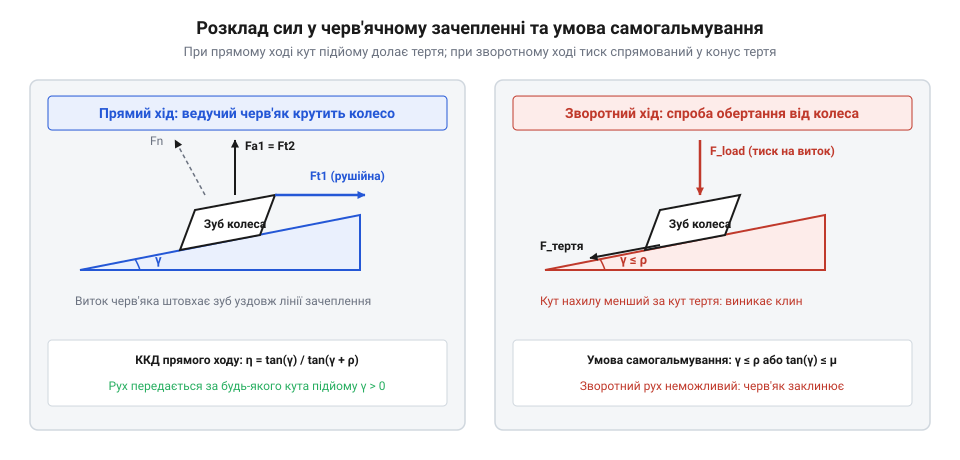
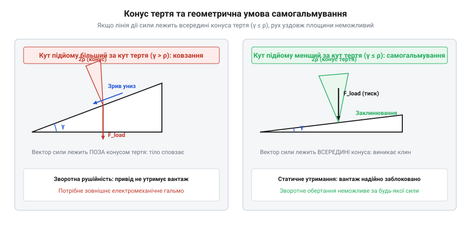
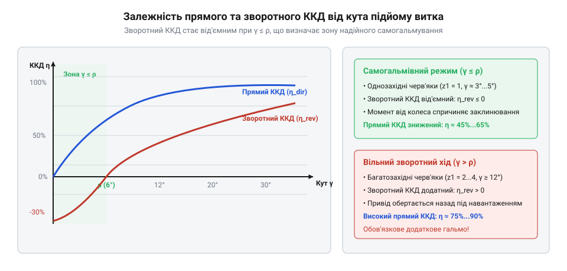
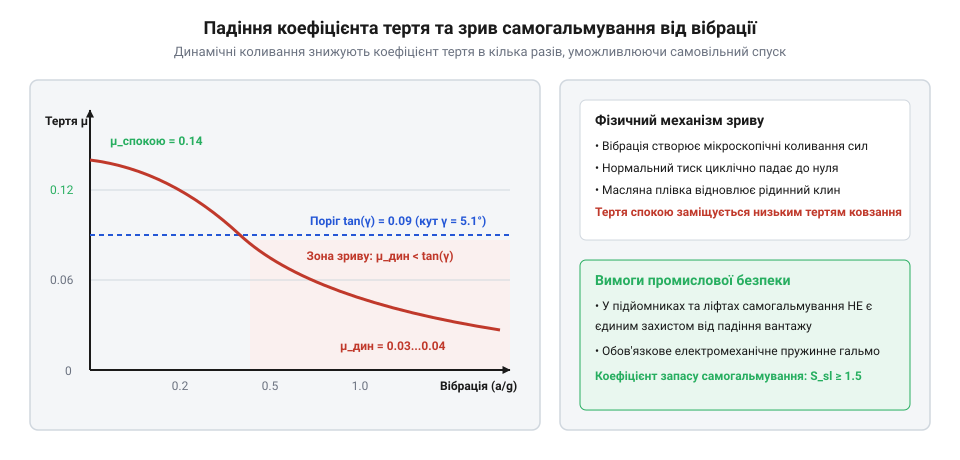

# Самогальмування черв'ячної передачі

<preknowlist>
- [Редуктори](root:hw-motion/gears-transmission) — базові поняття передатного числа, вхідного і вихідного вала та кінематики зубчастих передач
</preknowlist>

## Фізична природа та геометрія черв'ячного зачеплення

У класичних зубчастих передачах — циліндричних чи конічних — зуби коліс контактують переважно в режимі кочення з мінімальним відносним проковзуванням. Якщо знеструмити електродвигун у такій передачі, прикладений до вихідного вала крутний момент легко змусить редуктор обертатися у зворотному напрямку. Ця властивість двосторонньої передачі руху називається оборотною рушійністю (backdrivability). Для роботів-маніпуляторів із прямим тактильним зворотним зв'язком це перевага, але для вантажопідйомних механізмів — потенційна катастрофа: підвішений вантаж під власною вагою негайно впаде донизу.

Черв'ячна передача влаштована за зовсім іншим кінематичним принципом. Її ведуча ланка — черв'як — являє собою циліндричний гвинт із трапецеподібною або евольвентною різзю, а ведена ланка — черв'ячне колесо — має увігнуті косозубі вінці, що охоплюють витки гвинта. Осі вхідного й вихідного валів перехрещуються в просторі під прямим кутом (90°), не перетинаючись.


*Кінематична схема та силовий баланс черв'ячної пари: розклад повної контактної сили взаємодії витка з зубом на колову, осьову та радіальну складові.*

> 🔧 **Навіщо це.** Принцип гвинтового клина перетворює обертовий рух на поступальне зміщення лінії контакту вздовж осі черв'яка, створюючи потужний силовий контакт із переважанням тертя ковзання замість кочення.

Рух у черв'ячному зачепленні подібний до ковзання клина по похилій площині. Коли черв'як обертається, його виток безперервно тисне на бічну поверхню зуба колеса, штовхаючи його в тангенціальному напрямку. Повне контактне зусилля розкладається на три взаємно перпендикулярні складові:
1. Колова сила на черв'яку `F_t1`, яка водночас дорівнює осьовій силі на колесі `F_a2`.
2. Осьова сила на черв'яку `F_a1`, яка дорівнює коловій рушійній силі на колесі `F_t2`.
3. Радіальна розпірна сила `F_r`, що відштовхує вали один від одного вздовж міжосьової лінії.

Вирішальна фізична особливість полягає в тому, що виток черв'яка рухається вздовж зуба колеса зі значною швидкістю відносного ковзання `v_s = v_1 / cos(γ)`. У зоні взаємодії постійно діє сила тертя ковзання, пропорційна нормальному тиску. Якщо зовнішнє навантаження намагається провернути колесо назад (режим зворотного ходу), зуб колеса впирається у виток нерухомого черв'яка, спрямовуючи реакцію опори так, що сила тертя спокою повністю врівноважує розгінний момент і блокує обертання вала.

## Геометричний критерій самогальмування

Здатність черв'ячної передачі утримувати навантаження без зовнішніх гальм визначається взаємним співвідношенням двох кутових величин: геометричного кута підйому витка черв'яка `γ` та трибологічного зведеного кута тертя `ρ'`.

Кут підйому витка `γ` відраховується на ділильному циліндрі черв'яка діаметром `d_1` і залежить від кількості заходів різі `z_1` та осьового модуля `m`:

```text
tan(γ) = (m · z_1) / d_1 = z_1 / q
```

де `q = d_1 / m` — безрозмірний коефіцієнт діаметра черв'яка (зазвичай у межах `8 ... 16`).


*Геометрія самогальмування на похилій площині: вектор результуючої сили реакції потрапляє всередину конуса тертя при gamma < rho', блокуючи зворотний рух.*

> 🔧 **Навіщо це.** Порівняння кута підйому гвинтової лінії з кутом конуса тертя дозволяє конструктору гарантувати самоблокування приводу простим підбором кількості заходів черв'яка `z_1 = 1` ще на етапі ескізного розрахунку.

Зведений кут тертя `ρ'` враховує профільний кут нахилу бокової грані витка в осьовому перерізі `α_n` (стандартно `α_n = 20°`). Через розклинювальний ефект бічних поверхонь нормальна сила тиску перевищує тангенціальну, збільшуючи еквівалентентний коефіцієнт тертя:

```text
tan(ρ') = μ' = μ / cos(α_n)
```

де `μ` — фактичний коефіцієнт тертя ковзання контактуючих матеріалів (для класичної пари загартована сталь — олов'яна бронза в стані спокою `μ_static ≈ 0.08 ... 0.12`).

Умова статичного самогальмування формулюється гранично просто:

```text
γ ≤ ρ'
```

Якщо кут підйому витка менший за зведений кут тертя `ρ'`, вектор результуючої контактної сили відхиляється від нормалі на кут, менший за кут конуса тертя. У цьому стані ніяка зовнішня сила на вихідному валу не здатна зрушити черв'як із місця: будь-яке збільшення крутного моменту вантажу лише сильніше притискає виток до зуба, збільшуючи утримуючу силу тертя.

Саме тому для самогальмівних передач обов'язково обирають однозахідний черв'як (`z_1 = 1`). При одному заході кут підйому зазвичай становить `γ ≈ 3.5° ... 6°`, що гарантовано менше кута тертя спокою `ρ' ≈ 6° ... 8°`. Навпаки, у багатозахідних черв'яках (`z_1 = 2` або `z_1 = 4`) кут підйому сягає `12° ... 25°`, унаслідок чого передача стає легко оборотною і позбавляється ефекту самоблокування.

## Енергетична ціна та теплове навантаження

Незворотність передачі та самостійне утримання навантаження не дістаються безкоштовно: платою за самогальмування є катастрофічно низький коефіцієнт корисної дії. У той час як прямозубий циліндричний або планетарний редуктор має ККД на рівні 97–98% на ступінь, у самогальмівній черв'ячній передачі корисна робота складає лише від 30% до 50% від спожитої потужності двигуна.

Коефіцієнт корисної дії черв'ячної пари при ведучому черв'яку описується формулою:

```text
η = tan(γ) / tan(γ + ρ')
```

Оскільки для самогальмування кут підйому витка повинен бути меншим за кут тертя (`γ < ρ'`), знаменник дробу завжди більш ніж удвічі перевищує чисельник: `tan(γ + ρ') > tan(2 · γ) > 2 · tan(γ)`. Відповідно, теоретичний ККД самогальмівної передачі принципово не може перевищити 50%:

```text
η < tan(γ) / tan(2 · γ) < 0.50 (50%)
```


*Криві енергетичної ефективності черв'ячного зачеплення: зона самогальмування строго обмежена областю ККД менше 50%, де зворотний ККД стає від'ємним.*

> 🔧 **Навіщо це.** Розуміння низького ККД змушує конструктора закладати електродвигун удвічі більшої потужності та обов'язково розраховувати тепловідвід редуктора, інакше передача перегріється й заклинить від терморозширення.

Решта енергії — від 50% до 70% вхідної потужності — повністю перетворюється на тепло безпосередньо в зоні тертя ковзання між витками й зубами. Якщо потужність двигуна становить 3 кВт, редуктор безперервно генерує близько 1.5–1.8 кВт чистого тепла, працюючи як електричний обігрівач.

Теплове навантаження картера черв'ячного редуктора обмежується допустимою робочою температурою мастила (зазвичай не вище 85–95 °C). При перевищенні цієї межі мінеральні та синтетичні оливи втрачають в'язкість, масляна плівка руйнується, і настає катастрофічний адгезійний знос — заїдання та схоплювання бронзового вінця зі сталевим витком. Для відведення тепла картер редуктора оснащують литими охолоджувальними ребрами, а на вхідний вал черв'яка встановлюють відцентрову крильчатку примусового обдування.

## Небезпека динамічного розгальмовування

Найпоширеніша й найбільш небезпечна помилка інженера-початківця — вважати черв'ячну передачу надійним стоянковим гальмом для вантажопідйомних кранів, будівельних лебідок чи пасажирських ліфтів. Правило `γ < ρ'` гарантує непорушність вантажу лише в лабораторних умовах ідеального спокою.

У реальній експлуатації механізм завжди зазнає випадкових динамічних збурень: вібрацій від сусідніх агрегатів, пружних коливань троса, поривів вітру або поштовхів при зупинці. Навіть мікровібрації амплітудою в кілька мікрометрів руйнують мікроскопічні зчіплення спокою між контактуючими металами.


*Динаміка вібраційного розгальмовування: перехід від статичного кута тертя до кінематичного зсуває робочу точку в зону нестійкості та самовільного обертання.*

> 🔧 **Навіщо це.** Знання ефекту вібраційного розгальмовування запобігає аваріям і людським жертвам: воно диктує нормативну вимогу обов'язкового дублювання черв'яка зовнішнім електромеханічним дисковим гальмом.

При переході від статичного стану спокою до мікроковзання коефіцієнт тертя стрімко падає від статичного значення `μ_static ≈ 0.10 ... 0.12` до кінематичного `μ_dynamic ≈ 0.025 ... 0.04`. Разом із ним зменшується і зведений кут тертя:

```text
ρ'_dynamic = arctan(μ_dynamic / cos(α_n)) ≈ arctan(0.035 / cos(20°)) ≈ 2.1°
```

Оскільки кут підйому витка черв'яка зазвичай становить `γ ≈ 4° ... 5°`, він раптово виявляється більшим за динамічний кут тертя:

```text
γ > ρ'_dynamic
```

У цей момент самогальмування повністю зникає. Вантаж зривається в некероване сповзання, розганяючи черв'як у зворотний бік. Зі зростанням швидкості обертання коефіцієнт тертя падає ще сильніше, перетворюючи плавне сповзання на стрімке катастрофічне падіння.

Саме тому сучасні стандарти промислової безпеки (зокрема європейський стандарт EN 14492 для лебідок і підйомників) категорично забороняють проектувати підйомні машини без нормально замкненого механічного гальма, покладаючись лише на властивості черв'ячного редуктора.
