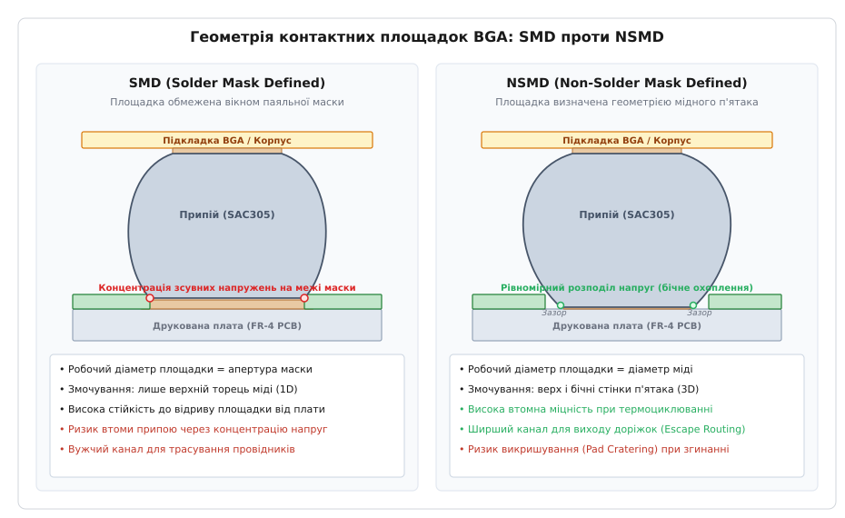
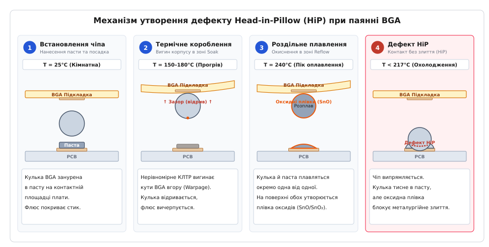

# BGA: монтаж і контроль

<preknowlist>
- [Шарування плати (PCB stackup)](root:hw-pcb/pcb-stackup) — діелектрики, препрег, металізація та внутрішні шари.
- [Трасування друкованої плати](root:hw-pcb/pcb-layout) — геометрія провідників, зазори та топологічні обмеження.
- [Проєктування посадкових місць (Footprint Design)](root:hw-pcb/footprint-design) — стандарти IPC-7351, площадки та паяльна маска.
- [Трафаретний друк пасти](root:hw-pcb/smd-stencil) — розрахунок апертур, площа перенесення пасти та реологія.
- [Рівні чутливості до вологи (MSL)](root:hw-pcb/moisture-sensitivity-levels) — сорбція вологи, сушіння та ефект попкорну.
- [Паяння оплавленням](root:hw-pcb/reflow-soldering) — температурні зони конвекційної печі та інтерметаліди.
- [Евтектичні сплави та припої](root:hw-pcb/eutectic-alloys) — фазові діаграми, ліквідус-солідус і змочуваність.
- [Теплові перехідні отвори](root:hw-pcb/thermal-vias) — структура металізованих переходів і тепловідвід.
</preknowlist>

Партія з трьохсот телекомунікаційних плат маршрутизації пакетів успішно проходить конвеєрну піч оплавлення, автоматична оптична інспекція (AOI) сканує поверхню та маркує всі вироби зеленим статусом «придатний», проте під час первинного апаратного тестування (Boundary Scan / JTAG) виявляється, що 28% процесорних вузлів не відповідають на системні запити шини. Центральний процесор у 1156-вивідному корпусі FCBGA (Flip-Chip Ball Grid Array) розміром 35 × 35 мм із кроком кульок 1.0 мм має обриви сигнальних ліній шини PCIe та ліній живлення ядра. Візуальний огляд під мікроскопом нічого не дає, оскільки масив із 1156 паяних з'єднань повністю схований під непрозорим текстолітовим корпусом мікросхеми. Стандартний двовимірний рентгенівський знімок (2D X-Ray) у вертикальній проєкції показує правильне коло припою над кожною площадкою без ознак перемичок або зміщення. Лише косий огляд під кутом 45 градусів на рентгенівській установці з мікрофокусною трубкою та комп'ютерна томографія (3D AXI) виявляють причину відмови: тридцять дві периферійні кульки у кутах корпусу мають прихований дефект «голова в подушці» (Head-in-Pillow) — паяльна кулька компонента торкається розплавленого горбика пасти на платі, утворивши механічну впадину, але між ними лишилася незруйнована плівка оксидів, яка заблокувала металургійне злиття металів.

Ця аварія виробничої лінії стала наслідком сукупності прорахунків: розробник використав на платі контактні площадки типу SMD (Solder Mask Defined), які створили різку концентрацію зсувних напружень на межі паяльної маски; під час нагрівання нескомпенсована різниця коефіцієнтів теплового розширення (КЛТР) кремнієвого кристала й текстоліту плати викликала динамічне короблення тонкого корпусу (Warpage) на 85 мкм; надмірно довга фаза прогріву (Soak) вичерпала хімічну активність флюсу в пасті, а перехідні отвори у площадках без захисного мідного покриття (Via-in-Pad) всмоктали рідкий припій усередину капілярних каналів плати.

Монтаж компонентів із кульковими виводами (BGA, CSP, WLCSP) принципово відрізняється від монтажу класичних корпусів із периферійними ніжками (QFP, SOIC, QFN). Контроль якості тут неможливо виконати оптичними засобами, а надійність паяного шва визначається мікроструктурою інтерметалідних шарів, балансом сил поверхневого натягу рідкого сплаву, геометрією контактних площадок та рентгенівським аналізом внутрішніх пустот і дефектів форми.

---

### Анатомія корпусів BGA та класифікація за типами з'єднання

Корпус типу BGA (англ. *Ball Grid Array* — матриця кулькових виводів) переносить електричні та теплові контакти з периферії деталі на її нижню площину у вигляді регулярної двовимірної сітки з паяльних кульок. Це дозволило подолати технологічний бар'єр корпусів QFP, де зменшення кроку плоских виводів нижче 0.4 мм призводило до їх масового загинання при транспортуванні та неконтрольованого утворення олов'яних перемичок (*bridging*) під час трафаретного друку пасти.


*Геометрія контактних площадок BGA та розподіл механічних напружень. Ліворуч: площадка SMD (Solder Mask Defined), обмежена вікном паяльної маски, з локалізацією зсувних напруг на гострому полімерному краї. Праворуч: площадка NSMD (Non-Solder Mask Defined), де припій обтікає бічні грані мідного диску, рівномірно розподіляючи напруження та збільшуючи ширину каналу трасування.*

Сучасна класифікація BGA-компонентів базується на матеріалі базової підкладки (*substrate*), способі внутрішнього монтажу напівпровідникового кристала та кроці розміщення виводів (*pitch*):

1. **PBGA (Plastic Ball Grid Array)** — найбільш масовий тип корпусу. Кремнієвий кристал монтується на багатошарову органічну підкладку на основі бісмалеїмід-триазину (BT-resin) або високотемпературного склотекстоліту FR-5. З'єднання кристала з доріжками підкладки виконується золотими або мідними мікропровідниками методом ультразвукового термокомпресійного розварювання (*Wire Bonding*), після чого вся верхня частина герметизується епоксидним компаундом (*mold compound*). Крок кульок зазвичай становить 1.27 мм, 1.0 мм або 0.8 мм.
2. **CBGA (Ceramic Ball Grid Array)** — мікросхеми на керамічній підкладці з оксиду алюмінію (Al₂O₃) або нітриду алюмінію (AlN). Мають відмінну теплопровідність та повну герметичність, проте коефіцієнт лінійного теплового розширення кераміки (6–7 ppm/°C) суттєво відрізняється від КЛТР склотекстоліту FR-4 (14–17 ppm/°C). Щоб запобігти зрізанню паяних з'єднань під час термоциклювання, у CBGA часто використовують високотемпературні свинцеві кульки зі сплаву 90Pb/10Sn з температурою плавлення понад 300°C, які не плавляться під час монтажу, зберігаючи калібровану висоту зазору (*stand-off*).
3. **FCBGA (Flip-Chip BGA)** — високопродуктивні мікропроцесори, графічні чипи та FPGA з високою густиною виводів. Кристал перевертається активною стороною донизу («flip-chip») і з'єднується з високощільною органічною підкладкою (ABF — *Ajinomoto Build-up Film*) за допомогою масиву мікростовпчиків (мідні стовпчики *Cu-pillar* з ковпачками з припою Sn-Ag або еолових мікрокульок) із кроком 80–150 мкм. Простір між кристалом і підкладкою заповнюється капілярним компаундом (*Underfill*).
4. **CSP (Chip Scale Package)** — клас мініатюрних корпусів, площа яких не перевищує площу самого кремнієвого кристала більш ніж у 1.2 раза. Крок кульок лежить у діапазоні 0.5–0.8 мм.
5. **WLCSP (Wafer-Level CSP)** — безпідкладковий варіант корпусу. Пасивація, перерозподільний металевий шар (RDL — *Redistribution Layer*) та посадка паяльних кульок виконуються безпосередньо на кремнієвій пластині (*wafer*) до її розрізання на окремі чипи. Товщина готового компонента може становити менше 0.4 мм, а крок кульок зменшується до 0.4 мм, 0.35 мм або 0.3 мм. Будь-який механічний перекіс плати під час роботи передається безпосередньо на крихкий кремній.

| Параметр корпусу | PBGA (Класичний) | FCBGA (Процесорний) | CSP (Компактний) | WLCSP (Напівпровідниковий) |
|---|---|---|---|---|
| **Типовий крок кульок (Pitch, P)** | 1.27 / 1.0 / 0.8 мм | 1.0 / 0.8 / 0.65 мм | 0.65 / 0.5 / 0.4 мм | 0.4 / 0.35 / 0.3 мм |
| **Діаметр кульки до паяння (D_b)** | 0.75 / 0.60 / 0.50 мм | 0.60 / 0.50 / 0.40 мм | 0.30 / 0.25 / 0.20 мм | 0.25 / 0.20 / 0.15 мм |
| **Висота зазору після паяння (h)** | 0.45–0.60 мм | 0.35–0.45 мм | 0.18–0.25 мм | 0.12–0.18 мм |
| **Чутливість до короблення (Warpage)** | Середня | Висока (через жорсткий кристал) | Низька | Критична (тонкий моноліт) |
| **Стійкість до термоциклів (TCoB)** | Добра | Посередня (вимагає Underfill) | Добра | Низька (вимагає Underfill) |

---

### Металургія кульок, припоїв та інтерметалідних шарів (IMC)

Паяне з'єднання BGA формується шляхом оплавлення монолітної кульки припою та дозованого відбитка паяльної пасти на контактній площадці друкованої плати. На відміну від штирьових компонентів, де об'єм припою утворює суцільну галтель, BGA-з'єднання функціонує як несуча колона, що одночасно забезпечує електричну провідність сигналу, передачу потужності живлення та механічне утримання масивного корпусу.

Склад сплаву кульки визначає температурне вікно процесу, механічну міцність на зсув та динаміку втоми:

- **SAC305 (Sn96.5 / Ag3.0 / Cu0.5)** — загальноприйнятий світовий промисловий стандарт безсвинцевого паяння (RoHS). Температура плавлення становить 217–219°C. Срібло (Ag) підвищує втомну міцність за рахунок виділення інтерметалідних дисперсоїдів Ag₃Sn, а мідь (Cu) зменшує швидкість розчинення мідних контактних площадок плати в розплавленому припої.
- **SAC405 (Sn95.5 / Ag4.0 / Cu0.5)** та **SAC105 (Sn98.5 / Ag1.0 / Cu0.5)** — варіації зі зміненим вмістом срібла. Сплав SAC105 має значно вищу пластичність і краще витримує динамічні удари та падіння приладів (*Drop Shock Test*), тому його широко використовують у смартфонах і портативній електроніці, хоча його стійкість до тривалого повільного термоциклювання нижча, ніж у SAC305.
- **Sn63Pb37 (63Sn / 37Pb)** — класичний евтектичний олов'яно-свинцевий сплав із чіткою температурою фазового переходу 183°C. Застосовується в аерокосмічній, військовій та медичній техніці, де директива RoHS не діє, завдяки відсутності ризику утворення олов'яних вусів (*tin whiskers*) та значно нижчій жорсткості шва.
- **Низькотемпературні сплави Bi-Sn (Sn42Bi58, T_m = 138°C)** — використовуються для тонких корпусів, схильних до руйнівного термічного короблення при 245°C, а також для послідовного ступеневого паяння складних вузлів.

У момент досягнення температури ліквідусу розплавлений припій контактує з мідною площадкою плати або металізацією підкладки BGA. Відбувається хімічна реакція взаємного розчинення та дифузії, в результаті якої на міжфазній межі виростає шар інтерметалідної сполуки (IMC — *Intermetallic Compound*).

Металургійний ланцюг утворення інтерметалідів на мідній підкладці під час паяння описується послідовністю фазових перетворень:

```text
Рідкий припій (Sn-Ag-Cu) + Тверда мідь (Cu)
  │
  ├─► Формування первинного шару η-фази:
  │     6 Cu + 5 Sn ───► Cu6Sn5  (хвилястий гребінчастий шар, товщина 1.0–2.5 мкм)
  │
  └─► Твердотільна дифузія при охолодженні та експлуатації:
        3 Cu + Cu6Sn5 ───► 2 Cu3Sn  (планарна ε-фаза між міддю та Cu6Sn5)
```

Інтерметалідний шар є обов'язковою умовою змочування та адгезії — без нього припій не тримається на металі. Проте сполуки Cu₆Sn₅ та Cu₃Sn є крихкими твердими фазами з високим електричним опором і низькою пластичністю. Якщо товщина IMC перевищує 3–4 мкм (через надто довге перебування в зоні розплаву або багаторазові цикли паяння), шар стає крихким концентратором напруг.

Особливу небезпеку становить явище утворення мікропустот Киркендалла (англ. *Kirkendall Voids*). Через те, що коефіцієнт дифузії атомів міді крізь інтерметалід є вищим за коефіцієнт зворотної дифузії атомів олова, на межі контакту між чистою міддю та шаром ε-фази (Cu₃Sn) виникає дефіцит маси. Вакансії кристалічної ґратки коагулюють у мікроскопічні пори діаметром від 10 нм до 1 мкм. При тривалій роботі пристрою за підвищеної температури (85–125°C) ланцюжок пор Киркендалла послаблює механічну межу, викликаючи раптовий відрив BGA-кульки від плати навіть при незначних механічних вібраціях.

При використанні фінішного покриття ENIG (*Electroless Nickel Immersion Gold*) шар імерсійного золота товщиною 0.05–0.1 мкм миттєво розчиняється в об'ємі припою під час оплавлення, а рідкий олов'яний розплав реагує з підлеглим хімічним нікелем (Ni-P, де вміст фосфору становить 7–9\%). На межі формується інтерметалід Ni₃Sn₄ або потрійна сполука (Cu,Ni)₆Sn₅. Оскільки нікель розчиняється у припої у 30–50 разів повільніше за мідь, товщина IMC росте значно повільніше (0.5–1.2 мкм), що забезпечує стабільність з'єднання при повторних термопрофілях. Проте, якщо хімічний процес нанесення нікелю був порушений (надмірне фосфорування), виникає дефект «чорної площадки» (*Black Pad*) — гіперкорозія нікелю, яка призводить до нульової адгезії кульки.

---

### Фізичні явища переносу: Електроміграція та термоелектроперенос

У сучасних мікропроцесорах і силових контролерах з високою густиною струму BGA-кульки працюють в екстремальних режимах навантаження, де виникають явища спрямованого переносу речовини:

1. **Електроміграція (Electromigration):**
   Коли постійний або пульсуючий струм проходить крізь мініатюрну кульку BGA діаметром 0.3–0.4 мм, перехід від тонкої мідної доріжки плати шириною 0.1 мм до об'єму кульки спричиняє явище згущення ліній струму (англ. *Current Crowding*). Локальна густина струму на вході у контактний інтерфейс може перевищувати j ≥ 10⁴ A/cm².
   Потік електронів («електронний вітер») передає імпульс іонам олова та міді, штовхаючи їх у напрямку від катода (негативного полюса) до анода (позитивного полюса). В результаті на катодній стороні кульки виникає дефіцит атомів і утворюються протяжні вакансійні тріщини та порожнини розриву, а на анодній стороні — надлишковий ріст горбків інтерметалідів і вусів, що призводить до коротких замикань із сусідніми виводами.

2. **Термоміграція (Thermomigration):**
   Кремнієвий кристал потужного процесора нагрівається під навантаженням до 95–105°C, тоді як друкована плата під кулькою має температуру близько 55–65°C. На висоті паяної кульки h = 0.2 мм (200 мкм) виникає екстремальний градієнт температури:

```text
       dT     (100 - 60) °C
grad = ── = ───────────────── = 2000 °C/см
       dh     0.020 см
```

Такий тепловий градієнт створює рушійну термодинамічну силу, під дією якої атоми розчинника (Sn) дифундують у бік холодного полюса (до друкованої плати), а домішкові атоми свинцю або міді накопичуються на гарячому боці. Це спричиняє фазове розшарування сплаву та втрату механічної однорідності з'єднання.

---

### Математичне моделювання втоми: Рівняння Коффіна-Менсона та Норріса-Ландзберга

При експлуатації пристрою періодичні цикли вмикання/вимикання нагрівають вузол, викликаючи циклічну зсувну деформацію кульок BGA через різницю коефіцієнтів теплового розширення (Δ α = α_{PCB} - α_{BGA}).

Максимальна зсувна деформація Δ γ виникає на найбільш віддалених від геометричного центру чіпа кульках (DNP — *Distance to Neutral Point*, L_{max}):

```text
               L_max * (alpha_PCB - alpha_BGA) * Delta_T
Delta_gamma = ───────────────────────────────────────────
                                  h
де:
L_max — відстань від центру мікросхеми до кутової кульки (мм);
Delta_T — розмах робочих температур циклу (T_max - T_min, °C);
alpha_PCB, alpha_BGA — КЛТР плати (16 ppm/°C) та корпусу BGA (12 ppm/°C);
h — висота стовпчика припою після паяння (Stand-off height, мм).
```

Кількість температурних циклів до втомного руйнування пайки N_f розраховується за модифікованою моделлю Норріса-Ландзберга (узагальнення закону Коффіна-Менсона):

```text
               -m       n       /     E_a     \
N_f = C * (Delta_gamma)   * f  * exp │ ─────────── │
                                     \  k_B * T_max/
де:
m — показник пластичної деформації (для SAC305 m ≈ 1.9–2.1);
f — частота температурних циклів (циклів/добу);
n — частотний показник (n ≈ 0.33);
E_a — енергія активації повзучості припою (E_a ≈ 0.5–0.7 еВ);
k_B — стала Больцмана (8.617 * 10^-5 еВ/К);
T_max — максимальна абсолютна температура циклу в Кельвінах.
```

З формули безпосередньо випливає фундаментальний інженерний висновок: **втомний ресурс N_f пропорційний квадрату висоти зазору h²**. Збільшення висоти посадки кульки шляхом оптимізації діаметра площадок та застосування сплавів із високою поверхневою пружністю вдвічі підвищує довговічність BGA-вузла вчетверо.

---

### Геометрія контактних площадок: SMD проти NSMD

Конструкція контактної площадки друкованої плати є фундаментальним чинником, що визначає геометрію паяного меніска, механічну надійність та трасувальні можливості під корпусом BGA. Стандарт IPC-7351 та інженерні настанови виробників мікросхем виділяють два топологічні типи площадок:

#### 1. Площадки SMD (Solder Mask Defined)
У конфігурації SMD розмір контактної зони повністю визначається апертурою паяльної маски. Мідний диск витравлюється на 75–100 мкм ширшим за вікно маски, тому шар діелектричної полімерної маски напливає на краї міді та перекриває їх по всьому периметру.

**Переваги:**
- Підвищена механічна міцність на відрив площадки від діелектрика FR-4. Паяльна маска механічно «притискає» краї мідного п'ятака, запобігаючи його підриву при ударних навантаженнях і згинанні друкованої плати.
- Висока точність позиціонування геометричного центру пайки при низькій точності травлення міді (за умови високої точності експонування фотомаски).

**Недоліки:**
- Плоска площа контакту (1D-змочування). Розплавлений припій змочує лише верхній плоский торець міді всередині вікна маски.
- Концентрація зсувних напруг. На гострому жорсткому краї отвору маски виникає різкий градієнт механічного напруження при циклічному тепловому розширенні. Зсувна втома розвивається саме по межі маски, що знижує втомний ресурс припою у 2–3 рази порівняно з NSMD.
- Зменшення зазору для трасування провідників (*Escape Routing*). Оскільки реальний мідний диск є ширшим за вікно, проміжок між сусідніми мідними площадками скорочується, обмежуючи проходження доріжок.

#### 2. Площадки NSMD (Non-Solder Mask Defined / Copper Defined)
У конфігурації NSMD розмір площадки визначається виключно геометричними розмірами витравленого мідного диску. Паяльна маска наноситься з гарантованим круговим зазором (*Clearance*) шириною 50–75 мкм, відкриваючи як верхню площину, так і бічні вертикальні стінки мідного п'ятака.

**Переваги:**
- Об'ємне тривимірне змочування (3D-змочування). Розплавлений припій стікає по бічних стінках міді до основи діелектрика FR-4, утворюючи плавний нижній меніск, який огинає край мідного диска.
- Плавний розподіл механічних напруг. Відсутність жорсткого полімерного бар'єра дозволяє паяному шву пружно деформуватися без виникнення пікових концентраторів напруги, що забезпечує найвищу стійкість до втоми при термоциклюванні (*Thermal Cycling Fatigue*).
- Широкий трасувальний канал. Мідний диск менший за номіналом на 15–20\%, що вивільняє простір для прокладання сигнальних провідників між кульками на зовнішніх шарах плати.

**Недоліки:**
- Менша площа зчеплення міді з епоксидною смолою FR-4. Через менший діаметр мідного п'ятака виникає підвищений ризик дефекту *Pad Cratering* — виривання мідної площадки «з м'ясом» діелектрика при пружному згинанні друкованої плати під час монтажу гвинтів або встановлення роз'ємів.

| Технічна характеристика | SMD (Solder Mask Defined) | NSMD (Non-Solder Mask Defined) |
|---|---|---|
| **Визначення робочого діаметра** | Апертурою паяльної маски | Діаметром мідного провідника |
| **Змочування бічних граней міді** | Відсутнє (закриті маскою) | Повне обтікання припоєм |
| **Втомна витривалість (термоцикли)** | Нижча (концентрація напруг на масці) | Вища у 2–3 рази (еталон для PCB) |
| **Стійкість до відриву п'ятака (Flex/Shock)** | Дуже висока | Потребує контролю деформацій плати |
| **Рекомендована сфера застосування** | Підкладки BGA-компонентів, роз'єми | Плати PCB для BGA/CSP з кроком ≤ 0.8 мм |

У сучасній практиці діє непорушне інженерне правило комбінування: **на підкладці самого BGA-компонента виробник застосовує площадки SMD** (для максимального захисту мікроскопічних внутрішніх доріжок від відшарування), а **на материнській друкованій платі тополог проєктує площадки NSMD** (для максимальної втомної довговічності та вільного трасування шин).

---

### Топологія перехідних отворів під BGA: Dog-Bone проти Via-in-Pad (VIPPO)

Розведення сотень сигнальних ліній із внутрішніх рядів матриці BGA вимагає переходу на внутрішні шари плати крізь металізовані перехідні отвори. Геометричне взаємне розташування контактної площадки та отвору безпосередньо впливає на якість формування паяного шва.

```text
1. Класичне трасування «Dog-Bone»:
   [ Контактний пад NSMD ] ──(міст-провідник)──► [ Перехідний отвір ]
              │                                          │
              └───────[ Бар'єр маски >= 75 мкм ]────────┘
                      (запобігає стіканню припою)

2. Сучасна технологія Via-in-Pad (VIPPO / IPC-4761 Type VII):
   ┌──────────────────────────────────────────────┐  ◄── Мідна кришка (Cap Plating >= 12 мкм)
   │           Контактний пад BGA                 │
   ├──┬────────────────────────────────────────┬──┤
   │  │   Заповнення епоксидною смолою         │  │
   │Cu│         (Epoxy Plugged)                │Cu│  ◄── Металізована стінка отвору
   │  │                                        │  │
```

При класичному підході **Dog-Bone** контактна площадка з'єднується з перехідним отвором коротким відрізком провідника довжиною 0.2–0.35 мм. Критичною вимогою тут є наявність суцільного бар'єра з паяльної маски (англ. *Solder Dam*) шириною не менше 75 мкм поверх цього з'єднувального містка. Якщо масковий бар'єр пошкоджений або відсутній, розплавлений припій кулі під дією капілярних сил перетече у відкритий перехідний отвір. В результаті об'єм кульки зменшиться, висота паяного стовпчика просяде, і сусідні виводи втратять контакт із платою.

Для корпусів із надвисокою щільністю виводів і кроком кульок 0.8 мм, 0.65 мм, 0.5 мм та 0.4 мм фізичного простору для розміщення окремих отворів Dog-Bone немає. У таких випадках застосовують технологію **Via-in-Pad Plated Over (VIPPO)**, регламентовану стандартом IPC-4761 (Тип VII):
1. Перехідний мікроотвір свердлиться безпосередньо в центрі контактної площадки BGA.
2. Стінки отвору металізуються міддю товщиною не менше 18–25 мкм.
3. Внутрішня порожнина отвору на 100% заповнюється спеціальною термореактивною епоксидною пастою без розчинників (наприклад, Taiyo THP-100DX1 або Tatsuta AE3030) з коефіцієнтом КЛТР, наближеним до міді.
4. Поверхня полімеризується, шліфується в один рівень із площиною мідної фольги та покривається фінішним суцільним шаром гальванічної міді (*Cap Plating*) товщиною 12–18 мкм.

Якщо на платі з відкритою матрицею BGA виконати звичайні незаповнені отвори у площадках без герметизації (поширена помилка аматорських проєктів), повітря всередині каналу під час нагрівання в печі розшириться й викличе викид припою у вигляді бризок, або навпаки — рідкий припій утече на протилежний бік плати, утворивши гарантований обрив кола.

---

### Трафаретний друк паяльної пасти під BGA/CSP

Нанесення паяльної пасти на BGA-площадки потребує суворого дотримання законів капілярного вивільнення пасти з апертур металевого трафарету. Якщо об'єм пасти на одній із площадок буде меншим на 20%, зменшена висота розплаву не зможе компенсувати короблення плати, спричинивши обрив; якщо ж пасти буде забагато — утвориться коротке замикання між сусідніми кульками.

Якість переносу паяльної пасти визначається двома геометричними критеріями за стандартом **IPC-7525**:

```text
                       W * L
1. Площинне відношення:  AR = ------------------- >= 0.66
                      2 * (W + L) * T

                 W
2. Аспектне відношення:  AS = --- >= 1.5
                 T

де:
W — ширина апертури трафарету (мм);
L — довжина апертури (для круглої апертури діаметром D: AR = D / (4 * T));
T — товщина металевої фольги трафарету (мм).
```

Якщо величина AR < 0.66, сила адгезійного тертя пасти об поліровані стінки нікелевої або сталевої апертури трафарету переважає силу зчеплення пасти з контактною площадкою друкованої плати. При підйомі трафарету паста частково залишається всередині отвору, що призводить до катастрофічного розкиду об'ємів відбитків.

Для BGA-компонентів із кроком 1.0–0.8 мм використовують трафарети зі сталі товщиною T = 120–130 мкм із круглими або квадратними апертурами з радіусним заокругленням кутів. Для мікросхем CSP та WLCSP із кроком 0.5–0.4 мм товщину фольги трафарету зменшують до T = 80–100 мкм, або застосовують ступеневі трафарети (*Step-Down Stencils*), де локальна зона під дрібнокроковим чіпом протравлюється або фрезерується до меншої товщини. Обов'язковим є застосування лазерного різання з електрополіруванням або додатковим нанопокриттям (*Nano-coating*), яке зменшує поверхневу енергію стінок і підвищує коефіцієнт переносу пасти до 90–95%.

Розмір зерна порошку паяльної пасти (за класифікацією J-STD-005) підбирають за «правилом п'яти кульок» — у найменшій апертурі трафарету в поперечному перерізі має вільно розміщуватися щонайменше 5 сферичних зерен припою:
- **Type 3 (25–45 мкм)** — для стандартних BGA з кроком ≥ 0.8 мм;
- **Type 4 (20–38 мкм)** — для BGA та CSP з кроком 0.5–0.65 мм;
- **Type 5 (10–25 мкм)** та **Type 6 (5–15 мкм)** — для ультратонких WLCSP із кроком ≤ 0.4 мм.

Для монтажу перевернутих кристалів (Flip-Chip) та деяких WLCSP традиційний трафаретний друк замінюють технологією занурення у флюс (*Flux Dipping*). Монтажний автомат *Pick-and-Place* опускає мікросхему кулями в обертову ванночку з каліброваною плівкою липкого флюсу товщиною 25–50 мкм. Флюс залишається лише на нижніх верхівках кульок, після чого чіп встановлюється безпосередньо на чисті мідні площадки плати.

---

### Термічні профілі паяння оплавленням (Reflow Profiling)

Складання плат із масивними BGA-компонентами накладає жорсткі вимоги на температурно-часовий профіль конвекційної печі. Через високу теплоємність корпусу BGA температура під його центром відстає від температури на відкритих кутах плати. Якщо градієнт температури по поверхні плати (Δ T) перевищить 5–7°C, периферійні легкозаймисті компоненти перегріються й згорять до того, як розплавляться центральні кульки під процесором.

```text
Температура (°C)
  ^
  │                                    [ Зона піку (Reflow) ]
  │                                    T_peak = 235–245°C
  │                                       ┌───────┐
  │                                      /  TAL    \
217 ────────────────────────────────────/  45–75 с  \──────── (Ліквідус SAC305)
  │                   [ Зона Soak ]    /             \
180 │                  ┌───────────────┘               \  [ Контрольоване охолодження ]
  │                 /   150–180°C                      \   Швидкість: 2–4°C/с
150 │                /    60–120 с                       \
  │  [ Прогрів ]   /                                     \
  │   Ramp-up     /                                       \
  │   1–3°C/с    /                                         \
  │             /                                           \
25 └────────────┴───────────────────────────────────────────┴────────► Час (с)
```

Класичний термопрофіль для безсвинцевого паяння BGA складається з чотирьох послідовних технологічних зон:

1. **Зона попереднього нагріву (Ramp-to-Soak):** Швидкість наростання температури становить 1.0–2.5°C/с. Занадто швидкий нагрів (> 3°C/с) викликає тепловий шок крихкого кремнієвого кристала та закипання розчинників у флюсі, що призводить до розкидання мікрокульок припою (*solder beads*).
2. **Зона стабілізації (Soak / Preheat):** Температура утримується в діапазоні 150–180°C (для свинцевих сплавів) або 160–200°C (для SAC305) протягом 60–120 секунд. Призначення зони — вирівняти температурний потенціал між масивними металевими екранами, радіаторами BGA та легкими чип-резисторами, а також активувати хімічні речовини флюсу для повного розчинення оксидних плівок CuO та SnO₂.
3. **Зона оплавлення (Reflow Peak):** Плата нагрівається вище точки ліквідусу (217°C для SAC305) до пікової температури T_peak = 235–245°C (але не вище 250–260°C за специфікацією вологочутливості MSL / J-STD-020). Час перебування над ліквідусом (TAL — *Time Above Liquidus*) має суворо контролюватися в межах 45–75 секунд. Якщо TAL < 40 с, припій не встигне повністю змочити контактні площадки, що призведе до дефектів форми; якщо TAL > 90 с, надмірно виросте крихкий шар інтерметалідів, а флюс повністю згорить і спричинить окиснення розплаву.
4. **Зона контрольованого охолодження (Cooling):** Швидкість зниження температури має підтримуватися на рівні 2.0–4.0°C/с. Швидке охолодження подрібнює кристалічну структуру сплаву, створюючи міцну дрібнозернисту евтектичну матрицю з високою стійкістю до втоми. Повільне охолодження (< 1.5°C/с) формує великі грубі голчасті кристали Ag₃Sn та товсті інтерметаліди, які легко розтріскуються під час експлуатації.

На відповідальних виробництвах паяння складних BGA здійснюється в середовищі захисного азоту (N₂) із залишковою концентрацією кисню менше 50–100 ppm. Азотна атмосфера повністю блокує високотемпературне окиснення рідкого олова, істотно знижує поверхневий натяг розплаву та розширює технологічне вікно паяння, практично ліквідуючи ризик утворення дефектів змочування.

---

### Пустоти в паяних кульках (BGA Voiding) та критерії IPC-7095

Утворення порожнин і газових раковин всередині паяних кульок BGA є неминучим фізичним явищем, спричиненим виділенням летких компонентів флюсу, які не встигають вийти назовні до моменту кристалізації розплавленого олова.

Стандарт **IPC-7095** (*Design and Assembly Process Implementation for BGAs*) класифікує пустоти за механізмом їх виникнення та локалізацією:

1. **Макропустоти (Macro-voids / Process Voids):** Великі сферичні порожнини в центральній частині кульки діаметром від 50 до 250 мкм. Виникають через закипання й термічну деструкцію органічних смол флюсу паяльної пасти під час фази оплавлення.
2. **Мікропустоти на межі розділу (Micro-voids / Interfacial Voids):** Дрібні пори (діаметром менше 25 мкм), сконцентровані безпосередньо на міжфазній межі біля інтерметалідного шару контактної площадки. Є наслідком неякісного лудіння, деградації органічного покриття OSP або залишків вологи.
3. **Планетарні пустоти (Planetary Voids):** Ланцюжки пустот навколо зовнішнього периметра кульки, зумовлені дегазацією порцій паяльної маски при її локальному перегріві.
4. **Пустоти від перехідних отворів (Microvia Voids):** Виникають над закритими або глухими переходами VIPPO у разі неповного заповнення отвору епоксидним компаундом. Залишкове повітря всередині мікроотвору розширюється й утворює гігантську порожнину прямо в основі паяного з'єднання.

```text
Критерії допустимості пустот за стандартом IPC-A-610 / IPC-7095 (Class 3 — High Reliability):

1. Сумарна проєкційна площа всіх пустот:
   A_void_total / A_ball <= 15% (для Class 1/2 допускається до 25%)

2. Площа найбільшої поодинокої пустоти:
   A_void_single / A_ball <= 8%

3. Пустоти в контактній зоні інтерфейсу (Interfacial Margin 15% від краю):
   A_void_interface / A_pad <= 10%
```

Всупереч поширеній думці, поодинокі макропустоти помірного розміру в центрі кульки (до 10–12%) практично не впливають на електричний опір і не знижують статичну міцність з'єднання, оскільки щільність струму через великий переріз кульки є відносно низькою. Проте пустоти, розташовані на контактній межі (біля підкладки чіпа або біля площадки плати), катастрофічно зменшують ефективну площу інтерметалідного зчеплення. Під час термоциклювання тріщини втомного руйнування поширюються саме від порожнини до порожнини вздовж межі розділу, призводячи до повного розмикання ланцюга.

---

### Дефекти Head-in-Pillow (HiP), короблення та мікровикришування

Монтаж BGA-компонентів супроводжується специфічними видами прихованого браку, які неможливо виявити традиційними методами контролю.


*Чотиристадійний механізм виникнення дефекту Head-in-Pillow (HiP) під час паяння BGA в конвеєрній печі. Від початкового нанесення пасти до відриву кульки через термічне короблення (Warpage), роздільного окиснення розплавів та формування фіктивного контакту без металургійного зв'язку.*

#### 1. Дефект Head-in-Pillow (HiP)
Дефект «голова в подушці» (HiP) — один із найбільш підступних видів дефектів BGA. Його фізичний механізм розгортається у чотири послідовні фази:
- **Фаза 1:** Мікросхема встановлюється на плату, паяльна кулька BGA занурюється у відбиток сирої паяльної пасти.
- **Фаза 2 (Короблення / Warpage):** Під час проходження зони нагріву (150–200°C) виникає значний градієнт розширення через різницю КЛТР між кремнієвим кристалом (3 ppm/°C), підкладкою чіпа (12 ppm/°C) та склотекстолітом плати (16 ppm/°C). Тонкий корпус мікросхеми вигинається у формі чаші (*Smile Warpage*) або купола (*Cry Warpage*). Кутові кульки підіймаються над платою на 50–100 мкм і фізично відриваються від пасти.
- **Фаза 3 (Окиснення в піку):** Перебуваючи у відірваному стані при піковій температурі 240°C, кулька і горбик пасти плавляться незалежно один від одного. Захисний флюс випаровується, і на поверхні обох розплавлених крапель утворюється щільна плівка високотемпературного оксиду олова (SnO / SnO₂).
- **Фаза 4 (Охолодження та фіктивний контакт):** При зниженні температури корпус BGA розпрямляється, і розплавлена кулька опускається назад у розплавлений горбик пасти на платі. Сила поверхневого натягу оксидної плівки запобігає коалесценції (злиттю) двох рідких фаз. Кулька продавлює у пасті заглиблення («подушку») і застигає.

Утворене з'єднання має слабкий механічний притискний контакт. На вихідному заводському контролі плата може успішно проходити електричне тестування. Проте після встановлення у виріб, внаслідок температурних коливань або незначної вібрації, оксидний мікроперехід розмикається, спричиняючи «плаваючий» збій всього пристрою.

#### 2. Дефект Pad Cratering (Мікровикришування діелектрика)
Дефект полягає в утворенні внутрішніх мікротріщин в епоксидній смолі FR-4 безпосередньо під мідною контактною площадкою BGA. Тріщина розвивається в шарі діелектрика між мідною фольгою та першим шаром скловолоконної тканини.
- Виникає під час монтажу важких радіаторів охолодження, затягування кріпильних гвинтів, встановлення модулів пам'яті або при термоциклюванні через жорсткість паяного шва NSMD.
- Мідна площадка разом із кулькою повністю відривається від основи плати, при цьому сам паяний шов залишається неушкодженим.
- Запобігання: проєктування площадок зі скругленими краями, додавання додаткових якірних мідних виступів (*Anchor Tabs*), використання діелектриків із високою температурою склування (T_g ≥ 170°C) та застосування демпферного підливання компаундом (*Underfill*).

---

### Рентгенівський контроль (2D та 3D AXI)

Оскільки візуальний огляд та системи автоматичного оптичного контролю (AOI) безсилі перед прихованими під корпусом виводами, єдиним неруйнівним методом верифікації монтажу BGA є рентгенівська інспекція.

```text
Схема рентгенівської інспекції:

  [ Рентгенівська трубка ] (Мікрофокус: 0.5–2.0 мкм)
            │
            ▼  X-Ray пучок
     ┌──────────────┐
     │  Корпус BGA  │  ◄── Ослаблення випромінювання (Закон Бугера-Ламберта)
     │  ●  ●  ●  ●  │      I = I_0 * exp(-mu * rho * x)
     └──────────────┘      Важке олово (Sn, Z=50) поглинає рентген значно
     ════════════════      сильніше, ніж кремній (Si, Z=14) чи пластик (C, H, O)
      Друкована плата
            │
            ▼
   [ Цифровий плоскопанельний детектор FPD ] ──► [ Алгоритм комп'ютерного зору ]
```

1. **2D рентгеноскопія (Transmission X-Ray):**
   - Рентгенівські промені пронизують плату перпендикулярно.
   - Дозволяє швидко виявити грубі дефекти: повні олов'яні перемички між кульками (*bridging*), відсутність кульок, значні зміщення чіпа відносно сітки площадок та загальну площу макропустот.
   - **Недоліки:** неможливо розрізнити верхню та нижню сторони плати при двосторонньому монтажі компонентів; неможливо виявити дефект HiP, оскільки проєкція кульки, що лежить у подушці, виглядає як правильне рівномірне коло.

2. **Рентгенівський контроль під кутом (Oblique View 2.5D):**
   - Плата або рентгенівська трубка нахиляється на кут 30–60° з обертанням на 360°.
   - Силует кожної кульки витягується в еліпс. Якщо паяне з'єднання якісне, кулька набуває характерної форми бочки з плавними галтелями вгорі та внизу. При дефекті HiP чітко видно розрив контуру або подвійну еліптичну тінь від окремої кульки та відбитка пасти.

3. **3D автоматизований рентгенівський контроль (3D AXI — Digital Tomosynthesis / CT):**
   - Система робить серію з десятків рентгенівських знімків під різними кутами та здійснює математичну реконструкцію об'єму методами комп'ютерної томографії.
   - Програмне забезпечення генерує цифрові плоскі зрізи (*Z-slices*) товщиною від 5 до 20 мкм паралельно поверхні плати:
     - *Зріз 1 (Top Interface):* Інспекція якості змочування та інтерметалідів біля підкладки чіпа.
     - *Зріз 2 (Center Ball):* Розрахунок відсотка макропустот та оцінка діаметра кульки.
     - *Зріз 3 (Bottom Interface):* Аналіз площі змочування площадки плати, детекція мікропустот і тріщин HiP.

Для автоматизації аналізу сотень тисяч паяних з'єднань на виробничій лінії застосовують спеціалізовані математичні алгоритми цифрової сегментації зображень, розрахунку відсотка порожнин та геометричної класифікації за IPC-7095. Детальну програмну реалізацію такого аналізатора на мовах C99 та C++20 розгорнуто у практичній вставці [Аналізатор рентгенівських знімків BGA-кульок](root:hw-pcb/bga-assembly/proj-bga-void-analyzer.md).

---

### Заповнення компаундом (Underfill) та механічне підсилення

Для підвищення стійкості BGA-вузлів до вібрацій, ударних навантажень та температурних циклів використовують полімерне підливання компаундом — **Underfill**.

Компаунд являє собою рідку епоксидну смолу з високим ступенем наповнення мікросферами діоксиду кремнію (SiO₂, до 60–70% за масою). Завдяки кремнієвому наповнювачу коефіцієнт КЛТР застиглого компаунду знижується до 22–30 ppm/°C, узгоджуючи теплові деформації між чипом, кулями та платою.

```text
Механізм перерозподілу напружень за допомогою Underfill:

Без Underfill:                           З Underfill:
  ┌──────────────┐                         ┌──────────────┐
  │  Корпус BGA  │                         │  Корпус BGA  │
  └──┬────────┬──┘                         └──┬────────┬──┘
     ▲        ▲                               ██████████  ◄── Епоксидний Underfill
  Усі зсувні напруги концентруються        Напруження розподіляються рівномірно
  на 4 кутових кульках (Швидка втома)      по всій площі підкладки (Ресурс х20)
```

Технологічний процес капілярного підливання (CUF — *Capillary Underfill*):
1. Друкована плата після паяння BGA прогрівається на підігрівальному столику до 70–90°C для зниження в'язкості смоли.
2. Прецизійний автоматичний дозатор наносить L-подібну або I-подібну лінію компаунду вздовж одного чи двох суміжних країв корпусу BGA.
3. Під дією капілярного тиску в зазорі 100–250 мкм рідина самостійно затягується під корпус, повністю обтікаючи всі кульки та витісняючи повітря через протилежний відкритий край. Нанесення компаунду по всьому замкненому периметру категорично заборонено, оскільки це призводить до утворення гігантського повітряного міхура під центром чіпа.
4. Плата переміщується в термошафу, де компаунд полімеризується при температурі 130–150°C протягом 30–60 хвилин.

Застосування якісного Underfill підвищує втомний ресурс паяних з'єднань BGA при термоциклюванні у 10–50 разів, що є критично важливим для автомобільної електроніки підкапотного простору та портативних пристроїв.

---

### Технологія ремонту та реболлінгу (BGA Rework)

Заміна несправної або некоректно запаяної BGA-мікросхеми вимагає спеціалізованого ремонтного центру з роздільними зонами нагріву та оптичною призматичною системою центрування.

```text
Технологічний цикл ремонту BGA (Rework):

  1. Попереднє сушіння плати (Baking: 125°C, 24–48 год за J-STD-033)
            │
            ▼
  2. Демонтаж BGA (Нижній ІЧ-прогрів 150°C + Верхнє сопло гарячого повітря)
            │
            ▼
  3. Очищення контактних площадок (Site Redressing мідною опліткою)
            │
            ▼
  4. Реболлінг чіпа (Reballing: трафарет прямого нагріву + нові кульки SAC305)
            │
            ▼
  5. Оптичне суміщення (Split-Beam призма: кульки BGA суміщаються з падами плати)
            │
            ▼
  6. Вторинне паяння за суворим термопрофілем з нижнім підігрівом
```

1. **Попереднє сушіння (Baking):** Склотекстоліт плати та корпус BGA поглинають вологу з повітря. Якщо вологу не видалити перед демонтажем, раптове нагрівання до 240°C перетворить воду на надкритичну пару, викликавши вибухове розшарування плати або здуття мікросхеми («ефект попкорну» за стандартом IPC/JEDEC J-STD-033). Плата сушиться в конвекційній печі при температурі 125°C протягом 24–48 годин.
2. **Локальний демонтаж:** Плата закріплюється на столику термопрофільної станції. Знизу вмикається інфрачервоний або конвекційний переднагрівач площею на всю плату для підтримки загальної температури 140–160°C (запобігає жолобленню текстоліту). Зверху на мікросхему опускається сопло гарячого повітря, що точно відповідає розмірам чіпа. Після розплавлення кульок мікросхема знімається вакуумним пінцетом.
3. **Підготовка місця посадки (Site Redressing):** Залишки старого окисленого припою видаляються з площадок плати за допомогою безвідмивної мідної обплітки (*Desoldering Braid*) та паяльника з плоским мікрохвильовим жалом, змоченим гелевим флюсом. Площадки промиваються ізопропіловим спиртом і перевіряються під мікроскопом на предмет цілісності маски.
4. **Реболлінг (Reballing):** Відновлення масиву кулькових виводів на демонтованій мікросхемі. На корпус накладається металевий трафарет прямого нагріву (*Direct Heat Stencil*), на площадки наноситься найтонший шар липкого флюсу (*Tacky Flux*), після чого в отвори трафарету засипаються калібровані преформовані кульки потрібного діаметра (0.4–0.6 мм зі сплаву SAC305 або Sn63Pb37). Трафарет із чіпом прогрівається термофеном або в печі до оплавлення кульок.
5. **Оптичне суміщення та повторний монтаж:** Мікросхема встановлюється у вакуумний тримач ремонтної станції. Оптична голівка зі світлороздільною призмою (*Split-Beam Optical Prism*) одночасно транслює в камеру зображення нижніх кульок BGA (у червоному підсвічуванні) та контактних площадок на платі (у синьому підсвічуванні). Оператор мікрогвинтами суміщає дві картинки до повного накладання колірних маркерів. Після опускання компонента запускається автоматичний цикл вторинного оплавлення.

---

### Розрахунковий модуль верифікації BGA-монтажу

Для перевірки технологічності посадкового місця, розрахунку каналів трасування та оцінки термопрофілю розроблено алгоритмічний модуль інженерної верифікації BGA.

:::tabs
```c
#include <stdio.h>
#include <stdbool.h>
#include <math.h>

#define BGA_PI 3.14159265358979323846

typedef struct {
    double pitch_mm;           /* Крок кульок BGA */
    double ball_diam_mm;       /* Початковий діаметр кульки */
    double pad_diam_mm;        /* Діаметр площадки на платі */
    double mask_clearance_mm;  /* Зазор паяльної маски */
    bool   is_nsmd;            /* true = NSMD, false = SMD */
    double trace_width_mm;     /* Ширина сигнального провідника */
    double trace_clearance_mm; /* Зазор між провідником і площадкою */
} BgaGeometryConfig;

typedef struct {
    double escape_channel_mm;  /* Ширина каналу між сусідніми площадками */
    int    max_traces_in_ch;   /* Максимальна кількість доріжок у каналі */
    double area_ratio;         /* Площинне відношення апертури (при T=0.12мм) */
    double estimated_standoff; /* Оціночна висота зазору після пайки */
    bool   is_valid;           /* Чи відповідає нормам DFM/IPC */
} BgaVerificationReport;

/* Розрахунок геометрії та технологічності BGA */
BgaVerificationReport verify_bga_layout(const BgaGeometryConfig* cfg, double stencil_thick_mm) {
    BgaVerificationReport rep;
    double effective_pad = cfg->pad_diam_mm;
    
    if (cfg->is_nsmd) {
        /* Для NSMD враховуємо зазор маски при оцінці каналу на зовнішньому шарі */
        double copper_pad = cfg->pad_diam_mm;
        rep.escape_channel_mm = cfg->pitch_mm - copper_pad;
    } else {
        /* Для SMD мідь ширша за апертуру маски */
        double copper_pad = cfg->pad_diam_mm + 2.0 * cfg->mask_clearance_mm;
        rep.escape_channel_mm = cfg->pitch_mm - copper_pad;
    }
    
    /* Розрахунок скільки доріжок вміщується в канал */
    double needed_per_trace = cfg->trace_width_mm + cfg->trace_clearance_mm;
    if (rep.escape_channel_mm > cfg->trace_clearance_mm) {
        rep.max_traces_in_ch = (int)((rep.escape_channel_mm - cfg->trace_clearance_mm) / needed_per_trace);
    } else {
        rep.max_traces_in_ch = 0;
    }
    
    /* Площинне відношення круглої апертури трафарету (AR = D / (4 * T)) */
    rep.area_ratio = cfg->pad_diam_mm / (4.0 * stencil_thick_mm);
    
    /* Оцінка висоти осадки кульки зі збереженням об'єму сфери (V = const) */
    double ball_vol = (4.0 / 3.0) * BGA_PI * pow(cfg->ball_diam_mm / 2.0, 3.0);
    double r_pad = cfg->pad_diam_mm / 2.0;
    /* Наближена висота стовпчика припою (усічена сфера) */
    rep.estimated_standoff = cfg->ball_diam_mm * (1.0 - 0.25 * pow(cfg->pad_diam_mm / cfg->ball_diam_mm, 2.0));
    
    /* Перевірка мінімальних норм DFM */
    rep.is_valid = (rep.escape_channel_mm >= 0.10) && 
                   (rep.area_ratio >= 0.66) && 
                   (rep.estimated_standoff >= 0.15);
                   
    return rep;
}

int main(void) {
    BgaGeometryConfig bga08 = {
        .pitch_mm = 0.80,
        .ball_diam_mm = 0.45,
        .pad_diam_mm = 0.38,
        .mask_clearance_mm = 0.05,
        .is_nsmd = true,
        .trace_width_mm = 0.10,
        .trace_clearance_mm = 0.10
    };
    
    BgaVerificationReport res = verify_bga_layout(&bga08, 0.12);
    
    printf("=== BGA Layout Verification (Pitch 0.8mm NSMD) ===\n");
    printf("Ширина каналу трасування: %.3f мм\n", res.escape_channel_mm);
    printf("Доріжок у каналі:         %d\n", res.max_traces_in_ch);
    printf("Area Ratio трафарету:     %.2f (Полотно >= 0.66: %s)\n", 
           res.area_ratio, res.area_ratio >= 0.66 ? "OK" : "FAIL");
    printf("Висота зазору Standoff:   %.3f мм\n", res.estimated_standoff);
    printf("Статус валідації DFM:     %s\n", res.is_valid ? "PASSED" : "REJECTED");
    
    return 0;
}
```
```cpp
#include <iostream>
#include <iomanip>
#include <numbers>
#include <cmath>
#include <expected>
#include <string_view>

struct BgaGeometryConfig {
    double pitch_mm{0.80};           // Крок кульок
    double ball_diam_mm{0.45};       // Діаметр кульки
    double pad_diam_mm{0.38};        // Діаметр площадки
    double mask_clearance_mm{0.05};  // Зазор маски
    bool   is_nsmd{true};            // Тип площадки NSMD vs SMD
    double trace_width_mm{0.10};     // Ширина доріжки
    double trace_clearance_mm{0.10}; // Зазор доріжки
};

struct BgaVerificationReport {
    double escape_channel_mm{0.0};
    int    max_traces_in_ch{0};
    double area_ratio{0.0};
    double estimated_standoff_mm{0.0};
};

enum class LayoutError {
    ChannelTooNarrow,
    ApertureRatioViolated,
    InsufficientStandoff
};

class BgaValidator {
public:
    [[nodiscard]] static constexpr std::expected<BgaVerificationReport, LayoutError>
    validate(const BgaGeometryConfig& cfg, double stencil_thick_mm) noexcept {
        BgaVerificationReport rep{};
        
        if (cfg.is_nsmd) {
            rep.escape_channel_mm = cfg.pitch_mm - cfg.pad_diam_mm;
        } else {
            const double copper_pad = cfg.pad_diam_mm + 2.0 * cfg.mask_clearance_mm;
            rep.escape_channel_mm = cfg.pitch_mm - copper_pad;
        }
        
        if (rep.escape_channel_mm < 0.10) {
            return std::unexpected(LayoutError::ChannelTooNarrow);
        }
        
        const double needed = cfg.trace_width_mm + cfg.trace_clearance_mm;
        if (rep.escape_channel_mm > cfg.trace_clearance_mm) {
            rep.max_traces_in_ch = static_cast<int>(
                (rep.escape_channel_mm - cfg.trace_clearance_mm) / needed
            );
        }
        
        rep.area_ratio = cfg.pad_diam_mm / (4.0 * stencil_thick_mm);
        if (rep.area_ratio < 0.66) {
            return std::unexpected(LayoutError::ApertureRatioViolated);
        }
        
        const double ratio = cfg.pad_diam_mm / cfg.ball_diam_mm;
        rep.estimated_standoff_mm = cfg.ball_diam_mm * (1.0 - 0.25 * (ratio * ratio));
        if (rep.estimated_standoff_mm < 0.15) {
            return std::unexpected(LayoutError::InsufficientStandoff);
        }
        
        return rep;
    }
};

int main() {
    constexpr BgaGeometryConfig config{
        .pitch_mm = 0.80,
        .ball_diam_mm = 0.45,
        .pad_diam_mm = 0.38,
        .mask_clearance_mm = 0.05,
        .is_nsmd = true,
        .trace_width_mm = 0.10,
        .trace_clearance_mm = 0.10
    };
    
    constexpr double stencil_thickness = 0.12;
    const auto result = BgaValidator::validate(config, stencil_thickness);
    
    std::cout << std::fixed << std::setprecision(3);
    std::cout << "=== C++20 BGA DFM Verification Engine ===\n";
    
    if (result.has_value()) {
        const auto& rep = result.value();
        std::cout << "Ширина каналу трасування: " << rep.escape_channel_mm << " мм\n";
        std::cout << "Доріжок у каналі:         " << rep.max_traces_in_ch << "\n";
        std::cout << "Area Ratio апертури:      " << rep.area_ratio << " (>= 0.66 OK)\n";
        std::cout << "Висота зазору Standoff:   " << rep.estimated_standoff_mm << " мм\n";
        std::cout << "Результат валідації:      УСПІШНО (DFM Passed)\n";
    } else {
        std::cout << "Помилка валідації топології BGA!\n";
    }
    
    return 0;
}
```
:::

---

### Підсумковий інженерний чек-лист DFM/DFA для BGA

При розробці та підготовці до серійного виробництва друкованих плат із BGA-компонентами обов'язково контролюють такі вузли:

1. **Тип площадок:** На друкованій платі застосовано площадки **NSMD** із гарантованим круговим зазором паяльної маски 50–75 мкм для вирівнювання механічних напруг.
2. **Перехідні отвори:** Для кроку ≤ 0.8 мм реалізовано технологію **VIPPO** (IPC-4761 Type VII) із заповненням смолою та суцільним мідним перекриттям; для класичних переходів Dog-Bone гарантовано бар'єр маски ≥ 75 мкм.
3. **Трафарет:** Площинне відношення апертур AR ≥ 0.66, для кроку ≤ 0.5 мм застосовано нанопокриття та пасту типу Type 4 / Type 5.
4. **Термопрофіль:** Градієнт Δ T ≤ 5°C по площі BGA, час над ліквідусом TAL = 45–75 с, пікова температура T_peak = 235–245°C (для SAC305), швидкість охолодження 2–4°C/с.
5. **Рентген-контроль:** Застосування 3D AXI з контролем сумарної площі пустот < 15\% та перевіркою кутових кульок на дефект Head-in-Pillow (HiP).
