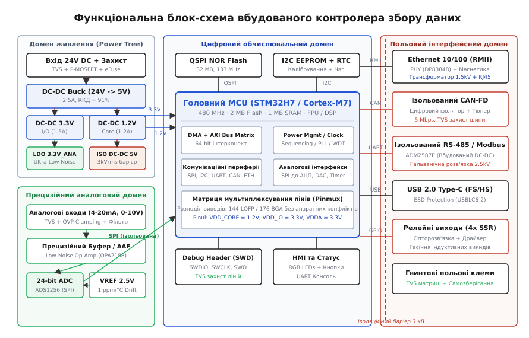
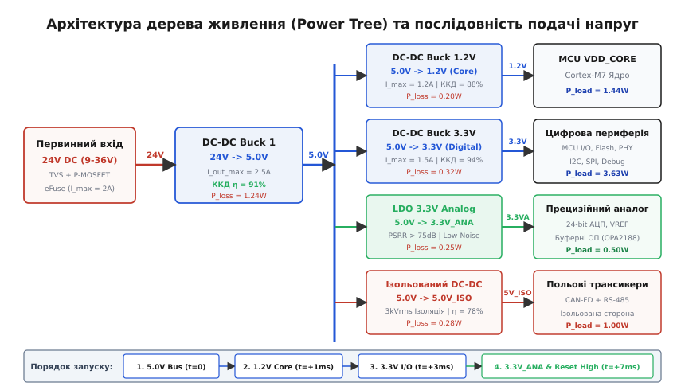

# Блок-схема пристрою: вузли, зв'язки, межі

<preknowlist>
- [Принципова схема](root:hw-pcb/schematic-purpose) — призначення електричної схеми, вузли та лінії з'єднань
- [Ієрархічні схеми і листи](root:hw-pcb/hierarchical-schematics) — декомпозиція складної схеми на функціональні блоки
- [Цілісність живлення (Power Integrity)](root:hw-pcb/power-integrity) — імпеданс шин живлення, перехідні процеси та фільтрація
- [Знижувальний імпульсний перетворювач (Buck)](root:hw-power/buck) — принцип роботи, ККД та тепловиділення DC-DC перетворювачів
- [Лінійний стабілізатор із низьким спадом напруги (LDO)](root:hw-power/ldo) — лінійне перетворення, придушення пульсацій та розсіювання тепла
</preknowlist>

Розробка апаратної частини складного електронного пристрою починається не з вибору конкретних резисторів і не з розведення провідників у редакторі друкованих плат, а зі створення системної архітектури. Якщо розробник одразу сідає малювати електричну схему багатокомпонентного промислового контролера, не зафіксувавши функціональні домени, фатальний прорахунок стає неминучим ще до завершення першого аркуша: 144-вивідний мікроконтролер вичерпує доступні виводи через апаратний конфлікт між лініями швидкісної пам'яті OctoSPI та інтерфейсом Ethernet RMII, лінійний стабілізатор LDO в корпусі SOT-223 при перепаді напруги з 24 В до 3.3 В і струмі навантаження 350 мА виділяє 7.24 Вт надлишкового тепла й миттєво перегрівається вище 400 °C, а високочастотні пульсації імпульсного перетворювача потрапляють у вхідний тракт 24-бітного сигма-дельта АЦП через спільну цифрову землю. Функціональна блок-схема є першим фізичним і топологічним контрактом проекту, який встановлює межі між функціональними вузлами, задає розподіл електричної потужності, фіксує бар'єри захисту та визначає просторову структуру майбутньої друкованої плати.

## Архітектурний перехід: від технічного завдання до функціональних меж

Технічне завдання (ТЗ) описує вимоги до кінцевого виробу на мові користувацьких та системних характеристик: діапазон вхідних напруг живлення, кількість та тип вимірювальних каналів, інтерфейси передачі даних, робочий температурний діапазон, габаритні обмеження та час автономної роботи від резервного джерела. Ці вимоги не містять прямих вказівок щодо схемотехнічних рішень. Перехід від абстрактного ТЗ до друкованої плати вимагає послідовної декомпозиції системи на функціональні домени — відокремлені апаратні підсистеми, кожна з яких виконує завершену фізичну функцію та має чітко визначений інтерфейс взаємодії з іншими доменами.

Коли прилад проектується без попереднього блочного структурування, виникає ефект схемотехнічного хаосу. Спроба поєднати цифровий мікропроцесор, чутливі аналогові підсилювачі, радіочастотний тракт і силові перетворювачі на одному неструктурованому аркуші призводить до того, що зворотні струми цифрових перемикань починають протікати крізь опорні точки вимірювальних кіл, а лінії керування силовими ключами прокладаються поруч із високоомними лініями датчиків. 

Блок-схема вирішує це завдання шляхом встановлення явних кордонів між різними частинами схеми. Вона перетворює набір вимог ТЗ на граф вузлів і з'єднань, де кожен вузол представляє фізичний функціональний блок, а кожне ребро графа — потік енергії, аналоговий сигнал або цифровий інтерфейс обміну даними.

```txt
Вимоги ТЗ (напруги, канали, інтерфейси, габарити)
   ↓
Функціональна декомпозиція (виділення доменів живлення, обчислення, аналогу, захисту)
   ↓
Функціональна блок-схема (фіксація меж, інтерфейсів, напруг і струмів)
   ↓
Бюджетування ресурсів (розрахунок живлення, тепла, пінів та площі плати)
   ↓
Принципова електрична схема (багатоаркушева ієрархія компонентів)
```

Головна мета побудови блок-схеми полягає у верифікації сумісності всіх частин пристрою до початку детального проектування. На цьому етапі перевіряється, чи достатньо напруги одного перетворювача для живлення вторинних стабілізаторів, чи узгоджуються логічні рівні сигналів між процесором та зовнішніми мікросхемами, чи витримують компоненти температурний режим і чи відповідають ізоляційні проміжки вимогам стандартів електробезпеки.

На рівні вибору системної архітектури розробник вирішує дилему між монолітною структурою (один потужний мікроконтролер із розвиненою периферією), гетерогенною двоядерною системою (наприклад, Cortex-M7 для інтерфейсів та обчислень і Cortex-M4 для жорсткого реального часу) та розподіленою архітектурою (головний процесор у парі з мікросхемою програмованої логіки FPGA або спеціалізованим співпроцесором). Монолітний підхід зменшує вартість компонентів і спрощує трасування, але створює жорстку конкуренцію за виводи та лінії переривань. Розподілений підхід розвантажує центральне ядро, проте вимагає додаткових міжкристальних шин обміну даними з високою пропускною здатністю, що фіксується відповідними стрілками між блоками на схемі.

Окрім вибору процесора, на рівні блок-схеми визначається архітектура пам'яті. Сучасні високопродуктивні мікроконтролери містять сегментовану внутрішню пам'ять: надшвидку пам'ять із жорстким зв'язком (Tightly-Coupled Memory, ITCM для інструкцій та DTCM для критичних даних), яка працює на повній частоті ядра без затримок конвеєра, та системну пам'ять AXI SRAM, доступну для контролерів прямого доступу до пам'яті (DMA). Якщо пристрій вимагає зберігання великих масивів графіки для дисплея або буферів мережевих пакетів, на блок-схемі обов'язково виділяється зовнішня пам'ять (OctoSPI PSRAM або SDRAM). Це рішення визначає вимоги до кількості сигнальних ліній, тактової частоти інтерфейсу та допустимого фазового зсуву сигналів.

## Анатомія блок-схеми друкованої плати: типи зв'язків та просторове зонування

Блок-схема електронного пристрою відрізняється від програмної блок-схеми алгоритму тим, що вона відображає просторову та електричну організацію реального фізичного заліза. Кожен елемент на схемі відповідає майбутній групі компонентів на платі, а лінії зв'язку між блоками несуть інформацію про фізичні властивості сигналів.


*Комплексна блок-схема промислового контролера з чітким розмежуванням домену живлення, обчислювального ядра, прецизійного аналогового тракту та гальванічно ізольованих польових інтерфейсів.*

На функціональній блок-схемі використовується чотири фундаментальні типи зв'язків:

1. **Силові шини живлення (Power Rails)** — лінії, що передають електричну енергію від джерел і перетворювачів до споживачів. Біля кожної силової лінії обов'язково вказується номінальна напруга, максимальний постійний струм навантаження та допустимий рівень пульсацій. На схемах силові лінії зазвичай позначають товстішими лініями або виділяють окремим кольором.
2. **Аналогові сигнальні тракти (Analog Signal Paths)** — лінії, що передають неперервні за часом і рівнем електричні сигнали від датчиків до підсилювачів, фільтрів та аналого-цифрових перетворювачів. Для аналогових ліній критичними є діапазон вхідних напруг, імпеданс джерела сигналу, смуга пропускання та рівень власних шумів тракту.
3. **Цифрові інтерфейсні шини (Digital Data Buses)** — односпрямовані або двоспрямовані лінії зв'язку, якими передаються цифрові дані між мікроконтролером, пам'яттю, трансиверами та периферійними мікросхемами. На блок-схемі вказується тип протоколу (SPI, I2C, UART, CAN, USB, Ethernet, QSPI), тактова частота шини, рівні логічних сигналів (1.8 В, 3.3 В, 5.0 В) та кількість фізичних ліній у шині.
4. **Лінії керування та статусу (Control & Status Lines)** — дискретні сигнали керування живленням (Enable, Shutdown), сигнали готовності живлення (Power Good), лінії апаратного скидання (Reset), виводи запитів переривань (Interrupt Request, IRQ) та лінії вибору мікросхеми (Chip Select).

Графічне зонування блок-схеми відтворює майбутнє компонування друкованої плати. Блоки вхідного живлення та первинного захисту розміщують біля вхідних роз'ємів; центральний процесор і пам'ять формують цифрове ядро в центральній зоні; аналоговий тракт виноситься на окрему ділянку плати якомога далі від імпульсних перетворювачів; ізольовані польові інтерфейси відокремлюються фізичним ізоляційним бар'єром.

Таке планування на рівні блоків запобігає класичним помилкам розведення топології. Наприклад, якщо високочастотний кварцовий резонатор на 25 МГц розмістити на блок-схемі впритул до АЦП, інженер одразу помітить просторовий конфлікт: електромагнітне поле випромінювання тактової лінії неминуче наводитиме паразитну складову на високоомний вхід операційного підсилювача. Перенесення блоку резонатора ближче до процесора на блок-схемі автоматично транслюється в правильне просторове рішення на друкованій платі.

## Дерево живлення (Power Tree): топологія каскадів, ККД та фільтрація

Домен живлення є фундаментом апаратної архітектури. Будь-який сучасний мікропроцесорний пристрій потребує кількох різних рівнів напруги: низької напруги для живлення обчислювального ядра процесора (0.9–1.2 В), проміжної напруги для пам'яті та внутрішньої логіки (1.8 В), стандартної напруги для периферійних інтерфейсів та вводу-виводу (3.3 В), підвищеної напруги для аналогових операційних підсилювачів і трансиверів (5.0 В або ±12 В) та гальванічно відокремленої напруги для польових інтерфейсів.

Сукупність джерел первинної енергії, перетворювачів напруги, фільтрів та споживачів, організована у вигляді ієрархічної структури, називається **деревом живлення (Power Tree)**.


*Багаторівневе дерево перетворення первинної напруги 24 В на вторинні шини 5.0 В, 3.3 В, 1.2 В та ізольовані 5.0 В із ланцюжком формування послідовності Power Good.*

Первинне живлення пристрою зазвичай надходить від нестабілізованого зовнішнього джерела: промислової мережі постійного струму 24 В (з допустимим діапазоном від 9 до 36 В), автомобільної бортмережі 12 В / 24 В зі значними перенапругами та викидами, шини USB (5 В або 9–20 В у протоколі USB Power Delivery) або акумуляторної батареї (Li-Ion 3.0–4.2 В). 

Отримання низьких напруг безпосередньо з високої первинної напруги за допомогою лінійних стабілізаторів призводить до неприпустимих втрат енергії. Якщо знижувати напругу з 24 В до 3.3 В при струмі 1 А за допомогою лінійного стабілізатора, його ККД становитиме лише:

```txt
η = V_out / V_in
  = 3.3 / 24
  ≈ 0.1375       [ККД дорівнює 13.75%]
```

При цьому потужність, яка безкорисно перетворюється на тепло, досягне:

```txt
P_loss = (V_in - V_out) · I_load
       = (24 - 3.3) · 1.0
       = 20.7 Вт       [потужність теплових втрат]
```

Розсіяти 20.7 Вт тепла на друкованій платі без масивного металевого радіатора та примусового обдуву вентилятором фізично неможливо. Тому в архітектурі дерева живлення застосовують багаторівневе каскадування:

1. **Перший рівень (Первинний імпульсний перетворювач):** Високоефективний знижувальний імпульсний регулятор (Buck Converter) перетворює вхідні 24 В на проміжну системну шину 5.0 В. При ККД перетворювача на рівні 91% і вихідній потужності 12.5 Вт (5 В при 2.5 А) розсіювана потужність становить лише 1.24 Вт, що легко відводиться мідними полігонами друкованої плати.
2. **Другий рівень (Вторинні імпульсні перетворювачі):** Проміжна шина 5.0 В живить вторинні високоефективні імпульсні стабілізатори Point-of-Load (PoL), які формують напругу 3.3 В для цифрового вводу-виводу та напругу 1.2 В для живлення ядра мікроконтролера. Оскільки перепад напруги невеликий (з 5.0 В до 3.3 В або 1.2 В), ці перетворювачі працюють на високих частотах комутації (1.5–3.0 МГц), що дозволяє використовувати мініатюрні керамічні конденсатори та індуктивності.
3. **Третій рівень (Прецизійні лінійні стабілізатори LDO):** Для живлення чутливих аналогових вузлів (АЦП, ЦАП, джерел опорної напруги, вхідних операційних підсилювачів) імпульсні перетворювачі непридатні через наявність високочастотних комутаційних пульсацій (зазвичай 10–50 мВ пік-ту-пік). Тому напругу для аналогового домену отримують від шини 5.0 В за допомогою малошумлячого лінійного стабілізатора з високим коефіцієнтом придушення пульсацій живлення (PSRR > 75 дБ на частоті 100 кГц). Оскільки струм аналогового тракту зазвичай не перевищує 100–150 мА, теплове розсіювання LDO при перепаді з 5.0 В до 3.3 В становить менше 0.25 Вт, що не викликає перегріву.
4. **Четвертий рівень (Гальванічно ізольоване живлення):** Для польових інтерфейсів, які підключаються до зовнішніх датчиків або промислових мереж CAN/RS-485, формується повністю ізольована напруга 5.0V_ISO за допомогою мініатюрного ізольованого DC-DC перетворювача з трансформаторною розв'язкою та міцністю діелектричного бар'єру 3 кВ.

При проектуванні імпульсних стабілізаторів першого рівня враховують втрати енергії в ключових елементах схеми. Втрати в синхронному перетворювачі складаються з двох основних компонентів: статичних втрат провідності у відкритому каналі польових транзисторів верхнього та нижнього плеча, а також динамічних втрат на комутацію. Статичні втрати визначаються опором відкритого каналу:

```txt
P_cond = I_rms^2 · R_ds(on)
```

Динамічні комутаційні втрати виникають у моменти відкривання та закривання силового транзистора, коли струм і напруга на ньому одночасно відмінні від нуля, а також через необхідність перезаряджання заряду затвора Q_g та заряду зворотного відновлення діода Q_rr:

```txt
P_sw = 0.5 · V_in · I_out · (t_rise + t_fall) · f_sw + Q_g · V_gate · f_sw
```

Зі збільшенням частоти комутації f_sw габарити дроселя та вихідної ємності зменшуються, проте динамічні втрати лінійно зростають, знижуючи ККД перетворювача при малих навантаженнях. Тому на блок-схемі для кожного конвертера фіксується не лише номінальний струм, але й робоча частота та розрахунковий ККД у діапазоні робочих струмів.

Для придушення високочастотного комутаційного шуму на вході та виході імпульсних регуляторів закладають П-подібні LC-фільтри (PI Filters). Пульсації вихідної напруги імпульсного перетворювача залежать від еквівалентного послідовного опору (ESR) вихідних конденсаторів та індуктивності дроселя:

```txt
ΔV_out = ΔI_L · ESR + (ΔI_L / (8 · f_sw · C_out))
```

де ΔI_L — розмах пульсацій струму в дроселі (зазвичай вибирається рівним 30–40% від максимального вихідного струму I_out). Використання багатошарових керамічних конденсаторів (MLCC) класу X7R/X5R забезпечує низький опір ESR (одиниці міліом), що мінімізує першу складову формули, а додавання феритової бусини (Ferrite Bead) з відповідною частотною характеристикою імпедансу Z(f) дозволяє придушити спектральні гармоніки комутації на частотах понад 30–100 МГц.

## Послідовність подачі напруг (Power Sequencing) та динамічні перехідні процеси

Сучасні високопродуктивні мікроконтролери, цифрові сигнальні процесори (DSP), системи на кристалі (SoC) та мікросхеми програмованої логіки (FPGA) містять мільйони транзисторів, виготовлених за субмікронними напівпровідниковими техпроцесами. Для їх функціонування одночасно потрібні напруга живлення ядра (Core Voltage, наприклад 1.0–1.2 В) та напруга живлення периферійних блоків і портів вводу-виводу (I/O Voltage, наприклад 3.3 В).

Якщо ці напруги подати на кристал одночасно або в довільному порядку, виникає небезпека фізичного руйнування мікросхеми. На кристалі інтегральної схеми між лініями живлення ядра та периферійних буферів існують паразитарні біполярні структури PN-P-N, утворені підкладкою та дифузійними областями транзисторів. Якщо напруга периферії 3.3 В з'явиться на мікросхемі раніше, ніж напруга ядра 1.2 В, виникає пряме зміщення захисних діодів вводу-виводу, що провокує виникнення паразитного низькоомного каналу між шинами живлення та землею. Це явище має назву **тиристорного замикання (Latch-up)**: струм через кристал зростає до кількох ампер, що призводить до локального термічного пробою та вигорання металізації мікросхеми.

Для запобігання цьому явищу виробники мікросхем строго регламентують часову послідовність подачі напруг (Power-Up Sequence) та послідовність зняття напруг (Power-Down Sequence). Зазвичай діє правило: **спочатку ядро, потім периферія**:

```txt
Подача живлення:  VDD_CORE (1.2V)  →  VDD_IO (3.3V)  →  VDDA (3.3V)  →  RELEASE_RESET
Зняття живлення:  RELEASE_RESET    →  VDDA (3.3V)   →  VDD_IO (3.3V) →  VDD_CORE (1.2V)
```

Реалізація цієї послідовності закладається безпосередньо в архітектуру блок-схеми. Існує три основні схемотехнічні підходи до організації Power Sequencing:

1. **Каскадування за допомогою сигналів Power Good (PG):** Більшість сучасних мікросхем DC-DC перетворювачів мають вхід дозволу роботи (Enable, EN) та вихід статусу готовності вихідної напруги з відкритим стоком (Power Good, PG). Вихід PG первинного перетворювача 5.0 В підключається до входу EN перетворювача ядра 1.2 В. Коли напруга 1.2 В досягає 90% від номінального значення, його вихід PG формує логічну одиницю, яка вмикає перетворювач периферії 3.3 В. Коли напруга 3.3 В стабілізується, її сигнал PG подається на вхід аналогового LDO та супервізора живлення, який знімає сигнал скидання Reset з мікроконтролера.
2. **Апаратні RC-ланцюжки та компаратори:** Для простих систем затримка ввімкнення наступного каскаду формується за допомогою інтегруючого RC-кола на виводі Enable. Цей метод дешевий, але має низьку точність часових інтервалів через розкид ємності конденсаторів і залежність порогу спрацьовування від температури.
3. **Спеціалізовані мікросхеми контролерів живлення (PMIC / Power Sequencer):** Для складних систем з 5–8 рівнями напруг (FPGA, процесори архітектури ARM Cortex-A) використовують окрему мікросхему секвенсора або інтегрований контролер живлення (PMIC). Така мікросхема керує ключами MOSFET або входами EN усіх регуляторів за запрограмованою часовою діаграмою з точністю до мікросекунд та контролює швидкість наростання напруги (Slew Rate Control) для обмеження пускових струмів (Inrush Current).

Окремим фізичним явищем, що враховується при старті пристрою, є **пусковий струм заряду ємностей (Inrush Current)**. У момент первинної комутації розряджені конденсатори фільтрів шини живлення еквівалентні короткому замиканню. Струм через вхідний ключ визначається швидкістю наростання напруги:

```txt
I_inrush = C_total · (dV / dt) + I_quiescent
```

Якщо сумарна ємність шини становить C_total = 470 мкФ, а напруга 24 В наростає за 100 мікросекунд (dV/dt = 0.24 В/мкс), амплітуда пускового струму досягає 112.8 А. Такий імпульс здатний розплавити контакти реле, викликати спрацьовування вхідного автомата або пошкодити діодний міст. Для обмеження пускового струму на блок-схемі закладається електронний запобіжник eFuse з контрольованим плавним пуском (Soft-Start), який обмежує швидкість наростання напруги dV/dt до безпечних 0.5–2 В/мс.

Додатковим аспектом є захист від паразитного зворотного заживлення (Back-Feeding). Якщо зовнішній трансивер інтерфейсу (наприклад, RS-485) живиться від постійної шини 5.0 В, а мікроконтролер переходить у спільний режим енергозбереження зі зняттям напруги 3.3 В, на лініях RX/TX залишається високий логічний потенціал 3.3 В або 5.0 В. Цей потенціал через внутрішні ESD-діоди мікроконтролера потрапляє на знеструмлену шину 3.3 В, викликаючи частковий неконтрольований запуск процесора на зниженій напрузі та збій ініціалізації внутрішньої флеш-пам'яті. На блок-схемі цей ризик усувається додаванням буферів із функцією повного відключення виходів при відсутності живлення (Partial Power-Down Mode / I_off protection).

## Обчислювальний домен: матриця шин, арбітраж DMA та мультиплексування пінів

Обчислювальний домен є координаційним центром системи. Він містить центральний мікроконтролер (MCU), процесор цифрової обробки сигналів (DSP), систему на кристалі (SoC) або програмовану логічну інтегральну схему (FPGA), а також енергозалежну та енергонезалежну пам'ять.

Під час побудови блок-схеми обчислювального домену вирішується ключове інженерне завдання — **балансування бюджету виводів (Pin Budget) та розподіл апаратних ресурсів внутрішніх шин**.

Сучасні мікроконтролери у корпусах зі 100, 144 або 176 виводами використовують внутрішню матрицю комутації сигналів — **мультиплексування виводів (Pin Multiplexing / Pinmux)**. Один і той самий фізичний вивід корпусу може виконувати до 16 різних альтернативних функцій: бути лінією передачі даних UART, лінією тактування SPI, виходом широтно-імпульсного модулятора таймера або лінією аналогового входу АЦП. Проте одночасно вивід може виконувати лише одну функцію.

Без детальної блок-схеми дуже легко припуститися помилки апаратного блокування, коли для роботи системи одночасно потрібні два периферійні блоки, чиї лінії виведені на один і той самий набір фізичних пінів. 

Розглянемо типовий розподіл інтерфейсних шин для мікроконтролера промислового контролера:

| Інтерфейс | Призначення в системі | Кількість ліній | Тактова частота / Швидкість | Особливості трасування та рівні |
| :--- | :--- | :--- | :--- | :--- |
| **OctoSPI Flash** | Зберігання коду програми та графіки | 10–12 ліній | 133 МГц (SDR/DDR) | Контрольований імпеданс 50 Ом, однакова довжина трас |
| **I2C EEPROM** | Зберігання калібрувань та налаштувань | 2 лінії | 400 кГц (Fast Mode) | Підтягувальні резистори, обмеження ємності шини 400 пФ |
| **Ethernet RMII** | Підключення до локальної мережі | 9 ліній | 50 МГц референсний клок | Окремий тактовий генератор, довжина ліній < 10 см |
| **CAN-FD** | Зв'язок із польовими виконавчими вузлами | 2 лінії (Tx/Rx) | До 5 Мбіт/с | Диференційна пара 120 Ом через ізольований трансивер |
| **SPI (ADC)** | Зчитування даних прецизійного АЦП | 4 лінії | 10–20 МГц | Гальванічна розв'язка, захист від цифрових наведень |
| **UART Console** | Налагодження та службовий інтерфейс | 2 лінії | 115200–921600 біт/с | Захист ліній ESD-супресорами |
| **USB 2.0 FS/HS** | Підключення до ПК / конфігурація | 2 лінії (D+/D-) | 12 / 480 Мбіт/с | Диференційний імпеданс 90 Ом, захисні діоди < 0.5 пФ |
| **SWD Debug** | Програмування та налагодження ядра | 3 лінії | До 25 МГц | Роз'єм ARM Cortex 10-pin, підтяжки до живлення |

Окрім підрахунку кількості ліній, блок-схема повинна враховувати сумісність логічних рівнів. Якщо мікроконтролер працює від напруги 3.3 В, а мікросхема зовнішньої пам'яті вимагає рівнів 1.8 В, у блок-схему обов'язково закладаються двоспрямовані або односпрямовані **перетворювачі логічних рівнів (Level Shifters)**. Спроба підключити лінію 3.3 В безпосередньо до входу мікросхеми 1.8 В призведе до відкриття вхідних захисних діодів, перегріву та деградації кристала.

На рівні внутрішньої організації процесора блок-схема відображає топологію міжшинного інтерконекту (AXI / AHB Crossbar Matrix). Коли одночасно активні кілька швидкісних потоків даних (контролер Ethernet передає кадри в оперативну пам'ять через DMA1, а контролер дисплея зчитує фреймбуфер через DMA2), виникає конкуренція за доступ до єдиного банку пам'яті SRAM. Якщо обидва контролери звертаються до одного блоку SRAM, арбітр шини призупиняє один із потоків, викликаючи переповнення буфера FIFO в контролері Ethernet та втрату пакетів. На блок-схемі це завдання вирішується просторовим розподілом буферів по фізично незалежних банках пам'яті (SRAM1, SRAM2, SRAM3, AXI SRAM), що відображається у структурі зв'язків між периферією та пам'яттю.

Окрему увагу на блок-схемі приділяють топології тактування (Clock Distribution Tree). Швидкісні периферійні вузли вимагають специфічних референсних частот із низьким рівнем фазового тремтіння (Jitter). Наприклад, для інтерфейсу Ethernet RMII потрібна стабільна частота 50.000 МГц. Якщо формувати цю частоту внутрішньою системою фазового автопідстроювання частоти (PLL) мікроконтролера від основного кварцу 8 МГц, накопичений джитер може перевищити допустиму межу стандарту IEEE 802.3, що спричинить періодичну втрату Ethernet-пакетів при високих температурах. Тому на блок-схемі відображають виділений генератор TCXO на 50 МГц, який одночасно тактує контролер MAC усередині MCU та зовнішню мікросхему PHY.

## Прецизійний аналоговий домен: захист сигналу від шумів, динамічний струм вибірки та опорні джерела

Аналоговий домен відповідає за перетворення фізичних величин (температури, тиску, струму, напруги) у пропорційний електричний сигнал, його нормалізацію, фільтрацію та оцифрування за допомогою аналого-цифрового перетворювача (АЦП).

Головним викликом при проектуванні аналогового домену на змішаній цифрово-аналоговій друкованій платі є **захист слабких сигналів від високочастотних цифрових перешкод**. При використанні 24-бітного АЦП з опорною напругою 2.5 В значення найменшого значущого розряду (LSB) становить:

```txt
V_LSB = VREF / 2^24
      = 2.5 / 16777216
      ≈ 1.49 · 10^(-7) В       [149 нановольт]
```

Один мілівольт комутаційного шуму від імпульсного перетворювача живлення або цифрової шини тактування, що проникне в аналоговий тракт, здатний повністю спотворити молодші 12 бітів вимірюваного значення, перетворивши прецизійний 24-бітний вимірювач на посередній 12-бітний прилад.

Щоб цього не сталося, функціональна блок-схема фіксує обов'язкові компоненти аналогового тракту:

1. **Вхідний нормалізатор сигналу:** Пасивні дільники напруги, токові шунти (для сигналів 4–20 мА) та захисні супресорні матриці.
2. **Фільтр нижніх частот для запобігання накладанню спектрів (Anti-Aliasing Filter, AAF):** Аналоговий RC- або активний фільтр, який відсікає всі частотні складові, що перевищують половину частоти дискретизації АЦП (частоту Найквіста).
3. **Прецизійний буферний операційний підсилювач:** Підсилювач із нульовим дрейфом зміщення нуля (Zero-Drift / Chopper-Stabilized), низьким рівнем шуму та високим коефіцієнтом придушення синфазного сигналу (CMRR > 120 дБ). Буфер забезпечує низький вихідний імпеданс, необхідний для швидкого заряджання внутрішньої ємності вибірки-зберігання АЦП.
4. **Високостабільне джерело опорної напруги (VREF):** Окрема мікросхема на основі забороненої зони кремнію (Bandgap Reference) з температурним коефіцієнтом дрейфу не гірше 1–3 ppm/°C та наднизьким рівнем власних шумів. Опорна напруга живиться виключно від аналогового стабілізатора LDO.

Специфічною проблемою, яка вимагає врахування на блок-схемі, є **динамічний струм зворотного викиду заряду (Charge Kickback)** на вході АЦП. Сучасні SAR та сигма-дельта АЦП використовують архітектуру на комутованих конденсаторах (Switched-Capacitor Input). У момент замикання внутрішнього ключа вибірки внутрішній конденсатор C_sample підключається до вхідного виводу мікросхеми, генеруючи короткий імпульс струму заряду. Якщо вихідний опір попереднього підсилювача або фільтра занадто великий, цей струм викликає просідання напруги, яке не встигає відновитися за час вибірки, що призводить до нелінійних спотворень (THD). Тому між буферним операційним підсилювачем та входом АЦП на блок-схемі обов'язково закладається вирівнювальний RC-ланцюг (Charge-Kickback Filter) з прецизійним конденсатором класу C0G/NP0.

На рівні топології блок-схема визначає просторове розділення цифрової землі (DGND) та аналогової землі (AGND). Проблема полягає у виникненні синфазної напруги шуму через спільний імпеданс землі:

```txt
V_noise_ground = I_digital_transient · Z_ground_plane
```

Коли мільйони цифрових логічних вентилів перемикаються одночасно, вони генерують струмові сплески I_digital_transient з амплітудою в кілька амперів і тривалістю в одиниці наносекунд. Протікаючи крізь паразитну індуктивність земляного полігону, цей струм створює флуктуацію потенціалу землі. Якщо земляний вивід аналогового сенсора підключити до тієї ж ділянки полігону, ця флуктуація безпосередньо додається до вимірюваного сигналу. Тому на блок-схемі аналоговий домен позначається окремим контуром AGND, який поєднується з DGND виключно в одній точці (зіркоподібне заземлення або нерозривний суцільний полігон із чітким просторовим розділенням зон повернення струмів).

## Гальванічна ізоляція та просторові бар'єри безпеки

Коли електронний пристрій експлуатується в промислових умовах, на польових лініях неминуче виникають значні різниці потенціалів між заземленням датчика та заземленням контролера (потенціал землі між двома цехами підприємства може сягати десятків і сотень вольтів). Крім того, кабельні траси піддаються індуктивним наведенням від потужних електродвигунів, частотних приводів та розрядів блискавки.

Підключення таких ліній безпосередньо до портів мікроконтролера призводить до утворення паразитних **земляних петель (Ground Loops)**, через які починають текти вирівнювальні струми силової мережі, що спалюють друковані провідники та мікросхеми.

Для розриву земляних петель та захисту низьковольтної частини схеми використовують **гальванічну розв'язку (Galvanic Isolation)**.

На блок-схемі бар'єр гальванічної ізоляції позначається суцільною роздільною лінією, яка проходить крізь усі сигнальні та силові ланцюги, що перетинають межу доменів:

```txt
[ Цифровий домен (MCU) ]  ---  [ Бар'єр ізоляції 3 кВ ]  ---  [ Польовий домен ]
   - Шина SPI             →    Цифровий ізолятор (магнітний) →   - АЦП датчика
   - Шина UART / CAN      →    Цифровий ізолятор (ємнісний)  →   - Трансивер RS-485/CAN
   - Сигнали керування    →    Швидкодіючі оптопари          →   - Твердотільні реле (SSR)
   - Живлення 5.0V        →    Ізольований DC-DC перетворювач →  - Живлення 5.0V_ISO
```

Для передачі дискретних і швидкісних цифрових сигналів крізь ізоляційний бар'єр використовують три типи технологій:

1. **Оптопари (Optocouplers):** Передають сигнал за допомогою світлодіода та фототранзистора. Мають низьку вартість і високу електричну міцність, але обмежені за швидкістю (зазвичай до 1–10 Мбіт/с) та страждають від температурної деградації коефіцієнта передачі струму (CTR) з плином часу.
2. **Цифрові ізолятори на основі мікротрансформаторів (Magnetic Isolators):** Використовують планарні трансформатори, інтегровані в кремнієвий кристал. Забезпечують швидкість передачі даних до 150 Мбіт/с, малу затримку розповсюдження (< 10 нс) та високу стійкість до синфазних перешкод (CMTI > 100 кВ/мкс).
3. **Цифрові ізолятори на основі кремнієвих конденсаторів (Capacitive Isolators):** Передають дані у вигляді високочастотної модуляції через діелектричний шар діоксиду кремнію (SiO2). Характеризуються мінімальним енергоспоживанням та високою надійністю.

Критичним параметром будь-якого ізолятора на блок-схемі є його стійкість до швидкості зміни синфазної напруги — **CMTI (Common-Mode Transient Immunity)**. Коли між польовою та цифровою землею виникає швидкий стрибок напруги dV/dt (наприклад, при комутації силового IGBT-транзистора інвертора), крізь власну бар'єрну ємність ізолятора C_barrier починає протікати ємнісний струм зміщення:

```txt
I_cm = C_barrier · (dV_cm / dt)
```

Якщо швидкість наростання напруги перевищує паспортне значення CMTI мікросхеми, цей струм спричиняє помилкове спрацьовування внутрішнього приймача та спотворює біти даних у шинах CAN або SPI. Тому для промислових блок-схем вибирають ізолятори зі стійкістю CMTI не менше 100–150 кВ/мкс.

Поряд із компонентами ізоляції блок-схема повинна враховувати вимоги стандартів безпеки (IEC 61010-1 для вимірювального обладнання та IEC 60664-1 для координації ізоляції):

- **Шлях струму витоку (Creepage Distance):** Найкоротша відстань між двома провідниками вздовж поверхні діелектрика друкованої плати. Для ізоляції 2.5–3.0 кВ у промисловому середовищі шлях витоку повинен становити не менше 6.3–8.0 мм. Якщо габарити плати не дозволяють витримати таку відстань, у платі під ізолюючими мікросхемами проектуються наскрізні прорізи (Isolation Slots).
- **Повітряний зазор (Clearance Distance):** Найкоротша відстань між провідниками напряму через повітря. Запобігає виникненню електричної дуги або іскрового пробою при високовольтних викидах.

## Зовнішні роз'єми та багаторівневий захист (ESD / Surge / EFT)

Кожен зовнішній роз'єм друкованої плати є відкритими воротами для проникнення деструктивних електричних перенапруг із зовнішнього середовища: електростатичних розрядів від дотику оператора (ESD за стандартом IEC 61000-4-2, до ±15 кВ), швидких комутаційних завад (EFT/Burst за IEC 61000-4-4, до ±2–4 кВ) та потужних імпульсів перенапруги від комутації силових ліній або блискавки (Surge за IEC 61000-4-5, до ±1–2 кВ).

Побудова блок-схеми вимагає обов'язкового включення вузлів захисту перед кожним зовнішнім інтерфейсом. Найефективнішою є **трирівнева узгоджена топологія захисту портів**:

```txt
Зовнішній роз'єм (Поле)
   ↓
[ Рівень 1: Грубий захист ]  →  Газорозрядники (GDT) / Варистори (MOV) — відводять основну енергію (до кілоджоулів)
   ↓
[ Елемент координації ]     →  Послідовний резистор / Дросель / PPTC — формує перепад напруги для запалювання GDT
   ↓
[ Рівень 2: Обмеження струму ] →  Самовідновні запобіжники (PTC / eFuse) — захищають від тривалого перевантаження
   ↓
[ Рівень 3: Тонкий захист ]   →  Швидкодіючі TVS-діоди — обмежують залишкову напругу на безпечному рівні (V_clamp)
   ↓
Внутрішня мікросхема (PHY / Трансивер / MCU)
```

Фізика узгодженого захисту полягає в тому, що швидкодіючий TVS-діод відкривається за лічені пікосекунди, проте не здатний розсіяти велику енергію потужного імпульсу Surge (він просто вибухне від перегріву). Потужний газорозрядник GDT або варистор MOV може поглинути гігантську енергію, але має час спрацьовування в десятки наносекунд або мікросекунд. Координуючий опір (резистор або індуктивність) між ними гарантує, що при наростанні імпульсу струму на ньому утворюється спад напруги, достатній для спрацьовування первинного розрядника GDT до того, як залишкова енергія зруйнує тонкий TVS-діод.

Для високошвидкісних цифрових шин (USB, Ethernet) критичним параметром захисних компонентів є їхня власна паразитна ємність. Стандартні потужні TVS-діоди мають власну ємність 50–500 пФ. Якщо такий діод підключити до диференційної лінії USB 2.0 High-Speed (480 Мбіт/с), його ємність зріже крутизну фронтів імпульсів і повністю зруйнує форму сигналу (очне вікно сигналу закриється, передача даних зупиниться). Тому для швидкісних ліній на блок-схемі обов'язково закладаються спеціалізовані супресорні матриці ультранизької ємності (Ultra-Low Capacitance TVS, C_tvs < 0.5 пФ).

На лініях живлення первинного входу 24 В закладається активний захист від переполюсовки на основі польового P-канального MOSFET транзистора або спеціалізованого інтегрального контролера «ідеального діода» (Ideal Diode Controller). На відміну від звичайного випрямного діода, на якому при струмі 2 А падає 0.7–1.0 В і розсіюється до 2 Вт тепла, відкритий канал потужного польового транзистора з опором R_ds(on) = 15 мОм розсіює лише:

```txt
P_loss = I_load^2 · R_ds(on)
       = 2.0^2 · 0.015
       = 4.0 · 0.015
       = 0.06 Вт       [у 33 рази менше, ніж на звичайному діоді]
```

При підключенні зовнішніх екранованих кабелів на блок-схемі закладається точка заземлення екрана на корпус пристрою (Chassis Ground / PE). Екран кабелю ніколи не підключають безпосередньо до сигнальної цифрової землі (DGND), оскільки струми високочастотних перешкод, що стікають по екрану, проникнуть у внутрішні цифрові контури. Екран з'єднується з металевим шасі біля самого роз'єму через низькоімпедансний пружинний контакт, а шасі розв'язується від внутрішньої землі за допомогою високовольтного конденсатора (1–4.7 нФ, 2–3 кВ) та паралельного резистора 1 МОм для стікання статичного заряду.

## Розрахунок бюджету потужності та попередній тепловий баланс

Бюджет живлення (Power Budget) — це детальна матриця розподілу споживання електричної потужності пристрою в усіх можливих експлуатаційних режимах. Складання бюджету потужності є фінальним розрахунковим етапом роботи над блок-схемою, який виконується до створення першого схемотехнічного символу в EDA.

Розрахунок виконується у чотирьох характерних станах приладу:

1. **Режим очікування (Low-Power / Standby Mode):** Більшість периферійних блоків вимкнено, мікроконтролер перебуває в режимі глибокого сну (Deep Sleep), працюють лише годинник реального часу (RTC), джерело чергового живлення та блок моніторингу вхідних сигналів. Цей режим визначає час автономної роботи від вбудованого акумулятора.
2. **Типовий робочий режим (Nominal Operational Mode):** Процесор виконує основну програму на середній тактовій частоті, періодично опитуються вимірювальні канали, активні інтерфейси Ethernet або CAN у режимі передачі службових пакетів.
3. **Піковий режим максимального навантаження (Worst-Case Peak Mode):** Усі обчислювальні ядра працюють на максимальній частоті з активним FPU/DSP, усі польові реле увімкнені, інтерфейси Ethernet, USB та CAN одночасно передають потокові дані на максимальній швидкості при найвищій температурі навколишнього середовища. Цей стан визначає вибір максимального робочого струму для кожного індуктора, силового ключа та перетворювача.
4. **Аварійний режим (Fault Condition):** Коротке замикання на зовнішніх польових клемах або перенапруга на вході. Бюджет перевіряє, чи не перевищать струми спрацьовування запобіжників допустимі ліміти джерела живлення.

Для розрахунку потужності, споживаної від первинного джерела, застосовують алгоритм зворотного поширення (Bottom-Up): спочатку сумуються струми кінцевих споживачів на кожній гілці, після чого розраховується навантаження вторинних регуляторів, а потім — навантаження та втрати первинного імпульсного перетворювача.

Втрати потужності на кожному перетворювачі обчислюються за формулами:

```txt
P_out = V_out · I_load               [корисна вихідна потужність]
P_in = P_out / η                     [споживана вхідна потужність перетворювача]
P_loss = P_in - P_out                [потужність, що перетворюється на тепло]
```

Для лінійного стабілізатора (LDO), де струмом власного споживання I_q можна знехтувати порівняно зі струмом навантаження:

```txt
P_loss_LDO = (V_in - V_out) · I_load + V_in · I_q
```

Отримане значення розсіюваної теплової потужності P_loss дозволяє розрахувати очікувану температуру напівпровідникового кристала (Junction Temperature, T_j) до початку проектування топології плати:

```txt
T_j = T_amb + P_loss · θ_JA
```

де T_amb — максимальна температура навколишнього середовища всередині корпусу приладу (зазвичай приймається рівною +60...+70 °C для промислової електроніки), а θ_JA — тепловий опір між кристалом мікросхеми та навколишнім повітрям (Junction-to-Ambient Thermal Resistance, вимірюється в °C/Вт).

Якщо конструкція передбачає металевий тепловідвід або корпусний радіатор, повний тепловий опір розраховується як послідовний ланцюг теплових опорів:

```txt
θ_JA_total = θ_JC + θ_CS + θ_SA
```

де θ_JC — тепловий опір кристал-корпус (Junction-to-Case), θ_CS — тепловий опір термоінтерфейсу (Case-to-Heatsink / термопрокладка), а θ_SA — тепловий опір радіатора у навколишнє середовище (Heatsink-to-Ambient).

Якщо розрахункова температура кристала T_j перевищує максимально допустиму паспортну межу (зазвичай +125 °C або +150 °C), проект на етапі блок-схеми вимагає негайного коригування: заміни лінійного стабілізатора на імпульсний, розподілу навантаження між кількома паралельними каналами або резервування площі друкованої плати під теплові полігони з масивом перехідних отворів (Thermal Vias).

Детальний математичний апарат розрахунку багаторівневих ієрархічних ланцюгів живлення та програмний інструментарій наведено у вставці [Утиліта розрахунку дерева живлення, ККД перетворювачів та теплового балансу](root:hw-pcb/blok-skhema-prystroiu/proj-power-tree-budget-calc.md).

## Валідатор бюджету живлення пристрою: реалізація на C та C++

Для автоматизації перевірки бюджету живлення на етапі створення блок-схеми використовують спеціалізоване програмне забезпечення. Нижче наведено компактну реалізацію валідатора вузлів живлення, яка перевіряє ліміти вихідного струму регуляторів та контролює максимальну температуру напівпровідникового кристала.

:::tabs
:::code blok-skhema-prystroiu-d/c/main.c
:::code blok-skhema-prystroiu-d/cpp/main.cpp
:::

## Контрольна матриця верифікації блок-схеми

Перед тим як переходити до створення бібліотечних символів та малювання першої принципової схеми в системі автоматизованого проектування (EDA), функціональна блок-схема повинна пройти обов'язковий інженерний аудит за десятьма ключовими критеріями:

1. **Баланс дерева живлення:** Чи розраховано максимальний сумарний струм для кожної силової шини з урахуванням пускових струмів (Inrush Current) при холодному старті?
2. **Послідовність подачі напруг (Power Sequencing):** Чи визначено порядок ввімкнення рейок живлення для багатовольтних мікросхем (SoC / FPGA / MCU) та чи закладено сигнали Power Good для керування виводами Enable?
3. **Узгодження логічних рівнів:** Чи перевірено всі міждоменні цифрові зв'язки на сумісність напруг сигналів (1.8 В / 2.5 В / 3.3 В / 5.0 В) та чи присутні необхідні перетворювачі рівнів (Level Shifters)?
4. **Захист вхідних/вихідних кіл:** Чи захищені всі зовнішні сигнальні та силові роз'єми матрицями супресорів TVS, самовідновними запобіжниками або схемами захисту від переполюсовки?
5. **Тепловий режим напівпровідників:** Чи не перевищує розрахункова температура кристала T_j для кожного лінійного стабілізатора та силового перетворювача значення +125 °C при максимальній температурі навколишнього середовища?
6. **Ізоляційні зазори електробезпеки:** Чи витримано мінімальні значення шляхів струму витоку (Creepage) та повітряних проміжків (Clearance) між високовольтними або польовими колами та цифровою землею?
7. **Відсутність апаратних конфліктів мультиплексування (Pinmux):** Чи перевірено доступність усіх призначених периферійних інтерфейсів на вибраному типі корпусу мікроконтролера в утиліті конфігурації виводів?
8. **Тактова архітектура (Clock Tree):** Чи визначено первинні джерела тактування (кварцові резонатори, генератори TCXO) та чи узгоджені їхні частоти з вимогами периферійних блоків (наприклад, рівно 50 МГц для RMII Ethernet та 48 МГц для USB)?
9. **Інтерфейси налагодження та діагностики:** Чи закладено на блок-схему обов'язкові діагностичні вузли: інтерфейс програмування SWD/JTAG, системний консольний UART, контрольні світлодіоди стану та тестові точки основних шин живлення?
10. **Ієрархічне структурування схеми:** Чи відповідає поділ блок-схеми на блоки майбутній структурі аркушів багатоаркушевої принципової схеми для спрощення передачі проекту між інженерами?
