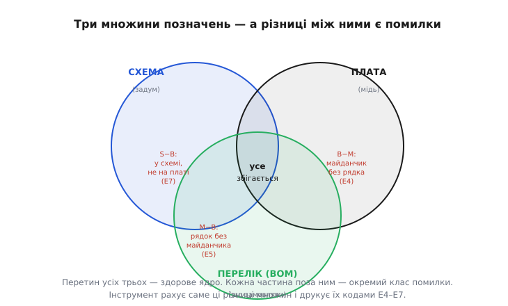
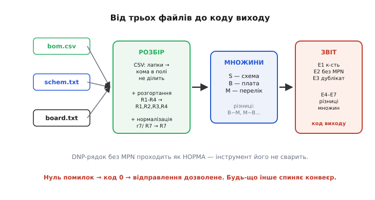

# ⚙️ Перевірка узгодженості переліку компонентів перед виробництвом

> Перед тим як натиснути «відправити» й заплатити за виготовлення та складання плати, варто витратити секунду на машинну перевірку — бо помилка тут коштує не переробленого рядка коду, а **зіпсованої або порожньої партії плат** після того, як гроші вже пішли. Найпідступніше те, що жоден окремий документ не бачить власної неузгодженості: схема впевнена в собі, плата впевнена в собі, перелік компонентів теж. Розбіжність живе **між** ними — позиція, що є на платі, але якої немає в переліку; рядок, що замовляє деталь у нікуди; кількість, яка не сходиться з власним переліком позначень. Тут ми зберемо робочий інструмент, який бере три списки позиційних позначень — зі схеми, з плати й з переліку компонентів — і виводить кожну розбіжність кодом помилки, доки вона ще дешева. Дорогою розберемо те, на чому такі інструменти найчастіше спотикаються: кому всередині поля, регістр літер, зайві пробіли й цілком законні порожні рядки.

### Задача

На столі — три джерела, і кожне говорить власною мовою про той самий набір деталей.

**Перше — схема.** Із неї редактор уміє вивести список усіх позиційних позначень, які інженер поставив у кресленні: `R1`, `R2`, …, `C1`, `U1`, `J1`. Це **задум**: усе, що мало б бути на платі за думкою автора. (Як редактор узагалі добуває цей список із намальованих ліній і міток — окрема історія; тут ми беремо вже готовий перелік позначень.)

**Друге — плата.** Файл розведення несе **посадкові місця** (англ. *footprint*) — фізичні контактні майданчики з написами шовкографії: `R1`, `R2`, … Це те, що **фізично існує на міді**: куди складальний автомат фізично може поставити деталь.

**Третє — перелік компонентів** (BOM). Це таблиця, де кожен рядок збирає **одну позицію** — одну деталь, повторену по всіх однакових місцях, із переліком позначень через кому (`R7, R8, R12`), кількістю, номером деталі (MPN) та позначкою «не монтувати» (DNP) там, де місце лишають порожнім.

> 🔧 **Навіщо це.** Усі три списки **мусять описувати один і той самий набір місць** — інакше десь буде біда. Якщо позначення є на платі, але його немає в переліку компонентів, складальник дійде до порожнього майданчика й **зупиниться** (або, гірше, впаяє щось «на власний розсуд»). Якщо позначення є в переліку, але його немає на платі, ви замовили й заплатили за деталь, якій **нема куди сісти**. Якщо рядок каже «кількість 3», а позначень перелічено двоє — закупівля порахує не те. Кожна з цих розбіжностей коштує грошей і часу, і кожну видно за частку секунди, якщо просто звести три списки докупи й порівняти.

Питання, на яке має відповісти інструмент, одне: **чи описують усі три джерела однаковий набір позицій — і чи кожна позиція придатна замовити та змонтувати?** Розкладемо це на конкретні підозри, які треба зловити:

- **Осиротіла на платі** — позначення є на платі, але його **немає в переліку компонентів**. Майданчик нема чим заповнити.
- **Осиротіла в переліку** — позначення є в переліку, але його **немає на платі**. Куплено деталь у нікуди.
- **Розбіжність кількості** — заявлене в рядку число **не дорівнює** довжині власного переліку позначень цього рядка (`R7, R8` при `К-сть = 3`).
- **Монтований рядок без MPN** — позиція **не** позначена як DNP, але номера деталі немає: замовляти нічим.
- **Дубльоване позначення** — те саме позначення трапляється **двічі** (у різних рядках переліку, або двічі на платі): незрозуміло, котра деталь куди.

І окрема тонкість, що **не** є помилкою: рядок DNP **без MPN — це норма**. Місце навмисно лишене порожнім, його позначення на платі є, у схемі є, а деталі немає — і так і має бути. Інструмент мусить це розрізняти, інакше він потоне в хибних тривогах і ним перестануть користуватися.

### Ідея: звести все до множин позначень і відняти

Уся задача стає прозорою, щойно ми відкинемо зайве й залишимо від кожного джерела **тільки множину позиційних позначень**. Схема дає множину `S`, плата — множину `B`, перелік компонентів — множину `M`. Тоді кожна підозра — це проста операція над множинами:

```
осиротілі на платі     = B − M    (є на платі, нема в переліку)
осиротілі в переліку   = M − B    (є в переліку, нема на платі)
у переліку, та не в схемі = M − S
у схемі, та не на платі   = S − B
```

Множина — саме той апарат, що тут потрібен: вона не зважає на порядок, миттєво відповідає «чи є тут елемент `R7`?» і дає різницю «що є в одному й немає в іншому» майже за сталий час на елемент. На рівні коду це хеш-множина рядків.

Але між «таблицею з файлу» й «чистою множиною позначень» лежать два кроки, у яких і ховається вся підступність.

**Перший крок — розбір CSV.** Перелік компонентів зазвичай зберігають як CSV — простий текст, де поля розділені комами. Біда в тому, що **сам перелік позначень — це поле, повне ком**: `"R7, R8, R12"`. Якщо наївно різати рядок по кожній комі, одна колонка «позначення» розлетиться на три, і вся таблиця попливе. Тому формат вимагає брати поля з комами **в лапки**, а парсер мусить ці лапки шанувати: кома всередині лапок — частина значення, а не роздільник. Це не примха конкретної програми, а записаний стандарт — RFC 4180, який кодифікує саме цю поведінку CSV (поле з комою, переносом рядка чи лапками береться в подвійні лапки; лапка всередині подвоюється: `""`). *(Правило лапок і подвоєння — усталений зміст RFC 4180, підтверджено текстом самого RFC.)*

**Другий крок — розгортання діапазонів.** У переліку позначення часто пишуть скорочено: `R1-R4` замість `R1, R2, R3, R4`. Для людини це зрозуміло, для множини — ні: `R1-R4` як один рядок не збігся б ні з `R2` на платі, ні з `R3`. Тому перш ніж класти позначення в множину, діапазон треба **розгорнути** в окремі елементи. А вже тут чигають дрібні пастки: однакова літерна частина (`R`), числа з обох боків, можливий спадний порядок, і потреба не сплутати дефіс-діапазон із дефісом, що міг би трапитися деінде.

Коли обидва кроки зроблено чесно, далі — самі лише різниці множин і кілька лічильників. Складність цілого — лінійна від числа позначень.


*Схема, плата й перелік компонентів дають три множини позиційних позначень. Перетин усіх трьох — здорове ядро, де все збігається. Кожна «пелюстка» поза перетином — окремий клас помилки: B−M (майданчик без рядка), M−B (рядок без майданчика), розбіжності зі схемою. Інструмент рахує саме ці різниці.*

### Робоче ядро: від CSV-рядка до множини позначень

Зберемо інструмент. Тон — як у справжній настільній утиліті інженера (це консольна програма на C++), тож вона читає файл, розбирає його за правилами CSV, нормалізує позначення й друкує звіт із кодами. Почнемо з найделікатнішого — розбору одного рядка CSV, що поважає лапки.

:::tabs
:::code proj-bom-consistency/cpp/roboche-iadro-vid-csv.cpp
:::code proj-bom-consistency/py/roboche-iadro-vid-csv.py
:::

Серце тут — прапорець `in_quotes`. Доки ми всередині лапок, кома — звичайний символ, і `R7, R8, R12` лишається **одним** полем. Це рятує саме той випадок, на якому ламаються наївні парсери: перелік позначень із комами.

Тепер — **нормалізація одного позначення**. Перш ніж порівнювати, треба прибрати дрібні розбіжності написання, через які `r7`, ` R7 ` і `R7` виглядали б трьома різними рядками. Дві дисципліни: відсікти пробіли з країв і звести літерний клас до одного регістру.

:::tabs
:::code proj-bom-consistency/cpp/roboche-iadro-vid-csv-2.cpp
```python
# Обрізати пробіли/табуляції з обох країв.
def trim(s):
    return s.strip(" \t\r\n")

# Нормалізувати позначення: обрізати краї + ВЕЛИКА літерна частина.
# R7, r7, " R7 " → усі стають "R7", тож у множині вони — один елемент.
def norm_ref(raw):
    return trim(raw).upper()                   # до верхнього регістру
```
:::

> 🔧 **Навіщо це.** Регістр і пробіли — найтихіший клас помилок. На платі шовкографія завжди великими: `R7`. А в переліку компонентів, особливо коли його зводять руками чи зливають із кількох джерел, легко проскочити `r7` або зайвий пробіл після коми: `"R7, R8"` із пробілом перед `R8`. Без нормалізації інструмент оголосив би `R8` (із плати) **осиротілим**, а ` R8` (із переліку) — **зайвим**, видавши дві хибні тривоги там, де насправді все гаразд. Нормалізація на вході — це те, що відрізняє інструмент, якому довіряють, від того, що «весь час кричить дурницями».

Тепер — **розгортання діапазону** `R1-R4` у `R1, R2, R3, R4`. Розбір простий: знайти дефіс, переконатися, що з обох боків — позначення з **однаковою** літерною частиною й числами, та згенерувати весь проміжок.

:::tabs
:::code proj-bom-consistency/cpp/roboche-iadro-vid-csv-3.cpp
:::code proj-bom-consistency/py/roboche-iadro-vid-csv-2.py
:::

Зверни увагу на захист: розгортаємо **лише** коли префікси з обох боків однакові й хвости числові. Якщо дефіс трапився десь, де це не діапазон позначень (скажімо, він заліз у поле з помилкою), ми не вигадуємо хибних `R`-ів, а повертаємо токен як є — хай далі його видно як окреме «дивне» позначення, а не тихо породжуємо сміття.

Маючи розбір рядка, нормалізацію й розгортання, складемо **поле позначень** одного рядка переліку в плаский список елементів. Поле може містити і коми (`R7, R8`), і діапазони (`R1-R4`), і те й те разом (`R1-R4, R7`).

:::tabs
:::code proj-bom-consistency/cpp/roboche-iadro-vid-csv-4.cpp
:::code proj-bom-consistency/py/roboche-iadro-vid-csv-3.py
:::

Тепер опишемо **один рядок переліку** як структуру й зчитаємо весь файл. Припустимо узгоджений порядок колонок: позначення, кількість, MPN, примітка (де живе `DNP`). У справжньому інструменті колонки шукають за іменами в шапці, та суть від цього не міняється, тож тримаємо фіксований порядок для ясності.

:::tabs
:::code proj-bom-consistency/cpp/roboche-iadro-vid-csv-5.cpp
:::code proj-bom-consistency/py/roboche-iadro-vid-csv-4.py
:::

Списки зі схеми та з плати простіші — це просто переліки позначень (по одному в рядку), які редактор уже вивів. Але прочитати їх наївно **в множину** — пастка: якщо на платі випадково опинилися два однакові написи (скажімо, дублікат посадкового місця `R7` через помилку розведення), множина мовчки зіллє їх в **один** елемент, і ця реальна помилка зникне з очей ще до будь-якої перевірки. Тому читаємо не в множину, а в **мапу «позначення → скільки разів трапилось»**: лічильник появ дасть нам зловити такий дублікат — так само, як ми ловимо його в переліку компонентів. Нормалізуємо кожне позначення тим самим `norm_ref`, щоб регістр і пробіли не розвели однакові речі. До самих множин зведемо пізніше, уже після підрахунку.

:::tabs
:::code proj-bom-consistency/cpp/roboche-iadro-vid-csv-6.cpp
:::code proj-bom-consistency/py/roboche-iadro-vid-csv-5.py
:::

### Зведення трьох множин і звіт із кодами

Тепер головне — **звести й порівняти**. З переліку компонентів вийде не просто множина, а ще й розгорнута мапа «позначення → рядок», щоб ловити дублікати та звітувати з номером рядка. Заодно дорогою перевіримо кожен рядок на дві власні біди: кількість проти довжини переліку позначень та монтований рядок без MPN.

Заведемо коди помилок — щоб звіт читала й людина, і машина (скрипт, що блокує відправлення, поки код не 0).

:::tabs
:::code proj-bom-consistency/cpp/zvedennia-trokh-mnozhyn-i.cpp
:::code proj-bom-consistency/py/zvedennia-trokh-mnozhyn-i.py
:::

Спершу — перевірки **всередині** переліку компонентів: вони не потребують двох інших списків, бо рядок неузгоджений сам із собою.

:::tabs
:::code proj-bom-consistency/cpp/zvedennia-trokh-mnozhyn-i-2.cpp
:::code proj-bom-consistency/py/zvedennia-trokh-mnozhyn-i-2.py
:::

Зверни увагу: у пункті (2) перевірка на MPN **свідомо пропускає DNP-рядки**. Це той самий нюанс, що в темі-власниці названо «не забув вписати, а навмисно лишив порожнім»: рядок DNP без MPN — законний, і інструмент, який сварив би на нього, був би неправильним. Розрізнити «порожньо навмисно» й «порожньо помилково» можна лише за позначкою DNP — тому її розбір такий важливий.

Тепер — **порівняння трьох списків**. Спершу — те, що множина сховала б: виловлюємо **дублікати на платі й у схемі**, пробігши мапи лічильників і піднявши тривогу на кожному позначенні, що трапилося більше разу. Аж тоді зводимо кожне джерело до множини позначень — `M` із переліку (ключі його мапи), `B` із плати, `S` зі схеми — і друкуємо чотири різниці.

:::tabs
:::code proj-bom-consistency/cpp/zvedennia-trokh-mnozhyn-i-3.cpp
:::code proj-bom-consistency/py/zvedennia-trokh-mnozhyn-i-3.py
:::

І точка входу, що зшиває все та повертає код виходу — нуль, якщо чисто; інакше число, на яке зважає скрипт, що або пропускає відправлення на завод, або зупиняє його.

:::tabs
:::code proj-bom-consistency/cpp/zvedennia-trokh-mnozhyn-i-4.cpp
:::code proj-bom-consistency/py/zvedennia-trokh-mnozhyn-i-4.py
:::

Це повний робочий кістяк: CSV із лапками розбирається без поломки на комах усередині поля, позначення нормалізуються й розгортаються, три множини зводяться, а кожна розбіжність виходить кодом. Скрипт-обгортка перед відправленням просто звіряє код виходу: `0` — пускає файли на завод, будь-що інше — спиняє й показує звіт.


*Шлях від трьох файлів до коду виходу. CSV переліку проходить розбір із лапками, тоді нормалізацію й розгортання діапазонів; списки схеми й плати — лише нормалізацію. На виході — множини, різниці яких дають коди E4–E7, а внутрішні перевірки рядка — E1–E3. Нуль помилок відмикає відправлення.*

### Швидка перевірка на прикладі

**Маленький перелік із характерними пастками.** Хай файл `bom.csv` має шапку й чотири рядки:

```
Позначення,К-сть,MPN,Примітка
"R1-R4",4,RC0603FR-0710KL,
"C1, C2",3,CL10B104KB8NNNC,
R20,1,,DNP — не монтувати
"r5, R5",2,RC0603FR-07100RL,
```

Прогін інструмента розбере це так:

```
Рядок 1: "R1-R4" → R1,R2,R3,R4 (4 шт), К-сть=4, MPN є → чисто.
Рядок 2: "C1, C2" → C1,C2 (2 шт), а К-сть=3 → [E1] розбіжність кількості.
Рядок 3:  R20 (1 шт), MPN немає, але DNP → НОРМА, мовчимо.
Рядок 4: "r5, R5" → обидва нормалізуються в R5 → [E3] дублікат R5 у рядку 4.
```

Розбір показує одразу три уроки: кома всередині `"C1, C2"` **не** розбила поле (бо лапки), та виявила розбіжність кількості; рядок DNP без MPN **не** викликав хибної тривоги; а `r5` і `R5`, що для ока різні, нормалізація звела в один елемент і **зловила як дублікат** — найтихіша з помилок, яку без приведення регістру не видно. Якби тепер плата мала майданчик `R6`, якого в переліку немає, додався б `[E4] є на платі, нема в BOM: R6`, і код виходу лишився б ненульовим, спинивши відправлення.

### Складність і пастки

**Складність.** Розбір CSV — лінійний від довжини файлу: кожен символ проходимо раз. Розгортання діапазонів додає рівно стільки елементів, скільки позначень насправді є. Усі різниці множин — лінійні від числа позначень (хеш-множина дає перевірку наявності майже за сталий час). Збір мапи й ловля дублікатів — теж лінійні. Тобто цілий інструмент масштабується **лінійно** з кількістю деталей; навіть плата на тисячі позицій перевіряється миттєво. Єдине, на що варто зважати, — впорядкування звіту (`sort`) дає логарифмічний множник, але це задля стабільного, читабельного виводу, не задля коректності.

А ось пастки — і саме вони псують реальні відправлення:

- **Кома всередині поля.** Найкласичніша поломка CSV-парсера. Поле `"R7, R8, R12"` без поваги до лапок розлітається на три колонки, і вся таблиця зсувається: кількість читається як MPN, MPN — як примітка, і весь рядок стає сміттям. Рятує **тільки** розбір зі станом «усередині лапок», як вище. Те саме стосується **переносу рядка всередині лапок** (RFC 4180 його дозволяє): простий `fgets` по рядках його розірве. Якщо ваші переліки таке містять, парсер мусить читати не «рядок за рядком», а «поле за полем», стежачи за лапками через межі рядків. *(Дозвіл багаторядкового поля в лапках — частина RFC 4180.)*

- **Регістр літер.** `R7` на платі й `r7` у переліку — для байтів різні рядки, для інженера одне. Без приведення регістру інструмент видасть **дві** хибні тривоги (осиротіла на платі + зайва в переліку) там, де все правильно. Гірше — зайвий шум привчає інженера **не дивитися** на звіт, і коли тривога стане справжньою, її проґавлять. Приведення регістру на вході — обов'язкове.

- **Зайві пробіли.** `"R7, R8"` із пробілом після коми дасть токен ` R8` із пробілом спереду; без `trim` він не збіжиться з `R8` із плати. Пробіли заводяться непомітно — від ручного редагування, від експорту з таблиці, від злиття кількох переліків. `trim` кожного токена прибирає цей цілий клас.

- **Рядок DNP без MPN — це норма, а не помилка.** Найважливіша пастка, але **зворотна**: тут небезпека не проґавити помилку, а **вигадати** її. Якщо інструмент свариться на кожен порожній MPN, він заллє звіт хибними тривогами на всіх навмисно порожніх місцях — і ним перестануть користуватися. Розрізнити «порожньо навмисно» (DNP) і «порожньо помилково» можна лише за позначкою; тому розбір примітки на `DNP`/`DNI` — не дрібниця, а те, що робить інструмент придатним до життя. Дзеркальна підстава: рядок, **позначений** DNP, але з реальним MPN, — теж підозра (навіщо номер тому, що не монтуємо?), хоча це радше попередження, ніж помилка.

- **Дубльоване позначення.** Те саме `R7` у двох рядках переліку (скажімо, після копіювання рядка й забутого перейменування) означає, що дві різні деталі претендують на одне місце. Множина сама собою цього **не** покаже — вона мовчки злила б два `R7` в один елемент. Тому дублікати ловлять **до** входу в множину, через мапу «позначення → рядок»: щойно позначення зустрілося вдруге, це сигнал. Те саме буває й на платі — два посадкові місця з однаковим написом (помилка розведення), і його теж видно лише підрахунком, а не множиною. Саме тому й списки плати та схеми ми читаємо не в множину, а в **мапу лічильників**, і проганяємо `report_dups` перед тим, як звести їх до множин для різниць — інакше дублікат на міді зник би тихо, ще до першої перевірки.

- **Числовий хвіст, що переповнюється чи має нулі спереду.** `R007` і `R7` — для людини, можливо, одне, для коду `split_ref` дасть число 7 в обох, тож вони **збіжаться** (бо ми порівнюємо за відновленим `prefix + число`). Це здебільшого добре, але варто знати: позначення з ведучими нулями нормалізуються до без-нульового вигляду. Якщо ваш редактор пише `R007`, а плата — `R7`, інструмент вважатиме їх одним — зазвичай саме те, що треба, але це рішення, а не випадковість.

- **Хибний діапазон.** Дефіс не завжди означає діапазон: він міг би трапитися в полі через помилку чи в позначенні нестандартного вигляду. Тому `expand_range` розгортає **лише** коли обидва боки — позначення з однаковим префіксом і числовими хвостами; інакше повертає токен як є. Інакше можна було б із сміттєвого поля нагенерувати лавину неіснуючих `R`-ів і поховати справжні помилки під ними.

- **Розбіжність кількості — це окрема перевірка від осиротілих.** Кількість у рядку звіряємо з **довжиною власного переліку позначень** цього рядка, а не з платою. Це ловить геть інший недогляд: інженер дописав позначення в перелік, але забув підбити число (або навпаки). Якби ми покладалися лише на різниці з платою, цей випадок міг би прослизнути — позначення на місці, а число бреше, і закупівля порахує не те.

Отже, перевірка узгодженості переліку компонентів — це три прості ідеї, що діють разом: чесний розбір CSV, який не ламається на комах усередині поля; нормалізація позначень, що зводить `r7`, ` R7 ` і `R7` в один елемент; і різниці трьох множин, кожна з яких — окремий клас помилки під своїм кодом. Уся хитрість — у крайових випадках: кома під лапками, регістр, пробіл, законний порожній DNP-рядок і дефіс, що не завжди діапазон. Хто проганяє цю перевірку перед кожним відправленням, той ловить осиротілу позицію та збиту кількість **на екрані за секунду** — а не з листа заводу через тиждень, коли плати вже зроблено й гроші вже сплачено.
