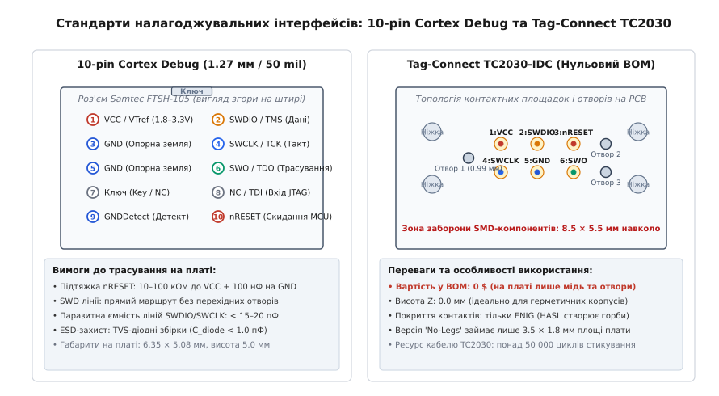
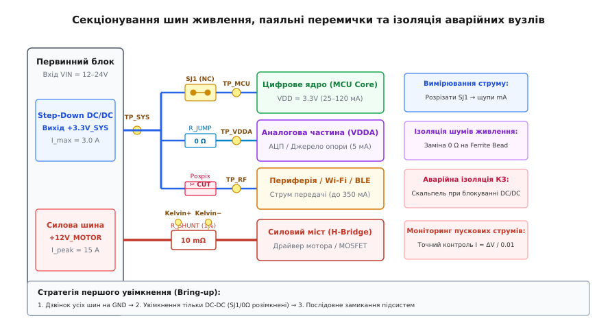

# Налагоджувальний роз'єм, тестові точки й навмисні аварійні виходи

<preknowlist>
- [Вузли й з'єднання](root:hw-pcb/nodes-connections) — логічні сітки (nets), класи ланцюгів та електричні вузли на схемі.
- [Земля й шини](root:hw-pcb/ground-power-rails) — опорний потенціал, паразитні опори шин живлення та контури зворотного струму.
- [Друкована плата](root:hw-pcb/pcb-layout) — топологія мідних шарів, розміщення компонентів і правила проектування (DRC).
- [Шарування плати](root:hw-pcb/pcb-stackup) — площини заземлення, діелектричні проміжки та вплив внутрішніх шарів на цілісність сигналів.
</preknowlist>

Коли щойно зібраний перший дослідний зразок багатошарової плати з мікроконтролером BGA, бездротовим радіомодулем та чотирма імпульсними перетворювачами напруги підключають до лабораторного блока живлення, він миттєво впирається в обмеження струму 2.5 А на шині 3.3 В, напруга просідає до 0.8 В, а температура мікросхеми перетворювача за дві секунди злітає до 90 °C. За відсутності на платі заздалегідь закладених тестових майданчиків, секційних перемичок живлення та стандартизованого налагоджувального порту інженер опиняється перед суцільним чорним ящиком: жоден вузол не функціонує, доступ до виводів під корпусами BGA чи QFN з прихованими контактними подушками фізично заблокований текстолітом, а коротке замикання в одному з тридцяти блокувальних керамічних конденсаторів паралізує роботу всієї системи. Єдиним виходом у такій ситуації стає хаотичне випоювання дорогих мікросхем гарячим повітрям або сліпе перерізання внутрішніх провідників плати скальпелем, що неминуче руйнує топологію та перетворює дослідний зразок вартістю кілька тисяч доларів на брухт.

Щоб плата була придатною до швидкого оживлення (англ. *bring-up*), заводського програмування, автоматизованого контролю на стендах із голчастими адаптерами (англ. *bed of nails*) та польової діагностики, її схемотехніка й малюнок міді повинні проектуватися за суворими правилами тестопридатності (англ. *Design for Testability*, скорочено *DFT*). Розглянемо архітектуру сучасних налагоджувальних інтерфейсів SWD, JTAG і UART, топологічні параметри та металургію тестових точок, методику розрахунку зусилля голчастих зондів, а також схемотехніку паяльних перемичок, нульових резисторів і аварійних розрізів, що дозволяють секціонувати шини живлення та безпомилково локалізувати дефекти монтажу.

## Філософія проектування для тестування (Design for Testability — DFT)

Проектування друкованої плати не завершується у момент, коли трасувальник закрив останній нез'єднаний ланцюг у середовищі САПР і згенерував виробничі Gerber-файли. Готова друкована плата проходить складний життєвий цикл, у якому витрати на пошук і усунення дефектів підпорядковуються класичному емпіричному правилу десятикратного зростання вартості (англ. *Rule of Tens*):

```
Виявлення дефекту на голому текстоліті (PCB E-Test):          ≈ 0.50 $
Виявлення дефекту після SMD-монтажу на стенді ICT / AOI:       ≈ 5.00 $
Виявлення дефекту зібраного модуля на функціональному тесті:   ≈ 50.00 $
Виявлення дефекту готового виробу в польових умовах:           ≈ 500.00 $+
```

Якщо технологічний дефект (мікротріщина у міді перехідного отвору, злипання кульок припою під мікросхемою BGA, перевернутий діод або зміщення номіналу резистора дільника зворотного зв'язку) не буде виявлений на ранньому етапі виробництва, його пошук у зібраному виробі вимагатиме годин роботи висококваліфікованого інженера, розбирання корпусу, а іноді й повної утилізації вузла.

```
       Життєвий цикл друкованої плати та етапи тестування
       
┌─────────────────┐      ┌─────────────────┐      ┌─────────────────┐
│ Перший зразок   │ ───> │ Серійний монтаж │ ───> │ Складання вузла │
│ (Bring-up)      │      │ (ICT / AOI)     │      │ (FCT / Burn-in) │
└─────────────────┘      └─────────────────┘      └─────────────────┘
         │                        │                        │
         ▼                        ▼                        ▼
• Ручні виміри           • Голчасте ложе          • Наскрізні тести
• Розрив перемичок       • Контроль номіналів     • Прошивка FW
• Діагностика SWD        • Пошук КЗ / обривів     • Калібрування
```

Концепція *DFT* базується на двох взаємопов'язаних властивостях електричної схеми:

1. **Керованість (англ. *Controllability*):** Здатність зовнішнього тестового обладнання або налагоджувального інструменту переводити будь-який внутрішній електричний вузол, тригер або логічний стан мікроконтролера в задане значення за допомогою зовнішнього впливу (подача логічного рівня, скидання через пін `nRESET`, перемикання режимів завантаження через піни `BOOT`, примусове відкриття ключа живлення).
2. **Спостережуваність (англ. *Observability*):** Здатність виміряти напругу, форму сигналу, струм споживання або логічний стан будь-якої внутрішньої сітки (англ. *net*) за допомогою контактного щупа осцилографа, мультиметра чи голчастого адаптера стенда без руйнування цілісності конструкції.

Показником якості проектування плати для виробництва є коефіцієнт тестового покриття (англ. *Test Coverage Ratio*, `C_test`):

```
C_test = (N_accessible / N_total) · 100%
```

де `N_accessible` — кількість електричних ланцюгів схеми, які мають безпосередній контакт із тестовими точками, штирями роз'ємів або доступними контактними площадками компонентів на доступному боці плати, а `N_total` — загальна кількість електричних ланцюгів у нетлисті проекту. Для простих плат масового виробництва промисловим стандартом вважається покриття `C_test ≥ 85–90%`, а для авіаційних, медичних та автомобільних контролерів найвищого класу надійності (IPC Class 3) обов'язковою вимогою є досягнення `C_test ≥ 95–98%`, де кожен критичний ланцюг живлення, скидання, тактування та аналогового вимірювання має виділений тестовий контакт.

## Стандартні налагоджувальні та діагностичні інтерфейси

Основою взаємодії розробника та автоматизованого прошивального стенда з мікроконтролером або процесором на платі є спеціалізовані апаратні налагоджувальні інтерфейси. Вони забезпечують прямий доступ до внутрішніх регістрів ядра, оперативної пам'яті, внутрішньої Flash-пам'яті та периферійних блоків за допомогою мінімальної кількості фізичних ліній.


*Конструкція сучасних налагоджувальних інтерфейсів: 10-контактний роз'єм Cortex Debug із кроком 1.27 мм (Samtec FTSH-105) та безроз'ємний футпринт Tag-Connect TC2030-IDC під пружинні контакти pogo-pin.*

### Інтерфейс SWD (Serial Wire Debug) та трасування SWO

Для мікроконтролерів архітектури ARM Cortex-M корпорація ARM розробила двопровідний інтерфейс налагодження **SWD (Serial Wire Debug)** як альтернативу громіздкому стандарту JTAG. Інтерфейс SWD використовує синхронну двонаправлену передачу даних по одній лінії, що дозволяє скоротити кількість необхідних виводів чіпа й площу роз'єму на платі.

Фізичний інтерфейс SWD включає такі обов'язкові та опціональні лінії:

- **SWDIO (Serial Wire Data Input/Output):** Двонаправлена лінія даних із синхронізацією по обох фронтах або за протоколом перемикання напрямку (англ. *turnaround period*). У моменти перемикання напрямку передачі лінія переводиться у стан високого імпедансу (Hi-Z) на один такт `SWCLK`.
- **SWCLK (Serial Wire Clock):** Тактовий сигнал, що генерується апаратним відлагоджувачем (Debug Probe, наприклад, J-Link, ST-Link, CMSIS-DAP). Робочі частоти тактування становлять від 1 МГц (для первинного з'єднання) до 25–50 МГц (для швидкісного завантаження прошивки).
- **SWO / TRACESWO (Serial Wire Output):** Односпрямований асинхронний канал виведення діагностичних даних та пакетів трасування ядра (модуль *Instrumentation Trace Macrocell*, ITM) без зупинки процесора. Дозволяє виводити налагоджувальні повідомлення (альтернатива `printf`) на швидкостях до 2–10 Мбіт/с по протоколу UART (NRZ) або Manchester без виділення окремого апаратного блоку UART мікроконтролера.
- **nRESET (Active-Low System Reset):** Лінія апаратного асинхронного скидання цільового мікроконтролера. Наявність апаратного виводу `nRESET` на налагоджувальному роз'ємі є критично важливою: якщо прошивка помилково переконфігурувала піни SWDIO/SWCLK на звичайні GPIO або ввела процесор у стан глибокого сну (Deep Sleep / Standby) з вимкненням тактування ядра, відлагоджувач може відновити зв'язок із кристалом виключно шляхом утримання лінії `nRESET` у низькому рівні в момент встановлення SWD-з'єднання (режим *Connect Under Reset*).
- **VTref (Target Voltage Reference):** Опорна напруга живлення логічних рівнів плати (зазвичай 1.8 В, 2.5 В або 3.3 В). Пін не призначений для живлення відлагоджувача: навпаки, схема перетворювача рівнів (англ. *Level Shifter*) всередині відлагоджувача використовує `VTref` для узгодження амплітуди вихідних сигналів SWDIO та SWCLK із поточною напругою живлення мікроконтролера.
- **GND:** Опорна земля сигнальних контурів. Для високошвидкісного трасування на частотах понад 20 МГц критично мати кілька розподілених контактів заземлення для зменшення індуктивності зворотного шляху струму в шлейфі.

Стандартним компактним з'єднувачем для ARM-систем є 10-контактний роз'єм **10-pin Cortex Debug Header** (крок штирів 1.27 мм / 50 mil, базовий типорозмір Samtec FTSH-105-01-L-DV-K).

Розпіновка 10-контактного роз'єму стандартизована:

| Номер піна | Назва сигналу | Напрямок | Призначення та вимоги до схеми на друкованій платі |
|---|---|---|---|
| **1** | `VCC / VTref` | Вихід з плати | Напруга живлення логіки цільового чіпа (1.8–3.3 В), струм < 5 мА |
| **2** | `SWDIO / TMS` | Двонаправлений | Лінія даних SWD / вибір режиму JTAG TMS (внутрішня підтяжка Pull-up 100 кОм) |
| **3** | `GND` | Опора | Сигнальна земля |
| **4** | `SWCLK / TCK` | Вхід у плату | Тактовий сигнал SWD / такт JTAG TCK (внутрішня підтяжка Pull-down 100 кОм) |
| **5** | `GND` | Опора | Сигнальна земля |
| **6** | `SWO / TDO` | Вихід з плати | Асинхронне трасування ITM / вихід даних JTAG TDO |
| **7** | `KEY` | — | Поляризаційний ключ: фізично видалений штир (заглушка у гнізді шлейфа) |
| **8** | `NC / TDI` | Вхід у плату | Не підключено для SWD / вхід даних JTAG TDI |
| **9** | `GNDDetect` | Вихід з плати | З'єднується з GND на платі; інформує відлагоджувач про підключення кабелю |
| **10** | `nRESET` | Вхід у плату | Апаратне скидання (зовнішній резистор Pull-up 10–100 кОм + конденсатор 100 нФ) |

При проектуванні топології друкованої плати для ліній SWD діють жорсткі правила захисту від завад і паразитних ємностей. Сумарна паразитна ємність лінії `SWCLK` не повинна перевищувати `C_load ≤ 15–20 пФ`. За наявності високої ємності фронти прямокутних імпульсів частотою 20 МГц (тривалість фронту менше 2 нс) завалюються за експоненційним законом `τ = R_out · C_load`, що призводить до фазового тремтіння (джитеру) та помилок зчитування даних відлагоджувачем. 

На входах роз'єму обов'язково встановлюють багатоканальні захисні діодні збірки TVS (Transient Voltage Suppressor) для захисту від електростатичного розряду (ESD) відповідно до стандарту IEC 61000-4-2 (контактний розряд 8 кВ, повітряний розряд 15 кВ). Головна вимога до TVS-діодів на лініях SWDIO, SWCLK та SWO — власна паразитна ємність діода не повинна перевищувати `C_d ≤ 0.8–1.0 пФ` (наприклад, збірки USBLC6-2SC6 або TPD4E05U06), оскільки використання звичайних захисних стабілітронів або TVS із ємністю 50–100 пФ повністю блокує високошвидкісний обмін.

### Безроз'ємний інтерфейс Tag-Connect (TC2030)

У портативних приладах, мініатюрних сенсорах Інтернету речей (IoT), герметичних модулях та приладах масового виробництва встановлення фізичного 10-контактного роз'єму Samtec є неприйнятним з двох причин: його вартість у специфікації (BOM) становить від 0.80 до 1.50 долара США, а вертикальний габарит (висота над платою 5.0–7.5 мм) не дозволяє розмістити плату в тонкому корпусі.

Вирішенням цієї проблеми став запатентований безроз'ємний стандарт **Tag-Connect TC2030**. На друкованій платі не розпаюється жодного фізичного компонента (вартість за специфікацією дорівнює 0.00 $): замість роз'єму створюється топологічний малюнок із шести круглих позолочених контактних майданчиків (крок 1.27 мм) та системи отворів.

Існує дві конструктивні модифікації футпринта:
1. **TC2030-IDC (Legged Version):** Містить 3 металеві напрямні штифти діаметром 0.99 мм для точного позиціонування та 4 великі неметалізовані отвори діаметром 2.36 мм для пластикових ніжок-засувок роз'єму кабелю. Кабель надійно замикається на платі без допомоги рук оператора, що ідеально підходить для лабораторії та тривалого налагодження коду.
2. **TC2030-IDC-NL (No-Legs Version):** Містить лише 6 контактних площадок і 3 напрямні отвори 0.99 мм (отвори під засувки відсутні). Футпринт займає мікроскопічну площу на текстоліті — всього **3.5 × 1.8 мм**. Для утримання кабелю на платі оператор під час прошивки або притискає адаптер рукою протягом 3 секунд, або використовує спеціальну утримувальну пластину зі зворотного боку плати (Retaining Clip TC2030-CLIP).

```
        Топологія контактних площадок Tag-Connect TC2030
        
   ( ) Фіксатор                  (1) VCC    (4) SWCLK           ( ) Фіксатор
    │                             │          │                   │
    │      (•) Напрямний 1        │          │                   │
    │                             ▼          ▼                   │
   ┌─┐     ┌─┐                  ┌───┐      ┌───┐                ┌─┐
   │ │     │ │                  │ 1 │      │ 4 │                │ │
   └─┘     └─┘                  └───┘      └───┘                └─┘
                                ┌───┐      ┌───┐        (•) Напрямний 2
                                │ 2 │      │ 5 │
                                └───┘      └───┘        (•) Напрямний 3
   ┌─┐                          ┌───┐      ┌───┐                ┌─┐
   │ │                          │ 3 │      │ 6 │                │ │
   └─┘                          └───┘      └───┘                └─┘
    ▲                             ▲          ▲                   ▲
    │                             │          │                   │
   ( ) Фіксатор                  (3) nRESET (6) SWO             ( ) Фіксатор
                                  (2) SWDIO  (5) GND
```

Вимоги до топології та виробництва друкованої плати під Tag-Connect:
- **Фінішне покриття міді:** Обов'язкове використання хімічного нікелювання з імерсійним золоченням (**ENIG** — Electroless Nickel Immersion Gold). Гаряче лудіння свинцевим чи безсвинцевим припоєм (**HASL**) категорично заборонено: припій формує на контактних майданчиках нерівномірні опуклі куполи з перепадом висоти до 30–50 мкм, через що тонкі підпружинені голки наконечника ковзають по поверхні, втрачають контакт і ламаються.
- **Точність свердління напрямних отворів:** Отвори діаметром 0.99 мм повинні виконуватися як неметалізовані отвори (NPTH) із виробничим допуском не гірше `+0.05 / −0.00 мм`. Якщо отвір буде завуженим, сталеві штифти кабелю застрягнуть; якщо зашироким — контактні голки змістяться відносно центрів мідних площадок.
- **Зона заборони SMD-компонентів (Keepout Envelope):** Навколо футпринта TC2030 на відстані не менше **1.5–2.0 мм** заборонено встановлювати будь-які високі компоненти (електролітичні конденсатори, роз'єми, котушки індуктивності заввишки понад 1.0 мм), оскільки пластиковий корпус кабельного адаптера притискається впритул до поверхні плати.

### Класичний інтерфейс JTAG (IEEE 1149.1) та каскадування пристроїв (Daisy Chain)

Для складних обчислювальних плат із мікроконтролерами, мікропроцесорами архітектури Application Class (наприклад, Cortex-A), цифровими сигнальними процесорами (DSP) та мікросхемами програмованої логіки (FPGA / CPLD) застосовують стандартизований 4/5-провідний інтерфейс **JTAG (Joint Test Action Group / IEEE 1149.1)**.

Інтерфейс JTAG містить такі сигнали:
- **TCK (Test Clock):** Тактовий сигнал контролера доступу до тестового порту (TAP).
- **TMS (Test Mode Select):** Сигнал керування станами скінченного автомата TAP-контролера (16 стандартизованих станів автомата перемикаються по фронту TCK залежно від рівня TMS).
- **TDI (Test Data Input):** Послідовний вхід тестових даних та інструкцій.
- **TDO (Test Data Output):** Послідовний вихід тестових даних та результатів сканування регістрів.
- **TRST (Test Reset, опціонально):** Асинхронне скидання TAP-контролера в початковий стан `Test-Logic-Reset`.

Головною системною перевагою JTAG є можливість послідовного включення багатьох мікросхем на одній платі в єдиний скануючий контур (**JTAG Daisy Chaining**). Сигнали `TCK`, `TMS` та `TRST` підключаються паралельно до всіх мікросхем контуру, тоді як лінія даних проходить крізь кристали послідовно: вихід `TDO` першого чіпа надходить на вхід `TDI` другого, і так далі, поки `TDO` останнього чіпа не повернеться на налагоджувальний роз'єм.

```
                  Послідовний контур JTAG Daisy Chain
                  
           ┌───────────────────────────────────────────────────────────┐
TMS ─────┬─┼──────────────────────────────┬──────────────────────────┐ │
         │ │                              │                          │ │
TCK ───┬─┼─┼────────────────────────────┬─┼────────────────────────┐ │ │
       │ │ │                            │ │                        │ │ │
       │ │ │   ┌────────────────────┐   │ │   ┌────────────────┐   │ │ │
TDI ───┼─┼─┼──>│ TDI            TDO │───┼─┼──>│ TDI        TDO │───┴─┴─┼──> TDO
       │ │ │   │                    │   │ │   │                │       │
       │ │ └──>│ TMS     MCU        │   │ └──>│ TMS    FPGA    │       │
       │ └────>│ TCK   (ARM M7)     │   └────>│ TCK  (Xilinx)  │       │
       │       └────────────────────┘         └────────────────┘       │
       └───────────────────────────────────────────────────────────────┘
```

Така топологія дозволяє через один фізичний роз'єм на платі одночасно прошивати мікроконтролер, конфігурувати конфігураційну Flash-пам'ять FPGA та виконувати периферійне сканування виводів (**Boundary Scan**). Технологія Boundary Scan дозволяє перевірити цілісність усіх з'єднань між BGA-мікросхемами (відсутність обривів ліній адресних та даних шин DDR, відсутність замикань ліній) виключно програмним шляхом без використання фізичних щупів.

При проектуванні розгалуженої лінії `TCK` для контуру Daisy Chain критично забезпечити цілісність тактового сигналу. Якщо сигнал `TCK` отримає паразитні відбиття від кінців довгих доріжок і на фронті утвориться сходинка з подвійним перетином логічного порогу (англ. *double clocking*), скінченні автомати TAP-контролерів мікросхем розсинхронізуються і зв'язок розірветься. Тому лінію `TCK` розводять топологією «зірка» або «дерево» з послідовними узгоджувальними резисторами (англ. *source termination*) номіналом `R_term = 33–50 Ом` біля джерела сигналу, або застосовують спеціалізовані буфери тактових сигналів із малим розкидом затримок.

### Консольний UART для виробничої телеметрії

Жодна налагоджувальна система не є повноцінною без виділеного асинхронного послідовного порту **UART (Universal Asynchronous Receiver/Transmitter)**. У той час як SWD/JTAG орієнтовані на зупинку ядра, встановлення точок зупину (breakpoints) та низькорівневе читання регістрів, UART є головним каналом функціональної телеметрії в реальному часі.

На друкованій платі поруч із процесором або біля основного налагоджувального порту виділяють контактні площадки або гребінець із трьох-чотирьох сигналів: `TXD`, `RXD`, `GND` та опціонально `VCC`.

Виробниче призначення порту UART:
1. **Активація системного ROM-завантажувача (ROM Bootloader):** Більшість сучасних мікроконтролерів (STM32, NXP LPC/i.MX, ESP32, TI MSPM0) мають зашитий на заводі нестираний завантажувач у системній пам'яті (System ROM). Якщо на плату закладено можливість комутації конфігураційних пінів (наприклад, `BOOT0 = 1` через тестову точку чи перемичку), заводський прошивальний стенд може завантажити первинну прошивку у порожній чіп безпосередньо через UART без використання дорогих відлагоджувачів J-Link.
2. **Потоковий вивід діагностичних журналів (Logging):** Вивід текстових повідомлень ОС реального часу (FreeRTOS, Zephyr) на швидкостях 115200 або 921600 біт/с.
3. **Автоматизоване калібрування сенсорів на виробництві:** Заводський комп'ютер надсилає через UART команди запуску самотестування, зчитує сирі значення АЦП, розраховує коефіцієнти компенсації зміщення нуля та записує їх у незалежну пам'ять EEPROM/Flash пристрою.

**Схемотехнічна пастка паразитного живлення (Phantom / Backfeeding Power):**
Найпоширенішою помилкою при розведенні порту UART є пряме підключення ліній `TXD`/`RXD` зовнішнього USB-UART конвертера (який живиться від порту USB комп'ютера напругою 3.3 В) до мікроконтролера плати, коли основне живлення плати вимкнено. Усі цифрові виводи сучасних мікросхем мають вбудовані внутрішні діоди електростатичного захисту (ESD Protection Diodes), підключені між піном GPIO та внутрішньою шиною живлення `VDD`. 

Коли зовнішній перетворювач утримує лінію `RXD` у стані логічної одиниці (3.3 В), струм тече крізь верхній захисний діод мікроконтролера безпосередньо в шину живлення всієї плати:

```
          Шлях паразитного струму через вхідний пін UART
          
Зовнішній USB-UART (3.3V)
     │
     └──> [ Пін MCU GPIO/RXD ] ───┐
                                  │
                                ┌─┴─┐
                                │ ▲ │  Внутрішній ESD-діод мікросхеми
                                └─┬─┘
                                  │
                                  ▼
                        [ Внутрішня шина VDD MCU ] ≈ 2.7 В (Паразитне живлення!)
```

У результаті мікроконтролер отримує неконтрольоване «паразитне живлення» рівнем 2.5–2.8 В (3.3 В мінус падіння на діоді 0.6 В), починає хаотично стартувати, зависає на невизначених станах внутрішніх тригерів і не може правильно ініціалізуватися при наступній подачі штатного живлення. Для запобігання цьому явищу в розрив ліній UART послідовно встановлюють резистори номіналом `1–4.7 кОм` (що обмежують паразитний струм до безпечних сотень мікроампер) або застосовують цифрові ізолятори / схеми на польових транзисторах із розмиканням ліній за відсутності штатної напруги живлення.

## Тестові точки (Test Points) та голчасті адаптери (Bed of Nails)

Для повністю автоматизованого контролю змонтованих друкованих плат на конвеєрі застосовують метод внутрішньосхемного тестування (**In-Circuit Testing — ICT**). Плата встановлюється у прецизійне технологічне ложе (англ. *ICT Fixture*), що містить сотні підпружинених металевих голок (**Pogo Pins**), які одночасно контактують з усіма спеціально передбаченими тестовими площадками на текстоліті.

```
       Структура автоматизованого тестового стенда (ICT Fixture)
       
              Плата пристрою (Unit Under Test - UUT)
    ═══════════════╤═════════════════════╤═══════════════════════
                   │ Тестова точка 1     │ Тестова точка 2
                   ▼                     ▼
             ┌───────────┐         ┌───────────┐
             │ ◊ ◊ ◊ ◊ ◊ │ Корона  │     │     │ Спис
             └─────┬─────┘         └─────┬─────┘
                   │                     │
               ┌───┴───┐             ┌───┴───┐
               │ Внутр.│             │ Внутр.│  Підпружинений корпус
               │пружина│             │пружина│  зонду (Pogo Pin)
               └───┬───┘             └───┬───┘
                   │                     │
    ═══════════════╪═════════════════════╪═══════════════════════
       Напрямна матриця ложа (Probe Guide Plate з G10/FR-4)
                   │                     │
                   └──────────┬──────────┘
                              ▼
            Комутаційна матриця реле та мультиметр ICT
```

### Геометрія та розкриття паяльної маски тестових точок

Тестова точка (**Test Point — TP**) являє собою круглий або квадратний майданчик міді зовнішнього шару плати, вільний від паяльної маски.

Нормативи проектування геометрії тестових точок за стандартами IPC (IPC-2221 / IPC-7351):
- **Рекомендований діаметр майданчика:** `D_pad = 1.0–1.27 мм` (40–50 mil). Забезпечує практично 100% надійність потрапляння голки при похибках виготовлення тестового ложа та розширенні текстоліту.
- **Мінімально допустимий діаметр для компактних плат:** `D_pad = 0.8 мм` (31 mil). Вимагає високої точності свердління напрямної пластини ложа.
- **Критичний технологічний мінімум:** `D_pad = 0.6 мм` (24 mil). Застосовується виключно за крайньої нестачі місця; різко здорожчує оснастку через необхідність використання надтонких мікроголок (розміру 0.050" або 0.039") з малим ресурсом роботи.

```
       Розріз тестової точки: геометрія міді та паяльної маски
       
         Розкриття маски (Mask Clearance) = D_pad + 0.1 мм
      ├──────────────────────────────────────────────────────┤
                 Діаметр мідної площадки D_pad = 1.0 мм
              ├──────────────────────────────────────┤
              
      Паяльна                                        Паяльна
       маска          Покриття ENIG (Золото/Нікель)   маска
      ┌──────┐        ┌──────────────────────┐        ┌──────┐
      │//////│        │                      │        │//////│
      └──────┘────────┴──────────────────────┴────────└──────┘
      ────────────────────────────────────────────────────────
                        Діелектрик FR-4 (База)
```

**Правило розкриття паяльної маски (Non-Solder Mask Defined — NSMD):**
Тестова точка обов'язково проектується за топологією NSMD. Вікно в паяльній масці повинно бути більшим за діаметр мідної площадки щонайменше на **0.05–0.1 мм** по колу (радіальний зазор `Mask Clearance ≥ 0.05 мм`). 

Якщо зробити тестову точку з перекриттям маскою (Solder Mask Defined — SMD), по краю мідного круга утвориться сходинка з твердої діелектричної смоли маски висотою 15–25 мкм. При найменшому механічному зміщенні голка зонда вдарить у цей діелектричний бортик, зісковзне й втратить електричний контакт із міддю, що викличе хибне відхилення справної плати на заводському тесті (англ. *false failure*).

**Чому не можна використовувати звичайні перехідні отвори (Vias) як тестові точки:**
Розповсюджена спроба зекономити площу плати шляхом зняття маски зі звичайних перехідних отворів (Vias) діаметром 0.3–0.5 мм замість встановлення повноцінних площадок веде до виробничих проблем:
1. Гострий наконечник голки зонда потрапляє точно в отвір свердління, де товщина міді на куті становить менше 18 мкм. Під дією пружини із зусиллям 2 Н голка деформує та зрізає внутрішній шар металізації, руйнуючи перехідний отвір.
2. Внутрішній отвір накопичує залишки флюсу, пилу та продуктів відмивання після пайки. Голка забивається шламом, контактний опір зростає з 0.01 Ом до сотень Ом, роблячи точні вимірювання напруг неможливими.

### Металургія фінішних покриттів тестових майданчиків

Надійність контакту голчастого адаптера безпосередньо залежить від фінішного покриття міді друкованої плати:

- **ENIG (Electroless Nickel Immersion Gold — хімічний нікель / імерсійне золото):** Абсолютний промисловий стандарт для тестування. Шар нікелю товщиною 3–5 мкм забезпечує тверду механічну опору, а тонкий зовнішній шар золота товщиною 0.05–0.10 мкм повністю виключає окислення міді на повітрі. Поверхня є ідеально пласкою (планарною), а перехідний опір контакту «голка–майданчик» стабільно становить `R_contact < 15–20 мОм` навіть після багатьох місяців зберігання плат на складі.
- **HASL (Hot Air Solder Leveling — лудіння гарячим припоєм):** Утворює нерівномірну криволінійну поверхню припою різної товщини. Контактні зонди зісковзують з опуклостей; крім того, олов'яно-свинцевий або безсвинцевий припій на повітрі вкривається тонкою плівкою оксиду олова `SnO2`, яка є діелектриком і вимагає застосування агресивних голок із високим тиском для її проколювання.
- **OSP (Organic Solderability Preservative — органічний захисний шар):** Тонка органічна плівка захищає чисту мідь від окислення до моменту пайки. Проте після проходження плати крізь піч оплавлення (Reflow) плівка OSP полімеризується і стає непровідною. Голчастий стенд ICT не може пробити деградований шар OSP без застосування спеціальних надгострих зондів типу «спис» із підвищеним зусиллям притискання.

### Механіка пружинних зондів (Pogo Pins) та вибір наконечників

Контактний зонд (**Pogo Pin**) складається з тонкостінної металевої гільзи (з позолоченої бронзи чи нікелевого сплаву), внутрішньої прецизійної пружини зі сталі або берилієвої міді та рухомого поршня-наконечника.

Форма наконечника підбирається відповідно до типу поверхні, що тестується:

1. **Багатопроменева корона / Зубчатий наконечник (4-Point Crown / Serrated):** Стандартний вибір для пласких тестових майданчиків із покриттям ENIG або залишками флюсу. Гострі зубці корони врізаються в поверхню під чотирма кутами, забезпечуючи самоочищення від оксидів та багатоточковий паралельний контакт із мінімальним опором.
2. **Гострий спис (Spear / Point 30°–60°):** Застосовується для проколювання твердих оксидних плівок на покриттях OSP, паяльної маски (у разі зміщення) та застиглого безвідмивного флюсу. Недолік — залишає помітні мікрократери на міді.
3. **Сферична чашка (Cup / Concave):** Застосовується для тестування вивідних компонентів (THT) та штирів роз'ємів. Чашка центрується на виводі деталі й охоплює конус припою.

```
                  Форми наконечників контактних зондів
                  
     ┌───┐             ┌───┐             ┌───┐
     │   │             │   │             │   │
     │ █ │             │ █ │             │ █ │  Гільза зонда
     │ █ │             │ █ │             │ █ │
     ├───┤             ├───┤             ├───┤
     │   │             │   │             │   │
     │   │             │   │             │\_/│  Сферична чашка
    /│ | │\  Корона    │   │  Спис       │   │  (для штирів THT)
   /_|_|_|_\ (ENIG)    \___/  (OSP)      └───┘
```

**Розрахунок сумарного зусилля притискання плати:**
Робоче зусилля однієї стандартної голки розміру 100 mil (діаметр гільзи 1.37 мм) при робочому стисненні на 2/3 ходу пружини становить від `F_pin = 1.5 Н` (5.4 oz) до `F_pin = 2.5 Н` (9.0 oz). 

Якщо складна промислова плата містить `N_tp = 300` тестових точок, сумарна механічна сила, що діє на текстоліт під час тестування, дорівнює:

```
F_total = N_tp · F_pin
F_total = 300 · 2.0 Н = 600 Н ≈ 61.2 кгс
```

Зусилля понад 60 кілограмів здатне викликати значний прогин склотекстоліту FR-4 товщиною 1.6 мм. Прогин плати навіть на **0.3–0.5 мм** під час тестування призводить до механічного напруження в паяних з'єднаннях, що викликає мікротріщини під BGA-чіпами та розтріскування керамічних конденсаторів MLCC (ефект *board flexure cracking*). Тому при проектуванні оснастки ложа інженери розміщують у кондукторі масив спеціальних антидеформаційних упорів (**Push-down / Support Pins**), які опираються у вільні від компонентів ділянки плати безпосередньо навпроти зон найбільшої концентрації тестових точок.

### Топологічні правила трасування тестових майданчиків

Щоб плата могла бути протестована на недорогому та надійному стенді, розробник топології зобов'язаний дотримуватися таких правил:

1. **Одностороннє розміщення тестових точок (Single-Sided Testing):** Усі 100% тестових точок повинні бути виведені виключно на один бік плати — переважно на нижній шар (**Bottom Layer**). Двостороннє голчасте ложе (англ. *Clamshell Fixture* з верхньою та нижньою голчастими матрицями) коштує у 3–4 рази дорожче ($6000–$10000 проти $1500–$2500 за одностороннє), має складну пневматичну систему вирівнювання та вкрай високу чутливість до перекосів.
2. **Мінімальний крок між центрами майданчиків (Test Point Pitch):**
   - *Стандартний крок:* `P = 2.54 мм` (100 mil). Дозволяє використовувати найнадійніші та найдешевші зонди з ресурсом понад 1 000 000 циклів.
   - *Допустимий крок:* `P = 1.27 мм` (50 mil).
   - *Мінімальний крок для виняткових вузлів:* `P = 1.0 мм` (39 mil).
3. **Відстань до компонентів (Component Clearance):**
   - Відстань від центру тестової точки до контактної площадки SMD-компонента заввишки до 1.5 мм: не менше **1.0–1.27 мм**.
   - Відстань від центру тестової точки до високих деталей (електролітичні конденсатори, реле, трансформатори, радіатори заввишки понад 5.0 мм): не менше **3.0–5.0 мм**. Цей зазор необхідний для проходження товстої напрямної пластини кондуктора (Probe Plate), яка має отвори для проходу високих компонентів.
4. **Базові технологічні отвори (Tooling Holes / NPTH):**
   - На платі мають бути передбачені щонайменше **два неметалізовані отвори** діаметром `3.00 ± 0.05 мм` (або `3.175 мм` / 1/8 дюйма), розташовані по діагоналі в протилежних кутах плати.
   - Отвори повинні розташовуватися асиметрично відносно центру плати, щоб оператор не міг встановити плату в тестове ложе у перевернутому на 180° положенні (захист від дурня / Poka-yoke).
5. **Відстань до краю плати:** Тестові точки не повинні розташовуватися ближче ніж **3.0–4.0 мм** до фізичного краю плати або лінії скрайбування/фрезерування панелі, оскільки ця зона перекривається притискною рамкою тестового стенда.

Детальний практичний алгоритм аудиту та генерації виробничого звіту тестопридатності наведено у вставці [програмний генератор звіту покриття тестовими точками](root:hw-pcb/debah-roziem-testovi-tochky-i-navmysni-avariini/proj-dft-testpoint-coverage.md).

## Навмисні перемички, нульові резистори та аварійні розриви

При проектуванні складних друкованих плат найвищою інженерною майстерністю є не просто забезпечення працездатності ідеально виготовленої плати, а закладання можливості локалізації та усунення несправностей, коли на платі є грубі дефекти: коротке замикання у внутрішньому шарі, брак мікросхеми, неправильно розрахований номінал індуктивності або помилка в розпіновці нового чіпа ревізії А.


*Архітектура секціонування шин живлення: використання паяльних перемичок (NC/NO), нульових резисторів, аварійних розрізів доріжок та шунтів Кельвіна для покрокового оживлення плати та вимірювання струмів.*

### Архітектура секціонування шин живлення (Power Rail Isolation)

Сучасна плата зазвичай містить дерево вторинних напруг живлення:
- Вхідне первинне живлення: `VIN = 12V` або `24V`.
- Головна цифрова шина системи: `+3.3V_SYS` (Step-Down DC/DC перетворювач).
- Живлення ядра мікропроцесора: `+1.8V_CORE` або `+1.2V_CORE` (синхронний Buck або LDO).
- Чисте аналогове живлення АЦП та джерела опорної напруги: `+3.3V_VDDA` (фільтроване через LC/Ferrite).
- Живлення бездротового радіомодуля: `+3.3V_RF`.
- Силове живлення приводів / драйверів мотора: `+12V_DRV`.

Якщо всі ці вузли об'єднані єдиним суцільним внутрішнім полігоном міді без можливості фізичного розриву, перше увімкнення перетворюється на рулетку. Якщо в радіомодулі або серед тридцяти фільтруючих конденсаторів 0402 є внутрішній пробій чи олов'яний місток, головний перетворювач `3.3V_SYS` при увімкненні миттєво входить у режим захисту від надструму (**Hiccup Mode** або обмеження струму). Напруга на всій платі падає до 0.5 В, перетворювач циклічно перезапускається з частотою кілька герц, а знайти несправний компонент за допомогою тепловізора неможливо, оскільки середня потужність, що виділяється на короткому замиканні в режимі Hiccup, становить лічені мілівати.

Для вирішення цієї проблеми дерево живлення обов'язково секціонують за допомогою чотирьох схемотехнічних елементів:

```
                      Секціонування дерева живлення
                      
                     ┌───────────────────────────┐
                     │ Step-Down DC/DC (+3.3V)   │
                     └─────────────┬─────────────┘
                                   │
              ┌────────────────────┼────────────────────┐
              │                    │                    │
              ▼                    ▼                    ▼
       ┌─────────────┐      ┌─────────────┐      ┌─────────────┐
       │   SJ1 (NC)  │      │ 0 Ω (0603)  │      │  ✂ CUT Line │
       │  Паяльна    │      │  Нульовий   │      │  Аварійний  │
       │  перемичка  │      │  резистор   │      │   розріз    │
       └──────┬──────┘      └──────┬──────┘      └──────┬──────┘
              │                    │                    │
              ▼                    ▼                    ▼
       ┌─────────────┐      ┌─────────────┐      ┌─────────────┐
       │ MCU Core    │      │ Аналог VDDA │      │ Радіомодуль │
       │ (+3.3V_MCU) │      │ (+3.3V_ANA) │      │ (+3.3V_RF)  │
       └─────────────┘      └─────────────┘      └─────────────┘
```

### Паяльні перемички (Solder Jumpers)

Паяльна перемичка (**Solder Jumper — SJ**) — це спеціалізований посадковий майданчик на зовнішньому шарі плати, що складається з двох або трьох сегментів міді, розділених зазором 0.2–0.3 мм без паяльної маски.

Існує два різновиди перемичок:
1. **Нормально-замкнена (Normally Closed — NC):** Сегменти перемички з'єднані тонким мідним містком завширшки **0.15–0.20 мм**. Під час серійного виробництва така перемичка проводить струм без встановлення будь-яких додаткових деталей і не потребує пайки. Якщо під час налагодження зразка необхідно ізолювати вузол, мідний місток перерізають кінчиком скальпеля або леза за дві секунди. Якщо вузол виявився справним, з'єднання миттєво відновлюють, нанісши на майданчик краплю припою.
2. **Нормально-розімкнена (Normally Open — NO):** Мідні сегменти розділені повітряним зазором 0.25 мм. За замовчуванням коло розірване. Для замикання контакту монтажник наносить паяльником краплю припою, яка завдяки силам поверхневого натягу стягується у надійний місток між позолоченими майданчиками.

Форма майданчиків зазвичай проектується у вигляді двох напівмісяців (круг, розрізаний навпіл) або двох зустрічних крапель. Заокруглені краї перешкоджають розтіканню припою за межі робочої зони та полегшують формування стабільного меніска припою.

### Нульові резистори (Zero-Ohm Jumpers)

Резистори нульового опору (**0 Ω Resistors / Jumpers**) у корпусах для поверхневого монтажу (SMD 0402, 0603, 0805, 1206) є універсальним засобом комутації та секціонування в серійній апаратурі.

Параметри та обмеження використання 0-омних резисторів:
- **Фактичний опір перемички:** Резистор 0 Ом не є надпровідником. Реальний опір якісного резистора становить `R_real ≈ 10–20 мОм` (для дешевих марок до 50 мОм). При протіканні великого струму на ньому виникає помітне падіння напруги та виділяється тепло за законом Джоуля–Ленца `P = I² · R`.
- **Максимальний допустимий струм:**
  - Корпус *0402:* номінальний струм `I_max = 0.5–1.0 А`.
  - Корпус *0603:* номінальний струм `I_max = 1.0–1.5 А`.
  - Корпус *0805:* номінальний струм `I_max = 2.0 А`.
  - Корпус *1206:* номінальний струм `I_max = 3.0–4.0 А` (спеціальні силові серії з потовщеним мідним шаром витримують до 10 А).
- **Паразитна індуктивність:** Власна індуктивність SMD-перемички становить `L_par ≈ 0.4–0.8 нГн`. У високочастотних колах (наприклад, узгодження RF-трактів 2.4 ГГц) ця індуктивність створює помітний реактивний опір `X_L = 2π · f · L`, що може змістити точку узгодження імпедансу антени.

Головна перевага нульового резистора над паяльною перемичкою — повна автоматизація монтажу. Автоматичний укладальник компонентів (Pick-and-Place Machine) встановлює його зі швидкістю 30 000 компонентів на годину. Крім того, нульовий резистор на серійній платі за потреби можна замінити без зміни малюнка міді на фільтруючий дросель (Ferrite Bead), захисний запобіжник (PTC Resettable Fuse) або вимірювальний шунт струму.

### Аварійні розрізи доріжок (Sacrificial Trace Cuts)

У високощільних платах, де для встановлення SMD-резисторів або паяльних перемичок немає фізичного місця, застосовують метод проектних **аварійних розрізів**.

На зовнішньому шарі плати в критичному ланцюзі живлення створюють ділянку доріжки зі спеціальною геометрією:
1. Доріжка локально звужується до ширини **0.20–0.25 мм** на відрізку довжиною 1.5–2.0 мм.
2. На шовкографії поруч наносять чітку позначку у вигляді піктограми ножиць (`✂ CUT`) та поперечної лінії.
3. **Залізне правило внутрішніх шарів:** Безпосередньо під місцем аварійного розрізу на всіх внутрішніх сигнальних шарах багатошарової плати створюється зона повної заборони трасування (**Keepout Zone**) радіусом не менше **1.5–2.0 мм**. 

Якщо інженер під час оживлення плати прорізатиме зовнішню доріжку скальпелем і лезо через надмірне зусилля проріже склотекстоліт на глибину 0.1–0.2 мм углиб препрегу, за наявності зони заборони скальпель не переб'є високошвидкісні шини внутрішнього шару Layer 2.

```
       Топологія аварійного розрізу доріжки (Sacrificial Trace Cut)
       
       Широка силова шина (1.0 мм)
       ═════════════════╗
                        ║   Звуження доріжки (0.2 мм)
                        ╚═══════════════╤═══════════════╗
                                        │               ║
                                        ▼               ║
                                 ┌──────────────┐       ║
                        Шовко-   │  ✂ CUT HERE  │       ║
                        графія   └──────────────┘       ║
                        ╔═══════════════════════════════╝
       ═════════════════╝
       
       ─────────────────────────────────────────────────────────── Layer 1 (Top)
       ░░░░░░░░░░░░░░░░░░░[ Зона заборони Keepout ]░░░░░░░░░░░░░░░ Препрег
       ───────────────────                         ─────────────── Layer 2 (Inner)
```

### Прецизійні шунти для вимірювання струму з підключенням Кельвіна

При оптимізації енергоспоживання автономних мікроконтролерних систем розробник повинен точно вимірювати динамічний струм у двох діапазонах, що різняться на п'ять порядків: струм активного режиму процесора з увімкненим радіомодулем (20–150 мА) та струм режиму глибокого сну (Deep Sleep, 0.5–5.0 мкА).

Підключення звичайного мультиметра в розрив кола живлення є неефективним через внутрішній опір приладу (англ. *burden voltage*): на вимірювальному шунті мультиметра падає від 0.2 до 0.8 В, що спричиняє перезапуск мікроконтролера по тригеру зниження напруги (Brown-out Reset — BOR).

Для коректного вимірювання на плату встановлюють постійний прецизійний шунт номіналом `R_shunt = 0.01–0.10 Ом` (1% допуск, температурний коефіцієнт TCR < 50 ppm/°C) із **чотирипровідним підключенням Кельвіна**.

```
                   Схема підключення шунта Кельвіна
                   
                  Силовий струм шини I_load ───>
       ═════════════════════════╤═════════════════════════
                                │
                          ┌─────┴─────┐
                          │  R_SHUNT  │  Низькоомний шунт (0.01 Ом)
                          │  (1206)   │
                          └─────┬─────┘
                                │
       ═════════════════════════╤═════════════════════════
                                │
            ┌───────────────────┴───────────────────┐
            │ Окремі тонкі вимірювальні провідники  │
            ▼                                       ▼
       ( TP_SENSE+ )                           ( TP_SENSE- )
            │                                       │
            └───────────────> V_sense <─────────────┘
                        ΔV = I_load · R_shunt
```

Силовий струм тече крізь широкі контактні площадки резистора, а напруга вимірюється окремими тонкими сигнальними провідниками, підключеними безпосередньо до внутрішніх країв металізації резистора з виведенням на дві тестові точки `TP_SENSE+` та `TP_SENSE-`. 

Оскільки вхідний опір вимірювального підсилювача чи мілівольтметра становить понад 10 МОм, струм у вимірювальних провідниках дорівнює нулю, а падіння напруги на опорі силових контактних площадок та припою повністю виключається з результату вимірювання:

```
I_measured = (V_TP_SENSE+ - V_TP_SENSE-) / R_shunt
```

## Методологія першого увімкнення (First-Article Bring-up Protocol)

Оживлення першого змонтованого зразка нової ревізії плати повинно відбуватися за суворим покроковим протоколом. Порушення послідовності (наприклад, подача повної напруги живлення без попередньої перевірки імпедансів шин) у 80% випадків призводить до миттєвого виходу з ладу дорогих чіпів.

```
                  Покроковий алгоритм Bring-up плати
                  
┌────────────────────────────────────────────────────────────────────────┐
│ 1. Оптичний контроль під мікроскопом (КЗ на виводах, орієнтація чіпів) │
└───────────────────────────────────┬────────────────────────────────────┘
                                    ▼
┌────────────────────────────────────────────────────────────────────────┐
│ 2. Дзвінок усіх шин живлення на GND мультиметром (Опір > 1 кОм)       │
└───────────────────────────────────┬────────────────────────────────────┘
                                    ▼
┌────────────────────────────────────────────────────────────────────────┐
│ 3. Розмикання всіх секційних перемичок (DC-DC відрізано від навантажень)│
└───────────────────────────────────┬────────────────────────────────────┘
                                    ▼
┌────────────────────────────────────────────────────────────────────────┐
│ 4. Подача VIN з обмеженням струму (CC Mode = 50 мА)                    │
└───────────────────────────────────┬────────────────────────────────────┘
                                    ▼
┌────────────────────────────────────────────────────────────────────────┐
│ 5. Перевірка стабільності напруг та пульсацій осцилографом             │
└───────────────────────────────────┬────────────────────────────────────┘
                                    ▼
┌────────────────────────────────────────────────────────────────────────┐
│ 6. Послідовне запаювання перемичок підсистем (MCU → Аналог → Радіо)   │
└───────────────────────────────────┬────────────────────────────────────┘
                                    ▼
┌────────────────────────────────────────────────────────────────────────┐
│ 7. Перевірка генерації кварцових резонаторів (активним щупом)         │
└───────────────────────────────────┬────────────────────────────────────┘
                                    ▼
┌────────────────────────────────────────────────────────────────────────┐
│ 8. Підключення SWD / JTAG відлагоджувача → Зчитування Device ID        │
└───────────────────────────────────┬────────────────────────────────────┘
                                    ▼
┌────────────────────────────────────────────────────────────────────────┐
│ 9. Завантаження діагностичної прошивки (Self-Test FW)                  │
└────────────────────────────────────────────────────────────────────────┘
```

Контрольний протокол первинного запуску:

1. **Оптична інспекція під стереомікроскопом:** Перевірка якості галтелей припою на виводах QFN/SOIC, відсутності злипання кульок під мікросхемами BGA (через бічний огляд з підсвіткою), перевірка орієнтації міток «ключ 1» на мікросхемах, полярності діодів та танталових конденсаторів.
2. **Перевірка пасивного імпедансу шин (холодний дзвінок):** Мультиметром у режимі вимірювання опору вимірюють опір між кожною шиною живлення (`VIN`, `3.3V_SYS`, `1.8V_CORE`, `VDDA`) та землею `GND`. Опір справної шини повинен становити від кількох сотень Ом до десятків кілоом (при підключенні спостерігається плавне зростання опору за рахунок заряду електролітичних та керамічних конденсаторів). Опір менше **1–2 Ом** свідчить про пряме коротке замикання.
3. **Ізоляція підсистем:** Усі секційні паяльні перемички розмикаються, або нульові резистори знімаються. Первинний перетворювач живлення виявляється повністю відрізаним від чутливих споживачів (мікроконтролера, пам'яті, радіотракту).
4. **Подача живлення з обмеженням струму (Current-Limited Bench PSU):** На лабораторному блоці живлення встановлюють робочу напругу (наприклад, 12.0 В) та жорстке обмеження струму на рівні **30–50 мА** (режим Constant Current — CC). Живлення подається на плату. Якщо струм споживання не перевищує 5–15 мА (струм холостого ходу DC-DC перетворювача), джерело живлення працює в штатному режимі.
5. **Осцилографічний контроль якості живлення:** На контрольній тестовій точці `TP_SYS` осцилографом вимірюють точне значення вихідної напруги, перевіряють відсутність високочастотного самозбудження контуру зворотного зв'язку та амплітуду пульсацій (англ. *voltage ripple*). Напруга пульсацій для цифрової шини 3.3 В не повинна перевищувати 30–50 мВ пік-ту-пік.
6. **Поетапне підключення споживачів:** Живлення знеструмлюють, запаюють перемичку `SJ1` живлення мікроконтролера, підвищують ліміт струму БЖ до 150 мА і повторно подають живлення. Фіксують збільшення струму на величину споживання ядра мікроконтролера в стані скидання (зазвичай 15–40 мА). Наступними кроками аналогічно підключають аналогову частину, периферію та силові драйвери.
7. **Перевірка тактових генераторів:** Активним високоомним щупом осцилографа (вхідна ємність `C_probe < 1.5 пФ`) перевіряють генерацію на виводах кварцового резонатора HSE (High-Speed External). Звичайний пасивний щуп 1:10 з ємністю 12–15 пФ використовувати не можна, оскільки його ємність зриває коливання слабкострумового генератора Пірса в мікроконтролері.
8. **Підключення налагоджувача:** Підключають кабель SWD (через 10-pin Cortex Debug або Tag-Connect TC2030), запускають утиліту відлагоджувача (OpenOCD, J-Link Commander) і зчитують ідентифікатор кристала (`Device ID` / `Core IDCODE`). Отримання валідного ID (наприклад, `0x6BA02477` для ядра Cortex-M7) підтверджує повну фізичну цілісність ядра процесора, шин живлення, тактування та налагоджувальних ліній.

## Програмна діагностика та апаратний самотест (Firmware Diagnostic Harness)

Після успішного первинного запуску процесора в пам'ять завантажують спеціалізований діагностичний образ прошивки (**Bring-up / Manufacturing Self-Test Firmware**). Його завдання — за лічені секунди протестувати всі цифрові та аналогові вузли плати, перевірити лінії введення-виведення на наявність обривів або замикань на сусідні доріжки та вивести звіт у консольний UART для комп'ютера тестового стенда.

Нижче наведено повну реалізацію діагностичного модуля контролю шин живлення через вбудований АЦП, сканування шини I2C та побітового тестування ліній GPIO (Walking 1/0 Test) мовами C99 та C++20.

:::tabs
@tab C (C99)
:::code debah-roziem-testovi-tochky-i-navmysni-avariini-d/c/main.c
@tab C++ (C++20)
:::code debah-roziem-testovi-tochky-i-navmysni-avariini-d/cpp/main.cpp
:::

## Інженерні правила та контрольний список перед відправкою у виробництво

Перед фінальним експортом виробничих Gerber-файлів та формуванням замовлення на виготовлення плати інженер-схемотехнік та тополог проводять перевірку проекту за контрольним списком тестопридатності (**DFT Checklist**):

```
                     Контрольний список тестопридатності (DFT Checklist)
                     
[✓] 1. Налагоджувальний інтерфейс:
    ├── Розпіновка SWD/JTAG строго відповідає стандарту (Samtec 1.27 мм або Tag-Connect TC2030).
    ├── Пін nRESET має апаратну лінію до роз'єму, підтяжку 10–100 кОм до VCC та конденсатор 100 нФ на GND.
    └── На лініях SWDIO/SWCLK встановлено захисні TVS-діоди з паразитною ємністю Cd < 1.0 пФ.

[✓] 2. Тестові точки (Test Points):
    ├── 100% шин вторинного та первинного живлення мають тестові площадки на Bottom Layer.
    ├── Діаметр площадок D_pad ≥ 1.0 мм (допустимо 0.8 мм у критично щільних місцях).
    ├── Розкриття паяльної маски виконано за топологією NSMD (вікно маски на 0.1 мм більше за мідь).
    ├── Відстань від центру тестової точки до SMD-компонентів ≥ 1.27 мм, до високих деталей ≥ 3.5 мм.
    └── На кутах плати закладено два неметалізовані базові отвори NPTH d = 3.00 +-0.05 мм.

[✓] 3. Секціонування та аварійний захист:
    ├── Усі вторинні гілки живлення мають паяльні перемички (NC), нульові резистори або розрізи.
    ├── Під проектними аварійними розрізами на внутрішніх шарах гарантовано відсутні доріжки.
    └── Силові та прецизійні аналогові вузли обладнані шунтами з чотирипровідним виведенням Кельвіна.
```

Дотримання цих правил гарантує, що під час первинного запуску розробник матиме повний апаратний контроль над кожним вузлом плати, а при переході до серійного виробництва заводський стенд із голчастим ложем автоматично перевірить якість монтажу за лічені секунди без залучення ручної праці.
