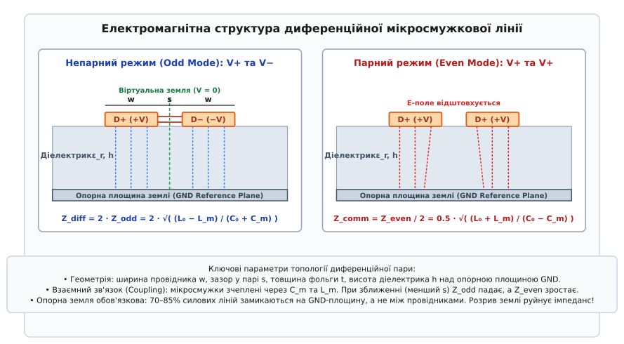
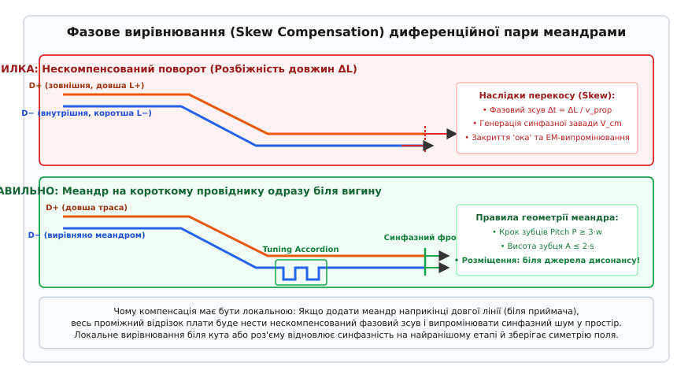

# Диференційні пари й швидкі шини на власній платі

<preknowlist>
- [Стек PCB і характеристичний опір мікросмужки](root:hw-pcb/pcb-stackup-rf) — шарування плати, діелектрична проникність `ε_r` та хвильовий опір поодинокої лінії.
- [Шлях зворотного струму](root:hw-pcb/current-return-path) — замикання високочастотного струму найменшою індуктивною петлею під провідником.
- [Перехресна завада (crosstalk)](root:hw-pcb/crosstalk) — ємнісний та індуктивний зв'язок між паралельними трасами на друкованій платі.
- [Діаграма ока](root:hw-pcb/eye-diagram) — візуалізація джитера, міжсимвольної інтерференції та запасу завадостійкості швидкісного каналу.
- [Електромагнітна сумісність (EMC)](root:hw-pcb/electromagnetic-compatibility) — випромінювання дипольних контурів і придушення синфазних струмів.
</preknowlist>

Коли тактова частота цифрової шини перевищує сотню мегагерців, а тривалість фронту наростання сигналу падає нижче однієї наносекунди, класичний однопровідний підхід передачі сигналів зі спільним поверненням струму через загальну землю перестає гарантувати надійність обміну даними. Швидка зміна струму `dI/dt` на паразитній індуктивності провідників живлення та земляних полігонів друкованої плати викликає динамічне падіння напруги — явище підскоку землі (англ. *ground bounce*). У результаті опорний потенціал мікросхеми коливається відносно потенціалу віддаленого приймача, а логічний нуль на вході довільно підстрибує до рівня помилкового перемикання логічного вентиля. Одночасно з цим електромагнітні поля від сусідніх вузлів — імпульсних перетворювачів напруги, симисторних ключів чи радіочастотних трактів — наводять у відкритому однопровідному сигнальному контурі паразитну електрорушійну силу, яку звичайний приймач не здатний відрізнити від інформаційного сигналу.

Фізичним вирішенням цієї проблеми є диференційна передача сигналів (лат. *differentia* — різниця). Замість вимірювання напруги поодинокого провідника відносно нестабільної точки загальної землі, інформація передається парою геометрично зближених трас, якими одночасно поширюються взаємно протифазні хвилі напруги та струму. Вхідний каскад диференційного приймача реєструє виключно миттєву різницю потенціалів між цими двома провідниками, повністю ігноруючи коливання їхнього спільного потенціалу відносно опорного шару друкованої плати.

Проектування та трасування швидкісних диференційних шин на друкованій платі вимагає неухильного дотримання хвильової геометрії, неперервності зворотного тракту струмів зміщення та ретельної синхронізації фаз. Будь-яка просторова асиметрія — розрив земляного шару під парою, нескомпенсований поворот доріжок, недбале розташування перехідних отворів чи паразитна ємність контактних майданчиків — миттєво руйнує баланс полів і перетворює корисний диференційний сигнал на синфазну заваду, яка закриває око сигналу та перетворює друковану плату на випромінювальну антену.

## Фізика диференційної передачі та придушення синфазної завади

Диференційна лінія зв'язку складається з двох геометрично паралельних провідників однакового поперечного перерізу, які позначають як прямий `D+` (або `True`, `P`) та інверсний `D-` (або `Comp`, `N`). Передавач формує на цих провідниках взаємно протилежні напруги відносно деякого постійного опорного зміщення `V_cm`:

```
V_D+(t) = V_cm + 0.5 · V_diff(t)
V_D-(t) = V_cm - 0.5 · V_diff(t)
```

Диференційна напруга `V_diff(t)` визначається як миттєва алгебраїчна різниця між потенціалами провідників прямого та інверсного сигналів:

```
V_diff(t) = V_D+(t) - V_D-(t)
```

Синфазна складова `V_cm(t)` (англ. *common-mode voltage*) є середнім арифметичним напруг двох провідників відносно місцевої землі:

```
V_cm(t) = 0.5 · (V_D+(t) + V_D-(t))
```

Диференційний приймач є аналоговим віднімачем із високим коефіцієнтом придушення синфазного сигналу (англ. *Common-Mode Rejection Ratio*, CMRR). Якщо зовнішня електромагнітна перешкода `V_noise(t)` від сусіднього імпульсного вузла чи радіовипромінювача наводиться на лінію, завдяки тісному просторовому розташуванню провідників вона індукує на обох трасах практично однакову за величиною та фазою напругу. У результаті повні напруги на входах приймального каскаду набувають вигляду:

```
V_in+(t) = V_D+(t) + V_noise(t)
V_in-(t) = V_D-(t) + V_noise(t)
```

На виході диференційного підсилювача різниця напруг залишається абсолютно вільною від наведеного шуму:

```
V_out(t) = V_in+(t) - V_in-(t)
= (V_D+(t) + V_noise(t)) - (V_D-(t) + V_noise(t))   [підстановка вхідних напруг]
= V_D+(t) - V_D-(t)                                [скорочення однакової синфазної завади]
= V_diff(t)                                        [отримання корисного сигналу]
```

Окрім несприйнятливості до зовнішніх наведень, диференційна пара кардинально знижує власне електромагнітне випромінювання у навколишній простір. Оскільки струми в провідниках рівні за величиною та протилежні за напрямком (`I_D+(t) = -I_D-(t)`), створювані ними вектори магнітної індукції `B` мають протилежну орієнтацію. На відстані `R`, що значно перевищує міжосьовий зазор між провідниками `s` (`R >> s`), поля двох провідників практично повністю компенсують одне одного в далекій зоні. Результуюче випромінювання диференційної пари виявляється пропорційним малій площі петлі між провідниками `A_diff = s · L`, тоді як в однопровідній лінії площа випромінювальної петлі визначається відстанню до найближчого зворотного провідника або контуру живлення, що часто на два-три порядки більше.

У системі з ідеальною симетрією площина, розташована рівно посередині між двома провідниками, має незмінний нульовий потенціал динамічного електричного поля. Ця площина діє як віртуальна земля (англ. *virtual ground*). Наявність віртуальної землі дозволяє розділити аналіз будь-якої складної диференційної структури на розгляд двох симетричних напівсистем, що істотно спрощує математичний розрахунок хвильових процесів.


*Геометрія диференційної пари на діелектрику: ширина провідників w, зазор s, товщина фольги t, висота діелектрика h та розподіл силових ліній поля в непарному й парному режимах.*

## Електродинаміка спряжених ліній та матричні телеграфні рівняння

Для строгого математичного опису хвильових процесів у системі паралельних провідників застосовують узагальнені матричні телеграфні рівняння. Якщо в поодинокій лінії стан описується скалярними величинами напруги `V(z)` та струму `I(z)`, то для пари зв'язаних провідників оперують векторами напруг `V(z) = [V_1(z), V_2(z)]^T` та струмів `I(z) = [I_1(z), I_2(z)]^T`.

Диференційні рівняння для хвилі вздовж поздовжньої координати `z` мають вигляд:

```
∂V(z) / ∂z = -[R + j·ω·L] · I(z)
∂I(z) / ∂z = -[G + j·ω·C] · V(z)
```

де `[R]` — матриця погонних активних опорів втрат у міді, `[G]` — матриця провідності діелектричних втрат, `[L]` — матриця погонних індуктивностей, а `[C]` — матриця погонних ємностей. Для симетричної пари провідників без втрат матриці спрощуються до виду:

```
[L] = [ L_0   L_m ]
      [ L_m   L_0 ]

[C] = [  C_0+C_m   -C_m    ]
      [  -C_m      C_0+C_m ]
```

де `L_0` — власна погонна індуктивність провідника відносно землі, `L_m` — взаємна магнітна індуктивність між двома лініями, `C_0` — власна ємність провідника на опорну площину землі, а `C_m` — взаємна ємність між двома провідниками крізь бічний зазор.

Оскільки недіагональні елементи `L_m` та `C_m` не дорівнюють нулю, сигнал на першому провіднику неминуче наводить напругу та струм на другому провіднику. Для аналітичного розв'язання цієї зв'язаної системи координат використовують модальну декомпозицію (перехід до власних векторів матриці `[L][C]`). Застосування ортогональної матриці модального перетворення `[T_modal]`:

```
[T_modal] = (1 / √2) · [ 1   1 ]
                       [ 1  -1 ]
```

діагоналізує систему рівнянь, розщеплюючи фізичну лінію на дві абсолютно незалежні, віртуальні однопровідні лінії передачі: непарну моду (Odd Mode) та парну моду (Even Mode).

### Непарний режим (Odd Mode)

Непарний режим описує поширення чистої протифазної диференційної хвилі: `V_1 = +V`, `V_2 = -V`, `I_1 = +I`, `I_2 = -I`.

У непарному режимі протилежно спрямовані струми генерують зустрічні магнітні потоки, які частково послаблюють один одного в області між провідниками. Власне значення індуктивності непарної моди дорівнює:

```
L_odd = L_0 - L_m
```

Електричні поля двох провідників спрямовані назустріч одне одному, а в центральній площині симетрії утворюється віртуальна земля з нульовим потенціалом. Повна ємність кожного провідника відносно цієї віртуальної землі зростає на величину взаємної ємності:

```
C_odd = C_0 + C_m
```

Характеристичний хвильовий опір одного провідника в непарному режимі `Z_odd` становить:

```
Z_odd = √( L_odd / C_odd ) = √( (L_0 - L_m) / (C_0 + C_m) )
```

Оскільки диференційний сигнал передається між двома провідниками, які включені послідовно відносно віртуальної землі, повний диференційний імпеданс лінії `Z_diff` дорівнює подвоєному непарному опору:

```
Z_diff = 2 · Z_odd = 2 · √( (L_0 - L_m) / (C_0 + C_m) )
```

### Парний режим (Even Mode)

Парний режим описує поширення синфазної хвилі або зовнішньої завади: `V_1 = +V`, `V_2 = +V`, `I_1 = +I`, `I_2 = +I`.

У парному режимі струми провідників спрямовані в один бік, тому їхні магнітні поля підсилюють одне одного, збільшуючи еквівалентну модальну індуктивність:

```
L_even = L_0 + L_m
```

Напруга між провідниками дорівнює нулю, тому струм через взаємну ємність `C_m` не протікає. Електричні силові лінії відштовхуються між провідниками і витісняються вниз, на опорну площину землі. Модальна ємність парного режиму набуває вигляду:

```
C_even = C_0 - C_m
```

Характеристичний опір провідника в парному режимі `Z_even` визначається як:

```
Z_even = √( L_even / C_even ) = √( (L_0 + L_m) / (C_0 - C_m) )
```

Синфазний імпеданс лінії `Z_comm` (опір пари для синфазного струму, що тече паралельно обома провідниками на землю) дорівнює половині парного імпедансу:

```
Z_comm = Z_even / 2 = 0.5 · √( (L_0 + L_m) / (C_0 - C_m) )
```

### Взаємозв'язок між одиночним та диференційним опором

Якщо ввести коефіцієнт індуктивного зв'язку `k_L = L_m / L_0` та коефіцієнт ємнісного зв'язку `k_C = C_m / C_0`, вираз для диференційного імпедансу набуває елегантного вигляду через хвильовий опір одиночної ізольованої траси `Z_0 = √(L_0 / C_0)`:

```
Z_diff = 2 · Z_0 · √( (1 - k_L) / (1 + k_C) )
```

Ця формула чітко демонструє фундаментальний інженерний принцип: за наявності помітного електромагнітного зв'язку (`k_L > 0`, `k_C > 0`) диференційний імпеданс пари завжди менший за подвоєний одиночний опір доріжки (`Z_diff < 2 · Z_0`). Що тісніше зближені провідники (менший зазор `s`), то сильніший зв'язок, і то ширшою має бути доріжка `w` для збереження цільового значення `Z_diff`.

Якщо ж провідники рознести на велику відстань (`s > 2.5 · h`), взаємні коефіцієнти прямують до нуля (`k_L → 0`, `k_C → 0`), і параметри лінії переходять у граничний стан:

```
Z_odd = Z_even = Z_0
Z_diff = 2 · Z_0
Z_comm = 0.5 · Z_0
```

Повний алгоритм чисельного розрахунку хвильових матриць ємностей наведено у вставці [Калькулятор імпедансу диференційних ліній](root:hw-pcb/dyferentsiini-pary-i-shvydki-shyny-na-vlasnii-plati/proj-diff-pair-impedance-calc.md).

## Аналітичні моделі розрахунку зв'язаних мікросмужок

Для швидкого попереднього інженерного розрахунку геометрії диференційної пари застосовують класичні квазістатичні аналітичні моделі Ваделла (Wadell) та Хаммерштада-Йенсена (Hammerstad-Jensen).

### Врахування скінченної товщини фольги

Реальна мідна фольга має товщину `t` (типово 18 мкм для базової фольги 0.5 oz, 35 мкм для 1.0 oz та до 45–50 мкм після гальванічного нарощування міді в отворах). Товщина фольги збільшує бічну площу провідника, створюючи додаткову ємність крайового поля на землю та на сусідній провідник.

Еквівалентна ефективна ширина провідника `w_eff` з урахуванням товщини фольги розраховується за формулою:

```
Δw = (t / π) · ( 1 + ln( 2 · h / t ) )   [для w/h >= 0.5 · π]
w_eff = w + Δw
```

### Модель зв'язаних мікросмужок за Ваделлом

Характеристичні імпеданси непарного та парного режимів зв'язаної мікросмужкової лінії виражаються через одиночний імпеданс ізольованої смужки `Z_0(w, h, ε_r)` та геометричні коефіцієнти взаємного впливу:

```
Z_even = Z_0(w_eff, h, ε_r) / ( 1 - (Z_0(w_eff, h, ε_r) / 376.73) · √(ε_eff) · Q_even )
Z_odd  = Z_0(w_eff, h, ε_r) / ( 1 - (Z_0(w_eff, h, ε_r) / 376.73) · √(ε_eff) · Q_odd )
```

де `Q_even` та `Q_odd` — безрозмірні коефіцієнти форми, що залежать від нормалізованого зазору `u = s / h` та ширини `v = w / h`.

### Вплив паяльної маски (Solder Mask Correction)

Після травлення топології міді поверхня плати покривається захисною паяльною маскою (Solder Mask) товщиною `t_mask = 15–25` мкм із діелектричною проникністю `ε_mask ≈ 3.3–3.8`. Рідка маска заповнює бічний зазор `s` між провідниками пари, витісняючи повітря (`ε_air = 1.0`).

Оскільки діелектрична проникність маски більш ніж утричі перевищує проникність повітря, взаємна ємність `C_m` помітно зростає. Це призводить до зниження диференційного імпедансу `Z_diff` на 2–5 Ом порівняно з відкритою непокритою міддю. Якщо розробник спроектував пару рівно на 90.0 Ом за формулою для голої плати, після нанесення маски реальний опір впаде до 85–86 Ом, що може призвести до виходу за межі стандартного допуску ±10%. Професійні калькулятори та фабричні САПР завжди враховують конформний шар маски під час синтезу ширини трас.

## Матриця змішаних S-параметрів (Mixed-Mode S-Parameters)

Для високочастотної характеристики диференційного чотириполюсника класичних одиночних S-параметрів стає недостатньо. Інженери використовують апарат змішаних S-параметрів (Mixed-Mode S-Parameters), які розділяють матрицю розсіювання на чотири функціональні блоки:

```
[S_mm] = [ S_dd   S_dc ]
         [ S_cd   S_cc ]
```

Кожен квадрант описує фундаментальні фізичні властивості лінії передачі:
1. **Диференційний блок `[S_dd]`:** описує поведінку корисного диференційного сигналу. Коефіцієнт `S_dd11` є диференційними зворотними втратами (Differential Return Loss) і характеризує якість узгодження імпедансу та рівень відбиттів. Коефіцієнт `S_dd21` є диференційними внесеними втратами (Differential Insertion Loss), що показує амплітудно-частотне згасання корисного сигналу на заданій довжині лінії.
2. **Синфазний блок `[S_cc]`:** описує проходження та відбиття синфазної завади (`S_cc11` та `S_cc21`).
3. **Блок конверсії мод `[S_cd]` (Differential to Common Mode Conversion):** найкритичніший параметр якості трасування друкованої плати. Коефіцієнт `S_cd21` показує, яка частка енергії корисного диференційного сигналу перетворюється на паразитний синфазний шум через геометричну асиметрію пари, різницю довжин або розриви опорного полігону землі. Для успішного проходження сертифікації EMC величина `S_cd21` на робочій частоті повинна бути меншою за -20...-25 дБ.
4. **Блок сприйнятливості до завад `[S_dc]` (Common to Differential Mode Conversion):** коефіцієнт `S_dc21` визначає, яка частка зовнішнього синфазного шуму трансформується в паразитну різницю напруг на вході приймача.

## Порівняння мікросмужкових, смужкових та копланарних топологій

Під час вибору типу лінії передачі в структурі багатошарової друкованої плати інженер обирає між трьома базовими планарними конфігураціями:

| Параметр | Поверхнева мікросмужка (Microstrip) | Внутрішня смужкова лінія (Stripline) | Копланар із землею (CPWG) |
| :--- | :--- | :--- | :--- |
| **Розташування** | Зовнішній шар (Layer 1, Layer N) | Внутрішній шар (Layer 3, Layer 4) | Зовнішній шар із бічною землею |
| **Діелектрик** | Неоднорідний (FR-4 + повітря/маска) | Ідеально однорідний (Prepreg/Core) | Неоднорідний (FR-4 + повітря) |
| **Швидкість `v_prop`** | Максимальна (`~6.0` пс/мм) | Менша на 15–20% (`~6.9` пс/мм) | Проміжна |
| **Перехресна завада FEXT** | Присутня через `v_odd ≠ v_even` | **Повністю відсутня** (`v_odd = v_even`) | Пригнічена бічними екранами |
| **Екранування від EMC** | Середнє (відкрита поверхня) | **Ідеальне** (між двома GND шарами) | Відмінне у площині шару |
| **Вплив паяльної маски** | Високий (знижує `Z_diff` на 2–5 Ом) | Відсутній (маска не наноситься) | Високий у бічних зазорах |
| **Необхідність перехідних отворів** | Мінімальна (прямий вихід на SMD) | Обов'язкова (перехід із поверхні) | Мінімальна |

## Фізика перехідних отворів та еквівалентні схеми переходів

Вертикальний перехідний отвір (via) є циліндричною трубкою з міді, яка проходить крізь товщу діелектрика плати. Еквівалентна електрична схема перехідного отвору складається з послідовної паразитної індуктивності стовбура `L_via` та паралельних паразитних ємностей контактних майданчиків `C_pad` на кожному шарі:

```
           L_via / 2               L_via / 2
o----------UUUUUU---------+---------UUUUUU----------o
                          |
                         --- C_pad
                         ---
                          |
                          v GND
```

Аналітична оцінка паразитної індуктивності одиночного циліндричного перехідного отвору довжиною `h_via` та діаметром свердла `d_via`:

```
L_via ≈ (μ_0 · h_via / (2 · π)) · [ ln( 4 · h_via / d_via ) - 0.75 ]
```

Для типової плати товщиною 1.6 мм із діаметром свердла 0.3 мм індуктивність отвору становить близько 1.1–1.3 нГн. На частоті 5 ГГц реактивний опір цієї індуктивності сягає `X_L = 2 · π · f · L ≈ 35–40` Ом, що створює різкий розрив імпедансу в тракті.

Коли через плату проходить диференційна пара перехідних отворів, між ними виникає взаємна індуктивність `L_m,via`. Оскільки струми в сигнальних отворах протифазні, еквівалентна непарна індуктивність пари перехідних отворів знижується:

```
L_odd,via = L_via - L_m,via
```

Щоб зберегти неперервність зворотного струму при переході між шарами, безпосередньо біля сигнальної пари розміщують зшивні перехідні отвори землі (GND Stitching Vias). Вони виконують роль зовнішнього екрана віртуального коаксіального хвилеводу, каналізуючи струми зміщення і знижуючи результуючу індуктивність вертикального переходу до значень менше 0.2–0.3 нГн.

## Дисперсія фазових швидкостей та перехресні завади дальнього кінця

У мікросмужкових структурах (коли провідники прокладені на зовнішньому шарі плати) діелектричне середовище є принципово неоднорідним: під провідниками знаходиться склотекстоліт із високою проникністю `ε_r ≈ 4.2`, а над провідниками — повітря (`ε_r = 1.0`) або тонка паяльна маска (`ε_r ≈ 3.5`).

У непарному режимі значна частка електричних силових ліній замикається між бічними гранями провідників через повітряний проміжок над платою. У парному режимі все поле відштовхується і зосереджується в товщі нижнього діелектрика. У результаті ефективна діелектрична проникність для непарної моди виявляється помітно меншою, ніж для парної моди:

```
ε_eff,odd < ε_eff,even
```

Оскільки фазова швидкість поширення електромагнітної хвилі в середовищі дорівнює `v = c / √(ε_eff)`, непарна мода рухається лінією швидше, ніж парна:

```
v_odd > v_even
```

Різниця фазових швидкостей призводить до того, що на дальньому кінці лінії передачі два модальні компоненти сигналу приходять із часовим зсувом. Це породжує перехресну заваду на дальньому кінці (Far-End Crosstalk, FEXT). Амплітуда завади FEXT зростає пропорційно довжині паралельного пробігу трас та крутизні фронту сигналу.

У внутрішніх шарах плати (смужкові лінії, англ. *stripline*), де провідники повністю занурені в однорідний діелектрик між двома опорними площинами землі, ефективна діелектрична проникність однакова для обох мод (`ε_eff,odd = ε_eff,even = ε_r`). У результаті фазові швидкості збігаються (`v_odd = v_even`), а перехресна завада FEXT теоретично повністю зникає. Тому всі критичні швидкісні інтерфейси зі швидкостями понад 5 Гбіт/с (PCIe Gen4/5, USB4, 25GbE) рекомендується трасувати виключно у внутрішніх шарах друкованої плати.

## Шлях зворотного струму та опорна площина

У колах постійного струму електричний струм завжди повертається до джерела шляхом найменшого омічного опору (найкоротшою геометричною лінією). Проте на високих частотах (вище 1–5 МГц) фізика кардинально змінюється: струм обирає шлях найменшої індуктивності петлі.

Індуктивність замкненого контуру пропорційна площі, яку охоплює цей контур. Щоб мінімізувати площу петлі, високочастотний зворотний струм індукується в опорній мідній площині безпосередньо під сигнальним провідником, повторюючи кожен його вигин. Поперечний розподіл густини поверхневого зворотного струму `J_return(x)` в опорному шарі описується формулою:

```
J_return(x) = I_0 / (π · h) · 1 / (1 + (x / h)²)
```

де `x` — поперечна відстань від осі провідника, а `h` — товщина діелектрика між провідником і опорною площиною.

Густина зворотного струму сягає максимуму точно під віссю провідника (`x = 0`) і спадає до мізерних значень на відстані `x > 3 · h`.

```
+---------------------------------------------------------------+
|    D+ (+I)                      D- (-I)                       |
|   [#######]       зазор s      [#######]        Шар сигналів  |
|      ||                           ||                          |
|~~~~~~||~~~~~~~~~~~~~~~~~~~~~~~~~~~||~~~~~~~~~~~~~~~~~~~~~~~~~~|  Діелектрик h
|      vv                           vv                          |
|  (<<<<<<<<<)                  (>>>>>>>>>)       Шар землі GND |
|  Зворотний струм -I           Зворотний струм +I              |
+---------------------------------------------------------------+
```

Оскільки в типових топологіях плат від 75% до 85% електричного поля мікросмужки замикається на нижній опорний шар, під провідником `D+` тече прямий зворотний струм `-I`, а під провідником `D-` — зворотний струм `+I`. Ці дві смуги струму розташовані на близькій відстані, тому їхні магнітні поля в металі опорного шару взаємно віднімаються, знижуючи загальну індуктивність тракту.

Якщо ж під диференційною парою є розрив опорного шару (технологічна щілина, паз, перетин розділених полігонів живлення), зворотні струми втрачають можливість рухатися під провідниками і змушені огинати перешкоду по периметру. Це викликає три важкі руйнівні наслідки:
1. **Локальний стрибок імпедансу:** площа петлі струму зростає в десятки разів, локальна індуктивність лінії різко збільшується, а диференційний опір підстрибує до 180–250 Ом, створюючи потужне відбиття хвиль.
2. **Динамічний фазовий перекіс:** через геометричну асиметрію форми щілини зворотний струм прямого провідника проходить інший шлях, ніж зворотний струм інверсного провідника, руйнуючи синфазність фронтів.
3. **Конверсія мод (Mode Conversion):** різниця затримок і стрибок імпедансу миттєво перетворюють частину диференційної енергії на потужний синфазний струм (явище описується коефіцієнтом матриці розсіювання `SCD21`). Велика петля синфазного струму перетворює ділянку плати на високоефективну випромінювальну антену, створюючи перешкоди в ефірі та провалюючи сертифікацію EMC.

## Геометричні правила трасування та фазове вирівнювання

Збереження цілісності швидкісного сигналу досягається строгою симетрією фізичної геометрії провідників на кожному міліметрі траси.

### 1. Контроль геометрії перерізу

Хвильовий опір пари визначається параметрами `w`, `s`, `h` та `ε_r`. Ширина провідників `w` та відстань між ними `s` мають залишатися абсолютно сталими на всій протяжності лінії. Зміна зазору між трасами (наприклад, при обході одиночного кріпильного отвору або компонента) модулює взаємну ємність `C_m` та індуктивність `L_m`, викликаючи стрибок імпедансу. Якщо необхідно оминути перешкоду, обидва провідники пари відгинають паралельно, зберігаючи константний міжосьовий інтервал.

### 2. Фазова компенсація та вирівнювання довжин (Skew Compensation)

Швидкість поширення електромагнітної хвилі в діелектрику плати визначається ефективною діелектричною проникністю `ε_r,eff`:

```
v_prop = c / √( ε_r,eff )
```

Для типового склотекстоліту FR-4 (`ε_r ≈ 4.2`) ефективна проникність зовнішньої мікросмужки становить близько `ε_r,eff ≈ 3.2`, а затримка поширення дорівнює:

```
t_pd = √( ε_r,eff ) / c ≈ √( 3.2 ) / (3 · 10⁸ м/с) ≈ 5.96 пс/мм (≈ 151 пс/дюйм)
```

При проходженні геометричного повороту траси під кутом 45° чи 90° зовнішній провідник має більший радіус кривини, ніж внутрішній, і проходить більший фізичний шлях. Наприклад, поворот пари з міжосьовою відстанню `D = w + s = 0.3` мм на кут 90° додає зовнішньому провіднику різницю довжини:

```
ΔL = (π / 2) · D = 1.5708 · 0.3 мм ≈ 0.471 мм (471 мкм)
```

Така розбіжність вносить фазовий перекіс:

```
Δt = ΔL · t_pd = 0.471 мм · 5.96 пс/мм ≈ 2.81 пс
```

Для сигналу PCIe Gen4 зі швидкістю 16 ГТ/с тривалість одного бітового інтервалу (англ. *Unit Interval*, UI) становить лише 62.5 пс. Фазовий зсув у 2.81 пс відбирає майже 5% бітового вікна з одного-єдиного повороту. Якщо поворотів на платі кілька, нескомпенсований фазовий зсув призводить до стиснення ока сигналу, порушення порогів спрацьовування та конверсії диференційного режиму в синфазну заваду `V_cm = (V_+ + V_-) / 2`.


*Принцип фазової компенсації: вирівнювання довжин за допомогою настроювальних меандрів безпосередньо біля джерела розбіжності та геометричні обмеження кроку.*

Для усунення фазового перекосу на коротшому провіднику формують настроювальні змійки (меандри, англ. *tuning accordions*), дотримуючись таких правил:
* **Локалізація:** компенсаційний меандр розміщують **безпосередньо біля джерела виникнення розбіжності** (одразу за вигином або виходом із роз'єму). Якщо накопичити розбіжність уздовж усієї лінії завдовжки 15 см і спробувати скомпенсувати її біля мікросхеми-приймача, увесь проміжний відрізок траси нестиме нескомпенсовану протифазність, випромінюючи синфазні перешкоди на плату.
* **Крок меандра (Pitch):** відстань між сусідніми паралельними колінами меандра `P` повинна становити не менше `3 · w` (краще `≥ 4 · w`). Якщо зробити крок занадто малим, між сусідніми витками виникне сильний паразитний ємнісний зв'язок: електромагнітна хвиля просто «перестрибне» через зазор замість проходження повного фізичного шляху петлі, і очікувана затримка не сформується.
* **Висота коліна (Amplitude):** висота вигину меандра не повинна перевищувати `2 · s`, щоб не створювати різкого розриву локального хвильового опору.

### 3. Заборона гострих кутів і плавні переходи

Будь-який прямий поворот під кутом 90° збільшує локальну ширину провідника в діагоналі в `√2 ≈ 1.414` раза. Це створює надлишкову паразитну ємність (ємнісний відвід), що призводить до локального падіння імпедансу та паразитного відбиття сигналу.
* Повороти виконують виключно під кутом 45° (зі зрізанням зовнішнього кута — скошенням, англ. *mitered bend*) або радіальними дугами.
* Оптимальне співвідношення радіуса заокруглення до ширини доріжки: `R ≥ 3 · w`.

### 4. Вертикальні переходи шарів та зворотні перехідні отвори землі

Коли диференційна пара змінює шар друкованої плати крізь перехідні отвори (англ. *vias*), провідники потрапляють у вертикальний циліндричний канал. Якщо паралельно з сигнальними перехідними отворами не перенести шлях зворотного струму, він шукатиме найближче ємнісне з'єднання між опорними шарами, що призведе до розриву контуру струму та стрибка індуктивності величиною 1–3 нГн.

```
+---------------------------------------------------------------+
|     [GND Via]         [Signal Via+]     [Signal Via-]         |
|        (O)                 (O)               (O)              |
|         |                   |                 |               |
|         |<---- d <= 0.5mm ->|                 |               |
+---------------------------------------------------------------+
```

Обов'язкові правила для вертикальних переходів швидкісних пар:
1. **Зшивні отвори землі (GND Stitching Vias):** безпосередньо біля сигнальної пари (на відстані `d ≤ 0.5` мм, не більше ніж `λ_min / 20`) встановлюють як мінімум один або два перехідні отвори землі. Вони забезпечують нерозривний шлях для струмів зсуву між площинами землі верхнього та нижнього шарів.
2. **Симетрія отворів:** отвори прямого й зворотного сигналів повинні мати ідентичний діаметр отвору, діаметр контактного майданчика та зазор до внутрішніх полігонів (англ. *anti-pad*).
3. **Видалення відростків (Via Stubs / Back-Drilling):** на частотах понад 5 Гбіт/с невикористана частина перехідного отвору (апендикс, що йде до нижніх шарів без підключення доріжки) діє як розімкнений чвертьхвильовий резонатор, повністю гасячи сигнал на резонансній частоті `f_res = c / (4 · h_stub · √(ε_r))`. Для запобігання цьому застосовують глухі/зариті отвори (англ. *blind/buried vias*) або механічне висвердлювання відростків (англ. *back-drilling*).

### 5. Очищення землі під SMD-майданчиками (Anti-Pad Voids)

У місцях встановлення поверхнево-монтованих елементів (розділових конденсаторів змінного струму, захисних ESD-діодів, термінаційних резисторів) ширина контактного майданчика (footprint pad) істотно перевищує ширину швидкісної доріжки (наприклад, площадка типорозміру 0402 має ширину 0.6 мм проти ширини мікросмужки 0.15 мм).

Через збільшену площу пластини ємність площадки на опорну землю `C_pad = ε · S / h` підскакує в 3–4 рази, створюючи локальний провал диференційного імпедансу на рефлектограмі (TDR) до 65–75 Ом.

Для компенсації цього паразитного ефекту під контактними майданчиками на опорному шарі землі, розташованому безпосередньо під компонентом (Layer 2), роблять прямокутний виріз міді (англ. *anti-pad void*). Опорна земля для майданчика тепер опиняється на наступному шарі (Layer 3), відстань `h` збільшується вдвічі, що знижує паразитну ємність і повертає локальний імпеданс майданчика до цільових 90 чи 100 Ом.

### 6. Захист від перехресних завад (Правило ізоляції 3W/5W)

Для запобігання перехресним наведенням (англ. *crosstalk*) між різними диференційними парами або між диференційною парою та поодинокими лініями великої амплітуди (шинами живлення, тактовими сигналами, GPIO) дотримуються просторового рознесення:
* Відстань між краями двох сусідніх диференційних пар повинна становити не менше `3 · s` (де `s` — зазор усередині пари) або не менше `3 · h` (де `h` — товщина діелектрика до землі).
* Для критичних шин передачі даних (наприклад, приймальної лінії RX поруч із передавальною лінією TX у PCIe чи USB 3.0) інтервал збільшують до `5 · h` або прокладають між ними захисний екранний полігон землі з регулярними перехідними отворами з кроком `λ / 10`.

## Втрати в діелектрику, скін-ефект та структура склотканини

На частотах понад 1 ГГц загальне згасання швидкісного каналу визначається двома фізичними механізмами втрат:

```
α_total(f) = α_conductor(f) + α_dielectric(f)
```

### 1. Скін-ефект та шорсткість фольги

Глибина проникнення струму в товщу міді зменшується зі зростанням частоти:

```
δ(f) = √( 1 / (π · f · μ_0 · σ) )
```

На частоті 1 ГГц товщина скін-шару становить `0.66` мкм, а на частоті 10 ГГц — лише `0.21` мкм. Вся енергія струму виявляється затиснутою в надтонкій приповерхневій плівці металу.

Якщо середньоквадратична висота мікронерівностей фольги `R_q` перевищує товщину скін-шару `δ(f)`, лінії струму змушені текти по звивистій поверхні мікрозубців міді. Це багаторазово збільшує ефективний омічний опір провідника (додаткові втрати 40–80%). Для кількісної оцінки застосовують модель Хаммерштада або модель снігових кульок Хурея (Huray Snowball Model), яка моделює дендрити міді кластерами сфер радіуса `a ≈ 0.5–1.5` мкм. Тому для швидкісних плат використовують мідну фольгу з ультранизьким профілем шорсткості (VLP, HVLP з `R_q < 1.0` мкм).

### 2. Діелектричні втрати

Згасання сигналу через в'язку переполяризацію молекул діелектрика пропорційне тангенсу кута втрат `tan δ`:

```
α_dielectric(f) = (π · f / c) · √( ε_r ) · tan δ
```

На частотах понад 2 ГГц діелектричні втрати повністю домінують над втратами в міді. Стандартний склотекстоліт FR-4 (`tan δ ≈ 0.020`) на довжині 20 см завалює амплітуду сигналу 10 Гбіт/с більш ніж на 15–20 дБ, викликаючи повне змикання ока сигналу. Для швидкісних плат застосовують високочастотні матеріали зі зниженими діелектричними втратами (Isola 370HR, Rogers RO4350B, Panasonic Megtron 6 з `tan δ ≈ 0.002–0.004`).

### 3. Ефект структури склотканини (Fiber Weave Effect)

Нерівномірність плетіння ниток скловолокна (`ε_r,glass ≈ 6.0`) в епоксидній смолі (`ε_r,resin ≈ 3.0`) створює просторову варіацію діелектричної проникності плати. Якщо провідники пари пролягають по різних ділянках тканини, виникає випадковий фазовий розрив (Glass Weave Skew) величиною до 30–50 пс на 10 см довжини.

Методи захисту від ефекту склотканини:
1. **Трасування під кутом:** розведення диференційних шин під кутом 10°–15° відносно країв плати, завдяки чому обидва провідники періодично перетинають однакову кількість ниток скла і смоли.
2. **Щільне плетіння (Spread Glass):** використання склотканин типів 1067, 1078 або 1086 з механічно розплющеними нитками, де мікропроміжки між пасмами скла повністю відсутні.

## Анатомія BGA-фанауту та виходу з роз'ємів

Найскладнішою зоною трасування швидкісних диференційних пар є зона виходу з багатовивідних корпусів мікросхем BGA (Ball Grid Array) та високощільних роз'ємів (breakout / escape routing).

Коли крок кульок BGA становить 0.8 мм, 0.65 мм або 0.5 мм, прокласти пару доріжок стандартної ширини (наприклад, `w = 0.15` мм із зазором `s = 0.15` мм) між контактними майданчиками кульок стає фізично неможливо через технологічні обмеження мінімального зазору фабрики.

Для проходження між виводами інженер змушений застосовувати локальне звуження провідників (англ. *neck-down*). Наприклад, ширина провідника зменшується з `w_1 = 0.15` мм до `w_2 = 0.09` мм. Якщо при цьому залишити початковий зазор `s_1 = 0.15` мм, зменшення ширини доріжки призведе до різкого зростання непарного хвильового опору `Z_odd` з 50 Ом до 65–70 Ом (диференційний опір підскочить до 130–140 Ом).

Щоб компенсувати звуження провідника і зберегти диференційний імпеданс незмінним на рівні 90 або 100 Ом, зазор між провідниками в зоні звуження пропорційно зменшують:

```
s_2 = s_1 · (w_2 / w_1)^p
```

Зменшення зазору `s_2` (наприклад, до 0.08–0.09 мм) різко збільшує взаємну ємність `C_m` та взаємну індуктивність `L_m`, що повністю компенсує зменшення власної ємності доріжки `C_0` і утримує диференційний імпеданс у межах допуску ±5% без появи сходинки на рефлектограмі.

У роз'ємах високої щільності (USB Type-C, PCIe edge connector, Samtec Q-Strip) перехід від об'ємних металевих ламелей контактів до тонких доріжок плати компенсують симетричним розташуванням сигнальних перехідних отворів та локальним розширенням вікон антипадів на внутрішніх шарах під ніжками роз'єму.

## Дроселі синфазної завади (Common-Mode Choke)

Для захисту чутливих радіотрактів та проходження сертифікації електромагнітної сумісності (EMC) на виході диференційних шин (USB, CAN FD, HDMI) встановлюють синфазні дроселі (Common-Mode Chokes, CMC).

Синфазний дросель містить дві зустрічно намотані обмотки на спільному високопроникному феритовому осерді (`μ_r ≈ 500–2000`):

```
D+ o------UUUUU-------> До роз'єму
          [===] Осердя
D- o------UUUUU-------> До роз'єму
```

Фізика роботи дроселя базується на модальному розділенні:
1. **Диференційний режим:** струми `I_D+` та `I_D-` рівні за амплітудою та протилежні за напрямком. Створювані ними магнітні потоки в товщі фериту взаємно компенсуються (`Φ_diff = Φ_1 - Φ_2 = 0`). Еквівалентна індуктивність дроселя для корисного сигналу дорівнює лише мізерній індуктивності розсіювання (`L_leak ≈ 1–3%` від номіналу), тому корисний сигнал проходить крізь дросель без спотворення форми імпульсу.
2. **Синфазний режим:** синфазний шум протікає обома обмотками в одному напрямку. Магнітні потоки в осерді синфазно додаються (`Φ_comm = Φ_1 + Φ_2 = 2 · Φ`), створюючи колосальний реактивний імпеданс `Z_cm = 2 · π · f · L_cm` (300–1000 Ом на частотах 100–500 МГц). Синфазний струм ефективно блокується і не виходить у зовнішній кабель, ліквідуючи антенний ефект.

Під час вибору синфазного дроселя інженер контролює:
* **Частоту власного резонансу (Self-Resonant Frequency, SRF):** паразитна ємність між витками обмоток не повинна створювати резонансного провалу імпедансу на робочих гармоніках корисного сигналу.
* **Індуктивність розсіювання:** надмірна індуктивність `L_leak` спотворює диференційний хвильовий опір, створюючи індуктивний сплеск на рефлектограмі TDR.

## Температурний дрейф діелектричної проникності та фазовий зсув

Під час експлуатації апаратури в широкому температурному діапазоні (від -40°C до +85°C в індустріальних застосуваннях або до +125°C в автомобільній електроніці) діелектрична проникність склотекстоліту змінюється. Ця залежність описується температурним коефіцієнтом діелектричної проникності (Thermal Coefficient of Dielectric Constant, TCDk):

```
TCDk = (1 / ε_r) · (dε_r / dT) · 10⁶ [ppm / °C]
```

Для стандартного FR-4 значення TCDk становить близько `+200...` `+350` ppm/°C. Нагрівання плати на 80°C збільшує діелектричну проникність на 2–3%, що сповільнює швидкість поширення сигналу `v_prop = c / √(ε_r)`.

На коротких платах цей ефект непомітний, але на довгих трасах серверних об'єднувальних плат (Backplane) довжиною 40–80 см температурне уповільнення додає абсолютну затримку в 15–30 пс. Якщо паралельні шини проходять через зони з різним локальним нагріванням (наприклад, одна пара біля радіатора процесора з температурою +85°C, а інша — біля холодного краю плати з +35°C), виникає температурний перекіс фаз (Thermal Skew). Для виключення цього ефекту в критичних високочастотних системах застосовують термокомпенсовані діелектрики (Rogers RO4003C, Megtron 6) з показником `TCDk < ±30` ppm/°C.

## Архітектура блоків SerDes та відновлення тактової частоти (CDR)

На фізичному рівні швидкісних мікросхем передача даних реалізується спеціалізованими апаратними вузлами SerDes (Serializer / Deserializer).

Головним завданням приймача SerDes є відновлення тактового сигналу безпосередньо з інформаційного потоку даних (Clock and Data Recovery, CDR) без прокладання окремої фізичної тактової пари.

Для цього використовують фазові детектори Банг-Банг (Bang-Bang Phase Detector, BBPD) або детектори Олександра (Alexander Phase Detector). Детектор вимірює знак часової похибки між фронтом вхідного сигналу та фронтом внутрішнього генератора:
* Якщо перехід сигналу відбувся раніше за строб, фаза генератора підтягується вперед (Early).
* Якщо перехід запізнився, фаза відтягується назад (Late).

Схема CDR здатна стабільно утримувати фазу лише за умови регулярної наявності логічних переходів `0 → 1` та `1 → 0` у сигналі. Якщо передавач передає довгу серію однакових символів (наприклад, 100 логічних нулів поспіль), відсутність переходів призводить до дрейфу фази генератора CDR, втрати синхронізації та повного зриву прийому пакетів.

Саме тому всі швидкісні диференційні протоколи застосовують канальне кодування (Line Coding) або псевдовипадкове скремблювання (Scrambling), які гарантують високу щільність переходів (Transition Density) та жорстко обмежують максимальну довжину однакових бітів (Max Run Length Constraint):
* **8b/10b (USB 3.0, PCIe Gen1/2, SATA, DisplayPort):** кожні 8 бітів перетворюються на 10-бітовий символ, гарантуючи довжину серії не більше 5 бітів та баланс постійної складової струму (DC-balance).
* **128b/130b та 128b/132b (PCIe Gen3–Gen5, USB4):** застосовують поліноміальний скремблер для статистичного розмазування спектра та усунення довгих серій однакових символів з оверхедом менше 1.5%.

## Метрологія швидкісних шин: рефлектометрія TDR та аналіз ока сигналу

Контроль якості виготовленої друкованої плати та верифікація трасування вимагають застосування двох ключових інструментів високочастотної метрології: рефлектометрії в часовій області (TDR) та аналізу діаграми ока (Eye Diagram).

### 1. Рефлектометрія в часовій області (Time Domain Reflectometry, TDR)

Прилад TDR є швидкісним стробоскопічним осцилографом із вбудованим генератором надкоротких каліброваних імпульсів напруги з тривалістю фронту `t_rise < 20–35` пс. Імпульс надсилається в лінію передачі, а приймач фіксує амплітуду та часову затримку відбитих хвиль.

Миттєвий хвильовий опір лінії `Z(t)` у кожній точці координати `x = v_prop · t / 2` розраховується з коефіцієнта відбиття:

```
Γ(t) = V_reflected(t) / V_incident
Z(t) = Z_source · (1 + Γ(t)) / (1 - Γ(t))
```

Інтерпретація рефлектограми TDR:
* **Стрибок угору (`Z(t) > Z_target`):** індуктивна неоднорідність. Вказує на локальне звуження доріжки, надмірну довжину провідника перехідного отвору або розрив опорного шару землі.
* **Провал униз (`Z(t) < Z_target`):** ємнісна неоднорідність. Свідчить про розширення доріжки, наявність контактного майданчика SMD без антипаду на другому шарі або надмірну паразитну ємність захисного ESD-діода.

Під час диференційного тестування генератор формує два взаємно протифазні імпульси (`+V` та `-V`), що дозволяє безпосередньо спостерігати профіль диференційного імпедансу `Z_diff(x)`. Синфазне тестування (`+V` та `+V`) дає профіль синфазного опору `Z_comm(x)`.

### 2. Аналіз діаграми ока (Eye Diagram) та розкладання джитера

Діаграма ока формується шляхом неперервного накладання осцилограм тисяч послідовних бітових інтервалів псевдовипадкової бітової послідовності (PRBS-7, PRBS-15, PRBS-31) при синхронізації від відновленого тактового сигналу (Clock Data Recovery, CDR).

Ключові параметри діаграми ока:
1. **Висота розкриття ока (Eye Height):** різниця напруг між рівнями логічної одиниці та нуля в центрі бітового інтервалу. Визначає запас завадостійкості приймача за напругою (в мілівольтах). Звуження висоти свідчить про високі втрати в діелектрику та міжсимвольну інтерференцію (ISI).
2. **Ширина розкриття ока (Eye Width):** часовий інтервал, протягом якого сигнал стабільно перевищує порогові рівні. Визначає фазовий запас надійності стробування (у пікосекундах або частках `UI`).
3. **Розкладання джитера (Jitter Decomposition):** часове тремтіння фронтів розкладається на дві фундаментальні компоненти:
   * **Випадковий джитер (Random Jitter, RJ):** гаусовий шум теплового походження, що не має верхньої межі амплітуди і характеризується середньоквадратичним відхиленням `RJ_rms`.
   * **Детермінований джитер (Deterministic Jitter, DJ):** строго обмежений за розмахом шум, що складається з періодичного джитера від перемикання перетворювачів живлення (PJ), міжсимвольної інтерференції від дисперсії в діелектрику (ISI) та спотворення шпаруватості від асиметрії фронтів (DCD).
   * **Повний джитер (Total Jitter, TJ):** розраховується для заданого рівня ймовірності бітової помилки (наприклад, `BER = 10^-12`) за формулою моделі подвійного Дірака:
     ```
     TJ(BER) = DJ_p-p + 2 · Q(BER) · RJ_rms
     ```
     Для `BER = 10^-12` значення квантиля становить `Q ≈ 7.034`, що дає класичне співвідношення:
     ```
     TJ = DJ_p-p + 14.069 · RJ_rms
     ```

## Топології узгодження навантаження та активна еквалізація

Для запобігання відбиттям хвиль від приймального кінця лінії використовують схеми навантаження:

```
Схема 1: Просте паралельне навантаження        Схема 2: Розділена термінація (Split)
D+ o-------+                                  D+ o-------+
           |                                             |
          [ ] R_T = 100 Ом                              [ ] R_T/2 = 50 Ом
           |                                             |
           |                                             +-------||---+ C_ac = 4.7 нФ
           |                                             |            |
          [ ]                                           [ ] R_T/2     |
           |                                             |            v GND
D- o-------+                                  D- o-------+
```

1. **Проста паралельна термінація (Simple Parallel):** один резистор `R_T = Z_diff` (100 Ом) між провідниками `D+` та `D-`. Повністю поглинає диференційну хвилю, але відбиває синфазну заваду.
2. **Розділена термінація (Split Termination):** два резистори по 50 Ом із середньою точкою, заземленою через конденсатор `C_ac` (4.7–10 нФ). Поглинає диференційний сигнал (100 Ом) та одночасно створює низькоомний стік 25 Ом на землю для синфазної завади, гасячи синфазні коливання.
3. **Вбудована термінація (On-Die Termination, ODT):** комутовані польові транзистори всередині кристала мікросхеми, що ліквідують паразитні відводи виводів корпусу.

Для виправлення спотворень форми імпульсів, викликаних згасанням високих частот у діелектрику, застосовують активну еквалізацію:
* **Передіскаження (Pre-emphasis / De-emphasis):** передавач штучно послаблює низькочастотні серії однакових бітів відносно швидких одиничних перепадів.
* **Аналогова лінійна еквалізація (CTLE):** високочастотний підсилювач-коректор у приймачі, що піднімає верхню частину спектра.
* **Цифрова еквалізація зі зворотним зв'язком (DFE):** цифровий автомат усередині приймача, який динамічно адаптує пороги розпізнавання поточного біта на основі значень попередніх бітів, ліквідуючи міжсимвольну інтерференцію (ISI).

## Захист від ESD та розв'язка кіл живлення трансиверів

Швидкісні канали безпосередньо контактують із зовнішніми роз'ємами, піддаючись ризику високовольтних електростатичних розрядів (ESD).

### 1. Інженерія ESD-захисту без розриву імпедансу
Звичайні стабілітрони або кремнієві діоди мають власну паразитну ємність p-n переходу `C_j ≈ 5–10` пФ. На частоті 5 ГГц ємнісний опір такого діода падає до `X_C = 1 / (2 · π · f · C) ≈ 3–6` Ом, що фактично закорочує швидкісний сигнал на землю.

Для швидкісних інтерфейсів застосовують спеціалізовані діодні матриці з ультранизькою ємністю (Ultra-Low Capacitance TVS, `C_esd < 0.15–0.3` пФ). При цьому критичним є спосіб трасування:
* **Трасування без відводів (Zero-Stub Routing):** швидкісна доріжка повинна проходити безпосередньо крізь контактний майданчик мікросхеми ESD-захисту. Будь-який T-подібний відвід (stub) довжиною навіть 1.5 мм створює паразитарний чвертьхвильовий резонатор, що повністю спотворює форму очного вікна на частотах 10–20 ГГц.
* **Антипади під ESD-чіпом:** під корпусом ESD-матриці на другому шарі формують виріз міді для зменшення сумарної ємності вузла.

### 2. Шуми живлення та джитер фазового автопідстроювання (PSIJ)
Вбудовані генератори тактових частот (PLL) та вихідні драйвери SerDes надзвичайно чутливі до пульсацій шин живлення. Високочастотний шум живлення безпосередньо модулює затримку перемикання транзисторів, породжуючи джитер, індукований живленням (Power Supply Induced Jitter, PSIJ).

Для захисту швидкісних інтерфейсів застосовують:
1. **Ізольовані фільтри живлення:** живлення аналогових кіл PLL подається через окремий LC-фільтр або феритову бусину (Ferrite Bead) з високим імпедансом на частотах 100–500 МГц.
2. **Низькоімпедансна площинна ємність (Power Plane Capacitance):** шар живлення розташовують на мінімальній відстані від шару землі (`h < 50` мкм), що утворює високоякісний розподілений площинний конденсатор із нульовою власною індуктивністю виводів.

## Практика розведення швидкісних інтерфейсів

### 1. USB 2.0 (High Speed, 480 Мбіт/с)
* **Імпеданс:** `Z_diff = 90` Ом ±10%, одиночний опір `Z_0 = 45` Ом.
* **Перекіс довжин:** максимальна розбіжність провідників у парі `< 1.5` мм (перекіс затримки `< 10` пс).
* **Специфіка розведення:** напівдуплексна двонаправлена пара. TVS-діоди захисту від статики встановлюють безпосередньо біля контактів роз'єму в розрив траси без відгалужень; власна ємність діода не повинна перевищувати 0.6–0.8 пФ.

### 2. USB 3.0 / 3.1 / 3.2 (SuperSpeed 5, 10 та 20 Гбіт/с)
* **Імпеданс:** `Z_diff = 90` Ом ±10%.
* **Повний дуплекс:** незалежні диференційні пари передачі `SSTX` та прийому `SSRX`.
* **Розділові конденсатори:** на лініях `SSTX` обов'язково встановлюють послідовні конденсатори ємністю 100 нФ у корпусі 0402/0201. Під майданчиками конденсаторів на другому шарі видаляють полігон землі (anti-pad void) для усунення провалу імпедансу.
* **Ізоляція:** відстань між парою `TX` та парою `RX` витримують не менше `5 · h` для виключення самонаведення передавача на чутливий приймач.

### 3. Ethernet (100Base-TX / 1000Base-T)
* **Імпеданс:** `Z_diff = 100` Ом ±10%.
* **Трансформаторний модуль (Magnetics):** плата розділяється на зону цифрової землі PHY-контролера та зону «шасі» роз'єму RJ45 з розривом між полігонами не менше 2.5 мм.
* **Термінація Боба Сміта:** середні точки обмоток трансформатора підключають до шасі через резистори 75 Ом і високовольтний конденсатор 1000 пФ (2 кВ).

### 4. PCI Express (Gen1–Gen5)
* **Імпеданс:** `Z_diff = 100` Ом ±10% (у серверах Gen5 часто `85` Ом).
* **Специфіка затримок:** допустимий перекіс усередині пари для Gen4/5 становить менше 5 mils (0.127 мм, ~0.8 пс).
* **Конденсатори зв'язку:** 100 нФ на кожній лінії `TX`. Усі перехідні отвори підлягають обов'язковому зворотньому висвердлюванню (back-drilling).

### 5. MIPI CSI-2 / DSI (Камери та дисплеї)
* **Імпеданс:** `Z_diff = 100` Ом ±10%.
* **Міжлінійне вирівнювання:** довжини пари тактового сигналу `CLK` та пар даних `Data0..Data3` повинні бути вирівняні між собою з точністю до ±0.5 мм для забезпечення точного стробування бітових кадрів.

### 6. CAN FD (до 5–8 Мбіт/с)
* **Імпеданс:** `Z_diff = 120` Ом ±10%.
* **Розділена термінація:** 60 Ом + 60 Ом із конденсатором 4.7 нФ на землю на обох кінцях магістралі.
* **Дросель спільного режиму (CMC):** обов'язкове встановлення дроселя індуктивністю 51–100 мкГн на виході трансивера для захисту від потужних автомобільних імпульсних наведень.

### 7. HDMI та DisplayPort (Відеопотоки надвисокої чіткості)
* **Імпеданс:** `Z_diff = 100` Ом ±10%, одиночний опір `Z_0 = 50` Ом.
* **Структура HDMI:** інтерфейс містить 3 диференційні пари передачі даних (TMDS Data0..Data2) та одну тактову пару (TMDS Clock) для стандартів HDMI 1.4/2.0. У стандарті HDMI 2.1 використовується режим FRL (Fixed Rate Link), де тактова пара замінюється четвертою парою даних, а швидкість на лінію сягає 12 Гбіт/с (сумарно 48 Гбіт/с).
* **Термінація:** приймач HDMI містить внутрішні підтягуючі резистори 50 Ом до шини живлення +3.3 В на кожному провіднику пари, формуючи логіку CML. На платі передавача підтяжки не потрібні.
* **Вимоги до розведення:** перекіс довжин усередині пари (intra-pair skew) має бути менше 0.15 бітового інтервалу (близько 10–15 пс для HDMI 2.0). Перекіс між різними парами даних (inter-pair skew) допускається до 0.2–0.5 тактового інтервалу.

### 8. SATA та SAS (Швидкісні дискові накопичувачі)
* **Імпеданс:** `Z_diff = 100` Ом ±10%.
* **Структура:** дві незалежні повнодуплексні диференційні пари (TX і RX).
* **Розділові конденсатори:** на лініях TX і RX встановлюють послідовні конденсатори номіналом 10 нФ у корпусі 0402.
* **Сигналізація OOB (Out-of-Band):** для виявлення накопичувача та ініціалізації швидкості (1.5, 3.0, 6.0 Гбіт/с для SATA III) використовують спеціальні пачки імпульсів COMRESET, COMINIT та COMWAKE. Трасування ліній SATA вимагає прямого, найкоротшого шляху між контролером та роз'ємом без перехідних отворів.

### 9. Диференційні строби та синхронізація пам'яті DDR3 / DDR4 / DDR5
Хоча шини даних `DQ` та адресні шини пам'яті DDR розводяться як поодинокі мікросмужки (40–50 Ом), тактові сигнали `CK_t / CK_c` та строби даних `DQS_t / DQS_c` проектуються як диференційні пари:
* **Імпеданс:** `Z_diff = 80` Ом (DDR4) або `Z_diff = 75–85` Ом (DDR5).
* **Синхронізація байтових груп:** кожна диференційна пара стробу `DQS` супроводжує свою групу з 8 бітів даних `DQ0..DQ7` та біта маски `DM`. Довжини всіх 8 ліній даних всередині байта повинні бути вирівняні відносно стробу `DQS` із точністю до ±0.15 мм (±1 пс), що забезпечує стабільне захоплення даних на фронтах стробу при швидкостях 3200–6400 МТ/с.

## Практичний розрахунковий інженерний кейс

Для демонстрації повної послідовності інженерних розрахунків розглянемо практичний приклад синтезу диференційних ліній на типовому 6-шаровому промисловому стек-апі зі склотекстоліту Nan Ya NP-140 (`ε_r = 4.1`, `tan δ = 0.016`).

### Стек шарів друкованої плати
* **Layer 1 (Top):** сигнальний шар зовнішніх мікросмужок (фольга 1 oz з фінішною металізацією `t = 35` мкм).
* **Діелектрик L1–L2:** препрег типу 2116 товщиною `h = 100` мкм (`ε_r = 4.1`).
* **Layer 2 (GND):** суцільний внутрішній шар землі.
* **Діелектрик L2–L3:** склотекстолітове ядро Core товщиною `h_core = 150` мкм.
* **Layer 3 (Inner 1):** сигнальний шар внутрішніх смужкових ліній (фольга 0.5 oz `t = 18` мкм).
* **Діелектрик L3–L4:** препрег товщиною `h_mid = 150` мкм.
* **Layer 4 (GND):** другий суцільний внутрішній шар опорної землі.

### Розрахунок пари USB 3.0 на зовнішньому шарі (Layer 1)
1. **Вхідні вимоги:** диференційний імпеданс `Z_diff = 90` Ом ±10%, максимально допустимий фазовий перекіс усередині пари `Δt ≤ 15` пс.
2. **Синтез геометрії:** для висоти діелектрика `h = 100` мкм та товщини міді `t = 35` мкм обираємо ширину провідників `w = 0.16` мм (160 мкм) та міжосьовий зазор `s = 0.14` мм (140 мкм).
3. **Розрахунок модальних параметрів:** чисельне розв'язання рівняння Лапласа дає непарну ємність `C_odd = 136.5` пФ/м та непарну індуктивність `L_odd = 277.2` нГн/м.
4. **Оцінка опору:** непарний імпеданс `Z_odd = √(277.2·10⁻⁹ / 136.5·10⁻¹²) = 45.06` Ом, що забезпечує диференційний імпеданс `Z_diff = 2 · Z_odd = 90.12` Ом.
5. **Вплив маски:** нанесення паяльної маски товщиною 20 мкм (`ε_mask = 3.5`) знижує імпеданс до `86.8` Ом, що ідеально лягає в 10% допуск (81–99 Ом).
6. **Розрахунок затримки та ліміту довжини:** ефективна діелектрична проникність `ε_r,eff ≈ 3.18`, швидкість поширення `v_prop = 0.2998 / √3.18 = 0.1681` мм/пс, погонна затримка `t_pd = 5.95` пс/мм. Гранична допустима геометрична розбіжність довжин провідників у парі:
   ```
   ΔL_max = Δt_max / t_pd = 15 пс / 5.95 пс/мм ≈ 2.52 мм
   ```

### Розрахунок пари PCIe Gen4 на внутрішньому шарі (Layer 3)
1. **Вхідні вимоги:** диференційний імпеданс `Z_diff = 100` Ом ±10%, допустимий фазовий перекіс для швидкості 16 ГТ/с `Δt ≤ 1.5` пс.
2. **Синтез геометрії:** провідник розташований між двома площинами землі на відстанях `h_1 = 150` мкм та `h_2 = 150` мкм. При товщині фольги `t = 18` мкм обираємо ширину траси `w = 0.11` мм (110 мкм) та зазор `s = 0.18` мм (180 мкм).
3. **Модальні імпеданси:** непарний опір `Z_odd = 49.8` Ом (`Z_diff = 99.6` Ом), парний опір `Z_even = 67.4` Ом (`Z_comm = 33.7` Ом).
4. **Затримка та ліміт довжин:** оскільки смужкова лінія повністю оточена однорідним склотекстолітом (`ε_r = 4.1`), затримка поширення становить `t_pd = √4.1 / 0.2998 = 6.75` пс/мм. Гранична геометрична похибка довжин:
   ```
   ΔL_max = 1.5 пс / 6.75 пс/мм = 0.222 мм (222 мкм)
   ```
   Це підтверджує критичну необхідність застосування настроювальних меандрів безпосередньо біля кожного вигину траси PCIe Gen4.

## Проектування швидкісних пар у САПР (KiCad та Altium Designer)

Під час практичної розробки друкованої плати в сучасних САПР інженер налаштовує класи диференційних ланцюгів та автоматичні правила перевірки (Design Rules).

### 1. Налаштування правил у KiCad та Altium
* **Призначення суфіксів:** сигнальні ланцюги позначають суфіксами `_P` / `_N` (або `+` / `-`). САПР автоматично об'єднує їх у диференційний об'єкт (Differential Pair).
* **Призначення Net Class:** створюють окремі класи, наприклад `DIFF90_USB` та `DIFF100_PCIE`, в яких жорстко задають розраховану ширину доріжки `Trace Width` та зазор у парі `Differential Spacing` для кожного сигнального шару відповідно до узгодженого з фабрикою стек-апу.
* **Встановлення правил довжин:** у правилах Matched Lengths вказують максимальний допустимий фазовий розрив (Max Tolerance), наприклад `0.1 мм` для внутрішньопарного вирівнювання та `1.0 мм` для міжпарного вирівнювання.

### 2. Робота з інтерактивним трасувальником
Під час інтерактивного прокладання диференційної пари (Interactive Differential Routing) САПР автоматично підтримує постійний зазор `s`. При наближенні до перешкод обидві траси зміщуються синхронно. Якщо необхідно обійти щільну групу компонентів, інженер використовує функцію автоматичного створення настроювальних меандрів (Interactive Length Tuning), обираючи згладжену дугову (Rounded) або 45-градусну (Mitered) форму петель.

## Програмний аналіз та валідація бюджету фазового перекосу

Нижче наведено програмний модуль інженерного аналізу та валідації фізичних параметрів швидкісних диференційних ліній, який перевіряє відповідність геометрії трас, затримок і перекосів вимогам стандартів USB, PCIe, MIPI та Ethernet.

:::tabs
:::code dyferentsiini-pary-i-shvydki-shyny-na-vlasnii-plati-d/c/main.c
:::code dyferentsiini-pary-i-shvydki-shyny-na-vlasnii-plati-d/cpp/main.cpp
:::

## Інженерний регламент контролю швидкісних ліній перед виробництвом

Перед фінальною генерацією Gerber-файлів та передачею проекту на фабрику кожен швидкісний канал проходить суворий контроль за інженерним регламентом:

1. **Неперервність опорного полігону:** виконано ручну та автоматичну перевірку відсутності перетинів розривів землі сигнальними парами на всіх шарах.
2. **Точність розрахунку стека:** розрахунок геометрії доріжок узгоджено з технологічним процесом конкретного заводу з урахуванням товщини фінішної металізації та діелектричної проникності паяльної маски.
3. **Локалізація меандрів:** усі компенсаційні змійки розташовані безпосередньо біля джерел розбіжностей; витримано крок меандра `≥ 3 · w`.
4. **Контроль переходів:** кожен вертикальний перехід шарів супроводжується як мінімум одним перехідним отвором землі на відстані `< 0.5` мм; для швидкостей понад 8 ГТ/с призначено висвердлювання відростків (back-drilling).
5. **Антипади під SMD:** під усіма майданчиками розв'язувальних конденсаторів та ESD-захисту на другому шарі сформовано технологічні вирізи міді.
6. **Ізоляція 3W/5W:** відстань до сусідніх трас витримана в межах не менше `3h` для однотипних ліній та `5h` для ліній іншого напрямку або тактових сигналів.
