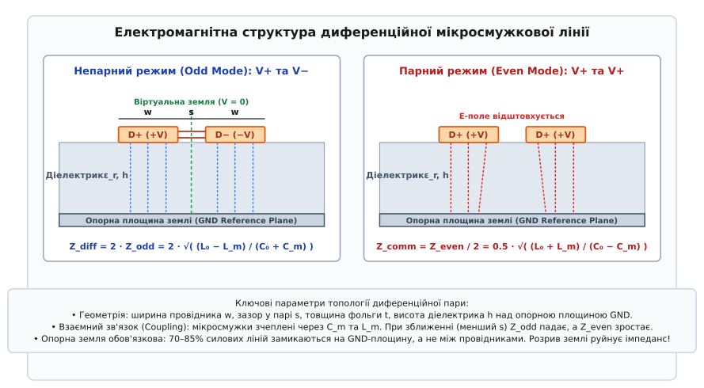
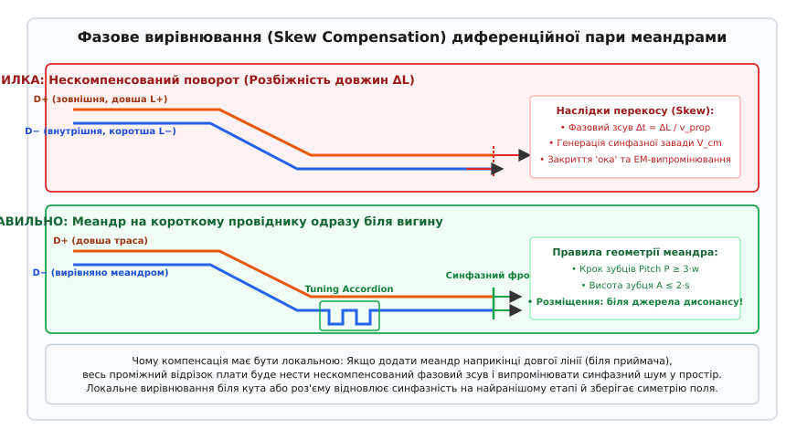

# Диференційні пари й швидкі шини на власній платі

<preknowlist>
- [Стек PCB і характеристичний опір мікросмужки](root:hw-pcb/pcb-stackup-rf) — шари друкованої плати, діелектрик та хвильовий опір одиночної траси.
- [Шлях зворотного струму](root:hw-pcb/current-return-path) — замикання високочастотного струму в опорній площині під провідником.
- [Перехресна завада (crosstalk)](root:hw-pcb/crosstalk) — ємнісний та індуктивний зв'язок між паралельними трасами на друкованій платі.
- [Електромагнітна сумісність (EMC)](root:hw-pcb/electromagnetic-compatibility) — випромінювання контурів струму та захист від зовнішніх наведень.
</preknowlist>

Коли швидкість перемикання логічних вентилів сягає частот у сотні мегагерців, а тривалість фронту сигналу стає меншою за наносекунду, звичайна однопровідна передача сигналів зазнає краху. Стрімка зміна струму в часі збуджує паразитну індуктивність спільних провідників живлення та земляних полігонів друкованої плати. У результаті виникає динамічний підскок потенціалу землі (англ. *ground bounce*): опорний рівень передавача починає коливатися відносно приймача, через що логічний нуль на вході довільно підстрибує до порогу помилкового спрацьовування. Одночасно електромагнітні шуми від сусідніх імпульсних стабілізаторів наводять у відкритому контурі між доріжкою та землею паразитну напругу, яку звичайний приймач не здатний відрізнити від корисного сигналу.

Фізичним вирішенням цієї проблеми є диференційна передача сигналів (лат. *differentia* — різниця). Замість передачі напруги поодиноким провідником відносно нестабільної точки загальної землі, інформація надсилається двома геометрично зближеними трасами, якими одночасно рухаються взаємно протифазні сигнали `D+` та `D-`. Диференційний приймач реєструє виключно миттєву різницю потенціалів між цими двома провідниками, повністю ігноруючи спільні коливання їхнього рівня відносно плати.

## Фізика диференційної передачі та віртуальна земля

Диференційна пара складається з двох паралельних провідників однакової ширини, розташованих на сталій відстані один від одного. Передавач формує на них протилежні напруги відносно постійного середнього зміщення: коли на прямому провіднику напруга зростає, на інверсному вона симетрично падає на таку саму величину.

Диференційний приймач є віднімачем сигналів: він вимірює різницю напруг між двома лініями `V_diff = V_+ - V_-`. Будь-яка зовнішня завада, випромінена перемиканням силових ключів або радіомодулем, через близьке розташування провідників пари наводить на обидва однакову за величиною та полярністю напругу. Таке синфазне наведення (грец. *syn* — разом + *phasis* — фаза, стан) називають синфазною завадою `V_cm`.

На вході диференційного каскаду приймача обидві напруги містять шум: на прямому проводі `V_+ + V_noise`, а на інверсному `V_- + V_noise`. Під час віднімання сигналів однаковий доданок шуму повністю скорочується:

```
V_out = (V_+ + V_noise) - (V_- + V_noise) = V_+ - V_- = V_diff
```

Окрім несприйнятливості до чужих наведень, пара майже не випромінює власних шумів у навколишній простір. Оскільки струми в двох лініях рівні за амплітудою та спрямовані назустріч один одному, створювані ними вектори магнітного поля мають протилежний напрямок і взаємно компенсуються на невеликій відстані від пари.

У центральній площині симетрії між провідниками електричне поле має постійний нульовий потенціал. Цю умовну грань називають віртуальною землею. Вона ділить диференційну пару на дві електрично збалансовані половини, полегшуючи розрахунок хвильових процесів.


*Геометрія диференційної пари на діелектрику: ширина провідників w, зазор s, товщина фольги t, висота діелектрика h та розподіл силових ліній поля в непарному й парному режимах.*

## Опорна земля та шлях зворотного струму

Поширеною помилкою є уявлення, ніби диференційній парі взагалі не потрібна земляна площина, оскільки струми прямого та інверсного провідників замикаються один на одного. На друкованій платі це не так: від 75% до 85% силових ліній електричного поля кожної мікросмужки замикаються не на сусідній провідник, а на суцільний металевий шар землі безпосередньо під трасою.

Високочастотний зворотний струм завжди повертається до джерела шляхом найменшої індуктивності, тобто утворює дзеркальні смуги протікання в опорному полігоні землі прямо під кожним із провідників пари. Якщо під диференційними доріжками опиняється розрив землі (технологічний паз, щілина між розділеними площинами живлення чи щільний ряд перехідних отворів), зворотні струми змушені огинати перешкоду довкола.

Такий обхід миттєво збільшує площу контуру струму в десятки разів. Локальний хвильовий опір підстрибує з розрахункових 90–100 Ом до 200 Ом і більше, породжуючи сильне відбиття сигналу. Через асиметрію щілини один зворотний струм затримується сильніше за інший, що перетворює корисну різницеву хвилю на потужний синфазний струм. Цей струм перетворює друковану плату на випромінювальну антену і гарантує провал сертифікації електромагнітної сумісності.

## Головні правила трасування швидкісних пар

Цілісність сигналів швидких шин (USB, Ethernet, PCIe, HDMI, MIPI, CAN FD) досягається дотриманням чотирьох базових топологічних правил на платі.

### 1. Незмінний диференційний імпеданс

Диференційний хвильовий опір лінії (лат. *impedire* — перешкоджати) визначається шириною провідників `w`, міжосьовим зазором між ними `s`, товщиною діелектрика `h` та діелектричною проникністю матеріалу плати. Кожен стандарт вимагає суворого дотримання свого значення імпедансу:
* **90 Ом (±10%):** шини USB 2.0 та USB 3.x SuperSpeed;
* **100 Ом (±10%):** лінії PCIe, Gigabit Ethernet, HDMI, DisplayPort, SATA та камери MIPI;
* **120 Ом (±10%):** автомобільні та промислові магістралі CAN і CAN FD.

Ширина провідників і зазор між ними повинні залишатися сталими на всій довжині пари. Якщо потрібно оминути перешкоду на платі (отвір або компонент), обидва провідники відгинають узгоджено, без розриву взаємного інтервалу.

### 2. Фазове вирівнювання та компенсація перекосу

Швидкість поширення сигналу в склотекстоліті обмежена діелектриком і становить приблизно 150–160 мм за одну наносекунду (близько 6–7 пікосекунд на міліметр). Коли пара проходить кутовий поворот, зовнішній провідник має більший радіус дуги і виявляється довшим за внутрішній.

Навіть невелика різниця довжин у 0.5 мм створює часовий перекіс фронтів сигналу величиною близько 3 пікосекунд. Для інтерфейсу PCIe Gen4, де весь бітовий інтервал триває лише 62.5 пс, такий зсув спотворює синфазність, стискає розкриття діаграми ока та генерує синфазний шум.


*Компенсація фазового перекосу: локальний настроювальний меандр на коротшому провіднику одразу біля вигину траси.*

Для відновлення балансу на коротшому провіднику формують компенсаційну змійку — настроювальний меандр (грец. *Maiandros* — звивиста річка):
* Меандр додають **безпосередньо біля джерела розбіжності** (одразу за вигином або роз'ємом), не відкладаючи вирівнювання на кінець довгої лінії;
* Крок між зубцями меандра повинен бути не меншим за потрійну ширину провідника (`P ≥ 3·w`), інакше високі частоти закоротяться паразитною ємністю між сусідніми витками;
* Висота вигину меандра не повинна перевищувати подвійний зазор пари (`A ≤ 2·s`).

### 3. Плавні кути та перехідні отвори між шарами

Прямі повороти під кутом 90° заборонені: на куті ширина провідника локально зростає в 1.41 раза, створюючи ємнісний стрибок. Трасування виконують плавними дугами або зрізами під кутом 45°.

Якщо пара змінює шар плати через перехідні отвори, поруч із сигнальними отворами на відстані не більше 0.5 мм встановлюють зшивні отвори землі (GND Stitching Vias). Вони переносять шлях зворотного струму між опорними площинами верхнього та нижнього шарів без розриву зворотного контуру.

### 4. Ізоляція від сусідніх кіл

Щоб потужні імпульси живлення, тактові генератори чи сусідні лінії не створювали перехресних завад, відстань від краю диференційної пари до інших сигналів повинна становити не менше трьох-п'яти товщин діелектрика (`3h–5h`). Під контактними майданчиками SMD-компонентів на опорній землі другого шару роблять вирізи (антипади), що усуває надлишкову ємність і запобігає провалу імпедансу.

> 🔧 **Навіщо це.**
> Помилка в трасуванні диференційної пари проявляється як періодичне випадання пакетів, падіння швидкості USB через повторні запити або зрив зв'язку під час увімкнення сусіднього двигуна чи передавача. Дотримання нерозривної землі під парою, точного зазору та локального вирівнювання довжин усуває джерело перешкод ще на рівні топології міді.

Повний математичний апарат із матрицями модального розкладання, змішаними S-параметрами, аналізом BGA-виходів та кодом аналізу бюджету затримок на C і C++ розгорнуто в [детальній статті](root:hw-pcb/dyferentsiini-pary-i-shvydki-shyny-na-vlasnii-plati/detail). Для точного обчислення геометрії мікросмужок скористайтеся [Калькулятором імпедансу диференційних ліній](root:hw-pcb/dyferentsiini-pary-i-shvydki-shyny-na-vlasnii-plati/proj-diff-pair-impedance-calc.md).
