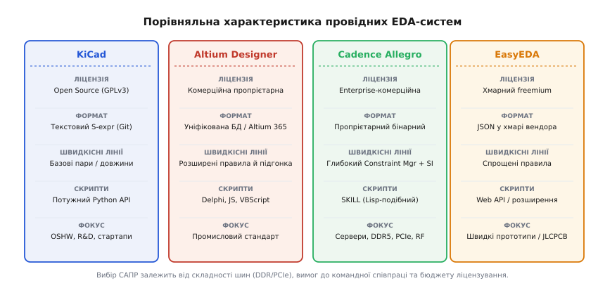
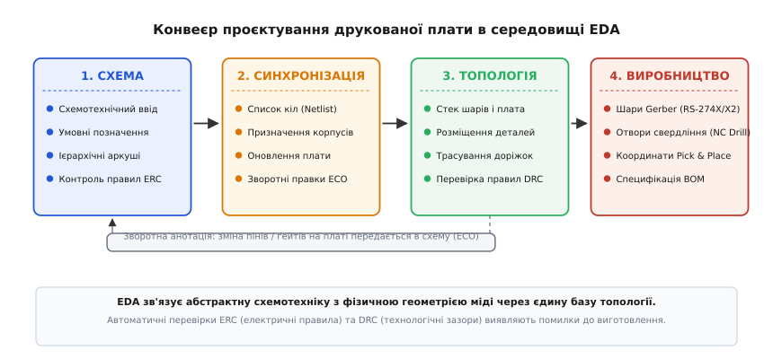

# Засоби проєктування плат (EDA)

<preknowlist>
- [Принципова схема](root:hw-pcb/schematic-purpose) — графічна модель електричних з'єднань між компонентами.
- [Друкована плата (PCB layout)](root:hw-pcb/pcb-layout) — фізичне розміщення компонентів і трасування мідних провідників.
- [Перелік компонентів (BOM)](root:hw-pcb/bom) — специфікація реальних комплектуючих для закупівлі та монтажу.
- [Вузли й з'єднання](root:hw-pcb/nodes-connections) — концепція електричних мереж (net) та еквіпотенціальних вузлів.
</preknowlist>

Сучасна друкована плата з 32-бітним мікроконтролером, швидкісною пам'яттю DDR, імпульсними перетворювачами живлення та аналоговими сенсорами містить від кількох сотень до десятків тисяч контактних майданчиків, розділених десятками мікронів зазорів на 6–16 шарах міді. Якщо малювати таку систему в універсальному графічному чи креслярському редакторі (наприклад, у векторних пакетах загального призначення), неминуче виникає катастрофічний розрив між електричною схемою та фізичним розташуванням міді. Один дзеркально розведений корпус мікросхеми, випадково замкнута пара шин живлення або зміщений на 0.1 мм перехідний отвір перетворюють виготовлену партію плат вартістю тисячі доларів на непотрібний брухт і призводять до тижнів безплідного пошуку несправностей з осцилографом.

Для подолання цього розриву створено системи автоматизованого проєктування електроніки — EDA (англ. *Electronic Design Automation*, або САПР електроніки). САПР електроніки — це не графічний редактор для малювання ліній, а спеціалізоване середовище керування реляційною базою даних топології, де кожен графічний елемент наділений строгою фізичною та електричною семантикою. Програмний комплекс відстежує еквіпотенціальні вузли (електричні кола, англ. *nets*), прив'язує логічні виводи компонентів до фізичних контактних площадок, контролює технологічні зазори виробництва та автоматично синхронізує будь-які інженерні зміни між принциповою схемою і багатошаровою платою.


*Порівняння чотирьох типових EDA-платформ за цільовим сегментом, моделлю даних, швидкісними правилами та придатністю до систем контролю версій (VCS).*

## Ландшафт сучасних САПР електроніки

Індустрія розробки електроніки використовує кілька провідних EDA-систем, кожна з яких оптимізована під певний клас інженерних завдань, розмір команд і бюджет проєкту.

### KiCad: екосистема з відкритим кодом

KiCad — це повністю відкритий кросплатформний комплекс (ліцензія GPLv3), розробку якого підтримують міжнародна спільнота, консорціум CERN та фонд Linux Foundation. Комплекс складається з незалежних, але тісно інтегрованих модулів: схемотехнічного редактора (*Eeschema*), редактора топології плат (*Pcbnew*), переглядача файлів Gerber (*GerbView*), калькулятора ліній передачі та редакторів бібліотечних символів і посадкових місць.

Головна архітектурна перевага KiCad — прозорий текстовий формат файлів на основі S-виразів (англ. *S-expressions*, синтаксис Lisp-подібних списків у дужках). Схеми (`.kicad_sch`) та плати (`.kicad_pcb`) зберігаються як чистий текст у кодуванні UTF-8, що робить проєкти ідеально сумісними зі стандартними системами контролю версій (Git). Крім того, KiCad має розвинений інтерфейс Python API для автоматизації рутинних операцій (розміщення масивів компонентів, генерація тестових точок, експорт документації). САПР не має обмежень на кількість шарів міді (до 32 сигнальних шарів) чи розміри плати й активно застосовується у відкритих апаратних проєктах (OSHW), університетах, наукових лабораторіях та малому й середньому бізнесі.

### Altium Designer: промисловий стандарт комерційної розробки

Altium Designer — найбільш поширене комерційне середовище для промислового проєктування складних пристроїв. Його ключова концепція — уніфікована модель даних (англ. *Unified Data Model*): принципова схема, топологія друкованої плати, тривимірна механічна модель (3D STEP), перелік компонентів (BOM) та виробнича документація пов'язані в єдиний синхронний вузол.

Altium виділяється потужним рушієм інтерактивного трасування з підтримкою розсування перешкод (англ. *push-and-shove routing*), автоматичним вирівнюванням затримок у високошвидкісних паралельних шинах (DDR3/DDR4) та вбудованою 3D-візуалізацією в реальному часі. Інженер може перевірити зазори між високими електролітичними конденсаторами та металевим корпусом приладу безпосередньо в редакторі плати. Хмарна платформа Altium 365 забезпечує командне рецензування, контроль версій проєктів та інтеграцію з базами постачальників компонентів (Octopart) для моніторингу цін і залишків на складах.

### Cadence OrCAD / Allegro: enterprise-сегмент для надшвидкісних систем

Платформа Cadence Allegro (та її полегшена версія OrCAD) є стандартом де-факто в автомобільній, аерокосмічній галузях, телекомунікаціях і серверах. Головна перевага Allegro — неперевершена система керування обмеженнями (англ. *Constraint Manager*). Замість простого завдання зазорів інженер формулює комплексні матриці правил для високошвидкісних інтерфейсів (PCIe Gen 5/6, 100GbE, DDR5): максимальні затримки в пікосекундах, допустимий фазовий зсув у диференційних парах, обмеження на кількість перехідних отворів і топології типу «fly-by» або «T-topology».

Cadence безшовно інтегрується з рушіями чисельного електромагнітного моделювання Sigrity для аналізу цілісності сигналів (Signal Integrity, SI) та цілісності живлення (Power Integrity, PI), що дозволяє розраховувати падіння постійної напруги (IR Drop), резонанси полігонів живлення та діаграми очей (англ. *eye diagrams*) до виготовлення дослідного зразка.

### EasyEDA: хмарне проєктування для швидкого прототипування

EasyEDA — хмарно-орієнтована САПР, розгорнута в браузері (доступна також як локальний клієнт на базі Chromium). Вона тісно інтегрована з каталогом електронних компонентів LCSC та контрактним виробником друкованих плат JLCPCB.

EasyEDA максимально спрощує поріг входження для швидкого прототипування: вибираючи бібліотечний компонент, розробник одразу бачить його вартість, наявність на складі та точний номер деталі (LCSC Part Number). Після завершення трасування генерація файлів Gerber, специфікації BOM та координат розстановки елементів (Centroid / Pick-and-Place) для автоматичного монтажу SMT виконується в один клік. Водночас робота з гігантськими платами (понад 1500 компонентів), тонке налаштування радіочастотних правил і повна ізоляція інтелектуальної власності в локальній мережі залишаються слабкими місцями хмарної моделі.


*Повний конвеєр EDA: кожен етап перетворює абстрактний задум на геометричні масиви та виробничі файли через суворий контроль правил (ERC/DRC).*

## Анатомія робочого процесу в EDA

Будь-який електронний пристрій проходить у середовищі САПР послідовний наскрізний конвеєр, кожен крок якого верифікує коректність даних перед переходом на наступний рівень.

### 1. Схемотехнічний редактор (Schematic Capture)

На першому етапі інженер створює функціональну схему пристрою. У графічному полі розміщуються умовні графічні позначення компонентів (символи), виводи яких з'єднуються електричними провідниками (дротами, англ. *wires*), глобальними мітками (англ. *net labels*) або шинами (англ. *buses*). Кожному компоненту присвоюється унікальне позиційне позначення (англ. *Reference Designator*, або RefDes — `R1`, `C12`, `U3`).

Для великих проєктів застосовують [ієрархічні схеми](root:hw-pcb/hierarchical-schematics): схема розбивається на функціональні модулі (аркуш живлення, аркуш мікроконтролера, аркуш радіотракту), пов'язані між собою ієрархічними портами. Це усуває хаос ліній на одному гігантському аркуші та дозволяє повторно використовувати цілі схемні блоки.

На завершення схемного вводу обов'язково запускається **Контроль електричних правил (ERC, англ. *Electrical Rules Check*)**. Алгоритм аналізує матрицю типів контактів (живлення, вхід, вихід, відкритий колектор, пасивний вивід) і сигналізує про грубі інженерні помилки:
- з'єднання двох виходів мікросхем безпосередньо між собою (ризик короткого замикання логічних рівнів);
- наявність «висячих» входів мікросхем CMOS без підтяжки до живлення або землі;
- відсутність джерела живлення на шині, до якої підключені виводи живлення мікросхем (Power Input);
- непідключені або замкнуті накоротко мережі.

> 🔧 **Навіщо це.** ERC запобігає передачі фатальних логічних помилок на етап трасування. Якщо інженер забуде подати живлення на ядро мікроконтролера або залишить лінію скидання (RESET) підтягнутою до землі замість живлення, ERC виявить це за частку секунди до того, як плата піде у виробництво.

### 2. Синхронізація зі списком з'єднань (Netlist та ECO)

Схема описує електричну логіку, але нічого не знає про фізичні розміри деталей. Редактор топології, навпаки, оперує полігонами міді та координатами посадкових місць (англ. *footprints*), але не знає логіки роботи схеми. Мостом між ними слугує **список з'єднань (Netlist)**.

Список з'єднань містить перелік усіх компонентів із зазначенням прив'язаних посадкових місць та таблицю всіх еквіпотенціальних мереж зі списком контактів, які входять до кожної мережі. У сучасних САПР прямий експорт/імпорт текстового нетліста замінено внутрішньою уніфікованою синхронізацією:
- **Пряма анотація (Forward Annotation / ECO — Engineering Change Order)**: зміни у схемі (додавання резистора, зміна номіналу, перейменування мережі) транслюються в редактор плати. На платі автоматично з'являються нові посадочні місця та «гумові нитки» нерозведених з'єднань (англ. *ratsnest*).
- **Зворотна анотація (Backward Annotation)**: якщо під час трасування багатовивідного мікроконтролера інженер міняє місцями однотипні виводи портів GPIO або гейти логічної мікросхеми (англ. *pin swapping / gate swapping*) для усунення перехрещень доріжок, САПР автоматично оновлює принципову схему.

### 3. Редактор топології плати (PCB Layout)

У редакторі топології розробник проходить такі ключові етапи:
1. **Налаштування стеку шарів ([PCB Stackup](root:hw-pcb/pcb-stackup))**: визначення загальної кількості шарів міді, товщини діелектрика (FR-4, Rogers), взаємного чергування сигнальних шарів і суцільних площин землі (GND) та живлення (Power Planes).
2. **Розміщення компонентів (Floorplanning & Placement)**: розміщення посадкових місць відповідно до механічних меж плати (Board Outline), роз'ємів і теплових вимог. Блокувальні конденсатори розміщуються впритул до виводів живлення, потужні транзистори постачаються [тепловими перехідними отворами](root:hw-pcb/thermal-vias).
3. **Трасування (Routing)**: фізична прокладка мідних доріжок між виводами. Використовуються режими інтерактивного обходу перешкод, трасування диференційних пар із фіксованим хвильовим опором та компенсація фазової затримки меандрами (англ. *length matching / delay tuning*).
4. **Формування мідних заливок (Copper Pours / Zones)**: заповнення вільного простору шарів полігонами землі для створення низькоімпедансного шляху повернення струмів. У місцях паяння застосовуються термобар'єри (англ. *thermal relief*) — тонкі спиці міді, що запобігають відведенню тепла від паяльника під час [паяння компонентів](root:hw-pcb/reflow-soldering).

### 4. Контроль проєктних правил (Design Rule Check — DRC)

DRC — автоматичний аудит геометрії топології на відповідність технологічним можливостям заводу-виробника (англ. *Design for Manufacturing*, DFM) та вимогам цілісності сигналів. DRC перевіряє:
- **Зазори (Clearances)**: відстань між доріжкою та доріжкою, площадкою та доріжкою, полігоном і отвором. Якщо завод вимагає мінімальний зазор 0.127 мм (5 mils), будь-яке зближення провідників на 0.1 мм викличе помилку DRC;
- **Ширину доріжок (Trace Width)**: відповідність мінімальній роздільній здатності фотолітографії заводу та струмовому навантаженню;
- **Поясок отвору (Annular Ring)**: ширина мідного кільця навколо висвердленого отвору перехідного чи монтажного виводу. Замалий поясок призведе до розриву контакту при зміщенні свердла;
- **Містки паяльної маски (Solder Mask Dam / Sliver)**: перевірка, чи не є зазор маски між сусідніми ніжками QFP/BGA тоншим за 0.1 мм (якщо тонший — маска відлущиться, і між ніжками утвориться перемичка припою);
- **Нерозведені мережі (Unrouted Nets) та висячі відрізки (Dangling Stubs)**: усунення забутих ділянок міді, які працюють як антени та створюють шум.

> 🔧 **Навіщо це.** Бездоганний звіт DRC «0 помилок / 0 попереджень» за файлом правил конкретного заводу (DRC ruleset) — єдина гарантія того, що плату буде виготовлено без коротких замикань, розривів металізації та браку монтажу.

### 5. Генерація виробничих файлів (Manufacturing Outputs)

Завершальний крок роботи в САПР — експорт наборів даних для виробничих ліній:
- **Gerber (RS-274X або Gerber X2)**: стандартний векторний формат опису кожного окремого шару друкованої плати (мідь топ/бот, внутрішні шари, паяльна маска, шовкографія, паяльна паста);
- **NC Drill (Excellon)**: текстовий файл координат та діаметрів інструментів для свердлувальних верстатів із ЧПК (роздільно для металізованих отворів PTH та неметалізованих отворів NPTH);
- **ODB++ та IPC-2581**: сучасні інтелектуальні контейнери виробничих даних, що містять усередині векторні шари, топологію нетліста, стек матеріалів та геометрію компонентів в єдиному файлі;
- **Pick-and-Place (Centroid / CPL)**: таблиця координат центрів компонентів (X, Y), кута повороту (0–360°) та сторони плати (Top/Bottom) для програмування автоматичних установників SMD-компонентів;
- **Специфікація матеріалів ([BOM](root:hw-pcb/bom))**: структурована таблиця позиційних позначень, номіналів, типів корпусів та точних номерів деталей виробника (MPN).

## Формати файлів і контроль версій (Git) для «заліза»

Розробка апаратного забезпечення (Hardware Engineering) дедалі активніше переймає практики розробки програмного забезпечення, зокрема автоматизоване тестування, безперервну інтеграцію (CI/CD) та версіонування у Git. Проте тут виникає фундаментальна відмінність між вихідним кодом програм і файлами друкованих плат.

Класичні САПР історично зберігали проєкти у пропрієтарних бінарних контейнерах (наприклад, формат файлів Altium `.PcbDoc` або файли Cadence `.brd`). Для системи контролю версій такий файл є непрозорим блоком даних (англ. *binary blob*). У Git неможливо побачити построковий diff або виконати автоматичне злиття (англ. *merge*): зміна одного конденсатора перезаписує мегабайти бінарного файлу, а паралельна робота двох інженерів над одною платою призводить до нерозв'язних конфліктів.

KiCad вирішив цю проблему використанням відкритого формату S-виразів. Кожен елемент плати записується читабельним структурованим блоком:

```lisp
(segment (start 125.4 85.2) (end 128.0 85.2) (width 0.25) (layer "F.Cu") (net 4))
(via (at 128.0 85.2) (size 0.6) (drill 0.3) (layers "F.Cu" "B.Cu") (net 4))
```

Такий формат дозволяє бачити в системі Git точні текстові зміни: зміну ширини провідника, перейменування мережі або переміщення компонента. Проте навіть у текстових форматах механічне тристороннє злиття рядків (3-way merge) у Git є надзвичайно небезпечним: якщо два розробники одночасно протягнуть різні доріжки через одну й ту саму фізичну координату, Git збереже обидва рядки без конфлікту, але у фізичній реальності виникне коротке замикання. Тому для верифікації апаратних змін використовують графічні утиліти побудови візуальних відмінностей (англ. *visual diffing*), що генерують векторне або растрове накладання шарів і підсвічують геометричні зміни кольором.

## Скриптування та автоматизація в CI/CD

Сучасні команди не обмежуються ручною роботою в графічному інтерфейсі, а вбудовують САПР у конвеєри безперервної інтеграції (GitHub Actions, GitLab CI). При кожному коміті в репозиторій серверний скрипт у headless-режимі (через утиліту `kicad-cli` або Python API) автоматично:
1. Запускає схемний контроль ERC і перевіряє відсутність помилок;
2. Проганяє повний геометричний контроль DRC за правилами обраного заводу;
3. Генерує свіжі виробничі архіви Gerber, креслення свердління та специфікацію BOM;
4. Рендерить тривимірні фотореалістичні зображення плати та PDF-альбом схем для рецензування командою.

Для розробки власних утиліт автоматизації та інструментів контролю якості часто виникає потреба програмно аналізувати структури друкованих плат та списків з'єднань. Нижче наведено приклад обробки та фільтрації топологічних записів з'єднань мовами C та C++:

:::tabs
:::code eda-tools-d/c/main.c
:::code eda-tools-d/cpp/main.cpp
:::

У промислових системах автоматизованої верифікації та на виробничих тестових стендах (англ. *Flying Probe Testers*) такі перевірки з'єднань здійснюються незалежними парсерами виробничих форматів нетлістів. Детальний розбір реалізації такого алгоритму наведено в проєкті [парсер списку з'єднань IPC-D-356 / KiCad Netlist](root:hw-pcb/eda-tools/proj-kicad-netlist-parser.md).
