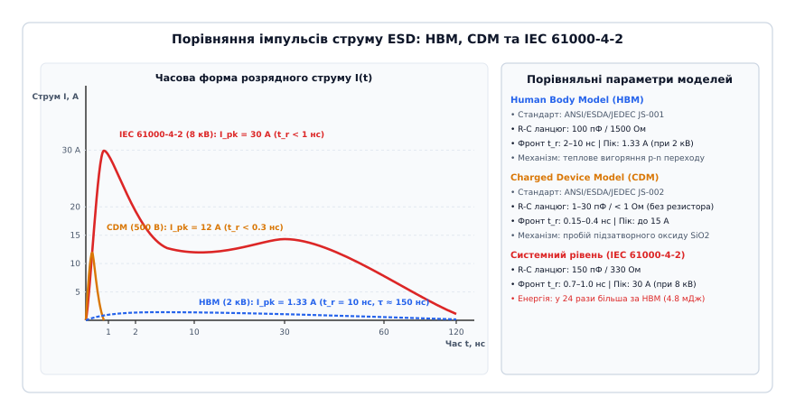
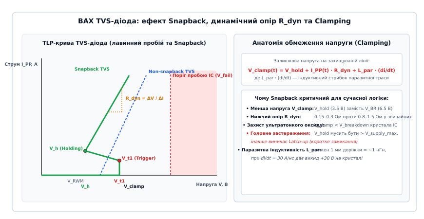

# Класи чутливості до ESD

<preknowlist>
- [Шлях зворотного струму](root:hw-pcb/current-return-path) — фізика повернення високочастотного струму по шляху найменшої індуктивності.
- [Шар землі](root:hw-pcb/ground-plane-design) — організація суцільних опорних полігонів і усунення розривів.
- [TVS-діод](root:hw-components/tvs-diode) — вольт-амперна характеристика, лавинний пробій і час спрацьовування напівпровідникових супресорів.
- [Електромагнітна сумісність](root:hw-pcb/electromagnetic-compatibility) — джерела завад, контури випромінювання та екранування вузлів.
- [Антистатичне робоче місце](root:hw-pcb/antistatic-workplace) — вирівнювання потенціалів, розсіювальні покриття та захист компонентів.
</preknowlist>

Коли оператор у цеху торкається пінцетом виводу мікроконтролера або коли користувач вставляє кабель у роз'єм USB, на напівпровідниковий кристал розряджається статичний заряд із потенціалом від кількох сотень вольтів до 15 кіловольт. При товщині підзатворного діелектрика сучасного польового транзистора всього 3–5 нанометрів критична напруженість електричного поля становить близько 10 МВ/см, тому різниця потенціалів понад 8–10 В незворотно пробиває оксид кремнію, випаровує алюмінієві мікродоріжки кристала та призводить до раптової або прихованої деградації приладу. Щоб запобігти масовому браку на лініях поверхневого монтажу та забезпечити надійну роботу обладнання в польових умовах, в електронній промисловості введено стандартизовані класи чутливості до електростатичного розряду (Electrostatic Discharge — ESD), які визначають математичні та фізичні моделі стресу для компонентів і готових систем.

Головна інженерна проблема полягає в тому, що стійкість мікросхеми, зазначена в її паспортних даних (наприклад, 2 кВ за моделлю людського тіла HBM), стосується виключно процедур транспортування та автоматизованого монтажу, тоді як у складі готового пристрою плата стикається з на порядок жорсткішим системним розрядом за стандартом IEC 61000-4-2, де струм сягає 30–45 А за частки наносекунди. Без розуміння фізики різних моделей розряду, точного розрахунку динамічного опору TVS-діодів і контролю паразитної індуктивності друкованих провідників зовнішній захист виявляється неефективним, а прилад виходить із ладу під час першого ж випробування на електромагнітну сумісність.

---

## Фізична природа електростатичного заряду та механіка деградації кристала

Електростатичний заряд виникає внаслідок контактної електризації (трибоелектричного ефекту), коли під час механічного зіткнення та подальшого розведення двох різних діелектричних або слабкопровідних матеріалів відбувається просторовий перерозподіл електронів. Матеріал із меншою роботою виходу втрачає електрони та набуває позитивного потенціалу, а матеріал із більшою спорідненістю до електрона заряджається негативно. 

Накопичений електричний заряд `Q` на ізольованому об'єкті (тілі оператора, пластиковому корпусі мікросхеми чи технологічному тримачі) створює напругу `V`, що визначається власною електричною ємністю об'єкта відносно оточення `C`:

```text
Q = C · V
```

Запас накопиченої енергії `E`, яка виділяється під час електричного пробою повітряного проміжку чи безпосереднього металевого контакту, становить:

```text
E = 0.5 · C · V²
```

Для людського тіла з типовою ємністю `C ≈ 100` пФ при накопиченому потенціалі `V = 2000` В накопичена енергія дорівнює:

```text
E = 0.5 · (100 · 10⁻¹² Ф) · (2000 В)² = 0.2 · 10⁻³ Дж = 0.2 мДж
```

Для людини такий розряд є ледь помітним або зовсім не відчутним (поріг чутливості нервових закінчень становить близько 2.5–3.0 кВ). Проте для напівпровідникової структури виділення навіть часток мікроджоуля енергії в об'ємі кількох кубічних мікрометрів викликає локальну густину потужності понад `10⁸ Вт/см³`.

```
            Механізми руйнування кристала при ESD
  ┌────────────────────────────────────────────────────────┐
  │                                                        │
  │  1. Діелектричний пробій підзатворного оксиду SiO2     │
  │     (E_field > 10 МВ/см, V_gate > 8..12 В)             │
  │     → Утворення провідного каналу, наскрізний КЗ      │
  │                                                        │
  │  2. Теплове вигоряння p-n переходів (Wunsch-Bell)      │
  │     (Локальний перегрів кремнію T > 1414 °C)           │
  │     → Плавлення кремнію, втрата бар'єрних властивостей │
  │                                                        │
  │  3. Розплавлення металізації та контактних вікон       │
  │     (Густина струму j > 10⁷ А/см² в Al/Cu шинах)       │
  │     → Випаровування металу, обрив або спайкінг у Si    │
  │                                                        │
  │  4. Прихована деградація (Latent Defect)                │
  │     (Мікротріщини, захоплення заряду в пастках оксиду) │
  │     → Дрейф струму витоку, відмова через тижні роботи  │
  │                                                        │
  └────────────────────────────────────────────────────────┘
```

Руйнування мікроелектронних компонентів під дією ESD поділяється на чотири основні фізичні процеси:

1. **Діелектричний пробій оксиду затвора (Dielectric Breakdown).** Товщина підзатворного діелектрика `t_ox` у технологічних процесах 180 нм — 7 нм становить від 4.0 до 1.2 нм. При критичній напруженості електричного поля пробою `E_crit ≈ 10 МВ/см` (що дорівнює `1 В/нм`) прикладення напруги всього 5–10 В викликає пряме тунелювання носіїв заряду (Fowler-Nordheim tunneling), лавинну генерацію електронно-діркових пар, утворення плазмового шнура та розплавлення діелектрика з формуванням резистивного мікромістка між затвором і каналом транзистора.
2. **Теплове вторинне вигоряння p-n переходів (Junction Burnout за моделлю Вунша-Белла).** Коли струм розряду протікає крізь зворотно зміщений p-n перехід або захисний внутрішній діод, напруга на переході фіксується на рівні лавинного пробою `V_br ≈ 8..20 В`. Локальне тепловиділення описується моделлю Вунша-Белла (Wunsch-Bell model), згідно з якою гранична потужність руйнування `P_fail` залежить від тривалості імпульсу `t_pulse`:
   
   ```text
   P_fail = K / √(t_pulse)
   ```
   
   де `K = A · √(π · ρ · c_p · k_th) · (T_melt - T_ambient)` — константа теплофізичних властивостей кремнію (`A` — площа переходу, `ρ` — густина, `c_p` — питома теплоємність, `k_th` — теплопровідність, `T_melt = 1414 °C` — температура плавлення кремнію).
   
   Залежно від тривалості імпульсу теплова поведінка кристала ділиться на три виражені зони:
   - **Адіабатичний режим (`t_pulse < 100` нс):** Теплота повністю залишається в межах p-n переходу, не встигаючи розсіятися в об'єм кристала. Потужність руйнування `P_fail` строго пропорційна `1 / t_pulse` (критичним параметром виступає сумарна виділена енергія `E_fail`). Це типовий режим для імпульсів HBM та CDM.
   - **Режим теплової дифузії (`100 нс < t_pulse < 10 мкс`):** Теплова хвиля встигає поширитися на відстань теплової дифузії `x_th = 2 · √(D_th · t_pulse)`, де `D_th = k_th / (ρ · c_p)` — коефіцієнт температуропровідності кремнію (`D_th ≈ 0.85 см²/с` при 300 K). У цьому діапазоні справедлива класична залежність Вунша-Белла `P_fail ∝ 1 / √(t_pulse)`.
   - **Квазістаціонарний режим (`t_pulse > 10 мкс`):** Встановлюється постійний тепловий градієнт між переходом і мідною підкладкою корпусу, а поріг руйнування визначається стаціонарним тепловим опором `R_th_JA`.
3. **Електродифузійне руйнування та спайкінг металізації (Contact Spiking & Metal Melt).** Протікання пікових струмів у десятки амперів крізь тонкі внутрішні з'єднувальні шини кристала викликає надвисоку густину струму `j > 10⁷ А/см²`. Алюмінієва або мідна металізація розігрівається вище температури плавлення (`660 °C` для алюмінію), метал дифундує крізь контактні вікна в кремнієву підкладку (contact spiking), коротячи розташовані нижче дифузійні шари на підкладку `V_SS`.
4. **Приховані дефекти (Latent Defects).** Розряд субкритичної енергії не призводить до негайного виходу мікросхеми з ладу, проте створює мікроскопічні пошкодження: пастки заряду в діелектрику, мікротріщини в пасивації кристала та локальні дефекти кристалічної ґратки. Під час подальшої експлуатації під дією робочої температури та електричного поля дефект розростається, збільшуючи струм витоку `I_leakage`, що викликає раптову відмову пристрою через сотні годин після проходження вихідного фабричного тестування.

---

## Моделі компонентного рівня: HBM, CDM та MM

Для стандартизації випробувань напівпровідникових виробів на етапі їх виробництва, корпусування та монтажу міжнародні організації ESDA (Electrostatic Discharge Association) та JEDEC розробили три класичні компонентні моделі: Human Body Model (HBM), Charged Device Model (CDM) та Machine Model (MM).

```
          Порівняння еквівалентних схем компонентних моделей
   
   1. Human Body Model (ANSI/ESDA/JEDEC JS-001):
      [ Джерело V_HBM ] ───( Заряд )───[ C = 100 пФ ]───[ R = 1500 Ом ]───> [ Вивід ІМС ]
                                                                                │
                                                                             [ Земля ]
   
   2. Charged Device Model (ANSI/ESDA/JEDEC JS-002):
      [ Заряджений корпус ІМС ] ( C_pkg = 1..30 пФ ) ───[ R_spark < 1 Ом ]───> [ Заземлений пінцет ]
                                                             L_arc ≈ 1..2 нГн
   
   3. Machine Model (JESD22-A115C, застарілий):
      [ Джерело V_MM ] ────( Заряд )───[ C = 200 пФ ]───[ L = 0.75 мкГн ]───> [ Вивід ІМС ]
                                                           ( R = 0 Ом )
```


*Порівняльні часові характеристики розрядного струму для моделі людського тіла (HBM), моделі зарядженого приладу (CDM) та системного імпульсу IEC 61000-4-2. Хвиля CDM вирізняється субнаносекундним фронтом наростання (< 300 пс) та високою амплітудою при ультракороткій тривалості, тоді як IEC 61000-4-2 поєднує надшвидкий пік 30 А з тривалим високоенергетичним хвостом.*

---

### Модель людського тіла (Human Body Model — HBM)

Модель людського тіла регламентується спільним стандартом **ANSI/ESDA/JEDEC JS-001** (який замінив застарілі військові специфікації MIL-STD-883 Method 3015 та JESD22-A114). HBM моделює розряд статичного заряду, накопиченого на тілі людини, через кінчик пальця або металевий інструмент на вивід інтегральної мікросхеми, тоді як інший вивід мікросхеми заземлений.

Еквівалентний електричний контур HBM складається з:
- Накопичувального конденсатора `C_HBM = 100` пФ `± 10%`;
- Послідовного розрядного резистора `R_HBM = 1500` Ом `± 1%`;
- Паразитної індуктивності тестового кола `L_par < 7.5` мкГн.

Форма хвилі розрядного струму HBM характеризується часом наростання фронту `t_r` від 10% до 90% амплітуди в межах від 2.0 до 10.0 нс, тривалістю імпульсу на рівні 50% амплітуди `t_d = 150 ± 20` нс та піковим струмом, що строго підпорядковується закону Ома:

```text
I_peak = V_HBM / R_HBM = V_HBM / 1500 Ом
```

При калібрувальній напрузі `V_HBM = 2000` В (Class 2):

```text
I_peak = 2000 В / 1500 Ом ≈ 1.33 А
```

Через великий послідовний опір (1.5 кОм) швидкість наростання струму `di/dt` є відносно помірною (`0.1..0.5 А/нс`), а головним фактором пошкодження виступає інтегральна теплова енергія, що виділяється в кремнії протягом 150 нс.

Стандарт JS-001 регламентує сувору процедуру комбінації виводів (Pin Combination Testing):
- **Вхід/вихід відносно `V_SS` (IO to `V_SS`):** Стрес прикладається до кожного сигнального піна з позитивною та негативною полярністю, тоді як шина землі заземлена, а решта пінів плавають.
- **Вхід/вихід відносно `V_DD` (IO to `V_DD`):** Стрес прикладається до сигнального піна відносно шини живлення для перевірки верхніх захисних діодів.
- **Сигнал до сигналу (Non-supply to Non-supply):** Попарна подача імпульсів між різними сигнальними виводами для виявлення слабких місць у спільних захисних рейках.
- **Шина до шини (Supply to Supply):** Розряд між `V_DD` та `V_SS` для перевірки центрального захисного клампа живлення (Power Rail Clamp / Active RC Clamp).

Критерієм проходження тесту є збереження параметричних характеристик: струм витоку `I_leak` не повинен перевищувати паспортний ліміт або дрейфувати більше ніж на 100% від початкового значення, а також успішне проходження повного функціонального цифро-аналогового тесту.

```
        Класи чутливості до ESD за стандартом ANSI/ESDA/JEDEC JS-001 (HBM)
   ─────────────────────────────────────────────────────────────────────────────
     Клас HBM            Діапазон витримуваної напруги V_HBM
   ─────────────────────────────────────────────────────────────────────────────
     Class 0A            < 125 В (надзвичайно чутливі: ВЧ-підсилювачі, GaN/GaAs)
     Class 0B            125 В ≤ V < 250 В
     Class 1A            250 В ≤ V < 500 В
     Class 1B            500 В ≤ V < 1000 В
     Class 1C            1000 В ≤ V < 2000 В
     Class 2             2000 В ≤ V < 4000 В (базовий промисловий цільовий рівень)
     Class 3A            4000 В ≤ V < 8000 В
     Class 3B            ≥ 8000 В
   ─────────────────────────────────────────────────────────────────────────────
```

Більшість стандартних цифрових мікроконтролерів і мікросхем логіки проектуються з розрахунку на забезпечення класу стійкості **Class 2 (2000 В)**. Проте для сучасних високошвидкісних інтерфейсів (SerDes 28–112 Гбіт/с) та радіочастотних трансиверів площа внутрішніх захисних діодів обмежена через жорсткі вимоги до паразитної ємності, тому такі компоненти часто мають стійкість лише Class 1A або Class 0B (125–250 В), що вимагає обов'язкового суворого контролю антистатики на складальних лініях.

---

### Модель зарядженого приладу (Charged Device Model — CDM)

Зі зростанням рівня автоматизації виробництва ручна праця монтажників була замінена швидкісними автоматами поверхневого монтажу (Pick-and-Place). У вакуумних соплах, віброживильниках і конвеєрних лініях мікросхема в пластиковому корпусі рухається з високою швидкістю, зазнаючи тертя об напрямні та пакувальну стрічку, внаслідок чого сам кристал і внутрішня рамка виводів (Leadframe) накопичують електростатичний заряд.

Коли заряджений компонент опускається на друковану плату, один із його виводів першим торкається металевої заземленої контактної площадки. Відбувається надшвидкий розряд накопиченого на кристалі заряду в землю. Цей процес регламентується стандартом **ANSI/ESDA/JEDEC JS-002** (Field-Induced CDM — FICDM).

У тестовій установці за стандартом JS-002 компонент розміщується ніжками догори на тонкій діелектричній підкладці над металевою пластиною поля (Field Plate). Під дією високої напруги на пластині у кристалі наводиться потенціал протилежного знака. Після цього швидкодіючий контактний зонд із пого-піном (Pogo Pin), інтегрований у 50-омний коаксіальний тракт осцилографа зі смугою пропускання не менше 6 ГГц, торкається тестованого виводу, викликаючи розряд.

Фізичні параметри CDM докорінно відрізняються від HBM:
- Власна ємність компонента становить усього `C_pkg = 1..30` пФ (залежно від розміру корпусу: QFN, BGA, WLCSP);
- У розрядному колі **відсутній обмежувальний резистор** (опір визначається лише опором іскри та виводу `R < 1` Ом);
- Паразитна індуктивність іскрового розряду становить `L ≈ 1..2` нГн.

```text
t_r < 0.2 .. 0.4 нс (200–400 пікосекунд)
t_pulse ≈ 1.0 .. 2.0 нс
```

Оскільки весь накопичений заряд скидається за 1 наносекунду, піковий струм розряду CDM при напрузі всього 500 В сягає колосальних значень:

```text
I_peak = 5.0 .. 15.0 А
```

Швидкість наростання струму `di/dt` перевищує `30..50 А/нс`. Внутрішні захисні діоди мікросхеми, спроектовані під повільний фронт HBM (10 нс), фізично не встигають увімкнутися за 200 пікосекунд через час відновлення та пролітний час носіїв. У результаті весь струм розряду тече безпосередньо крізь ємність затвора вхідного транзистора, викликаючи миттєвий діелектричний пробій підзатворного оксиду SiO2.

```
        Класи чутливості до ESD за стандартом ANSI/ESDA/JEDEC JS-002 (CDM)
   ─────────────────────────────────────────────────────────────────────────────
     Клас CDM            Діапазон витримуваної напруги V_CDM
   ─────────────────────────────────────────────────────────────────────────────
     Class C0a           < 125 В (екстремально чутливі кристали)
     Class C0b           125 В ≤ V < 250 В
     Class C1            250 В ≤ V < 500 В (сучасний цільовий рівень індустрії)
     Class C2a           500 В ≤ V < 750 В (традиційний стандартний рівень)
     Class C2b           750 В ≤ V < 1000 В
     Class C3            ≥ 1000 В
   ─────────────────────────────────────────────────────────────────────────────
```

Індустріальний консорціум Industry Council on ESD Targets переглянув рекомендовані цільові рівні для сучасних субмікронних ІМС: якщо раніше стандартом де-факто вважався рівень 500 В (Class C2a), то для сучасних складних SoC у корпусах FC-BGA з тисячами виводів реалістичним і безпечним рівнем для виробництва визнано **250 В (Class C1)** за умови дотримання контролю статичного потенціалу на виробництві нижче 100 В.

---

### Машинна модель (Machine Model — MM) та причини її скасування

Машинна модель (стандарт **JESD22-A115C**) історично використовувалася для імітації розряду зарядженого металевого маніпулятора обладнання або тестового стенда на вивід компонента.

Параметри еквівалентного контуру MM:
- Ємність накопичувача: `C_MM = 200` пФ;
- Послідовний активний опір: `R_MM = 0` Ом;
- Паразитна індуктивність тестової лінії: `L_MM = 0.75` мкГн.

Через нульовий номінальний опір розряд MM являє собою високочастотні затухаючі коливання (дзвін на частоті близько 10–20 МГц) із піковим струмом до 10–30 А. 

Проте спільним рішенням JEDEC та ESDA стандарт **MM було офіційно скасовано (Discontinued / Obsolete)** з таких причин:
1. Фізичні механізми відмов, що спостерігаються при тестах MM, повністю дублюють поєднання теплових пошкоджень HBM та надструмових пошкоджень CDM.
2. Тестові результати MM мали надзвичайно погану повторюваність між різними лабораторіями через критичну залежність форми коливань від паразитної індуктивності контактних голок і дротів стенда.
3. Дослідження довели, що компонент, який успішно витримує випробування за JS-001 (HBM) та JS-002 (CDM), автоматично має гарантовану стійкість до будь-яких контактів із виробничим обладнанням.

Незважаючи на статус застарілого, позначення MM Class M1–M4 все ще зустрічаються в технічній документації на застарілу компонентну базу та автомобільні компоненти попередніх поколінь (AEC-Q100-003).

---

## Методи імпульсної характеристики: TLP та vf-TLP

Для точного проектування захисних схем неможливо користуватися стандартними статичними вольт-амперними характеристиками діодів, виміряними на постійному струмі, оскільки на постійному струмі діод згорить задовго до досягнення струмів у 10–30 А. Для зняття ВАХ у наносекундному діапазоні застосовують метод імпульсів лінії передачі (Transmission Line Pulse — TLP за стандартом **ANSI/ESD STM5.5.1**) та ультрашвидкий TLP (Very-Fast TLP — vf-TLP).

```
                 Схема вимірювального стенда TLP (50 Ом)
   
   [ Джерело HV ] ───( Заряд )───[ Коаксіальний кабель 50 Ом ]───[ Реле / Ключ ]
                                      Довжина = 10 метрів             │
                                      (t_pulse = 100 нс)              │
                                                                      ▼
   [ Цифровий осцилограф ] <───( Зонд V, Зонд I )─────────────[ Тестований TVS ]
```

### Стандартний TLP (100 нс)

TLP використовує відрізок коаксіального кабелю із хвильовим імпедансом `Z_0 = 50` Ом, який заряджається до високої напруги та розряджається через швидкодіючий ртутний або твердотільний комутатор на тестований прилад. 

Довжина кабелю визначає тривалість прямокутного імпульсу струму:

```text
t_pulse = (2 · l_cable) / v_prop
```

Для стандартного кабелю з поліетиленовим діелектриком (`v_prop ≈ 2 · 10⁸` м/с) довжина 10 метрів формує імпульс тривалістю строго 100 нс. Час наростання фронту калібрується вхідними фільтрами і становить типово `t_r = 0.2`, `2.0` або `10.0` нс.

Під час випробування осцилограф реєструє напругу `V_TLP` та струм `I_TLP` шляхом усереднення сигналу у часовому вікні від 70% до 90% тривалості імпульсу (наприклад, між 70 та 90 нс), коли перехідні процеси завершилися. Після кожного імпульсу вимірювальний блок перевіряє постійний струм витоку `I_leak` при робочій напрузі `V_RWM`. 

З TLP-кривої безпосередньо витягуються фундаментальні параметри захисного елемента:
- Напруга пробою `V_BR` та тригерна напруга `V_t1`;
- Струм утримання `I_hold` та напруга утримання `V_hold`;
- Динамічний опір `R_dyn = dV / dI`;
- Струм другого пробою `I_t2` (Thermal Failure Current) — струм, при перевищенні якого настає незворотна деструкція кремнію, що фіксується різким стрибком струму витоку `I_leak` на кілька порядків.

Для забезпечення високої точності вимірювань динамічного опору порядка десятих часток ома вимірювальний стенд TLP використовує чотирьохпровідну схему Кельвіна (Kelvin 4-point sensing) та процедуру де-ембеддингу (De-embedding). Калібрування здійснюється за трьома еталонними навантаженнями: коротке замикання (Short), холостий хід (Open) та узгоджене 50-омне навантаження (Match). Це дозволяє виключити паразитичний опір контактних голок і кабельних роз'ємів із кінцевого розрахунку `R_dyn`.

### Ультрашвидкий TLP (vf-TLP: 1–5 нс)

Для моделювання умов розряду CDM та перевірки часу спрацьовування TVS-діодів застосовують vf-TLP. Довжина коаксіальної лінії становить лише 10–50 см, що формує імпульси тривалістю `t_pulse = 1.0..5.0` нс із часом наростання фронту `t_r = 100..200` пікосекунд.

vf-TLP дозволяє дослідити критичний динамічний параметр — **динамічний пік перерегулювання (Transient Voltage Overshoot — `V_peak`)**. Перш ніж TVS-діод перейде в режим Snapback або лавинної провідності, потрібен скінченний час на лавинне розмноження носіїв та заряджання бар'єрної ємності. Протягом перших 0.5–1.0 нс на діоді виникає короткочасний сплеск напруги, амплітуда якого може в 2–3 рази перевищувати стаціонарну напругу обмеження `V_clamp`. Якщо `V_peak` перевищує діелектричну міцність підзатворного оксиду мікросхеми, кристал вийде з ладу в перші пікосекунди, навіть якщо стаціонарне значення `V_clamp` є цілком безпечним.

---

## Системний рівень випробувань: стандарт IEC 61000-4-2

Коли мікросхема змонтована на друкованій платі та інтегрована в кінцевий виріб (мережевий комутатор, автомобільний контролер, медичний монітор), вона стикається з абсолютно іншим рівнем енергетичного впливу. Системний захист регламентується міжнародним стандартом **IEC 61000-4-2** (в Україні — ДСТУ EN 61000-4-2).

Стандарт моделює електростатичний розряд від пальця людини, яка тримає металевий предмет (ключ, викрутку, роз'єм кабелю) і торкається зовнішніх портів або корпусу працюючого приладу.

```
          Схема генератора розрядів ESD Gun (IEC 61000-4-2)
   
    [ Джерело високої напруги HV ] 
                  │
                  ▼
              ( Заряд )
                  │
          ┌───────┴───────┐
          │ C_sys = 150 пФ│
          └───────┬───────┘
                  │
             [ Розрядник / Реле ]
                  │
                  ▼
          ┌───────────────┐
          │ R_sys = 330 Ом│
          └───────┬───────┘
                  │
                  ▼
          [ Наконечник пістолета ] ───( Іскра / Контакт )───> [ Порт пристрою EUT ]
                                                                     │
          [ Заземлювальний ремінь довжиною 2 метри ] <───────────────┘
```

Параметри тестового генератора (ESD Gun):
- Ємність накопичувача: `C_sys = 150` пФ `± 10%`;
- Розрядний опір: `R_sys = 330` Ом `± 10%`;
- Час наростання першого піку струму: `t_r = 0.7 .. 1.0` нс (субнаносекундний фронт);
- Довжина зворотного шинного проводу заземлення: 2.0 метри.

Форма імпульсу струму за IEC 61000-4-2 є складною **двопіковою кривою**:
1. **Перший пік (Initial Peak).** Виникає внаслідок надшвидкого розряду розподіленої паразитної ємності руки та металевого наконечника пістолета (`10..30 пФ`) безпосередньо в точку контакту за час `t_r < 1` нс. Амплітуда першого піку струму строго стандартизована і становить **3.75 А на кожен кіловольт** прикладеної напруги:
   
   ```text
   I_peak_1 = V_test · 3.75 А/кВ
   ```
   
   Для стандартного випробувального рівня 4 (8 кВ контактного розряду):
   
   ```text
   I_peak_1 = 8 кВ · 3.75 А/кВ = 30.0 А ± 15%
   ```
2. **Другий пік (Main Body Discharge).** Формується розрядом основного конденсатора ємністю 150 пФ крізь резистор 330 Ом. Струм досягає другого максимуму приблизно через 30 нс і повільно спадає протягом 60–100 нс.

```
       Рівні жорсткості випробувань за стандартом IEC 61000-4-2
  ─────────────────────────────────────────────────────────────────────────────
    Рівень       Контактний розряд      Повітряний розряд     Піковий струм
    (Level)      (Contact Discharge)    (Air Discharge)       першого піку (±15%)
  ─────────────────────────────────────────────────────────────────────────────
    Level 1      2 кВ                   2 кВ                  7.5 А
    Level 2      4 кВ                   4 кВ                  15.0 А
    Level 3      6 кВ                   8 кВ                  22.5 А
    Level 4      8 кВ                   15 кВ                 30.0 А
    Level X      Спеціальний            Спеціальний           Визначається ТЗ
  ─────────────────────────────────────────────────────────────────────────────
```

Крім амплітуди першого піку, стандарт IEC 61000-4-2 нормує значення струму на фіксованих часових інтервалах:
- Струм при `t = 30` нс (для 8 кВ): `I(30 нс) = 16.0` А `± 30%`;
- Струм при `t = 60` нс (для 8 кВ): `I(60 нс) = 8.0` А `± 30%`.

Під час сертифікаційних випробувань оцінюється поведінка пристрою за критеріями якості функціонування (Performance Criteria A, B, C, D):
- **Критерій A:** Нормальне функціонування в межах технічних умов під час та після випробування (відсутність збоїв передачі даних, перезавантажень чи зависань).
- **Критерій B:** Тимчасова втрата функціональності або погіршення характеристик під час впливу ESD, яке самостійно відновлюється після припинення розрядів без втручання оператора.
- **Критерій C:** Тимчасова втрата функціональності, що вимагає ручного перезавантаження приладу оператором або вимкнення живлення.
- **Критерій D:** Незворотна апаратна відмова обладнання (фізичне руйнування компонентів плати).

---

### Автомобільний системний стандарт ISO 10605

В автомобільній електроніці вимоги до стійкості суттєво перевищують загальнопромислові норми. Стандарт **ISO 10605** регламентує методики випробувань електронних блоків керування (ECU) в умовах автомобіля.

Стандарт враховує два різні сценарії накопичення заряду:
1. **Людина всередині салону (Human Inside):** Ємність тіла зменшена через ізоляцію сидіннями: `C = 150` пФ, `R = 330` Ом або `2000` Ом.
2. **Людина ззовні автомобіля (Human Outside):** Велика площа контакту з металевим кузовом через ємнісний зв'язок: `C = 330` пФ, `R = 330` Ом або `2000` Ом.

Напруги випробувань в ISO 10605 досягають **15 кВ контактного та 25 кВ повітряного розряду**. При ємності 330 пФ енергія розряду становить:

```text
E = 0.5 · (330 · 10⁻¹² Ф) · (25000 В)² ≈ 103 мДж
```

Це більш ніж у 500 разів перевищує енергію компонентного тесту HBM (0.2 мДж). Додатково ISO 10605 вимагає тестування як у знеструмленому стані (Unpowered ESD під час сервісного обслуговування), так і в увімкненому робочому режимі (Powered ESD), де розряд не повинен викликати збоїв у шинах CAN-FD, LIN, FlexRay чи Automotive Ethernet.

---

## Прірва між компонентним та системним захистом (SEED-методологія)

Найпоширеніша помилка інженерів-початківців — припущення про те, що використання мікросхеми зі специфікацією `ESD Protection: ±2 kV HBM` усуває необхідність встановлення зовнішніх захисних компонентів на друкованій платі.

Порівняння енергетичних параметрів наочно демонструє критичну прірву між компонентним та системним рівнями:

```
        Порівняльний аналіз навантаження: HBM проти IEC 61000-4-2
  ─────────────────────────────────────────────────────────────────────────────
    Параметр                 JEDEC JS-001 (HBM)         IEC 61000-4-2 (Level 4)
  ─────────────────────────────────────────────────────────────────────────────
    Випробувальна напруга    2000 В                     8000 В (контакт)
    Ємність джерела          100 пФ                     150 пФ
    Послідовний опір         1500 Ом                    330 Ом
    Час наростання фронту    2–10 нс                    0.7–1.0 нс
    Піковий струм I_peak     1.33 А                     30.0 А  (у 22.5 раза більше!)
    Загальна енергія         0.20 мДж                   4.80 мДж (у 24 рази більше!)
    Швидкість di/dt          0.13 А/нс                  30.0–40.0 А/нс
  ─────────────────────────────────────────────────────────────────────────────
```

Внутрішні захисні діоди на кристалі ІМС (On-Chip ESD Diodes) мають мікроскопічну площу p-n переходу (ширина металізації кілька мікрометрів), розраховану на розсіювання струму `1.33 А` протягом 150 нс. Під дією струму `30 А` від генератора IEC 61000-4-2 внутрішній діод випаровується протягом перших 2–3 наносекунд розряду.

Для вирішення цієї проблеми міжнародний комітет розробив методологію **SEED (System-Efficient ESD Design)**, стандартизовану в документі **IEC 62215-3**.

```
             Концепція SEED: координація TVS та On-Chip діодів
   
      Зовнішній імпульс ESD (30 А)
   ────────────────────────┬───────────────────────────────────────────┐
                           │                                           │
                           ▼                                           ▼
                 ┌──────────────────┐                        ┌──────────────────┐
                 │  Зовнішній TVS   │                        │  Внутрішній ESD  │
                 │  (на платі)      │                        │  (на кристалі)   │
                 │  R_dyn = 0.2 Ом  │                        │  R_onchip = 2 Ом │
                 └─────────┬────────┘                        └─────────┬────────┘
                           │ I_TVS = 28.5 А                            │ I_IC = 1.5 А
                           ▼ (95% струму)                              ▼ (< I_fail)
                       [ Земля ]                                   [ Земля ]
```

Суть SEED полягає в електричній координації зовнішнього захисного пристрою на платі (TVS) та внутрішньої схеми захисту мікросхеми. Розглянемо точну аналітичну модель розподілу струму між зовнішнім TVS-діодом та внутрішнім діодом мікросхеми, між якими встановлено послідовний ізолювальний резистор `R_ser`.

Еквівалентна схема описується системою рівнянь Кірхгофа:

```text
I_total(t) = I_TVS(t) + I_IC(t)
V_node(t) = V_clamp_TVS(I_TVS) = V_hold_TVS + I_TVS(t) · R_dyn_TVS
V_pin_IC(t) = V_node(t) - I_IC(t) · R_ser = V_clamp_IC(I_IC) = V_on_IC + I_IC(t) · R_dyn_IC
```

Прирівнюючи напруги, отримуємо аналітичний вираз для струму, що протікає крізь кристал мікросхеми `I_IC`:

```text
I_IC(t) = [ V_hold_TVS + I_total(t) · R_dyn_TVS - V_on_IC ] / [ R_ser + R_dyn_IC + R_dyn_TVS ]
```

Звідси випливає фундаментальна умова безпеки SEED: струм `I_IC(t)` у будь-який момент часу не повинен перевищувати граничний струм термічного руйнування внутрішніх діодів кристала `I_fail_IC` (типово 1.0–2.5 А для HBM Class 2):

```text
I_IC_max < I_fail_IC
```

Для виконання цієї умови інженер повинен:
1. Зменшувати динамічний опір зовнішнього TVS `R_dyn_TVS` (обирати значення 0.1–0.3 Ом);
2. Застосовувати TVS з низькою напругою утримання `V_hold_TVS` (структури Snapback);
3. Збільшувати послідовний опір `R_ser` до максимально допустимого значення, за якого не порушується цілісність передачі сигналів.

---

## Напівпровідникові TVS-діоди: динамічний опір, Snapback та ємність

Основним елементом захисту сучасних друкованих плат є супресорні діоди перехідних процесів (Transient Voltage Suppressor — TVS). TVS-діод — це спеціалізований кремнієвий p-n прилад із великою площею переходу, оптимізований для швидкого переходу в режим лавинного або тиристорного пробою без теплового руйнування при протіканні великих імпульсних струмів.


*Вольт-амперна характеристика TVS-діода при випробуваннях методом Transmission Line Pulse (TLP). Порівняння класичного лавинного TVS та приладу з ефектом Snapback. Залишкова напруга обмеження V_clamp визначається напругою утримання V_hold, динамічним опором R_dyn та паразитною індуктивністю виводів.*

---

### Ключові параметри TVS-діодів

Для вибору TVS-діода аналізують такі паспортні параметри:

1. **Робоча пікова зворотна напруга (Reverse Working Maximum Voltage — `V_RWM`).** Максимальна напруга, за якої TVS залишається повністю закритим, а струм витоку не перевищує специфікованого значення `I_R` (типово 1–100 нА). `V_RWM` має бути строго вищою за максимальну робочу напругу сигнальної лінії з урахуванням допусків джерела живлення:
   
   ```text
   V_RWM ≥ 1.1 · V_signal_max
   ```
2. **Напруга пробою (Breakdown Voltage — `V_BR`).** Напруга, за якої діод переходить у режим лавинного пробою при тестовому струмі `I_T = 1` мА.
3. **Напруга обмеження (Clamping Voltage — `V_C` або `V_clamp`).** Максимальна залишкова напруга на виводах TVS при протіканні заданого імпульсного пікового струму `I_PP` (наприклад, при `I_PP = 8` А або `16` А за стандартом TLP 100 нс).
4. **Динамічний опір (Dynamic Resistance — `R_dyn`).** Нахил вольт-амперної характеристики діода в зоні пробою. `R_dyn` визначає приріст напруги обмеження при збільшенні струму розряду:
   
   ```text
   R_dyn = ΔV_clamp / ΔI_PP
   ```
   
   Сучасні високоефективні TVS-діоди мають динамічний опір у межах `R_dyn = 0.1 .. 0.5` Ом. Залишкова напруга на діоді при струмі `I_PP` розраховується як:
   
   ```text
   V_clamp(I_PP) = V_BR + I_PP · R_dyn
   ```

---

### Ефект зворотного зриву напруги (Snapback Effect)

У традиційних кремнієвих стабілітронах лавинного типу напруга на виводах монотонно зростає зі збільшенням струму (`V_clamp = V_BR + I · R_dyn`). Для захисту низьковольтних мікросхем (з напругою живлення 1.8 В, 1.2 В чи 0.8 В) такий діод не підходить: щоб не відкриватися при 1.8 В, його `V_BR` має бути близько 2.5 В, але при струмі розряду 16 А залишкова напруга через динамічний опір (`16 А · 0.5 Ом = 8 В`) піднімається до `10.5 В`, що перевищує поріг руйнування вхідних транзисторів.

Для вирішення цієї суперечності розроблено **TVS-діоди з ефектом Snapback (тиристорні структури NPNP або SCR — Silicon Controlled Rectifier)**.

Принцип роботи Snapback TVS:
1. При перевищенні напруги тригера `V_t1` (Trigger Voltage) у структурі вмикається лавинний пробій, який інжектує носії в базу паразитного біполярного транзистора.
2. Вмикається позитивний зворотний зв'язок тиристорної пари, і прилад лавиноподібно переходить у низькоомний стан високої провідності.
3. Напруга на виводах діода **падає (зривається)** від тригерного значення `V_t1 ≈ 6..8 В` до низької напруги утримання `V_hold ≈ 3..4 В`.
4. Подальше зростання напруги обмеження починається вже не від `V_BR`, а від низького рівня `V_hold`:
   
   ```text
   V_clamp_snapback(I_PP) = V_hold + I_PP · R_dyn
   ```

При струмі `I_PP = 16` А та `R_dyn = 0.2` Ом напруга обмеження Snapback TVS становить:

```text
V_clamp = 3.5 В + (16 А · 0.2 Ом) = 6.7 В  (замість 10.5 В у звичайного діода)
```

> ⚠️ **Критичне застереження: Ефект замикання (Latch-up Danger).** 
> Якщо напруга утримання `V_hold` виявиться **нижчою** за напругу джерела живлення захищуваної лінії `V_supply`, TVS після спрацьовування від імпульсу ESD залишиться у відкритому низькоомному стані навіть після закінчення статичного розряду. Струм від джерела живлення утримуватиме діод відкритим, викликаючи незворотне коротке замикання шини живлення та термічне вигоряння TVS-діода або плати.
> 
> **Залізне правило інженера:** Напруга утримання TVS-діода обов'язково повинна перевищувати максимальну напругу живлення лінії з запасом не менше 10%:
> 
> ```text
> V_hold > 1.1 · V_supply_max
> ```

---

### Паразитна ємність та збереження цілісності швидкісних сигналів

Будь-який p-n перехід має власну бар'єрну ємність `C_j`. При підключенні TVS-діода паралельно швидкісній сигнальній лінії ця ємність утворює фільтр низьких частот разом із хвильовим імпедансом лінії `Z_0` (типово `Z_0 = 50` Ом для одиночної лінії або `Z_diff = 90..100` Ом для диференціальної пари).

Частота зрізу за рівнем −3 дБ становить:

```text
f_c = 1 / (2 · π · (Z_0 / 2) · C_j) = 1 / (π · Z_0 · C_j)
```

Коефіцієнт передачі (прямі втрати S21) залежить від частоти сигналу `f`:

```text
|S_21(f)| = 1 / √(1 + (π · f · Z_0 · C_j)²)
```

Для високошвидкісних інтерфейсів паразитна ємність спотворює фронти імпульсів, завалює очну діаграму (Eye Diagram) та викликає міжсимвольну інтерференцію (ISI).

```
        Вимоги до максимальної ємності TVS-діодів за типами інтерфейсів
  ─────────────────────────────────────────────────────────────────────────────
    Інтерфейс               Швидкість передачі      Максимально допустима C_j
  ─────────────────────────────────────────────────────────────────────────────
    RS-485 / CAN-FD         1 – 5 Мбіт/с            10 – 30 пФ
    USB 2.0 High Speed      480 Мбіт/с              1.5 – 3.0 пФ
    Gigabit Ethernet (GbE)  1 Гбіт/с                0.8 – 1.5 пФ
    HDMI 1.4 / USB 3.0      5 Гбіт/с                0.4 – 0.6 пФ
    USB 3.2 Gen 2 / PCIe 3  10 Гбіт/с               0.25 – 0.35 пФ
    USB4 / Thunderbolt 4    20 – 40 Гбіт/с          0.10 – 0.18 пФ
    PCIe 5.0 / HDMI 2.1     32 – 48 Гбіт/с          < 0.15 пФ
  ─────────────────────────────────────────────────────────────────────────────
```

Для досягнення ємності `C_j < 0.2` пФ виробники застосовують мостову топологію (Rail-to-Rail Protection), де вхідна лінія з'єднується з парою надмалих діодів з низькою ємністю, які відводять струм на внутрішній масивний TVS-зенеровський елемент, затиснутий між шинами `V_BUS` та `GND`.

---

## Альтернативні захисні компоненти: варистори, полімери, розрядники

Крім напівпровідникових TVS-діодів, у схемотехніці використовуються інші типи захисних елементів, кожен із яких займає власну інженерну нішу:

```
        Порівняльна матриця компонентів захисту від перенапруг
  ─────────────────────────────────────────────────────────────────────────────
    Тип компонента         Час реакції   Піковий струм   Ємність C_j   Деградація
  ─────────────────────────────────────────────────────────────────────────────
    TVS-діод (Silicon)     < 1 нс        10 – 50 А       0.1 – 5 пФ    Відсутня
    Багатошаровий варистор 1 – 5 нс      50 – 500 А      30 – 500 пФ   Є (поступова)
    Полімерний супресор    < 1 нс        10 – 30 А       0.05 – 0.1 пФ Середня
    Газорозрядник (GDT)    > 100 нс      1 – 20 кА       < 1 пФ        Є (після дуги)
    Іскровий проміжок PCB  < 1 нс        10 – 100 А      < 0.2 пФ      Сильна (ерозія)
  ─────────────────────────────────────────────────────────────────────────────
```

1. **Багатошарові варистори (Multilayer Varistors — MLV / MOV).** Складаються з полікристалічного оксиду цинку (ZnO) з додаванням оксидів вісмуту та кобальту. Мають високу поглинальну енергоємність (здатні розсіювати джоулі енергії при сплесках Surge 8/20 мкс). Головні недоліки для ESD: великий динамічний опір (`R_dyn > 1..3` Ом), висока залишкова напруга (`V_clamp > 25..40` В) та висока власна ємність (`> 30` пФ), що обмежує їх застосування низькошвидкісними колами живлення та автомобільними шинами.
2. **Полімерні ESD-супресори (Polymer Voltage Variable Material — PVVM).** Мають матрицю з провідних наночастинок, розподілених у полімерному діелектрику. Забезпечують рекордно малу ємність (`C_j = 0.05 пФ`), що ідеально для надшвидкісних ліній. Проте вони мають високу напругу спрацьовування (`V_trigger = 150..300 В`) і помітний час запізнення реакції, пропускаючи на кристал перший кіловольтний пік розряду тривалістю 1–2 нс.
3. **Газові розрядники (Gas Discharge Tubes — GDT).** Герметичні керамічні колби зі спеціальною газовою сумішшю (неон/аргон). Здатні витримувати удари блискавки та струми до 20 кілоамперів. Однак час запалювання газового розряду становить від 100 нс до 1 мкс при напрузі пробою 75–600 В, тому GDT не здатні самостійно захистити мікросхеми від субнаносекундних розрядів ESD і використовуються виключно як перший каскад захисту в комбінації з TVS.
4. **Друковані іскрові розрядники (PCB Spark Gaps).** Формуються на зовнішньому шарі друкованої плати у вигляді зустрічних трикутних полігонів міді з зазором 0.15–0.25 мм без захисної паяльної маски. Не потребують вартості компонентів на BOM, проте мають істотні вади: напруга пробою сильно залежить від вологості повітря та атмосферного тиску (закон Пашена), а після кількох пробоїв мідь окислюється, склотекстоліт обвуглюється (карбонізується), створюючи постійний витік струму між лінією та землею.

---

## Топологічні правила трасування друкованих плат для ESD-захисту

Навіть найдорожчий TVS-діод із нульовим динамічним опором стає повністю марним, якщо друкована плата розведена без урахування законів електродинаміки надвисоких частот.

```
          Вплив паразитної індуктивності відгалуження TVS
   
   Вхідний роз'єм ─────────────── Траса сигналу ────────────────> Вхід ІМС
                                       │
                                   [ L_stub ] (4 мм = 4 нГн)
                                       │
                                   ┌───┴───┐
                                   │  TVS  │  V_clamp_TVS = 6 В
                                   └───┬───┘
                                       │
                                   [ L_via  ] (1 нГн)
                                       │
                                   [ Земля ]
   
   Розрахунок напруги на вході ІМС під час розряду IEC 61000-4-2 (di/dt = 30 А/нс):
   V_IC(t) = V_clamp_TVS + (L_stub + L_via) · (di/dt)
   V_IC(t) = 6 В + (4 нГн + 1 нГн) · 30 А/нс = 6 В + 150 В = 156 В! (Кристал зруйновано)
```

При швидкості наростання струму `di/dt = 30` А/нс кожен міліметр друкованого провідника з питомою паразитною індуктивністю `L_trace ≈ 1` нГн/мм створює індуктивний стрибок напруги:

```text
ΔV_L = L_trace · (di/dt) = 1 нГн · 30 А/нс = 30 В
```

Якщо TVS-діод підключений через відгалуження доріжки довжиною всього 4 мм, додатковий індуктивний викид складе `120 В`. Цей імпульс потрапляє безпосередньо на вхідний вивід мікроконтролера задовго до того, як струм розряду зможе розігнатися крізь індуктивність відгалуження в TVS.

---

### Правила трасування та розміщення

```
   ПРАВИЛЬНО (Feed-Through трасування):
   
   Роз'єм ──────[ Контакт TVS ]──────[ Резистор R_ser ]──────> Вхід ІМС
                      │
                   [ Via ] (2-3 паралельні перехідні отвори)
                      │
                 [ Шар GND ]
   
   НЕПРАВИЛЬНО (Відгалуження / Stub):
   
   Роз'єм ───────────────────────────────────────────────────> Вхід ІМС
                     │
                 ( Доріжка ) ◄── Індуктивність L_stub генерує викид 150 В!
                     │
                 [  TVS  ]
                     │
                 [  Via  ]
```

1. **Розміщення в точці входу (Edge Placement).** TVS-діоди повинні розташовуватися впритул до контактів вхідного роз'єму на краю плати, до того, як сигнальна лінія зайде всередину друкованого монтажу. Розряд має бути скинутий у землю негайно на межі плати, не створюючи електромагнітного випромінювання на внутрішні шари.
2. **Прохідне трасування без відгалужень (Feed-Through / Kelvin Routing).** Сигнальна доріжка повинна входити на контактну площадку TVS-діода з одного боку і виходити з протилежного боку того самого майданчика безпосередньо до захищуваної схеми. Будь-які Т-подібні відгалуження суворо заборонені.
3. **Паралельні заземлювальні отвори (Multi-Via Stitching).** Земляний вивід TVS-діода має з'єднуватися з суцільним опорним полігоном землі за допомогою щонайменше 2–3 паралельних перехідних отворів, розташованих упритул до контактного майданчика. Це знижує паразитну індуктивність заземлення до величини менше 0.3 нГн.
4. **Послідовний демпфувальний резистор (Series Resistance Coordination).** Між TVS-діодом та входом мікросхеми вкрай бажано встановити послідовний резистор номіналом `R_ser = 10..33` Ом (якщо це дозволяє смуга пропускання інтерфейсу). Разом із вхідною ємністю ІМС цей резистор утворює RC-фільтр низьких частот, який затримує фронт хвилі напруги та гарантує, що 99% струму піде крізь зовнішній TVS.
5. **Взаємна індуктивність та захисні екранувальні кільця (Guard Rings).** Струм розряду амплітудою 30 А, що протікає по крайовому провіднику заземлення, створює інтенсивне змінне магнітне поле `B(t) = μ_0 · i(t) / (2 · π · r)`. За законом електромагнітної індукції Фарадея це поле наводить ЕРС у будь-якому замкненому контурі сусідніх сигнальних доріжок `V_ind = - dΦ/dt = - M · di/dt`. Щоб виключити паразитні наведення на чутливі тактові генератори (HSE) та лінії скидання (nRST), навколо зони роз'ємів формують охоронні заземлені кільця (Guard Rings) з суцільною прошивкою перехідними отворами з кроком `λ / 20` (типово 1.0–1.5 мм).
6. **Координація TVS та синфазних дроселів (Common Mode Choke — CMC).** У диференціальних інтерфейсах CAN-FD, RS-485 та Ethernet часто застосовують синфазні дроселі для придушення електромагнітного випромінювання. Архітектурне розміщення TVS-діодів відносно CMC має вирішальне значення: TVS **завжди повинен стояти першим від роз'єму, до дроселя**. Якщо встановити TVS після CMC, високовольтний синфазний імпульс 8 кВ викличе міжвитковий пробій тонкої поліуретанової або емалевої ізоляції обмоток дроселя (пробивна напруга якої зазвичай не перевищує 500–1000 В) і зруйнує феритовий сердечник магнітним насиченням ще до того, як розряд дійде до захисного діода.
7. **Розділення земель шасі та сигнальної землі.** Металевий екран роз'єму (Shield) повинен мати пряме низькоімпедансне з'єднання з металевим корпусом пристрою (Chassis GND) або виділеним крайовим полігоном заземлення через масив гвинтів кріплення. Якщо металевий корпус відсутній, земля роз'єму з'єднується з внутрішньою опорною землею GND через паралельний RC-ланцюг (`C = 1..10` нФ з робочою напругою 2–3 кВ та паралельний резистор `R = 1` МОм для стікання статичного заряду), що запобігає проникненню високочастотного розрядного струму у внутрішні сигнальні шари плати.

---

## Вплив навколишнього середовища та кумулятивна деградація

Стійкість до електростатичного розряду має виражену кліматичну залежність. Головним зовнішнім фактором виступає відносна вологість повітря (Relative Humidity — RH):
- **При вологості `RH > 60%` (літній період):** На поверхні матеріалів адсорбується мономолекулярний шар води, який знижує поверхневий опір діелектриків із `10¹⁴ Ом/кв` до `10⁹..10¹⁰ Ом/кв`. Накопичений статичний заряд стікає за частки секунди, а потенціал людини рідко перевищує 1.5–2.0 кВ.
- **При вологості `RH = 10..20%` (зимовий період з опаленням або чисті кімнати з кондиціонуванням):** Поверхня матеріалів стає ідеальним ізолятором. Швидкість природної релаксації заряду падає на п'ять порядків, а звичайне переміщення оператора по лінолеуму або зняття одягу генерує потенціали від 12 до 20 кВ.

```
         Залежність генерованого потенціалу від вологості повітря
  ─────────────────────────────────────────────────────────────────────────────
    Діяльність оператора             RH = 10–20% (Сухо)    RH = 60–80% (Волого)
  ─────────────────────────────────────────────────────────────────────────────
    Ходьба по синтетичному килиму    35 000 В              1 500 В
    Ходьба по вініловій підлозі      12 000 В                250 В
    Робота за монтажним столом        6 000 В                100 В
    Зняття поліетиленового пакета    20 000 В              1 200 В
    Підйом із робочого крісла        18 000 В              1 500 В
  ─────────────────────────────────────────────────────────────────────────────
```

Крім одноразового катастрофічного пробою, вкрай небезпечним є явище **кумулятивної багаторазової деградації (Multi-Strike Degradation)**. Коли на пристрій періодично діють розряди субкритичної амплітуди (наприклад, 4 кВ замість 8 кВ), кожен імпульс викликає локальний мікроперегрів p-n переходу та утворення точкових дефектів решітки. Внаслідок накопичення вакансій та інтерстицій область локального витоку струму розширюється, динамічний опір захисного елемента зростає, і після 20–50 розрядів компонент деградує, виходячи з ладу при номінальному робочому навантаженні. Тому під час кваліфікаційних випробувань за IEC 61000-4-2 вимагається подача не менше 10–50 позитивних і негативних імпульсів у кожну контрольну точку з інтервалом не менше 1 секунди для повного розсіювання тепла.

---

## Практична інженерна реалізація та математичне моделювання

Для виконання точних розрахунків залишкової напруги Clamping Voltage, аналізу деградації очної діаграми через ємність `C_j` та перевірки критеріїв стійкості SEED розроблено практичний інструмент-калькулятор, детально описаний у практичній вставці ⚙️ [Калькулятор параметрів TVS-діодів та розрахунку Clamping Voltage](root:hw-pcb/esd-sensitivity-levels/proj-esd-protection-designer.md).

Математична модель імпульсу розряду за стандартом IEC 61000-4-2 описується аналітичним виразом із чотирма експонентами:

```text
i(t) = [ I_1 / k_1 ] · [ (t / τ_1)^n / (1 + (t / τ_1)^n) ] · exp(-t / τ_2) + 
       [ I_2 / k_2 ] · [ (t / τ_3)^n / (1 + (t / τ_3)^n) ] · exp(-t / τ_4)
```

де параметри калібруються для формування субнаносекундного піку струму (перший доданок) та тривалого тілесного розряду (другий доданок).

Нижче наведено програмний модуль розрахунку перехідного процесу обмеження напруги TVS-діодом з урахуванням паразитної індуктивності та динамічного опору.

:::tabs
:::code esd-sensitivity-levels-d/c/main.c
:::code esd-sensitivity-levels-d/cpp/main.cpp
:::

---

## Висновки та інженерний чекліст проектування

Стійкість друкованої плати до електростатичного розряду є системною властивістю пристрою, яка закладається на ранніх етапах проектування схеми та топології:

1. **Розрізнення стандартів:** Ніколи не покладайтеся на паспортний рейтинг компонента HBM 2 кВ як на засіб системного захисту — він захищає мікросхему лише під час монтажу.
2. **Аналіз моделі CDM:** При проектуванні виробничих процесів контролюйте накопичення потенціалу на автоматах Pick-and-Place нижче 100 В для запобігання діелектричного пробою затворів сучасних мікросхем.
3. **Вибір TVS за напругою утримання:** Для ліній 1.8 В / 3.3 В обирайте діоди з ефектом Snapback та низьким динамічним опором `R_dyn`, гарантуючи, що `V_hold > 1.1 · V_supply_max` для виключення ризику замикання Latch-up.
4. **Мінімізація паразитної ємності:** Для інтерфейсів USB 3.2, PCIe, HDMI та Ethernet обирайте захисні збірки з ємністю `C_j < 0.35` пФ для запобігання деградації очної діаграми.
5. **Топологічна дисципліна:** Трасуйте сигнальні провідники крізь контактні площадки TVS за топологією Feed-Through, розміщуйте захист упритул до роз'єму та заземлюйте через кілька паралельних перехідних отворів у суцільний полігон GND.
