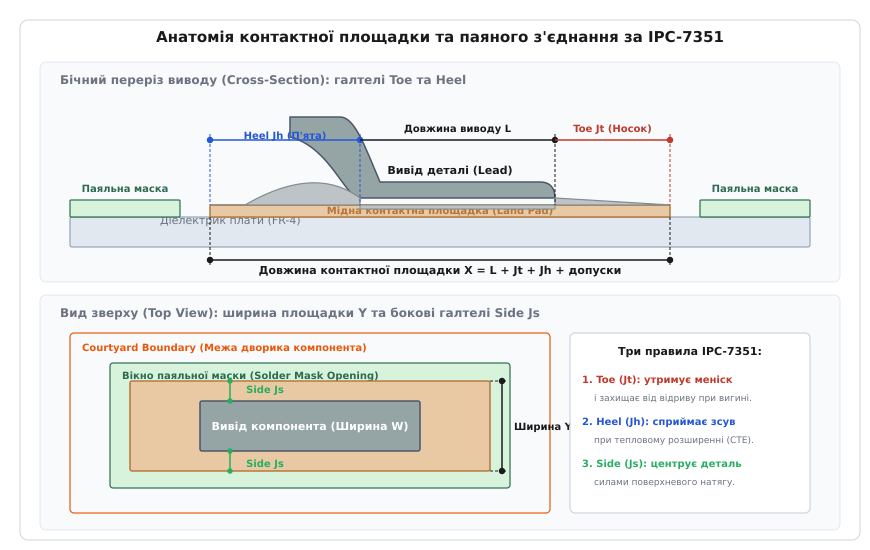
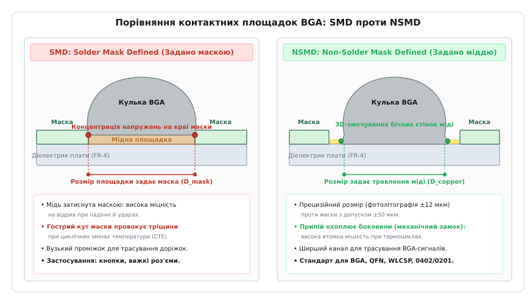

# Проєктування посадкових місць (Footprint Design)

<preknowlist>
- [Шарування плати (PCB stackup)](root:hw-pcb/pcb-stackup) — осердя, препрег, металізація та шари міді.
- [Трасування друкованої плати](root:hw-pcb/pcb-layout) — розміщення компонентів, топологія доріжок і зазори.
- [Основи паяння](root:hw-pcb/basic-soldering) — механізм змочування, утворення галтелей та інтерметалідів припою.
- [Теплові перехідні отвори](root:hw-pcb/thermal-vias) — відведення тепла через мідні отвори під нагрітими компонентами.
- [Евтектичні сплави та припої](root:hw-pcb/eutectic-alloys) — фазові переходи, поверхневий натяг та змочуваність припою.
</preknowlist>

Партія з тисячі зібраних друкованих плат контролера двигуна виходить із конвеєрної печі оплавлення припою, проте під час первинного автоматичного оптичного контролю (AOI) з'ясовується, що 42% виробів є бракованими. Мікроконтролер у безвивідному корпусі QFN-32 змістився на 0.3 мм убік і завис під кутом 4 градуси до площини плати: через надмірний об'єм нанесеної паяльної пасти під центральним тепловим майданчиком розплавлений припій утворив опуклу рідку лінзу, яка спливла й відірвала периферійні сигнальні виводи від мідних доріжок. Одночасно третина керамічних конденсаторів типорозміру 0402 стала дибки, утворивши класичний дефект «могильного каменя» (англ. *tombstoning*): розробник під'єднав одну контактну площадку до суцільного мідного полігону заземлення товщиною 35 мкм без термобар'єрів, а другу — до тонкого сигнального провідника шириною 0.15 мм. Різниця в швидкості прогріву та силах поверхневого натягу розплавленого припою з двох боків компонента створила обертальний момент, що висмикнув конденсатор із паяльної пасти в момент фазового переходу сплаву.

Ця виробнича аварія стала прямим наслідком того, що тополог плати створив посадкові місця компонентів «на око», просто скопіювавши номінальні геометричні розміри корпусу з паспорта мікросхеми без урахування законів капілярного стягування розплавленого припою, статистичного розподілу виробничих допусків та міжнародних стандартів розрахунку геометрії контактних площадок.

---

### Анатомія посадкового місця та стандарти IPC

Посадкове місце компонента (англ. *footprint*, або за термінологією міжнародної асоціації IPC — *land pattern*, від англ. *land* — контактна площадка та *pattern* — просторовий малюнок, шаблон) — це сукупність геометричних фігур на всіх технологічних шарах друкованої плати, що забезпечує механічне кріплення електронного компонента, електричний контакт із доріжками, теплопередачу та умови для автоматизованого монтажу й візуального контролю.

Коректно спроєктоване посадкове місце складається з шести взаємопов'язаних технологічних шарів:

1. **Контактні площадки (Lands)** (шар міді, *Top/Bottom Copper*) — металізовані ділянки, на які сідають виводи деталі під час паяння.
2. **Паяльна маска (Solder Mask)** — полімерний термостійкий шар (найчастіше зелений, синій або чорний), що ізолює мідні провідники та залишає відкритими лише вікна навколо контактних площадок, запобігаючи розтіканню припою за межі робочої зони.
3. **Паяльна паста (Paste Mask / Stencil)** — шар апертур трафарету, крізь які дозатором або ракелем наноситься паяльна паста (суміш мікросфер припою та флюсу) перед встановленням компонентів.
4. **Шовкодрук (Silkscreen / Legend)** — шар непровідної фарби для нанесення позиційних позначень (*RefDes*, наприклад `R12`, `U3`), контурів габаритів та індикаторів першого виводу й полярності.
5. **Межа дворика (Courtyard Boundary)** — геометрична зона безпеки навколо компонента, що резервує простір під рух вакуумних захватів монтажного автомата (*Pick-and-Place*), гарантує відсутність колізій між сусідніми деталями та забезпечує доступ для ремонтного жала паяльника або сопла термофену.
6. **Тривимірна модель (3D STEP Model)** — твердотільний габаритний макет компонента для перевірки механічної взаємодії з корпусом приладу, сусідніми роз'ємами та кріпильними гвинтами.

Еволюція конструювання посадкових місць пройшла шлях від індивідуальних емпіричних правил окремих фабрик (стандарт IPC-SM-782 1993 року) до математично обґрунтованої статистичної моделі у стандартах серії **IPC-7351** (чинні ревізії IPC-7351B та IPC-7351C — *Generic Requirements for Surface Mount Design and Land Pattern Standard*, від лат. *standard* — зразок, мірило). Сучасний стандарт не просто фіксує готові розміри під обмежений перелік корпусів, а надає універсальний алгоритм розрахунку площадок на основі допусків компонента, точності технологічного процесу фабрики та необхідної надійності пристрою.

---

### Рівні густини монтажу (Density Levels за IPC-7351)

Умови експлуатації та технологічні обмеження виготовлення суттєво різняться: плата промислового частотного перетворювача, яка працює в умовах вібрацій під навантаженням струмами в десятки амперів, вимагає принципово іншого запасу припою, ніж восьмишарова плата смартфона з кроком кульок BGA 0.35 мм. Тому IPC-7351 визначає три рівні густини посадкових місць:

- **Рівень A: Максимальна площадка (Density Level A — Most Land Protrusion / Maximum Material Condition, MMC).** Забезпечує максимальний об'єм галтелей припою. Застосовується для виробів військової, аерокосмічної та автомобільної електроніки з жорсткими вимогами до вібростійкості й термоциклювання, а також у виробах, де передбачено ручний монтаж або ручне доопрацювання паяльником.
- **Рівень B: Номінальна площадка (Density Level B — Nominal / Median Land Protrusion, NMM).** Збалансований базовий стандарт для переважної більшості споживчих, телекомунікаційних та промислових пристроїв. Оптимізований під типові технологічні допуски ліній поверхневого монтажу (SMT) та хвильового паяння.
- **Рівень C: Мінімальна площадка (Density Level C — Least Land Protrusion / Minimum Material Condition, LMC).** Площадки мінімально допустимого розміру для ультракомпактних пристроїв високої щільності (смартфони, носимі датчики, модулі камер). Вимагає високої повторюваності трафаретного друку та прецизійних монтажних автоматів із оптичним центруванням компонентів.

| Параметр галтелі та дворика | Рівень A (Most) | Рівень B (Nominal) | Рівень C (Least) | Фізичне призначення параметра |
|---|---|---|---|---|
| **Носок (Toe, `J_T`)** для SOIC/QFP | +0.55 мм | +0.35 мм | +0.15 мм | Формування меніска, опір відриву виводу при згинанні плати |
| **П'ята (Heel, `J_H`)** для SOIC/QFP | +0.45 мм | +0.35 мм | +0.25 мм | Сприйняття зсувних напружень при циклічному нагріванні (CTE) |
| **Бік (Side, `J_S`)** для SOIC/QFP | +0.05 мм | +0.03 мм | +0.01 мм | Центрування компонента силами поверхневого натягу рідкого припою |
| **Допуск дворика (Courtyard Excess)** | +0.50 мм | +0.25 мм | +0.10 мм | Простір безпеки для захватів маніпулятора та ремонтного сопла |

---

### Геометрія пайки: фізика галтелей Toe, Heel та Side

Під час паяння оплавленням вивід компонента опускається на пасту, припій плавиться, флюс розчиняє оксидні плівки на міді та металевому покритті виводу (лудінні Sn-Pb або чистий матовий Sn), і рідина формує увігнутий меніск завдяки капілярним силам.


*Анатомія контактної площадки та паяного з'єднання за стандартом IPC-7351. Угорі: бічний розріз виводу Gull-wing із виділенням вильоту носка (Toe), п'яти (Heel) та загальної довжини контактної площадки. Унизу: вид зверху з позначенням бічних галтелей (Side), апертури паяльної маски та контуру дворика.*

Кожна з трьох ділянок галтелі виконує чітку механічну функцію:

1. **Носок галтелі (*Toe*, `J_T`)** (англ. *toe* — носок стопи, передній край) — це продовження контактної площадки за межі зовнішнього торця виводу деталі. Під час змочування розплавлений припій підіймається по зовнішньому торцю виводу, утворюючи увігнутий меніск із кутом змочування `θ ≤ 30°`. Цей меніск працює як амортизатор: коли друкована плата зазнає пружного механічного згинання (наприклад, під час натискання на кнопки або розмикання роз'ємів), саме носок галтелі сприймає відривні зусилля, захищаючи корінь виводу від сколювання. Окрім того, носок є головним об'єктом інспекції для камер автоматичного оптичного контролю (AOI): за формою та блиском увігнутого меніска на носку алгоритм комп'ютерного зору підтверджує наявність якісного паяного шва.
2. **П'ята галтелі (*Heel*, `J_H`)** (англ. *heel* — п'ята) — це ділянка контактної площадки, розташована позаду внутрішнього радіуса згину виводу (або під корпусом компонента). Під час експлуатації електронного приладу кремнієвий кристал мікросхеми та мідні доріжки нагріваються. Коефіцієнт лінійного теплового розширення (КЛТР, англ. *CTE — Coefficient of Thermal Expansion*) склотекстоліту FR-4 становить `14–17 ppm/°C`, тоді як мідного виводу або кремнію — `3–6 ppm/°C`. Ця різниця розширень породжує циклічний горизонтальний зсув між корпусом деталі та платою. П'ята галтелі є найпотужнішим опорним вузлом: саме вона сприймає 70–80% зсувного напруження при циклічних змінах температури, запобігаючи втомному розтріскуванню припою.
3. **Бічні галтелі (*Side*, `J_S`)** (англ. *side* — бік, бічна поверхня) — виступи площадки ліворуч та праворуч від бічних граней виводу. Завдяки змочуванню бічних стінок виводу сили поверхневого натягу рідкого припою симетрично підтягують компонент до центру контактної площадки (ефект автоцентрування). Якщо бічний виступ площадки зробити надмірно широким, припій стікатиме в один із боків, викликаючи перекіс компонента. Якщо ж бічний виступ буде відсутній, компонент втратить стійкість до кутового зміщення під час плавлення пасти.

---

### Фізика змочування та металургія інтерметалідів

Формування галтелі припою визначається термодинамічною рівновагою поверхневих натягів на межі трьох фаз: твердого металу виводу (S), рідкого припою (L) та газового середовища печі або флюсу (V). Цей стан описується фундаментальним законом Юнга-Дюпре:

```text
cos(θ) = (γ_SV - γ_SL) / γ_LV      [термодинамічний кут змочування меніска]
```

де `γ_SV` — поверхнева енергія на межі «твердий метал — газ», `γ_SL` — міжфазний натяг «твердий метал — рідкий припій», `γ_LV` — поверхневий натяг розплавленого припою на межі з газовою фазою.

Ідеальне змочування досягається за умови `θ → 0°` (`cos(θ) → 1`), що відповідає максимальному зниженню міжфазної енергії за рахунок дії флюсу. У промисловому процесі оплавлення припою кут змочування якісної галтелі становить `θ = 15°–30°`. Якщо поверхня контактної площадки окиснена або недостатньо прогріта, значення `γ_SL` різко зростає, кут перевищує `90°`, і рідкий припій стягується в ізольовані сферичні краплі без розтікання по міді (явище дезмочування, англ. *dewetting*).

У безсвинцевих припоях сімейства SAC305 (`96.5% Sn, 3.0% Ag, 0.5% Cu`) температура фазового переходу ліквідус становить `217°C`, що на `34°C` вище за класичний евтектичний свинцевий сплав Sn63Pb37 (`183°C`). При цьому поверхневий натяг рідкого сплаву SAC305 становить близько `0.55 Н/м` проти `0.48 Н/м` у свинцевого припою. Вищий поверхневий натяг створює сильніші стягувальні сили під час оплавлення, що загострює схильність до дефекту *Tombstoning* та вимагає прецизійного симетричного проєктування розмірів контактних площадок.

На межі контакту розплавленого олова з мідною площадкою плати відбувається інтенсивна дифузія атомів, яка формує перехідний шар інтерметалідних сполук (англ. *Intermetallic Compounds, IMC*):

```text
6 Cu + 5 Sn → Cu₆Sn₅ (η-фаза)      [утворюється безпосередньо під час рідкої фази паяння]
3 Cu + Sn → Cu₃Sn (ε-фаза)         [утворюється під час тривалої температурної витримки]
```

Оптимальна товщина шару інтерметаліду становить `0.5–1.5 мкм`. Саме шар `Cu₆Sn₅` забезпечує міцний металургійний зв'язок між припоєм та міддю. Проте якщо контактна площадка або вивід деталі зазнають надмірного термічного перегріву під час багаторазового оплавлення, шар інтерметаліду розростається понад `3–5 мкм`. Оскільки кристалічна решітка `Cu₃Sn` є надзвичайно крихкою та має мікропори Кіркендалла, такий паяний шов втрачає в'язкість і сколюється під дією ударних навантажень або вібрацій.

---

### Математична модель розрахунку площадок (RSS-метод)

Розрахунок розмірів контактних площадок не може базуватися на простому арифметичному підсумовуванні максимальних похибок: ситуація, за якої компонент виготовлено з максимально можливим додатним допуском, плату протруєно з максимальним зміщенням, а автомат *Pick-and-Place* одночасно помилився на свою граничну величину в той самий бік, має мізерно малу статистичну ймовірність.

Тому IPC-7351 застосовує **метод кореня з суми квадратів (англ. *Root-Sum-Squares*, RSS)**, який спирається на центральну граничну теорему теорії ймовірностей: сумарна похибка системи з незалежних випадкових величин, підпорядкованих нормальному розподілу Гауса, дорівнює геометричній сумі їхніх дисперсій.

У розрахунку беруть участь три незалежні групи допусків:

1. **Допуски компонента (`C_L`, `C_S`, `C_W`)** — різниця між максимальним і мінімальним розміром довжини корпусу, відстані між виводами та ширини виводу за даними креслення виробника:
   ```text
   C_L = L_max - L_min      [допуск габаритної довжини деталі з виводами]
   C_S = S_max - S_min      [допуск внутрішнього просвіту між протилежними виводами]
   C_W = W_max - W_min      [допуск ширини контактного виводу]
   ```
2. **Виробничий допуск друкованої плати (`F`)** — сумарна похибка виготовлення плати на заводі (точність фотолітографії, підтравлювання міді під час хімічного травлення та лінійне розширення матеріалу під час термопресування). Для сучасних плат 4–5 класів точності за IPC-6012 приймають `F = 0.10 мм` (для прецизійних виробництв — `0.05 мм`).
3. **Допуск точності розміщення автомата (`P`)** — динамічна похибка позиціонування головки маніпулятора *Pick-and-Place* відносно оптичних реперних знаків (*Fiducial Marks*). Для сучасних швидкісних SMT-ліній приймають `P = 0.05 мм` (для застарілих верстатів — `0.075–0.10 мм`).

Сумарний статистичний допуск для кожного виміру визначають як:

```text
T_L = √(C_L² + F² + P²)      [сумарна дисперсія зовнішнього габариту]
T_S = √(C_S² + F² + P²)      [сумарна дисперсія внутрішнього зазору]
T_W = √(C_W² + F² + P²)      [сумарна дисперсія ширини виводу]
```

На основі отриманих статистичних допусків та нормативних вильотів галтелей `J_T, J_H, J_S` обчислюють три фундаментальні розміри пари контактних площадок:

1. **Максимальний зовнішній габарит між площадками (`Z_max`)**:
   ```text
   Z_max = L_min + 2·J_T + T_L      [відстань між зовнішніми краями двох площадок]
   ```
2. **Мінімальний внутрішній просвіт між площадками (`G_min`)**:
   ```text
   G_min = S_max - 2·J_H - T_S      [відстань між внутрішніми торцями двох площадок]
   ```
3. **Максимальна ширина контактної площадки (`X_max`)**:
   ```text
   X_max = W_min + 2·J_S + T_W      [ширина кожної окремої площадки]
   ```

Після обчислення габаритних меж проєктна довжина кожної окремої контактної площадки `Y` та міжцентрова відстань `C_land` визначаються за прямокутними геометричними залежностями:

```text
Y = (Z_max - G_min) / 2          [індивідуальна довжина контактної площадки]
C_land = (Z_max + G_min) / 2     [відстань між геометричними центрами протилежних площадок]
```

---

### Класифікація сімейств корпусів за IPC-7351

Стандарт IPC-7351 класифікує компоненти поверхневого монтажу на 14 геометричних сімейств залежно від просторової форми та розташування контактних виводів. Для кожного сімейства нормативні таблиці стандарту задають індивідуальні значення вильотів `J_T, J_H, J_S`:

#### 1. Корпуси з виводами типу «крило чайки» (Gull-Wing Leads: SOIC, SOP, TSSOP, QFP, LQFP)
Виводи зігнуті назовні від корпусу. П'ята виводу `J_H` сприймає головне зсувне навантаження, а подовжений носок `J_T` утримує зовнішній меніск.
- Номінальні галтелі (Level B): `J_T = +0.35 мм`, `J_H = +0.35 мм`, `J_S = +0.03 мм`.
- Допуск дворика: `+0.25 мм`.
- Головний ризик: при надмірній довжині площадки `Y` виникає перекіс виводів при груповому монтажі.

#### 2. Корпуси з виводами типу J-Lead (PLCC, SOJ)
Виводи загнуті під корпус у формі літери J. Основна галтель формується на зовнішньому згині виводу (носок), тоді як п'ята заходить під днище деталі.
- Номінальні галтелі (Level B): `J_T = +0.50 мм`, `J_H = +0.25 мм`, `J_S = +0.05 мм`.
- Застосування: мікросхеми Flash-пам'яті, сокети та силові драйвери підвищеної вібростійкості.

#### 3. Безвивідні корпуси з пласкими контактами (Flat No-Lead: QFN, DFN, MLF)
Контактні площадки розташовані на нижній площині корпусу врівень із пластиком. Торці виводів часто не мають металізації (оголена мідь після розпилу кремнієвої пластини), тому припій не завжди підіймається по вертикальному торцю корпусу.
- Номінальні галтелі (Level B): `J_T = +0.20 мм`, `J_H = +0.00 мм` (п'ята не виходить під корпус), `J_S = +0.00 мм` (нульовий бічний виліт для уникнення замикань між ніжками з кроком 0.4–0.5 мм).
- Обов'язкова умова: наявність центрального теплового майданчика з матрицею вікон пасти.

#### 4. Прямокутні чип-компоненти (Rectangular Chips: 0201, 0402, 0603, 0805, 1206)
Резистори, багатошарові керамічні конденсатори (MLCC) та феритові індуктивності з двома металізованими торцями.
- Номінальні галтелі для 0402 (Level B): `J_T = +0.20 мм`, `J_H = +0.00 мм`, `J_S = +0.05 мм`.
- Номінальні галтелі для 0603 (Level B): `J_T = +0.30 мм`, `J_H = +0.00 мм`, `J_S = +0.05 мм`.
- Головний ризик: ефект *Tombstoning* при асиметрії підвідних доріжок.

#### 5. Циліндричні компоненти з металізованими ковпачками (MELF, MiniMELF, MicroMELF)
Діоди та прецизійні резистори в круглому скляному або керамічному корпусі.
- Особливість розрахунку: контактні площадки проєктуються увігнутими або з пазом посередині для фіксації циліндра від скочування під час оплавлення припою.

#### 6. Матричні корпуси з кульовими виводами (Ball Grid Array: BGA, FBGA, WLCSP)
Масив олов'яно-свинцевих або безсвинцевих кульок на нижньому боці підкладки чіпа.
- Крок кульок: `0.35–1.27 мм`.
- Розрахунок діаметра площадки: `D_pad = 0.80–0.85 · D_ball` (діаметр контактного диска становить 80–85% від діаметра кульки припою).
- Тип площадки: NSMD для кроку `≤ 0.8 мм`, SMD для кроку `≥ 1.0 мм`.

#### 7. Корпуси з кастеляційними напівкруглими отворами (Castellated Modules)
Готові радіомодулі (Wi-Fi, Bluetooth, наприклад ESP32, LoRa) з металізованими напівкруглими вирізами по периметру плати.
- Носок галтелі `J_T` виноситься на `+0.50–0.80 мм` за межі модуля для формування глибокої вертикальної галтелі в колодязі кастеляції.

---

### Теплові контактні майданчики (Exposed Thermal Pads) та матриці отворів

Сучасні силові драйвери, стабілізатори напруги та високопродуктивні мікроконтролери у корпусах QFN, DFN, PowerSOIC та PowerQFP оснащені великим відкритим металевим майданчиком на днищі корпусу (англ. *Exposed Thermal Pad / Slug*). Через цей майданчик скидається до 90% тепла, що генерується напівпровідниковим кристалом.

Якщо тепловий майданчик просто залити суцільним шаром паяльної пасти й розмістити під ним відкриті отвори, виникають дві критичні відмови:

1. **Ефект гідропланування та спливання кристала.** Під час плавлення пасти флюс бурхливо закипає. Якщо площа суцільного майданчика перевищує `4×4 мм`, гази не встигають вийти через тонкий зазор між корпусом і платою. Тиск пари підіймає чіп над платою, внаслідок чого периферійні сигнальні ніжки взагалі втрачають контакт із доріжками, а під тепловим майданчиком утворюються гігантські газові порожнечі (*voids*), які займають понад 60% площі. Тепловий опір `R_th_JA` зростає в рази, і мікросхема згорає від теплового пробою під час першого запуску під навантаженням.
2. **Втягування припою в отвори (Solder Wicking).** Якщо теплові перехідні отвори залишаються відкритими з протилежного боку плати, капілярний ефект затягує розплавлений припій усередину отворів під час оплавлення. Припій витікає на зворотний бік плати, утворюючи там краплі й короткі замикання, а на верхньому боці під чіпом виникає гострий дефіцит припою (*solder starvation*).

> 🔧 **Правило трафарету для теплових падів (Window Pane Design).** Апертура паяльної пасти під великим тепловим майданчиком ніколи не робиться суцільною. Її розбивають на матрицю менших вікон (наприклад, 2×2, 3×3 або 4×4) з сумарним покриттям **50–70% від загальної площі мідного майданчика**. Між вікнами залишають вільні від пасти перемички шириною `0.20–0.35 мм`: вони слугують вентиляційними каналами, через які леткі гази киплячого флюсу вільно виходять назовні без утворення бульбашок.

```text
A_total = W_pad · H_pad                  [повна площа мідного теплового майданчика]
A_paste_target = A_total · 0.60          [цільова площа нанесення пасти: 60%]
N_windows = 4                            [розбивка на матрицю 2x2 вікна]
A_window = A_paste_target / N_windows    [площа кожної окремої апертури у трафареті]
```

#### Тепловий опір матриці отворів

Теплове моделювання вертикального скидання тепла від кристала у внутрішні мідні шари заземлення описується еквівалентним тепловим ланцюгом:

```text
R_th_total = R_th_junction_to_case + R_th_solder + R_th_via_array + R_th_pcb_plane
```

Тепловий опір одного металізованого перехідного отвору довжиною `h` (товщина плати, типово 1.6 мм), діаметром свердла `D_drill` та товщиною гальванічної мідної стінки `t_wall` (типово 25 мкм) обчислюється за формулою теплопровідності циліндричної труби:

```text
A_cu_ring = π · (D_drill · t_wall - t_wall²)    [площа поперечного перерізу мідної гільзи]
R_th_single_via = h / (κ_Cu · A_cu_ring)        [тепловий опір одного отвору]
```

де `κ_Cu = 390 Вт/(м·К)` — теплопровідність чистої електролітичної міді.

Для отвору з діаметром свердла `0.30 мм` у платі товщиною `1.6 мм` площа мідного кільця дорівнює:

```text
A_cu_ring = π · (0.30 · 10⁻³ · 0.025 · 10⁻³ - (0.025 · 10⁻³)²)  [підстановка геометрії гільзи]
          = π · (7.5 · 10⁻⁸ - 6.25 · 10⁻¹⁰) ≈ 2.33 · 10⁻⁷ м² = 0.233 мм²  [площа мідного перерізу]
```

Тепловий опір одного такого отвору становить:

```text
R_th_single_via = 1.6 · 10⁻³ м / (390 Вт/(м·К) · 2.33 · 10⁻⁷ м²) ≈ 17.6 К/Вт
```

Матриця з 16 таких отворів (сітка 4×4 з кроком 1.0 мм), з'єднаних паралельно, знижує тепловий опір переходу до:

```text
R_th_via_array = R_th_single_via / 16 = 17.6 / 16 ≈ 1.1 К/Вт
```

Це дозволяє розсіювати до 15–20 Вт потужності без перегріву кристала мікроконтролера понад критичний поріг `125°C`.

Для запобігання витіканню припою крізь теплові отвори згідно зі стандартом IPC-4761 застосовують такі технології герметизації:

- **Тентування маскою (Type I — Tented Via):** отвір закривається сухою плівковою маскою зверху. Дешеве, але ненадійне рішення: під час паяння залишки повітря в отворі розширюються й проривають маску («вистрілювання припою»).
- **Заповнення маскою (Type III/IV — Plugged Via):** отвір заповнюється рідкою термореактивною маскою перед фінішним нанесенням шару. Допустимо для отворів діаметром `≤ 0.3 мм`.
- **Заповнення непровідною смолою з металізацією (Type VII — Via-in-Pad Plated Over, VIPPO):** отвір заповнюють епоксидним компаундом, зрізають надлишок, шліфують врівень із поверхнею міді та гальванічно покривають суцільним шаром міді товщиною 15–20 мкм (*Capped*). Поверхня стає абсолютно пласкою й монолітною. Це найдорожча, але єдино надійна технологія для розміщення отворів безпосередньо всередині площадок BGA та QFN.

Докладніше про розрахунок перехідних отворів див. у статті [теплові перехідні отвори](root:hw-pcb/thermal-vias).

---

### Паяльна маска: Mask Defined (SMD) проти Non-Solder Mask Defined (NSMD)

Під час проєктування контактних площадок під компоненти з дрібним кроком виводів (BGA, WLCSP, QFN, мікросхеми у корпусах DFN 0.4 мм) конструктор зобов'язаний обрати один із двох фундаментальних типів формування площадки:

1. **Площадка, обмежена паяльною маскою (SMD — Solder Mask Defined):** мідний провідник на платі має більший розмір, ніж потрібна контактна площадка, а шар паяльної маски насувається на краї міді, залишаючи відкритим тільки центральне вікно. Розмір паяного з'єднання повністю визначається геометрією апертури маски.
2. **Площадка, не обмежена паяльною маскою (NSMD — Non-Solder Mask Defined, або Copper Defined):** мідний майданчик протруюється точно за потрібним розміром, а вікно в паяльній масці відкривається ширше за мідь, залишаючи навколо площадки чистий діелектричний зазор (*clearance*). Розмір паяного з'єднання визначається контуром протруєної міді.


*Порівняння контактних площадок BGA за типами формування. Ліворуч: SMD (Solder Mask Defined) — маска затискає краї міді, створюючи концентрацію механічних напружень на межі полімеру. Праворуч: NSMD (Non-Solder Mask Defined) — припій обтікає бічні стінки міді, забезпечуючи високу втомну міцність при термоциклюванні та розширюючи канал для трасування.*

Порівняльний інженерний аналіз показує переваги та недоліки обох підходів:

- **Точність геометрії.** Фотолітографічне травлення міді на сучасному обладнанні має технологічний допуск `±12..15 мкм`. Нанесення рідкої паяльної маски та її фотоекспонування через похибки суміщення шарів має допуск `±35..50 мкм`. Відтак площадка NSMD є втричі точнішою за площею та формою, ніж SMD. Для корпусів BGA з кроком кульок `0.5 мм` площадки SMD матимуть різний діаметр у межах одного чіпа, що спричинить перекіс кульок по висоті (*ball height coplanarity error*).
- **Втомна міцність при термоциклах (Thermal Fatigue).** У площадці SMD край паяльної маски утворює гострий внутрішній кут. Під час циклічних коливань температури в цьому куті виникає висока концентрація механічних напружень, і мікротріщина у припої розвивається вздовж межі «припій–маска», відриваючи кульку від плати через 300–500 циклів. У площадці NSMD розплавлений припій під дією капілярного ефекту стікає на бічні вертикальні стінки мідного майданчика товщиною 35 мкм (1 oz). Утворюється об'ємний механічний «замок», напруження розподіляються по значно більшій площі, а термін служби до втомного руйнування зростає у 2.5–3 рази.
- **Міцність на відрив при ударі (Pad Cratering / Peel Strength).** Оскільки в структурі SMD паяльна маска міцно притискає краї міді до склотекстоліту, зусилля відриву мідної фольги від діелектрика в ній є на 30–40% вищим, ніж у маленької ізольованої площадки NSMD. Тому для важких роз'ємів USB Type-C, тактових кнопок, перемикачів та масивних електролітичних конденсаторів застосовують виключно технологію SMD.
- **Ширина каналу трасування (*Routing Channel*).** Мідний п'ятак NSMD має менший фізичний діаметр, ніж мідна заготовка під SMD при однаковій ефективній площі пайки. Це дає додаткові 50–70 мкм простору між сусідніми виводами BGA, дозволяючи прокласти сигнальну доріжку без переходу на наддорогі норми виробництва *HDI (High Density Interconnect)* з мікроотворами.

> 🔧 **Рекомендація IPC для BGA та дрібних SMD.** Для всіх матричних мікросхем BGA/CSP з кроком `≤ 0.8 мм`, корпусів QFN та пасивних компонентів 0402/0201 слід за замовчуванням проєктувати площадки **NSMD**. Площадки **SMD** використовують для роз'ємів, тестових точок та силових компонентів, що зазнають ударних навантажень.

---

### Зазори маски та містки маски (Solder Mask Dam & Expansion)

Якщо відкрити вікна паяльної маски занадто широко, сусідні контактні площадки об'єднаються спільним вікном без захисного бар'єра між ними. Під час оплавлення рідкий припій потече по відкритій поверхні й утворить коротке замикання (паяльний місток, англ. *solder bridge*).

Для надійної ізоляції виводів конфігурація маски повинна задовольняти два геометричні інваріанти:

1. **Розширення маски (Solder Mask Expansion, `E_mask`):** зазор між краєм мідної площадки та краєм вікна маски. Зазвичай становить `+0.05 мм` на сторону (для високоточних фабрик — `+0.025..0.035 мм`). Це гарантує, що при технологічному зміщенні маски на `±35 мкм` полімер не залізе на поверхню мідного майданчика.
2. **Місток паяльної маски (Solder Mask Dam, `D_mask`):** мінімальна ширина смужки полімерної маски між двома сусідніми вікнами. Фотополімерна маска зеленого кольору надійно полімеризується та утримується на платі при ширині містка `D_mask ≥ 0.075–0.100 мм` (для чорних або матових масок через гірше проникнення ультрафіолету мінімальний місток становить `0.100–0.125 мм`).

Якщо крок виводів мікросхеми становить `0.5 мм`, а ширина мідної площадки `0.28 мм`, відстань між мідними площадками дорівнює `0.22 мм`. При розширенні маски `0.05 мм` на кожну сторону ширина вільного містка становитиме:

```text
D_mask = Pitch - W_pad - 2·E_mask          [геометричний баланс зазорів]
       = 0.50 мм - 0.28 мм - 2·(0.05 мм)   [підстановка параметрів площадки та маски]
       = 0.22 мм - 0.10 мм = 0.12 мм       [розрахункова ширина містка маски]
```

Отримане значення `0.12 мм` перевищує мінімальний поріг `0.075 мм`, тому між ніжками сформується надійний зелений місток маски, який повністю заблокує виникнення коротких замикань між виводами під час конвеєрного паяння.

---

### Трасування виходу (Fanout & Escape Routing) та правила BGA

Розведення сигналів від матричних корпусів BGA (*Escape Routing*) безпосередньо пов'язане з геометрією посадкового місця. Залежно від кроку кульок розрізняють дві базові топології:

1. **Топологія «собача кістка» (Dog-bone Fanout) для кроку `0.8–1.0 мм`:**
   Від кожної площадки BGA відходить коротка діагональна доріжка довжиною `0.3–0.5 мм`, яка сполучає контактний пад із перехідним отвором *Via*. Між падом BGA та отвором **обов'язково формується перемичка паяльної маски шириною `≥ 0.075 мм`**. Якщо не закрити шийку доріжки маскою, рідкий припій кульки BGA під дією капілярного тиску стече в отвір, висота кульки зменшиться, і чіп втратить контакт із сусідніми ніжками.
2. **Топологія отвору в паді (Via-in-Pad VIPPO) для кроку `≤ 0.5 мм`:**
   При кроці кульок 0.4–0.5 мм простір між площадками становить лише `0.15–0.22 мм`, що фізично унеможливлює розміщення окремого отвору поруч. Перехідний отвір свердлиться безпосередньо по центру контактного майданчика BGA, заповнюється епоксидною смолою, зрізається та покривається міддю з контролем глибини залишкової ямки (*Dimple ≤ 15 мкм*).

Кількість необхідних сигнальних шарів друкованої плати `N_layers` для повного розведення матриці BGA оцінюється за формулою розрахунку рядів виходу:

```text
N_layers = 2 + ⌈(N_rows / 2 - 1) / N_channels⌉
```

де `N_rows` — кількість рядів кульок BGA від краю до центру, а `N_channels` — кількість провідників, що проходять крізь один просвіт між сусідніми перехідними отворами.

---

### Трафарет, паяльна паста та ефект «могильного каменя» (Tombstoning)

Якість паяного шва на 60–70% залежить від правильного дозування паяльної пасти через лазерний металевий трафарет (*stencil*, за стандартом **IPC-7525** *Stencil Design Guidelines*).

Товщина сталевого трафарету `T_stencil` зазвичай вибирається в діапазоні `0.10–0.13 мм` (100–130 мкм). Щоб паяльна паста не застрягала у вузьких отворах трафарету, а повністю переносилася на контактні площадки плати під час підняття трафарету, геометрія апертури повинна задовольняти два фізичні критерії:

1. **Співвідношення сторін (Aspect Ratio):**
   ```text
   Aspect_Ratio = W_aperture / T_stencil ≥ 1.50
   ```
2. **Коефіцієнт площі (Area Ratio):** відношення площі основи апертури до площі її бічних вертикальних стінок. Сила зчеплення пасти з мідною площадкою плати має перевищувати силу тертя пасти об стінки отвору:
   ```text
   Area_Ratio = (W · L) / (2 · (W + L) · T_stencil) ≥ 0.66
   ```

Якщо для мікросхеми BGA з діаметром площадки `0.30 мм` використати трафарет товщиною `0.15 мм`, коефіцієнт площі впаде до `0.50`, паста налипатиме на стінки трафарету, і частина кульок отримає сухий непаяний контакт (*head-in-pillow defect*).

#### Фізика ефекту Tombstoning

Ефект «могильного каменя» (підняття двополюсних пасивних SMD-елементів 0201, 0402, 0603 вертикально на одній ніжці) виникає через дисбаланс капілярних сил під час фазового переходу припою з твердого стану в рідкий.

Коли припій плавиться, він створює три сили, що діють на торець чип-компонента:
- Горизонтальну силу поверхневого натягу `F_h = γ · W · cos(θ)`, яка втягує деталь до центру площадки;
- Вертикальну силу меніска під виводом `F_v = γ · W · sin(θ)`, яка намагається підняти деталь;
- Гравітаційну силу ваги деталі `F_g = m · g`, яка притискає її до плати.

Якщо припій під лівою площадкою розплавився на 0.2 секунди раніше, ніж під правою (через несиметричну термодинаміку мідних доріжок або асиметричне випромінювання нагрівачів печі), на лівому кінці виникає повна сила змочування `F_v`, тоді як правий кінець лежить на холодній твердій пасті. Виникає нескомпенсований обертальний момент сил:

```text
M_tombstone = F_v · L_chip - F_g · (L_chip / 2)
```

Оскільки маса чипа 0402 становить лише близько 0.5 мг, сила натягу меніска на два порядки переважає силу гравітації, і деталь миттєво підіймається вертикально, обриваючи електричне коло.

```
       Вертикальна сила змочування
            ▲ F_v
            │   ┌──────────────┐
            └───┤   ЧИП 0402   │   (підіймається дибки)
                └──────┬───────┘
                       │
   [Лівий пад: рідкий] │           [Правий пад: тверда паста]
   ════════════════════╪═════════════════════════════════════
          ▲            └── Обертальний момент навколо ребра
          └─────────── Раннє плавлення припою
```

Конструктивні методи усунення Tombstoning при розрахунку посадкового місця:
- **Сувора симетрія топології підключень:** якщо один контакт резистора під'єднується до полігону живлення, його підводять через термобар'єр (*Thermal Relief*) із рівно такою ж шириною шийки (наприклад, 0.2 мм), як і сигнальна доріжка на протилежному контакті.
- **Модифікація апертур трафарету (*Home-plate / Inverted Home-plate*):** зменшення площі нанесення пасти на внутрішніх краях площадок у формі «бейсбольного домашнього щита» знижує надлишковий об'єм рідкого припою під серединою чипа, зменшуючи силу `F_v` на 30–40%.

#### Проблема паразитних кульок припою (Mid-Chip Solder Beads)

Для компонентів типорозмірів 0603, 0805 та 1206 надмірний об'єм паяльної пасти під днищем корпусу викликає інший небезпечний дефект — утворення вільних кульок припою (*Solder Beads / Mid-Chip Solder Balls*). Під час оплавлення припій вичавлюється під керамічний брусок, згортається в кульку діаметром `0.15–0.30 мм` і вистрілює вбік під тиском випаровуваного флюсу. Кулька вільно катається по платі, викликаючи короткі замикання між сусідніми доріжками або ніжками мікросхем.

Для усунення цього дефекту застосовують геометрію трафарету типу *Bow-Tie* (апертура звужена у формі краватки-метелика) або зміщення апертури назовні на 10–15% площі площадки, залишаючи внутрішній простір під корпусом сухим.

---

### Топологічні переходи та краплеподібні підключення (Teardrops)

При трасуванні провідників до контактних площадок особливу увагу приділяють місцю з'єднання тонкої доріжки з широким майданчиком. Якщо доріжка шириною `0.10 мм` підходить перпендикулярно до кута прямокутної площадки `0.60×1.50 мм`, у точці стику виникає висока концентрація механічних напружень під час термоциклювання або вигину плати. Окрім того, при технологічному зміщенні свердління або фотолітографії доріжка може частково підтравитися на гострому переході.

Для усунення цієї проблеми застосовують **краплеподібні згладжування (англ. *Teardrops*)**:

1. Плавне лінійне або дугове розширення доріжки на підході до площадки на довжині `0.25–0.50 мм`.
2. Збільшення площі металургійного переходу на 40–60%, що повністю виключає розрив провідника в зоні термовпливу пайки.
3. Зниження паразитних неоднорідностей хвильового опору для високошвидкісних цифрових сигналів із крутими фронтами.

---

### Локальні реперні знаки (Local Fiducials) та оптичне центрування

Для мікросхем із високою щільністю виводів (QFP з кроком `≤ 0.5 мм`, BGA з кроком `≤ 0.8 мм`) загальних реперів на кутах плати (*Global Fiducials*) стає недостатньо через нелінійне термічне розширення та деформацію склотекстоліту FR-4 під час проходження через піч.

У таких випадках на рівні посадкового місця проєктують **локальні реперні знаки (Local Fiducials)**:

- Репер являє собою ізольований мідний диск діаметром `1.0 мм` із круглим вікном паяльної маски діаметром `2.0 мм` (чисте діелектричне кільце шириною 0.5 мм навколо міді).
- Два локальні репери розміщують по діагоналі навколо корпусу мікросхеми на відстані `2–3 мм` від контуру дворика.
- Камера маніпулятора *Pick-and-Place* сканує локальні репери безпосередньо перед установкою чіпа, обчислює кутове зміщення `Δθ` та масштабне розширення плати `Δx, Δy` з точністю до `±5 мкм`, гарантуючи ідеальну посадку виводів по центру площадок.

---

### Копланарність виводів (Lead Coplanarity)

Критичним механічним параметром під час монтажу багатовивідних корпусів QFP та SOIC є **копланарність виводів (англ. *coplanarity*)** — максимальна відстань по висоті між найнижчим і найвищим виводом корпусу, встановленого на ідеально рівну калібровану плиту.

За стандартом JEDEC допустима некопланарність становить:
- `≤ 0.08 мм` (80 мкм) для корпусів із кроком виводів 0.65–1.27 мм;
- `≤ 0.05 мм` (50 мкм) для тонких корпусів TQFP/LQFP з кроком 0.4–0.5 мм.

Якщо вивід відігнутий угору на 0.09 мм, а товщина шару нанесеної паяльної пасти становить 0.10 мм (яка після оплавлення стискається до висоти 0.05 мм), розплавлений меніск не зможе замкнути зазор між ніжкою та площадкою. Виникає дефект «висячого виводу» (холодна пайка або обрив). Розрахунок носка площадки `J_T` та п'яти `J_H` за рівнем Density Level A компенсує дрібні похибки копланарності за рахунок збільшеного об'єму припою.

---

### Технологічність тестування (Design for Testability — DFT) та оптичний контроль (AOI/AXI)

Проєктування посадкового місця зобов'язане враховувати подальший контроль якості на заводі:

1. **Тестові точки (Test Points) для голкових адаптерів (ICT / Bed-of-Nails):**
   - Діаметр тестового паду: `0.80–1.00 мм` (для щупів з кроком 1.27 мм).
   - Зазор від тестової точки до тіла найближчого компонента: `≥ 1.0 мм` (до високих компонентів понад 5 мм — `≥ 3.0 мм`), щоб притискна плита тестера не розчавила корпус мікросхеми.
   - Заборона маски: тестовий майданчик відкривається повністю, фінішне покриття — ENIG або іммерсійне олово (рівна поверхня без напливів припою).
2. **Вимоги до автоматичного оптичного контролю (AOI):**
   - Контрастність шовкодруку та паяльної маски (матові маски зеленого або синього кольору дають менше паразитних відблисків, ніж глянцеві чорні).
   - Носок контактної площадки `J_T` повинен залишатися відкритим на `≥ 0.20 мм` перед ніжкою для прямого огляду меніска камерою верхнього освітлення.
3. **Рентгенівський контроль прихованих з'єднань (AXI — Automated X-Ray Inspection):**
   - Для мікросхем BGA та QFN заборонено розташовувати перехідні отвори або компоненти на протилежному боці плати безпосередньо під кульками чи тепловими падами. Інакше на рентгенівському знімку металізація отвору накладається на зображення паяного шва, створюючи тіньовий ефект (*shadowing effect*) та провокуючи хибні спрацьовування дефектоскопу.

---

### Шовкодрук, полярність та межа дворика

Останній етап конструювання посадкового місця — підготовка шарів контролю, складання та трасування:

1. **Індикатори першого виводу (Pin 1 Indicator):** кругла точка діаметром `0.5–1.0 мм`, фаска або трикутна мітка на шовкодруку повинні обов'язково розміщуватися **за межами контуру змонтованого корпусу**. Якщо мітку першого виводу надрукувати під днищем мікросхеми, після запаювання оператор або сервісний інженер не зможе візуально перевірити правильність орієнтації мікросхеми без рентгенівського просвічування.
2. **Маркування полярності:** для діодів (катодна риска), світлодіодів, танталових та електролітичних конденсаторів обов'язково наносять чіткі символи `+` та лінійні бар'єри на шовкодруку. Відстань від шовкодруку до вікон паяльної маски (*Silkscreen-to-Mask Clearance*) повинна становити `≥ 0.10 мм`: якщо фарба шовкодруку випадково налізе на мідний пад, припій у цьому місці не змочить мідь, і пайка розкришиться.
3. **Контур дворика (Courtyard Boundary):** невидима для виробництва, але критична для САПР лінія на спеціальному шарі (`Courtyard Top`), яка охоплює контактні площадки та тіло компонента з нормативним запасом:
   - `+0.50 мм` (Рівень A) — для великих роз'ємів, модулів і ручного складання;
   - `+0.25 мм` (Рівень B) — стандартний зазор автоматизованого SMT-монтажу;
   - `+0.10 мм` (Рівень C) — граничний зазор мікромонтажу під контролем прецизійних камер.

САПР друкованих плат (KiCad, Altium Designer) використовує шар дворика для автоматичної перевірки перетинів (*Design Rule Check — DRC Courtyard Overlap*): якщо дворики двох сусідніх компонентів перетинаються, вакуумна насадка маніпулятора з високою ймовірністю зіб'є вже встановлену деталь під час швидкісного монтажу.

---

### Програмна верифікація правил посадкових місць

Для контролю коректності розмірів посадкових місць та автоматичної перевірки зазорів паяльної маски в автоматизованих конвеєрах перевірки бібліотек компонентів застосовують скрипти валідації геометрії.

:::tabs
:::code footprint-design-d/c/main.c
:::code footprint-design-d/cpp/main.cpp
:::

---

### Покроковий чекліст верифікації посадкового місця перед виробництвом

Перед передачею бібліотеки компонентів у виробництво інженер перевіряє кожне посадкове місце за дев'ятьма контрольними пунктами:

1. **Відповідність нумерації виводів (Pinout Mapping):** звірка нумерації виводів посадкового місця (`1, 2, 3...`) зі схемним символом мікросхеми. Для транзисторів (SOT-23) та діодів — обов'язкова перевірка відповідності виводів `Gate/Drain/Source` та `Anode/Cathode`, оскільки різні виробники мають альтернативні цоколівки в однакових корпусах.
2. **Перевірка допусків за даними виробника:** чи взято для розрахунку граничні розміри корпусу `min/max`, а не лише одне номінальне значення.
3. **Конфігурація маски (SMD vs NSMD):** чи встановлено NSMD для всіх дрібних BGA/QFN та SMD для сильних механічних кріплень.
4. **Контроль ширини містка маски (`D_mask ≥ 0.075 мм`):** чи немає спільних вікон маски між сусідніми сигнальними ніжками.
5. **Розбивка пасти на тепловому паді (Window Pane 50–70%):** чи відсутнє суцільне нанесення пасти під великими тепловими майданчиками.
6. **Захист теплових отворів (Via Plugging / VIPPO):** чи герметизовано отвори для запобігання витіканню припою на нижній бік плати.
7. **Видимість маркування Pin 1 та полярності:** чи залишається мітка видимою після встановлення корпусу деталі.
8. **Зазор шовкодруку до маски (`≥ 0.10 мм`):** чи немає налізання маркувальної фарби на мідні площадки.
9. **Шар дворика (Courtyard DRC):** чи охоплює замкнений контур усі площадки з нормативним запасом `0.25 мм` для запобігання зіткненням на автоматі *Pick-and-Place*.

---

### Зведена таблиця правил проєктування посадкових місць

| Тип корпусу / Елемент | Конфігурація площадки | Цільові вильоти галтелей (Toe / Heel / Side) | Трафарет (Paste Mask) | Зазори маски (Solder Mask) |
|---|---|---|---|---|
| **SOIC / TSSOP / QFP** (Gull-wing) | NSMD (задано міддю) | Toe: +0.35 мм<br>Heel: +0.35 мм<br>Side: +0.03 мм | 1:1 до площадки, прямокутні кути | Expansion: +0.05 мм,<br>Місток Dam ≥ 0.075 мм |
| **QFN / DFN** (Leadless) | NSMD (сигнали)<br>Суцільна мідь (тепло) | Toe: +0.20 мм<br>Heel: +0.00 мм (під корпус)<br>Side: +0.00 мм | Сигнали: 1:1<br>Тепловий пад: вікна 50–65% | Сигнали: місток ≥ 0.075 мм<br>Тепло: заповнені отвори VIPPO |
| **BGA / CSP** (Ball Array) | NSMD (0.4–0.8 мм)<br>SMD (≥ 1.0 мм) | Сферична галтель, діаметр площадки 80–85% від діаметра кульки | 1:1 круглі апертури, лазерне полірування | NSMD: Clearance +0.05 мм навколо мідного диска |
| **0402 / 0603 / 0805** (Чипи) | NSMD | Toe: +0.20..0.30 мм<br>Heel: +0.00 мм<br>Side: +0.05 мм | Редукція Home-plate на 10% для захисту від Tombstone | Expansion: +0.04 мм,<br>симетричні термобар'єри |
| **Кнопки, USB-роз'єми** | SMD (задано маскою) | Toe: +0.50 мм<br>Heel: +0.40 мм<br>Side: +0.10 мм | 1:1, збільшений об'єм пасти для механічної міцності | Маска насувається на мідь на 0.08–0.10 мм |

Для детального ознайомлення з алгоритмами розрахунку, розширеними таблицями констант IPC для всіх 14 класів корпусів компонентів та повнофункціональним калькулятором на мовах C99 та C++20 відкрийте вставку [проєктний калькулятор геометрії контактних площадок за стандартом IPC-7351](root:hw-pcb/footprint-design/proj-ipc7351-land-calculator.md).
