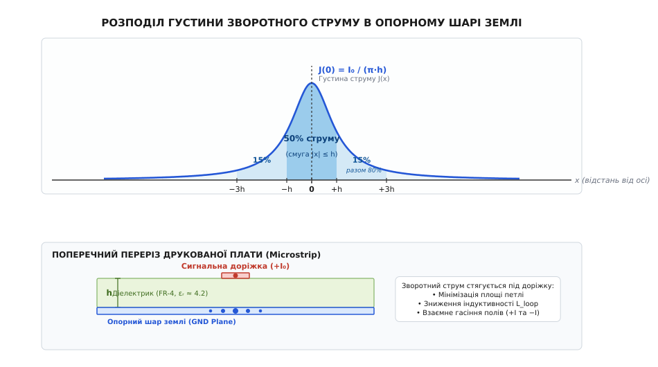
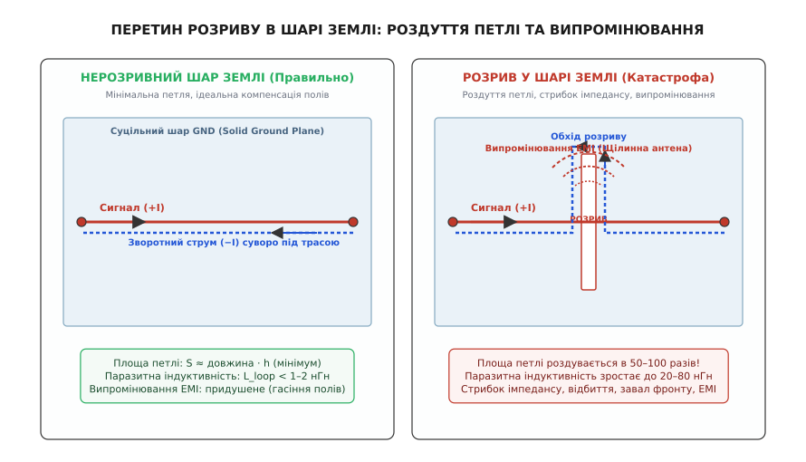

# Шар землі (ground plane)

<preknowlist>
- [Шлях зворотного струму](root:hw-pcb/current-return-path) — принципи замикання струмових контурів, різниця між DC та HF і закон мінімальної індуктивності.
- [Стек шарів друкованої плати](root:hw-pcb/pcb-stackup) — порядок чергування сигнальних, земляних і живильних шарів та їхній діелектричний зв'язок.
- [Стек PCB і характеристичний опір мікросмужки](root:hw-pcb/pcb-stackup-rf) — структура шарів, імпеданс та діелектрики швидкісних ліній.
- [Цілісність живлення](root:hw-pcb/power-integrity) — розподільча мережа живлення (PDN), імпеданс шин і локальне блокування завад.
- [Електромагнітна сумісність](root:hw-pcb/electromagnetic-compatibility) — механізми випромінювання дипольних і петльових антен та екранування.
- [Перехресні завади](root:hw-pcb/crosstalk) — паразитний ємнісний та індуктивний зв'язок між сусідніми провідниками.
</preknowlist>

Коли вихідний каскад сучасного цифрового процесора або передавача перемикає логічний рівень за 500 пікосекунд, струм амплітудою 20 міліампер у сигнальній доріжці шириною 0.2 міліметра створює навколо себе швидкозмінне електромагнітне поле з частотним спектром, що сягає гігагерцового діапазону. Якщо безпосередньо під цією доріжкою розташовано суцільний мідний шар, електричне та магнітне поля залишаються локалізованими в тонкому шарі діелектрика товщиною 100 мікрометрів: взаємна індуктивність сигнального провідника і зворотного струму компенсує власну індуктивність контуру, знижуючи її до одиниць наногенрі, а хвильовий імпеданс лінії зберігає стабільне значення 50 Ом уздовж усієї траси. Варто цій самій доріжці перетнути технологічний розріз у міді завширшки лише 0.5 міліметра, як шлях зворотного струму миттєво розривається, площа струмового контуру зростає у п'ятдесят разів, паразитна індуктивність підскакує до 35 наногенрі, а на краях щілини генерується стрибок напруги понад 1.4 вольта. У результаті цифровий приймач фіксує помилкові спрацьовування відбитого сигналу, затримка поширення імпульсу збільшується на сотні пікосекунд, а утворена щілинна антена починає інтенсивно випромінювати електромагнітну енергію в простір, гарантовано провалюючи лабораторні випробування на електромагнітну сумісність.

Шар землі (Ground Reference Plane) у друкованій платі не є пасивним механічним екраном чи умовним «резервуаром нульового потенціалу», яким його часто зображують на спрощених принципових схемах. Це повноправний, активний компонент кожної лінії передачі та розподільчої мережі живлення, що визначає граничні умови поширення електромагнітних хвиль, контролює хвильовий опір трас, утримує паразитні поля від розповсюдження між сусідніми колами та забезпечує зворотний шлях для кожного змінного струму в електронній системі.

## Фізична природа опорного шару: розвінчання міфу про стік струму

У базових курсах електротехніки землю часто визначають як нескінченний масив провідного матеріалу, здатний поглинати будь-яку кількість електричного заряду без зміни свого потенціалу. На принципових схемах це позначається графічним символом «землі», куди нібито безслідно стікають струми від усіх навантажень, блокувальних конденсаторів та аналогових датчиків. Для постійного струму або низькочастотних сигналів, де довжина хвилі в тисячі разів перевищує геометричні розміри друкованої плати, таке спрощення не створює фатальних помилок, оскільки різниці потенціалів між різними точками мідного полігону мізерні.

Проте на високих частотах і при швидких фронтах перемикання концепція «землі як безмежного стоку» повністю руйнується. В електродинаміці діє фундаментальний закон збереження заряду та закон неперервності струму: кожен заряд, що виходить із джерела сигналу, зобов'язаний повернутися назад до цього ж джерела замкненим контуром. Сигнал на друкованій платі фізично не поширюється по одному провіднику. Будь-яка мікросмужкова або симетрична смужкова лінія — це дводротова лінія передачі, де сигнальна доріжка є першим провідником, а суцільний опорний шар міді — другим, абсолютно рівноправним провідником.

Енергія цифрового чи радіочастотного сигналу переноситься не рухом електронів усередині міді (дрейфова швидкість електронів становить частки міліметра на секунду), а електромагнітною хвилею, що поширюється в діелектрику між доріжкою та опорним шаром. Вектор Пойнтінга, який задає густину потоку електромагнітної енергії, визначається векторним добутком напруженості електричного поля та напруженості магнітного поля:

```text
S = E × H
```

Електричне поле `E` починається на зарядах сигнальної доріжки і закінчується на зарядах протилежного знака, наведених на поверхні опорного шару землі. Магнітне поле `H` циркулює навколо сигнальної доріжки і пронизує простір між нею та землею. Без присутності опорного шару електричне поле розсіюється в навколишній простір, ємність лінії різко падає, індуктивність зростає, а хвильовий опір стає нестабільним і залежним від будь-яких металевих предметів поблизу плати.

```
       Сигнальна доріжка (+I)         ───┐
       ┌────────────────────────┐        │
       │       Мідь (Top)       │        │  Електромагнітна хвиля (TEM)
       └────────────────────────┘        │  Енергія тече в діелектрику:
         │   │   │   │   │   │           │  вектор Пойнтінга S = E × H
    ─ ─ ─▼─ ─▼─ ─▼─ ─▼─ ─▼─ ─▼─ ─ ─ ─ ─  │
         Діелектрик плати (h, εᵣ)        │
    ─ ─ ─▲─ ─▲─ ─▲─ ─▲─ ─▲─ ─▲─ ─ ─ ─ ─  │
       ┌────────────────────────┐        │
       │  Опорний шар GND (−I)  │        │
       └────────────────────────┘     ───┘
```

Опорний шар (Reference Plane) задає чітку граничну умову для електромагнітного поля: тангенціальна складова електричного поля на поверхні ідеального провідника дорівнює нулю, а нормальна складова магнітного поля також дорівнює нулю. Це змушує хвилю поширюватися у вигляді квазі-ТЕМ (Transverse Electro-Magnetic) моди суворо вздовж геометричної осі доріжки, обмежуючи її розсіювання та перехресне наведення на сусідні ланцюги.

Розподіл полів і поверхневих струмів на межі провідника підпорядковується фундаментальним граничним співвідношенням теорії Максвелла:

```text
n × (E₁ - E₂) = 0        [тангенціальна складова електричного поля неперервна]
n · (D₁ - D₂) = ρ_s      [стрибок нормальної індукції задає поверхневий заряд]
n × (H₁ - H₂) = J_s      [стрибок тангенціального магнітного поля задає струм]
n · (B₁ - B₂) = 0        [нормальна складова магнітної індукції неперервна]
```

де `n` — одиничний вектор нормалі до поверхні опорної площини, `ρ_s` — поверхнева густина електричного заряду, `J_s` — векторна поверхнева густина струму. Оскільки всередині провідника з високою провідністю електричне та магнітне поля практично дорівнюють нулю (на глибинах, більших за товщину скін-шару), поверхнева густина струму в опорній площині строго дорівнює тангенціальній складовій магнітного поля над нею: `J_s = n × H`.

Будь-яка неідеальність опорного шару — розрив, отвір, зміна товщини або віддалення від сигнальної доріжки — деформує граничні умови, порушує структуру квазі-ТЕМ хвилі та породжує паразитні поздовжні складові полів, які призводять до випромінювання та спотворення сигналу.

## Фізика розподілу зворотного струму: DC проти HF

Розподіл зворотного струму в суцільному опорному шарі підпорядковується фундаментальному принципу мінімізації повного електричного імпедансу контуру. Повний комплексний опір петлі, утвореної сигнальним провідником і землею, складається з активного омічного опору та реактивного індуктивного опору:

```text
Z_loop = R_loop + j · ω · L_loop
```

де `R_loop` — сумарний активний опір міді сигнальної доріжки та площини повернення, `L_loop` — повна петльова індуктивність контуру, `ω = 2π · f` — кругова частота гармонійної складової струму.

Залежно від частоти цей шлях докорінно змінюється, розділяючись на два фізичні режими.

### Низькочастотний режим (DC і низькі частоти)

При постійному струмі (`f = 0`, `ω = 0`) реактивний опір дорівнює нулю:

```text
Z_loop = R_loop = ρ · l / S
```

де `ρ` — питомий електричний опір міді (приблизно `1.72 · 10⁻⁸` Ом·м при кімнатній температурі), `l` — довжина шляху струму, `S` — площа поперечного перерізу.

У цьому режимі зворотний струм шукає шлях **найменшого активного опору**. Оскільки активний опір обернено пропорційний площі провідника, струм прагне задіяти якомога більшу ширину опорної площини. Розподіл електричного потенціалу в шарі землі описується класичним рівнянням Лапласа для двовимірного провідного середовища:

```text
∇²V = (∂²V / ∂x²) + (∂²V / ∂y²) = 0
```

Зворотний постійний струм виходить із точки заземлення навантаження і розтікається широким віялом по всій доступній площі мідного полігону, рухаючись по найкоротшій геометричній прямій безпосередньо до точки заземлення джерела живлення. Траєкторія сигнальної доріжки на верхньому шарі для постійного струму абсолютно байдужа: доріжка може робити довгі петлі, обходити компоненти або йти по периметру плати, тоді як зворотний постійний струм рухатиметься навпростець між точками контакту.

Лінії густини струму є ортогональними до ізопотенціальних ліній:

```text
J(x, y) = -σ · ∇V(x, y)
```

де `σ = 1/ρ` — питома електропровідність міді. Оскільки провідність площини однорідна, струм розсіюється вшир на максимальну доступну відстань, обмежену лише краями друкованої плати.

### Високочастотний режим (RF та швидкі цифрові фронти)

Зі збільшенням частоти реактивний опір індуктивності `ω · L_loop` зростає пропорційно частоті. Вже на частотах у кілька сотень кілогерц величина `ω · L_loop` перевищує активний опір міді `R_loop`, а на частотах понад 10 МГц індуктивна складова перевищує омічну на три-чотири порядки.

У високочастотному режимі повний імпеданс практично повністю визначається індуктивністю:

```text
Z_loop ≈ j · ω · L_loop
```

Струм перемикається на шлях **найменшої петльової індуктивності**. Петльова індуктивність двох паралельних провідників із зустрічними струмами залежить від їхніх власних індуктивностей `L_sig`, `L_gnd` та коефіцієнта взаємної індуктивності `M` між ними:

```text
L_loop = L_sig + L_gnd - 2 · M
```

Зворотний струм у землі має напрямок, строго протилежний прямому струму в сигнальній доріжці. Тому їхні магнітні поля спрямовані назустріч одне одному і взаємно віднімаються. Що ближче зворотний струм протікає до сигнальної доріжки, то більшою стає взаємна індуктивність `M`, яка входить у формулу зі знаком мінус, і то меншою є сумарна індуктивність петлі `L_loop`.

Мінімальна магнітна енергія системи досягається тоді, коли зворотний струм стягується у вузьку смугу безпосередньо під сигнальною доріжкою, дзеркально повторюючи кожен її поворот, вигин і перехід. Цей феномен є проявом **ефекту близькості (Proximity Effect)**, зумовленого вихровими струмами та прагненням змінного електромагнітного поля сконцентрувати свою енергію в мінімальному об'ємі простору.

```
Постійний струм (f < 10 кГц)          Висока частота (f > 1 МГц)
┌─────────────────────────────────┐   ┌─────────────────────────────────┐
│     Z ≈ R (активний опір)       │   │   Z ≈ jωL (індуктивний опір)    │
│ Струм тече по прямій лінії між  │   │ Струм стягується у вузьку смугу │
│ виводами по найкоротшому шляху  │   │ СУВОРО ПІД сигнальною доріжкою  │
│ (максимальний переріз міді)     │   │ (мінімальна площа контуру)      │
└─────────────────────────────────┘   └─────────────────────────────────┘
```

### Частота переходу між режимами (Кросовер)

Точка переходу, на якій активний опір дорівнює індуктивному опору контуру (`R_loop = 2π · f_c · L_loop`), називається частотою кросоверу:

```text
f_c = R_loop / (2π · L_loop)
```

Розглянемо практичний приклад типової мікросмужкової лінії на 4-шаровій друкованій платі:
- Довжина доріжки `l = 80` мм;
- Ширина доріжки `w = 0.25` мм (хвильовий опір 50 Ом при товщині діелектрика `h = 0.12` мм);
- Товщина міді `t = 35` мкм (1 oz);
- Омічний опір доріжки `R_sig ≈ 0.16` Ом;
- Активний опір площини землі `R_gnd ≈ 0.01` Ом;
- Загальний опір `R_loop ≈ 0.17` Ом;
- Повна петльова індуктивність контуру `L_loop ≈ 24` нГн (приблизно 0.3 нГн/мм).

Обчислимо частоту кросоверу:

```text
f_c = 0.17 / (2π · 24 · 10⁻⁹)
    = 0.17 / (1.508 · 10⁻⁷)
    ≈ 1.13 МГц
```

На частотах нижче 100 кГц струм поводиться як постійний і розтікається по площині. На частотах понад 1 МГц струм на 90% сконцентрований під доріжкою. На частотах понад 10 МГц повернення струму на 99.9% локалізоване строго під трасою.

> 🔧 **Навіщо це.** Поширена помилка початківців — вважати лінію низькочастотною, якщо її тактова частота становить лише 100 кГц (наприклад, шина I2C або дискретний сигнал датчика). Проте спектральний склад сигналу визначається не періодом повторення імпульсів, а крутизною їхніх фронтів (Rise Time, `t_r`).
>
> Частота зламу спектра (Knee Frequency), до якої зосереджена переважна частина енергії перехідного процесу, визначається співвідношенням:
> ```text
> f_knee = 0.35 / t_r
> ```
> Якщо мікроконтролер перемикає вивід GPIO з часом наростання `t_r = 1.2` нс, то гранична частота спектра становить:
> ```text
> f_knee = 0.35 / (1.2 · 10⁻⁹) ≈ 292 МГц
> ```
> Оскільки 292 МГц у сотні разів перевищують частоту кросоверу `f_c ≈ 1.13` МГц, зворотний струм фронту перемикання повністю підпорядкований високочастотному закону мінімальної індуктивності й стягується під доріжку незалежно від того, як рідко відбуваються самі перемикання.

## Математичний розподіл густини зворотного струму в площині

Високочастотний зворотний струм у площині не стискається в нескінченно тонку лінію: паралельні нитки струму однакового напрямку зазнають взаємного магнітного відштовхування, що врівноважується притяганням до протилежного струму сигнальної доріжки. У результаті в опорному шарі встановлюється стаціонарний профіль поверхневої густини струму `J(x)`, де `x` — поперечна координата відносно осі симетрії сигнальної доріжки, а `h` — висота діелектрика між доріжкою та опорним шаром.

Для нескінченно тонкого сигнального провідника над нескінченною ідеально провідною площиною аналітичний розв'язок методу дзеркальних зображень дає класичну функцію розподілу Лоренца (лоренціан):

```text
J(x) = (I₀ / (π · h)) · (1 / (1 + (x / h)²))
```

де `I₀` — повний струм у сигнальній лінії, `h` — товщина шару діелектрика між сигнальною доріжкою та опорною площиною, `x` — горизонтальне відхилення від центру доріжки.

```
                 Густина струму J(x)
                        ▲
                        │       J(0) = I₀ / (π·h)
                        │          ┌───┐
                        │        ┌─┘   └─┐
                        │       ┌┘       └┐
                        │      ┌┘         └┐
                        │     ┌┘           └┐
      ──────────────────┼────┌┘             └┐────► x
                       -3h  -h       0      +h   +3h
                        │◄─────── 50% ──────►│
                        │◄─────────── 80% ──────────►│
```

Максимальна густина струму досягається строго під центром доріжки при `x = 0`:

```text
J_max = J(0) = I₀ / (π · h)
```

З формули видно, що пікова густина зворотного струму обернено пропорційна товщині діелектрика `h`. Що тонший діелектрик між сигналом і землею, то вища концентрація зворотного струму під доріжкою, то менша ширина його розтікання і то сильніший зв'язок між прямим та зворотним струмами.

### Інтегрування струму по зонах ширини

Щоб визначити, яка частка повного зворотного струму протікає в межах смуги шириною `2 · x_b` (від `-x_b` до `+x_b`), виконаємо інтегрування функції густини струму:

```text
I(x_b) = ∫_{-x_b}^{+x_b} J(x) dx
       = (I₀ / π) · ∫_{-x_b}^{+x_b} (1 / (h · (1 + (x/h)²))) dx
       = (I₀ / π) · [arctg(x / h)]_{-x_b}^{+x_b}
       = (2 · I₀ / π) · arctg(x_b / h)
```

Обчислимо частку струму для характерних зон віддалення від осі доріжки:

1. **Центральна смуга `|x| ≤ h` (ширина смуги `2h`):**
   ```text
   I(h) / I₀ = (2 / π) · arctg(1) = (2 / π) · (π / 4) = 0.50 (50.0%)
   ```
   Рівно половина всього зворотного струму протікає у вузькому коридорі шириною всього дві висоти діелектрика (`2h`). Для типового препрегу `h = 0.1` мм це смуга завширшки лише 0.2 мм.

2. **Смуга `|x| ≤ 3h` (ширина смуги `6h`):**
   ```text
   I(3h) / I₀ = (2 / π) · arctg(3) = (2 / π) · 1.2490 ≈ 0.795 (79.5%)
   ```
   Майже 80% усього зворотного струму утримується в межах трьох висот діелектрика по обидва боки від доріжки.

3. **Смуга `|x| ≤ 10h` (ширина смуги `20h`):**
   ```text
   I(10h) / I₀ = (2 / π) · arctg(10) = (2 / π) · 1.4711 ≈ 0.937 (93.7%)
   ```
   Понад 93% струму зосереджено в межах десяти товщин діелектрика.

4. **Смуга `|x| ≤ 30h`:**
   ```text
   I(30h) / I₀ = (2 / π) · arctg(30) ≈ 0.979 (97.9%)
   ```


*Просторовий розподіл густини високочастотного зворотного струму в опорному шарі землі під мікросмужковою лінією. Лоренцівський профіль густини струму демонструє, що 50% зворотного струму сконцентровано в межах смуги шириною 2h, а 80% — у межах 6h.*

З розподілу випливає фундаментальне правило трасування високошвидкісних плат: **правило захисного зазору 3W/3H**. Якщо дві сигнальні доріжки розташовані на відстані понад `3h`–`5h` одна від одної, їхні смуги зворотних струмів у шарі землі практично не перекриваються, що зводить взаємні індуктивні наведення до безпечного рівня нижче 40 дБ.

## Тріада інженерних задач опорного шару: SI, PI та EMC

Суцільний опорний шар землі одночасно вирішує три взаємопов'язані інженерні завдання, що лежать в основі надійності будь-якої друкованої плати.

```
                        ОПОРНИЙ ШАР ЗЕМЛІ
                               │
         ┌─────────────────────┼─────────────────────┐
         ▼                     ▼                     ▼
  Цілісність сигналів   Цілісність живлення     Електромагнітна
       (SI)                   (PI)             сумісність (EMC)
  • Стабільний Z₀       • Низький Z_pdn        • Гасіння магнітних полів
  • Контроль затримок   • Міжшарова ємність    • Екранування випромінювання
  • Усунення відбиттів  • Зниження Ground      • Придушення синфазної
  • Зниження завад        Bounce                моди струмів
```

### 1. Цілісність сигналів (Signal Integrity — SI)

Для забезпечення якісної передачі високошвидкісного сигналу без спотворень лінія передачі повинна мати постійний хвильовий опір уздовж усієї своєї довжини. Хвильовий опір мікросмужкової лінії визначається відношенням погонної індуктивності `L₀` до погонної ємності `C₀`:

```text
Z₀ = √(L₀ / C₀)
```

Погонна ємність лінії утворюється електричним полем між сигнальною доріжкою та опорним шаром, а погонна індуктивність визначається площею петлі між доріжкою і зворотним струмом у землі. 

Поки опорний шар залишається нерозривним і розташованим на фіксованій відстані `h`, значення `L₀` та `C₀` залишаються суворо постійними, забезпечуючи ідеально плаский профіль імпедансу (наприклад, 50.0 Ом ± 5%). Це усуває відбиття електромагнітної хвилі, запобігає виникненню дзвіна (Ringing), викидів напруги (Overshoot/Undershoot) та спотворень логічних рівнів.

Крім того, швидкість поширення електромагнітної хвилі в лінії визначається ефективною діелектричною проникністю середовища `ε_{r,eff}`:

```text
v = c / √(ε_{r,eff})
```

де `c ≈ 3 · 10⁸` м/с — швидкість світла у вакуумі. 

Опорний шар стабілізує розподіл полів між повітрям і діелектриком плати, гарантуючи точну відповідність затримок поширення імпульсів (Time of Flight) у паралельних шинах даних (DDR4/DDR5, PCIe), де розсинхронізація ліній (Skew) не повинна перевищувати кількох пікосекунд.

### 2. Цілісність живлення (Power Integrity — PI) та цільовий імпеданс PDN

Під час одночасного перемикання сотень вихідних буферів мікросхеми виникають потужні імпульсні кидки струму з крутизною `dI/dt`, що досягає десятків ампер за наносекунду. Цей змінний струм повертається через виводи живлення та землі мікросхеми.

Якщо індуктивність земляного контуру між мікросхемою та джерелом живлення становить `L_gnd`, на ній виникає паразитний стрибок напруги, відомий як **земляний дзвін або підскок землі (Ground Bounce)**:

```text
V_bounce = L_gnd · (dI / dt)
```

Навіть крихітна індуктивність у `L_gnd = 2` нГн при кидку струму `dI = 1.5` А за час `dt = 1` нс породжує стрибок потенціалу:

```text
V_bounce = 2 · 10⁻⁹ · (1.5 / 10⁻⁹) = 3.0 В
```

Цей стрибок здатний повністю спотворити стан логічних входів сусідніх мікросхем або спричинити збій процесорного ядра. Суцільний шар землі має поверхневу індуктивність у частки наногенрі, що знижує `V_bounce` у десятки разів порівняно з вузькими доріжками заземлення.

Для проєктування розподільчої мережі живлення використовують критерій **цільового імпедансу (Target Impedance)**:

```text
Z_target = (V_dd · Ripple_max) / I_transient
```

де `V_dd` — напруга живлення (В), `Ripple_max` — максимально допустима відносна пульсація напруги (зазвичай 2–3%), `I_transient` — максимальний динамічний стрибок струму споживання ядра процесора (А).

Розглянемо чисельний приклад розрахунку для сучасного ядра процесора:
- Напруга живлення `V_dd = 0.85` В;
- Допустима пульсація `Ripple_max = 3%` (`ΔV = 0.85 · 0.03 = 25.5` мВ);
- Кидок струму при активації блоку векторних обчислень `I_transient = 10.0` А за час `t_edge = 400` пс.

Обчислимо цільовий імпеданс шини:

```text
Z_target = 0.0255 / 10.0 = 0.00255 Ом = 2.55 мОм
```

Імпеданс мережі `Z_pdn` зобов'язаний залишатися нижче 2.55 мОм у всьому частотному діапазоні від постійного струму до частоти перемикання транзисторів (понад 500 МГц). Якщо опорний шар землі розірвано або замінено вузькими доріжками, їхня власна індуктивність миттєво підкидає імпеданс `Z_pdn` до сотень міліом, викликаючи провали напруги живлення (Voltage Drop / Droop) та збої обчислень.

Крім того, пара суміжних шарів «Земля» та «Живлення», розділена тонким шаром діелектрика (наприклад, 50–100 мкм), утворює розподілений високочастотний конденсатор із надзвичайно низькою власною індуктивністю (Interplane Capacitance). Ця ємність працює на гігагерцових частотах, де класичні керамічні SMD-конденсатори втрачають ефективність через власну індуктивність виводів та перехідних отворів (ESL).

### Антирезонанси паралельних блокувальних конденсаторів

Поширена практика встановлення кількох блокувальних конденсаторів різної ємності (наприклад, 100 нФ + 10 нФ + 1 нФ) паралельно до опорних площин GND та Power приховує в собі небезпечний паразитний ефект — **паралельний антирезонанс (Parallel Antiresonance)**.

Кожен реальний SMD-конденсатор є послідовним RLC-контуром:

```text
Z_cap(f) = ESR + j · (2π · f · ESL - 1 / (2π · f · C))
```

Власний послідовний резонанс конденсатора (Series Resonant Frequency — SRF) настає на частоті:

```text
f_srf = 1 / (2π · √(ESL · C))
```

На частотах вище `f_srf` конденсатор втрачає ємнісні властивості і починає поводитися як чиста котушка індуктивності з імпедансом `+jω · ESL`. 

Якщо конденсатор більшої ємності `C₁ = 100` нФ (`f_{srf1} ≈ 16` МГц) підключений паралельно з конденсатором меншої ємності `C₂ = 10` нФ (`f_{srf2} ≈ 50` МГц), то в проміжному діапазоні між 16 МГц та 50 МГц індуктивність першого конденсатора `ESL₁` утворює замкнений паралельний коливальний контур із ємністю другого конденсатора `C₂`.

```
       АНТИРЕЗОНАНСНИЙ СПЛЕСК ІМПЕДАНСУ PDN
   Імпеданс Z (Ом)
        ▲
        │                 АНТИРЕЗОНАНСНИЙ ПІК!
        │                     ▲ (Z > 5 Ом!)
        │                    ╱ ╲
        │       100 нФ      ╱   ╲      10 нФ
        │       ╲          ╱     ╲          ╱
        │        ╲  SRF1  ╱       ╲  SRF2  ╱
        │  ───────▼───────         ▼──────────────► Цільовий Z_target
        └─────────────────────────────────────────► Частота f (МГц)
                          f_anti
```

На частоті антирезонансу:

```text
f_anti ≈ 1 / (2π · √(ESL₁ · C₂))
```

повний імпеданс шини живлення `Z_pdn` підскакує в десятки разів, утворюючи гострий пік опору понад 5–10 Ом. Якщо одна з гармонік тактової частоти збігається з `f_anti`, плата генерує масивні пульсації напруги.

Для усунення антирезонансних піків:
1. Застосовують конденсатори однакового номіналу (наприклад, 10 штук по 100 нФ) замість суміші різних ємностей;
2. Обирають конденсатори з контрольованим еквівалентним послідовним опором (Controlled ESR), що демпфує добротність контуру `Q`;
3. Розміщують перехідні отвори заземлення впритул до контактних площадок (Via-in-Pad або Side-via) для мінімізації індуктивності `ESL` монтажу.

### 3. Електромагнітна сумісність (EMC) та емісія завад

Випромінювання друкованої плати у відкритий простір розглядається через модель випромінювання малого рамкового контуру (Magnetic Dipole / Small Loop Antenna). Напруженість електричного поля випромінювання на відстані `r` у дальній зоні антени описується формулою:

```text
E_rad = (1.316 · 10⁻¹⁴) · (f² · I · A) / r
```

де `f` — частота гармоніки сигналу (Гц), `I` — амплітуда змінного струму (А), `A` — геометрична площа петлі струму (м²), `r` — відстань до точки вимірювання (м).

```
        Сигнал (+I) ───────────────────────►
        │                                  │
        │      Площа петлі контуру A       │   ──► Випромінювання E_rad ∝ f² · I · A
        │                                  │
        ◄─────────────────────── Зворот (−I)
```

З формули видно, що напруженість випромінюваного поля пропорційна **квадрату частоти** та **площі петлі `A`**. 

Коли під сигнальною доріжкою присутній суцільний шар землі на відстані `h = 0.1` мм, площа петлі на одиницю довжини доріжки становить `A = l · h`. При довжині доріжки `l = 50` мм площа петлі дорівнює всього `50 · 0.1 = 5` мм².

Якщо ж шар землі відсутній або розірваний, і струм повертається обхідним шляхом на відстані 25 мм від доріжки, площа петлі збільшується до `50 · 25 = 1250` мм² — тобто зростає у 250 разів. Відповідно, рівень випромінюваних електромагнітних завад (EMI) підскакує на:

```text
ΔdB = 20 · lg(250) ≈ 48 дБ
```

Збільшення емісії на 48 дБ означає перевищення гранично допустимих норм стандартів FCC Class B / CISPR 32 більш ніж у 250 разів, що робить пристрій непридатним для сертифікації.

## Диференційні пари та роль опорного шару

Серед інженерів-початківців побутує небезпечний міф, що диференційні лінії передачі (наприклад, USB, HDMI, PCIe, Ethernet, LVDS) нібито взагалі не потребують опорного шару землі. Логіка міфу проста: прямий струм тече по лінії `D+`, а зворотний — дзеркально повертається по лінії `D-`, тому струми нібито повністю компенсують один одного без участі площини заземлення.

В реальних друкованих платах це уявлення виявляється цілковитою помилкою, здатною зруйнувати працездатність високошвидкісного інтерфейсу.

```
                  ДИФЕРЕНЦІЙНА ПАРА НАД ЗЕМЛЕЮ
           Лінія D+ (+I)               Лінія D- (−I)
           ┌──────────┐                ┌──────────┐
           │   Мідь   │                │   Мідь   │
           └──────────┘                └──────────┘
             │      │                    │      │
             │      └─── Електромагнітний ──┘   │
             │           зв'язок пари           │
             ▼                                  ▼
      ─ ─ ─ ─ ─ ─ ─ ─ ─ ─ ─ ─ ─ ─ ─ ─ ─ ─ ─ ─ ─ ─ ─ ─ ─
                  Діелектрик плати (h)
      ─ ─ ─ ─ ─ ─ ─ ─ ─ ─ ─ ─ ─ ─ ─ ─ ─ ─ ─ ─ ─ ─ ─ ─ ─
           ┌──────────────────────────────────────┐
           │       Опорний шар землі (GND)        │
           │  ◄──────── Зворотні струми ────────► │
           └──────────────────────────────────────┘
```

Будь-який сигнал у диференційній парі математично та фізично розкладається на дві незалежні складові — диференційну моду (Odd Mode) та синфазну моду (Even Mode):

```text
V_diff = V_plus - V_minus       [диференційна складова корисної інформації]
V_comm = (V_plus + V_minus) / 2 [синфазна паразитна складова]
```

Розглянемо фізичну структуру полів обох мод:

1. **Диференційний зв'язок проти зв'язку з землею:**
   У типовій мікросмужковій диференційній парі з хвильовим диференційним опором 100 Ом ширина доріжок становить `w ≈ 0.2` мм, зазор між ними `s ≈ 0.2` мм, а висота до шару землі `h ≈ 0.1` мм. Коефіцієнт зв'язку між двома доріжками пари становить не більше 30–40%. Це означає, що понад 60–70% електромагнітного поля кожної доріжки замикається не на сусідню лінію, а **на підстильний шар землі**. Зворотні струми диференційної моди протікають безпосередньо в площині GND під кожною з доріжок.
2. **Синфазний шум (Common-Mode Noise):**
   Жоден реальний передавач не формує ідеально симетричні сигнали: завжди присутній невеликий фазовий перекіс (Skew) у кілька пікосекунд або асиметрія амплітуд. Ця різниця миттєво породжує синфазний струм `I_comm = I_plus + I_minus`. Синфазний струм має однаковий напрямок в обох провідниках і може повернутися до джерела **виключно через шар землі**. Якщо опорний шар під диференційною парою розірвано, синфазний струм утворює величезну петлю, що випромінює в простір у вигляді синфазної антени.
3. **Конверсія мод (Mode Conversion):**
   Якщо диференційна пара перетинає щілину або отвір у шарі землі під кутом чи з асиметричним розташуванням відносно розрізу, корисний диференційний сигнал перетворюється на паразитний синфазний шум (Scd21 / Sdc21). Це призводить до різкого падіння амплітуди сигналу на приймачі та катастрофічного сплеску електромагнітної емісії.

Висновок однозначний: диференційні пари критично потребують суцільного нерозривного опорного шару землі так само, як і одиночні лінії передачі.

## Копланарні хвилеводи з заземленням (GCPW)

У радіочастотних схемах (RF/Microwave) на частотах від 2.4 ГГц до 60 ГГц часто застосовують **копланарний хвилевід із заземленням (Grounded Coplanar Waveguide — GCPW)**. У цій топології сигнальна доріжка оточена бічними земляними полігонами на тому самому верхньому шарі (Top Ground) та спирається на суцільний нижній шар землі (Bottom Ground).

```
       КОПЛАНАРНИЙ ХВИЛЕВІД ІЗ ЗАЗЕМЛЕННЯМ (GCPW)
   Top GND          Сигнал (w)         Top GND
   ┌─────────┐      ┌────────┐      ┌─────────┐
   │  Мідь   │  s   │  Мідь  │  s   │  Мідь   │
   └─────────┘      └────────┘      └─────────┘
        │               │                │
        │               ▼                │  Бічні зв'язки (Top GND)
   ─ ─ ─┼─ ─ ─ ─ ─ ─ ─ ─ ─ ─ ─ ─ ─ ─ ─ ─ ┼─ ─ ─ ─ ─ ─ ─ ─ ─ ─ ─ ─
        │           Діелектрик (h)       │
   ─ ─ ─┼─ ─ ─ ─ ─ ─ ─ ─▲─ ─ ─ ─ ─ ─ ─ ─ ┼─ ─ ─ ─ ─ ─ ─ ─ ─ ─ ─ ─
        │   ┌───────────┴─────────────┐  │  Нижній зв'язок (Bottom GND)
        └───┤ Опорний шар землі (GND) ├──┘  (Зшивальні перехідні отвори)
            └─────────────────────────┘
```

Розподіл зворотного струму в структурі GCPW залежить від геометричного співвідношення між бічним зазором `s` та товщиною діелектрика `h`:

1. **Вузький бічний зазор (`s < h / 2`):** більша частина електромагнітного поля (понад 60–75%) замикається горизонтально на бічні земляні смужки верхнього шару. Зворотний струм протікає переважно по внутрішніх краях бічних земляних полігонів.
2. **Широкий бічний зазор (`s > 2h`):** ємнісний і магнітний зв'язок із бічними полігонами різко слабшає, і лінія фактично перероджується у звичайну мікросмужку, де 90% зворотного струму тече в нижній площині землі.
3. **Необхідність зшивання бічної та нижньої землі:** оскільки бічні смужки верхньої землі та нижній шар землі є двома паралельними шляхами повернення струму, між ними неминуче виникає різниця потенціалів, що збуджує паразитну щілинну моду (Slotline Mode). Для її усунення бічні земляні полігони верхнього шару зшивають із нижнім шаром землі рядами перехідних отворів із кроком `p_via ≤ λ / 10`.

## Мікросмужкові лінії проти смужкових ліній (Microstrip vs Stripline)

Опорний шар землі по-різному взаємодіє з сигналом залежно від того, де саме прокладена доріжка — на зовнішньому шарі плати чи у внутрішньому шарі між двома площинами.

```
       Мікросмужка (Microstrip)            Смужкова лінія (Stripline)
               Повітря (εᵣ = 1.0)          ═════════════════════════════════ GND 1
           ┌──────────┐                    ───────── Діелектрик (εᵣ) ─────────
           │  Сигнал  │                              ┌──────────┐
      ─────┴──────────┴───── Діелектрик              │  Сигнал  │
           Діелектрик (εᵣ)                           └──────────┘
      ══════════════════════ GND           ───────── Діелектрик (εᵣ) ─────────
                                           ═════════════════════════════════ GND 2
```

### Мікросмужкова лінія (Microstrip)

Мікросмужка формується на зовнішньому шарі (Top або Bottom) над єдиним опорним шаром землі.
- **Діелектрична асиметрія:** частина поля поширюється в діелектрику плати (`ε_r ≈ 4.3`), а частина — у відкритому повітрі над платою (`ε_r = 1.0`). Ефективна діелектрична проникність `ε_{r,eff}` набуває проміжного значення (приблизно 3.0–3.3).
- **Дисперсія фазової швидкості:** різні частотні гармоніки поширюються з дещо різною швидкістю, що викликає розмиття крутих фронтів на довгих дистанціях.
- **Далекі перехресні завади (Far-End Crosstalk — FEXT):** через різницю діелектричних проникностей коефіцієнт взаємної індуктивності `k_L` не дорівнює коефіцієнту взаємної ємності `k_C` (`k_L > k_C`). У результаті на дальньому кінці сусідньої пасивної лінії формується значний імпульс далекої перехресної завади, амплітуда якого зростає пропорційно довжині паралельного пробігу доріжок.

### Симетрична смужкова лінія (Stripline)

Смужкова лінія розташовується на внутрішньому шарі плати між двома паралельними шарами землі (або парою «земля-живлення»).
- **Однорідне діелектричне середовище:** усе електромагнітне поле повністю занурене в діелектрик плати з постійною проникністю `ε_r`. Фазова швидкість строго однакова для всіх гармонік: `v = c / √(ε_r)`.
- **Повна компенсація далекої завади (FEXT = 0):** в однорідному середовищі індуктивний та ємнісний зв'язки між паралельними лініями строго збалансовані (`k_L = k_C`). Імпульси наведеного струму від ємності та індуктивності на дальньому кінці мають протилежні знаки і взаємно знищуються. Далека перехресна завада практично дорівнює нулю незалежно від довжини паралельного трасування.
- **Ідеальне екранування:** два шари землі (зверху і знизу) утворюють замкнену клітку Фарадея, яка повністю ізолює внутрішній сигнал від зовнішніх завад та запобігає випромінюванню назовні.

Саме тому всі найбільш критичні швидкісні шини (DDR4/DDR5 clk/cmd/data, PCIe, SATA, інтерфейси 10G/25G Ethernet) завжди трасують виключно на внутрішніх шарах у вигляді екранованих смужкових ліній (Stripline).

## Паразитні резонанси порожнини між площинами (Power-Ground Cavity Modes)

Коли пара паралельних мідних площин (наприклад, шар землі GND та шар живлення Power) розташовані на малій відстані `d` одна від одної, вони утворюють замкнений двовимірний планарний хвилевід — **об'ємний електромагнітний резонатор (Cavity Resonator)**.

По краях друкованої плати цей резонатор обмежений високим хвильовим опором відкритого простору, що діє як практично ідеальне розімкнене коло для магнітного поля. Хвилі високої частоти, збуджені імпульсними перемиканнями мікросхем, відбиваються від країв плати, накладаються одна на одну й утворюють двовимірні стоячі електромагнітні хвилі.

```
       СТОЯЧІ ХВИЛІ В ПОРОЖНИНІ ЖИВЛЕННЯ-ЗЕМЛЯ
   ┌─────────────────────────────────────────────────┐
   │ ╭─────╮                ╭─────╮                ╭─│  Вузли та пучності
   ││  MAX  │              │  MIN  │              │ M│  напруги на резонансних
   │ ╰─────╯                ╰─────╯                ╰─│  частотах порожнини!
   │                                                 │
   │           ╭─────╮                ╭─────╮        │  Імпеданс шини живлення
   │          │  MIN  │              │  MAX  │       │  злітає в десятки разів!
   │           ╰─────╯                ╰─────╯        │
   └─────────────────────────────────────────────────┘
```

Резонансні частоти двовимірної прямокутної порожнини розмірами `a` на `b` описуються формулою:

```text
f_{mn} = (c / (2 · √(ε_r))) · √((m / a)² + (n / b)²)
```

де `m` та `n` — цілі просторові моди резонансу (0, 1, 2, ...), `a` та `b` — геометрична довжина і ширина плати, `c` — швидкість світла у вакуумі, `ε_r` — діелектрична проникність підкладки.

Розрахуємо перші резонансні частоти для типової плати розміром `120 × 80` мм на текстоліті FR-4 (`ε_r = 4.3`):

1. **Мода (1, 0) — резонанс уздовж довгої сторони (`a = 0.12` м):**
   ```text
   f_{10} = (3 · 10⁸ / (2 · √4.3)) · (1 / 0.12)
          ≈ (7.233 · 10⁷) · 8.333
          ≈ 602.7 МГц
   ```
2. **Мода (0, 1) — резонанс уздовж короткої сторони (`b = 0.08` м):**
   ```text
   f_{01} = (3 · 10⁸ / (2 · √4.3)) · (1 / 0.08)
          ≈ (7.233 · 10⁷) · 12.50
          ≈ 904.1 МГц
   ```
3. **Діагональна мода (1, 1):**
   ```text
   f_{11} = 7.233 · 10⁷ · √(8.333² + 12.50²)
          ≈ 7.233 · 10⁷ · √(69.44 + 156.25)
          ≈ 7.233 · 10⁷ · 15.023
          ≈ 1.086 ГГц
   ```

### Наслідки порожнинних резонансів

На резонансних частотах імпеданс мережі живлення `Z_pdn` у певних точках плати підскакує від сотих часток Ома до 10–50 Ом. Якщо робоча частота шини або одна з її гармонік збігається з резонансною частотою `f_{mn}`, напруга живлення мікросхем починає відчувати колосальні коливання амплітуди, що призводить до зависання обчислювальних ядер та масштабного крайового випромінювання завад через торці плати.

### Правило 20H для меж площин живлення та землі

На межах плати електричне поле між шарами живлення та землі вигинається назовні у вигляді опуклих крайових ліній (Fringing Fields), які випромінюють енергію у відкритий простір та наводять шуми на кабелі підключення.

Для зниження крайового випромінювання застосовують емпіричне **правило 20H (W. Michael King 20H Rule)**: контур площини живлення відступає всередину плати відносно контуру опорного шару землі на відстань не менше `20 · h`, де `h` — відстань між шарами живлення та землі.

```
       ПРАВИЛО 20H ДЛЯ КРАЮ ПЛАТИ
       Край плати
       │
   ════╪═══════════════════════════════════ Шар L2 (GND Plane) — ширший
       │    │◄──── Відступ 20h ────►│
       │                            ┌────── Шар L3 (Power Plane) — вужчий
       │                            │
   ─ ─ ┼─ ─ ─ ─ ─ ─ ─ ─ ─ ─ ─ ─ ─ ─ ┼─ ─ ─  Діелектрик h
       │                            │
   ════╪═══════════════════════════════════ Шар L4 (GND Plane)
```

При відступі `20 · h` силові лінії електричного поля надійно замикаються всередині структури, притягаючись до виступаючих країв землі, що знижує крайову радіаційну емісію на 70% (приблизно 10–14 дБ).

### Методи придушення резонансів порожнини

1. **Розподілені блокувальні конденсатори різного номіналу:** розміщення конденсаторів ємністю 1 нФ, 10 нФ та 100 нФ у різних точках плати руйнує просторову когерентність стоячих хвиль.
2. **Земляний паркан по периметру (Edge Stitching):** замикання контуру країв плати перехідними отворами перетворює відкриті кінці резонатора на короткозамкнені стінки, зміщуючи резонанси у вищий частотний діапазон.
3. **Демпфуючі RC-ланцюжки по краях плати:** розміщення резисторів опором 1–2 Ом послідовно з конденсаторами 10 нФ уздовж торців плати поглинає відбиту хвилю, запобігаючи формуванню стоячих коливань.

## Анатомія катастрофи: розриви, щілини та вирізи в шарі землі

Найбільш руйнівною помилкою топології високошвидкісних друкованих плат є трасування сигнальної доріжки над розривом у шарі землі (Slot / Split Crossing). Розриви виникають через некоректне розділення площин на «аналогову» та «цифрову» зони, надмірну щільність перехідних отворів (Via Anti-pad overlap), вирізи під силовими трансформаторами або отвори кріплення.

```
       Сигнальна доріжка перетинає розріз
   ───────────────────────┬───────────────────────► Сигнал (+I)
                          │
   ═══════════════════╗   │   ╔════════════════════
   Шар землі (GND)    ║ Р │   ║ Шар землі (GND)
   ◄──────────────────╝ О └───╚───────────────────◄ Зворотний струм (−I)
   Зворот змушений      З       змушений робити
   робити обхід         Р       великий обхід
   навколо щілини       И       навколо щілини
                        В
   ═══════════════════╗   │   ╔════════════════════
                      ▼   ▼   ▼
             Щілинна антена: потужне
             випромінювання EMI в простір!
```

### Фізичні наслідки перетину розриву

Коли високочастотна хвиля добігає до краю розриву в опорному шарі, відбуваються такі фізичні процеси:

1. **Руйнування шляху струму зображення:** Зворотний струм не може перестрибнути повітряний або діелектричний проміжок у міді. Він змушений зупинитися і повертати вздовж краю щілини, огинаючи її по периметру до найближчого неперервного провідного містка.
2. **Катастрофічне роздуття площі петлі:** Замість компактного контуру товщиною `h = 0.1` мм утворюється гігантська петля, площа якої визначається довжиною щілини.
3. **Різкий стрибок індуктивності:** Додаткова паразитна індуктивність розриву `L_slot` становить від 10 до 80 нГн залежно від довжини обходу. Оціночна формула паразитної індуктивності прямокутної щілини довжиною `l_slot`:
   ```text
   L_slot ≈ μ₀ · l_slot · ln(l_slot / w_slot)
   ```
   Для щілини довжиною `l_slot = 15` мм і шириною `w_slot = 0.5` мм розрахунок дає `L_slot ≈ 18–25` нГн.
4. **Стрибок імпедансу (Impedance Discontinuity):** У зоні розриву погонна ємність `C₀` падає до мінімуму, а індуктивність `L₀` злітає вгору. Хвильовий опір лінії стрибає з 50 Ом до 120–200 Ом. Це породжує сильний коефіцієнт відбиття:
   ```text
   Γ = (Z_slot - Z₀) / (Z_slot + Z₀)
   ```
   При стрибку до 150 Ом відбивається половина енергії сигналу (`Γ = 0.5`), спричиняючи багаторазові паразитні коливання та хибні спрацьовування логічних тригерів.
5. **Трансформація в щілинну антену (Slot Antenna):** Змінна напруга `V_slot = L_slot · (dI/dt)`, наведена на краях щілини, збуджує в ній коливання електромагнітного поля. Розріз у площині перетворюється на високоефективну щілинну антену, яка випромінює радіохвилі перпендикулярно площині плати на резонансних гармоніках довжини розрізу.
6. **Завал фронту та фазовий джитер (Timing Jitter):** Паразитна індуктивність разом із ємністю доріжки утворює низькочастотний фільтр, який сповільнює наростання фронту, збільшуючи час перемикання та породжуючи випадковий часовий зсув (джитер), що звужує «око» сигнальної діаграми (Eye Diagram).
7. **Перехресне спільне наведення (Common Impedance Coupling):** Якщо через одну й ту саму щілину проходить кілька сигнальних трас (наприклад, 8-бітна шина даних), їхні зворотні струми змушені протікати через один спільний обхідний шлях уздовж краю щілини. Падіння напруги на спільній паразитній індуктивності `L_slot` призводить до прямого перехресного затікання сигналу з однієї лінії в усі сусідні (Crosstalk понад 20–30%), унеможливлюючи коректну передачу даних.


*Порівняння нерозривного опорного шару землі та плати з розривом. Ліворуч: мінімальна площа петлі та взаємна компенсація полів. Праворуч: зворотний струм огинає щілину, утворюючи гігантську петлю контуру, стрибок імпедансу та інтенсивне випромінювання щілинної антени.*

Для глибокого чисельного аналізу цих ефектів у вставці [Чисельний 2D-симулятор зворотного струму](root:hw-pcb/ground-plane/proj-return-current-simulator.md) розроблено повноцінний алгоритмічний комплекс розрахунку розподілу струмів та індуктивності розрізів різної конфігурації.

## Стек шарів друкованої плати та архітектура опорних площин

Ефективність опорного шару безпосередньо залежить від загальної архітектури стек-апу (Layer Stackup) друкованої плати. Кількість шарів, їхнє взаємне розташування та товщини діелектриків визначають, наскільки якісно замкнені електромагнітні контури.

### 2-шарові плати: обмеження та техніка сітчастої землі

У 2-шарових платах створення суцільного шару землі неможливе, оскільки обидва шари (Top та Bottom) використовуються як для монтажу компонентів, так і для перехресного трасування сигналів. Будь-яка сигнальна доріжка на нижньому шарі розрізає полігон землі.

```
       Вертикальні земляні траси (Top)
             │   │   │   │
   ──────────┼───┼───┼───┼──────────
             │   │   │   │
   ──────────┼───┼───┼───┼──────────  ◄── Горизонтальні земляні траси (Bottom)
             │   │   │   │
             └───┴───┴───┴─── З'єднання перехідними отворами у вузлах
```

Для мінімізації площі петель на 2-шарових платах застосовують такі топологічні методи:
- **Сітчаста земля (Gridded Ground):** на верхньому шарі формують вертикальні провідники заземлення, на нижньому — горизонтальні, з'єднуючи їх перехідними отворами на кожному перетині з кроком 10–15 мм. Це створює наближення до площини з розміром комірки, меншим за чверть довжини хвилі завад.
- **Суцільне заливання порожнеч (Copper Pour):** усі вільні ділянки обох шарів заливають полігонами GND та зшивають частими перехідними отворами.
- **Супутні земляні провідники (Ground Traces):** поряд із критичними швидкісними сигналами (SPI, тактові генератори) паралельно прокладають виділену земляну трасу, з'єднану з загальною землею з обох кінців.

2-шарові плати обмежені за частотою сигналів (надійна робота лише до 10–20 МГц при тривалості фронтів понад 5–10 нс). Будь-які сучасні швидкісні інтерфейси (USB 2.0/3.0, Ethernet, DDR, SDIO) вимагають як мінімум 4-шарової структури.

### 4-шарові плати: аналіз класичного та оптимізованого стеків

Для 4-шарових плат існують два принципово різні варіанти компонування шарів:

```
    Класичний стек (Застарілий)         Оптимізований високошвидкісний стек
┌─────────────────────────────────┐    ┌─────────────────────────────────┐
│ L1 (Top): Signal                │    │ L1 (Top): Signal (High-Speed)   │
├─────────────────────────────────┤    ├─────────────────────────────────┤
│ Діелектрик препрег (~0.2 мм)    │    │ Тонкий препрег (~0.08-0.10 мм)  │
├─────────────────────────────────┤    ├─────────────────────────────────┤
│ L2: Ground Plane (GND)          │    │ L2: Ground Plane (GND)          │
├─────────────────────────────────┤    ├─────────────────────────────────┤
│ Товстий сердечник (~1.0-1.2 мм) │    │ Товстий сердечник (~1.0-1.2 мм) │
├─────────────────────────────────┤    ├─────────────────────────────────┤
│ L3: Power Plane (PWR)           │    │ L3: Ground / Power Plane (GND)  │
├─────────────────────────────────┤    ├─────────────────────────────────┤
│ Діелектрик препрег (~0.2 мм)    │    │ Тонкий препрег (~0.08-0.10 мм)  │
├─────────────────────────────────┤    ├─────────────────────────────────┤
│ L4 (Bottom): Signal             │    │ L4 (Bottom): Signal / Power     │
└─────────────────────────────────┘    └─────────────────────────────────┘
```

1. **Класичний стек `Signal - GND - Power - Signal`:**
   - Переваги: просте розведення живлення через суцільний внутрішній шар L3, кожен сигнальний шар (L1 і L4) має поруч внутрішній опорний шар (L2-GND для L1 і L3-PWR для L4).
   - Недоліки: товстий сердечник між L2 та L3 (1.0–1.2 мм) дає мізерну міжшарову ємність живлення; сигнал на шарі L4 спирається на шину живлення Power Plane, що вимагає розв'язувальних конденсаторів при переході на шар L1.
2. **Оптимізований високошвидкісний стек `Signal - GND - GND - Signal/Power`:**
   - Переваги: обидва сигнальні шари спираються на бездоганні суцільні шари землі GND; перехід сигналу з L1 на L4 за допомогою зшивального отвору GND-GND забезпечує ідеальний шлях повернення; ультратонкий препрег під L1 та L4 (75–100 мкм) забезпечує щільне прилягання зворотного струму та мінімальне випромінювання.
   - Недоліки: живлення розводиться полігонами або широкими трасами на шарі L4.

### 6-шарові плати: забезпечення нерозривних опорних площин

У 6-шарових платах критично важливо уникати суміжного розташування двох сигнальних шарів без проміжної землі.

```
       Невдалий стек 6L                     Еталонний стек 6L (Ідеальний)
┌───────────────────────────────┐       ┌───────────────────────────────┐
│ L1: Signal                    │       │ L1: Signal (High-Speed)       │
├───────────────────────────────┤       ├───────────────────────────────┤
│ L2: Ground (GND1)             │       │ L2: Ground (GND1)             │
├───────────────────────────────┤       ├───────────────────────────────┤
│ L3: Signal                    │       │ L3: Signal (Internal)         │
├───────────────────────────────┤       ├───────────────────────────────┤
│ L4: Signal (Небезпека зв'язку)│       │ L4: Power (PWR)               │
├───────────────────────────────┤       ├───────────────────────────────┤
│ L5: Power (PWR)               │       │ L5: Ground (GND2)             │
├───────────────────────────────┤       ├───────────────────────────────┤
│ L6: Signal                    │       │ L6: Signal                    │
└───────────────────────────────┘       └───────────────────────────────┘
```

В еталонному стеку `SIG1 - GND2 - SIG3 - PWR4 - GND5 - SIG6`:
- Кожен сигнальний шар має як мінімум один безпосередньо прилеглий суцільний шар землі;
- Внутрішні швидкісні траси на шарі L3 захищені зверху шаром GND2, а знизу — шаром PWR4, утворюючи екрановану смужкову лінію (Stripline);
- Шари PWR4 та GND5 розділені тонким шаром діелектрика (50–100 мкм), що створює потужну розподілену ємність живлення з нульовою власною індуктивністю.

### 8-шарові та багатошарові плати: симетричні структури зі смужковими лініями

Для складних процесорних систем (FPGA, SoC, PCIe Gen4/5) стандартом є 8-шаровий стек:

```text
L1: Signal (Top microstrip)
L2: Ground Plane (GND1)
L3: Signal (Internal stripline 1)
L4: Ground Plane (GND2)
L5: Power Plane (PWR)
L6: Signal (Internal stripline 2)
L7: Ground Plane (GND3)
L8: Signal (Bottom microstrip)
```

Тут усі внутрішні сигнальні шари (L3 і L6) розташовані між парою суцільних шарів землі (Dual Stripline). Це забезпечує 100% електромагнітне екранування від зовнішнього простору, повну відсутність випромінювання назовні та нульовий вплив зовнішніх радіозавад на чутливі цифрові шини.

### Розрахунок розподіленої міжшарової ємності живлення-земля

Ємність плоскопаралельної структури, утвореної суміжними шарами живлення та землі, визначається фундаментальною формулою електростатики:

```text
C_plane = (ε₀ · ε_r · A_plane) / d
```

де `ε₀ = 8.854 · 10⁻¹²` Ф/м — електрична стала, `ε_r` — відносна діелектрична проникність матеріалу (для FR-4 `ε_r ≈ 4.3`), `A_plane` — площа взаємного перекриття площин (м²), `d` — відстань між шарами (м).

Для друкованої плати площею `100 × 80` мм (`A = 0.008` м²) при товщині діелектрика `d = 60` мкм (`60 · 10⁻⁶` м) ємність становить:

```text
C_plane = (8.854 · 10⁻¹² · 4.3 · 0.008) / (60 · 10⁻⁶)
        = (3.0458 · 10⁻¹³ ) / (60 · 10⁻⁶)
        ≈ 5.08 · 10⁻⁹ Ф = 5.08 нФ
```

Хоча величина 5 нФ здається невеликою порівняно з керамічними конденсаторами ємністю 1–10 мкФ, ця ємність розподілена по всій площі плати і має еквівалентну послідовну індуктивність `ESL ≈ 0` пГн. Вона здатна миттєво віддавати енергію за час менше 50 пікосекунд, забезпечуючи стабільність напруги на наносекундних фронтах перемикання ядер процесора.

## Перехід між шарами та зшивання землі (Ground Stitching)

Коли сигнальна доріжка переходить з одного шару плати на інший за допомогою перехідного отвору (Signal Via), її шлях зворотного струму також зобов'язаний змінити свій опорний шар. Якщо топологія не надає зворотній хвилі чіткого фізичного каналу для переходу, виникає розрив контуру з усіма наслідками: стрибком індуктивності, генерацією Ground Bounce та випромінюванням завад.

```
       Сигнальний перехідний отвір (Signal Via)
               │          Зшивальний земляний отвір (Ground Stitching Via)
               │          │
   ────────────┐          │          ┌──────────── Шар L1 (Top Signal)
               │          │          │
   ════════════╪══════════╪══════════╪════════════ Шар L2 (GND Reference 1)
               │          │◄─────────┼─ Шлях зворотного струму перетікає
               │          │          │  через зшивальний отвір без роздуття петлі!
   ════════════╪══════════╪══════════╪════════════ Шар L3 (GND Reference 2)
               │          │          │
   ────────────┘          │          └──────────── Шар L4 (Bottom Signal)
```

### Сценарії зміни опорного шару

Розглянемо три класичні інженерні випадки міжшарового переходу сигналів:

#### Сценарій 1: Обидва сигнальні шари спираються на один і той самий шар GND

Приклад: перехід між шаром L1 (Top) та шаром L3 (Internal) у 4-шаровій платі, де шар L2 є суцільною землею GND. 

У цьому випадку опорний шар залишається незмінним (L2). Зворотний струм просто перетікає з верхньої поверхні мідного шару L2 на його нижню поверхню через скін-шар міді. Додаткових зшивальних отворів не потрібно, оскільки мідна площина єдина і неперервна.

#### Сценарій 2: Перехід між шарами, що спираються на різні шари GND

Приклад: перехід сигналу з шару L1 (опорний шар L2-GND1) на шар L6 (опорний шар L5-GND2) у 6-шаровій платі.

Зворотний струм повинен перейти з площини L2 на площину L5. Якщо між ними немає гальванічного зв'язку поблизу сигнального отвору, струм розтікається по всій платі в пошуках найближчого випадкового отвору заземлення, створюючи велетенську паразитну петлю.

**Рішення:** безпосередньо біля сигнального перехідного отвору (на відстані не більше 0.5–1.0 мм) встановлюють виділений **зшивальний перехідний отвір землі (Ground Stitching Via)**. Він з'єднує площини L2 та L5, надаючи зворотному струму найкоротший вертикальний місток із паразитною індуктивністю менше 0.5 нГн. 

Для критичних диференційних пар (PCIe, USB 3.0, HDMI) встановлюють пару симетричних зшивальних отворів по обидва боки від сигнальних віасів.

#### Сценарій 3: Перехід між шаром GND та шаром Power

Приклад: перехід сигналу з шару L1 (опорний шар L2-GND) на шар L4 (опорний шар L3-Power) у класичній 4-шаровій платі.

Площини L2-GND та L3-Power не можна з'єднувати напряму перехідним отвором, оскільки це призведе до короткого замикання живлення на землю.

**Рішення:** поруч із сигнальним перехідним отвором встановлюють **зшивальний конденсатор (Stitching Capacitor)** номіналом 10–100 нФ у типорозмірі 0402 або 0201 із мінімальною паразитною індуктивністю ESL. Один вивід конденсатора підключають перехідним отвором до L2-GND, другий — до L3-Power. Для високочастотного змінного струму конденсатор має мізерний імпеданс (`X_c = 1 / (2π · f · C) ≈ 0`), забезпечуючи плавний перехід зворотного струму між площинами.

### Перфорація та злиття антипадів у BGA-зонах (BGA Anti-pad Perforation)

Перехідний отвір, проходячи крізь шар землі, вимагає гарантованого технологічного зазору між своєю металізацією та міддю площини, щоб уникнути замикання. Цей круглий виріз у міді називається **антипадом (Anti-pad)** або пояском ізоляції (Clearance).

```
   Окремі антипади (Норма)           Злиття антипадів (КАТАСТРОФА!)
   ┌───────────────────────┐         ┌───────────────────────┐
   │  GND-мідь             │         │  GND-мідь             │
   │    ╭───╮     ╭───╮    │         │    ╭─────────────╮    │
   │   │  ●  │   │  ●  │   │         │   │  ●    ●    ●  │   │ ◄── Суцільний
   │    ╰───╯     ╰───╯    │         │    ╰─────────────╯    │     розріз у міді!
   │   Мідні містки цілі   │         │  Містків немає,       │
   │   струм тече вільно   │         │  утворився розрив     │
   └───────────────────────┘         └───────────────────────┘
```

Якщо група перехідних отворів (наприклад, під роз'ємом DIMM пам'яті, мікросхемою BGA або роз'ємом PCIe) розташована із занадто малим кроком (наприклад, BGA з кроком виводів 0.8 мм або 0.5 мм), їхні антипади перекриваються, зливаючись у суцільну довгу щілину в шарі землі.

Будь-які сигнальні доріжки на сусідніх шарах, що перетинають цей масив отворів («поле дірок»), опиняються над розривом землі. Це призводить до таких дефектів:
1. **Зниження ефективної провідності:** сітка отворів знижує площу поперечного перерізу міді, збільшуючи локальний омічний опір площини в 3–5 разів.
2. **Локальний стрибок хвильового імпедансу:** через падіння погонної ємності лінії над перфорованою землею хвильовий опір доріжки зростає на 5–12 Ом (наприклад, з 50 Ом до 58 Ом).
3. **Методи компенсації в BGA-зоні:**
   - Застосування овальних або краплеподібних антипадів (Oval / Slotted Anti-pads), що розширюють мідні містки між сусідніми отворами;
   - Локальне звуження ширини сигнальної доріжки (Neck-down) із компенсаційним перерахунком імпедансу;
   - Використання мікровіасів (Microvias / HDI) глибиною в один шар замість наскрізних отворів, що залишає внутрішні шари землі абсолютно суцільними.

### Захисний земляний паркан по периметру (Via Picket Fence)

На високих частотах (понад 1 ГГц) край друкованої плати, де закінчуються шари живлення та землі, функціонує як відкритий хвилевідний резонатор, випромінюючи паразитні електромагнітні хвилі назовні.

Для усунення крайового випромінювання по всьому периметру плати формують захисний бар'єр із перехідних отворів заземлення — **земляний паркан (Via Picket Fence / Edge Stitching)**. Отвори з'єднують усі шари землі плати з кроком `d_via`, що задовольняє умові:

```text
d_via ≤ λ_min / 20 = c / (20 · f_max · √(ε_r))
```

Для сигналу з максимальною спектральною частотою `f_max = 5` ГГц у діелектрику FR-4 (`ε_r = 4.2`):

```text
λ_min = (3 · 10⁸) / (5 · 10⁹ · √4.2) ≈ 0.06 / 2.05 ≈ 0.0293 м = 29.3 мм
d_via ≤ 29.3 / 20 ≈ 1.46 мм
```

Розміщення зшивальних отворів заземлення вздовж краю плати з кроком 1.0–1.5 мм повністю блокує вихід електромагнітних хвиль за межі плати, знижуючи фонову емісію на 15–20 дБ.

## Гнучко-жорсткі плати (Rigid-Flex) та сітчаста земля

У гнучко-жорстких друкованих платах (Rigid-Flex PCB) суцільний шар міді на ділянках вигину швидко руйнується через механічну втому матеріалу. Після кількох сотень циклів згинання в суцільній мідній фользі виникають мікротріщини, які розривають електричний контакт.

Для збереження механічної гнучкості та електродинамічних властивостей опорного шару на гнучких ділянках застосовують **сітчасту землю (Cross-Hatched Ground Plane)**.

```
       СІТЧАСТА ЗЕМЛЯ НА ГНУЧКОМУ ШЛЕЙФІ (Cross-Hatched)
             ╱     ╱     ╱     ╱     ╱     ╱
            ╱     ╱     ╱     ╱     ╱     ╱   Сітка провідників
           ╱     ╱     ╱     ╱     ╱     ╱    під кутом 45°
          ╲     ╲     ╲     ╲     ╲     ╲     запобігає зламу міді
           ╲     ╲     ╲     ╲     ╲     ╲    при вигинанні шлейфу!
            ╲     ╲     ╲     ╲     ╲     ╲
```

### Електродинамічні особливості сітчастої землі

1. **Орієнтація сітки під кутом 45°:** провідники сітки прокладають під кутом 45 градусів до напрямку згинання та сигнальних доріжок. Це виключає збіг ліній вигину з провідниками і забезпечує рівномірний розподіл механічного напруження.
2. **Зміна хвильового імпедансу:** оскільки в сітчастій землі присутні квадратні або ромбічні вікна діелектрика, погонна ємність лінії `C₀` зменшується на 10–20%, а погонна індуктивність `L₀` збільшується. Хвильовий опір мікросмужки зростає:
   ```text
   Z_{0,hatched} = Z_{0,solid} · √(1 + k_aperture)
   ```
   Для збереження цільового імпедансу 50 Ом ширину сигнальної доріжки на ділянці гнучкого шлейфу збільшують на 15–25% порівняно з жорсткою частиною плати.
3. **Крок сітки:** розмір комірки сітки `w_grid` обирають набагато меншим за висоту діелектрика (`w_grid ≤ 2h–3h`), щоб електромагнітне поле не просочувалося крізь отвори сітки.

## Динаміка струмів у силових імпульсних перетворювачах (DC-DC Hot Loops)

У вузлах імпульсних джерел живлення (DC-DC Buck/Boost/Buck-Boost) протікають потужні комутаційні струми з крутизною перемикання `dI/dt`, що перевищує 5–10 А за кілька наносекунд. Найбільш критичною ділянкою є **гарячий контур комутації (Hot Loop)**, що включає вхідний керамічний конденсатор `C_in`, верхній ключ MOSFET та нижній синхронний ключ (або діод Шотткі).

```
       ГАРЯЧИЙ СИЛОВИЙ КОНТУР DC-DC BUCK
           +V_in ──────┐
                       │
                     ┌─┴─┐
                     │Cin│
                     └─┬─┘
                       │   ┌────────┐ SW (Switch Node)
                       ├───┤ Q_high ├───┬───────[ L_out ]────► +V_out
                       │   └────────┘   │
                       │   ┌────────┐   │
                       └───┤ Q_low  ├───┘
                           └────────┘
                               │
                       ════════╪═════════════════════════════
                       Шар землі GND: суцільна мідь під контуром
```

### Вимоги до шару землі в силовій зоні

1. **Суцільна опорна площина під усім гарячим контуром:** силові ключі та вхідний конденсатор повинні монтуватися безпосередньо над суцільним внутрішнім шаром землі. Високочастотний струм повернення комутаційних імпульсів замкнеться в площині землі безпосередньо під транзисторами, забезпечуючи мінімальну площу петлі `A_loop`.
2. **Ємнісний зв'язок комутаційного вузла (Switch Node):** мідний майданчик виводу SW має швидкозмінну напругу з розмахом 12–48 В. Цей полігон утворює паразитну ємність із підстильним шаром землі:
   ```text
   I_disp = C_sw · (dV / dt)
   ```
   Змінний струм зміщення `I_disp` замикається в землю і повинен мати прямий, нерозірваний шлях назад до виводу GND вхідного конденсатора. Якщо шар землі під DC-DC розділений або розрізаний, цей струм потече через сигнальні кола, створюючи важковиліковні кондуктивні завади.

## Механізми виникнення земляних петель (Ground Loops) та їхнє придушення

Земляна петля виникає тоді, коли два електронні блоки або вузли системи з'єднані між собою сигнальним кабелем із заземленим екраном і одночасно підключені до захисного заземлення мережі живлення в різних фізичних точках.

```
                  ФІЗИКА ЗЕМЛЯНОЇ ПЕТЛІ
   Блок А (Джерело)                         Блок Б (Приймач)
   ┌────────────────┐                      ┌────────────────┐
   │ Сигнал         ├─────────────────────►│ Вхід           │
   │ Земля GND_A    ├─── Екран кабелю ────►│ Земля GND_B    │
   └───────┬────────┘                      └───────┬────────┘
           │                                       │
       Заземлення 1                            Заземлення 2
       (Корпус А)                              (Корпус Б)
           │                                       │
           ▼                                       ▼
     ══════════════════════════════════════════════════════
     Земля будівлі: різниця потенціалів ΔV_gnd (50 Гц / Шум)
```

### Фізичний механізм проникнення завади

1. Через нерівномірне навантаження фаз силової мережі та струми витоку між точками заземлення Корпусу А та Корпусу Б виникає різниця потенціалів `ΔV_gnd` (від кількох мілівольт до кількох вольт на частоті 50 Гц).
2. Ця напруга збуджує в замкненій петлі струм `I_loop = ΔV_gnd / R_loop`.
3. Струм петлі протікає по екрану або нульовому провіднику сигнального кабелю, створюючи омічне падіння напруги `V_noise = I_loop · R_shield`.
4. Оскільки приймач вимірює напругу сигналу відносно своєї локальної землі `GND_B`, наведена напруга `V_noise` аддитивно додається до корисного сигналу, генеруючи низькочастотний фон («гудіння 50 Гц») або спотворення вимірювань аналогових датчиків.

### Інженерні методи розриву земляних петель

1. **Гальванічна ізоляція інтерфейсів:** використання оптичних ізоляторів (Optocouplers), цифрових ємнісних або магнітних ізоляторів (ISO77xx, ADuM) повністю розриває шлях постійного та низькочастотного струму між блоками.
2. **Диференційна передача сигналів (RS-422/485, CAN, LVDS):** приймач реагує виключно на різницю напруг між прямим та інверсним провідниками, повністю відкидаючи синфазну напругу земляної петлі `ΔV_gnd` завдяки високому коефіцієнту придушення синфазного сигналу (CMRR > 70 дБ).
3. **Синфазні дроселі (Common Mode Chokes):** синфазний трансформатор на сигнальному кабелі створює високий опір для струму земляної петлі, не впливаючи на корисний диференційний сигнал.

## Розділені площини в аналогово-цифрових системах (Mixed-Signal Grounding)

Протягом десятиліть у радіоелектронній літературі домінувала застаріла рекомендація фізично розрізати шар землі на дві окремі ділянки — «аналогову землю» (AGND) та «цифрову землю» (DGND), з'єднуючи їх в одній точці («зіркою» або через феритову намистину під АЦП). 

У сучасній високошвидкісній електроніці цей підхід у 99% випадків визнано помилковим і небезпечним.

```
  Застарілий підхід (Розрізана земля)      Сучасний підхід (Єдина земля + Зонування)
┌──────────────────┬──────────────────┐  ┌────────────────────────────────────────┐
│  Аналогова зона  │  Цифрова зона    │  │  Аналогова зона  │  Цифрова зона       │
│  (AGND)          │  (DGND)          │  │  (Чутливі кола)  │  (Шумні процесори)  │
│                  │                  │  │                  │                     │
│         РОЗРІЗ У ЗЕМЛІ              │  │  СУЦІЛЬНИЙ НЕРОЗРИВНИЙ ШАР ЗЕМЛІ (GND) │
│       (Щілинна антена!)             │  │                                        │
│         ───[ АЦП ]───               │  │            ───[ АЦП ]───               │
│  Сигнали SPI перетинають розріз!    │  │  Струми не змішуються через Proximity! │
└──────────────────┴──────────────────┘  └────────────────────────────────────────┘
```

### Чому розрізання землі призводить до збоїв

1. Будь-який сучасний аналого-цифровий перетворювач (АЦП/ЦАП) має цифрові лінії керування та передачі даних (SPI, I2S, паралельна шина, LVDS).
2. Якщо земля розрізана під мікросхемою, ці цифрові лінії неминуче перетинають розріз між AGND та DGND.
3. Зворотні струми цифрових фронтів не можуть повернутися через розріз, обходять його через віддалену «точку зірки», утворюючи гігантські контури, що наводять колосальні імпульсні завади безпосередньо на вхідний аналоговий підсилювач та джерело опорної напруги (VREF).
4. Феритова намистина або дросель, встановлений між AGND та DGND, на високих частотах має імпеданс у сотні Ом, перетворюючи розріз на розімкнену резонансну антену.

### Сучасна методологія: єдина земля та просторове зонування

Сучасний стандарт проєктування змішаних систем базується на двох непохитних правилах:
1. **Шар землі залишається єдиним, монолітним і нерозривним** під усією площею друкованої плати.
2. **Компоненти строго розділяються на просторові зони (Spatial Partitioning):**
   - Аналогова зона (датчики, фільтри, підсилювачі, джерела опорної напруги) розміщується в одному кутку плати;
   - Цифрова зона (мікроконтролер, пам'ять, інтерфейсні трансивери) розміщується в протилежному кутку;
   - Змішані мікросхеми (АЦП/ЦАП) встановлюються строго на межі зон;
   - Джерела живлення розміщуються так, щоб їхні силові зворотні струми не текли через зону чутливих аналогових кіл.

Оскільки високочастотні зворотні струми підпорядковані закону мінімальної індуктивності й течуть суворо під своїми доріжками (лоренцівський розподіл), цифровий зворотний струм фізично не може затекти в аналогову зону, якщо цифрові доріжки туди не прокладені. Нерозривний шар землі гарантує мінімальну індуктивність для всіх сигналів, усуваючи взаємні завади без створення небезпечних розрізів.

## Вимірювальна практика, рефлектометрія (TDR) та діагностика

Навіть бездоганно розрахована теоретична модель друкованої плати вимагає лабораторної верифікації після виготовлення перших дослідних зразків. Для виявлення неідеальностей опорного шару землі та локалізації паразитних контурів зворотного струму застосовують комплекс спеціалізованих вимірювальних методів.

```
       РЕФЛЕКТОМЕТРІЯ ЧАСОВОЇ ОБЛАСТІ (TDR)
   Генератор фронту 20 пс
         ┌─────┐             Мікросмужкова лінія 50 Ом
         │ TDR │────────────┬─────────────────────────────► До приймача
         └─────┘            │
   Осцилограф               │   Ділянка над РОЗРИВОМ землі:
   ┌────────────────────┐   ▼   L_slot підкидає імпеданс до 140 Ом!
   │ Відгук TDR (Ом)    │       ┌──┐
   │                140 ├───────┘  └───────
   │                 50 ├───┐          ┌───  Z₀ = 50 Ом
   │                  0 └───┴──────────┴───► Час t (пікосекунди)
   └────────────────────┘
```

### 1. Рефлектометрія часової області (Time Domain Reflectometry — TDR)

Рефлектометр TDR подає в тестовану сигнальну лінію надшвидкий перепад напруги з часом наростання від 15 до 35 пікосекунд і одночасно вимірює амплітуду та фазу відбитих хвиль як функцію часу:

```text
Z(t) = Z_source · (1 + Γ(t)) / (1 - Γ(t))
```

де `Γ(t) = V_reflected(t) / V_incident` — коефіцієнт відбиття.

За часовою затримкою відбитого імпульсу `t_delay = 2 · l / v` рефлектометр точно визначає фізичну координату дефекту на платі з точністю до міліметра:
- **Ідеальна лінія над суцільним шаром землі:** графік TDR є абсолютно горизонтальною прямою лінією на рівні 50.0 Ом.
- **Ділянка перетину розриву землі (Slot Crossing):** на рефлектограмі спостерігається різкий індуктивний сплеск імпедансу у вигляді вузького піку до 120–180 Ом. Площа під цим піком дозволяє безпосередньо обчислити величину паразитної індуктивності `L_slot`.
- **Зона антипадів перехідного отвору без достатньої компенсації:** глибокий ємнісний провал імпедансу до 38–42 Ом або комбінований стрибок.

### 2. Локалізація струмів магнітними пробниками ближнього поля (H-Field Probes)

Для прямого спостереження за шляхами розтікання високочастотного зворотного струму використовують мініатюрні коаксіальні рамкові пробники магнітного поля діаметром 2–5 мм, підключені до входу спектроаналізатора з малошумним попереднім підсилювачем.

Рамковий пробник реагує на магнітний потік `Φ_m`, створюваний змінним струмом у міді за законом Фарадея:

```text
V_probe = - (dΦ_m / dt) = - μ₀ · A_probe · (dH / dt)
```

Скануючи поверхню плати зондом, розташованим перпендикулярно до площини міді:
- Над сигнальною трасою з нерозривним шаром землі магнітне поле швидко спадає на відстані понад `3h`, фіксуючи компактний рівень випромінювання;
- У зоні щілини в шарі землі напруженість магнітного поля різко підскакує на 30–50 дБ, чітко окреслюючи геометрію обходу розриву зворотним струмом та вказуючи інженеру точне місце дефекту топології.

### 3. Двопортовий метод вимірювання ультранизького імпедансу PDN (Two-Port Shunt-Through)

Вимірювання імпедансу шин живлення та розподіленої ємності між шарами Power та Ground у діапазоні від 100 кГц до 3 ГГц ускладнюється тим, що цільовий імпеданс становить міліоми (1–50 мОм). Класичні однопортові вимірювання векторними аналізаторами кіл (VNA) дають колосальну похибку через опір кабелів та контактних щупів.

Стандартом індустрії є **двопортовий метод паралельного підключення (Two-Port Shunt-Through)**:

```text
Z_pdn = (Z₀ / 2) · (S21 / (1 - S21))
```

де `Z₀ = 50` Ом — хвильовий опір портів VNA, `S21` — виміряний коефіцієнт передачі між двома напівжорсткими коаксіальними зондами, припаяними безпосередньо до площин живлення та землі. Цей метод дозволяє вимірювати імпеданси аж до 0.1 мОм і точно фіксувати частоти всіх паразитних резонансів міжшарової порожнини.

## Технологічні аспекти: баланс міді, шорсткість фольги та термобар'єри

Опорний шар землі виконує не лише електричні, але й критичні теплові, механічні та технологічні функції при виготовленні плати.

### Баланс міді (Copper Balance) та запобігання деформації плати

Під час процесу групового паяння оплавленням у конвекційній печі друкована плата нагрівається до температури 245–260 °C (для безсвинцевих припоїв SAC305). Якщо розподіл площі міді між верхніми та нижніми шарами незбалансований (наприклад, суцільний шар GND на L2 і майже порожній шар L3), різниця коефіцієнтів теплового розширення (CTE) міді (`17 · 10⁻⁶` 1/K) та епоксидного склотекстоліту (`14–16 · 10⁻⁶` 1/K у площині XY і `50–70 · 10⁻⁶` 1/K по осі Z) призводить до сильних внутрішніх механічних напружень.

Це викликає короблення плати — появу стріли прогину (Bow) та скручування (Twist). За стандартами IPC-A-610 короблення для плат під поверхневий монтаж не повинно перевищувати 0.75%.

Для забезпечення балансу міді:
- Стек-ап проєктують суворо симетричним відносно центрального сердечника;
- Вільні ділянки зовнішніх сигнальних шарів заповнюють технологічною земляною сіткою (Thieving / Copper Hatching);
- Товщини мідної фольги на парних шарах (L1/L4, L2/L3) обирають однаковими.

### Термобар'єри (Thermal Reliefs) проти ВЧ-індуктивності

Припаювання виводу компонента безпосередньо до масивного суцільного полігону землі призводить до миттєвого відведення тепла від паяльного жала або контактного майданчика. Припій не встигає прогрітися, що спричиняє дефект «холодної пайки» або незмочування виводу.

Для забезпечення паяльності виводи компонентів підключають до шару землі через **термобар'єри (Thermal Relief)** — контактні площадки з тонкими радіальними містками (хрестовинами).

```
   Суцільне підключення (Direct Connect)    Термобар'єр (Thermal Relief)
   ┌──────────────────────────────────┐    ┌──────────────────────────────────┐
   │  GND-полігон                     │    │  GND-полігон                     │
   │            ████████              │    │            ██    ██              │
   │            ████████              │    │            ██    ██              │
   │            ████████              │    │        ████████████████          │
   │            ████████              │    │        ████        ████          │
   │                                  │    │        ████████████████          │
   │  Ідеально для ВЧ (L ≈ 0.1 нГн),  │    │            ██    ██              │
   │  але важко паяти (тепловідвід)   │    │  Легко паяти, L_додаткова ≈ 1 нГн│
   └──────────────────────────────────┘    └──────────────────────────────────┘
```

**Інженерний компроміс:**
- Для низькочастотних сигналів, вивідних компонентів (THT) та ручного паяння термобар'єри обов'язкові;
- Для високочастотних блокувальних конденсаторів (0402/0201) процесорних шин та радіочастотних компонентів термобар'єри **заборонені**: контактні площадки підключають безпосередньо до перехідних отворів землі (Direct Connect / Via-in-Pad), оскільки кожен місток термобар'єра додає 0.5–1.2 нГн паразитної індуктивності, нівелюючи роботу конденсатора на гігагерцах.

### Скін-ефект, шорсткість міді та високочастотні втрати (Hammerstad & Huray Models)

На високих частотах струм витісняється до поверхні мідного провідника. Глибина скін-шару (Skin Depth), на якій густина струму спадає в `e ≈ 2.718` разів, дорівнює:

```text
δ = 1 / √(π · f · μ₀ · μ_r · σ)
```

де `σ = 5.8 · 10⁷` См/м — провідність відпаленої міді, `μ₀ = 4π · 10⁻⁷` Гн/м, `μ_r = 1.0`.

Спрощена інженерна формула для міді при кімнатній температурі:

```text
δ = 66 / √(f)  [мкм, де f у Гц]
```

Розрахуємо глибину скін-шару для різних частот:
- При `f = 100` кГц: `δ ≈ 209` мкм (струм пронизує всю товщину фольги 35 мкм);
- При `f = 10` МГц: `δ ≈ 20.9` мкм;
- При `f = 100` МГц: `δ ≈ 6.6` мкм;
- При `f = 1` ГГц: `δ ≈ 2.1` мкм;
- При `f = 10` ГГц: `δ ≈ 0.66` мкм.

На гігагерцових частотах струм протікає в найтоншому приповерхневому шарі міді товщиною менше двох мікронів, зверненому до діелектрика. На цих частотах критичним фактором стає не товщина фольги (0.5 oz чи 1 oz), а **шорсткість поверхні міді (Copper Surface Roughness, `R_z` або `R_q`)**.

Якщо середньоквадратична шорсткість міді перевищує товщину скін-шару (`R_q ≥ δ`), струм змушений огинати мікрозубці гальванічної фольги, що подовжує ефективну траєкторію струму та різко збільшує коефіцієнт втрат.

Поправковий коефіцієнт втрат за класичною моделлю Хаммерстада (Hammerstad Model):

```text
K_rough = 1 + (2 / π) · arctg(1.4 · (R_q / δ)²)
```

Для сучасних інтерфейсів зі швидкістю понад 28–56 Гбіт/с (PCIe Gen5/Gen6, 112G PAM4) класична модель Хаммерстада насичується і дає похибку до 40%. У передових САПР застосовують **модель Хюрея (Huray Cannonball-nodule Model)**, яка моделює шорсткість як масив мідних наносфер радіуса `a_i`, на яких падаюча електромагнітна хвиля розсіюється в тепло через збудження локальних дипольних моментів.

У високошвидкісних платах застосовують виключно фольгу з ультранизьким профілем шорсткості (VLP / HVLP Copper, `R_q < 0.4` мкм), де втрати в опорному шарі землі мінімізовані.

## Електростатичний розряд (ESD) та захисна роль площини землі

Під час контакту людини або інструмента з металевими роз'ємами чи корпусом приладу виникає електростатичний розряд (Electrostatic Discharge — ESD). Відповідно до міжнародного стандарту IEC 61000-4-2 тестовий розряд напругою 8 кВ генерує імпульсний струм з амплітудою до 30 А та часом наростання першого піку лише 700–1000 пікосекунд.

Спектральний склад імпульсу ESD містить гармоніки з частотами від десятків мегагерц до 1.5 ГГц.

```
       ШЛЯХ СТРУМУ ESD ПРИ НЕРОЗРИВНІЙ ЗЕМЛІ
   Роз'єм (Вхід ESD)
         ┌────────┐
         │ 8 кВ   │────────┐
         │ 30 А   │        │
         └────────┘        ▼  TVS-діод миттєво скидає струм на суцільний GND
             │           ┌───┐
             │           │TVS│
             │           └───┘
             │             │  L_gnd < 0.2 нГн: падіння напруги мізерне!
      ═══════╪═════════════╪═════════════════════════════════════════
             │             │◄── Струм ESD швидко розсіюється
             ▼             │    по суцільній мідній площині
         До процесора      ▼    без наведення на сигнальні траси
```

### Поведінка опорного шару під час розряду ESD

1. **Мінімальний імпульсний імпеданс:** суцільний опорний шар землі завдяки наднизькій паразитній індуктивності розсіює струм 30 А по всій площі без створення небезпечних перепадів потенціалу між мікросхемами.
2. **Катастрофа розрізів при ESD:** якщо захисний TVS-діод скидає розрядний струм на розрізану площину землі, струм 30 А з крутизною `dI/dt = 30 / (1 · 10⁻⁹) = 3 · 10¹⁰` А/с, проходячи через паразитну індуктивність розрізу `L_slot = 10` нГн, генерує смертоносний індуктивний викид:
   ```text
   V_esd = 10 · 10⁻⁹ · 3 · 10¹⁰ = 300 В
   ```
   Цей імпульс напруги 300 В миттєво пробиває підзатворний діелектрик польових транзисторів процесора, безповоротно випалюючи кристал.
3. **Правило розділення шасі та схеми:** роз'єми підключають до захисної землі шасі (Chassis Ground). Шасі з'єднують із системною землею GND в одній точці біля вводу живлення або через паралельний RC-ланцюг (1 МОм + 4.7 нФ, 2 кВ) для запобігання утворенню низькочастотних земляних петель заземлення.

## Інженерний розбір аварійного кейсу (Root Cause Analysis)

У серійному виробництві промислового контролера приводу на базі високопродуктивного процесора з пам'яттю LPDDR4 (тактова частота шини 2.133 ГГц) було зафіксовано регулярну появу спонтанних бітових помилок контролера прямого доступу до пам'яті (DMA CRC Errors) при температурі вище +45 °C.

```
       ТОПОЛОГІЧНИЙ ДЕФЕКТ: ПЕРЕТИН РОЗРІЗУ ЗЕМЛІ
   Шар L1 (Top): Тактова диференційна лінія CLK_P / CLK_N (2.133 ГГц)
   ─────────────────────────────┬─────────────────────────────►
                                │
   ═════════════════════════╗   │   ╔═════════════════════════
   Шар L2 (GND_CORE)        ║ Р │   ║ Шар L2 (GND_IO)
   ◄────────────────────────╝ О └───╚─────────────────────────◄
   Зворотні струми            З       Зворотні струми
   не можуть пройти!          Р       змушені огинати розріз
                              И       через точку зірки за 22 мм!
                              В
   ═════════════════════════╗   │   ╔═════════════════════════
```

### Покроковий хід лабораторної діагностики

1. **Рефлектометрія TDR (Time Domain Reflectometry):**
   Підключення щупа TDR із часом наростання 20 пс до диференційної пари CLK зафіксувало різкий індуктивний пік імпедансу до 138 Ом (при номіналі 100 Ом) на відстані 34 мм від виводів BGA процесора. Топологічна перевірка показала, що в цьому місці внутрішній шар землі L2 був розділений 0.8-міліметровою щілиною між зонами живлення ядра (GND_CORE) та периферії (GND_IO).
2. **Сканування ближнім магнітним полем (H-Field Scan):**
   Рамковий пробник магнітного поля виявив потужне випромінювання на частотах 2.133 ГГц та 4.266 ГГц уздовж усього периметра щілини. Зворотний струм тактової частоти був змушений огинати розріз через єдину спільну перемичку заземлення, розташовану на відстані 22 мм від лінії. Площа паразитної петлі сягала 175 мм².
3. **Аналіз осцилограм та діаграми ока (Eye Diagram):**
   - Висота розкриття ока (Eye Height) впала з нормативних 320 мВ до 115 мВ через сильні індуктивні відбиття;
   - Загальний джитер сигналу (Total Jitter Tj) зріс із 14 пікосекунд до 88 пікосекунд, що призводило до збоїв стробування даних при підвищенні температури.

```
   Діаграма ока НАД РОЗРИВОМ         Діаграма ока ПІСЛЯ ВИПРАВЛЕННЯ
   ┌───────────────────────────┐     ┌───────────────────────────┐
   │    ╭─────────────────╮    │     │    ╭─────────────────╮    │
   │   │  XXX  ШУМ  XXX   │   │     │   │                   │   │
   │  │  XXXX  ДЖИТЕР  XXXX │  │     │  │     ЧИСТЕ ОКО     │  │
   │   │  XXX 115 мВ XXX  │   │     │   │      320 мВ       │   │
   │    ╰─────────────────╯    │     │    ╰─────────────────╯    │
   │  Eye Height = 115 мВ      │     │  Eye Height = 320 мВ      │
   │  Jitter = 88 пс (ЗБІЙ!)   │     │  Jitter = 14 пс (НОРМА)   │
   └───────────────────────────┘     └───────────────────────────┘
```

### Інженерне усунення дефекту

1. **Експериментальна верифікація:** на платі прототипу поверх розрізу було припаяно суцільну смужку мідної фольги, що відновило цілісність шару L2 безпосередньо під тактовою парою. Повторне вимірювання зафіксувало відновлення висоти ока до 315 мВ і падіння джитеру до 16 пс — помилки DMA повністю зникли.
2. **Зміна ревізії друкованої плати:** у серійній версії було ліквідовано штучний поділ землі на домени, замінивши його єдиним суцільним шаром GND2 з просторовим групуванням кіл.

## Високочастотне заземлення роз'ємів та екранування кабелів

Кабелі, що підключаються до друкованої плати (Ethernet RJ45, USB Type-C, коаксіальні SMA), є найпотужнішими потенційними антенами випромінювання синфазних завад (Common-Mode Radiation). Навіть синфазний струм величиною всього 5–10 мікроампер, що витікає в екран кабелю, здатний провалити сертифікацію приладу на відповідність стандартам EMC CISPR 32 Class B.

```
   Заземлення "косичкою" (КАТАСТРОФА!)    Круговий 360° затискач (ІДЕАЛЬНО)
   ┌───────────────────────────────┐     ┌───────────────────────────────┐
   │ Кабель          Провід-хвіст  │     │ Кабель         Металізована   │
   │ ═══════════════╗ (L ≈ 15 нГн) │     │ ═══════════════╗ гільза 360°  │
   │ Екран          ╚──────┐       │     │ Екран          ║ (L < 0.1 нГн)│
   │                       ▼       │     │                ▼              │
   │              Шар землі плати  │     │     Шар землі шасі / плати    │
   │       Струми ВЧ не проходять, │     │     Повне екранування струмів │
   │       кабель потужно випромінює!    │     без розкриття полів назовні│
   └───────────────────────────────┘     └───────────────────────────────┘
```

### Чому підключення екрана «косичкою» (Pigtail) руйнує екранування

Поширена виробнича практика скручувати обплітку кабелю в тонкий дріт («косичку» або «хвостик») довжиною 20–30 мм для зручного запаювання в отвір плати є неприпустимою для ВЧ-систем:
- Індуктивність тонкого проводу становить приблизно `1 нГн/мм`. Відрізок довжиною 20 мм має власну індуктивність `L_pigtail ≈ 20` нГн;
- На частоті 100 МГц реактивний опір такого з'єднання становить `X_L = 2π · 100 · 10⁶ · 20 · 10⁻⁹ ≈ 12.6` Ом;
- На частоті 500 МГц опір підскакує до 63 Ом.

Високий імпеданс «косички» блокує стікання високочастотного струму на землю плати. Замість цього струм збуджує екран кабелю відносно опорного шару плати, перетворюючи весь кабель на повнорозмірну дипольну антену.

### Правило кругового з'єднання 360°

Для надійного заземлення кабельних екранів:
- Металевий корпус роз'єму (Shield Shell) повинен мати круговий 360-градусний контакт із зовнішнім екраном кабелю;
- Корпус роз'єму запаюють безпосередньо в металізовані отвори та контактні полігони опорного шару шасі або землі плати по всьому периметру контакту (Multi-point Grounding);
- Для радіочастотних роз'ємів SMA/U.FL використовують копланарні мікросмужкові переходи з симетричними перехідними отворами заземлення безпосередньо біля центрального сигнального піна.

## Практичний інженерний чекліст трасування опорних площин

Перед передачею Gerber-файлів у виробництво топологія друкованої плати повинна пройти обов'язкову верифікацію за інженерним чеклістом:

```
┌────┬────────────────────────────────────────────────────────────────────────┐
│ №  │ Перевірка топології опорного шару землі                                │
├────┼────────────────────────────────────────────────────────────────────────┤
│ 1  │ Чи відсутні розриви, вирізи та щілини в GND під швидкісними лініями?  │
│ 2  │ Чи встановлено зшивальні отвори GND біля кожного сигнального переходу?│
│ 3  │ Чи збережено суцільні мідні містки між антипадами в BGA-масивах?      │
│ 4  │ Чи підключено блокувальні конденсатори через прямі віаси без рельєфу? │
│ 5  │ Чи забезпечено крок земляного паркану по периметру d_via ≤ λ/20?       │
│ 6  │ Чи збережено симетрію площ міді стек-апу для запобігання коробленню?  │
│ 7  │ Чи використовується єдиний шар GND без розрізів для аналог/цифри?     │
└────┴────────────────────────────────────────────────────────────────────────┘
```

У сучасних САПР (Altium Designer, Cadence Allegro, KiCad 8) ці перевірки автоматизують через налаштування правил проєктування (Design Rule Checks — DRC). Спеціалізоване правило Return Path DRC контролює максимальний технологічний зазор під сигнальною трасою, генеруючи критичну помилку при виході доріжки за межі опорної площини або перетині будь-яких вирізів міді.

## Практичний інструментарій та інженерні розрахунки

Нижче наведено повноцінний програмний модуль на мовах C99 та C++20 для аналітичного інженерного розрахунку параметрів опорного шару землі:
1. Профілю густини зворотного струму `J(x)` та частки струму в межах заданої смуги;
2. Частоти кросоверу `f_c` для переходу між омічним та індуктивним режимами;
3. Паразитної індуктивності щілини в шарі землі `L_slot` та стрибка напруги `V_bounce`;
4. Напруженості випромінюваного електромагнітного поля `E_rad` у дальній зоні;
5. Розподіленої міжшарової ємності `C_plane` та частоти першого порожнинного резонансу.

:::tabs
:::code ground-plane-d/c/main.c
:::code ground-plane-d/cpp/main.cpp
:::

## Підсумок: правила проєктування надійної опорної площини

Формування надійного опорного шару землі спирається на набір фундаментальних інженерних правил:
1. **Нерозривність понад усе:** шар землі під швидкісними лініями передачі повинен бути суцільним і монолітним. Трасування ліній над будь-якими розрізами, щілинами чи отворами категорично заборонене.
2. **Мінімізація висоти діелектрика `h`:** зменшення товщини препрегу під зовнішніми сигнальними шарами до 75–100 мкм багаторазово звужує смугу розтікання зворотного струму, знижує паразитну індуктивність та придушує перехресні завади.
3. **Обов'язкове зшивання при переході шарів:** кожен сигнальний перехідний отвір, що змінює опорні площини, повинен супроводжуватися виділеним зшивальним отвором заземлення (Ground Stitching Via) на відстані менше 1 мм.
4. **Єдиний монолітний GND замість розрізів у змішаних схемах:** ізоляція аналогових і цифрових сигналів досягається просторовим зонуванням компонентів, а не фізичним розрізанням мідного шару.
5. **Земляний паркан по периметру:** зшивання шарів землі вздовж контуру плати з кроком менше λ / 20 надійно блокує крайове випромінювання електромагнітної енергії.
