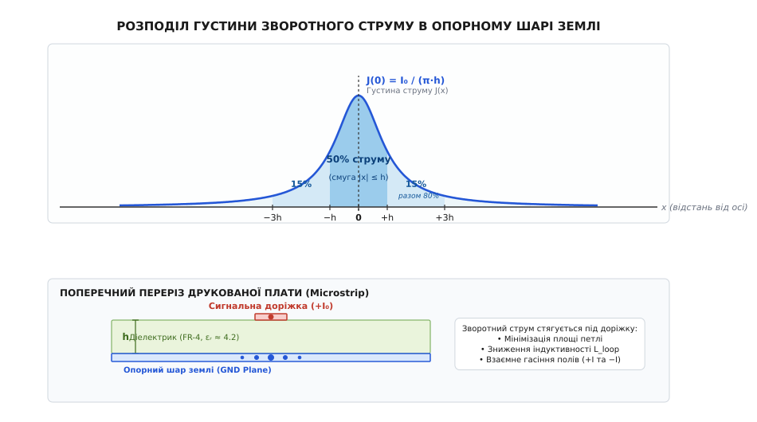
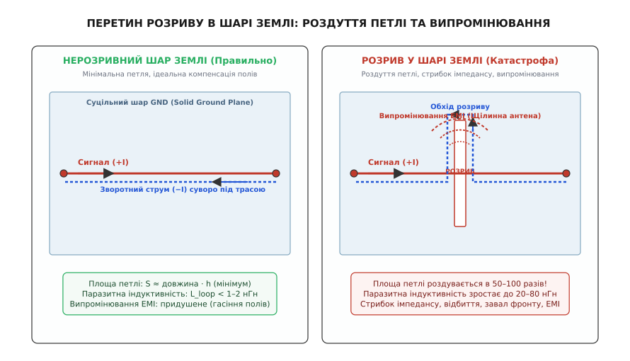

# Шар землі (ground plane)

<preknowlist>
- [Шлях зворотного струму](root:hw-pcb/current-return-path) — замикання струмових контурів, різниця між постійним та високочастотним поверненням.
- [Стек шарів друкованої плати](root:hw-pcb/pcb-stackup) — чергування сигнальних, земляних і живильних шарів та діелектрик між ними.
- [Електромагнітна сумісність](root:hw-pcb/electromagnetic-compatibility) — випромінювання струмових петель і формування паразитних антен.
</preknowlist>

Коли цифровий вихід мікроконтролера перемикає логічний рівень за одну наносекунду, струм у доріжці формує швидкозмінне електромагнітне поле. Якщо безпосередньо під цією доріжкою розташовано суцільний шар міді, електромагнітна хвиля залишається замкненою в тонкому шарі діелектрика: хвильовий опір лінії зберігає стабільні 50 Ом, а випромінювання назовні практично відсутнє. Проте варто тій самій доріжці перетнути навіть вузький розріз у міді завширшки пів міліметра, як зворотний шлях струму розривається, площа контуру зростає в десятки разів, лінія починає генерувати потужні електромагнітні завади, а форма імпульсу спотворюється відбитими хвилями.

Шар землі (Ground Plane) у швидкісній друкованій платі — це не пасивний каркас і не міфічний «бездонний стік для заряду», яким його позначають на спрощених схемах. Це повноцінний активний зворотний провідник кожної сигнальної лінії, що задає просторові межі електромагнітного поля, визначає імпеданс трас і захищає пристрій від взаємних наведень.

## Опорний шар як половина лінії передачі

У низькочастотній електротехніці землю прийнято вважати областю нульового потенціалу, куди струм стікає й зникає. На високих частотах і при швидких фронтах перемикання це уявлення призводить до грубих помилок. Згідно з фундаментальним законом неперервності струму, кожен електричний заряд, що вийшов із джерела, зобов'язаний повернутися назад у джерело замкненим фізичним контуром.

Будь-яка мікросмужкова доріжка на платі разом із землею під нею утворює дводротову лінію передачі. Енергія сигналу поширюється не всередині міді (де швидкість дрейфу електронів становить лічені міліметри на секунду), а в просторі діелектрика (від грец. *dia* — через + *ēlektron*) між доріжкою та опорним шаром у формі електромагнітної хвилі. 

```
       Сигнальна доріжка (+I)         ───┐
       ┌────────────────────────┐        │
       │       Мідь (Top)       │        │  Електромагнітна хвиля
       └────────────────────────┘        │  Енергія тече в діелектрику:
         │   │   │   │   │   │           │  вектор Пойнтінга S = E × H
    ─ ─ ─▼─ ─▼─ ─▼─ ─▼─ ─▼─ ─▼─ ─ ─ ─ ─  │
         Діелектрик плати (h, εᵣ)        │
    ─ ─ ─▲─ ─▲─ ─▲─ ─▲─ ─▲─ ─▲─ ─ ─ ─ ─  │
       ┌────────────────────────┐        │
       │  Опорний шар GND (−I)  │        │
       └────────────────────────┘     ───┘
```

Електричне поле починається на сигнальному провіднику й замикається на зарядах, наведених на поверхні опорного шару, а магнітне поле концентрується між ними. Суцільна мідна площина під сигналом створює граничну умову для хвилі: вона екранує поле, запобігає його виходу в навколишній простір і фіксує постійну ємність та індуктивність на одиницю довжини.

## Розподіл зворотного струму: DC проти ВЧ

Шлях, яким зворотний струм тече по опорному шару землі, підпорядковується принципу мінімізації повного комплексного опору — імпедансу (від лат. *impedire* — перешкоджати):

```text
Z = R + j · ω · L
```

де `R` — активний омічний опір міді, `L` — петльова індуктивність (від лат. *inductio* — наведення), а `ω = 2π · f` — кругова частота сигналу.

Поведінка струму докорінно залежить від частотного спектра:

1. **Постійний струм (DC, `ω = 0`):** реактивна частина `ω · L` дорівнює нулю. Струм шукає шлях **найменшого активного опору**. Оскільки мідний шар суцільний, струм розтікається широким віялом по всій доступній ширині плати й рухається від точки заземлення навантаження до джерела живлення по найкоротшій геометричній прямій. Траєкторія сигнальної доріжки на верхньому шарі для постійного струму ролі не грає.
2. **Високі частоти та круті фронти (`> 1` МГц):** індуктивний опір `ω · L` стає в сотні й тисячі разів більшим за омічний `R`. Тепер струм обирає шлях **найменшої індуктивності**.

Індуктивність замкненого контуру прямо пропорційна площі петлі, яку охоплює прямий і зворотний струм. Щоб зробити площу петлі мінімальною, зворотний високочастотний струм у шарі землі збирається безпосередньо під сигнальною доріжкою, дзеркально повторюючи всі її повороти та вигини.


*Просторовий розподіл густини високочастотного зворотного струму в опорному шарі: основна частина енергії повернення зосереджена в смузі шириною три висоти діелектрика 3h безпосередньо під сигнальною доріжкою.*

Густина високочастотного струму під доріжкою має колоколоподібний профіль. Понад 80% усього зворотного струму протікає у вузькому коридорі шириною `3h`, де `h` — товщина діелектрика між доріжкою та землею. Чим тонший діелектрик під сигналом, тим сильніший електромагнітний зв'язок і тим щільніше зворотний струм притискається до осі траси.

## Катастрофа розрізів у шарі землі

Поширена помилка трасування — створення штучних розрізів або щілин у шарі заземлення (наприклад, під час спроб розділити цифрову та аналогову землю або через надто щільні групи перехідних отворів).

Коли високошвидкісна лінія передачі перетинає таку щілину, виникає ланцюг деструктивних явищ:

* **Роздуття петлі повернення:** високочастотний зворотний струм не може перестрибнути через повітряний чи діелектричний розрив. Він змушений повертати й огинати щілину по периметру, перш ніж знову повернутися під доріжку.
* **Стрибок паразитної індуктивності:** площа контуру миттєво зростає у десятки разів. Паразитна індуктивність лінії підскакує на 10–50 нГн, що спричиняє завал фронтів сигналу, фазове запізнення та локальний стрибок напруги землі (Ground Bounce).
* **Утворення щілинної антени:** змінний струм, що огинає краї розрізу, створює на його протилежних берегах різницю потенціалів. Розріз перетворюється на випромінювальну щілинну антену, яка створює сильні завади в радіоефір і провалює сертифікацію на електромагнітну сумісність (ЕМС).
* **Міжканальні перехресні завади:** зворотний струм, блукаючи вздовж щілини, затікає під чужі сигнальні доріжки, наводячи на них синфазний шум через спільний імпеданс.


*Трасування швидкісної лінії через розріз у шарі землі: зворотний струм змушений огинати щілину, збільшуючи площу контуру та перетворюючи розрив на випромінюючу антену.*

Швидкісні сигнальні доріжки ніколи не повинні перетинати розрізи в опорних шарах. Якщо на платі є окремі функціональні зони, шар землі роблять суцільним і єдиним, а ізоляцію забезпечують фізичним просторовим рознесенням компонентів.

## Зміна шарів і зшивальні перехідні отвори

Коли доріжка за допомогою перехідного отвору (via) переходить з одного сигнального шару на інший, зворотний струм зобов'язаний перейти разом із нею на новий опорний шар:

1. **Перехід між шарами з однією спільною землею:** якщо сигнал переходить між зовнішніми шарами, що спираються на один і той самий суцільний шар GND, зворотний струм просто огинає отвір у тій самій площині.
2. **Перехід між двома різними шарами землі:** якщо сигнал переходить із верхнього шару (опора — шар GND1) на нижній (опора — шар GND2), поруч із сигнальним отвором обов'язково розміщують **зшивальний отвір заземлення (Stitching Via)**. Він з'єднує GND1 та GND2, створюючи вертикальний місток для високочастотного зворотного струму з мінімальною площею петлі.
3. **Перехід між землею та площиною живлення:** якщо доріжка змінює опорну площину з GND на Power Plane, поруч із сигнальним переходом встановлюють зшивальний керамічний конденсатор ємністю 10–100 нФ, який замикає контур високочастотного струму між двома площинами.

> 🔧 **Правило розробки:** завжди ставте якнайближче (до 0.5–1 мм) зшивальний отвір землі біля кожного сигнального перехідного отвору для шин тактування, інтерфейсів пам'яті (DDR), диференційних ліній (PCIe, USB) та ліній з фронтами швидше 2–3 нс.

## Підсумок

Суцільний, нерозрізаний опорний шар землі під швидкісними лініями зв'язку — найважливіший фактор цілісності сигналів у сучасній електроніці. Збереження неперервного шляху повернення мінімізує паразитну індуктивність ліній, стабілізує хвильовий опір і надійно блокує електромагнітне випромінювання.

Для детального математичного виведення рівнянь Максвелла, чисельного FDM-моделювання полів та розбору коду 2D-симулятора розподілу струмів мовами C і C++ звертайтеся до [детальної статті](root:hw-pcb/ground-plane/detail) та інтерактивного проєкту [чисельного симулятора](root:hw-pcb/ground-plane/proj-return-current-simulator.md).
