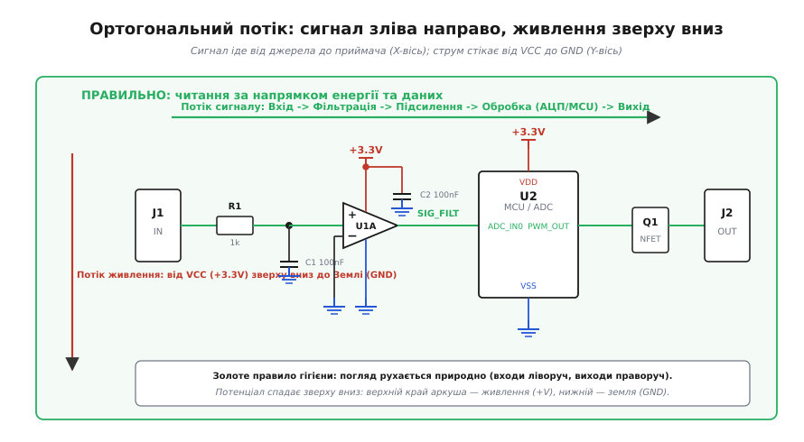
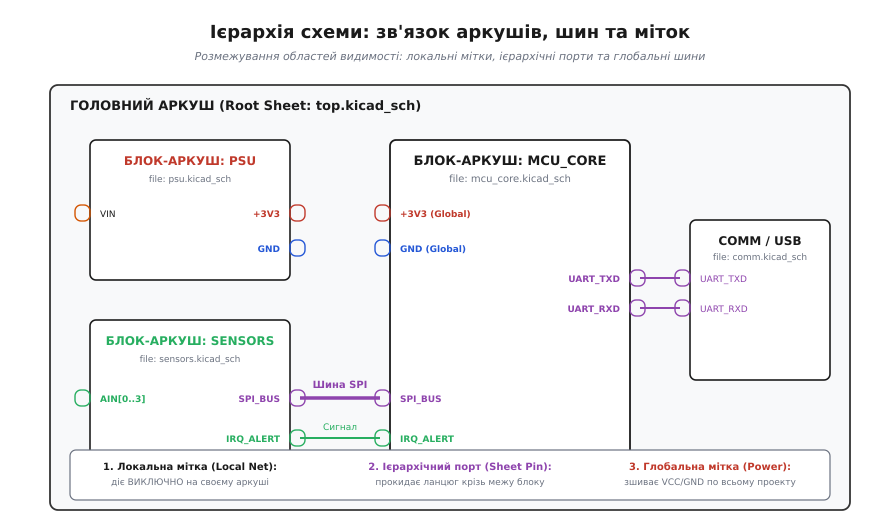

# Гігієна схеми: аркуші, ієрархія, мітки, позначення

<preknowlist>
* [Принципова схема](root:hw-pcb/schematic-purpose)
* [Вузли й з'єднання](root:hw-pcb/nodes-connections)
* [Лінії та з'єднання на схемі](root:hw-pcb/schematic-line-conventions)
* [Ієрархічні схеми і листи](root:hw-pcb/hierarchical-schematics)
* [Шини і векторні ланцюги](root:hw-pcb/net-bus-notation)
</preknowlist>

Коли інженер-початківець відкриває редактор принципових схем, виникає спокуса сприймати полотно як звичайний графічний інтерфейс для генерації списку з'єднань (нетлиста). Якщо редактор з'єднав вивід мікроконтролера з базою транзистора, а програма перевірки електричних правил (ERC) не видала фатальних помилок, здається, що завдання виконано. Проте реальність розробки апаратного забезпечення карає за такий підхід на першому ж етапі виробництва та налагодження. Схема, накреслена без дотримання суворої візуальної та функціональної гігієни, перетворюється на хаотичне накопичення ліній, де рецензент не здатен помітити переплутані шини диференціальних пар, монтажник запаює конденсатор на неприпустимо низьку робочу напругу, а інженер під час першого увімкнення плати витрачає тижні на пошук короткого замикання, спричиненого неочевидним збігом імен глобальних міток.

Принципова електрична схема — це насамперед документ інженерної комунікації між людьми. Комп'ютерній програмі для трасування друкованої плати байдуже, як саме накреслені лінії на аркуші: вона оперує виключно графом зв'язності (нетлистом), де кожен ланцюг є абстрактним переліком контактних майданчиків. Людина ж сприймає схему візуально, спираючись на усталені просторові патерни, ієрархічну декомпозицію, однозначність літерних кодів та передбачуваність потоків енергії. Якщо для розуміння роботи одного транзисторного ключа доводиться очима блукати по діагональних лініях через п'ять аркушів або розшифровувати нерозбірливі позначення на зразок «C? 10», креслення втрачає свою головну функцію — слугувати математично точною, візуально прозорою моделлю фізичного пристрою.

Правила схемної гігієни формувалися десятиліттями інженерної практики як захист від людської помилки. Вони визначають, у якому напрямку має текти інформація, як розмежовуються рівні потенціалів, яким чином складний прилад ділиться на ізольовані функціональні модулі та чому певні графічні перехрестя ліній перебувають під суворою забороною. Порушення цих правил не обов'язково призводить до збою в роботі компілятора САПР, але гарантовано підвищує ентропію проекту, роблячи його супровід, ревізію та модернізацію небезпечними й фінансово витратними.

## Ортогональний потік: геометрія сигналу та живлення

Людське око під час аналізу технічного креслення потребує чіткої системи просторових орієнтирів. Якщо напрямок поширення сигналу змінюється хаотично (на одному каскаді зліва направо, на сусідньому — справа наліво чи знизу вгору), мозок витрачає когнітивний ресурс на відновлення топології замість аналізу фізики процесів. Стандартом інженерного проектування є ортогональна організація схеми: взаємно перпендикулярне рознесення інформаційних та енергетичних потоків.

Головна інформаційна вісь схеми розгортається строго зліва направо вздовж горизонталі. Це відповідає природному напрямку читання в західній культурі та повторює каузальний ланцюг обробки: вхідний сигнал від датчика, антени чи зовнішнього кабелю потрапляє на ліву межу аркуша, проходить через вхідні фільтри та захисні супресори, підсилюється операційним підсилювачем, оцифровується АЦП, обробляється процесорним ядром і через вихідні драйвери спрямовується до правої межі аркуша на виконавчі вузли. Якщо виникає зворотний зв'язок (наприклад, у контурі регулювання струму або автогенератора), лінія повернення ведеться знизу або зверху функціонального блоку, проте прямий шлях сигналу ніколи не малюється у зворотному напрямку без гострої графічної потреби.


*Ортогональна організація схеми: інформаційний потік рухається зліва направо крізь функціональні каскади, тоді як потенціал живлення спадає зверху вниз.*

Друга вісь — енергетична — спрямована строго вертикально зверху вниз. Вона відображає фізичний спад електричного потенціалу в колі. Верхня частина кожного схемного вузла відводиться під позитивні рейки живлення (+12V, +5V, +3.3V, VDD). Нижня частина аркуша закріплюється за нульовим потенціалом — землею (GND, VSS), а якщо в системі присутні негативні напруги (-5V, -12V, VEE), вони розташовуються ще нижче під шиною землі.

Це правило має прямий вплив на читабельність пасивних ланцюгів обв'язки. Резистори підтяжки до живлення (pull-up) завжди малюються вертикально вгору від сигнальної лінії до шини живлення. Резистори підтяжки до землі (pull-down), навантажувальні резистори та фільтруючі ємності завжди опускаються вертикально вниз до відповідного символу GND. Блокувальні конденсатори живлення (decoupling capacitors), призначені для фільтрації високочастотних завад мікросхем, підключаються паралельно між верхньою лінією VCC та нижньою GND і малюються строго вертикально. Малювання блокувальних конденсаторів горизонтально або «підвішування» землі догори ногами є грубим порушенням культури проектування: воно змушує інженера щоразу перевіряти, куди саме під'єднаний кожен вивід деталі, руйнуючи миттєве візуальне розпізнавання стандартного LC- чи RC-фільтра.

## Топологія з'єднань: небезпека 4-сторонніх перехресть

Електричне креслення оперує лініями провідників, які неминуче перетинаються на площині аркуша. У середовищі САПР існує однозначне розрізнення: перетин двох ліній без точки з'єднання (junction dot) означає, що провідники ізольовані й проходять один над одним у просторі графа, тоді як наявність жирної точки в місці перетину свідчить про фізичний контакт (утворення єдиного електричного вузла).

Головна небезпека виникає тоді, коли чотири провідники сходяться в одній спільній точці, утворюючи хрестоподібне 4-стороннє з'єднання (4-way junction). У візуальному сприйнятті та поліграфії таке з'єднання є вкрай нестійким до спотворень:
1. Якщо крапка з'єднання через помилку експорту у векторний чи растровий формат PDF зникне або зменшиться до розміру товщини лінії, з'єднаний вузол візуально перетвориться на звичайний перетин двох незалежних ліній. Інженер або технік, який перевіряє плату, сприйме це як відсутність контакту.
2. Навпаки, якщо дві незалежні лінії просто перетинаються під прямим кутом, а якість друку чи рендерингу призведе до розмиття фарби в точці перетину, виникне хибне враження наявності з'єднувальної крапки там, де її ніколи не було.
3. Під час редагування схеми в САПР переміщення вузла з 4-стороннім перехрестям часто призводить до автоматичного розриву провідників або випадкового видалення вузлової точки самим графічним ядром редактора.

```
НЕПРАВИЛЬНО (двозначне 4-перехрестя):
          │
          │
    ──────┼──────   <-- Крапка може зникнути або з'явитися випадково
          │
          │

ПРАВИЛЬНО (два зміщені Т-вузли):
          │
    ──────┴─────┐
                │
          ┌─────┴──────
          │
```

Золоте правило схемної гігієни забороняє створення 4-сторонніх перехресть. Будь-яке розгалуження провідників повинно виконуватися виключно за допомогою 3-сторонніх Т-подібних вузлів (T-junctions). Якщо до однієї магістралі необхідно під'єднати кілька відгалужень, точки врізки розносяться вздовж магістралі на фіксовану відстань кроку координатної сітки, утворюючи зміщені Т-вузли (staggered junctions). У такій геометрії наявність чи відсутність крапки стає надлишковим захистом: сам факт того, що лінія впирається в іншу під кутом 90 градусів і закінчується, однозначно свідчить про наявність електричного контакту.

Крім того, гігієна ліній вимагає дотримання суворої ортогональності. Провідники прокладаються виключно під прямими кутами. Діагональні лінії створюють візуальний шум, перетинають позиційні позначення деталей і ускладнюють відстеження ланцюгів. Категорично забороняється пропускати лінії зв'язку крізь тіла компонентів, креслити провідники поверх текстових підписів або залишати мікроскопічні невидимі розриви (коли лінія на піксель не доходить до виводу мікросхеми, утворюючи прихований висячий пін).

## Архітектура багатоаркушних та ієрархічних схем

Сучасний електронний пристрій середньої складності налічує від сотень до десятків тисяч компонентів. Спроба розмістити такий проект на одному велетенському аркуші формату A0 призводить до повної втрати контролю над схемою: полотно вкривається тисячами перехресних ліній, розібратися в яких сторонньому спостерігачеві неможливо. Для боротьби зі складністю застосовують два підходи до структурування: плаский багатоаркушний поділ та ієрархічну декомпозицію.

Плаский поділ (flat multi-sheet) розрізає систему на набір паралельних аркушів однакового рангу: наприклад, аркуш 1 — блок живлення, аркуш 2 — мікроконтролер, аркуш 3 — драйвери двигунів. Зв'язок між аркушами здійснюється або за допомогою міжаркушевих портів (off-page connectors), або через збіг імен міток. Хоча такий підхід простий у реалізації, він має серйозну ваду: відсутність цілісної картини системи. Щоб зрозуміти, як пов'язані між собою блоки, доводиться переглядати всі аркуші, утримуючи в пам'яті десятки розрізнених сигналів. Крім того, плаский підхід не дозволяє повторно використовувати готові схемні модулі.

Ієрархічний підхід (hierarchical schematic) вибудовує дерево підпорядкування. На вершині знаходиться кореневий аркуш (Root Sheet), який не містить окремих резисторів чи транзисторів. Замість цього він складається з блоків-символів (Sheet Symbols), кожен з яких представляє окрему функціональну підсистему: живлення, аналоговий тракт, інтерфейсний блок, ядро обчислень. Блок-символ має чітко визначені вхідні та вихідні виводи (Sheet Pins), які на головному аркуші з'єднуються товстими лініями шин та сигнальними провідниками.


*Ієрархічна організація проекту: модульні аркуші з'єднуються через ієрархічні порти та шини, унеможливлюючи конфлікти локальних імен.*

Клік на блок-символ переносить інженера всередину дочірнього аркуша (Child Sheet), де розміщена детальна принципова схема даного вузла. Дочірній аркуш може, своєю чергою, містити власні вкладені блоки, утворюючи дерево потрібної глибини. Це забезпечує дві фундаментальні переваги:
1. **Зрозумілість на різних масштабах.** Головний аркуш відіграє роль структурної блок-схеми, яка повністю описує інтерфейси між модулями. Дочірні аркуші розкривають деталі реалізації конкретних вузлів.
2. **Багаторазове використання модулів (Multi-instancing).** Якщо пристрій містить чотири ідентичні канали вимірювання, їхня принципова схема малюється рівно один раз на одному дочірньому аркуші `channel.kicad_sch`. На головному аркуші розміщуються чотири блокові символи, які посилаються на цей самий файл. Під час генерації нетлиста САПР автоматично створить унікальні фізичні позначення (наприклад, резистор R1 першого каналу стане R101, другого — R201, третього — R301), усуваючи ризик розсинхронізації схемотехніки однакових каналів.

## Області видимості міток: локальні, ієрархічні, глобальні

Коли схема розбивається на кілька аркушів, виникає питання коректної адресації електричних ланцюгів. У САПР існує три принципово різні типи міток (Net Labels), кожен з яких має суворо визначену область видимості (scope). Неправильне змішування цих типів є головним джерелом так званого «спагетті-проектування».

```
┌──────────────────────────────────────────────────────────────────┐
│                   ТИПИ МІТОК І ОБЛАСТІ ВИДИМОСТІ                 │
├──────────────────────┬──────────────────────┬────────────────────┤
│ Тип мітки            │ Область дії          │ Типове призначення │
├──────────────────────┼──────────────────────┼────────────────────┤
│ Локальна (Local Net) │ Лише поточний аркуш  │ Внутрішні вузли    │
│ Ієрархічна (Port)    │ Батько <-> Дочірній  │ Інтерфейси блоків  │
│ Глобальна (Global)   │ Весь проект наскрізь │ Живлення (VCC,GND) │
└──────────────────────┴──────────────────────┴────────────────────┘
```

1. **Локальні мітки (Local Net Labels).** Діють виключно в межах того аркуша, на якому вони встановлені. Якщо на аркуші 1 провідник підписано `DATA`, а на аркуші 2 інший провідник також названо `DATA`, САПР розглядає їх як два повністю незалежні електричні кола з різними потенціалами. Локальні мітки ідеально підходять для усунення перехресних ліній усередині одного блоку (наприклад, для з'єднання виводу мікроконтролера з базою сусіднього транзистора через підпис `LED_DRV`), але вони не можуть виходити за межі аркуша.

2. **Ієрархічні мітки та порти (Hierarchical Labels / Sheet Pins).** Слугують точками входу та виходу сигналу крізь межу блоку. Ієрархічна мітка всередині дочірнього аркуша має своє точне дзеркальне відображення — вивід (Sheet Pin) на блоці головного аркуша. Зшивання ланцюгів відбувається тільки тоді, коли на батьківському аркуші цей вивід з'єднано з відповідним зовнішнім провідником. Це забезпечує повну капсуляцію: дочірній аркуш перетворюється на чорну скриньку з чітким API, унеможливлюючи випадкове закорочування внутрішніх сигналів через збіг локальних імен.

3. **Глобальні мітки (Global Labels / Power Symbols).** Пронизують увесь проект наскрізь, незалежно від структури дерева ієрархії. Будь-який провідник з глобальною міткою `+3.3V` на будь-якому аркуші буде фізично об'єднаний в одне спільне електричне коло. Глобальні мітки призначені виключно для шин живлення та загального проводу (`+12V`, `+5V`, `+3V3`, `VDDA`, `GND`, `AGND`).

Головна антипатерн-помилка початківців — використання глобальних міток для інформаційних сигналів (`SPI_CS`, `RESET`, `CLK`, `TXD`). Коли на десятках аркушів розкидані сотні глобальних міток, схема втрачає будь-яку модульність. Достатньо інженеру в незалежному блоці випадково назвати тестову лінію `ENABLE`, як вона тихо закоротиться з глобальним ланцюгом дозволу тактування всієї плати. Інженерна гігієна вимагає: усі інформаційні сигнали між аркушами передаються виключно через ієрархічні порти та векторні шини; глобальними залишаються тільки шини живлення.

## Векторні шини: компактність без втрати семантики

Коли між блоками необхідно передати паралельний інтерфейс пам'яті, системну шину мікроконтролера або групу споріднених ліній керування (наприклад, 16 ліній адрес та 8 ліній даних), прокладання десятків окремих провідників захаращує креслення. Для компактного групування застосовують векторні шини (Buses).

Шина на схемі позначається потовщеною лінією іншого стилю або кольору. Вона має обов'язковий векторний синтаксис іменування: ім'я префікса та діапазон індексів у квадратних дужках, наприклад `DATA[7..0]` або `ADDR[15..0]`. Кожен окремий сигнал підключається до шини за допомогою шинного входу (Bus Entry) — короткого діагонального відрізка під кутом 45 градусів. Цей скошений кут візуально показує напрямок входження сигналу в загальний джгут.

Кожен провідник, що входить у шину або виходить із неї, повинен мати власну локальну мітку, назва якої точно збігається з елементом шини: наприклад, провідник `DATA0` під'єднується до відгалуження шини `DATA[7..0]`. Помилка в індексі (наприклад, спроба вивести з шини сигнал `DATA8`) або невідповідність регістру літер призведе до того, що САПР розірве з'єднання без візуального попередження на схемі.

Сучасні системи проектування дозволяють створювати також комплексні шинні структури (Bus Aliases), де в одну шину об'єднуються різнорідні сигнали інтерфейсу, наприклад `SPI_BUS = {SCK, MOSI, MISO, CS0, CS1, IRQ}`. Це дозволяє передавати складні інтерфейси між аркушами єдиним ієрархічним зв'язком, гарантуючи, що жоден із критичних сигналів протоколу не буде втрачено чи переплутано під час декомпозиції.

## Багатосекційні компоненти та поділ символів мікросхем

Мікросхеми у сучасних проектах варіюються від здвоєних операційних підсилювачів у корпусі SOIC-8 до мікроконтролерів та FPGA на сотні виводів у корпусах BGA. Спроба намалювати мікросхему у вигляді єдиного велетенського прямокутника з усіма виводами по периметру перетворює схему на нечитабельну конструкцію, де аналогові входи перемішані з пінами програмування, а виводи живлення захаращують середину сигнального тракту.

Для подолання цього хаосу застосовують поділ компонентів на логічні функціональні секції (Multi-unit components або Heterogeneous symbols):

1. **Окремі функціональні одиниці (Units).** Чотириканальний операційний підсилювач (наприклад, TL074 або LM324) ділиться на чотири незалежні графічні символи підсилювачів: U1A, U1B, U1C, U1D. Кожен із них розміщується безпосередньо в тому місці схеми, де обробляється відповідний сигнал, без необхідності тягнути довгі провідники через увесь аркуш.
2. **Винесення живлення в окремий Unit (Power Unit).** П'ята секція — U1E — містить виключно піни живлення (VCC та GND). Її виносять в окремий блок живлення аркуша або розміщують у кутку поруч із блокувальними конденсаторами C1 та C2. Це звільняє графічні символи сигнальних підсилювачів від зайвих ліній, дозволяючи зосередитися на контурах зворотного зв'язку та фільтрації.
3. **Функціональне групування пінів у великих ІС.** Для мікроконтролерів із сотнями виводів мікросхему ділять на кілька секцій за типами периферії:
   - Секція `A`: Системні кола (Power, Ground, Reset, Crystal Oscillator, Boot Pins, SWD/JTAG).
   - Секція `B`: Аналогова периферія (ADC In, DAC Out, VREF+, AGND).
   - Секція `C`: Цифрові інтерфейси зв'язку (SPI, I2C, UART, CAN, USB).
   - Секція `D`: Загальні порти введення-виведення (GPIO Port A, Port B).

Такий поділ дозволяє кожній секції ІС природно вписатися у свій функціональний каскад схеми: аналогова секція опиняється поруч із датчиками, інтерфейсна — поруч із роз'ємами зв'язку, а силова секція — біля стабілізаторів живлення.

## Фізичні межі: Net-Tie, аналогові землі та диференціальні пари

Особлива зона відповідальності схемної гігієни — це відображення фізичних обмежень трасування безпосередньо у семантиці схеми. Якщо специфічні вимоги до топології залишаються лише в усних домовленостях інженерів, під час розведення плати вони гарантовано будуть втрачені.

Перший класичний приклад — поділ цифрової (DGND) та аналогової (AGND) земель. У змішаних аналогово-цифрових системах швидкі цифрові струми повернення викликають високочастотний шум на спільній земляній площині, що спотворює чутливі вимірювання АЦП. Фізично ці землі повинні з'єднуватися строго в одній єдиній точці — так званій зірковій точці з'єднання (Star Ground). Якщо на схемі просто об'єднати обидві мітки в один ланцюг, САПР вважатиме їх еквіпотенціальними і під час трасування зіллє полігони без розбору в довільних місцях.

Правильне гігієнічне рішення полягає у використанні спеціального символу зв'язку — Net-Tie (`NT1`). Символ Net-Tie у графічному редакторі виглядає як два виводи, з'єднані перемичкою, але в правилах САПР він оголошується компонентом із двома різними електричними ланцюгами на схемі та суцільним мідним майданчиком на друкованій платі. Завдяки цьому нетлист чітко розрізняє AGND та DGND як два ізольовані ланцюги по всій платі, дозволяючи перевірити їхню цілісність, а фізичне з'єднання відбувається виключно в точці монтажу Net-Tie біля виводу змішаної мікросхеми.

Другий приклад — диференціальні пари (Differential Pairs). Сигнали швидкісних інтерфейсів (USB, CAN, RS-485, Ethernet) передаються двома провідниками в протифазі. Для коректного автоматичного трасування зі збереженням хвильового опору мітки цих ліній повинні суворо відповідати конвенції САПР, маючи суфікси `_P` / `_N` або `+` / `-` (наприклад, `USB_D_P` та `USB_D_N`). Наявність таких міток інформує компілятор про необхідність створення класу диференціальних пар із контрольованим імпедансом і мінімальним перекосом фаз (skew).

## Контрольні тестові точки (Test Points) та підготовка до тестування

Схема пристрою створюється не лише для виготовлення друкованої плати, а й для її подальшого налагодження, заводського тестування та сервісного обслуговування (Design for Testability, DFT). Плата, на якій немає доступу до ключових сигналів, стає «чорною скринькою»: у разі відмови доводиться підпаювати тонкі дроти під мікроскопом до виводів мікросхем із кроком 0.4 мм, ризикуючи пошкодити кристал перегрівом або статичним розрядом.

Схемна гігієна вимагає явного розміщення контрольних тестових точок (Test Points, префікс `TP`) на принциповій схемі:
1. **Тестові точки рейок живлення:** Кожна напруга в системі (`+12V`, `+5V`, `+3V3`, `VDDA`, `VREF`) повинна мати власну точку `TP_PWR` для швидкого контролю мультиметром та осцилографом під час першого увімкнення (bringup).
2. **Точки тактування та скидання:** Лінії `RESET_N`, `SYS_CLK`, `BOOT0` обов'язково забезпечуються контрольними точками.
3. **Шини діагностики та зв'язку:** Виводи UART (TX, RX) та переривань (IRQ) виводяться на тестові майданчики, навіть якщо вони не йдуть на зовнішній роз'єм.
4. **Земляні точки:** Поруч із високочастотними або чутливими тестовими точками обов'язково розміщують тестову точку GND для підключення короткого пружинного земляного контакту щупа осцилографа, що мінімізує паразитну індуктивність вимірювального контуру.

На схемі кожна тестова точка повинна мати чіткий текстовий опис призначення у полі `Value` або `Description` (наприклад, `TP1: VCC_MAIN`, `TP2: 3V3_CLEAN`, `TP3: MCU_SWDIO`).

## Позначення компонентів, стандарти RefDes та інженерні номінали

Будь-який фізичний компонент на схемі має два обов'язкові ідентифікатори: позиційне літерно-цифрове позначення (Reference Designator, RefDes) та значення номіналу (Value). Дотримання міжнародних стандартів (IEEE 200, IEC 60617, ASME Y14.44) у призначенні літерних кодів виключає плутанину під час монтажу, закупівлі деталей за специфікацією (BOM) та тестування плати.

```
┌──────────────────────────────────────────────────────────────────┐
│              СТАНДАРТНІ ПРЕФІКСИ ПОЗИЦІЙНИХ ПОЗНАЧЕНЬ            │
├─────────┬──────────────────────────┬─────────────────────────────┤
│ Префікс │ Тип компонента           │ Приклади                    │
├─────────┼──────────────────────────┼─────────────────────────────┤
│ R       │ Резистори                │ R101 (10k), R102 (0R1)      │
│ C       │ Конденсатори             │ C101 (100nF), C102 (10uF)   │
│ L       │ Індуктивності, дроселі   │ L101 (4.7uH), L102 (10uH)   │
│ U / IC  │ Мікросхеми, процесори    │ U1 (STM32), U2 (LM358)      │
│ Q / VT  │ Транзистори (FET, BJT)   │ Q1 (2N7002), Q2 (BC847)     │
│ D / VD  │ Діоди, LED, супресори    │ D1 (1N4148), D2 (Зелений)   │
│ J / P   │ Роз'єми, джампери        │ J1 (USB-C), J2 (SMA)        │
│ TP      │ Тестові контрольні точки │ TP1 (VCC_SENSE), TP2 (CLK)  │
│ F       │ Запобіжники (Fuses, PTC) │ F1 (500mA Polyfuse)         │
│ Y / X   │ Кварцові резонатори      │ Y1 (8MHz), Y2 (32.768kHz)   │
│ SW      │ Перемикачі, кнопки       │ SW1 (Reset), SW2 (DIP-4)    │
│ T / TR  │ Трансформатори           │ T1 (Імпульсний трансформатор)│
│ FB      │ Феритові намистини       │ FB1 (600R@100MHz)           │
│ NT      │ Зіркові точки (Net-Tie)  │ NT1 (AGND to DGND tie)      │
└──────────────────────────────────────────────────────────────────┘
```

Позиційний номер компонента складається з літерного префікса та порядкового номера. У багатоаркушних та ієрархічних проектах номери призначаються з урахуванням номера аркуша або блоку: наприклад, деталі на аркуші 1 нумеруються як R101, R102, C101; на аркуші 2 — R201, R202, C201. Це дозволяє монтажнику або ремонтному інженеру, глянувши на позиційне маркування деталі на шовкографії друкованої плати, миттєво відкрити потрібний аркуш принципової схеми.

Особливу увагу слід приділяти текстовому запису номіналів пасивних компонентів. Застосування звичайної десяткової крапки (наприклад, `4.7k` або `0.1uF`) є джерелом виробничого браку. Під час друку креслення на папері низької якості, пересилання сканованих копій або стиснення векторних креслень дрібна крапка часто стирається або зникає. У результаті монтажник читає `47k` замість `4.7k`, що змінює коефіцієнт підсилення в 10 разів і виводить аналоговий каскад із ладу.

Для запобігання цій помилці діє стандарт інженерного позначення R-S-H (IEC 60062), де множник виступає в ролі десяткового роздільника:
- `4k7` означає 4.7 кОм (4700 Ом);
- `0R22` або `R22` означає 0.22 Ом;
- `100R` або `100` означає 100 Ом;
- `1M2` означає 1.2 МОм;
- `100n` означає 100 нФ (0.1 мкФ);
- `2u2` або `2µ2` означає 2.2 мкФ;
- `4p7` означає 4.7 пФ;
- `4u7` означає 4.7 мкГн.

Крім того, гігієна схеми вимагає наявності повного набору критичних параметрів для кожного компонента безпосередньо у властивостях символу. Для резисторів це точність (1%, 0.1%) та розсіювана потужність (0.125W, 0.25W). Для конденсаторів — допустима робоча напруга (16V, 50V, 100V) та тип діелектрика (C0G/NP0 для високостабільних та високочастотних кіл, X7R для загальної фільтрації). 

Необхідність явного зазначення робочої напруги на схемі зумовлена фізичним явищем деградації ємності керамічних конденсаторів (DC-bias effect). У багатошарових керамічних конденсаторах (MLCC) класу діелектрика X7R або X5R реальна ефективна ємність падає на 40-70% при наближенні постійної напруги зміщення до номінальної напруги конденсатора. Наприклад, якщо на лінії живлення 12V встановлено конденсатор `10uF 16V X5R`, його реальна ємність під робочою напругою складе всього 3-4 мкФ, що призведе до різкого зростання пульсацій живлення та збою процесора. Правильний запис на схемі `10u 25V X7R` або `10u 50V X7R` гарантує, що відділ закупівлі не придбає дешевший аналог на 16V, а схема збереже стабільність. Використання ненадійних сегнетоелектричних діелектриків типу Y5V або Z5U, ємність яких може падати на 80% при нагріванні, має бути суворо виключено з якісних схем. Для незмонтованих компонентів (наприклад, альтернативних посадкових місць або резисторів вибору конфігурації) обов'язково встановлюється атрибут `DNP` (Do Not Populate) або `DNF` (Do Not Fit), що автоматично виключає деталь зі складальної специфікації.

## Автоматизація контролю: ERC проти схемного лінтингу

Сучасні САПР (KiCad, Altium Designer, Cadence OrCAD) мають вбудовані засоби електричної перевірки правил — ERC (Electrical Rule Check). Принцип роботи класичного ERC базується на перевірці матриці сумісності типів пінів: наприклад, чи не з'єднані між собою два виходи типу «Output» (що призведе до короткого замикання), чи не підключений вхід «Input» до порожнечі, і чи є на шині живлення «Power Input» відповідне джерело «Power Output».

Проте базовий ERC не виконує лінтингу гігієни. Він нічого не знає про естетику та культуру креслення:
- ERC не повідомить про наявність небезпечних 4-сторонніх перехресть;
- ERC не перевірить, чи правильно вказано робочу напругу блокувальних конденсаторів;
- ERC не розпізнає, що локальну мітку `DATA_LINE` помилково залишено з єдиним підключенням на аркуші (single-pin net), оскільки інженер змінив назву на іншому кінці аркуша;
- ERC проігнорує використання ненадійного синтаксису номіналу на зразок `4.7k`.

Для забезпечення найвищої надійності в професійних командах розробників впроваджують інструменти статичного аналізу схем — схемні лінтери. Вони аналізують вихідні файли проектів або сплющений нетлист і перевіряють дотримання корпоративних та галузевих гайдлайнів гігієни.

Практичну реалізацію такого інструменту розгорнуто у вставці [Лінтер електричних схем на C та C++](root:hw-pcb/hihiiena-skhemy/proj-schematic-linter.md), де детально показано алгоритми синтаксичного аналізу схем, пошуку висячих ліній, валідації сумісності напруг та контролю ортогональності з'єднань.

Нижче наведено приклад коду на C та C++, який ілюструє базовий алгоритм парсингу та валідації інженерного форматування номіналів пасивних компонентів (перетворення рядків `4k7`, `0R1`, `100n` у числові значення з плаваючою комою та перевірку наявності критичних атрибутів безпеки).

:::tabs
@tab C (C99)
```c
#include <stdio.h>
#include <stdlib.h>
#include <stdbool.h>
#include <string.h>
#include <ctype.h>

// Структура валідації атрибутів компонента
typedef struct {
    char refdes[16];
    char value_raw[32];
    double value_numeric;
    double voltage_rating;
    bool has_voltage;
    bool is_dnp;
    bool valid_format;
} ComponentAttr;

// Парсинг інженерного формату IEC 60062 (наприклад: "4k7", "0R22", "100n", "2u2")
bool parse_engineering_value(const char *raw, double *out_val) {
    if (!raw || *raw == '\0') return false;
    
    char clean[32];
    size_t len = 0;
    char unit_char = '\0';
    int unit_idx = -1;

    for (size_t i = 0; raw[i] != '\0' && len < sizeof(clean) - 1; ++i) {
        char c = raw[i];
        if (isdigit((unsigned char)c) || c == '.') {
            clean[len++] = c;
        } else if (strchr("RKMGTpnumk", c) && unit_char == '\0') {
            unit_char = c;
            unit_idx = (int)len;
            clean[len++] = '.'; // Замінюємо літеру на крапку
        }
    }
    clean[len] = '\0';

    if (len == 0) return false;

    // Множники
    double multiplier = 1.0;
    switch (unit_char) {
        case 'p': multiplier = 1e-12; break;
        case 'n': multiplier = 1e-9;  break;
        case 'u': multiplier = 1e-6;  break;
        case 'm': multiplier = 1e-3;  break;
        case 'R': multiplier = 1.0;   break;
        case 'k':
        case 'K': multiplier = 1e3;   break;
        case 'M': multiplier = 1e6;   break;
        case 'G': multiplier = 1e9;   break;
        default:  multiplier = 1.0;   break;
    }

    // Якщо множник був на початку (наприклад: "R22" або "u1")
    char *endptr = NULL;
    double base = strtod(clean, &endptr);
    if (endptr == clean && unit_idx == 0) {
        base = strtod(clean + 1, &endptr);
    }

    *out_val = base * multiplier;
    return true;
}

// Перевірка гігієни компонента
bool validate_component(ComponentAttr *comp) {
    comp->valid_format = parse_engineering_value(comp->value_raw, &comp->value_numeric);
    
    // Перевірка 1: Конденсатор повинен мати робочу напругу
    if (comp->refdes[0] == 'C' && !comp->is_dnp) {
        if (!comp->has_voltage || comp->voltage_rating <= 0.0) {
            printf("[ПОПЕРЕДЖЕННЯ] %s: Конденсатор %s не має робочої напруги!\n",
                   comp->refdes, comp->value_raw);
            return false;
        }
    }
    
    // Перевірка 2: Наявність небезпечної крапки в Value (наприклад "4.7k" замість "4k7")
    if (strchr(comp->value_raw, '.') != NULL) {
        printf("[ЗАСТЕРЕЖЕННЯ] %s: Номінал '%s' містить крапку. Рекомендовано IEC-формат.\n",
               comp->refdes, comp->value_raw);
    }

    return comp->valid_format;
}
```
@tab C++ (C++20)
```cpp
#include <iostream>
#include <string>
#include <string_view>
#include <charconv>
#include <optional>
#include <unordered_map>
#include <algorithm>

struct Component {
    std::string refdes;
    std::string value_raw;
    std::optional<double> voltage_rating;
    bool is_dnp{false};

    [[nodiscard]] std::optional<double> parse_numeric_value() const {
        if (value_raw.empty()) return std::nullopt;

        std::string buffer;
        char multiplier_char = '\0';

        for (char c : value_raw) {
            if ((c >= '0' && c <= '9') || c == '.') {
                buffer += c;
            } else if (std::string_view("RKMGTpnumk").find(c) != std::string_view::npos && multiplier_char == '\0') {
                multiplier_char = c;
                buffer += '.'; // Замінюємо літеру-роздільник на десяткову крапку
            }
        }

        if (buffer.empty()) return std::nullopt;

        double base_val = 0.0;
        const char *begin = buffer.data();
        const char *end = buffer.data() + buffer.size();

        // Швидкий та безпечний розбір через C++17/20 from_chars
        auto [ptr, ec] = std::from_chars(begin, end, base_val);
        if (ec != std::errc{}) {
            // Обробка запису з множником на початку (наприклад "R22")
            if (!buffer.empty() && buffer[0] == '.') {
                auto [p2, ec2] = std::from_chars(begin + 1, end, base_val);
                if (ec2 != std::errc{}) return std::nullopt;
                base_val /= 10.0;
            } else {
                return std::nullopt;
            }
        }

        static const std::unordered_map<char, double> multipliers = {
            {'p', 1e-12}, {'n', 1e-9}, {'u', 1e-6}, {'m', 1e-3},
            {'R', 1.0},   {'k', 1e3},  {'K', 1e3},  {'M', 1e6},  {'G', 1e9}
        };

        double mult = 1.0;
        if (auto it = multipliers.find(multiplier_char); it != multipliers.end()) {
            mult = it->second;
        }

        return base_val * mult;
    }

    [[nodiscard]] bool validate_hygiene() const {
        const auto val = parse_numeric_value();
        if (!val.has_value()) {
            std::cerr << "[ПОМИЛКА] " << refdes << ": Некоректний номінал '" << value_raw << "'\n";
            return false;
        }

        // Правило: Конденсатори повинні мати робочу напругу
        if (!refdes.empty() && refdes[0] == 'C' && !is_dnp) {
            if (!voltage_rating.has_value() || *voltage_rating <= 0.0) {
                std::cerr << "[ПОПЕРЕДЖЕННЯ] " << refdes << ": Конденсатор без номіналу напруги!\n";
                return false;
            }
        }

        // Попередження про небезпечну десяткову крапку
        if (value_raw.find('.') != std::string::npos) {
            std::clog << "[ЗАСТЕРЕЖЕННЯ] " << refdes << ": Використання крапки у '" << value_raw 
                      << "' замість інженерного синтаксису.\n";
        }

        return true;
    }
};
```
:::

## Інженерний чеклист схемної гігієни перед трасуванням

Перед тим як передавати принципову схему на етап розведення друкованої плати (PCB Layout), провідний розробник або зовнішній рецензент зобов'язаний виконати фінальну верифікацію за контрольним списком гігієни:

1. **Топологія ліній та вузлів:**
   - [ ] Повністю відсутні 4-сторонні хрестоподібні з'єднання (усі перехрестя замінено на зміщені Т-вузли).
   - [ ] Усі лінії прокладено строго ортогонально під кутом 90 градусів.
   - [ ] Відсутні провідники, накреслені крізь корпуси компонентів або поверх позиційних написів.
   - [ ] Усі лінії під'єднані строго до виводів компонентів без мікроскопічних проміжків.

2. **Потоки сигналів та живлення:**
   - [ ] Інформаційні сигнали проходять зліва направо від вхідних роз'ємів до обробки та виходів.
   - [ ] Позитивні шини живлення розміщені вгорі, негативні та земляні шини — унизу.
   - [ ] Блокувальні конденсатори розташовані вертикально біля відповідних виводів живлення мікросхем.
   - [ ] Резистори підтяжки pull-up під'єднані вертикально вгору, pull-down — вертикально вниз.

3. **Ієрархія та мітки:**
   - [ ] Проект розбито на логічні ієрархічні аркуші із заповненим головним аркушем верхнього рівня (Root Sheet).
   - [ ] Міжаркушеві зв'язки виконано через ієрархічні порти та шини, а не через глобальні мітки.
   - [ ] Глобальні мітки використовуються виключно для шин живлення та землі.
   - [ ] Усі локальні мітки мають більше ніж одне підключення в межах аркуша (відсутні поодинокі висячі мітки).
   - [ ] Векторні шини оформлені відповідно до синтаксису `BUS[N..0]` зі скошеними шинними входами під 45 градусів.
   - [ ] Диференціальні пари мають уніфіковані суфікси `_P` / `_N`.
   - [ ] Розділення аналогової та цифрової земель оформлено через явні елементи Net-Tie.

4. **Атрибути компонентів та стандартизація:**
   - [ ] Усі позиційні позначення відповідають стандартам (R, C, L, U, Q, D, J, TP, F, Y, SW, NT).
   - [ ] Номінали пасивних компонентів записано в інженерному форматі без незахищених десяткових крапок (`4k7`, `0R1`, `100n`, `2u2`).
   - [ ] Для всіх конденсаторів вказано клас робочої напруги з урахуванням запасу за постійною напругою та тип діелектрика (X7R, C0G).
   - [ ] Для всіх резисторів визначено клас точності (1%, 5%) та розсіювану потужність.
   - [ ] Для всіх компонентів призначено коректні посадкові місця (Footprints).
   - [ ] Опціональні компоненти позначено прапорцем `DNP` / `DNF`.
   - [ ] Багатосекційні ІС розділені за функціями з винесенням живлення в окремий блок.
   - [ ] Передбачено контрольні тестові точки (Test Points) на лініях живлення, тактування та діагностики.

5. **Автоматична верифікація:**
   - [ ] Пройдено повну перевірку ERC без нерозглянутих попереджень та фатальних помилок.
   - [ ] Виконано перевірку правил гігієни через схемний лінтер.

Дотримання цих правил гарантує, що принципова схема стане надійним фундаментом проекту, заощадить десятки годин під час ревізії та виробництва, і забезпечить бездоганну повторюваність пристрою в серії.
