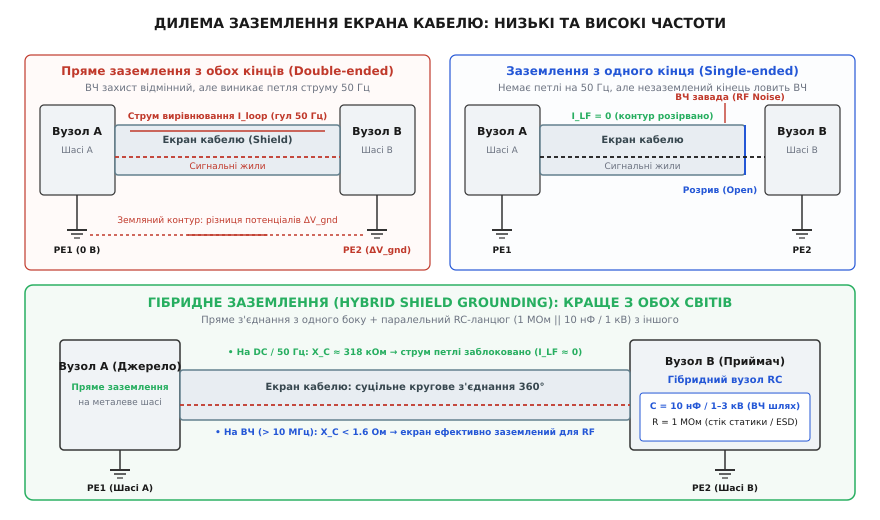
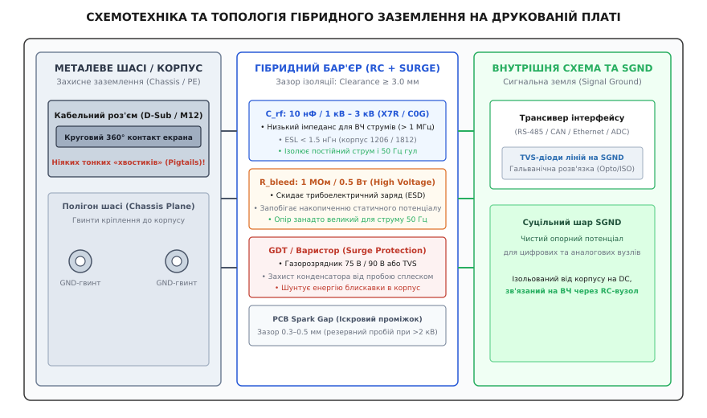

# Гібридне заземлення екрана

<preknowlist>
- [Екранування кабелів](root:hw-pcb/shielded-cable) — фізична конструкція екранованих ліній, механізми відбиття й поглинання електромагнітних хвиль.
- [Земляні петлі та спільний імпеданс](root:hw-pcb/ground-loops) — замикання контурів через сторонні провідники та падіння паразитної напруги на спільному опорі.
- [Електромагнітна сумісність (EMC)](root:hw-pcb/electromagnetic-compatibility) — стандарти випромінювання, завадостійкості та механізми захисту апаратури.
- [Ємнісний та індуктивний зв'язок](root:ph-electromagnetism/capacitive-coupling) — паразитна передача енергії через електричні та магнітні поля між сусідніми провідниками.
- [Шлях зворотного струму](root:hw-pcb/current-return-path) — розподіл струмів у зворотних провідниках та опорних площинах на низьких і високих частотах.
</preknowlist>

Коли два електронні прилади, рознесені на десятки чи сотні метрів у виробничому цеху, серверній стійці чи на борту рухомого апарата, з'єднують екранованим кабелем, інженер стикається з фундаментальним протиріччям між низькочастотною та високочастотною електродинамікою. Якщо суцільний екран кабелю гальванічно приєднати до металевих корпусів обох приладів, між їхніми точками захисного заземлення (PE, *Protective Earth*), які через несиметрію фазних навантажень електромережі та скінченний опір ґрунту мають різницю потенціалів у кілька вольтів на частоті 50 Гц, утворюється замкнений контур із мізерним активним опором. Цим контуром по зовнішньому обплетенню кабелю починає циркулювати струм вирівнювання потенціалів силою в сотні міліамперів чи навіть десятки амперів, який через поверхневий передавальний імпеданс екрана наводить напругу промислового гулу безпосередньо на внутрішні сигнальні жили й може фізично розплавити захисну оболонку чи тонкий дріт заземлення. Якщо ж, намагаючись розірвати 50-герцовий земляний контур, залишити один кінець екрана повністю від'єднаним, кабель для високочастотних електромагнітних завад із довжиною хвилі, сумірною з його фізичною довжиною, втрачає властивості суцільного екрана й перетворюється на ефективну несиметричну антену, яка приймає радіозавади з ефіру та випромінює власні цифрові шуми трансиверів.

Розв'язанням цієї інженерної дилеми є гібридне заземлення екрана (*hybrid shield grounding*), за якого екран кабелю під'єднують до металевого корпусу шасі безпосередньо з одного боку, а з протилежного боку — через спеціалізований паралельний RC-ланцюг (зазвичай 1 МОм у паралель із високовольтним конденсатором 10 нФ на напругу 1–3 кВ), доповнений елементами імпульсного захисту (газорозрядниками або варисторами). Завдяки частотній залежності реактивного опору конденсатора такий бар'єр поводиться як розрив кола для постійного струму та низьких частот промислової мережі, блокуючи циркуляційні струми вирівнювання, але одночасно створює шлях із мінімальним імпедансом для радіочастотних струмів, зберігаючи цілісність радіочастотного екранування кабельної траси.


*Дилема заземлення екрана кабелю: пряме двостороннє заземлення створює низькочастотний контур струму вирівнювання (гул 50 Гц); одностороннє заземлення розриває контур на 50 Гц, але перетворює незаземлений кінець на радіочастотну антену; гібридне RC-заземлення блокує низькі частоти конденсатором C_rf та замикає радіочастоти на шасі.*

---

### Фізична природа екранування кабелів: відбиття, поглинання та передавальний імпеданс

Щоб зрозуміти, чому спосіб підключення екрана до корпусу кардинально змінює поведінку всієї системи передачі сигналів, необхідно простежити фізичний механізм захисту, який забезпечує металева циліндрична оболонка навколо сигнальних провідників. Екранування електромагнітного поля ґрунтується на трьох фізичних явищах: відбитті хвилі від границі розподілу середовищ із різними хвильовими імпедансами (*reflection loss*), поглинанні енергії хвилі в товщі провідника внаслідок скін-ефекту (*absorption loss*) та багаторазових внутрішніх відбиттях (*multiple reflection factor*).

Коли зовнішнє електромагнітне поле падає на металеву поверхню екрана, різкий стрибок хвильового імпедансу між вільним простором (де імпеданс вакууму становить приблизно 377 Ом) і металом екрана (де питомий опір міді становить 1.72·10⁻⁸ Ом·м, а імпеданс матеріалу на радіочастотах вимірюється міліомами) змушує переважну частину енергії електричного поля відбиватися назад. Та частина хвилі, що проникла всередину металевого шару, експоненційно згасає з глибиною внаслідок вихрових струмів, густина яких спадає за законом:

```
J(x) = J_0 · e^(-x / delta)
```

де `x` — глибина проникнення від зовнішньої поверхні, а `delta` — глибина скін-шару (товщина скін-ефекту), яка для немагнітного провідника визначається круговою частотою `omega = 2·pi·f`, магнітною проникністю вакууму `mu_0 = 4·pi·10^(-7)` Гн/м та питомою провідністю металу `sigma`:

```
delta = sqrt(2 / (omega · mu_0 · sigma))
```

Для мідного екрана на промисловій частоті 50 Гц глибина скін-шару становить близько 9.3 мм, що у десятки разів перевищує товщину типового кабельного обплетення чи алюмінієвої фольги (0.05–0.2 мм). Це означає, що на частоті 50 Гц магнітне поле вільно пронизує стінку екрана практично без згасання. Навпаки, на частоті 10 МГц глибина скін-шару міді падає до 21 мкм, а на частоті 100 МГц — до 6.6 мкм. На цих частотах навіть тонка алюмінієва фольга завтовшки 50 мкм вміщує понад 7 скін-шарів, забезпечуючи поглинання енергії високочастотного поля на рівні понад 60 дБ.

Кількісним критерієм якості екранування реального кабелю є поверхневий передавальний імпеданс (*surface transfer impedance*, `Z_t`). За визначенням, передавальний імпеданс пов'язує падіння поздовжньої напруги на одиницю довжини на внутрішній поверхні екрана `d V_int / d x` зі струмом `I_ext`, що протікає по його зовнішній поверхні:

```
Z_t = (1 / I_ext) · (d V_int / d x)   [Ом/м]
```

Для ідеальної однорідної металевої трубки передавальний імпеданс на постійному струмі дорівнює її активному погонному опору `R_dc`, а зі зростанням частоти експоненційно спадає завдяки витісненню струму вихровими струмами до зовнішньої стінки циліндра. Проте для реального плетеного кабельного обплетення картина змінюється: між переплетеними жилами мідних дротиків існують мікроскопічні ромбічні щілини — оптичні просвіти плетіння. Крізь ці отвори зовнішнє магнітне поле зв'язується з внутрішнім простором кабелю через індуктивність взаємного зв'язку отворів `M_h`. Повний передавальний імпеданс плетеного екрана записується рівнянням:

```
Z_t(f) = R_dc · (gamma · d) / sinh(gamma · d) + j · 2·pi·f · M_h   [Ом/м]
```

де `d` — товщина обплетення, а `gamma = (1 + j) / delta` — комплексна стала поширення в металі.

```
|Z_t| (Ом/м)
  ^
  |          /
  |         /  +20 дБ/декада через отвори плетіння (j·omega·M_h)
  |        /
  |-------/
  |  R_dc \
  |        \  Ідеальна трубка (експоненційний спад скін-ефекту)
  +------------------------------> Частота f (Гц)
          f_transition (~1 МГц)
```

На низьких частотах (до 100 кГц) передавальний імпеданс визначається виключно омічним опором `R_dc` (зазвичай від 5 до 30 мОм/м). У діапазоні від 100 кГц до 1–5 МГц скін-ефект зменшує дифузійне проникнення струму, і модуль `|Z_t|` тимчасово падає. Проте на частотах понад 5–10 МГц магнітний потік, що витікає крізь мікроотвори плетіння, створює паразитну взаємну індуктивність `M_h`, і передавальний імпеданс починає лінійно зростати пропорційно частоті (+20 дБ на декаду). 

Звідси випливає наріжний фізичний факт: **будь-який струм, що тече по екрану кабелю, неминуче створює падіння напруги на його внутрішній поверхні через передавальний імпеданс `Z_t`**. Якщо цей струм породжений низькочастотною земляною петлею, внутрішні сигнальні лінії отримують наведену паразитну ЕРС, пропорційну добутку струму петлі на погонний опір екрана та довжину траси.

---

### Дилема заземлення екрана: один кінець проти двох кінців

Підключення екрана кабелю до опорного потенціалу корпусу або сигнальної землі підпорядковується фундаментальним законам електромагнітної взаємодії, які на низьких і високих частотах вимагають діаметрально протилежних топологічних рішень.

#### Заземлення екрана лише з одного боку (Single-ended Grounding)

Коли екран кабелю заземлено лише в одній точці (наприклад, на боці передавача сигналу чи центрального контролера), а на протилежному кінці залишено повністю ізольованим:

1. **Електростатичний захист (Electric Field Shielding):** Екран утворює навколо сигнальних жил замкнену з одного боку еквіпотенціальну порожнину (клітку Фарадея). Електричні силові лінії зовнішнього змінного поля замикаються на провідний екран, а наведений у ньому заряд стікає в точку заземлення. Напруга ємнісного наведення між зовнішнім джерелом завади та внутрішніми провідниками послаблюється пропорційно співвідношенню паразитної ємності екрана до ємності між жилами.
2. **Гальванічний розрив земляного контуру:** Оскільки електричне коло між заземлювачами двох рознесених приладів через екран є розімкненим, струм вирівнювання потенціалів промислової частоти 50 Гц протікати не може (`I_loop = 0`). Низькочастотний гул напруги `ΔV_gnd` у сигнальних колах не виникає.
3. **Відсутність низькочастотного магнітного екранування:** Змінне магнітне поле промислової частоти (50 Гц) від силових трансформаторів, кабельних ліній та електродвигунів пронизує немагнітний екран (мідь, алюміній). Оскільки екран розімкнений, у ньому не може виникнути замкнений індукційний струм, який за законом електромагнітної індукції Фарадея та правилом Ленца міг би створити зустрічний магнітний потік для компенсації зовнішнього поля. Магнітне екранування на низьких частотах для розімкненого екрана дорівнює 0 дБ.
4. **Високочастотний антенний ефект:** Коли довжина кабелю `L` перевищує приблизно одну двадцяту довжини хвилі завади (`L > lambda / 20`), незаземлений кінець екрана перестає бути еквіпотенціальним. На ньому утворюється вузол струму та пучність напруги. На частотах, де довжина кабелю досягає чверті довжини хвилі (`L = (2k + 1) · lambda / 4`), екран перетворюється на резонансний чвертьхвильовий штир (монопольну антену). Така структура з максимальною ефективністю перевипромінює внутрішні цифрові завади кабелю в навколишній простір і одночасно вловлює зовнішні радіочастотні поля (від радіостанцій, імпульсних блоків живлення, перетворювачів частоти), передаючи їх на внутрішні жили через розподілену ємність «екран–жила».

```
Розподіл напруги та струму стоячої хвилі на чвертьхвильовому незаземленому екрані:
Заземлений кінець (x = 0)                    Незаземлений кінець (x = L = lambda/4)
|                                                                                 |
|-- Струм I_rf (максимум) -----------------------------> I_rf = 0 (вузол) --------|
|                                                                                 |
|-- Напруга V_rf = 0 (вузол) --------------------------> V_rf (максимум/пучність)-|
```

Наприклад, для кабелю довжиною 15 метрів чвертьхвильовий резонанс у поліетиленовій ізоляції (із коефіцієнтом укорочення `v = 0.66 · c`) настає на частоті:

```
f_res = v / (4 · L) = (0.66 · 3·10^8 м/с) / (4 · 15 м) = 198·10^6 / 60 = 3.3 МГц
```

Уже починаючи з частот 3–5 МГц, одностороннє заземлення 15-метрового кабелю повністю руйнує електромагнітну сумісність пристрою.

#### Пряме заземлення екрана з обох боків (Double-ended Direct Grounding)

Якщо металевий екран кабелю наглухо з'єднано з корпусами приладів на обох кінцях траси:

1. **Високочастотне електромагнітне екранування:** На високих частотах зворотний струм сигналу або індукований зовнішнім радіочастотним полем струм замикається через суцільну циліндричну оболонку екрана. Оскільки індуктивність взаємної індукції між екраном та внутрішніми провідниками практично дорівнює власній індуктивності екрана (`M ≈ L_shield`), зворотний струм утворює зустрічне магнітне поле, яке компенсує пряме поле сигнальних жил. Ефективність екранування (Shielding Effectiveness, `SE`) на частотах 10–1000 МГц сягає 60–90 дБ.
2. **Захист від швидких перехідних процесів та ESD:** Імпульси електростатичного розряду (ESD за стандартом IEC 61000-4-2) та наносекундні імпульсні завади комутаційного походження (EFT/Burst за стандартом IEC 61000-4-4) мають спектральний склад від одиниць до сотень мегагерців із фронтами наростання 0.7–5 нс. Замкнений із двох боків екран відводить гігантські пікові струми розряду (до 30–45 А) безпосередньо на металеві шасі приладів, не допускаючи їхнього протікання внутрішніми сигнальними колами.
3. **Виникнення низькочастотних земляних петель:** У розподілених системах потенціали опорних шин захисного заземлення `PE_A` та `PE_B` ніколи не бувають ідеально однаковими. Якщо прилад A живиться від трансформаторної підстанції цеху №1, а прилад B — від підстанції цеху №2, нерівномірне навантаження фаз і струми витоку в захисних провідниках створюють різницю потенціалів `ΔV_gnd` величиною від кількох сотень мілівольтів до 10–25 В на частоті 50 Гц (а також гармоніках 150, 250, 350 Гц від тиристорних і частотних приводів).
4. **Струм перевантаження екрана та наведення завад:** Опір мідного обплетення кабелю довжиною 100 м становить приблизно `R_shield = 100 м · 0.015 Ом/м = 1.5 Ом`. При різниці потенціалів `ΔV_gnd = 6 В` по екрану потече струм:

```
I_loop = ΔV_gnd / R_shield = 6 В / 1.5 Ом = 4.0 А
```

Цей струм викликає сильне нагрівання кабелю (потужність тепловиділення `P = I^2 · R = 16 · 1.5 = 24 Вт`), руйнування контактів у роз'ємах і через внутрішній опір екрана створює падіння напруги:

```
V_noise = I_loop · R_shield = 4 А · 1.5 Ом = 6.0 В
```

Для несиметричних аналогових ліній (наприклад, сигналу 0–10 В або 4–20 мА) або ліній із неідеальним придушенням синфазної завади (CMRR диференційного приймача) ця паразитна напруга повністю спотворює корисний сигнал, спричиняючи непереборний 50-герцовий гул і збої в роботі АЦП.

---

### Механізми зв'язку передавального імпедансу з диференційними та синфазними лініями

У практичній схемотехніці всередині екранованого кабелю майже завжди прокладають симетричну пару провідників (кручену пару). Розгляньмо, як саме струм екрана перетворюється на заваду в симетричних лініях і чому якість екранування безпосередньо впливає на коефіцієнт послаблення синфазного сигналу (CMRR).

Коли струм завади `I_shield` протікає по екрану кабелю, він створює на внутрішній поверхні екрана поздовжню напругу `V_shield_int = I_shield · Z_t · L`. Ця напруга діє як синфазне джерело ЕРС відносно обох внутрішніх провідників пари. Якщо симетрія кабелю ідеальна, напруга наводиться на обидва дроти абсолютно однаково, і диференційний приймач із високим CMRR теоретично міг би повністю її відфільтрувати. Проте в реальному кабелі завжди присутня паразитна асиметрія ємнісного та індуктивного зв'язку жил із екраном.

Нехай ємності провідників пари відносно екрана дорівнюють `C_1s` та `C_2s`, а їхня різниця становить `ΔC_s = |C_1s - C_2s|`. Тоді синфазна напруга на екрані `V_cm` трансформується в паразитну диференційну напругу завади `V_dm` на вході приймача за співвідношенням:

```
V_dm = V_cm · (ΔC_s / C_total) · (omega · R_load / 2)
```

де `C_total = C_1s + C_2s`, а `R_load` — вхідний диференційний опір приймача.

Навіть якщо асиметрія ємностей становить лише 1–2%, при падінні напруги на екрані `V_cm = 5 В` на частоті 50 Гц диференційна завада досягає 50–100 мВ, що є неприпустимим для прецизійних вимірювальних трактів (наприклад, термопар, тензорезисторів або аудіосигналів мікрофонного рівня). Крок скручування крученої пари (*twist lay*) усереднює просторове магнітне наведення, але він безсилий проти ємнісної несиметрії та падіння напруги на загальному передавальному імпедансі `Z_t`. Єдиним фізично надійним способом усунення диференційного шуму є кардинальне зменшення самого струму `I_shield` на низьких частотах, що й забезпечує гібридне заземлення.

---

### Гібридне заземлення: фізичний принцип та частотний розподіл імпедансу

Гібридне заземлення усуває конфлікт між вимогами до низьких і високих частот завдяки використанню частотно-вибіркового імпедансу на одному з кінців кабельної траси. 


*Схемотехніка та топологія вузла гібридного заземлення на друкованій платі: кругове з'єднання 360° кабельного екрана з металевим шасі (Chassis Plane), високовольтний конденсатор C_rf, антистатичний резистор витоку R_bleed, газорозрядник GDT для шунтування сплесків та бар'єр ізоляції між шасі й внутрішньою сигнальною землею SGND.*

Один кінець кабелю (переважно на боці джерела сигналу, ведучого вузла мережі або всередині екранованої шафи автоматики) під'єднують до металевого корпусу шасі **напряму та безпосередньо** із забезпеченням кругового контакту 360 градусів.

На протилежному кінці кабелю (на боці приймача сигналу, виносного давача чи виконавчого модуля) екран з'єднують із металевим шасі через паралельний ланцюг, що складається з:
1. **Високочастотного керамічного конденсатора `C_rf`** номіналом від 4.7 нФ до 47 нФ (типове стандартне значення — **10 нФ**) із робочою напругою діелектрика не менше **1 кВ – 3 кВ**.
2. **Високоомного розрядного резистора `R_bleed`** номіналом від 470 кОм до 10 МОм (типове значення — **1 МОм**, потужністю 0.25–0.5 Вт або у високовольтному SMD-виконанні).
3. **Елемента імпульсного захисту (газорозрядника GDT або варистора MOV)**, увімкненого паралельно RC-ланцюжку для запобігання пошкодженню конденсатора при високовольтних викидах і грозових розрядах.

#### Розрахунок імпедансу в діапазоні частот

Комплексний опір (імпеданс) паралельного RC-ланцюжка без урахування паразитних індуктивностей виражається класичною формулою:

```
Z_rc(omega) = (R_bleed · (1 / (j · omega · C_rf))) / (R_bleed + 1 / (j · omega · C_rf))
            = R_bleed / (1 + j · omega · R_bleed · C_rf)
```

Модуль повного опору ланцюжка дорівнює:

```
|Z_rc(f)| = R_bleed / sqrt(1 + (2 · pi · f · R_bleed · C_rf)^2)
```

Розгляньмо числові значення опору для стандартного ланцюжка `R_bleed = 1 МОм`, `C_rf = 10 нФ` на різних характерних частотах:

1. **Постійний струм (f = 0 Гц):**
   Реактивний опір конденсатора нескінченний (`X_C = ∞`). Повний опір ланцюжка дорівнює опору резистора:
   ```
   |Z_rc(0)| = R_bleed = 1 000 000 Ом = 1 МОм
   ```
   Постійні струми електрохімічної корозії та різниці потенціалів постійного струму між заземлювачами повністю блокуються. Струм витоку при напрузі 24 В становить мізерні 24 мкА.

2. **Промислова частота електромережі (f = 50 Гц):**
   Реактивний опір конденсатора 10 нФ становить:
   ```
   X_C(50 Гц) = 1 / (2 · pi · 50 · 10·10^(-9)) = 1 / (3.14159·10^(-6)) ≈ 318 310 Ом ≈ 318.3 кОм
   ```
   Паралельний опір `R_bleed` (1 МОм) та `X_C` (318.3 кОм):
   ```
   |Z_rc(50 Гц)|
   = (1000 кОм · 318.3 кОм) / sqrt(1000^2 + 318.3^2)   [паралельне з'єднання R_bleed та X_C]
   = 318 300 / sqrt(1 000 000 + 101 315)              [обчислення під коренем]
   = 318 300 / 1049.4 ≈ 303.3 кОм                     [ділення: результуючий модуль]
   ```
   Якщо між приладами існує паразитна різниця потенціалів `ΔV_gnd = 10 В` на частоті 50 Гц, струм земляної петлі обмежиться значенням:
   ```
   I_loop(50 Гц) = 10 В / 303.3 кОм ≈ 33 мкА
   ```
   Струм силою 33 мікроампери не здатний нагріти кабель і через передавальний імпеданс екрана (`R_dc = 1.5 Ом`) наводить у внутрішніх лініях паразитну напругу величиною лише:
   ```
   V_noise = 33·10^(-6) А · 1.5 Ом = 49.5 мкВ = 0.0495 мВ
   ```
   Це на п'ять порядків менше, ніж у випадку прямого двостороннього заземлення (де напруга шуму сягала 6–10 В). 50-герцовий гул повністю зникає.

3. **Радіочастотний діапазон (f = 10 МГц):**
   Реактивний опір ємності 10 нФ на частоті 10 МГц:
   ```
   X_C(10 МГц) = 1 / (2 · pi · 10·10^6 · 10·10^(-9)) = 1 / (0.6283) ≈ 1.59 Ом
   ```
   Опір 1.59 Ом у масштабах хвильового імпедансу радіозавад є еквівалентом прямого короткого замикання. Для радіочастотних струмів екран кабелю виявляється надійно з'єднаним із шасі з обох боків.

4. **Діапазон НВЧ (f = 100 МГц):**
   Теоретичний реактивний опір ємності становить:
   ```
   X_C(100 МГц) = 1 / (2 · pi · 100·10^6 · 10·10^(-9)) ≈ 0.159 Ом
   ```
   На цих частотах головну роль починає відігравати власна паразитна індуктивність конденсатора та друкованих доріжок (ESL), аналіз якої наведено нижче.

```
|Z_rc| (Ом)
  ^
1M|========================\
  |                         \  -20 дБ/декада (ємнісний опір 1/(omega·C))
  |                          \
  |                           \
1 |                            \--------/  Зона мінімуму імпедансу (ESR + ESL)
  |                                    /
  |                                   /  +20 дБ/декада через ESL конденсатора
  +---------------------------------------------> Частота f (Гц)
   0 Гц      50 Гц          100 кГц   10 МГц    100 МГц
```

#### Роль антистатичного резистора `R_bleed` (1 МОм)

Чому не можна обмежитися лише конденсатором `C_rf` і залишити розрив кола по постійному струму?

Якщо екран під'єднати до корпусу виключно через конденсатор, він виявиться гальванічно ізольованим від землі для постійного струму. У реальних експлуатаційних умовах діють такі руйнівні чинники:
- **Трибоелектричний ефект:** Тертя зовнішньої ізоляції кабелю об будівельні конструкції, кабельні лотки або рух повітряних потоків у вентиляційних шахтах заряджає паразитну ємність кабелю статичною електрикою.
- **Атмосферна та наведена статика:** Зміни атмосферного тиску, сухе повітря в приміщенні та робота високовольтного обладнання накопичують на ізольованому екрані заряд `Q`.
- **Накопичення високої напруги:** Оскільки опір витоку якісного діелектрика конденсатора перевищує сотні гігаомів, заряд `Q`, накопичуючись у ємності екрана `C_cable` (яка для кабелю довжиною 50 м становить близько 5 нФ), створює статичну напругу:
  ```
  V_static = Q / C_cable
  ```
  За кілька годин чи діб ця напруга може досягти 5–20 кВ. Рано чи пізно стається лавинний діелектричний пробій ізоляції конденсатора чи повітряного проміжку на друкованій платі. Високовольтна іскра інжектує гігантський струмовий імпульс безпосередньо в сигнальні ланцюги, миттєво спалюючи вхідні каскади мікросхем і трансиверів.

Резистор `R_bleed` номіналом 1 МОм утворює надійний канал безперервного стікання статичного заряду на корпус приладу. Стала часу розряду типової ємності кабелю `C_cable = 5 нФ` через резистор 1 МОм становить:

```
tau = R_bleed · C_cable = 1·10^6 Ом · 5·10^(-9) Ф = 5·10^(-3) с = 5 мс
```

Будь-який статичний заряд стікає в землю за лічені мілісекунди, не дозволяючи потенціалу екрана піднятися вище десятих часток вольта, водночас опір 1 МОм залишається нездоланною перешкодою для струмів земляної петлі на частоті 50 Гц.

#### Робоча напруга та діелектрик конденсатора `C_rf`

Конденсатор гібридного заземлення повинен витримувати довготривалу різницю потенціалів між заземлювачами та короткочасні індуковані перенапруги. Вибір компонента регламентується такими правилами:
1. **Номінальна напруга:** Робоча напруга конденсатора повинна становити **не менше 1000 В (1 кВ)**, а для промислових і вуличних систем — **2 кВ – 3 кВ**. Використання звичайних SMD-конденсаторів на 50 В або 100 В є грубою помилкою: перший же комутаційний перехідний процес у сусідньому силовому кабелі пробиває низьковольтний діелектрик, перетворюючи гібридне заземлення на пряме коротке замикання.
2. **Тип діелектрика:** Найкращі результати забезпечує кераміка класу 1 (**C0G / NP0**), яка має нульовий температурний коефіцієнт ємності, відсутність п'єзоефекту та мінімальні діелектричні втрати на частотах до 1 ГГц. Для ємностей 10–47 нФ у високовольтному виконанні часто застосовують діелектрик класу 2 (**X7R**), який забезпечує прийнятну стабільність і низький еквівалентний послідовний опір (ESR).
3. **Еквівалентна послідовна індуктивність (ESL):** На частотах понад 20–50 МГц індуктивність виводів і внутрішніх електродів конденсатора `L_esl` формує з ємністю послідовний коливальний контур. Частота послідовного власного резонансу конденсатора дорівнює:
   ```
   f_srf = 1 / (2 · pi · sqrt(C_rf · L_esl))
   ```
   Для якісного SMD-конденсатора типорозміру 1206 або 1812 паразитна індуктивність становить `L_esl ≈ 1.2–1.8 нГн`. При ємності `C_rf = 10 нФ` частота власного резонансу становить:
   ```
   f_srf
   = 1 / (2 · pi · sqrt(10·10^(-9) · 1.5·10^(-9)))   [підстановка C = 10 нФ та ESL = 1.5 нГн]
   = 1 / (2 · pi · sqrt(15·10^(-18)))                [добуток під коренем]
   = 1 / (2 · pi · 3.87·10^(-9)) ≈ 41.1 МГц          [власна резонансна частота]
   ```
   Нижче частоти 41 МГц компонент поводиться як конденсатор; на частоті 41 МГц його імпеданс мінімальний і дорівнює активному опору втрат `ESR` (близько 10–30 мОм); вище 41 МГц опір ланцюжка починає індуктивно зростати (`Z ≈ 2·pi·f·L_esl`). Щоб розширити зону низького імпедансу до сотень мегагерців, у критичних системах паралельно до основного конденсатора 10 нФ встановлюють високочастотний конденсатор меншої ємності (наприклад, 100–470 пФ у компактному корпусі 0603 або 0402 з `L_esl < 0.5 нГн`).

---

### Захист від імпульсних перенапруг та аварійних сплесків

У промислових установках та протяжних лініях зв'язку кабельні траси зазнають впливу потужних імпульсних завад мікросекундного діапазону (Surge за стандартом IEC 61000-4-5), викликаних непрямими ударами блискавки, комутаціями потужних індуктивних навантажень (трансформаторів, контакторів, двигунів) та аварійними короткими замиканнями в мережі електропостачання.

```
Схема вузла гібридного заземлення з повною координацією захисту:

Кабельний екран (360°) ───┬──────────────┬──────────────┬───────────────┐
                          │              │              │               │
                         [ ] R_bleed    --- C_rf       --- GDT         / \ Spark Gap
                         [ ] 1 МОм      --- 10 нФ      --- 75-90 В     \ / 0.4 мм
                          │   1 кВ       │   2-3 кВ     │   5-10 кА     │
                          │              │              │               │
Захисне шасі (Chassis/PE) ┴──────────────┴──────────────┴───────────────┴
```

Якщо енергія імпульсу перенапруги перевищує електричну міцність конденсатора `C_rf`, у його діелектрику виникає незворотний тепловий або лавинний пробій. Конденсатор спікається в низькоомний резистор або коротке замикання, і гібридне заземлення безповоротно виходить з ладу.

Для запобігання руйнуванню RC-вузла паралельно йому встановлюють такі захисні елементи:

#### 1. Газорозрядники (GDT, Gas Discharge Tubes)
Газорозрядник є першою лінією захисту від високоенергетичних сплесків струму. Він являє собою герметичну керамічну трубку з двома масивними електродами, заповнену інертним газом під контрольованим тиском.
- **Статична напруга запалювання (DC Spark-over Voltage):** Для гібридного заземлення обирають низьковольтні газорозрядники з напругою пробою **75 В або 90 В**.
- **Власна ємність:** Газорозрядник має надзвичайно малу власну ємність (**менше 0.5–1.5 пФ**) та гігантський опір у закритому стані (> 10 ГОм). Завдяки цьому він абсолютно не шунтує високочастотний RC-ланцюг у штатному режимі роботи й не вносить спотворень.
- **Струмовий ресурс:** Здатний багаторазово відводити імпульсні струми амплітудою **5 кА – 10 кА** (стандартна форма хвилі 8/20 мкс).
- **Принцип дії:** Коли різниця потенціалів між екраном кабелю та корпусом перевищує 90 В, газ усередині трубки іонізується, переходячи в режим дугового розряду. Напруга на виводах різко падає до напруги горіння дуги (10–20 В), безпечно шунтуючи всю енергію сплеску на металеве шасі повз конденсатор. Після закінчення імпульсу розряд гасне, і GDT миттєво повертається у високоомний стан.

#### 2. Оксидно-цинкові варистори (MOV, Metal Oxide Varistors)
Варистор є напівпровідниковим нелінійним резистором на основі зерен оксиду цинку (ZnO).
- Має симетричну вольт-амперну характеристику та швидший час спрацьовування, ніж газорозрядник (менше 25 нс проти 100–500 нс у GDT).
- Недоліком варистора є відносно велика власна ємність (від 100 пФ до кількох нанофарадів залежно від площі кристала), яка додається до ємності `C_rf`, а також поступова деградація матеріалу після поглинання багаторазових потужних імпульсів струму.
- У прецизійних схемах варистори застосовують рідше, ніж GDT, або комбінують послідовно з газорозрядником для усунення струму витоку.

#### 3. Друковані іскрові проміжки (PCB Spark Gaps)
Надійним і безкоштовним додатковим захисним елементом є формування іскрового проміжку безпосередньо у мідному шарі друкованої плати. Дві загострені трикутні мідні контактні площадки розташовують одна напроти одної через зазор завширшки **0.3–0.5 мм** на межі бар'єру ізоляції.
- Пробивна напруга сухого повітря при нормальному атмосферному тиску становить приблизно 3 кВ/мм, тому зазор 0.4 мм пробивається при напрузі близько 1.2–1.5 кВ.
- Іскровий проміжок слугує аварійним бар'єром останньої надії: якщо газорозрядник відсутній або пошкоджений екстремальним прямим ударом блискавки, електрична дуга спалахує на вістрях іскрового проміжку, захищаючи текстоліт плати та внутрішні компоненти від катастрофічного займання.

---

### Динаміка перехідних процесів: EFT/Burst та Surge за стандартами IEC

Для повної оцінки надійності вузла гібридного заземлення необхідно розглянути його реакцію на стандартизовані випробувальні імпульси перешкод:

#### 1. Швидкі наносекундні перехідні процеси (EFT/Burst за IEC 61000-4-4)
Випробування EFT моделюють завади від іскріння контактів реле, комутації індуктивностей та роботи тиристорних ключів. Генератор формує пачки високочастотних імпульсів з амплітудою від 1 кВ до 4 кВ, тривалістю окремого імпульсу 50 нс і фронтом наростання лише 5 нс (що відповідає еквівалентній смузі частот до 70–100 МГц). Частота слідування імпульсів у пачці становить 5 кГц або 100 кГц.

Завдяки крутому фронту 5 нс спектральна енергія імпульсу EFT зосереджена в діапазоні 20–100 МГц. На цих частотах реактивний опір конденсатора `C_rf = 10 нФ` становить частки ома (`X_C < 0.8 Ом`). Конденсатор миттєво відводить високочастотний струм пачки на корпус шасі, запобігаючи його проникненню у внутрішні сигнальні кола. Газорозрядник GDT у цьому режимі навіть не встигає запалитися (оскільки час його динамічного спрацьовування становить 100–300 нс, а напруга на конденсаторі не встигає нарости до порогу пробою завдяки його великій ємності відносно заряду імпульсу).

#### 2. Мікросекундні сплески великої енергії (Surge за IEC 61000-4-5)
Імпульс Surge моделює наведення від розрядів блискавки та має стандартизовану форму напруги 1.2/50 мкс (фронт 1.2 мкс, тривалість спаду до півзначення 50 мкс) та струму 8/20 мкс із піковим струмом генератора до 1–4 кА.

Динаміка роботи вузла гібридного заземлення під час імпульсу Surge розгортається у три фази:
1. **Фаза заряду конденсатора (t = 0 ... 0.8 мкс):** На початковому етапі струм сплеску тече в конденсатор `C_rf`, заряджаючи його за законом `V(t) = (1 / C_rf) · integral(I(t) dt)`. Напруга на конденсаторі монотонно зростає зі швидкістю `d V / d t ≈ 100–500 В/мкс`.
2. **Фаза динамічного пробою GDT (t ≈ 0.8 ... 1.2 мкс):** Щойно напруга на виводах досягає динамічного порогу спрацьовування газорозрядника (близько 120–180 В при високій швидкості наростання), у газі запалюється тліючий розряд, який за 10–20 нс лавиноподібно переходить у низьковольтну електричну дугу.
3. **Фаза шунтування дуги (t = 1.2 ... 50 мкс):** Напруга на вузлі падає до напруги горіння дуги (12–18 В). Увесь залишковий кілоамперний струм сплеску безпечно стікає в металеве шасі через плазму газорозрядника, а напруга на конденсаторі `C_rf` надійно обмежується на безпечному рівні 15 В, що виключає його пробій.

---

### Топологія та проєктування друкованої плати: 360° контакт проти «свинячих хвостиків»

Найдосконаліша схемотехніка гібридного заземлення стає абсолютно марною, якщо порушено фундаментальні правила топологічного монтажу та підключення екрана до друкованої плати й металевого корпусу.

#### Катастрофа монтажу за допомогою «хвостиків» (Pigtails)

Класичною і найпоширенішою помилкою інженерів-початківців є зняття екрана кабелю, скручування його мідного обплетення в тонкий джгутик («хвостик», *pigtail*) завдовжки 5–10 см і запаювання цього джгутика на випадковий земляний контакт плати або клемник.

```
КАТАСТРОФА (Pigtail):
Кабель ═════╗ (обплетення знято)
            ╠═══════ Дріт-хвостик L = 80 мм (L_pigtail ≈ 80 нГн!) ───> [ Плата ]
Жили   ─────╨─────────────────────────────────────────────────────────> [ Сигнал ]

ПРАВИЛЬНО (360° Shield Clamp):
Кабель ═════╡ Металевий затискач / Backshell роз'єму ╞═══════════════> [ Корпус PE ]
Жили   ───────────────────────────────────────────────────────────────> [ Плата ]
```

Погонна індуктивність тонкого круглого провідника становить приблизно **1 нГн на кожен міліметр довжини** (`L_wire ≈ 1 нГн/мм`). Хвостик завдовжки 80 мм має паразитна індуктивність близько `L_pigtail = 80 нГн`.

Обчислімо реактивний опір такого хвостика на різних частотах:
- На частоті 1 МГц:
  ```
  X_L(1 МГц) = 2 · pi · 1·10^6 · 80·10^(-9) ≈ 0.50 Ом
  ```
- На частоті 50 МГц:
  ```
  X_L(50 МГц) = 2 · pi · 50·10^6 · 80·10^(-9) ≈ 25.1 Ом
  ```
- На частоті 150 МГц:
  ```
  X_L(150 МГц) = 2 · pi · 150·10^6 · 80·10^(-9) ≈ 75.4 Ом
  ```

На частоті 100 МГц опір «заземлювального хвостика» сягає 50 Ом. Струм високочастотної завади, зустрівши такий гігантський індуктивний опір, не може стекти в землю корпусу. Натомість на індуктивності хвостика виникає високочастотне падіння напруги `V = L · (d I / d t)`, яке через паразитний взаємний індуктивний зв'язок наводиться безпосередньо у відкриті неекрановані ділянки внутрішніх сигнальних жил. Крім того, сам дріт-хвостик починає працювати як рамкова магнітна антена, інтенсивно випромінюючи електромагнітне поле всередину корпусу приладу.

**Ефективність екранування кабелю з хвостиком завдовжки 5–10 см на частотах понад 30 МГц падає з потенційних 70–80 дБ до мізерних 10–15 дБ!**

#### Вимоги до кругового підключення 360 градусів

Щоб зберегти цілісність екранування:
1. Екран кабелю повинен з'єднуватися з металевим корпусом роз'єму (металевим кожухом D-Sub, круглим роз'ємом M12/M23, промисловим роз'ємом RJ-45 у латунному екрані або гермовводом EMC Cable Gland) **по всьому периметру на 360 градусів** за допомогою пружинних контактних пелюсток (*spring fingers*), обтискних конусних муфт або сітчастих затискачів.
2. Корпус роз'єму повинен мати прямий електричний контакт низького опору з нефарбованою металевою панеллю шасі приладу (Chassis Ground).
3. Якщо кабель заходить безпосередньо на друковану плату, фіксація екрана виконується масивними металевими сідлоподібними скобами (*EMC saddle clamps*), які притискають очищене кругове обплетення безпосередньо до широкого мідного полігона шасі на платі.

#### Трасування друкованої плати та правила ізоляційного бар'єру

На друкованій платі вузол гібридного заземлення реалізується відповідно до таких правил трасування:
- **Розділення полігонів:** На платі формують два ізольовані мідні полігони: полігон захисного заземлення шасі (**Chassis Ground / PE**) та внутрішній шар сигнальної землі (**Signal Ground / SGND**).
- **Ширина бар'єру ізоляції:** Відстань між полігоном Chassis GND та полігоном SGND повинна складати **не менше 2.5–4.0 мм** (*Clearance* по повітрю та *Creepage* по поверхні текстоліту), що забезпечує електричну міцність ізоляції проти пробою напругою до 2.5–4 кВ відповідно до стандартів безпеки IEC/EN 62368-1 та IEC 60664-1.
- **Фрезерування пазів (Isolation Slots):** Для запобігання поверхневому пробою в умовах підвищеної вологості, осідання промислового пилу та утворення струмопровідних містків у текстоліті плати вздовж лінії розділення полігонів прорізають наскрізний паз завширшки 1.0–2.0 мм.
- **Розміщення компонентів:** Конденсатор `C_rf`, резистор `R_bleed` та газорозрядник `GDT` встановлюють безпосередньо впоперек ізоляційного бар'єру з мінімальною довжиною з'єднувальних доріжок. Доріжки від контактних площадок компонентів до полігонів повинні мати ширину не менше 1.5–2.5 мм і з'єднуватися з внутрішніми шарами масивами з 3–5 паралельних перехідних отворів (*vias*) для мінімізації паразитної індуктивності.
- **Заборона перетину бар'єру сигнальними доріжками:** Жодна сигнальна доріжка не повинна перетинати ізоляційний розріз між Chassis GND та SGND без застосування гальванічної розв'язки (цифрових ізоляторів, оптронів чи трансформаторів). Сигнали, що проходять над розрізом опорної площини, утворюють петлі зворотного струму гігантської площі, генеруючи потужні електромагнітні завади.
- **Зворотна геометрія SMD-компонентів:** Для досягнення гранично низької власної індуктивності ESL рекомендується використовувати керамічні конденсатори з геометрією виводів по довгій стороні (Reverse Geometry / Wide Termination, типорозміри 0508 або 0612 замість класичних 0805 або 1206). Це зменшує паразитну індуктивність ESL до менш ніж 0.3–0.5 нГн, зміщуючи власний резонанс у зону понад 150–200 МГц.

---

### Крайові випадки та аномалії в гібридному заземленні

При проєктуванні розгалужених систем автоматизації інженер стикається з кількома специфічними аномаліями гібридного заземлення, які потребують спеціального аналізу:

#### 1. Паралельний контурний резонанс (Shield-Chassis Resonance)
Власна індуктивність кабельного екрана `L_cable` (яка для кабелю довжиною 50–100 м становить близько 20–50 мкГн) разом із конденсатором гібридного вузла `C_rf = 10 нФ` утворює паралельний коливальний контур. Частота цього контурного резонансу потрапляє в діапазон середніх частот:

```
f_par
= 1 / (2 · pi · sqrt(L_cable · C_rf))             [формула Томсона для коливального контуру]
= 1 / (2 · pi · sqrt(30·10^(-6) · 10·10^(-9)))   [підстановка L = 30 мкГн, C = 10 нФ]
= 1 / (2 · pi · sqrt(300·10^(-15)))              [добуток під коренем]
= 1 / (2 · pi · 1.732·10^(-7)) ≈ 290 кГц          [частота паралельного резонансу]
```

На резонансній частоті 290 кГц повний опір екрана різко зростає (досягаючи сотень омів через високу добротність контуру), що може призвести до локального провалу ефективності екранування в смузі від 200 кГц до 500 кГц (частота гармонік комутації потужних інверторів). 

Для демпфування цього контурного резонансу застосовують такі заходи:
- Надівання на кабель феритових кілець або рознімних кліпс (*ferrite clamp / choke*) біля вузла гібридного заземлення. Ферит на частотах 100 кГц – 5 МГц вносить активні омічні втрати в коло екрана, знижуючи добротність `Q` резонансного контуру до менш ніж 1.5–2.0 і згладжуючи пік імпедансу.
- Вибір номіналу конденсатора `C_rf` таким чином, щоб резонансна частота не збігалася з робочою частотою ШІМ сусідніх силових перетворювачів.

#### 2. Триаксіальне екранування (Triaxial Cables) для надчутливих сигналів
У системах вимірювання фемтоамперних струмів, зарядових давачів або нановольтових напруг застосовують триаксіальний кабель, що має два концентричні ізольовані екрани:
- **Внутрішній екран (Guard / Екран захисту):** Під'єднується до виходу активного повторювача напруги (*driven guard buffer*), потенціал якого точно повторює напругу вимірювального сигналу. Завдяки нульовій різниці потенціалів між жилою та внутрішнім екраном струм витоку через опір ізоляції дорівнює нулю, а динамічна паразитна ємність кабелю нейтралізується. Внутрішній екран заземлюють **лише з одного боку** на платі вимірювача.
- **Зовнішній екран (Outer Shield):** Під'єднується до металевого корпусу шасі за схемою **гібридного заземлення** (напряму на боці приладу і через RC-ланцюг на боці давача). Зовнішній екран бере на себе весь удар зовнішніх електромагнітних полів і струмів завад, захищаючи чутливий внутрішній контур від радіозавад.

---

### Розрахунковий приклад: промислова лінія зв'язку RS-485

Розгляньмо практичний розрахунок заземлення екрана для промислової шини передачі даних RS-485 (кабель кручена пара в екрані Belden 9841, довжина траси `L = 120 м`, погонний активний опір екрана `R_shield = 14.5 мОм/м`, погонна ємність «жила–екран» `C_per_m = 72 пФ/м`). Кабель прокладено між головною шафою ПЛК (Вузол A) та віддаленим частотно-регульованим приводом насоса (Вузол B).

```
Параметри системи:
- Довжина кабелю: L = 120 м
- Повний активний опір екрана: R_total = 120 м · 0.0145 Ом/м = 1.74 Ом
- Повна ємність екрана: C_total = 120 м · 72 пФ/м = 8.64 нФ
- Різниця потенціалів між заземлювачами: ΔV_gnd(50 Гц) = 8.5 В (діюче значення)
- Зовнішня радіозавада від ШІМ-інвертора: f_noise = 25 МГц, амплітуда E_rf = 10 В/м
```

**Крок 1. Аналіз прямого двостороннього заземлення:**
Якщо екран під'єднати до шасі напряму з обох боків:
- Струм низькочастотної петлі на частоті 50 Гц:
  ```
  I_loop = ΔV_gnd / R_total = 8.5 В / 1.74 Ом = 4.885 А
  ```
- Падіння напруги завади на екрані:
  ```
  V_noise(50 Гц) = I_loop · R_total = 4.885 А · 1.74 Ом = 8.5 В
  ```
- Потужність тепловиділення в кабелі:
  ```
  P_loss = (I_loop)^2 · R_total = (4.885)^2 · 1.74 ≈ 41.5 Вт
  ```
  Струм майже 5 амперів викликає сильне нагрівання кабельного джгута та випалює контакти клемників. Синфазна напруга 8.5 В перевищує допустимий синфазний діапазон стандартного трансивера RS-485 (від -7 В до +12 В за стандартом TIA/EIA-485-A), спричиняючи масову втрату пакетів передачі даних.

**Крок 2. Аналіз одностороннього заземлення:**
Якщо екран заземлити лише у Вузлі A, а у Вузлі B залишити відкритим:
- Струм петлі 50 Гц: `I_loop = 0 А`. Низькочастотний перегрів відсутній.
- Оцінка чвертьхвильового резонансу:
  Швидкість поширення хвилі в поліетилені (`epsilon_r = 2.25`): `v = c / sqrt(2.25) = 3·10^8 / 1.5 = 2.0·10^8 м/с`.
  Частота чвертьхвильового резонансу для `L = 120 м`:
  ```
  f_res(lambda/4) = v / (4 · L) = 2.0·10^8 / (4 · 120) = 200·10^6 / 480 ≈ 416.7 кГц
  ```
  На частоті завади ШІМ `f_noise = 25 МГц` довжина кабелю становить:
  ```
  lambda = v / f_noise = 2.0·10^8 / 25·10^6 = 8.0 метрів
  L / lambda = 120 м / 8 м = 15.0 довжин хвиль!
  ```
  Кабель довжиною 15 повних хвиль із розімкненим кінцем працює як гігантська багатохвильова антена. Незаземлений кінець має хвильовий опір понад кілька сотень омів, а ефективність екранування падає до нуля. Радіочастотний шум вільно наводиться на диференційну пару, викликаючи асинхронні збої UART.

**Крок 3. Розрахунок гібридного заземлення:**
Встановлюємо у Вузлі B паралельний ланцюг: `R_bleed = 1 МОм`, `C_rf = 10 нФ / 2 кВ` (SMD 1812, `ESL = 1.5 нГн`, `ESR = 0.02 Ом`), газорозрядник GDT на 90 В.

- Опір гібридного вузла на частоті 50 Гц:
  ```
  X_C(50 Гц) = 1 / (2 · pi · 50 · 10·10^(-9)) ≈ 318.3 кОм
  |Z_rc(50 Гц)| ≈ 303.3 кОм
  ```
- Струм низькочастотної петлі:
  ```
  I_loop(50 Гц) = 8.5 В / (303.3 кОм + 1.74 Ом) ≈ 28.0 мкА
  ```
  Струм 28 мкА є повністю безпечним і не наводить вимірюваних завад на передачу даних.

- Опір гібридного вузла на частоті завади 25 МГц:
  Ємнісний реактивний опір:
  ```
  X_C(25 МГц) = 1 / (2 · pi · 25·10^6 · 10·10^(-9)) ≈ 0.637 Ом
  ```
  Індуктивний реактивний опір паразитної індуктивності `ESL = 1.5 нГн`:
  ```
  X_L(25 МГц) = 2 · pi · 25·10^6 · 1.5·10^(-9) ≈ 0.236 Ом
  ```
  Повний реактивний опір гібридного вузла:
  ```
  X_total(25 МГц) = |X_L - X_C| = |0.236 - 0.637| = 0.401 Ом
  |Z_hybrid(25 МГц)| = sqrt(ESR^2 + X_total^2) = sqrt(0.02^2 + 0.401^2) ≈ 0.4015 Ом
  ```
  Імпеданс 0.4 Ом надійно замикає радіочастотний струм екрана на шасі Вузла B, забезпечуючи коефіцієнт послаблення високочастотної завади понад 55 дБ.

---

### Програмна реалізація та математичне моделювання

Для швидкої перевірки та оптимізації параметрів гібридного заземлення при проєктуванні кабельних трас інженери використовують спеціалізовані розрахункові моделі. Програмний комплекс виконує матричний розрахунок частотно-залежного імпедансу, моделює передавальний імпеданс екрана кабелю, оцінює струми вирівнювання потенціалів та обчислює ефективність екранування від 10 Гц до 1 ГГц.

Нижче наведено порівняльні реалізації базового модуля розрахунку комплексного імпедансу гібридного вузла заземлення мовами C99 та C++20.

:::tabs
:::code hybrid-shield-grounding-d/c/main.c
:::code hybrid-shield-grounding-d/cpp/main.cpp
:::

Повний інженерний калькулятор для розрахунку комплексного імпедансу, поверхневого передавального опору кабелів, частотного сканування в логарифмічній шкалі та аналізу резонансних явищ реалізовано у вставці [Калькулятор імпедансу гібридного заземлення кабельних екранів](root:hw-pcb/hybrid-shield-grounding/proj-hybrid-shield-calc.md).

---

### Зведена інженерна методика вибору конфігурації заземлення

Щоб уникнути помилок при проєктуванні кабельних з'єднань у різноманітних класах апаратури, інженер спирається на наведену матрицю рішень:

| Тип сигналу та умови експлуатації | Рекомендована схема заземлення екрана | Обґрунтування та критичні вимоги |
|---|---|---|
| **Низькочастотні аналогові сигнали (f < 100 кГц)** на коротких трасах (< 5 м) у межах однієї шафи | Заземлення з одного кінця (Single-ended) на боці джерела сигналу | Відсутність земляної петлі 50 Гц; довжина кабелю набагато менша за чверть довжини хвилі радіозавад. |
| **Високочастотні цифрові інтерфейси (Ethernet, USB, HDMI, PCIe)** у спільному екранованому шасі | Пряме заземлення з обох кінців (Double-ended Direct) | Повна 360-градусна цілісність екрана; потенціали шасі вирівняні спільною металевою конструкцією. |
| **Промислові розподілені мережі (RS-485, CAN, Profibus, Industrial Ethernet)** між різними будівлями та шафами | **Гібридне заземлення (Hybrid Grounding)**: пряме з одного кінця, паралельний RC (1 МОм + 10 нФ / 2 кВ) + GDT з іншого | Блокування струмів петлі 50 Гц на конденсаторі; надійне замикання ВЧ завад ШІМ і комутацій на шасі; стікання статики через резистор. |
| **Чутливі вимірювальні давачі (тензомості, п'єзодавачі, термопари)** у промисловій зоні з високим рівнем ВЧ завад | Подвійне екранування (Triaxial Cable): внутрішній екран з одного боку, зовнішній екран з обох боків або через RC | Внутрішній екран ізолює слабкий сигнал від ємнісного наведення, зовнішній екран відводить радіочастотні струми та струми перешкод у шасі. |

#### Чек-лист інженера EMC перед виробництвом друкованої плати

Перед фіналізацією трасування та передачею гербер-файлів у виробництво необхідно виконати обов'язкову перевірку:
1. Чи розведено полігон Chassis Ground окремо від внутрішнього полігона сигнальної землі Signal Ground?
2. Чи становить мінімальний ізоляційний зазор (Clearance/Creepage) між полігоном Chassis GND і SGND не менше 3.0 мм?
3. Чи прорізано наскрізний ізоляційний паз (Isolation Slot) у текстоліті плати вздовж усього бар'єру розділення?
4. Чи підключено металеві кожухи роз'ємів безпосередньо до полігона Chassis GND через суцільну мідну заливку з кількома перехідними отворами?
5. Чи вибрано для `C_rf` високовольтний керамічний конденсатор (1 кВ – 3 кВ, X7R або C0G) з низькою власною індуктивністю ESL?
6. Чи встановлено паралельно конденсатору антистатичний резистор 1 МОм та газорозрядник GDT (або захисний PCB Spark Gap)?
7. Чи виключено будь-яке трасування сигнальних провідників поперек ізоляційного бар'єру без гальванічної розв'язки?

Дотримання цієї методики у поєднанні з обов'язковим круговим 360-градусним обтиском екрана в металевих роз'ємах гарантує проходження сертифікаційних випробувань на електромагнітну сумісність за стандартами CISPR 32 / EN 55032 (випромінювання) та EN 61000-4-2/3/4/5/6 (завадостійкість) із першої спроби.
