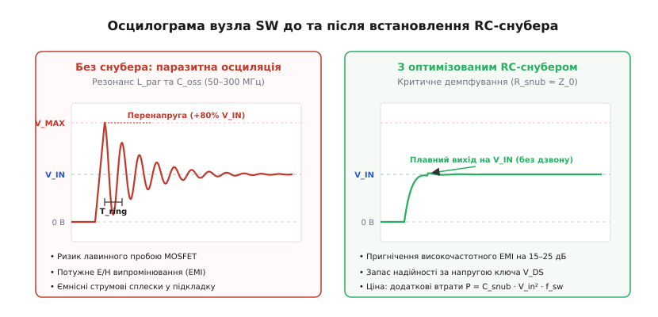
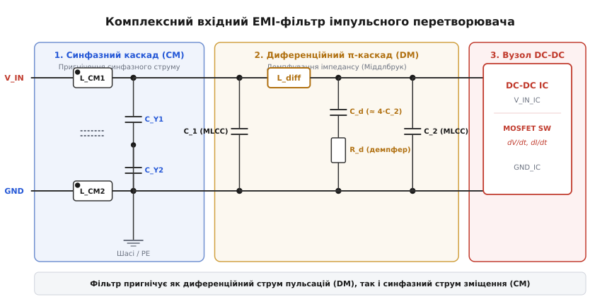

# Імпульсний перетворювач як найгучніший вузол

<preknowlist>
- [Електромагнітна сумісність](root:hw-pcb/electromagnetic-compatibility) — тріада «джерело–шлях–жертва», кондуктивні та випромінювані завади, нормативні ліміти.
- [Шлях зворотного струму](root:hw-pcb/current-return-path) — високочастотний струм повертається контуром найменшої індуктивності безпосередньо під провідником.
- [Проєктування площини землі](root:hw-pcb/ground-plane-design) — суцільна опорна площина як екран від магнітних полів та низькоімпедансний провідник.
- [Зсув потенціалу землі](root:hw-pcb/ground-bounce) — стрибки напруги на паразитній індуктивності провідників при високій похідній струму dI/dt.
- [Цілісність живлення](root:hw-pcb/power-integrity) — імпеданс розподільчої мережі живлення, паразитні резонанси та розв'язувальні конденсатори.
- [Екранування на платі](root:hw-pcb/shielding) — замкнені металеві контури та клітки Фарадея для локалізації високочастотних полів.
</preknowlist>

Коли на макетній платі або щойно виготовленій багатошаровій друкованій платі запускається імпульсний стабілізатор напруги з вхідних 24 В у вихідні 3.3 В при струмі навантаження 3 А, чутливий 24-бітний аналогово-цифровий перетворювач поруч починає втрачати молодші вісім бітів корисної інформації, інтерфейс SPI генерує помилки контрольних сум CRC, а радіоприймач на 433 МГц повністю глушиться суцільною пеленою широкосмугового шуму. Якщо до силового комутаційного вузла під'єднати щуп осцилографа, замість ідеального прямокутного сигналу зі шпаруватістю 14% на екрані з'являється послідовність потужних сплесків перенапруги амплітудою до 42 В із подальшим високочастотним дзвоном на частотах 120–250 МГц. Будь-який імпульсний перетворювач напруги (Switch-Mode Power Supply, SMPS; від англійського *switch* — перемикати) за своєю фізичною природою є найпотужнішим генератором електромагнітних завад (Electromagnetic Interference, EMI) на друкованій платі.

Високий коефіцієнт корисної дії імпульсних топологій досягається саме завдяки екстремально швидкому перемиканню силових напівпровідникових ключів — час наростання та спаду напруги у сучасних кремнієвих MOSFET становить від 1 до 5 наносекунд, а у транзисторів на основі нітриду галію (GaN) опускається нижче 500 пікосекунд. Проте швидкість перемикання породжує фундаментальний фізичний конфлікт: що вища крутість наростання напруги `dV/dt` та струму `dI/dt`, то нижчі динамічні теплові втрати на кристалі, але то вища спектральна щільність випромінюваного електромагнітного шуму, який перетворює друковану плату та під'єднані до неї кабелі на ефективну антенну систему.

```
P_sw = 0.5 · V_in · I_out · (t_rise + t_fall) · f_sw  [динамічні втрати перемикання]
```

При зменшенні часу перемикання `t_rise` та `t_fall` потужність втрат `P_sw` падає лінійно, дозволяючи будувати компактні джерела живлення без масивних радіаторів, однак похідні напруги `dV/dt` (що сягають величин 10–50 В/нс) і струму `dI/dt` (до 2–10 А/нс) збуджують паразитно утворені коливальні контури монтажу, інжектують струми зміщення в земляні шари та генерують потужні кондуктивні й випромінювані завади у смузі частот від сотень кілогерців до гігагерців.

---

### Спектральний аналіз комутаційного імпульсу та кутові частоти

Щоб зрозуміти, чому імпульсний перетворювач створює перешкоди на частотах, які у тисячі разів перевищують його власну тактову частоту, необхідно проаналізувати спектр трапецієподібного періодичного сигналу напруги на комутаційному вузлі.

Ідеальний прямокутний імпульс з нульовим часом наростання існує лише в математичних абстракціях. Реальний сигнал комутації має амплітуду `V_in`, період повторення `T_sw = 1 / f_sw`, тривалість відкритого стану верхнього ключа `t_on = D · T_sw` (де `D` — коефіцієнт заповнення або шпаруватість), а також скінченний час наростання `t_r` і спаду `t_f`.

Розклад такого трапецієподібного сигналу в ряд Фур'є показує, що амплітуда `n`-ї гармоніки описується виразом:

```
c_n = 2 · V_in · D · |(sin(n · π · D) / (n · π · D))| · |(sin(n · π · t_r / T_sw) / (n · π · t_r / T_sw))|
```

Спектральна огинаюча амплітуд гармонік має вигляд ламаної лінії з двома характерними точками перегину — **кутовими частотами (Corner Frequencies)**:

1. **Перша кутова частота `f_c1`:** Визначається тривалістю імпульсу `t_on` (або шпаруватістю):
   ```
   f_c1 = 1 / (π · t_on) = 1 / (π · D · T_sw)
   ```
   На частотах нижче `f_c1` амплітуда гармонік залишається практично постійною і пропорційною середній напрузі `V_in · D`. У діапазоні між `f_c1` та другою кутовою частотою `f_c2` амплітуда гармонік спадає зі швидкістю **-20 дБ на декаду** (спадання пропорційне `1/f`).

2. **Друга кутова частота `f_c2`:** Визначається швидкістю наростання найкрутішого фронту `t_r`:
   ```
   f_c2 = 1 / (π · t_r)
   ```
   На частотах вище `f_c2` починає домінувати другий синусоїдальний множник Фур'є-розкладу, і швидкість спадання амплітуди гармонік подвоюється, досягаючи **-40 дБ на декаду** (спадання пропорційне `1/f²`).

```
Амплітуда (дБ)
  │
──┼────────┐ 
  │        │  \  -20 дБ/дек (вплив тривалості імпульсу t_on)
  │        │    \
  │        │      \
──┼────────┼───────┼───────┐
  │        │       │        \  -40 дБ/дек (вплив швидкості фронту t_r)
  │        │       │          \
──┴────────┴───────┴───────────┴────────► log(f)
          f_c1    f_c2
```

Цей розподіл наочно демонструє вплив технології силових транзисторів на генерацію перешкод:
- У класичному кремнієвому MOSFET з часом наростання `t_r = 5 нс` друга кутова частота становить:
  ```
  f_c2 = 1 / (π · 5 · 10⁻⁹ с) ≈ 63.7 МГц
  ```
  Після 64 МГц спектр шуму швидко згасає зі швидкістю -40 дБ/дек;
- У сучасному нітрид-галієвому GaN транзисторі час перемикання становить всього `t_r = 0.5 нс`, що зміщує другу кутову частоту до:
  ```
  f_c2 = 1 / (π · 0.5 · 10⁻⁹ с) ≈ 636.6 МГц
  ```

Зсув точки перегину з 64 МГц до 637 МГц означає, що у критичному для радіозв'язку діапазоні частот (від 100 МГц до 1 ГГц) амплітуда гармонік перемикання GaN-ключа виявляється на **20–35 дБ вищою**, ніж у кремнієвого транзистора при абсолютно однаковій робочій частоті стабілізатора `f_sw = 1 МГц`. Таким чином, технологічний перехід на швидші транзистори підвищує ККД на 2–4%, але вимагає принципово суворішого контролю електромагнітних контурів друкованої плати.

---

### Топологічні гарячі контури: фізика розривних струмів

Електромагнітна поведінка імпульсного регулятора визначається просторовою конфігурацією контурів, якими протікають високочастотні змінні струми. Будь-яка схема імпульсного перетворювача містить ділянки з неперервним струмом (де індуктивність згладжує пульсації) та ділянки з розривним, пульсуючим струмом (де струм миттєво стрибає від нуля до пікового значення і навпаки). Контур плати, в якому протікає розривний змінний струм із максимальним значенням `dI/dt`, називають **гарячим контуром** (Hot Loop або Critical AC Loop).

У класичному понижувальному перетворювачі (Buck Converter) гарячий контур складається з чотирьох послідовних елементів:
1. Вхідний блокувальний керамічний конденсатор `C_in`;
2. Верхній силовий транзистор (High-Side MOSFET);
3. Нижній синхронний транзистор або діод вільного ходу (Low-Side MOSFET / Freewheeling Diode);
4. Опорна лінія повернення струму на мінусову обкладку `C_in`.

Коли верхній транзистор відкритий, струм із вхідного конденсатора тече через кристал ключа у вихідну котушку індуктивності та навантаження. Коли верхній ключ закривається, а нижній відкривається, струм котушки продовжує текти в тому самому напрямку, замикаючись через нижній ключ, але струм через верхній ключ і вхідний конденсатор миттєво обривається до нуля. Таким чином, у вхідному контурі `C_in – Q_high – Q_low` струм є суто імпульсним із прямокутним або трапецієподібним профілем.

```
i_in(t) = I_L(t),  коли Q_high відкрито (0 < t < D · T_sw)
i_in(t) = 0,       коли Q_high закрито (D · T_sw < t < T_sw)
```

У підвищувальному перетворювачі (Boost Converter) ситуація дзеркальна: вхідний струм через котушку індуктивності є квазінеперервним, натомість розривним є струм вихідного кола, утвореного нижнім ключем, випрямним діодом (або верхнім синхронним ключем) та вихідним конденсатором `C_out`. У мостових, інвертувальних та SEPIC/Flyback топологіях розривні струми можуть протікати одночасно як у вхідних, так і у вихідних колах.

Чому площа гарячого контуру є критичною для електромагнітної сумісності? Згідно із законом Біо–Савара та теорією випромінювання рамкових антен, струмова петля площею `A`, якою тече змінний струм гармонійної частоти `f` з амплітудою `I`, формує змінний магнітний дипольний момент `m = I · A`. Напруженість випромінюваного електричного поля `E` у дальній зоні (на відстані `r` від плати у вільному просторі) зростає пропорційно площі контуру та квадрату частоти:

```
E = (1.316 · 10⁻¹⁴) · (I · A · f²) / r  [напруженість поля магнітного диполя, В/м]
```

Квадратична залежність від частоти `f²` означає, що високочастотні гармоніки комутації (наприклад, на частотах 100–300 МГц) випромінюються в тисячі разів ефективніше, ніж основна гармоніка роботи перетворювача (500 кГц). Якщо площа гарячого контуру на друкованій платі становить `1 см²` (100 мм²), напруженість поля на відстані 3 метрів від приладу перевищить жорсткі ліміти стандарту CISPR 25 (клас 5 для автомобільних систем) на 20–30 дБ. Зменшення фізичної площі петлі `A` до `5 мм²` шляхом розміщення конденсатора `C_in` безпосередньо біля виводів мікросхеми перетворювача знижує напруженість випромінюваного поля у 20 разів (на 26 дБ) без додавання будь-яких додаткових компонентів.

Паразитна індуктивність гарячого контуру `L_loop` (що складається з індуктивності виводів корпусу IC, перехідних отворів, виводів конденсатора та мідних доріжок) додатково створює різкий стрибок перенапруги в момент закривання транзистора:

```
V_spike = L_loop · (dI / dt)  [індуктивний викид напруги]
```

При швидкості наростання струму `dI/dt = 3 А / 2 нс = 1.5 · 10⁹ А/с` паразитна індуктивність контуру всього у `4 нГн` (еквівалент доріжки довжиною 4 мм або двох перехідних отворів) генерує сплеск амплітудою:

```
V_spike = 4 · 10⁻⁹ Гн · 1.5 · 10⁹ А/с = 6.0 В
```

Ці 6 вольт додаються до вхідної напруги живлення, прикладаючись безпосередньо до переходу стік-витік транзистора, створюючи ризик його лавинного пробою та збуджуючи високочастотні коливання.

---

### Динаміка комутаційного циклу напівпровідникового ключа

Щоб зрозуміти джерела збудження паразитної індуктивності контуру, необхідно простежити покроковий процес перемикання силового польового транзистора MOSFET у синхронному понижувальному каскаді. Процес переходу з відкритого стану в закритий і навпаки складається з чотирьох послідовних фаз, керованих зарядом затвора:

```
       ┌─────────── High-Side MOSFET (Q1)
  V_IN ┤  C_gd (Міллер)
       │   ├── C_gs
       └─┬─┴─────── SW (Комутаційний вузол)
         │  L_par  ▲
         │ ┌───┐   │ dV/dt (до 50 В/нс)
         ├─┤   ├───┴──────── Силова котушка L1 ──► V_OUT
         │ └───┘
         │
       ┌─┴───────── Low-Side MOSFET (Q2)
       │  C_oss (Q2)
   GND ┴
```

1. **Фаза перезаряджання ємності затвор-витік `C_gs`:** Драйвер затвора подає струм заряду. Напруга на затворі зростає від 0 В до порогової напруги відкривання транзистора `V_th`. У цей проміжок часу транзистор залишається закритим, струм стоку дорівнює нулю, а напруга на стоці дорівнює напрузі живлення `V_in`;
2. **Фаза наростання струму стоку (Linear Current Rise):** Напруга на затворі перевищує `V_th`, і канал транзистора починає проводити струм. Струм стоку `I_D` стрімко зростає від нуля до повного струму котушки індуктивності `I_L`. Оскільки швидкість наростання струму `dI/dt` визначається вихідним імпедансом драйвера та індуктивністю кола затвора, саме у цій фазі на паразитній індуктивності витоку `L_source` виникає проти-ЕРС, яка зменшує ефективну керуючу напругу на затворі (явище індуктивного виродження зворотного зв'язку за витоком):
   ```
   V_gs_eff = V_gate_driver - L_source · (dI_D / dt)
   ```
3. **Фаза плато Міллера (Miller Plateau) та екстремального `dV/dt`:** Щойно струм стоку досягає значення струму котушки, діод вільного ходу (або боді-діод нижнього ключа) закривається, і напруга на стоці починає падати від `V_in` до 0 В (для верхнього ключа — навпаки, напруга на вузлі SW злітає від 0 до `V_in`). Напруга на затворі фіксується на постійному рівні напруги Міллера `V_Miller`, а весь струм драйвера витрачається виключно на перезаряджання паразитної ємності затвор-стік `C_gd`. Саме в цій фазі виникає максимальна похідна напруги `dV/dt`, яка спричиняє ємнісні струми зміщення;
4. **Фаза зворотного відновлення боді-діода (Reverse Recovery):** Якщо в якості нижнього ключа використовується MOSFET, перед його активним відкриванням струм котушки протягом мертвого часу (Dead Time, зазвичай 10–30 нс) протікає через його внутрішній паразитичний p-n діод (Body Diode). У p-n переході накопичується заряд неосновних носіїв `Q_rr`. Коли верхній транзистор починає відкриватися, до закритого боді-діода прикладається зворотна напруга, яка викликає потужний короткочасний імпульс зворотного струму `I_rrm`.

Цей імпульс зворотного струму має амплітуду від 1 до 5 А і різко обривається за частки наносекунди (`t_b`), коли заряд розсмоктується:

```
V_snap = L_par · (dI_rr / dt)  [стрибок від жорсткого відновлення діода]
```

Якщо діод має так звану «жорстку» характеристику відновлення (Snappy Recovery, де відношення часу спаду до часу наростання струму `t_b / t_a < 0.2`), обрив струму діє як ударне збудження контуру, породжуючи надвисокочастотний дзвін у діапазоні 200–500 МГц. Застосування діодів Шотткі (в яких відсутній накопичений заряд неосновних носіїв, `Q_rr ≈ 0`) або синхронних польових транзисторів із паралельними діодами Шотткі повністю усуває фазу зворотного відновлення та значно знижує амплітуду високочастотних завад.

---

### Керування швидкістю перемикання затвора та оптимізація драйвера

Найпростішим схемотехнічним методом обмеження крутості фронтів `dV/dt` та `dI/dt` є введення послідовного резистора в коло затвора транзистора `R_gate`. Проте пряме збільшення опору затвора має суттєвий недолік: воно однаково уповільнює як увімкнення, так і вимкнення транзистора, що призводить до різкого зростання динамічних теплових втрат.

Інженерним стандартом є **асиметричне керування затвором**:

```
                 ┌─── R_gate_on (10..22 Ом) ───┐
  Вихід драйвера ┤                             ├─── Затвор MOSFET
                 └─── [>| D_fast] ─ R_gate_off ┘
                         (1..2.2 Ом)
```

1. **Траєкторія увімкнення (Turn-on):** Діод `D_fast` закритий. Струм заряду затвора тече через резистор `R_gate_on` підвищеного номіналу (10–22 Ом). Це штучно розтягує фазу плато Міллера, обмежуючи швидкість наростання напруги `dV/dt` на комутаційному вузлі SW до безпечного рівня 2–5 В/нс, що повністю усуває високочастотний дзвін без додаткових втрат на демпферах;
2. **Траєкторія вимкнення (Turn-off):** Діод `D_fast` відкривається, шунтуючи резистор увімкнення. Розряд затвора відбувається через паралельний резистор `R_gate_off` мінімального опору (1–2.2 Ом) або безпосередньо через внутрішній транзистор драйвера. Швидке вимикання силового ключа мінімізує динамічні втрати в момент спаду струму та запобігає випадковому відкриванню транзистора через ємнісний ефект Міллера при стрибку напруги на сусідньому плечі моста.

У сучасних інтегрованих DC-DC конвертерах, де силові ключі вбудовані безпосередньо в кристал мікросхеми, виводи затворів недоступні для користувача. У таких мікросхемах швидкість наростання фронту вузла SW регулюється через зовнішній резистор ланцюга вольтдобавки **Bootstrap Resistor (`R_boot`)**. Резистор номіналом 2.2–4.7 Ом, встановлений послідовно з конденсатором вольтдобавки `C_boot`, обмежує піковий струм внутрішнього драйвера верхнього ключа, забезпечуючи плавне увімкнення без погіршення динаміки вимкнення.

---

### Паразитні параметри компонентів та частотна деградація

Реальні пасивні компоненти ведуть себе як ідеальні опори, ємності та індуктивності лише на низьких частотах. Зі зростанням частоти паразитна індуктивність та ємність конструкції починають домінувати над номінальними параметрами.

#### 1. Керамічні конденсатори MLCC

Багатошаровий керамічний конденсатор (Multi-Layer Ceramic Capacitor, MLCC) описується послідовною еквівалентною схемою, що складається з номінальної ємності `C`, еквівалентного послідовного опору `ESR` та еквівалентної послідовної індуктивності `ESL`:

```
Z_MLCC(f) = ESR + j · 2 · π · f · ESL - j / (2 · π · f · C)
```

На низьких частотах переважає ємнісний опір `1 / (2πfC)`. На власній резонансній частоті (Self-Resonant Frequency, SRF):

```
f_SRF = 1 / (2 · π · √(ESL · C))
```

імпеданс конденсатора досягає свого мінімального значення, рівного чисто активному опору `ESR`. На частотах вище `f_SRF` конденсатор перетворюється на індуктивність з імпедансом `2πf · ESL`, повністю втрачаючи здатність блокувати високочастотні завади.

```
Імпеданс |Z| (Ом)
  │
  │  \  Ємнісна зона (1/ωC)
  │    \
  │      \       /  Індуктивна зона (ω·ESL)
  │        \   /
──┼──────────V───────────► f (Гц)
           f_SRF (мінімум = ESR)
```

Величина `ESL` визначається виключно геометричними розмірами корпусу та довжиною струмового шляху між електродами:
- Стандартний SMD-корпус 1206: `ESL ≈ 1.2–1.5 нГн` (`f_SRF` для ємності 10 мкФ становить всього 1.3 МГц);
- Корпус 0805: `ESL ≈ 0.8–1.0 нГн`;
- Корпус 0603: `ESL ≈ 0.5–0.6 нГн`;
- Корпус 0402: `ESL ≈ 0.3–0.4 нГн`;
- Зворотна геометрія (Reverse Geometry, наприклад 0306 або 0508, де виводи розташовані вздовж довгої сторони): `ESL ≈ 0.15–0.2 нГн`.

Додатковим прихованим фактором є **ефект падіння ємності від постійної напруги зміщення (DC Bias Effect)** у діелектриках класу II (X5R, X7R, Y5V). Під дією робочої напруги живлення (наприклад, 16 В для конденсатора з номіналом 25 В) реальна ємність керамічного конденсатора може падати на 60–85%. Це зміщує власну резонансну частоту вхідного фільтра вгору у 2–3 рази, викликаючи несподіваний провал придушення завад. Для силових фільтрів необхідно обирати конденсатори з номінальною напругою, що щонайменше у 2–3 рази перевищує робочу напругу шини, або застосовувати стабільну кераміку класу I (C0G/NP0) та полімерні танталові конденсатори.

#### 2. Небезпека паралельного з'єднання різних номіналів (Антирезонанс)

Поширеною інженерною практикою є паралельне з'єднання конденсатора великої ємності (наприклад, `C_1 = 10 мкФ` в корпусі 0805) та малого конденсатора (`C_2 = 100 нФ` в корпусі 0402) для розширення смуги фільтрації.

Проте на частотах між власними резонансними частотами двох конденсаторів (`f_SRF1 < f < f_SRF2`) перший конденсатор уже поводиться як індуктивність `ESL_1`, а другий конденсатор все ще працює як ємність `C_2`. Утворюється **паралельний коливальний контур**, який на частоті антирезонансу генерує високий пік імпедансу:

```
f_anti = 1 / (2 · π · √(ESL_1 · C_2))
```

Якщо на цю частоту антирезонансу потрапляє одна з гармонік комутації перетворювача, імпеданс шини живлення в цій точці різко зростає у десятки разів, викликаючи аномальні сплески шуму на платі. Щоб усунути антирезонансні піки, необхідно забезпечити достатній опір втрат (демпфування) шляхом вибору конденсатора з контрольованим `ESR` або додавання послідовного резистора демпфування.

---

### Ізольовані топології та трансформаторні завади (Flyback, Forward)

В ізольованих імпульсних джерелах живлення (Flyback, Forward, Push-Pull) головним джерелом шуму та кондуктивних перешкод стає симульований трансформатор (або зв'язані дроселі).

```
 Первинна сторона (Hot GND)        Вторинна сторона (Cold GND)
   V_IN ───┐                        ┌─── [>| D_out] ───► V_OUT
           │                        │
         ┌─┴─┐ C_pri_sec (10..50 пФ)│
         │ T1│::::::::::::::::::::::│
         └─┬─┘ (Міжобмотковий міст) └─── C_out ────────► GND_SEC
           │ 
       ┌───┴───┐
       │ Q_pri │ (dV/dt = 100..400 В/нс)
   GND ┴───────┘
```

1. **Індуктивність розсіювання первинної обмотки `L_leak`:** Не весь магнітний потік первинної обмотки пронизує вторинну обмотку. Частина енергії, пропорційна індуктивності розсіювання (зазвичай 1–3% від повної індуктивності `L_pri`), не передається у навантаження в момент закривання транзистора `Q_pri`:
   ```
   E_leak = 0.5 · L_leak · I_pk²
   ```
   Ця енергія збуджує паразитний контур, утворений `L_leak` та вихідною ємністю транзистора `C_oss`, генеруючи високовольтний сплеск напруги на стоці, який може перевищувати `V_in + N · V_out` у 2–3 рази і пробивати кристал. Для обмеження сплеску обов'язково застосовують первинний **RCD-демпфер** або напівпровідниковий супресор (TVS-діод).
2. **Міжобмоткова паразитна ємність `C_pri_sec`:** Фізична близькість витків первинної та вторинної обмоток трансформатора створює міжелектродну ємність величиною від 10 до 100 пФ. Коли потенціал стоку первинного ключа стрибає на 400–600 В за 10–20 нс, через цю ємність у вторинне «холодне» коло інжектується потужний синфазний струм:
   ```
   i_CM_trans = C_pri_sec · (dV_drain / dt)
   ```
   Цей струм замикається через вторинні кабелі живлення, заземлені клеми навантаження та корпус приладу, формуючи гігантську випромінювальну антену.

Для блокування синфазного струму в трансформаторах застосовують два обов'язкові методи:
- **Екрануюча обмотка Фарадея (Faraday Shield):** Між первинною та вторинною обмотками вкладається незамкнений шар мідної фольги або суцільний шар дроту, з'єднаний із «тихою» первинною шиною постійної напруги (`V_IN` або первинна земля). Струм зміщення замикається на екран і повертається у первинне коло, не проникаючи у вторинну секцію;
- **Міжземельний безпечний Y-конденсатор (Safety Y-Capacitor):** Між первинною («гарячою») і вторинною («холодною») землями безпосередньо на платі встановлюють високовольтний сертифікований конденсатор класу Y1/Y2 ємністю 1–2.2 нФ. Цей конденсатор створює контрольований локальний шлях повернення синфазного струму всередині плати, запобігаючи його витоку в зовнішні кабелі.

---

### Ємнісний зв'язок крізь радіатори охолодження (Heatsink Coupling)

При роботі з потужними перетворювачами силові транзистори MOSFET або діоди встановлюють на масивні алюмінієві радіатори через тонкі теплопровідні ізоляційні прокладки (силіконові підкладки Sil-Pad, слюду або кераміку з оксиду алюмінію Al2O3 товщиною 0.2–0.5 мм).

```
   Фланець стоку MOSFET (SW)  ─────── dV/dt (20..100 В/нс)
   ═════════════════════════         
   Теплопровідна прокладка    ─────── C_heatsink (20..80 пФ)
   ═════════════════════════         
   Металевий радіатор         ─────── Працює як випромінювальна антена!
```

Фланець транзистора, електрично з'єднаний із шумним стоком (комутаційним вузлом SW), разом із металевою поверхнею радіатора утворює паразитний плаский конденсатор ємністю `C_heatsink = 20–80 пФ`.

Якщо радіатор залишається електрично ізольованим («плаваючим», floating heatsink), струм зміщення `i = C_heatsink · (dV_SW / dt)` збуджує весь металевий масив радіатора. Завдяки значним геометричним розмірам (50–150 мм) радіатор перетворюється на високоефективну четвертьхвильову або дипольну антену, яка інтенсивно випромінює електричне поле у діапазоні 50–300 МГц.

Якщо ж радіатор помилково під'єднати до металевого корпусу приладу або шини захисного заземлення (PE), струм зміщення потече через дріт заземлення та мережевий кабель, що призведе до різкого погіршення показників кондуктивних завад (Common Mode Emissions) на 25–40 дБ.

**Правильне схемотехнічне рішення:** Радіатор необхідно електрично з'єднати з первинною «тихою» силовою шиною постійної напруги (`V_IN` або первинна силова земля `GND`) безпосередньо біля витоку транзистора на друкованій платі. У такому разі струм зміщення через паразитичну ємність радіатора замкнеться у внутрішньому локальному контурі мінімальної площі всередині плати і не потрапить ані в навколишній простір, ані у зовнішні кабельні лінії.

---

### Екрануючі кришки на платі (Board-Level Shielding, BLS)

У високощільних пристроях із чутливими радіоканалами (наприклад, у смартфонах, дронах та IoT-модулях із вбудованими GPS, Bluetooth, Wi-Fi) навіть оптимізована силова індуктивність та мініатюрний гарячий контур випромінюють достатньо енергії, щоб погіршити чутливість приймача (явище десенсибілізації радіоприймача, Desense).

У таких випадках весь вузол імпульсного перетворювача (мікросхему DC-DC, вхідні конденсатори, котушку індуктивності та снубер) накривають металевою **екрануючою кришкою (Shielding Can)**, припаяною до суцільної земляної рамки на платі.

Правила проектування екрануючої кришки:
1. **Суцільний земляний паркан із перехідних отворів (Via Fence):** По периметру екрану встановлюють ланцюжок земляних перехідних отворів із кроком `d ≤ λ / 20` для максимальної робочої частоти. Наприклад, для екранування частоти 2.4 ГГц (`λ = 125 мм`) відстань між отворами має становити не більше `6 мм` (рекомендовано 1.5–2 мм);
2. **Фільтрація виходу за межі екрана:** Будь-який провідник, що виходить з-під екрана (вихід живлення, лінії зворотного зв'язку), повинен мати локальний фільтрувальний керамічний конденсатор безпосередньо на межі екрана. Якщо вивести невідфільтровану доріжку з-під екрана, вона спрацює як зонд, витягуючи шум із внутрішнього простору екрана назовні та нівелюючи весь ефект екранування.

---

### Розширення спектра частоти комутації (SSFM)

Традиційний імпульсний регулятор працює на фіксованій тактовій частоті `f_sw` (наприклад, строго 500 кГц). У результаті вся енергія електромагнітної комутації концентрується у вузьких дискретних спектральних піках на частотах `f_sw, 2f_sw, 3f_sw, ...`.

Технологія **модуляції з розширенням спектра (Spread Spectrum Frequency Modulation, SSFM)** періодично змінює частоту комутатора в невеликому діапазоні навколо номінального значення:

```
f_sw(t) = f_0 ± Δf · m(t)  [де Δf ≈ 0.05..0.12 · f_0, а m(t) — трикутна функція модуляції]
```

```
Спектральна щільність
  │
  │        █  (Фіксована частота: вузький високий пік)
  │        █
  │      ┌─┴─┐  (SSFM: енергія розмазана по смузі 2·Δf)
  │   ───┴───┴───
──┼────────────────► f (Частота)
          f_0
```

Оскільки повна енергія завади залишається постійною, розмиття спектрального піка по смузі шириною `2 · Δf` (наприклад, від 450 до 550 кГц при `f_0 = 500 кГц`) знижує пікову спектральну щільність потужності на **8–14 дБ** у стандартних вимірювальних смугах квазіпікових (Quasi-Peak) та середньоквадратичних (Average) приймачів ЕМС-лабораторій.

SSFM є надзвичайно ефективним програмно-апаратним методом, що дозволяє виробу вкластися у жорсткі рамки нормативів без збільшення габаритів вхідного фільтра, проте вимагає ретельного проектування контуру зворотного зв'язку, щоб частота модуляції `f_m` (зазвичай 20–40 кГц) не потрапляла у смугу пропускання підсилювача помилки регулятора.

---

### Багатофазні синхронні перетворювачі (Multi-phase Interleaved Converters)

При великих струмах навантаження (понад 15–30 А) дискретний однофазний регулятор генерує надмірно високі пульсації вхідного струму, що вимагає встановлення десятків паралельних керамічних конденсаторів.

Рішенням є **багатофазне чергування (Interleaving)**, коли навантаження живиться від `N` паралельних силових каскадів, що працюють на спільний вихід із взаємним зсувом фаз комутації:

```
Δθ = 360° / N  [фазовий зсув між каналами]
```

Для двофазного перетворювача (`N = 2`) фазовий зсув становить 180°. Коли перший ключ відкривається і споживає струм із входу, другий ключ закритий. Вхідні розривні струми двох фаз частково накладаються один на одного, утворюючи сумарний струм із значно меншою амплітудою пульсацій та подвоєною частотою:

```
f_ripple_effective = N · f_sw  [ефективна частота пульсацій]
```

Переваги багатофазної топології для електромагнітної сумісності:
1. **Зниження середньоквадратичного струму (RMS) вхідного конденсатора у 2–4 рази:** Це пропорційно зменшує падіння напруги на `ESR` конденсатора та рівень диференційного шуму на вході;
2. **Зсув частоти пульсацій у вищу область:** Замість 500 кГц основні пульсації зосереджені на частоті 1 МГц (для 2 фаз) або 2 МГц (для 4 фаз). Вища частота дозволяє використовувати значно менші за номіналом і габаритами індуктивності та ємності вхідного π-фільтра.

---

### Високочастотний дзвін комутаційного вузла (Switch Node Ringing)

Комутаційний вузол (вузол фази, що позначається як SW або LX на схемах DC-DC контролерів) є фізичною точкою з'єднання стоку нижнього транзистора, витоку верхнього транзистора та силової котушки індуктивності. Напруга на цьому вузлі є імпульсною послідовністю з розмахом від потенціалу землі до напруги живлення `V_in`.


*Осцилограма напруги на комутаційному вузлі SW: ліворуч — без демпфування спостерігається високочастотний резонансний дзвін (50–300 МГц) із викидом перенапруги до 1.8 V_IN; праворуч — робота оптимізованого RC-снубера, що забезпечує критичне демпфування без втрати швидкості наростання фронту.*

Коли нижній транзистор закривається, а верхній починає відкриватися, струм, що протікав через паразитний діод нижнього ключа, різко припиняється. У цей момент накопичена в паразитній індуктивності контуру `L_par` енергія починає хаотично перезаряджати паразитну вихідну ємність закритого нижнього транзистора `C_oss` та міжелектродну ємність монтажу `C_par`. Утворюється класичний паразитний послідовний коливальний LC-контур, позбавлений активного демпфувального опору.

Частота виникаючого дзвону (Switch Node Ringing) лежить у діапазоні від 50 до 300 МГц і визначається формулою Томсона для паразитного контуру:

```
f_ring = 1 / (2 · π · √(L_par · C_par))  [частота паразитного резонансу]
```

Паразитна вихідна ємність MOSFET `C_oss` є сильно нелінійною величиною, залежною від прикладеної напруги `V_DS`. При низькій напрузі (поблизу 0 В) ємність p-n переходів кристала може сягати 500–1500 пФ, тоді як при робочій напрузі 24–48 В вона падає до 50–150 пФ. Саме тому під час наростання фронту резонансна частота зміщується вгору, формуючи складний спектр вищих гармонік.

Паразитний дзвін вузла SW несе в собі чотири прямі загрози функціонуванню приладу:

1. **Електричне випромінювання (E-field radiation):** Мідний полігон вузла SW перебуває під потенціалом, який змінюється зі швидкістю десятків вольт за наносекунду. Цей полігон працює як монопольна передавальна антена електричного поля, випромінюючи широкосмуговий шум у навколишній простір та корпус приладу.
2. **Ємнісна інжекція струмів зміщення у внутрішні шари плати:** Відповідно до рівнянь Максвелла, змінне електричне поле крізь діелектрик склотекстоліту FR-4 (товщиною `h = 0.1–0.2 мм` між шарами) породжує струм зміщення у підкладку та сусідні земляні або сигнальні шари:
   ```
   i_disp = C_plate · (dV_SW / dt) = (ε_0 · ε_r · A_SW / h) · (dV_SW / dt)
   ```
   Якщо площа мідного полігону вузла SW становить `20 мм²`, діелектрична проникність `ε_r = 4.2`, а відстань до внутрішнього шару землі `0.1 мм`, паразитна ємність полігону становить `C ≈ 7.4 пФ`. При `dV/dt = 24 В / 1.5 нс = 16 · 10⁹ В/с` у внутрішній шар землі впорскується імпульсний струм:
   ```
   i_disp = 7.4 · 10⁻¹² Ф · 16 · 10⁹ В/с = 0.118 А (118 мА)
   ```
   Цей імпульсний струм величиною понад 100 мА розтікається земляною площиною, генеруючи локальні перекоси потенціалу опорного нуля ([зсув потенціалу землі](root:hw-pcb/ground-bounce)) під чутливими мікросхемами.
3. **Електричний перерозподіл енергії на шину затвора (Miller Injection):** Сплеск `dV/dt` на стоці нижнього ключа через ємність зворотного зв'язку затвор-стік `C_gd` (ємність Міллера) намагається відкрити закритий транзистор. Якщо опір ланцюга драйвера затвора недостатньо низький, напруга на затворі перевищує порогову величину `V_th`, що призводить до наскрізного струму (Shoot-through) через одночасно відкриті верхній і нижній ключі та миттєвого теплового пробою.
4. **Помилки вимірювань під час лабораторного налагодження:** Неправильне підключення щупа осцилографа з довгим дротом заземлення («крокодилом» довжиною 10–15 см) додає у вимірювальне коло зовнішню паразитну індуктивність 50–100 нГн. Ця індуктивність утворює паразитичний контур із вхідною ємністю щупа (10–15 пФ), генеруючи штучний фальшивий дзвін на екрані осцилографа, якого насправді на платі немає, або маскуючи реальні перехідні процеси. Для достовірної фіксації дзвону вузла SW необхідно використовувати виключно коаксіальні пружинні контакти (Spring Tip) або пряме розпаювання коаксіального кабелю 50 Ом безпосередньо на виводи силового конденсатора та транзистора.

---

### Кондуктивні завади: диференційний та синфазний струми

Завади, які виходять за межі друкованої плати через вхідні та вихідні кабельні лінії, поділяються на два принципово різні типи залежно від топології їхнього розповсюдження: **диференційні завади** (Differential Mode, DM) та **синфазні завади** (Common Mode, CM).

```
I_total_L1 = I_power + I_DM + I_CM  [струм у фазному/плюсовому проводі]
I_total_L2 = -I_power - I_DM + I_CM [струм у нейтральному/мінусовому проводі]
```

Диференційний шум `I_DM` протікає замкненим колом: він витікає з перетворювача по позитивній лінії живлення `V_IN` і повертається назад по лінії `GND`. Фізичною першопричиною диференційного шуму є пульсації струму, викликані комутацією силових ключів на основній частоті перетворення `f_sw` та її перших 10–20 гармоніках (діапазон 150 кГц – 30 МГц). Оскільки цей струм протікає крізь еквівалентний послідовний опір (ESR) та еквівалентну послідовну індуктивність (ESL) вхідних конденсаторів, на клемах живлення виникає пульсація напруги:

```
V_ripple_DM = ΔI_in · ESR + L_ESL · (dI_in / dt)
```

Синфазний шум `I_CM` має зовсім іншу природу: він протікає в одному і тому самому напрямку по обох силових лініях (`V_IN` та `GND`) одночасно, а повертається до джерела через паразитні ємності конструкції на металеве шасі, корпус приладу, захисне заземлення (PE) або крізь розподілену ємність навколишнього середовища.

Головним генератором синфазного шуму є комутаційний вузол SW, радіатор охолодження транзисторів та паразитна ємність між первинною і вторинною обмотками трансформатора (у разі ізольованих топологій). Коли потенціал вузла SW стрибає на величину `V_in` за частки наносекунди, у будь-який сусідній провідний предмет (радіатор, металевий екран, шар землі під платою) через паразитну ємність `C_chassis` (яка зазвичай становить від 1 до 50 пФ) інжектується синфазний струм зміщення:

```
i_CM = C_chassis · (dV_SW / dt)  [синфазний струм через паразитну ємність]
```

Цей струм замикається через провідники живлення та кабельні джгути. Хоча амплітуда синфазного струму зазвичай вимірюється в мікроамперах або одиницях міліамперів (що у тисячі разів менше за амперні диференційні струми), саме синфазний струм є головним руйнівником електромагнітної сумісності в діапазоні вище 30 МГц. Причина полягає в тому, що кабельний джгут довжиною 1–2 метри, яким тече синфазний струм, працює як класична дипольна антена. Для порівняння: синфазний струм величиною всього `20 мкА` на частоті 100 МГц у кабелі довжиною 1 метр створює у просторі випромінюване поле, достатнє для повного провалу сертифікації за стандартом FCC Part 15 Class B або CISPR 32 Class B.

---

### Вимірювання за допомогою LISN та розділення шумів

Для стандартизованого вимірювання кондуктивних перешкод згідно зі стандартами CISPR 25 та CISPR 32 прилад живлять через **еквівалент мережі (Line Impedance Stabilization Network, LISN)**.

```
 Джерело DC          Схема LISN (50 Ом / 50 мкГн)             Випробовуваний прилад (EUT)
 ┌─────────┐       50 мкГн               0.1 мкФ
 │         ├───^^^^^^^^^^───┬───────────────||──────────────► Лінія V_IN
 │ Живлення│                │
 │         ├───^^^^^^^^^^───┼───[ 50 Ом ]───||──────────────► Лінія GND
 └─────────┘       50 мкГн  │   (RF Порт на BNC)
                           ===
                           GND_LISN (Опорний екран камери)
```

LISN виконує три фундаментальні функції:
1. **Ізоляція від зовнішніх шумів:** Послідовні індуктивності 50 мкГн блокують шуми лабораторного джерела живлення;
2. **Стандартизація імпедансу:** Створює фіксований вхідний опір `50 Ом` для високочастотних сигналів між кожною лінією живлення та опорною площиною заземлення камери;
3. **Зняття вимірювального сигналу:** Через розділові конденсатори високочастотний шум потрапляє на 50-омний вхід спектроаналізатора.

Для точного підбору фільтрів сигнали з фазного і нейтрального (або плюсового і мінусового) виходів LISN подають на пасивний RF-розділювач шумів (Noise Separator). За допомогою високочастотних суматорів і трансформаторів розділювач формує два незалежні вихідні канали:

```
V_DM = 0.5 · (V_L1 - V_L2)  [диференційний вихід]
V_CM = 0.5 · (V_L1 + V_L2)  [синфазний вихід]
```

Це дозволяє інженеру на екрані приладу окремо спостерігати амплітуду диференційної та синфазної завад і точно дозувати індуктивність синфазного дроселя або ємності фільтра.

---

### Магнітні поля силової котушки індуктивності та маркування початку обмотки

Котушка індуктивності є ключовим енергонакопичувальним компонентом імпульсного стабілізатора, проте вона може стати потужним джерелом як магнітних, так і електричних полів завад за неправильного вибору типу корпусу або помилкової орієнтації на платі.

За конструкцією магнітопроводу сучасні силові індуктивності поділяються на три основні класи:

1. **Неекрановані котушки (Unshielded / Drum Core):** Мають відкритий гантелеподібний феритовий сердечник. Магнітний потік виходить із торця сердечника і замикається через навколишнє повітря. Силові лінії магнітної індукції пронизують полігони друкованої плати, наводячи вихрові струми (Eddy currents) у земляних площинах та створюючи паразитну ЕРС у сусідніх сигнальних доріжках відповідно до закону Фарадея:
   ```
   V_induced = - dΦ / dt = - A_loop · (dB / dt)
   ```
   Неекрановані котушки категорично заборонено використовувати на платах із жорсткими вимогами до шуму.
2. **Напівекрановані котушки (Semi-shielded):** Обмотка нанесена на гантелеподібний сердечник, але зверху покрита компаундом із феритового порошку та епоксидної смоли. Це знижує магнітне розсіювання на 60–80%, проте не усуває його повністю.
3. **Монолітні екрановані котушки (Molded Powder Inductors / Fully Shielded):** Дріт намотується у повітрі або на оправці, після чого пресується разом із металевим порошковим сплавом (залізо-кремній, карбонільне залізо) під тиском у сотні атмосфер. Уся магнітна енергія локалізується всередині замкненого моноліту, магнітні поля розсіювання зведені до абсолютного мінімуму, а сам металевий корпус додатково виконує функцію електростатичного екрана.

Крім магнітного поля розсіювання, силова котушка діє як електричний випромінювач. Обмотка котушки складається з кількох шарів витків дроту. Один кінець обмотки (внутрішній шар, найближчий до феритового сердечника) фізично знаходиться всередині, а другий кінець (зовнішній шар) формує зовнішню поверхню котушки.

Виробники якісних компонентів завжди наносять на корпус маркування початку обмотки — **крапку (Dot Marking)**, смугу або скошений кут.

```
       ┌────────────────────────┐
       │ ● Початок (внутрішній) │ ─── Підключати до вузла SW (dV/dt)
       │                        │
       │   Кінець (зовнішній)   │ ─── Підключати до V_OUT (DC стабільна)
       └────────────────────────┘
```

Фізичне правило підключення індуктивності:
- **Початок обмотки (з крапкою)** повинен підключатися до шумного комутаційного вузла SW. Внутрішні витки обмотки перебувають під високим потенціалом `dV/dt`, проте вони просторово заблоковані всередині конструкції;
- **Кінець обмотки (без крапки)** повинен підключатися до вихідного фільтрувального конденсатора `V_out`. Напруга на виході перетворювача є постійною (DC) з низьким рівнем змінної складової. Зовнішні витки обмотки, маючи стабільний потенціал, працюють як природний електростатичний екран, що екранує внутрішні високочастотні витки від навколишнього простору плати.

Якщо індуктивність запаяти на плату у зворотній орієнтації (повернувши на 180°), шумний потенціал вузла SW опиниться на зовнішньому шарі витків. Це призведе до різкого зростання паразитної ємності між котушкою і сусідніми компонентами та збільшить рівень випромінюваного електричного поля на частотах 30–150 МГц на 6–12 дБ, що нерідко стає причиною раптового провалу випробувань на електромагнітну сумісність.

---

### Методи демпфування дзвону: RC-снубери та феритові намистини

Коли топологія друкованої плати вже оптимізована, але залишковий дзвін на комутаційному вузлі SW все ще створює неприпустимий рівень завад, застосовують активні та пасивні схемотехнічні методи придушення високочастотного резонансу.

#### 1. RC-снубер (Resistor-Capacitor Snubber)

RC-снубер — це послідовний ланцюг із безиндуктивного резистора `R_snub` та високочастотного керамічного конденсатора `C_snub`, під'єднаний паралельно джерелу резонансу: між комутаційним вузлом SW та опорною землею GND (або паралельно нижньому силовому ключу).

Фізичний принцип дії снубера полягає у внесенні активних резистивних втрат у коливальний контур саме на резонансній частоті. Конденсатор `C_snub` виконує роль фільтра верхніх частот: він блокує постійну складову напруги живлення (запобігаючи марному виділенню тепла на низьких частотах) і пропускає струм лише під час швидких переходів `dV/dt`. Резистор `R_snub` розсіює накопичену в паразитній індуктивності енергію у вигляді тепла, забезпечуючи критичне або близьке до критичного затухання коливального процесу (коефіцієнт демпфування `ζ ≈ 0.7–1.0`).

Розрахунок оптимальних параметрів снубера виконується у три кроки:

**Крок 1. Визначення еквівалентних параметрів паразитного контуру `L_par` та `C_par`:**
На працюючій платі за допомогою осцилографа з коаксіальним щупом вимірюють початкову частоту дзвону `f_ring1`. Потім паралельно нижньому транзистору тимчасово підпаюють невеликий тестовий конденсатор `C_add` (номіналом приблизно 200–500 пФ, класу C0G/NP0) і вимірюють нову, зменшену частоту дзвону `f_ring2`.

Оскільки додана ємність збільшила загальну ємність контуру, точні значення паразитної ємності монтажу `C_par` та індуктивності `L_par` вираховуються аналітично:

```
C_par = C_add / ((f_ring1 / f_ring2)² - 1)  [власна паразитна ємність]
L_par = 1 / ((2 · π · f_ring1)² · C_par)    [власна паразитна індуктивність]
```

**Крок 2. Розрахунок характеристичного імпедансу та номіналів:**
Характеристичний (хвильовий) опір паразитного коливального контуру дорівнює:

```
Z_0 = √(L_par / C_par)  [характеристичний імпеданс]
```

Для досягнення оптимального демпфування опір снуберного резистора обирають рівним характеристичному імпедансу контуру:

```
R_snub ≈ Z_0 = √(L_par / C_par)
```

Номінал снуберного конденсатора `C_snub` обирають у діапазоні від 2 до 4 значень власної паразитної ємності:

```
C_snub = (2 ... 4) · C_par
```

Збільшення `C_snub` понад 4·C_par дає мінімальне додаткове зниження амплітуди дзвону, але призводить до стрімкого зростання динамічних втрат потужності.

**Крок 3. Розрахунок теплових втрат на снубері:**
За кожен період комутації конденсатор `C_snub` двічі перезаряджається: від 0 до `V_in` і назад. Уся енергія, що передається конденсатору, розсіюється на резисторі `R_snub`:

```
P_snub = C_snub · V_in² · f_sw  [теплова потужність на резисторі]
```

Наприклад, якщо при напрузі живлення `V_in = 24 В` та частоті комутації `f_sw = 500 кГц` встановлено конденсатор `C_snub = 470 пФ`, теплова потужність, яка безперервно розсіюється резистором, становить:

```
P_snub = 470 · 10⁻¹² Ф · (24 В)² · 500 · 10³ Гц = 0.135 Вт (135 мВт)
```

Для такого розсіювання необхідний резистор типорозміру не менше 0805 або 1206 із достатнім запасом за імпульсною потужністю. Конденсатор `C_snub` повинен мати виключно діелектрик C0G/NP0 (кераміка класу 1) з нульовим п'єзоефектом, стабільною ємністю від прикладеної напруги та мінімальною власною індуктивністю ESL. Детальний математичний апарат, процедуру розрахунку нестандартних топологій та оптимізацію демпфування реалізовано в [модулі розрахунку снубера та фільтра](root:hw-pcb/impulsnyi-peretvoriuvach-iak-naihuchnishyi-vuzol/proj-snubber-calculator.md).

#### 2. Феритові намистини (Ferrite Beads)

Феритова намистина — це пасивний елемент, комплексний імпеданс якого залежить від частоти:

```
Z(f) = R(f) + j · X(f)  [імпеданс феритової намистини]
```

На низьких частотах (до 5–10 МГц) переважає реактивна індуктивна складова `X(f)` із мінімальним активним опором `R(f) < 0.05 Ом`. На високих частотах (вище 50–100 МГц) через втрати на перемагнічування та вихрові струми у фериті різко зростає активна резистивна складова `R(f)`, яка поглинає високочастотну енергію та розсіює її у вигляді тепла.

Використання феритових намистин безпосередньо у розрив силового кола вузла SW є поширеною інженерною помилкою. Послідовне включення фериту між виходом транзистора та котушкою індуктивності додає паразитної індуктивності у контур комутації, що збільшує амплітуду початкового перехідного стрибка напруги `V_spike`. Крім того, силовий постійний струм навантаження вводить ферит у стан глибокого магнітного насичення, внаслідок чого його імпеданс на високих частотах падає на 80–95%.

Феритові намистини високоефективні в інших вузлах:
- У затворних колах драйвера (послідовно з резистором затвора) для пригнічення паразитних осциляцій лінії керування;
- У ланцюгах вольтдобавки (Bootstrap) для зниження швидкості наростання струму заряду плаваючої ємності;
- У вихідних LC-фільтрах після силового перетворювача для придушення залишкових пікосекундних голок комутації.

---

### Комплексна вхідна фільтрація: π-фільтри та критерій Міддлбрука

Для гарантованого проходження стандартів кондуктивної емісії (CISPR 25 Class 5, CISPR 32 Class B) стандартного вхідного блокувального конденсатора `C_in` недостатньо. На вході приладу встановлюють багаторівневий фільтр, що комбінує синфазне та диференційне придушення завад.


*Принципова схема комплексного вхідного EMI-фільтра: на вході розташовано синфазний дросель (CMC) з Y-конденсаторами на шасі (захист від CM-шумів); далі — диференційний π-фільтр другого порядку (C1 – L_diff – C2) із паралельним демпфувальним колом Rd + Cd для задоволення критерію стійкості Міддлбрука.*

#### 1. Синфазний дросель (Common-Mode Choke, CMC)

Синфазний дросель складається з двох однакових обмоток, намотаних на спільний тороїдальний або броньовий феритовий сердечник із високою магнітною проникністю (`μ_r = 5000–10000`).

- **Для диференційного робочого струму живлення:** Струм витікає по верхньому проводу та повертається по нижньому. Оскільки напрямки струмів у обмотках протилежні, створювані ними магнітні потоки в сердечнику віднімаються і взаємно компенсуються. Результуючий магнітний потік у фериті дорівнює нулю, тому синфазний дросель не створює опору для постійного струму живлення та не насичується;
- **Для синфазного шуму:** Синфазні струми течуть у фазі в одному напрямку по обох лініях. Їхні магнітні потоки в сердечнику додаються, утворюючи для синфазного струму високий індуктивний опір (від кількох сотень ом до кількох кілоом на частотах 10–100 МГц).

Спільно з Y-конденсаторами `C_Y1` та `C_Y2`, під'єднаними від кожної лінії живлення на металеве шасі або захисну землю, синфазний дросель формує фільтр нижніх частот другого порядку, що скидає синфазний струм зміщення назад на джерело завади, не випускаючи його в лінійні кабелі.

#### 2. Диференційний π-фільтр та критерій стійкості Міддлбрука

Диференційний фільтр будується за топологією π-ланки: керамічний конденсатор `C_1` на вході, послідовна силова індуктивність `L_diff` та вихідний керамічний конденсатор `C_2` (що є безпосереднім вхідним конденсатором перетворювача).

Частота зрізу фільтра `f_c` обирається щонайменше у 10 разів нижчою за робочу частоту комутації перетворювача `f_sw`:

```
f_c = 1 / (2 · π · √(L_diff · C_2)) ≤ 0.1 · f_sw
```

Проте додавання вхідного LC-фільтра породжує небезпечне явище: втрату динамічної стійкості системи. Будь-який імпульсний стабілізатор напруги з замкненим контуром зворотного зв'язку за постійної вихідної потужності `P_out = const` володіє **негативним динамічним вхідним опором** на низьких частотах:

```
R_in_dyn = - (V_in² · η) / P_out  [негативний вхідний опір DC-DC]
```

Якщо вхідна напруга зростає, для підтримки стабільної потужності перетворювач зменшує споживаний струм, і навпаки — при просіданні напруги струм зростає, що за визначенням відповідає негативному диференційному опору `dV/dI < 0`.

Згідно з фундаментальним **критерієм стійкості Міддлбрука (Middlebrook Stability Criterion)**, система «вхідний фільтр — імпульсний стабілізатор» залишається стабільною тоді й тільки тоді, коли вихідний комплексний імпеданс фільтра `Z_out_filter(f)` у всьому діапазоні частот є значно меншим за модуль динамічного вхідного імпедансу перетворювача `Z_in_converter(f)`:

```
|Z_out_filter(f)| << |Z_in_converter(f)|  [критерій стійкості Міддлбрука]
```

На резонансній частоті фільтра `f_c` недемпфований LC-контур має високий добротний пік вихідного імпедансу:

```
Z_out_peak = Q · √(L_diff / C_2) = (1 / R_parasitic) · (L_diff / C_2)
```

Якщо піковий опір `Z_out_peak` наблизиться до `|R_in_dyn|`, виникає позитивний зворотний зв'язок: фазовий запас стійкості перетворювача падає до нуля, виникають незгасаючі низькочастотні коливання напруги живлення, перетворювач виходить із режиму стабілізації або згоряє від перенапруги.

Для надійного придушення резонансного піку паралельно керамічному конденсатору `C_2` підключають демпфувальний ланцюг, що складається з послідовно з'єднаних демпфувального конденсатора `C_d` та резистора `R_d`. Оптимальні параметри демпфування Міддлбрука розраховуються за формулами:

```
C_d ≈ (3 ... 5) · C_2  [ємність демпфувального конденсатора]
R_d ≈ √(L_diff / C_2)  [оптимальний опір демпфера]
```

На практиці демпфувальну гілку `C_d + R_d` часто реалізують за допомогою одного алюмінієвого електролітичного або танталового конденсатора відповідної ємності, внутрішній послідовний опір (ESR) якого якраз дорівнює необхідному значенню `R_d`.

---

### Топологічні правила трасування друкованої плати

Навіть найдосконаліша електрична схема з ідеально розрахованими снуберами та фільтрами провалить випробування на електромагнітну сумісність, якщо фізичне трасування друкованої плати виконано з порушенням базових правил просторового розподілу високочастотних струмів:

1. **Мінімізація площі гарячої петлі на верхньому шарі:** Вхідний керамічний конденсатор `C_in` повинен бути встановлений на тому самому шарі, що й мікросхема перетворювача, безпосередньо впритул до виводів VIN та GND. Підключення `C_in` через перехідні отвори категорично заборонено: кожен перехідний отвір додає 0.5–1.2 нГн паразитної індуктивності, що знецінює якість конденсатора;
2. **Неперервна площина опорної землі на 2-му шарі:** Безпосередньо під силовою секцією перетворювача (на шарі Layer 2) повинен розташовуватися суцільний, непорізаний мідний полігон землі. Відстань між шаром 1 (силові компоненти) та шаром 2 повинна бути мінімальною (тонкий діелектричний препрег товщиною 70–100 мкм). Це забезпечує мінімальну площу струмової петлі у вертикальному перерізі та створює дзеркальний зворотний струм, магнітне поле якого компенсує поле прямого струму;
3. **Оптимізація геометрії полігону вузла SW:** Мідний майданчик вузла SW повинен мати площу, достатню для тепловідведення від виводів транзистора чи мікросхеми, але строго мінімальну з погляду паразитної ємності на землю. Під полігоном SW на внутрішніх шарах не повинні проходити жодні сигнальні лінії;
4. **Ізоляція чутливих аналогових кіл зворотного зв'язку (Feedback):** Резистивний подільник зворотного зв'язку лінії FB повинен бути розташований безпосередньо біля виводу контролера, а не біля навантаження. Високоомна лінія між подільником і виводом FB має бути максимально короткою і захищеною земляними провідниками від впливу магнітного поля котушки індуктивності та електричного поля вузла SW.

---

### Порівняльний аналіз багатошарових стеків для імпульсних вузлів

Вибір структури шарів (Stackup) друкованої плати визначає фізичні межі електромагнітного випромінювання. Порівняємо три типові варіанти реалізації плат:

```
  2-шарова плата (1.6 мм)         4-шарова плата (1.6 мм)         6-шарова плата (1.6 мм)
┌─────────────────────────┐     ┌─────────────────────────┐     ┌─────────────────────────┐
│ L1: Силові траси + SW   │     │ L1: Силові траси + SW   │     │ L1: Силові компоненти   │
├─────────────────────────┤     ├─────────────────────────┤     ├─────────────────────────┤
│                         │     │ ~0.1 мм препрег         │     │ ~0.1 мм препрег         │
│   1.5 мм склотекстоліт  │     ├─────────────────────────┤     ├─────────────────────────┤
│   (велика петля!)       │     │ L2: СУЦІЛЬНА ЗЕМЛЯ (GND)│     │ L2: СУЦІЛЬНА ЗЕМЛЯ (GND)│
│                         │     ├─────────────────────────┤     ├─────────────────────────┤
├─────────────────────────┤     │ ~1.2 мм серцевина (Core)│     │ L3: Сигнали / FB        │
│ L2: Нижня земля / траси │     ├─────────────────────────┤     ├─────────────────────────┤
└─────────────────────────┘     │ L3: Живлення / Сигнали  │     │ L4: СУЦІЛЬНА ЗЕМЛЯ (GND)│
                                ├─────────────────────────┤     ├─────────────────────────┤
                                │ ~0.1 мм препрег         │     │ L5: Силове живлення     │
                                ├─────────────────────────┤     ├─────────────────────────┤
                                │ L4: Нижня земля         │     │ L6: Нижня земля         │
                                └─────────────────────────┘     └─────────────────────────┘
```

- **Двошарова плата (2-Layer):** Товщина діелектрика між шарами становить 1.5–1.6 мм. Площа вертикальної петлі розривного струму між верхнім шаром і нижнім шаром повернення виходить величезною. Індуктивність контуру `L_loop` рідко вдається опустити нижче 8–15 нГн. Двошарові плати вкрай важко сертифікувати на норми CISPR 25 Class 5 або FCC Class B при струмах навантаження понад 1–2 А;
- **Чотиришарова плата (4-Layer з тонким верхнім препрегом):** Товщина препрегу між Layer 1 та Layer 2 становить 0.075–0.1 мм. Індуктивність контуру повернення струму падає до 1–2 нГн (зменшення у 8–10 разів). Зворотний високочастотний струм у земляному шарі Layer 2 концентрується строго під силовою доріжкою Layer 1 завдяки ефекту мінімізації енергії магнітного поля, забезпечуючи взаємну компенсацію магнітних потоків прямого та зворотного струмів;
- **Шестишарова плата (6-Layer з двома опорними площинами GND):** Дозволяє повністю закрити чутливі аналогові траси зворотного зв'язку (FB, Current Sense) на шарі Layer 3 між двома суцільними земляними екранами Layer 2 та Layer 4 (полоскова лінія, Stripline). Це виключає наведення полів перемикання на ланцюг регулювання напруги навіть при роботі з GaN-ключами на частотах понад 2 МГц.

---

### Діагностика та локалізація завад у лабораторії

Під час сертифікаційних випробувань або попереднього тестування у лабораторії розробник стикається із завданням швидкого визначення фізичного джерела та механізму розповсюдження завади. Для цього використовують зонди ближнього поля (Near-Field Probes), під'єднані до спектроаналізатора або швидкого цифрового осцилографа з функцією БПФ (FFT).

```
                      ┌────────────────────────────────────────┐
                      │          Спектроаналізатор             │
                      └──────────────────┬─────────────────────┘
                                         │ 50 Ом коаксіал
                ┌────────────────────────┴────────────────────────┐
                │                                                 │
      ┌─────────┴─────────┐                             ┌─────────┴─────────┐
      │   H-Field Probe   │                             │   E-Field Probe   │
      │ (Магнітна петля)  │                             │ (Штировий зонд)   │
      └─────────┬─────────┘                             └─────────┬─────────┘
                ▼                                                 ▼
     Виявляє струмові петлі dI/dt                     Виявляє вузли напруги dV/dt
   (Гарячі контури, котушки L, виводи)              (Вузол SW, радіатори, кабелі)
```

- **Магнітний зонд (H-field probe, мініатюрна екранована петля):** Реагує на вихрові магнітні поля, створювані змінним струмом `dI/dt`. Орієнтуючи площину петлі паралельно та перпендикулярно до доріжок, інженер точно визначає геометричні межі гарячої петлі комутації та локалізує витік магнітного потоку з котушки індуктивності. Якщо піднесення магнітної петлі до вхідного кабелю показує високий рівень сигналу на частоті комутації, у кабелі домінує диференційний струм;
- **Електричний зонд (E-field probe, мініатюрна пластина або штир):** Реагує на потенціал та швидкість зміни напруги `dV/dt`. Зонд прикладають до металевих корпусів, тепловідводів та екранованих кабелів. Фіксація високого сигналу електричним зондом на кабелі живлення однозначно свідчить про наявність синфазного струму зміщення `i_CM`, викликаного ємнісним зв'язком комутаційного вузла на шасі.

Якщо аналіз спектра показує регулярний «частокіл» гармонік із відстанню, рівною частоті комутації `f_sw` (наприклад, кожні 500 кГц аж до 30 МГц), першоджерелом є диференційні пульсації струму, які вимагають збільшення ємності `C_in` або встановлення диференційного π-фільтра. Якщо ж у спектрі спостерігається широкий шумовий «горб» на частотах 120–220 МГц, причиною є паразитний дзвін вузла SW, який усувається виключно підбором RC-снубера.

---

### Програмний розрахунок параметрів паразитного контуру

Для швидкого аналізу лабораторних вимірювань дзвону на комутаційному вузлі розроблено аналітичний модуль на мовах C та C++, що приймає параметри двох вимірювань частоти і генерує готові рекомендації щодо номіналів снубера:

:::tabs
```c
#include <stdio.h>
#include <stdbool.h>
#include <math.h>

#define PI 3.14159265358979323846

typedef struct {
    double f1_hz;         /* Початкова частота дзвону без снубера */
    double f2_hz;         /* Зміщена частота з тестовим конденсатором */
    double c_test_f;      /* Ємність тестового конденсатора (Ф) */
    double v_in_volts;    /* Вхідна напруга живлення (В) */
    double f_sw_hz;       /* Робоча частота перемикання DC-DC (Гц) */
} RingingMeasureInput;

typedef struct {
    double c_par_f;       /* Розрахована паразитна ємність (Ф) */
    double l_par_h;       /* Розрахована паразитна індуктивність (Гн) */
    double z0_ohms;       /* Характеристичний імпеданс контуру (Ом) */
    double r_snub_ohms;   /* Рекомендований опір снубера (Ом) */
    double c_snub_f;      /* Рекомендована ємність снубера (Ф) */
    double p_loss_watts;  /* Розсіювана теплова потужність на резисторі (Вт) */
    bool is_valid;
} SnubberResult;

SnubberResult calculate_snubber(const RingingMeasureInput* in) {
    SnubberResult res = {0};
    if (!in || in->f1_hz <= 0.0 || in->f2_hz <= 0.0 || in->c_test_f <= 0.0 || in->f2_hz >= in->f1_hz) {
        res.is_valid = false;
        return res;
    }

    /* Розрахунок паразитної ємності: C_par = C_test / ((f1 / f2)^2 - 1) */
    double ratio = in->f1_hz / in->f2_hz;
    res.c_par_f = in->c_test_f / (ratio * ratio - 1.0);

    /* Розрахунок паразитної індуктивності: L_par = 1 / ((2 * pi * f1)^2 * C_par) */
    double omega1 = 2.0 * PI * in->f1_hz;
    res.l_par_h = 1.0 / (omega1 * omega1 * res.c_par_f);

    /* Характеристичний імпеданс: Z0 = sqrt(L_par / C_par) */
    res.z0_ohms = sqrt(res.l_par_h / res.c_par_f);

    /* Оптимальні номінали снубера */
    res.r_snub_ohms = res.z0_ohms;
    res.c_snub_f = 3.0 * res.c_par_f;

    /* Теплові втрати: P = C_snub * V_in^2 * f_sw */
    res.p_loss_watts = res.c_snub_f * (in->v_in_volts * in->v_in_volts) * in->f_sw_hz;
    res.is_valid = true;

    return res;
}

int main(void) {
    RingingMeasureInput meas = {
        .f1_hz = 180.0e6,     /* 180 МГц початковий дзвін */
        .f2_hz = 115.0e6,     /* 115 МГц після додавання 470 пФ */
        .c_test_f = 470.0e-12,
        .v_in_volts = 24.0,
        .f_sw_hz = 500.0e3    /* 500 кГц комутація */
    };

    SnubberResult r = calculate_snubber(&meas);
    if (r.is_valid) {
        printf("--- Параметри паразитного контуру ---\n");
        printf("Паразитна ємність C_par:     %.2f пФ\n", r.c_par_f * 1e12);
        printf("Паразитна індуктивність L_par: %.2f нГн\n", r.l_par_h * 1e9);
        printf("Характеристичний опір Z0:    %.2f Ом\n", r.z0_ohms);
        printf("\n--- Розраховані номінали снубера ---\n");
        printf("Резистор R_snub:              %.2f Ом (вибираємо найближчий ряду E24)\n", r.r_snub_ohms);
        printf("Конденсатор C_snub:           %.2f пФ (клас C0G/NP0)\n", r.c_snub_f * 1e12);
        printf("Теплові втрати на резисторі:  %.3f Вт\n", r.p_loss_watts);
    }
    return 0;
}
```
```cpp
#include <iostream>
#include <iomanip>
#include <numbers>
#include <cmath>
#include <expected>
#include <string_view>

struct RingingMeasureInput {
    double f1_hz{0.0};
    double f2_hz{0.0};
    double c_test_f{0.0};
    double v_in_volts{0.0};
    double f_sw_hz{0.0};
};

struct SnubberResult {
    double c_par_f{0.0};
    double l_par_h{0.0};
    double z0_ohms{0.0};
    double r_snub_ohms{0.0};
    double c_snub_f{0.0};
    double p_loss_watts{0.0};
};

enum class SnubberCalcError {
    InvalidFrequency,
    FrequencyNotShifted,
    InvalidCapacitance,
    ZeroVoltageOrSwitching
};

constexpr std::expected<SnubberResult, SnubberCalcError> calculate_snubber(const RingingMeasureInput& in) noexcept {
    if (in.f1_hz <= 0.0 || in.f2_hz <= 0.0) {
        return std::unexpected(SnubberCalcError::InvalidFrequency);
    }
    if (in.f2_hz >= in.f1_hz) {
        return std::unexpected(SnubberCalcError::FrequencyNotShifted);
    }
    if (in.c_test_f <= 0.0) {
        return std::unexpected(SnubberCalcError::InvalidCapacitance);
    }
    if (in.v_in_volts <= 0.0 || in.f_sw_hz <= 0.0) {
        return std::unexpected(SnubberCalcError::ZeroVoltageOrSwitching);
    }

    const double ratio = in.f1_hz / in.f2_hz;
    const double c_par = in.c_test_f / (ratio * ratio - 1.0);
    const double omega1 = 2.0 * std::numbers::pi * in.f1_hz;
    const double l_par = 1.0 / (omega1 * omega1 * c_par);
    const double z0 = std::sqrt(l_par / c_par);
    const double c_snub = 3.0 * c_par;
    const double p_loss = c_snub * (in.v_in_volts * in.v_in_volts) * in.f_sw_hz;

    return SnubberResult{
        .c_par_f = c_par,
        .l_par_h = l_par,
        .z0_ohms = z0,
        .r_snub_ohms = z0,
        .c_snub_f = c_snub,
        .p_loss_watts = p_loss
    };
}

int main() {
    constexpr RingingMeasureInput meas{
        .f1_hz = 180.0e6,
        .f2_hz = 115.0e6,
        .c_test_f = 470.0e-12,
        .v_in_volts = 24.0,
        .f_sw_hz = 500.0e3
    };

    const auto res = calculate_snubber(meas);
    if (res) {
        std::cout << std::fixed << std::setprecision(2);
        std::cout << "--- Параметри паразитного контуру ---\n";
        std::cout << "Паразитна ємність C_par:     " << res->c_par_f * 1e12 << " пФ\n";
        std::cout << "Паразитна індуктивність L_par: " << res->l_par_h * 1e9 << " нГн\n";
        std::cout << "Характеристичний опір Z0:    " << res->z0_ohms << " Ом\n\n";
        std::cout << "--- Розраховані номінали снубера ---\n";
        std::cout << "Резистор R_snub:              " << res->r_snub_ohms << " Ом\n";
        std::cout << "Конденсатор C_snub:           " << res->c_snub_f * 1e12 << " пФ\n";
        std::cout << "Теплові втрати на резисторі:  " << std::setprecision(3) << res->p_loss_watts << " Вт\n";
    } else {
        std::cerr << "Помилка розрахунку параметрів снубера!\n";
    }
    return 0;
}
```
:::

---

### Інженерний підсумок

Імпульсний перетворювач перетворюється на небезпечне джерело електромагнітних завад лише тоді, коли його проектування зводиться виключно до з'єднання ліній на схемі без урахування тривимірної електродинаміки плати. Комплексна стратегія мінімізації шуму вимагає послідовного застосування системних заходів на всіх стадіях розробки:

> 🔧 **Навіщо це.**
> Забезпечення низького рівня шуму DC-DC перетворювача на етапі топології коштує рівно нуль додаткових доларів у собівартості виробу. Натомість спроба усунути завади після виготовлення плати за допомогою додаткових металевих екранів, феритових кліпс на кабелі та багаторівневих зовнішніх фільтрів збільшує собівартість приладу в кілька разів, затримує вихід продукту на ринок на місяці та створює ризик відкликання партій через нестабільність живлення.

1. **На рівні трасування друкованої плати:** Максимальне стиснення геометрії гарячих контурів розривного струму, наближення блокувального конденсатора `C_in` безпосередньо до виводів мікросхеми, використання суцільної площини землі на суміжному внутрішньому шарі та мінімізація площі полігону комутаційного вузла SW.
2. **На рівні вибору компонентів:** Використання виключно монолітних екранованих силових індуктивностей із підключенням початку обмотки (з крапкою) до вузла SW, застосування керамічних конденсаторів класу X7R/X8R для фільтрації та C0G/NP0 для високочастотних демпферів.
3. **На рівні демпфування комутаційного вузла:** Експериментальне визначення паразитної індуктивності та ємності контуру методом доданої ємності, розрахунок та встановлення критично демпфованого RC-снубера для придушення дзвону 50–300 МГц без погіршення крутості фронтів перемикання.
4. **На рівні вхідних інтерфейсів живлення:** Встановлення комбінованого фільтра із синфазним дроселем для придушення випромінювання кабельних джгутів та диференційного π-фільтра з паралельним демпфуванням за критерієм Міддлбрука для гарантії динамічної стійкості регулятора.

Повний інженерний алгоритм, детальні математичні моделі та інтегрований програмний модуль розрахунку всіх компонентів демпфування й вхідної фільтрації містяться у вставці [модуль розрахунку снубера та фільтра](root:hw-pcb/impulsnyi-peretvoriuvach-iak-naihuchnishyi-vuzol/proj-snubber-calculator.md).
