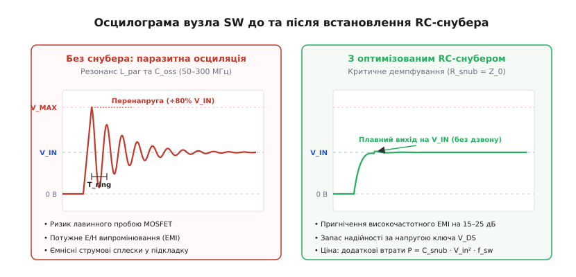
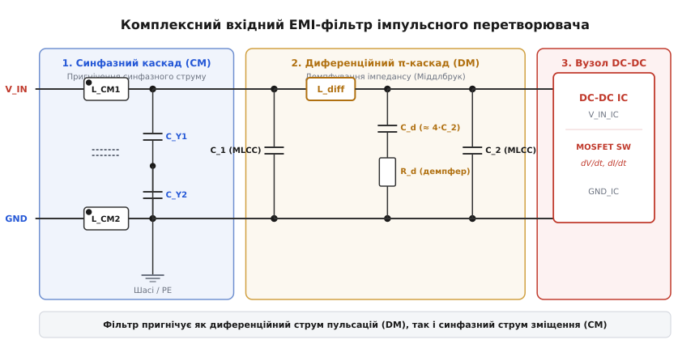

# Імпульсний перетворювач як найгучніший вузол

Коли на спільній друкованій платі поруч працюють цифровий мікроконтролер, чутливий 24-бітний аналогово-цифровий перетворювач та імпульсний стабілізатор напруги (Switch-Mode Power Supply, SMPS; від англійського *switch* — перемикати), вимірювальний тракт раптово втрачає молодші розряди, шина SPI генерує помилки контрольних сум, а радіотракт на 433 МГц глушиться суцільним широкосмуговим шумом. Причина криється у фізиці роботи імпульсного перетворювача: для досягнення коефіцієнта корисної дії 90–95% силові напівпровідникові ключі перемикають струми в кілька ампер за лічені наносекунди. 

Швидке перемикання зменшує час перебування транзистора в активному лінійному режимі, завдяки чому мінімізуються теплові втрати на кристалі. Однак висока швидкість зміни струму `dI/dt` (до 2–5 А/нс) та напруги `dV/dt` (до 10–40 В/нс) перетворює комутаційний вузол на потужне джерело електромагнітних завад (Electromagnetic Interference, EMI).

---

### Природа шуму: розривні струми та гарячий контур

Головним джерелом випромінюваного шуму в імпульсному перетворювачі є не сама робоча частота перемикання (зазвичай від 200 кГц до 2 МГц), а надзвичайно круті фронти струмів у так званому **гарячому контурі** (Hot Loop). 

У класичному понижувальному перетворювачі (Buck) гарячий контур утворений вхідним керамічним конденсатором `C_in`, верхнім польовим транзистором і нижнім синхронним транзистором (або діодом вільного ходу). У цьому колі струм не тече неперервно: щоразу при перемиканні верхнього ключа струм через вхідний конденсатор миттєво наростає від нуля до повного струму котушки індуктивності, а потім різко обривається.

```
       ┌─────────── Верхній MOSFET
 V_IN ─┤
       │     ┌───── Вузол SW (dV/dt до 40 В/нс)
       └─┬───┴───── Котушка L ──► V_OUT
         │
       ┌─┴───────── Нижній MOSFET (або діод)
  GND ─┴─────────── (розривний контур струму C_in -> MOSFET -> GND)
```

Будь-яка замкнена струмова петля площею `A`, якою циркулює високочастотний струм `I`, діє як мініатюрна рамкова магнітна антена. Напруженість випромінюваного нею магнітного поля зростає пропорційно площі контуру `A` та квадрату частоти гармоніки `f²`. Через це гармоніки комутації на частотах 100–300 МГц випромінюються в навколишній простір у сотні тисяч разів ефективніше за основну частоту перетворювача. Якщо площа гарячого контуру на платі сягає всього `1 см²`, випромінювання легко перевищує промислові норми електромагнітної сумісності.

Додатково паразитна індуктивність провідників гарячого контуру `L_par` реагує на надшвидкий обрив струму відповідно до закону самоіндукції:

```
V_spike = L_par · (dI / dt)  [індуктивний викид напруги]
```

Навіть крихітна індуктивність у 3–5 нГн (яку створюють усього пара міліметрів доріжки та перехідні отвори) при струмі 3 А та фронті 2 нс породжує імпульсний викид амплітудою 5–8 В, що накладається на напругу живлення і створює загрозу пробою транзисторів.

---

### Паразитний резонанс комутаційного вузла SW

Вузол з'єднання силових транзисторів та котушки індуктивності — комутаційний вузол **SW** (Switch Node) — зазнає максимальних перепадів напруги `dV/dt`. У момент закривання транзистора енергія, накопичена в паразитній індуктивності монтажу `L_par`, починає перезаряджати вихідну ємність закритого напівпровідникового ключа `C_oss`.

Утворюється недемпфований коливальний контур, в якому виникає високочастотний дзвін (Ringing) із частотою від 50 до 300 МГц.


*Осцилограма вузла SW: зліва — паразитна перенапруга та дзвін без захисту; справа — чистий аперіодичний фронт після встановлення розрахованого RC-снубера.*

Цей дзвін діє одразу у двох напрямках:
1. **Ємнісне наведення (електричне поле `E`):** Мідний полігон вузла SW має власну ємність відносно сусідніх шарів плати. Швидкі стрибки потенціалу інжектують високочастотні струми зміщення в опорну площину землі, звідки вони розтікаються по всій системі.
2. **Пряме випромінювання (магнітне поле `H`):** Коливальні струми дзвону циркулюють у гарячій петлі, випромінюючи електромагнітні хвилі на частотах резонансу.

---

### Методи приборкання шуму на друкованій платі

Захист чутливих кіл від шуму DC-DC перетворювача базується на чотирьох послідовних інженерних кроках:

#### 1. Мінімізація геометрії гарячого контуру
Найефективніший спосіб знизити випромінювання — зменшити фізичну площу петлі розривного струму. Вхідний керамічний конденсатор `C_in` розміщують упритул до виводів мікросхеми перетворювача на тому самому шарі. Безпосередньо під силовим вузлом (на наступному шарі багатошарової плати) має проходити суцільна, нерозрізана площина землі. Зворотний високочастотний струм потече в землі прямо під провідником, дзеркально компенсуючи власне магнітне поле та знижуючи сумарну індуктивність контуру до мінімуму.

#### 2. Демпфування дзвону за допомогою RC-снубера
Щоб придушити паразитно виникаючий дзвін на вузлі SW, паралельно нижньому транзистору встановлюють демпферний ланцюг — **RC-снубер** (від англійського *snub* — гасити, зупиняти). 

Снубер складається з послідовно з'єднаних конденсатора `C_snub` та резистора `R_snub`. Конденсатор відсікає постійний струм і низькі робочі частоти, а резистор поглинає та розсіює у тепло енергію високочастотного резонансу. Опір резистора обирають близьким до характеристичного хвильового опору паразитного контуру `Z_0 = √(L_par / C_par)`. Для точного лабораторного визначення невідомих паразитів плати використовують [калькулятор снубера та EMI-фільтра](root:hw-pcb/impulsnyi-peretvoriuvach-iak-naihuchnishyi-vuzol/proj-snubber-calculator.md), який розраховує номінали за зміщенням резонансної частоти.

#### 3. Вибір екранованої силової індуктивності
Котушка індуктивності перетворювача проводить великий струм трикутної форми. У дешевих відкритих котушках (гантельних сердечниках) магнітне поле замикається через повітря, наводячи паразитні струми в навколишні доріжки зворотного зв'язку та сигнальні лінії. У якісних пристроях застосовують виключно **екрановані індуктивності** (Shielded Inductors) із замкненим феритовим осердям або монолітні порошкові дроселі (Molded Power Inductors), у яких магнітний потік повністю локалізований всередині корпусу.

#### 4. Вхідна фільтрація живлення
Оскільки імпульсний перетворювач споживає струм порціями, пульсації та струми перемикання намагаються вийти назад у лінію первинного живлення. Для їх блокування на вході плати встановлюють комбінований EMI-фільтр.


*Комплексний вхідний EMI-фільтр: синфазний дросель із Y-конденсаторами блокує спільний струм зміщення, а диференційний π-каскад із демпфуванням пригнічує струмові пульсації.*

Диференційний π-фільтр (MLCC-конденсатори та дросель `L_diff`) пригнічує протифазні пульсації струму між лініями `V_IN` та `GND`. Демпфуючий ланцюжок `R_d – C_d` усуває небезпечні резонансні сплески фільтра згідно з критерієм Міддлбрука. Синфазний дросель `L_CM` разом із Y-конденсаторами замикає синфазні струми зміщення, що виникають через паразитні ємності радіаторів та трансформаторів, не дозволяючи їм перетворити зовнішні дроти живлення на передавальну антену.

---

### Системний підхід до тихої плати

Боротьба із шумом імпульсного перетворювача не вимагає випадкового додавання фільтрів чи важких металевих екранів. Вона спирається на чітке дотримання топологічної дисципліни:
- максимальне стиснення геометрії гарячої петлі біля кристала;
- збереження монолітної площини землі під усім силовим вузлом;
- мінімізація площі полігону вузла SW для зменшення ємнісного наведення;
- демпфування залишкового дзвону локальним RC-снубером.

Для повного виведення спектрального розкладу Фур'є, детального аналізу роботи драйверів затворів, математичного обґрунтування критерію стійкості фільтрів Міддлбрука та перегляду готового C/C++ програмного рушія аналізу відкривайте [детальну статтю про імпульсні перетворювачі](root:hw-pcb/impulsnyi-peretvoriuvach-iak-naihuchnishyi-vuzol/detail).
