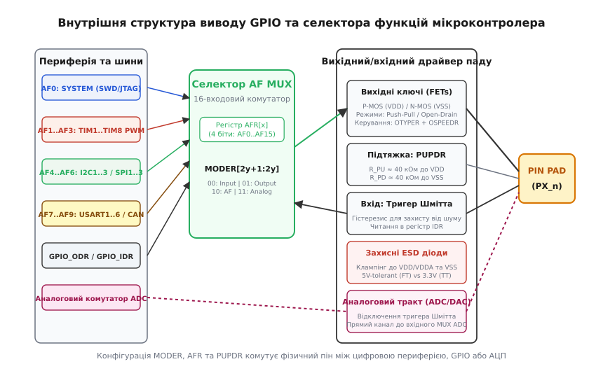
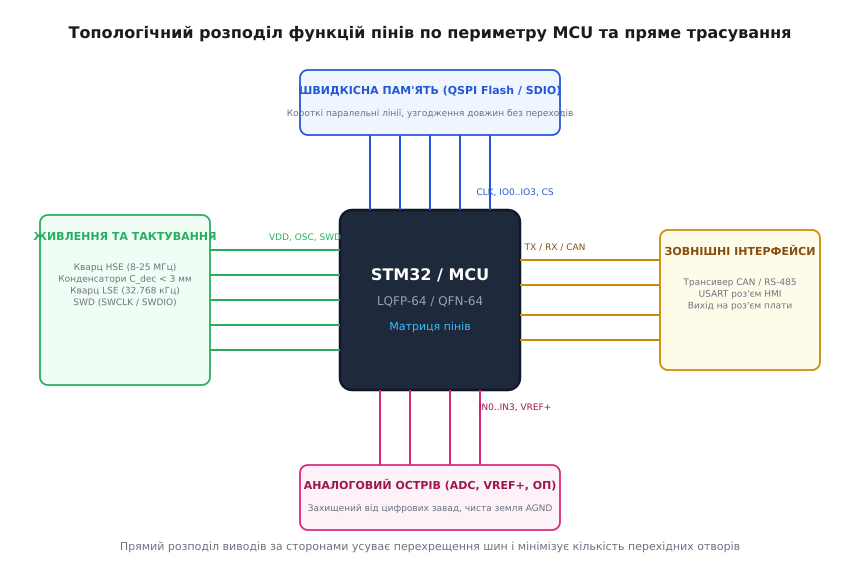

# Карта пінів: розподіл функцій до першої лінії схеми

<preknowlist>
[Принципова схема](root:hw-pcb/schematic-purpose) — графічна мова електричних зв'язків та функціональних вузлів
[Символ мікросхеми на схемі](root:hw-pcb/ic-schematic-symbol) — представлення логічних та фізичних виводів інтегральних схем
[Друкована плата (PCB layout)](root:hw-pcb/pcb-layout) — перехід від принципової схеми до фізичної топології мідних доріжок
[Переривання](root:hw-arch/interrupts) — апаратні лінії запитів та обробка зовнішніх подій процесором
[Таймер-лічильник](root:hw-arch/timer-counter) — апаратні канали захоплення, порівняння та лічильні структури
[Апаратний PWM](root:hw-arch/hardware-pwm) — генерація шимових сигналів через таймерні блоки
</preknowlist>

Коли розробник відкриває порожній аркуш схемного редактора, виникає спокуса одразу розставляти зв'язки: під'єднати інтерфейс датчика до перших-ліпших вільних виводів мікроконтролера, призначити світлодіод на випадкову ніжку порту B, а лінію зовнішнього переривання кинути туди, де на схемному символі виявився зручний кут. На папері чи на екрані монітора будь-який провідник з'єднує будь-які дві точки за нуль секунд і без жодного опору. Проте в кремнії мікроконтролера та на фізичній площині друкованої плати кожен вивід підпорядкований суворим апаратним законам. Якщо призначити функції виводів навмання, помилка виявиться не під час креслення схеми, а значно пізніше — коли виготовлена на заводі плата ляже на монтажний стіл, і з'ясується, що апаратний передавач USART блокує роботу швидкісного таймера, два критичні сенсори ділять одну лінію переривань і не можуть працювати одночасно, а трасування шини пам'яті вимагає шести перехідних отворів і прорізає зворотний шар землі через невдалий вибір сторони корпусу.

Складання карти пінів (англ. *pinout planning*) — це інженерний процес попереднього розподілу апаратних ресурсів кристала та їхнього узгодження з топологією майбутньої друкованої плати до того, як буде проведено першу лінію зв'язку в редакторі схем. Це не просто заповнення таблиці відповідності імен сигналів номерам ніжок, а розв'язання багатокритеріальної оптимізаційної задачі. У цій задачі необхідно одночасно задовольнити обмеження кремнієвого мультиплексора альтернативних функцій, уникнути конфліктів каналів прямого доступу до пам'яті (DMA), врахувати спільні дільники частоти таймерів, забезпечити цілісність аналогових вимірювань і мінімізувати паразитна індуктивність та ємність друкованих провідників.

## Від логічної схеми до фізичного кристала: ціна ранньої помилки

У сучасних мікроконтролерах із сотнею чи двома сотнями виводів один фізичний вивід корпусу (пад) може виконувати до шістнадцяти різних ролей: працювати як лінія введення-виведення загального призначення, вихід широтно-імпульсного модулятора, вхід захоплення сигналу таймера, лінія синхронізації шини SPI, сигнал передавання даних USART або аналоговий канал АЦП. Таке суміщення називають мультиплексуванням виводів (англ. *pin multiplexing*). Виробники мікросхем застосовують його для того, щоб вмістити багату периферію в компактні корпуси з прийнятною кількістю фізичних виводів і зберегти низьку собівартість чіпа. Проте кількість внутрішніх периферійних блоків майже завжди перевищує кількість зовнішніх виводів.

Якщо обрати конфігурацію виводів суто за зручністю малювання схеми, виникає небезпечна ілюзія завершеності. Схемний редактор (EDA) за замовчуванням не знає внутрішньої архітектури обраного мікроконтролера: для нього пін — це просто електричний вузол. Перевірка електричних правил (ERC, *Electrical Rules Check*) підтвердить, що вихід з'єднаний із входом, а напруги живлення підведені коректно. Проте ERC не здатний попередити розробника про те, що обраний для шини I2C пін вимагає альтернативної функції AF4, яка апаратно вимикає тактування потрібного каналу ШІМ, або що вибрані піни таймера належать різним внутрішнім модулям із несумісними базовими частотами.

Ціна такої помилки зростає експоненціально з кожним етапом проекту:
1. **На етапі планування:** виправлення займає п'ять хвилин у таблиці розподілу ресурсів чи конфігураторі.
2. **На етапі трасування друкованої плати:** зміна одного піна руйнує вже розведений джгут паралельних доріжок, змушуючи перетрасовувати значну частину сигнальних шарів.
3. **Після виготовлення плати:** виявлений апаратний конфлікт перетворює зібраний прототип на макет із перерізаними доріжками та навісними тонкими дротами («кустарними перемичками»), або вимагає повної зупинки проекту, переробки гербер-файлів і повторного замовлення друкованих плат на фабриці, що означає втрату тижнів часу та значних коштів.
4. **У серійному виробництві:** невдалий розподіл пінів, що призвів до підвищеного рівня електромагнітних завад чи шуму на лініях АЦП, змушує вносити дорогі схемні фільтри або знижувати тактову частоту пристрою, погіршуючи його характеристики.

Тому карта пінів є головним контрактом між апаратною частиною (схемотехнікою та топологією плати) і низькорівневим програмним забезпеченням (драйверами та операційною системою реального часу). Вона фіксує розподіл фізичних ресурсів до початку будь-яких детальних робіт.

## Внутрішня будова GPIO-паду та мультиплексування альтернативних функцій

Щоб усвідомлено призначати виводи, необхідно детально уявляти електричну схему та логіку роботи універсального порту введення-виведення (GPIO, *General-Purpose Input/Output*) на рівні кремнію. Кожен фізичний пін мікроконтролера — це не просто металевий контакт, а складний електронний вузол, що містить аналогові ключі, цифрові буфери, схеми захисту від електростатичного розряду (ESD) та матрицю комутації.


*Внутрішня апаратна структура виводу GPIO сучасного 32-бітного мікроконтролера. Регістри конфігурації комутують фізичний контакт між вихідними силовими ключами, вхідним тригером Шмітта, підтягувальними резисторами, мультиплексором альтернативних функцій (AF0..AF15) та прямим аналоговим трактом АЦП/ЦАП.*

Розгляньмо послідовно ланки цього тракту:

### 1. Захисний каскад ESD та особливості 5V-Tolerant виводів
Безпосередньо за фізичним контактним майданчиком розташовані захисні діоди, підключені до шин живлення VDD (або VDDA) та землі VSS. Вони обмежують вхідну напругу, відводячи короткочасні сплески електростатичного розряду. У багатьох мікроконтролерах цифрові піни маркуються як 5V-tolerant (FT). Такі виводи мають спеціальну схемотехніку без прямого діода на шину VDD = 3.3 В, що дозволяє подавати на них напругу до 5.5 В без виникнення паразитного струму витоку через захисний діод у шину живлення ядра.

Проте тут криється підступна пастка: якщо на FT-пін подати напругу 5 В у той час, коли живлення самого мікроконтролера вимкнено (VDD = 0 В), внутрішній захисний польовий транзистор із плаваючою підкладкою може почати проводити струм у шину живлення плати. Це викликає так зване паразитне зворотне живлення (back-powering), коли мікроконтролер частково вмикається від сигнальних ліній зовнішніх датчиків, входячи в непередбачуваний напівзавислий стан із високим ризиком виникнення тиристорного защіпання (CMOS latch-up).

Крім того, якщо пін переведено в аналоговий режим (для роботи з АЦП), захисна структура змінює свою конфігурацію, і допустима напруга суворо обмежується рівнем VDDA + 0.3 В. Подання п'яти вольтів на пін, сконфігурований як аналоговий вхід, призводить до відкриття захисного діода, спотворення опорної напруги всього аналогового блоку та теплового пробою вхідного мультиплексора АЦП.

### 2. Вихідний драйвер, крутість фронтів та спектр завад
Вихідний каскад складається з пари комплементарних польових транзисторів (P-MOS верхнього плеча та N-MOS нижнього плеча). Регістр конфігурації типу виходу (`OTYPER`, *Output Type Register*) визначає режим їхньої роботи:
* **Двотактний вихід (Push-Pull, `OTYPER = 0`):** активні обидва транзистори. P-MOS підтягує лінію до VDD при логічній одиниці, а N-MOS притягує до VSS при логічному нулі. Цей режим забезпечує круті фронти, низький вихідний імпеданс і здатність віддавати та приймати струм (зазвичай від 4 мА до 20 мА залежно від налаштувань). Застосовується для швидкісних ліній SPI, UART TX, тактових сигналів, виходів ШІМ.
* **Відкритий стік (Open-Drain, `OTYPER = 1`):** верхній P-MOS транзистор апаратно вимкнений. Логічний нуль активно притягується до землі через N-MOS, а логічна одиниця переводить вихід у високоімпедансний стан (Z-стан). Для формування високого рівня потрібен зовнішній або внутрішній підтягувальний резистор. Цей режим є обов'язковим для шин із топологією «монтажне АБО», таких як I2C (SCL/SDA) або 1-Wire, де кілька пристроїв підключені до спільної лінії та можуть одночасно керувати нею без ризику виникнення короткого замикання між живленням і землею.

Швидкість наростання фронту вихідного сигналу контролюється регістром швидкості (`OSPEEDR`, *Output Speed Register*). У ньому доступні чотири градації: Low Speed (до 2–8 МГц), Medium Speed (до 12.5–50 МГц), High Speed (до 25–100 МГц) та Very High Speed (до 50–180 МГц). 

З точки зору електромагнітної сумісності гранична частота спектра гармонік цифрового сигналу визначається не його періодом, а часом наростання фронту t_r:

```
          0.35
f_knee = ──────     [гранична частота спектра завад]
           t_r
```

Якщо на звичайному виході керування світлодіодом чи лінією UART зі швидкістю 115200 бод помилково увімкнути режим `OSPEEDR = Very High`, час наростання фронту становитиме t_r ≈ 0.8 нс. Це розширює спектр випромінюваних гармонік аж до:

```
f_knee = 0.35 / (0.8 * 10^-9) = 437.5 МГц     [спектральна межа завад]
```

Ці гармоніки потрапляють у діапазони стільникового зв'язку та радіоприймачів, викликаючи непроходження сертифікаційних тестів на ЕМС і наводячи шум на чутливі сусідні доріжки. Тому правило проектування вимагає обирати мінімально достатню швидкість `OSPEEDR` під конкретну частоту інтерфейсу.

### 3. Одночасне перемикання виводів (SSO) та підстрибування землі
Коли група виводів мікроконтролера перемикається одночасно (наприклад, 8-бітна або 16-бітна паралельна шина даних зовнішньої пам'яті FMC), струми перезаряджання ємностей доріжок підсумовуються на спільних виводах живлення та землі мікроконтролера. Кожен провідник корпусу чіпа (від кремнієвого кристала до ніжки на платі) має власну паразитну індуктивність L_package ≈ 1–3 нН.

Стрибок напруги на внутрішній землі кристала (явище Ground Bounce або Simultaneous Switching Outputs — SSO) описується законом електромагнітної індукції:

```
                      di
V_bounce = N × L_pkg × ──     [напруга підстрибування землі]
                      dt
```

де N — кількість виводів, що одночасно перемикаються, L_pkg — індуктивність виводу землі, а di/dt — швидкість наростання струму через вихідні драйвери.

Якщо 16 виводів із вихідним струмом 15 мА перемикаються за 1 нс через спільний пін землі з індуктивністю 2 нН, внутрішнє падіння напруги складе:

```
V_bounce = 16 × (2 * 10^-9) × (0.015 / (1 * 10^-9)) = 0.48 В     [амплітуда підстрибування]
```

Стрибок амплітудою майже 0.5 В на внутрішній землі кристала здатний викликати помилкове спрацьовування вхідних тригерів Шмітта на сусідніх лініях введення, спричинити хибні переривання або збій у виконанні інструкцій процесорного ядра. Щоб запобігти цьому явищу:
* Швидкісні паралельні шини розподіляють між різними фізичними портами введення-виведення;
* Уникають концентрації швидкісних виходів біля чутливих ліній скидання (`NRST`) або налагодження (`SWCLK`);
* Забезпечують підключення кожного окремого виводу VDD/VSS мікроконтролера до індивідуального блокувального конденсатора ємністю 100 нФ, розміщеного не далі ніж 2 мм від ніжки.

### 4. Вхідний каскад (Input Driver) та підтяжка
Вхідна частина містить тригер Шмітта, який перетворює плавні зміни вхідної напруги на чіткі цифрові рівні 0 та 1 із гістерезисом (зазвичай близько 200 мВ), що захищає логіку від брязкоту та шуму в зоні порогу перемикання. Сигнал із тригера Шмітта потрапляє у вхідний регістр даних (`IDR`, *Input Data Register*).

Регістр підтяжки (`PUPDR`, *Pull-Up/Pull-Down Register*) дозволяє підключати внутрішні резистори номіналом близько 30–50 кОм до шини VDD або VSS. Ці резистори є слабкими і призначені для фіксації логічного рівня на високому імпедансі (наприклад, на лініях вибору кристала CS або на невикористовуваних входах), але їхнього номіналу зазвичай недостатньо для швидкісних шин I2C Fast Mode Plus (1 Мбіт/с), де потрібні зовнішні дискретні резистори номіналом 1–2.2 кОм для швидкого перезаряджання паразитної ємності лінії.

### 5. Селектор альтернативних функцій (AF Multiplexer)
Серцем матриці виводів є 16-входовий мультиплексор альтернативних функцій. Керування цим мультиплексором здійснюється через масив регістрів альтернативних функцій (наприклад, `AFR[0]` або `AFRL` для пінів 0–7 і `AFR[1]` або `AFRH` для пінів 8–15). Для кожного виводу виділено 4 біти в регістрі, що дозволяє закодувати значення від `0000` (AF0) до `1111` (AF15):
* `AF0`: системні функції (SWD/JTAG налагодження, лінія скидання RTC);
* `AF1..AF3`: канали таймерів загального призначення та таймерів розширеного керування (TIM1..TIM8 PWM, входи захоплення);
* `AF4..AF6`: цифрові комунікаційні інтерфейси I2C1..I2C4, SPI1..SPI4;
* `AF7..AF9`: послідовні інтерфейси USART1..USART6, CAN1/CAN2;
* `AF10..AF12`: швидкісні шини USB OTG, SDIO, FMC/FSMC, Ethernet;
* `AF13..AF15`: додаткові таймери, події виходу, події низького енергоспоживання.

Коли регістр режиму `MODER` встановлено у значення `10` (Alternate Function), вихідний і вхідний цифрові траки паду відключаються від звичайних регістрів `ODR` та `IDR` і перемикаються на внутрішні апаратні лінії обраного периферійного модуля через AF MUX.

### 6. Аналоговий комутатор
При встановленні `MODER = 11` (Analog Mode) відбувається принципова зміна: вхідний цифровий тригер Шмітта повністю знеструмлюється та відключається від виводу, внутрішні підтягувальні резистори розриваються, а вихідні транзистори блокуються. Фізичний пін через низькоомний аналоговий ключ підключається безпосередньо до вхідного мультиплексора блоку АЦП або виходу ЦАП. Відключення цифрового тригера Шмітта в аналоговому режимі є критично важливим: якщо на пін подати проміжну напругу (наприклад, 1.5 В при живленні 3.3 В), звичайний цифровий вхідний каскад почне споживати значний наскрізний струм (shoot-through current), оскільки обидва транзистори тригера частково відкриються, викликаючи зайвий нагрів кристала та високочастотні шуми, що зруйнують точність аналогового оцифрування.

## Матриця апаратних конфліктів: коли функціям тісно на кристалі

Планування карти пінів вимагає розуміння чотирьох головних класів апаратних конфліктів, які неможливо вирішити простим перемиканням регістрів у програмі після виготовлення плати.

### 1. Конфлікти мультиплексування AF (взаємне виключення)
Один фізичний пін одночасно може бути підключений лише до одного номера AF. Якщо ваш проект вимагає використання апаратного SPI1 для зв'язку з радіомодулем і одночасно швидкісного каналу ШІМ від таймера TIM1 для керування силовим транзистором, а обидві ці функції на обраному корпусі доступні лише на виводі PA7 (де SPI1_MOSI має номер AF5, а TIM1_CH1N — номер AF1), виникає апаратний клінч. Ви не можете призначити обидві функції на цей вивід одночасно.

Вирішення такого конфлікту вимагає пошуку альтернативного перепризначення (англ. *pin remapping*). Багато периферійних блоків мають продубльовані виходи на інших портах (наприклад, SPI1_MOSI може бути доступний також на PB5 через AF5). Проте використання альтернативного піна PB5 може вступити в конфлікт із лінією I2C1_SMBA або таймером TIM3. Розплутування цього ланцюжка залежностей нагадує складання кубика Рубіка, де кожен поворот змінює конфігурацію сусідніх граней.

### 2. Архітектура та колізії каналів прямого доступу до пам'яті (DMA)
Для швидкісної обробки даних (передавання буферів в аудіо-кодек, вичитування кадрів із камери, фоновий обмін через SPI чи USART) процесорне ядро звільняють від побайтового копіювання, доручаючи цю роботу контролеру DMA. Проте контролер DMA сам по собі має суворі внутрішні обмеження арбітражу.

У класичній архітектурі мікроконтролерів (наприклад, STM32F4/F7) контролер DMA містить фіксовану кількість потоків (Streams), кожен із яких підключений до 8-входового селектора каналів (Channels). Кожен периферійний блок жорстко прив'язаний до конкретного потоку та каналу:

```
┌─────────────────────────────────────────────────────────────┐
│                 Контролер DMA2 (STM32F4)                    │
├───────────┬──────────────┬──────────────┬───────────────────┤
│   Потік   │  Канал 0     │  Канал 3     │  Канал 4          │
├───────────┼──────────────┼──────────────┼───────────────────┤
│ Stream 0  │ ADC1         │ —            │ SPI1_RX           │
│ Stream 2  │ TIM8_CH1/2/3 │ —            │ SPI1_RX           │
│ Stream 3  │ —            │ SPI1_TX      │ SDIO              │
│ Stream 6  │ TIM1_CH1/2/3 │ USART6_TX    │ SDIO              │
└───────────┴──────────────┴──────────────┴───────────────────┘
```

Якщо в проекті одночасно потрібні передавання через `SPI1_TX` та обмін із карткою пам'яті `SDIO`, і обидва ці блоки призначені на `DMA2_Stream3` (SPI1_TX як Channel 3, а SDIO як Channel 4), вони **не зможуть працювати одночасно через DMA**. Контролер дозволяє вибрати лише один канал для одного потоку в конкретний момент часу. Спроба одночасного запуску призведе до того, що один із потоків блокуватиме інший, викликаючи переповнення буферів (FIFO overrun) та втрату пакетів даних.

У новіших серіях мікроконтролерів (STM32G4, STM32H7, STM32U5) виробники інтегрують матричний комутатор запитів — `DMAMUX`. Він дозволяє призначити будь-який периферійний тригер на будь-який вільний потік DMA. Проте навіть за наявності DMAMUX загальна кількість фізичних каналів DMA є обмеженою. Якщо в системі заплановано 12 периферійних потоків, а контролер має лише 8 каналів DMA1 та 8 каналів DMA2, частина периферії змушена буде працювати за перериваннями процесора, збільшуючи навантаження на ядро та затримки реакції (interrupt latency).

### 3. Прив'язка таймерів до каналів ШІМ: спільні базові частоти
Розподіл виводів для формування сигналів ШІМ часто містить приховану пастку, пов'язану з організацією таймерних блоків мікроконтролера. Більшість таймерів містять один загальний лічильний регістр (`CNT`), один регістр попереднього дільника частоти (`PSC`) та один регістр автоперезавантаження (`ARR`), які обслуговують відразу чотири канали порівняння (`CCR1`..`CCR4`).

Період і частота повторення ШІМ визначаються формулою:

```
                  f_TIM
f_PWM = ─────────────────────────     [розрахунок частоти ШІМ]
        (PSC + 1) × (ARR + 1)
```

де f_TIM — тактова частота шини таймера (наприклад, 84 МГц), PSC — значення дільника, а ARR — модуль лічення, що визначає дискретність шпаруватості.

Оскільки регістри PSC та ARR є спільними для всіх чотирьох каналів таймера (наприклад, TIM2_CH1, TIM2_CH2, TIM2_CH3, TIM2_CH4), **усі чотири виводи зобов'язані працювати на одній і тій самій базовій частоті ШІМ**. Регістри каналів `CCR1`..`CCR4` дозволяють змінювати лише індивідуальну тривалість імпульсу (шпаруватість), але не період.

Якщо розробник призначив на вивід PA0 (TIM2_CH1) керування силовими ключами синхронного понижувального перетворювача (де потрібна частота ШІМ 100 кГц для зменшення габаритів дроселя), а на вивід PA1 (TIM2_CH2) підключив звуковий випромінювач-п'єзобузер (який вимагає резонансної частоти 4 кГц), виникає апаратна несумісність. Або бузер видаватиме нечутний ультразвук на 100 кГц, або силовой перетворювач перейде в діапазон 4 кГц, увійде в насичення за струмом і згорить. Розв'язання цієї проблеми — суворе рознесення таких навантажень на різні фізичні таймерні модулі (наприклад, перетворювач на TIM1, а бузер на TIM3).

Крім того, для керування трифазними безколекторними моторами (BLDC/PMSM) потрібні таймери розширеного керування (Advanced Timers: TIM1, TIM8), які мають комплементарні виходи (CH1/CH1N, CH2/CH2N, CH3/CH3N) із вбудованим апаратним генератором мертвого часу (Dead-Time Generator), що запобігає наскрізному струму у стійках напівмостів, та аварійним входом вимкнення (`BKIN`, *Break Input*). Використання для мотора виводів від звичайних таймерів загального призначення (TIM2..TIM5) позбавить систему апаратного захисту, змушуючи реалізовувати мертвий час програмно, що вкрай небезпечно у разі зависання мікроконтролера.

### 4. Обмеження мультиплексора зовнішніх переривань (EXTI)
Ще один критичний апаратний бар'єр — матриця зовнішніх переривань EXTI (*Extended Interrupts and Events Controller*). У більшості мікроконтролерів лінії переривань від виводів GPIO згруповані за їхніми номерами через системний мультиплексор `SYSCFG_EXTICR`:

```
┌─────────────────────────────────────────────────────────────┐
│                 Мультиплексор EXTI (STM32)                  │
├────────────┬────────────────────────────────────────────────┤
│ Лінія EXTI │ Доступні виводи (вибирається рівно ОДИН)       │
├────────────┼────────────────────────────────────────────────┤
│ EXTI0      │ PA0  або  PB0  або  PC0  або  PD0  або  PE0    │
│ EXTI1      │ PA1  або  PB1  або  PC1  або  PD1  або  PE1    │
│ EXTI2      │ PA2  або  PB2  або  PC2  або  PD2  або  PE2    │
│ ...        │ ...                                            │
│ EXTI15     │ PA15 або  PB15 або  PC15 або  PD15 або  PE15   │
└────────────┴────────────────────────────────────────────────┘
```

Мультиплексор `EXTICR1` дозволяє підключити до лінії `EXTI0` або пін `PA0`, або `PB0`, або `PC0`, але **лише один із них у кожен момент часу**. 

Якщо в проекті заплановано вхід готовності даних акселерометра (`ACC_INT` на `PA0`) і тактову кнопку керування (`USER_BTN` на `PB0`), вони ділитимуть спільну лінію `EXTI0`. Одночасна апаратна обробка переривань від обох джерел стане неможливою: доведеться або опитувати кнопку програмно в нескінченному циклі (polling), витрачаючи процесорний час і енергію батареї, або перерізати доріжку на платі та переносити кнопку на вивід з іншим індексом (наприклад, `PB1` або `PC13`).

## Топологічний розподіл пінів: проектування від площини плати

Кремнієвий кристал упакований у пластиковий чи керамічний корпус (LQFP, QFN, BGA), виводи якого розташовані по периметру чіпа або у вигляді матриці кульок на його нижній площині. Проектування карти пінів має відбуватися з постійним оглядом на фізичне оточення мікроконтролера на друкованій платі.


*Концепція зонованого топологічного розподілу пінів мікроконтролера. Групування виводів за сторонами чіпа дозволяє вести прямі сигнальні траси до зовнішніх вузлів без перехрещень, зменшує кількість перехідних отворів і локалізує електромагнітні завади.*

### 1. Зонування периметра корпусу чіпа
Золоте правило проектування: **виводи мікроконтролера повинні дивитися в бік тих компонентів, з якими вони взаємодіють**. Корпус мікроконтролера розбивають на функціональні сектори (сторони):
* **Північна сторона (High-Speed Bus):** виділяється під швидкісні цифрові паралельні або послідовні шини (зовнішня пам'ять QSPI Flash, SDRAM, інтерфейс SD-карти, паралельна шина дисплея RGB/8080). Лінії трасуються прямими короткими провідниками в єдиному шарі з мінімальною довжиною та узгодженими затримками поширення сигналу.
* **Східна сторона (External Comm & Connectors):** відводиться під інтерфейси, що виходять на край плати до роз'ємів (трансивери CAN, RS-485, лінії UART діагностичного порту, інтерфейс USB).
* **Південна сторона (Clean Analog Cluster):** ізольований сектор. Тут зосереджуються виводи вимірювальних каналів АЦП, виходи ЦАП, входи операційних підсилювачів та лінії підключення зовнішнього джерела опорної напруги (VREF+). Під цим сектором розташовують суцільний полігон чистої аналогової землі (AGND), повністю захищений від проходження зворотних струмів цифрової частини.
* **Західна сторона (Power, Clocks, Debug):** концентрує системні лінії живлення (VDD, VSS), входи підключення кварцових резонаторів (HSE, LSE) та роз'єм налагодження SWD/JTAG.

### 2. Мінімізація перехідних отворів (Vias) і цілісність землі
Кожен перехідний отвір додає в сигнальну лінію паразитну індуктивність порядку L_via ≈ 0.5–1.2 нН та ємність на навколишню мідь близько C_via ≈ 0.3–0.8 пФ. Для постійного струму чи повільних сигналів це непомітно, але для сигналів із крутими фронтами (t_r < 1 нс) перехідний отвір створює стрибок характеристичного імпедансу лінії, що викликає відбиття сигналу (reflections).

Ще небезпечнішим є те, що при переході сигналу з верхнього шару на нижній зворотний струм високої частоти, який тече в опорному шарі землі прямо під доріжкою, змушений шукати найближчий отвір між шарами землі, щоб перетекти на новий опорний шар. Якщо поруч немає зшивального земляного отвору (ground return via), петля зворотного струму різко збільшує свою площу A. 

Рівень електромагнітного випромінювання контуру зі струмом прямо пропорційний площі цієї петлі:

```
E_rad ∝ f² × I × A     [випромінювання струмової петлі]
```

де f — частота гармоніки сигналу, I — амплітуда струму, а A — площа петлі між прямою доріжкою та зворотним шляхом у землі.

Правильний топологічний розподіл пінів дозволяє провести всі швидкісні шини в одному шарі від чіпа до приймача взагалі без перехідних отворів, зберігаючи суцільність опорної площини землі під ними та забезпечуючи відповідність вимогам електромагнітної сумісності (EMC).

## Спеціальні, виділені та небезпечні виводи

При формуванні карти пінів першими на кристалі бронюються виводи зі спеціальними системними функціями. Помилка в їхній конфігурації загрожує повною непрацездатністю плати після монтажу.

### 1. Лінії вибору режиму завантаження (Boot Pins)
Більшість мікроконтролерів мають виводи конфігурації завантаження: `BOOT0` та `BOOT1` (часто суміщений із `PB2`). Логічний стан цих виводів фіксується внутрішньою логікою чіпа в момент зняття сигналу апаратного скидання (`NRST`):
* Якщо `BOOT0 = 0`, процесор починає виконання програми зі стандартної Flash-пам'яті користувача.
* Якщо `BOOT0 = 1` (а `BOOT1 = 0`), мікроконтролер запускає внутрішній завантажувач виробника (System Memory Bootloader) для прошивки через інтерфейси UART, USB DFU чи CAN.

**Типова схемотехнічна пастка:** використання виводу `BOOT0` як звичайного виходу під час роботи. Якщо до цього піна підключити зовнішнє навантаження, яке в момент увімкнення живлення створить підтяжку до високого рівня VDD, мікроконтролер замість запуску робочої програми назавжди зависне в системному завантажувачі. Правило гігієни схеми: вивід `BOOT0` завжди підтягують до землі надійним зовнішнім резистором номіналом 10 кОм, а для переходу в режим прошивки встановлюють джампер або кнопку на шину VDD. Якщо ж пін використовується як вхід, підключена схема повинна гарантувати нульовий потенціал протягом перших 10 мс після увімкнення живлення.

### 2. Інтерфейси налагодження та програмування (SWD / JTAG)
Сучасні ядра Cortex-M використовують для прошивки та налагодження 2-провідний інтерфейс SWD (Serial Wire Debug):
* `SWCLK` (PA14) — лінія тактування налагодження;
* `SWDIO` (PA13) — двонаправлена лінія даних налагодження;
* Додатково: `NRST` (апаратне скидання) та `SWO` (PB3, Serial Wire Output для виведення трасувальних логів у реальному часі).

У гонитві за вільними пінами розробники-початківці нерідко призначають виводи `PA13` та `PA14` під потреби користувацьких GPIO (наприклад, для світлодіодів чи опитування реле). Якщо в програмному коді ініціалізації мікроконтролера викликати функцію перепризначення цих пінів у звичайний режим GPIO, процесор негайно втрачає зв'язок із налагодженняером (ST-Link, J-Link). Плата окрипічується (bricked): повторно підключитися через стандартний інтерфейс і прошити новий код стає неможливо. Відновити зв'язок у такому стані вдається лише за наявності розведеної лінії `NRST` у спеціальному режимі «Connect Under Reset», коли програматор утримує процесор у стані скидання до моменту захоплення контролю над шиною налагодження.

Тому лінії `SWCLK` та `SWDIO` категорично не рекомендується використовувати для сторонніх задач, окрім випадків екстремальної нестачі виводів у серійних виробах, де налагодження-порт апаратно відключається на фінальній стадії релізу.

### 3. Аналогові виводи та опорна напруга (ADC, DAC, VREF+, VDDA)
Входи аналого-цифрового перетворювача надзвичайно чутливі до перехресних ємнісних і магнітних завад. Струм, що наводиться через паразитну ємність зв'язку C_mutual між двома паралельними провідниками, описується виразом:

```
                  dv
i_coupled = C_m × ──     [ємнісна перехресна завада]
                  dt
```

Якщо поруч із доріжкою високоїмпедансного аналогового входу АЦП (з вхідним опором R_in ≈ 50 кОм) прокласти цифрову лінію тактування SPI частотою 20 МГц зі швидкістю наростання dv/dt = 3.3 В / 1 нс, паразитна ємність усього в 0.5 пФ наведе струмовий імпульс амплітудою:

```
i_coupled = 0.5 * 10^-12 * 3.3 * 10^9 = 1.65 мА     [наведений струм завади]
```

Цей струм, протікаючи через вхідний імпеданс, створить викид напруги амплітудою в сотні мілівольтів, що повністю зруйнує молодші 4–6 бітів 12-бітного АЦП.

Тому при плануванні карти пінів:
* Усі виводи `ADC_IN` зосереджують у єдиній зоні, просторово віддаленій від швидкісних цифрових шин (SPI, QSPI, PWM, UART).
* Окремі виводи живлення аналогової частини `VDDA` та `VSSA` фільтрують за допомогою LC-ланцюжка (феритова намистина або дросель 10 мкГн плюс паралельні конденсатори 1 мкФ кераміка і 10 нФ високочастотна NPO-кераміка).
* Вивід джерела опорної напруги `VREF+` підключають до прецизійного інтегрального стабілізатора (наприклад, ADR4525 або REF3030), розташованого безпосередньо біля мікроконтролера.

### 4. Виводи кварцових резонаторів (OSC_IN / OSC_OUT, OSC32_IN / OSC32_OUT)
Генератори Пірса (HSE на 8–25 МГц для системного тактування та LSE на 32.768 кГц для годинника реального часу) є аналоговими підсилювачами з високим коефіцієнтом підсилення, охопленими позитивним зворотним зв'язком через кварцовий резонатор. Вхідний вивід `OSC_IN` має надвисокий імпеданс і здатний вловлювати найдрібніші електромагнітні завади від сусідніх ліній.

Розрахунок стабільності генератора Пірса базується на крутості підсилювача g_m та критичній крутості g_mcrit:

```
g_mcrit = 4 × ESR × (2π f)² × (C_0 + C_L)²     [критична крутість кварцу]
```

де ESR — еквівалентний послідовний опір резонатора, f — резонансна частота, C_0 — шунтуюча ємність кварцу, а C_L — ємність навантаження, яка визначається конденсаторами C_1, C_2 та паразитною ємністю друкованих провідників C_stray:

```
          C_1 × C_2
C_L = ───────────────── + C_stray     [ємність навантаження генератора]
        C_1 + C_2
```

Для надійного запуску генератора за будь-яких температур коефіцієнт запасу за підсиленням повинен становити Gain_Margin = g_m / g_mcrit > 5. Будь-яка цифрова доріжка, прокладена поруч із виводами кварцу, додає неконтрольовану ємність C_stray і може викликати зрив генерації або фазове тремтіння (jitter) системної тактової частоти, що призведе до збоїв у роботі ФАПЧ (PLL) та фатальних помилок при обміні даними через USB чи Ethernet. Виводи резонатора повинні бути оточені захисним земляним кільцем (guard ring), а доріжки до конденсаторів навантаження C_L1, C_L2 мають бути мінімальної довжини (< 5 мм).

### 5. Виводи внутрішнього регулятора ядра (VCAP / VCORE)
Сучасні мікроконтролери живлять внутрішнє обчислювальне ядро зниженою напругою (1.2 В або 1.8 В), яка формується вбудованим LDO- або SMPS-регулятором із зовнішнього живлення VDD = 3.3 В. Виводи `VCAP1` / `VCAP2` призначені для підключення зовнішніх стабілізувальних конденсаторів (зазвичай низькоімпедансна кераміка X7R ємністю 2.2–4.7 мкФ). 

Ці виводи **не можна використовувати для живлення будь-яких зовнішніх схем** на платі. Конденсатори повинні розташовуватися на відстані не більше 2–3 мм від відповідних ніжок мікросхеми з прямим виходом на земляний полігон. Порушення цієї вимоги призводить до самозбудження внутрішнього регулятора, нестабільності ядра та випадкових перезавантажень мікроконтролера за сигналом Brown-out Reset (BOR).

### 6. Поводження з невикористаними виводами (Unused Pins)
Якщо в проекті залишаються вільні виводи GPIO, їхній стан не можна залишати невизначеним. Якщо пін залишиться в режимі цифрового входу без підтяжки (Floating Input), його потенціал через струми витоку дрейфуватиме поблизу порогу перемикання логіки (VDD / 2). Це викличе постійне перемикання вхідного тригера Шмітта, створюючи наскрізний струм витоку в декілька мікроампер на кожен пін і генеруючи високочастотний шум на внутрішніх шинах живлення кристала.

Найнадійніша практика конфігурації невикористаних виводів у прошивці:
* Програмно перевести всі вільні піни в **аналоговий режим** (`MODER = 11`) без внутрішньої підтяжки (`PUPDR = 00`). У цьому режимі цифровий вхідний каскад повністю знеструмлений, а струм споживання дорівнює нулю.
* На друкованій платі невикористані піни залишають вільними (нікуди не під'єднують), що виключає ризик короткого замикання у разі помилкової конфігурації їх як цифрових виходів у софті.

## Систематичний алгоритм складання карти пінів

Щоб процес розподілу виводів був передбачуваним і не призводив до глухих кутів, застосовують покроковий ітераційний алгоритм із жорстким пріоритетом обмежень:

```
Крок 1: Фіксація системних та службових виводів
  ├── Живлення (VDD, VSS, VDDA, VSSA, VREF+, VBAT)
  ├── Конденсатори внутрішнього ядра (VCAP1, VCAP2)
  ├── Апаратне скидання (NRST) та завантаження (BOOT0, BOOT1)
  ├── Тактування (HSE OSC_IN/OUT, LSE OSC32_IN/OUT)
  └── Інтерфейс налагодження (SWCLK, SWDIO)
          │
          ▼
Крок 2: Розподіл критичних швидкісних та аналогових вузлів
  ├── Швидкісні шини (QSPI/FSMC/SDIO/USB) з урахуванням прямого виходу до мікросхем
  └── Аналогові канали АЦП/ЦАП у секторі чистої землі AGND
          │
          ▼
Крок 3: Розподіл каналів ШІМ та синхронізації таймерів
  ├── Групування навантажень за частотами (один таймер = одна частота)
  └── Призначення комплементарних каналів (CHx/CHxN) для силових мостів
          │
          ▼
Крок 4: Перевірка матриці каналів DMA
  └── Перевірка відсутності колізій потоків між активними інтерфейсами
          │
          ▼
Крок 5: Розподіл послідовних інтерфейсів (USART, SPI, I2C, CAN)
  └── Орієнтація пінів у бік відповідних трансиверів та роз'ємів
          │
          ▼
Крок 6: Розподіл зовнішніх ліній переривань (EXTI)
  └── Перевірка унікальності номерів ліній (індекси 0..15 не повинні дублюватися)
          │
          ▼
Крок 7: Заповнення залишкових виводів GPIO
  ├── Світлодіоди індикації, керування увімкненням живлення (Power Enable)
  └── Переведення всіх нерозподілених виводів у режим Analog Input
```

## Практичний приклад: розбір карти пінів для польотного контролера

Розгляньмо конкретний інженерний кейс проектування карти пінів для 4-роторного польотного контролера на базі мікроконтролера STM32F405RGT6 (корпус LQFP-64).

### Вихідні вимоги до апаратної частини:
1. **Силова частина:** 4 канали ШІМ для регуляторів швидкості моторів (ESC) із протоколом DShot600 (вимагає частоти оновлення кадрів 1–8 кГц і підтримки DMA для генерації бітових послідовностей).
2. **Датчики (IMU):** 6-осьовий гіроскоп/акселерометр на шині SPI зі швидкістю 20 Мбіт/с та виходом переривання готовності даних `IMU_INT` (частота переривань 8 кГц).
3. **Магнітометр та барометр:** шина I2C зі швидкістю 400 кбіт/с (`I2C_SCL`, `I2C_SDA`).
4. **Навігація (GPS):** UART-інтерфейс із лініями `GPS_TX`, `GPS_RX` на швидкості 115200 бод.
5. **Телеметрія:** інтерфейс CAN (`CAN_TX`, `CAN_RX`) для зв'язку з бортовою мережею.
6. **Аналоговий моніторинг:** вхід вимірювання напруги батареї `VBAT_SENSE` (дільник 1:10) та струму `CURR_SENSE` (датчик Холла).
7. **Звуковий випромінювач:** п'єзобузер на частоту 2.7 кГц.
8. **Системні вузли:** кварц HSE 8 МГц, SWD-налагодження.

### Розподіл функцій та вирішення конфліктів:

1. **Таймери ШІМ моторів:**
   Мотори вимагають одночасної синхронної видачі імпульсів через DMA. Обираємо таймер `TIM4` (канали `TIM4_CH1`..`TIM4_CH4`), виводи якого розташовані компактною групою на порту B: `PB6`, `PB7`, `PB8`, `PB9`. Вони ділять спільний потік `DMA1_Stream6` (або `DMA1_Stream0`), що дозволяє оновлювати всі 4 канали за один сплеск DMA через таймерний Burst-режим.

2. **Звуковий бузер:**
   Бузер вимагає частоти 2.7 кГц. Його **категорично не можна** саджати на таймер `TIM4`, бо це зламає протокол моторів. Призначаємо бузер на окремий таймер `TIM3_CH1` на вивід `PC6` (AF2).

3. **Шина IMU SPI:**
   Для датчика положення обираємо швидкісну шину `SPI1` (працює на частоті шини APB2 до 42 Мбіт/с): `PA5` (SCK), `PA6` (MISO), `PA7` (MOSI), а вибір кристала `IMU_CS` призначаємо на `PC4` як звичайний швидкий GPIO Output.

4. **Розподіл переривання IMU та кнопок (EXTI):**
   Лінію готовності даних `IMU_INT` призначаємо на пін `PC5` (лінія `EXTI5`). Це означає, що піни `PA5` та `PB5` більше **не можуть** використовуватися як джерела зовнішніх переривань. Тому користувацьку кнопку `USER_BTN` призначаємо на `PB2` (лінія `EXTI2`), уникаючи конфлікту індексів.

5. **Аналоговий кластер:**
   Виводи `VBAT_SENSE` та `CURR_SENSE` призначаємо на `PC0` (ADC123_IN10) та `PC1` (ADC123_IN11). Вони розташовані на південній стороні чіпа поруч із виводами `VDDA` (пін 13) та `VSSA` (пін 12), що дозволяє локалізувати аналогове трасування на площі лише 10×10 мм плати.

6. **Комунікації:**
   `USART1` (GPS) призначаємо на `PA9` (TX) та `PA10` (RX). `CAN1` призначаємо на `PB8`/`PB9`? Ні! Піни `PB8`/`PB9` вже зайняті під ШІМ моторів (`TIM4_CH3`/`TIM4_CH4`). Шукаємо альтернативні виводи для CAN: обираємо `PB12` (CAN1_RX) та `PB13` (CAN1_TX) на східній стороні корпусу. Конфлікт розв'язано на етапі планування.

## Алгоритмічна модель перевірки карти пінів на C та C++

Для автоматизованої перевірки карти пінів під час проектування та збірки прошивки розробляють спеціальні валідатори. Вони формалізують правила мультиплексування, перевіряють відсутність конфліктів у регістрах `EXTICR`, таймерних блоках і потоках DMA.

Нижче наведено практичну реалізацію ядра валідатора конфігурації пінів. Програма перевіряє таблицю призначених пінів на наявність колізій ліній EXTI (коли два активні переривання призначені на однаковий номер піна в різних портах) та конфліктів таймерів (коли канали одного таймера намагаються сконфігурувати на несумісні частоти).

:::tabs
:::code karta-piniv-d/c/main.c
:::code karta-piniv-d/cpp/main.cpp
:::

## Практична інженерія: проектування повноцінного розподільника ресурсів

Складання карти виводів для складного виробу (наприклад, системи керування польотним контролером безпілотника або промисловим частотним перетворювачем) вимагає аналізу десятків взаємопов'язаних параметрів одночасно. Щоб заглибитися в алгоритмічну побудову таких систем, розібрати матричні структури комутації каналів DMA, динамічне перепризначення виводів під час виконання програми та оцінку геометричного штрафу перехрещення доріжок на друкованій платі, зверніться до проекту: [вставка proj-pinout-allocator.md](root:hw-pcb/karta-piniv/proj-pinout-allocator.md).

У цій практичній вставці розроблено повнофункціональний модуль автоматизованої валідації та оптимального призначення ресурсів мікроконтролера, здатний знаходити безконфліктні комбінації виводів для найвимогливіших вбудованих систем.

## Підсумок проектування карти пінів

Грамотно складена карта пінів перетворює проектування друкованої плати з хаотичного розплутування провідників на послідовний інженерний процес. Вона гарантує, що:
1. Кожен периферійний модуль отримує необхідні апаратні ресурси кристала без взаємних блокувань у регістрах `AFR`, `EXTICR` та каналах `DMA`.
2. Вихідні сигнали таймерів згруповані за сумісними базовими частотами, а силові драйвери забезпечені комплементарними виходами з апаратним мертвим часом.
3. Швидкісні цифрові шини спрямовані безпосередньо до приймачів без зайвих переходів між шарами, мінімізуючи площу струмових петель і випромінювані завади.
4. Аналоговий тракт АЦП надійно захищений від перехресних цифрових завад, шумів живлення та температурного дрейфу.
5. Програмне забезпечення отримує однозначний, задокументований апаратний контракт, що виключає сюрпризи на етапі запуску та налагодження перших дослідних зразків пристрою.
