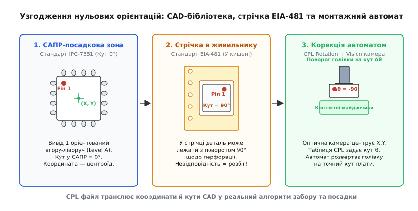
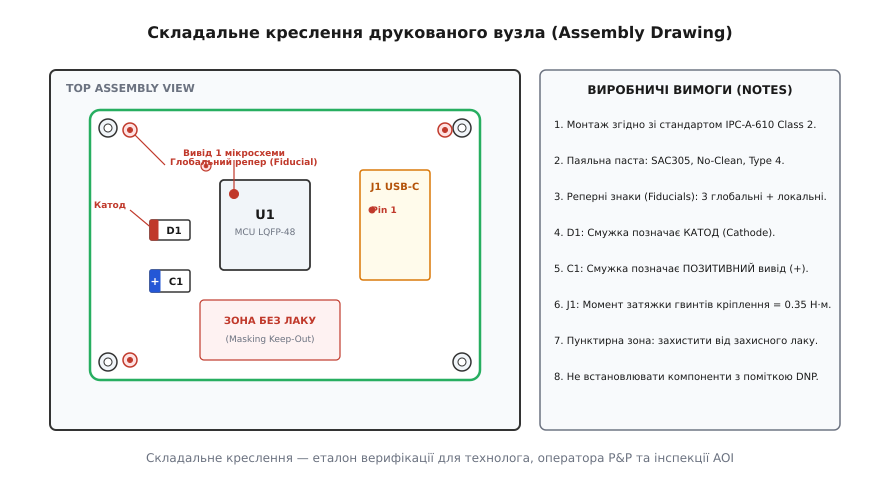

# Комплект для монтажу: паста, трафарет, pick&place, складальне креслення

<preknowlist>
- [Перелік компонентів (BOM)](root:hw-pcb/bom)
- [Трафаретний друк пасти](root:hw-pcb/smd-stencil)
- [Пайка оплавленням (Reflow Soldering)](root:hw-pcb/reflow-soldering)
- [Проектування посадкових місць (Footprint Design)](root:hw-pcb/footprint-design)
- [Монтаж та контроль BGA](root:hw-pcb/bga-assembly)
</preknowlist>

Коли партія виготовлених друкованих плат надходить на лінію автоматизованого поверхневого монтажу (SMT, Surface Mount Technology), наявності самих лише Gerber-файлів топології міді недостатньо для встановлення жодного компонента. Трасувальні шари показують, де має бути мідь, але складальний верстат не знає, яку саме мікросхему взяти з живильника, під яким кутом повернути вакуумну насадку, з яким зусиллям опустити деталь на плату і яка кількість паяльної пасти має бути нанесена через отвори трафарету. Якщо передати цеху неповний або неузгоджений набір даних, лінія зупиняється на етапі налаштування або випускає сотні бракованих виробів зі зміщеними виводами, короткими замиканнями під BGA та перевернутими полярними конденсаторами.

Для безперебійного автоматизованого складання формується **монтажний пакет** (англ. *Assembly Package* або *Assembly Release*) — стандартизований комплект цифрових інструкцій, хіміко-металургійних специфікацій та складальних креслень. Цей пакет поєднує чотири взаємопов'язані сутності: перелік компонентів (BOM), файл координат та орієнтацій центроїдів (CPL / Pick & Place), векторні шари апертур паяльної пасти (Gerber Paste Mask) та складальне креслення (Assembly Drawing) з технологічними примітками.

## Анатомія монтажного пакета

Автоматизована лінія SMT складається з послідовно з'єднаних конвеєром машин: трафаретного принтера (Stencil Printer), оптичного інспектора нанесення пасти (SPI, Solder Paste Inspection), високошвидкісного та прецизійного складальних автоматів (Pick & Place), конвекційної печі оплавлення (Reflow Oven) та системи автоматичної оптичної інспекції (AOI). Кожна з цих машин живиться власним шаром інформації з монтажного пакета:

```
┌──────────────────────────────────────────────────────────────────────────┐
│                     МОНТАЖНИЙ ПАКЕТ (ASSEMBLY PACKAGE)                   │
├───────────────────┬───────────────────┬─────────────────┬────────────────┤
│ 1. Специфікація   │ 2. Координати     │ 3. Геометрія    │ 4. Контрольне  │
│    компонентів    │    центроїдів     │    пасти        │    креслення   │
│    (BOM CSV/XLSX) │    (CPL / XY Data)│    (Gerber Paste│    (Assembly   │
│                   │                   │     GTP / GBP)  │     Drawing)   │
├───────────────────┼───────────────────┼─────────────────┼────────────────┤
│ • Designator      │ • Designator      │ • Форма отворів │ • Полярності   │
│ • MPN / SKU       │ • Mid X, Mid Y    │ • Редукція площі│ • Ключі Pin 1  │
│ • Package / Foot  │ • Rotation (0-360)│ • Розбивка падів│ • Зони без лаку│
│ • DNP / Fitted    │ • Layer (Top/Bot) │ • Товщина фольги│ • IPC Class 2/3│
└───────────────────┴───────────────────┴─────────────────┴────────────────┘
```

1. **Перелік компонентів (BOM, Bill of Materials)**: структурована таблиця, що пов'язує позиційне позначення компонента на схемі (Designator: `R1`, `C12`, `U4`) із конкретним заводським номером виробника (MPN, Manufacturer Part Number: `STM32F405RGT6`, `GRM188R71E104KA01D`), типом корпусу, точним описом номіналу та статусом монтажу (DNP — Do Not Populate / NM — Not Mounted). У промисловому виробництві BOM також обов'язково містить перелік дозволених вторинних замін (Approved Vendor List / Second Source) на випадок дефіциту компонентів у ланцюгу постачання.
2. **Файл координат центроїдів (CPL, Component Placement List / Pick-and-Place XY Data)**: машинний файл, що задає геометричний центр компонента (`Mid X`, `Mid Y`), кут його повороту (`Rotation`: від `0.0°` до `359.9°`) та монтажний шар плати (`Layer`: Top або Bottom). Для асиметричних деталей розрізняють три поняття центру: геометричний центр контактних майданчиків (Pad Center), оптичний центр симетрії корпусу (Package Center) та точку механічного вакуумного забору соплом (Pick Center).
3. **Шар паяльної пасти (Gerber Paste Masks: `*.GTP`, `*.GBP`)**: векторні шари у форматі Gerber RS-274X або Gerber X2, що визначають геометрію кожного отвору (апертури) у металевому трафареті для нанесення пасти на контактні майданчики.
4. **Складальне креслення (Assembly Drawing / Fabrication Drawing у форматі PDF/DXF)**: графічний документ із пошаровим зображенням друкованого вузла, де вказані візуальні індикатори виводу 1 мікросхем, полярності діодів і конденсаторів, механічні складальні одиниці (стійки, радіатори, гвинти з моментами затягування), зони нанесення захисного лаку та загальні виробничі вимоги за стандартом IPC-A-610.
5. **Файли оптичної та рентгенівської інспекції (AOI/AXI Data)**: комп'ютерні моделі плат, що генеруються на основі CAD-даних і містять точні 3D-габарити корпусів та геометрію паяних з'єднань для налаштування систем автоматичного контролю.

## Паяльна паста: металургія, хімія та реологія

Паяльна паста (Solder Paste) — це складна дисперсна суспензія, що складається з мікроскопічних металевих кульок припою (85–90% за масою, 50% за об'ємом), рівномірно розподілених у в'язкому рідкому флюсовому носії (Vehicle/Flux, 10–15% за масою). Її характеристики визначають температурний профіль оплавлення, надійність контактів і якість дозування через мікроапертури трафарету.

### Металургійні сплави
- **SAC305 (Sn96.5 Ag3.0 Cu0.5)**: сучасний безсвинцевий промисловий стандарт (RoHS). Точка плавлення становить `217–220 °C`. Срібло (Ag) підвищує механічну міцність і пластичність з'єднання завдяки утворенню дисперсних інтерметалідів Ag3Sn, а мідь (Cu) сповільнює розчинення мідних майданчиків плати в рідкому припої завдяки насиченню розплаву фазою Cu6Sn5. Пікова температура профілю в печі сягає `235–250 °C`.
- **Sn63Pb37 / Sn62Pb36Ag2**: класичні евтектичні олов'яно-свинцеві сплави. Мають чітку точку фазового переходу при `183 °C` без проміжного пастоподібного стану. Застосовуються в аерокосмічній, оборонній та медичній техніці завдяки високій стійкості до вібрацій, відсутності ризику росту олов'яних віскерів (Tin Whiskers) та низькій температурі паяння (`205–225 °C`).
- **Sn42Bi58 та Sn42Bi57Ag1**: низькотемпературні евтектичні сплави з точкою плавлення `138 °C`. Застосовуються для монтажу термочутливих компонентів (пластикові лінзи діодів, конектори з низькотемпературних полімерів) або для ступеневого монтажу (Step Soldering), коли вторинна сторона монтується за нижчої температури без розплавлення первинної.

### Хімічна класифікація флюсів
Флюсовий носій виконує три критичні функції: хімічно розчиняє оксидну плівку на поверхні міді та виводів деталей під час нагріву, захищає очищений метал від повторного окислення киснем повітря та забезпечує необхідні гідродинамічні властивості пасти під час друку.

За стандартами IPC J-STD-004 виділяють три головні класи флюсів:
- **No-Clean (безодмивний, класифікація ROL0 / ROL1)**: містить низьку концентрацію твердих речовин (Solid Content < 5%) на основі модифікованих синтетичних смол та слабких органічних кислот без вмісту галогенідів. Після проходження печі залишки флюсу полімеризуються, стають хімічно інертними, негігроскопічними та мають надвисокий опір ізоляції поверхні (SIR, Surface Insulation Resistance > 100 МОм). Вони не потребують обов'язкового відмивання, окрім випадків нанесення захисного лаку (де залишки смоли погіршують адгезію) або роботи у високочастотних колах.
- **Water-Soluble (водозмивний, Organic Acid / OA, класифікація ORM0 / ORH1)**: флюс на основі високоактивних водорозчинних органічних кислот. Забезпечує агресивне розчинення стійких оксидних шарів навіть на частково окислених виводах. Залишки після паяння є гігроскопічними, електропровідними та корозійно активними, тому плати обов'язково промивають у деіонізованій воді під тиском у струменевих установках відмивання з контролем іонної чистоти за тестом ROSE (Resistivity of Solvent Extract).
- **Rosin / RMA (Rosin Mildly Activated, класифікація ROM0 / ROM1)**: класичні каніфольні флюси з додаванням м'яких активаторів. Залишки змиваються спиртовими сумішами або вуглеводневими розчинниками.

### Розмір часток порошку та правило 5 кульок
Розмір металевих гранул стандартизовано за IPC J-STD-005. Неправильний вибір типу порошку призводить до забивання апертур трафарету та нестабільного об'єму дозування:

| Тип порошку (Powder Type) | Діапазон розміру часток (мкм) | Типовий крок компонентів (Pitch) | Мінімальний розмір апертури |
| :--- | :--- | :--- | :--- |
| **Type 3** | 25 – 45 | ≥ 0.65 мм (SOIC, 0805, 0603) | 225 мкм |
| **Type 4** | 20 – 38 | 0.5 – 0.4 мм (QFP, BGA, 0402) | 190 мкм |
| **Type 5** | 10 – 25 | 0.4 – 0.3 мм (CSP, Micro-BGA, 0201) | 125 мкм |
| **Type 6** | 5 – 15 | < 0.3 мм (Ultra-fine BGA, 01005) | 75 мкм |

В інженерній практиці застосовується **правило 5 кульок** (5-ball rule): ширина найвужчої апертури трафарету `W` повинна вміщувати щонайменше 4.5–5 найбільших кульок обраного типу порошку:

```
W_min = 5 · d_max                       [мінімальна ширина апертури за правилом 5 кульок]
```

Для порошку Type 3 найбільший діаметр частки `d_max = 45 мкм`, тому мінімальна ширина отвору трафарету становить `5 · 45 = 225 мкм`. Якщо спробувати нанести пасту Type 3 на контактні майданчики BGA з кроком 0.4 мм (де ширина апертури становить 160 мкм), великі металеві гранули застрягнуть на кромках отвору, утворивши механічну пробку, і під час підйому трафарету паста залишиться всередині сталевої фольги, а не на платі.

### Реологія, тиксотропія та гідродинаміка друку
Паяльна паста є неньютонівською рідиною з вираженою **тиксотропією** — її динамічна в'язкість експоненційно падає зі збільшенням швидкості зсуву (Shear Rate).

У стані спокою паста має високу в'язкість (понад 800–1000 Па·с), що запобігає осіданню важких металевих кульок на дно банки та розшаруванню суспензії. Коли сталевий або поліуретановий ракель (Squeegee) трафаретного принтера рухається по поверхні трафарету зі швидкістю 20–100 мм/с під фіксованим кутом 60° із зусиллям притискання 0.15–0.30 кг/см леза, у зоні контакту виникає зусилля зсуву. В'язкість пасти миттєво знижується у 5–10 разів (до 100–150 Па·с): паста перетворюється на текучу масу, що котиться циліндричним валиком перед кромкою ракеля і під тиском затікає в мікроскопічні отвори фольги.

Після того, як ракель проходить над отвором і навантаження зникає, починається фаза тиксотропного відновлення (Thixotropic Recovery). Якщо паста відновлює в'язкість занадто повільно, сформований прямокутний стовпчик пасти розпливається під дією власної ваги (дефект Slump), торкається сусіднього майданчика і під час оплавлення утворює коротке замикання (Solder Bridging). Якщо відновлення відбувається занадто швидко (ще до повного вертикального підйому трафарету), паста міцно зчіплюється зі сталевими стінками отвору й відривається від мідного майданчика плати.

Критичним параметром є швидкість вертикального відриву трафарету від плати (Separation Speed, від 0.1 до 3.0 мм/с). Для компонентів із дрібним кроком (BGA 0.4 мм, CSP) відрив налаштовують на наднизьку швидкість (0.1–0.3 мм/с), щоб сили поверхневого натягу встигли відірвати стовпчик пасти від стінок без утворення загострених піків («собачих вух», dog-ears), які під час переміщення плати по конвеєру падають і спричиняють міжвивідні перемички.

## Розрахунок геометрії трафарету та механіка переносу пасти

Трафарет (SMD Stencil) виготовляється з нержавіючої аустенітної сталі товщиною від 80 до 150 мкм методом прецизійного волоконного лазерного різання з наступним електрополіруванням або нанесенням гідрофобного нанопокриття (Nano-coating). Покриття зменшує адгезію флюсу до стінок апертур і збільшує коефіцієнт виходу пасти (Paste Transfer Efficiency) з 70% до 90–95%.

```
      ◄─── W (Ширина отвору) ───►
  ┌─────────────────────────────────┐ ▲
  │      СТАЛЕВИЙ ТРАФАРЕТ          │ │
  │                                 │ │ T (Товщина фольги)
  │      ┌──────────────────┐       │ │
  │      │  ПАЯЛЬНА ПАСТА   │       │ ▼
──┴──────┴──────────────────┴───────┴──
  ═══════════════════════════════════   ▲ Контактний майданчик
         ДРУКОВАНА ПЛАТА (Мідь)         │ друкованої плати
```

Механіка виходу пасти визначається конкуренцією двох сил:
1. **Сила адгезії пасти до мідного майданчика плати**, пропорційна площі основи отвору: `A_pad = W · L`.
2. **Сила тертя та зчеплення пасти зі стінками сталевого отвору**, пропорційна площі бічних стінок: `A_walls = 2 · (W + L) · T`.

Щоб паста гарантовано залишилася на платі, а не всередині трафарету під час його підйому, стандарт IPC-7525 встановлює два обов'язкові геометричні критерії:

### 1. Аспектне відношення (Aspect Ratio)
Відношення ширини найвужчої апертури `W` до товщини фольги трафарету `T`:

```
AR_aspect = W / T                       [аспектне відношення ширини до товщини]
```

За вимогами IPC-7525 аспектне відношення для прямокутних отворів повинно задовольняти умову:

```
AR_aspect ≥ 1.5                         [критерій допустимого аспектного відношення]
```

### 2. Площинне відношення (Area Ratio)
Відношення площі основи апертури до сумарної площі її вертикальних бічних стінок:

```
AR_area   = (W · L) / (2 · (W + L) · T) [площинне відношення для прямокутної апертури]
AR_circle = D / (4 · T)                 [площинне відношення для круглого отвору BGA]
```

Критичний поріг виходу пасти за IPC-7525:

```
AR_area ≥ 0.66                          [мінімальне площинне відношення за IPC-7525]
```

Якщо `AR_area < 0.66`, площа стінок перевищує критичну межу, і сила тертя утримує пасту всередині трафарету. На майданчик потрапляє менше 50% розрахункового об'єму припою, що утворює сухий або ненадійний контакт (дефект Insufficient Solder).

### Модифікація апертур: термальні майданчики та захист від надгробків
Пряме копіювання геометрії мідного майданчика у шар трафарету 1:1 допустиме лише для стандартних чіп-компонентів 0805 та 0603. Для критичних корпусів застосовують інженерну модифікацію апертур:

- **Розбивка центральних термальних майданчиків (Window Paning / Thermal Pad Reduction)**: мікросхеми в корпусах QFN, DFN, PowerPAK мають великий металевий майданчик тепловідведення під черевом чіпа (Exposed Pad). Якщо нанести пасту суцільним шаром 100%, під час нагріву леткі компоненти флюсу не зможуть вийти назовні, утворюючи гігантські газові порожнини (Voiding > 50%), а сам чіп спливе на рідкому припої (Component Floating), через що його бічні сигнальні ніжки піднімуться над платою й не запаяються. Апертуру розбивають на матрицю дрібних віконець («шибок» 2×2, 3×3 або 4×4) із сумарним покриттям 40–65% від загальної площі міді та перемичками 0.2–0.3 мм між ними.
- **Антинадгробні апертури (Anti-Tombstoning Apertures: Home-Plate, Bow-Tie)**: для дрібних двовивідних резисторів та конденсаторів (0402, 0201) внутрішні краї апертур зрізають під кутом (форма «домашньої бази» у бейсболі). Це зменшує об'єм припою під внутрішнім краєм деталі й балансує моменти сил поверхневого натягу на протилежних контактах, запобігаючи підйому чіпа сторчма на один вивід (ефект надгробного каменю / Tombstoning).
- **Редукція кроку (Fine-Pitch Reduction)**: для мікросхем QFP/QFN із кроком 0.4–0.5 мм ширину апертури зменшують на 10–15% від ширини мідного майданчика (наприклад, з 0.22 мм до 0.18 мм), щоб створити запас для розширення пасти під час опускання компонента і запобігти замиканню сусідніх виводів.

## Розрахунковий модуль верифікації апертур

У виробничих САПР та скриптах автоматизованої підготовки даних (CAM Automation) геометричні параметри трафарету розраховуються для кожного контактного майданчика. Нижче наведено обчислювальний модуль перевірки аспектного і площинного відношень та правила 5 кульок мовами C99 та C++20.

:::tabs
@tab C99
:::code komplekt-dlia-montazhu-d/c/main.c
@tab C++20
:::code komplekt-dlia-montazhu-d/cpp/main.cpp
:::

## Pick & Place: координати, орієнтація та оптичне центрування

Складальний автомат SMT Pick & Place — це високоточний робот із числовим програмним керуванням, здатний встановлювати від 15 000 до понад 100 000 компонентів на годину з точністю позиціонування до ±15–25 мкм.

Автомат складається з банку живильників (Feeders), куди заправляються стрічки з деталями на котушках (Reels), пенали (Tubes) або матричні піддони (Waffle Trays); рухомої портальної голівки з набором вакуумних сопел (Nozzles); верхньої камери розпізнавання плати (Top Optical Vision) та нижньої камери розпізнавання компонентів на льоту (Bottom Vision / Flying Vision).


*Узгодження нульових орієнтацій компонентів. Зліва — визначення нульового кута 0° у САПР за стандартом IPC-7351 (Вивід 1 вгорі ліворуч). По центру — розташування деталі в блістерній стрічці за стандартом EIA-481 (Вивід 1 повернутий на 90°). Справа — корекція кута голівкою P&P на основі таблиці CPL.*

### Реперні знаки (Fiducial Markers)
Друкована плата під час нагріву, хімічного травлення та механічного свердління зазнає нелінійних пружних і термічних деформацій: масштабування по осях `X` і `Y`, кутового перекосу та прогину. Щоб компенсувати ці відхилення, автомат перед початком складання сканує верхньою камерою оптичні реперні знаки (Fiducials):

- **Глобальні репери (Global Fiducials)**: щонайменше 3 знаки, розташовані по периметру плати (або на технологічних полях мультипанелі) якнайдалі один від одного. Трьох точок математично достатньо для розрахунку матриці афінного перетворення, що компенсує зміщення за осями X і Y, кут повороту плати в затискачах конвеєра, нерівномірне термічне розтягнення склотекстоліту FR-4 та трапецеподібний перекіс кутів.
- **Локальні репери (Local Fiducials)**: пара реперів, розташованих по діагоналі безпосередньо біля компонентів із наддрібним кроком (QFP/QFN із кроком < 0.5 мм, BGA/CSP). Вони дозволяють оптичній системі скоригувати локальне зміщення координат контактних майданчиків саме під цією мікросхемою перед її опусканням.

Конструкція репера: суцільний круглий мідний диск діаметром `1.0 мм` (без отворів, покритий ENIG або HASL), відкритий від паяльної маски круглим вікном діаметром `2.0–3.0 мм`. Навколо репера створюється заборонена зона (Keep-Out) радіусом не менше 3.0 мм, де заборонено розміщувати доріжки, полігони, шовкографію чи перехідні отвори, щоб оптична система машинного зору верстата не сплутала репер із сусіднім металевим елементом.

### Стандарти орієнтації IPC-7351 проти EIA-481
Найпідступнішим джерелом масового браку під час автоматизованого монтажу мікросхем є конфлікт нульових орієнтацій між бібліотекою САПР та заводським пакуванням деталей у стрічки:

1. **Стандарт проектування бібліотек посадкових місць (IPC-7351 Level A / Level B)**: регламентує положення деталі при нульовому куті повороту (`Rotation = 0°`). За рівнем Level A мікросхеми в прямокутних та квадратних корпусах (SOIC, QFP, QFN, BGA) мають вивід 1 у верхньому лівому кутку (Top-Left), а двовивідні чіп-компоненти (0603, 0402) розташовані горизонтально з першим контактом (Pin 1 / Cathode / Anode) ліворуч.
2. **Стандарт пакування компонентів у стрічки на котушках (EIA-481)**: регламентує орієнтацію деталі всередині тисненої кишені блістерної стрічки щодо круглих отворів перфорації напрямку протягування. Для більшості мікросхем SOIC/QFP стандарт EIA-481 вимагає розміщення виводу 1 у верхньому правому кутку (Top-Right, що відповідає куту 90° за годинниковою стрілкою щодо напрямку подачі стрічки).

Якщо інженер експортує CPL безпосередньо з САПР без урахування специфікації живильників, складальний автомат візьме мікросхему зі стрічки, вважаючи її початковий кут нульовим, і встановить її на плату з поворотом на 90° або 180°. Для усунення цієї розбіжності технологічне програмне забезпечення верстата Pick & Place містить таблицю корекції кутів живильників (Feeder Pick Angle Offset).

### Вакуумні насадки та динамічне профілювання посадки
Забір та перенесення деталей виконують спеціальні змінні вакуумні сопла (Nozzles). Їхня геометрія та матеріал наконечника підбираються під розміри корпусу:
- **Антистатичний силікон / гума**: застосовується для великих і важких компонентів (електролітичні конденсатори, дроселі, реле) для щільного прилягання до нерівних поверхонь.
- **Технічна кераміка (Ceramic Nozzles)**: надтверді насадки для мікрокомпонентів 0402, 0201 та 01005. Вони не зношуються від тертя та мають абсолютну площинність торця.
- **Електропровідний поліоксиметилен (ESD POM)**: захищає чутливі кристали мікросхем від електростатичних розрядів.

Усередині сопла встановлено датчик вакуумного розрідження (Vacuum Pressure Sensor). Якщо під час руху голівки розрідження зникає, верстат фіксує втрату компонента, скидає координату в журнал помилок і бере наступну деталь.

Коли сопло опускає деталь на контактні майданчики, вертикальний рух по осі `Z` суворо профілюється (Z-Touchdown Profiling). Якщо опустити деталь занадто високо, виводи не торкнуться пасти, і деталь зміститься під час руху конвеєра. Якщо опустити деталь з надмірним зусиллям (Placement Force > 3–5 Н), виводи видавлять паяльну пасту за межі майданчиків, що гарантовано утворить кульки припою (Solder Beads) та замикання під корпусом. Оптимальне зусилля посадки становить `1.5–2.5 Н` для великих мікросхем та менше `0.5 Н` для дрібних чіпів 0201/01005, занурюючи вивід у пасту на 30–50% її початкової товщини.

Камера нижнього огляду (Bottom Vision / Flying Vision) фотографує компонент на соплі безпосередньо під час його руху від живильника до плати. Алгоритм комп'ютерного зору за частки мілісекунди обчислює зміщення центру деталі щодо осі сопла та кутовий перекіс, вводячи динамічну поправку в координати посадки без уповільнення роботи робота.

## Панелізація, двосторонній монтаж та технологічні обмеження

Для забезпечення високої продуктивності автоматизованої лінії дрібні та середні друковані плати об'єднують у технологічні мультипанелі (Panelization). Лінія SMT монтує всю панель за один прохід конвеєра.

```
┌─────────────────────────────────────────────────────────────────┐  ▲
│ (О) Репер 1      ТЕХНОЛОГІЧНЕ ПОЛЕ ПАНЕЛІ (Breakaway)   [|||||] │  │ 5-10 мм
├─────────────────────────────────────────────────────────────────┤  ▼
│ ┌───────────────┐ ┌───────────────┐ ┌───────────────┐          │
│ │   ПЛАТА 1     │ │   ПЛАТА 2     │ │   ПЛАТА 3     │          │
│ │               │ │               │ │               │          │
│ └───────────────┘ └───────────────┘ └───────────────┘          │
│        ▲                 ▲                 ▲                   │
│      V-Cut             V-Cut             V-Cut                 │
├─────────────────────────────────────────────────────────────────┤  ▲
│ [|||||] DataMatrix       ТЕХНОЛОГІЧНЕ ПОЛЕ       (О) Репер 2    │  │ 5-10 мм
└─────────────────────────────────────────────────────────────────┘  ▼
```

### Технологічні поля та методи розділення панелей
1. **Технологічні поля (Breakaway Rails / Tooling Strips)**: бічні технологічні смуги завширшки `5–10 мм` по краях панелі. На них розміщують реперні знаки, нематалізовані технологічні отвори позиціонування конвеєра (Tooling Holes `⌀ 3.2 мм` з допуском +0.05/-0.00 мм) та DataMatrix штрихкоди відстежуваності партії.
2. **V-подібний надріз (V-Scoring / V-Cut)**: дискові алмазні фрези надрізають панель із двох сторін під кутом 30° або 45°, залишаючи центральну перемичку склотекстоліту завтовшки `0.3–0.4 мм`. Панелі розділяються на дискових сепараторах практично без пилу.
3. **Табове фрезерування (Tab-Routing з перфорацією Mouse Bites)**: контур плат повністю прорізається кінцевою фрезою, залишаючи вузькі перемички (мостики завширшки 1.0–1.5 мм) з перфорацією з дрібних отворів `⌀ 0.5–0.8 мм`.

Під час механічного розділення панелі (De-paneling) виникає локальне згинальне напруження (Flex Stress). Керамічні багатошарові конденсатори (MLCC у діелектриках X7R, X5R, Y5V) є крихкими: вигин склотекстоліту всього на `0.5–1.0 мм` призводить до виникнення внутрішніх мікротріщин (Flex Cracking). Конденсатор може успішно пройти всі функціональні тести на заводі, але вийде з ладу через кілька тижнів експлуатації у клієнта внаслідок короткого замикання через адсорбовану вологу. Тому конденсатори розміщують на відстані не менше `3.0–5.0 мм` від ліній надрізу V-Cut або перфорацій Mouse Bites та орієнтують їх поздовжньо до очікуваної лінії вигину.

### Двосторонній монтаж та утримання компонентів у печі
Якщо плата містить компоненти на обох сторонах, вона двічі проходить крізь піч оплавлення. Спочатку монтується сторона з легшими компонентами (Side 1 / Bottom). Потім плата перевертається (Flipping), на сторону 2 (Top) наноситься паста, встановлюються мікросхеми, і панель знову заходить у піч.

Коли сторона 2 знаходиться зверху, компоненти сторони 1 висять донизу у розплавленому стані припою. Вони не падають у ванну печі завдяки силі поверхневого натягу рідкого металу:

```
F_surface = 2 · (W + L) · γ · cos(θ)    [сила поверхневого натягу рідкого припою]
F_gravity = m · g                       [сила тяжіння компонента]
```

де коефіцієнт поверхневого натягу рідкого SAC305 становить приблизно `0.45–0.50 Н/м` при 240 °C, розміри контактних майданчиків дорівнюють `W` та `L`, а `θ` позначає кут змочування.

В інженерних розрахунках користуються перевіреним емпіричним критерієм питомого навантаження:

```
m_ratio = m / A_total                   [питоме навантаження на контактні майданчики]
```

де допустима межа надійності утримання становить:

```
m_ratio < 30 мг / мм²                   [граничне співвідношення маси до площі падів]
```

Якщо відношення маси компонента до сумарної площі його контактних майданчиків перевищує `30 мг/мм²` (масивні екрани, трансформатори, дроселі живлення, важкі електроліти), деталь відірветься і впаде під дією сили тяжіння. Такі компоненти монтують виключно на верхній стороні (Side 2), фіксують точками термостійкого клею (SMD Adhesive Dispensing) під час першого проходу або запаюють методом селективного паяння (Selective Soldering) після основного циклу SMT.

## Складальне креслення та стандартизація за IPC-A-610

Складальне креслення (Assembly Drawing) є юридичним та інженерним еталоном для верифікації готової продукції відділом технічного контролю (ВТК), операторами автоматичної оптичної інспекції та спеціалістами контрактного виробництва.


*Анатомія складального креслення. Показано контур друкованої плати, глобальні та локальні репери, візуальні індикатори полярності діодів і танталових конденсаторів, позначення виводу 1 мікросхем, зони захисту від лакування та таблицю виробничих вимог.*

### Обов'язкові елементи складального креслення
1. **Контур плати та габаритні прив'язки**: точні розміри плати, радіуси заокруглення кутів, координати кріпильних отворів та базові нульові осі координат.
2. **Графічне відображення корпусів та позиційні позначення (RefDes)**: кожен компонент зображується у реальному масштабі з відповідним контуром корпусу та чітко читабельним підписом (`R1`, `C4`, `U2`). Для плат із високою щільністю монтажу підписи виносяться лініями-виносками у вільні зони креслення.
3. **Маркування полярностей та орієнтацій**:
   - Діоди: чітка товста смуга або маркер з боку **катода** (Cathode).
   - Танталові SMD-конденсатори: смуга на корпусі позначає **позитивний вивід (+)** (на відміну від алюмінієвих електролітичних конденсаторів, де смуга завжди позначає мінус!).
   - Світлодіоди (LED): графічний символ діода на шовкографії або літера `K` (катод) біля відповідного майданчика.
   - Інтегральні схеми: точка біля виводу 1 (Pin 1 Dot), скошений кут корпусу або напівкругла виїмка (Notch) на торці.
   - Багатоконтактні розніми: цифра `1` біля першого виводу та графічна стрілка нумерації контактного ряду.
4. **Виробничі примітки (General Notes)**:
   - Посилання на галузевий стандарт приймання: **IPC-A-610** (Acceptability of Electronic Assemblies).
   - Вказівка класу надійності виробу: **Class 1** (загальна споживча електроніка), **Class 2** (промислова апаратура з підвищеним ресурсом) або **Class 3** (критична апаратура безперервної дії: авіоніка, військові системи, медичні імпланти та апарати життєзабезпечення).
   - Тип паяльної пасти та припою (наприклад, `SAC305 No-Clean Type 4`).
   - Моменти затягування різьбових з'єднань (наприклад: `Гвинти М3 кріплення радіатора: 0.35 Н·м ± 0.05 Н·м`).
   - Межі зон нанесення та захисту від захисного лаку (Conformal Coating Keep-Out Zones) — контактні площадки рознімів, кнопки, RF-екрани, кварцові резонатори та оптичні датчики, куди потрапляння лаку суворо заборонено.
   - Перелік невстановлюваних деталей (DNP Table: Do Not Populate).

## Системи автоматичного контролю: SPI, AOI та AXI

Сучасна лінія поверхневого монтажу функціонує як замкнена система автоматизованого контролю якості зі зворотним зв'язком (Closed-Loop Quality Control):

```
┌─────────────┐    ┌─────────────┐    ┌─────────────┐    ┌─────────────┐    ┌─────────────┐
│ ТРАФАРЕТНИЙ │───►│   3D SPI    │───►│ PICK&PLACE  │───►│    ПІЧ      │───►│   3D AOI    │
│   ПРИНТЕР   │    │  ІНСПЕКЦІЯ  │    │  АВТОМАТ    │    │ ОПЛАВЛЕННЯ  │    │   ТА AXI    │
└─────────────┘    └─────────────┘    └─────────────┘    └─────────────┘    └─────────────┘
       ▲                  │
       └──────────────────┘  Зворотний зв'язок: корекція зміщення трафарету
```

1. **3D SPI (Solder Paste Inspection)**: лазерний або структуровано-оптичний інтерферометричний 3D-сканер, розташований безпосередньо після трафаретного принтера. Він сканує кожен контактний майданчик і вимірює висоту нанесеного стовпчика пасти, його площу та розраховує 3D-об'єм. Якщо об'єм пасти відхиляється більш ніж на ±20–25% від номіналу або виявлено місток між виводами QFN, принтер автоматично зупиняє лінію, ініціює цикл вологого очищення трафарету розчинником і вносить поправку в координати суміщення ракеля. Дефектна плата відправляється на відмивання до встановлення компонентів, що рятує дорогі мікросхеми.
2. **3D AOI (Automated Optical Inspection)**: багатокамерна система зі стробоскопічним RGB-підсвічуванням різнокольоровими кільцями світлодіодів, встановлена після печі оплавлення. Вона аналізує відбиття світла від увігнутого меніска галтелі припою, виявляючи перекоси компонентів (Skew), підйом виводів над майданчиком (Coplanarity Lift), відсутність контакту, надгробні камені (Tombstoning) та зчитує лазерне маркування мікросхем методом оптичного розпізнавання символів (OCR) для верифікації правильності встановленого номіналу за BOM.
3. **2.5D / 3D AXI (Automated X-ray Inspection)**: рентгенівська інспекція, незамінна для прихованих контактів масивів кулькових виводів BGA, CSP та безвивідних корпусів QFN. Рентгенівські промені просвічують плату наскрізь, формуючи пошарові томографічні зрізи паяних з'єднань. Комп'ютерний алгоритм розраховує відсоток газових порожнин (Voiding Analysis) всередині кульки BGA (за стандартом IPC-7095 сумарна порожнистість не повинна перевищувати 15–25% площі кулі) та виявляє мікроперемички під непрозорим корпусом мікросхеми.

## Автоматизація міжфайлової валідації

Ручна перевірка узгодженості між BOM (сотні рядків у CSV/Excel) та CPL (тисячі координат X/Y) забирає багато годин і через людський фактор не гарантує відсутності прихованих дефектів. Найменша розбіжність ревізій файлів або помилка в полярності зупиняє виробничу лінію з погодинною вартістю простою в тисячі доларів.

Для повної автоматизації верифікації монтажного комплекту використовується спеціалізований інструмент, алгоритми та повна промислова реалізація якого на C99 та C++20 представлені у практичній вставці [proj-cpl-bom-validator.md](root:hw-pcb/komplekt-dlia-montazhu/proj-cpl-bom-validator.md). Валідатор виконує автоматичне перехресне зіставлення списків, виявляє фантомні компоненти, перевіряє відповідність статусів DNP та нормалізує кути повороту компонентів до єдиного канонічного формату ще до того, як виробничі файли потраплять до операторів верстатів.

Ретельно підготовлений та автоматично валідований монтажний пакет перетворює абстрактну топологію друкованої плати на передбачуваний і бездоганний технологічний процес автоматизованого складання, де кожен компонент займає своє точне місце з першого проходу конвеєра.