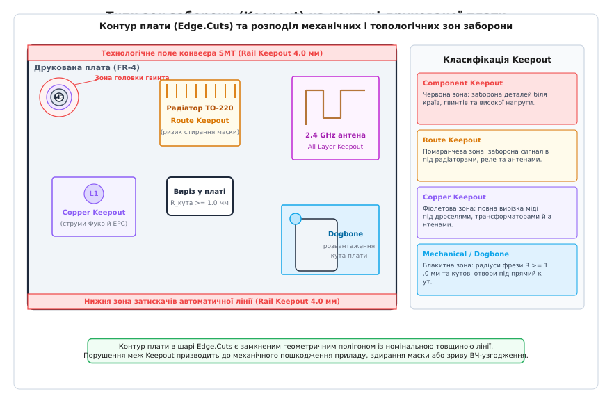
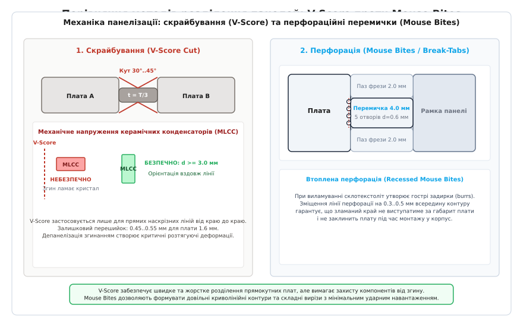

# Контур плати, кріплення й зони заборони

<preknowlist>
- [Друкована плата (PCB layout)](root:hw-pcb/pcb-layout) — базові принципи топології, шари міді та зворотні шляхи струмів.
- [Зазори на платі: creepage та clearance](root:hw-pcb/creepage-clearance) — електрична міцність ізоляції та шляхи поверхневого витоку.
- [Шарування плати (PCB stackup)](root:hw-pcb/pcb-stackup) — структура діелектриків, внутрішні та зовнішні шари фольги.
</preknowlist>

Коли зібрана партія з сотні плат уперше потрапляє на автоматичну лінію монтажу, вона може перетворитися на металобрухт ще до того, як на неї подадуть перший міліампер струму. Автоматичний установник компонентів захоплює заготовку конвеєрними рейками завширшки 3.5 мм — і сталевий затискач чавить встановлені впритул до краю плати керамічні блокувальні конденсатори корпусу 0402. Далі, під час прикручування плати до алюмінієвого корпусу, сталева головка гвинта М3 із зовнішнім діаметром 5.5 мм та пружинною шайбою здирає тонкий шар захисної паяльної маски завтовшки 20 мкм і замикає внутрішній полігон живлення +12 В на заземлене шасі приладу. На завершення, під час розділення плати з панелі вздовж надрізу скрайбування (V-Score), деформація згину склотекстоліту рве припаяні поруч багатошарові керамічні конденсатори, утворюючи невидимі оку мікротріщини в діелектрику, які перетворяться на коротке замикання через три тижні роботи приладу у замовника.

Кожна з цих аварій трапляється не через помилку в електричній принциповій схемі, а через ігнорування просторової взаємодії друкованої плати з виробничим обладнанням, механічним кріпленням та фізичними полями сусідніх вузлів. Друкована плата (англ. *printed circuit board*, PCB) є не лише електричним носієм топологічних провідників, а й повноцінною механічною деталлю приладу з суворими допусками на геометрію контуру, отвори кріплення та заборонені для монтажу ділянки. Для запобігання механічним та електромагнітним колізіям у сучасних САПР запроваджено концепцію зон заборони (англ. *keepout zones*) — спеціальних геометричних областей, які накладають безумовні обмеження на розміщення компонентів, трасування доріжок та заливку суцільної міді.

## 1. Геометрія контуру плати: шар Edge.Cuts та механічні шари

Будь-яке проєктування топології починається зі створення контуру плати (англ. *board outline*). У форматах Gerber RS-274X, Gerber X2, ODB++ та IPC-2581 контур плати експортується в окремому механічному шарі. В екосистемі KiCad цей шар називається `Edge.Cuts`, в Altium Designer — `Keep-Out Layer` або призначений користувачем механічний шар `Mechanical 1 (Board Outline)`, у Cadence Allegro / OrCAD — підклас `Board Geometry / Outline` або `Design_Outline`.


*Контур плати в шарі Edge.Cuts із розподілом технологічних полів під конвеєр SMT (Component Keepout 4.0 мм), кріпильного отвору М3 із зоною заборони міді й деталей, теплового радіатора (Route Keepout), імпульсного дроселя L1 (Copper Keepout), друкованої антени (All-Layer Keepout) та кутового розвантаження типу Dogbone.*

### Замкненість полігональних контурів

Контур плати в шарі `Edge.Cuts` повинен являти собою строго **замкнений несамоперетинний геометричний контур** (англ. *closed non-self-intersecting loop*), складений із прямолінійних відрізків та дуг кіл. Будь-який розрив у контурі — навіть мікроскопічна щілина довжиною `0.001` мм між кінцями ліній — викликає збій у CAM-системах (англ. *Computer-Aided Manufacturing*) на заводі з виробництва плат.

Коли автоматизований конвертер формує траєкторію руху фрези числового програмного керування (ЧПК, англ. *CNC routing*), алгоритм повинен однозначно визначити, яка область простору є матеріалом плати (внутрішня зона), а яка — відходами виробництва (зовнішня зона). Якщо контур розімкнений або містить лінії, що перетинаються між собою «вісімкою», CAM-софт не може розрахувати еквідистанту зміщення інструмента (команди `G41/G42` компенсації радіуса фрези) і зупиняє обробку проєкту на стадії вхідного аудиту (DFM-перевірка, англ. *Design for Manufacture*).

### Товщина ліній та осьова інтерпретація

У середовищі САПР лінії шару `Edge.Cuts` малюються з номінальною товщиною (наприклад, `0.05` мм або `0.1` мм) для зручності візуалізації на екрані. Однак на виробництві CAM-процесор трактує лінію контуру як **математичну вісь нескінченно малої товщини (centerline)**. 

Краї різання формуються саме по геометричній осі вектора. Тому, якщо інженер накреслив прямокутник розміром `100.0 × 50.0` мм лінією товщиною `0.5` мм, фізичний розмір готової відфрезерованої плати після проходження шпинделя з фрезою становитиме точно `100.0 × 50.0` мм за осьовими координатами, а не `99.5 × 49.5` мм.

### Внутрішні вирізи, пази та допуски

Якщо всередині плати потрібні отвори складної форми — вікна під роз'єми, пази під установку субмодулів або ізоляційні прорізи між високовольтними ланцюгами, — вони наносяться в тому ж самому шарі `Edge.Cuts` окремими замкненими контурами. 

Стандартні допуски на механічну обробку контуру становлять:
1. **Фрезерування контуру ЧПК (CNC Routing):** стандартний допуск `±0.10` мм, підвищена точність — `±0.05` мм.
2. **Скрайбування (V-Scoring):** допуск на лінійне положення осі надрізу `±0.15` мм, залишковий перешийок по товщині `±0.05` мм.
3. **Штампування (Punching / Die cutting):** для масових дешевих плат на гетинаксі або тонкому текстоліті — допуск `±0.20` мм.

Якщо механічний відсік корпусу розрахований на розмір плати `50.0` мм без запасу, виготовлена за стандартним класом плата може мати габарит `50.1` мм і не ввійде в пази напрямних корпусу. Проєктуючи контур, інженер зобов'язаний закладати конструкційний зазор не менше `0.2–0.3` мм на кожен бік.

## 2. Зони заборони розміщення компонентів (Component Keepout)

Зона заборони розміщення компонентів (англ. *Component Keepout Zone*) визначає область друкованої плати, де заборонено розташовувати будь-які електронні деталі, їхні контактні площадки або корпусні виступи. Це обмеження діє як на верхній (`Top`), так і на нижній (`Bottom`) сторонах плати або на обох одночасно.

### Технологічні поля та рейки конвеєра (SMT Rail Clearance)

Сучасний автоматизований монтаж друкованих плат виконується на лініях поверхневого монтажу (англ. *Surface Mount Technology*, SMT). Плата або групова панель рухається крізь трафаретний принтер нанесення паяльної пасти, швидкісні установники компонентів (англ. *pick-and-place machines*) та багатозонну конвеєрну піч оплавлення (англ. *reflow oven*). 

Уздовж руху заготовка фіксується за верхній та нижній краї рухомими ременями та металевими притискними планками конвеєра:
- Стандартна ширина захвату конвеєра становить від `3.0` мм до `5.0` мм (типове галузеве значення — **`4.0` мм**).
- У межах цієї смуги (англ. *conveyor rail keepout*) заборонено встановлювати будь-які компоненти. Якщо елемент розташований ближче ніж `3.5–4.0` мм від краю, металевий ролик чи напрямна конвеєра вдарить по його корпусу, змістить деталь зі свіжонанесеної пасти або розчавить її притискним зусиллям.
- Якщо топологія плати вимагає розміщення компонентів під самий край (наприклад, крайні виводи роз'ємів USB, micro-SD слотів або світлодіодів індикації), плату не монтують як одиничну заготовку. Її обов'язково об'єднують у технологічну виробничу панель із додаванням бічних технологічних полів (англ. *breakaway rails / panel borders*), які несуть конвеєрне навантаження і пізніше відламуються.

### Зазор до краю при депанелізації

Край плати — зона підвищеного механічного напруження. Під час механічного випилювання дисковою пилкою, скрайбування або виламування з перемичок склотекстоліт FR-4 зазнає локального розшарування (англ. *delamination*) та мікротріщин смоли, що проникають углиб матеріалу на глибину до `0.3–0.5` мм від зрізу.

> 🔧 **Навіщо це.** Керамічний конденсатор, припаяний за `0.5` мм від краю, під час депанелізації панелі отримує колосальне навантаження згину. Оскільки припій має міцне зчеплення з металізованими виводами та мідними площадками, деформація склотекстоліту передається на тендітний керамічний брусок титанату барію. Виникає внутрішній зсувний скол, який перетворює конденсатор на бомбу сповільненої дії. Мінімальний безпечний відступ для корпусів SMD-пасивних деталей до краю фрезерування становить **`1.0` мм**, а до лінії скрайбування V-Score — не менше **`3.0` мм** (із переважною орієнтацією вздовж лінії зламу).

### Зони навколо кріпильних отворів (Mounting Holes)

Кріпильні отвори (англ. *mounting holes*) забезпечують жорстку фіксацію плати у приладовому корпусі, на стійках або шасі. Типова помилка початківця — накласти заборону розміщення компонентів лише на внутрішній діаметр свердління отвору (наприклад, `3.2` мм під гвинт М3). 

Реальна зона механічного впливу складається з чотирьох концентричних областей:

```
[ Діаметр свердління d_hole ] 
     ↓ 
[ Діаметр мідного кільця / металізації d_pad ] 
     ↓ 
[ Зовнішній діаметр головки гвинта / шайби d_screw ] 
     ↓ 
[ Інструментальний конверт викрутки / головки ключа d_tool ]
```

1. **Діаметр свердла (`d_hole`):** для різьби М3 стандартний діаметр вільного проходу складає `3.2` мм (середній клас за ISO 273) або `3.4` мм (вільний клас).
2. **Головка гвинта та шайба (`d_screw`):** стандартний гвинт М3 із циліндричною головкою за DIN 912 (ISO 4762) має діаметр головки `5.5` мм. Пласка підкладна шайба за DIN 125 має зовнішній діаметр `7.0` мм, а збільшена шайба за DIN 9021 — аж `9.0` мм. Під час затягування гвинта із зусиллям `0.6–1.0` Н·м шайба втискається в поверхню плати. Будь-який SMD-компонент, розміщений ближче за радіус шайби плюс гарантійний допуск `0.5` мм (тобто в радіусі менше `4.0–5.0` мм від центру отвору), буде знесений або розчавлений металом шайби.
3. **Інструментальний конверт (`d_tool`):** наконечник біти електричного шуруповерта, торцевий шестигранний ключ або голівка затяжного інструмента мають зовнішній діаметр від `8.0` мм до `12.0` мм. Високі електролітичні конденсатори, масивні індуктивності, клемники та роз'єми не повинні стояти в межах конуса доступу інструмента, інакше збиральник на заводі під час монтажу корпусу вдарить інструментом по сусідніх компонентах.
4. **Зона роздавлювання діелектрика (FR-4 Crush Zone):** тиск під затягнутим гвинтом перевищує межу пружності епоксидного сполучного матеріалу FR-4, що призводить до мікроруйнувань скловолокна. На внутрішніх шарах друкованої плати навколо кріпильного отвору роблять відступ міді (англ. *copper pullback*) на відстань не менше `0.5–1.0` мм за межі радіуса шайби. Це гарантує, що навіть при деформації текстоліту, продавлюванні маски та потраплянні металевого задирка від гвинта не виникне короткого замикання на внутрішні шари живлення чи сигнальні шини.

### Металізовані (PTH) проти неметалізованих (NPTH) отворів

Кріпильні отвори бувають двох типів:
- **NPTH (Non-Plated Through Hole):** неметалізований отвір без міді на стінках. Використовується для повної електричної ізоляції плати від корпусу. Навколо NPTH обов'язково задається кругова зона заборони міді на всіх шарах, щоб запобігти випадковому замиканню при перекосі гвинта.
- **PTH (Plated Through Hole):** металізований отвір, що з'єднує зовнішні контактні площадки з внутрішніми шарами землі. Застосовується для вирівнювання потенціалів шасі приладу та електричної землі плати (англ. *Chassis Ground to Signal Ground*). Контактне кільце часто оточують вінцем із дрібних перехідних отворів (англ. *via stitch ring*), які запобігають зриву та відшаруванню мідної фольги під дією обертального моменту затягування гвинта.

## 3. Зони заборони трасування (Route Keepout)

Зона заборони трасування (англ. *Route Keepout Zone* або *Trace Keepout*) забороняє прокладання друкованих провідників та розміщення перехідних отворів (англ. *vias*) на вказаних шарах топології. При цьому розміщення корпусів пасивних деталей чи розливка суцільного земляного полігону може бути дозволена, якщо це не суперечить іншим правилам.

### Зона під тепловими радіаторами

Потужні напівпровідникові прилади у корпусах TO-220, D2PAK, TO-247 або силові модулі часто монтуються на масивні алюмінієві або мідні ребристі радіатори. Радіатор фіксується до плати гвинтами, пружинними сталевими скобами або пластиковими засувками.

Паяльна маска на поверхні плати — це тонкий полімерний шар товщиною всього `15–25` мкм. Вона призначена для захисту міді від окиснення та запобігання перемичкам припою під час паяння хвилею або оплавленням, але **не є силовим конструкційним діелектриком**. 

Під дією вібрації, температурного розширення металу радіатора (коефіцієнт лінійного теплового розширення алюмінію становить приблизно `23·10⁻⁶` 1/°C проти `14–17·10⁻⁶` 1/°C у FR-4) та тиску пружинної кліпси гострі мікрограні нижньої підошви радіатора перетирають шар маски. Якщо під радіатором проходить сигнальна доріжка або шина живлення, виникає прямий електричний контакт провідника з металом радіатора. Якщо на радіаторі вже сидить заземлений фланець іншого транзистора або корпус приладу, стається миттєве коротке замикання.

Правило інженерного проєктування: **під усією проекцією металевого радіатора на зовнішньому шарі встановлюється повний Route Keepout та Via Keepout**. Якщо виникає критична потреба провести доріжки під радіатором, їх опускають на внутрішні шари (Layer 2, Layer 3), залишаючи на поверхневому шарі лише суцільну діелектричну підкладку або заземлену екрануючу мідь без перехідних отворів.

### Зона під електромеханічними реле

Електромеханічні реле комутують великі струми індуктивного навантаження (електродвигуни, соленоїди, нагрівачі, мережеву напругу 230 В). Під час розмикання силових контактів між ними виникає електрична дуга, яка супроводжується гігантськими швидкостями наростання напруги та струму:

```
dV/dt > 10¹⁰ В/с,   dI/dt > 10⁸ А/с
```

Ці електромагнітні перехідні процеси випромінюють широкосмуговий імпульсний шум безпосередньо у простір під корпусом реле. Якщо під пластиковим днищем реле прокласти високошвидкісні цифрові доріжки (шини SPI, I2C, лінії тактування мікроконтролера чи входи чутливих АЦП), комутаційний імпульс через паразитну ємність корпусу реле (навіть величиною `0.5–1.0` пФ) індукує в сигнальну лінію високовольтний сплеск амплітудою в кілька вольтів. Це призводить до зависання мікроконтролера, збою транзакцій інтерфейсів зв'язку або помилкових спрацьовувань компараторів.

Крім того, стандарти електробезпеки (IEC 60664-1, IEC 62368-1) вимагають дотримання повітряних зазорів ([Clearance](root:hw-pcb/creepage-clearance)) та шляхів витоку струму ([Creepage](root:hw-pcb/creepage-clearance)) між високовольтними контактами реле та низьковольтними ланцюгами безпечної напруги (SELV, англ. *Safety Extra-Low Voltage*). Тому під усім корпусом реле на глибину всіх сигнальних шарів накладається заборона трасування сторонніх низьковольтних сигналів.

### Зона під ВЧ-антенами

Будь-яка планарна антена бездротового зв'язку (Bluetooth, Wi-Fi 2.4/5 GHz, LoRa 868 MHz, Zigbee, GNSS) — це відкрита резонансна коливальна система. Вона випромінює електромагнітні хвилі за рахунок розподілу поверхневих струмів та електричного поля у ближній зоні.

Якщо безпосередньо під антеною або в зоні її ближнього поля (англ. *reactive near-field zone*, радіус `r < λ / (2π)`) прокласти бодай одну цифрову лінію або лінію живлення, відбуваються два катастрофічні явища:
1. **Зрив резонансу антени:** паразитна діелектрична та ємнісна взаємодія з мідним провідником зсуває робочу резонансну частоту антени (наприклад, з 2.44 GHz на 2.15 GHz). Коефіцієнт стоячої хвилі за напругою (КСХН, англ. *VSWR*) зростає від прийнятних `1.2` до неприйнятних `4.0–6.0`, що призводить до відбиття 70% потужності передавача назад у вихідний підсилювач. Дальність зв'язку падає в 5–10 разів.
2. **Пряме наведення цифрового шуму в антенний тракт:** високочастотні гармоніки тактових генераторів та ліній пам'яті випромінюються в антену, повністю забиваючи чутливість вхідного малошумлячого підсилювача (LNA) радіоприймача.

Тому під друкованими та чип-антенами встановлюється строга **зона заборони трасування на всіх шарах без винятку** (All Layers Route Keepout).

## 4. Зони заборони мідних полігонів (Copper Keepout)

Зона заборони міді (англ. *Copper Keepout Zone* або *Copper Pour Cutout*) забороняє заливку суцільних мідних полігонів землі чи живлення на обраних шарах плати. 

Здавалося б, суцільний шар землі ([Ground Plane](root:hw-pcb/pcb-stackup)) — це завжди благо для цілісності сигналів та екранування. Проте існують класи компонентів, під якими наявність суцільного мідного екрана руйнує фізику їхньої роботи.

### Фізика вихрових струмів (струми Фуко) під дроселями DC-DC

В імпульсних понижувальних (Buck), підвищувальних (Boost) та інвертувальних перетворювачах живлення котушка індуктивності є ключовим накопичувачем магнітної енергії. Навіть у сучасних екранованих (англ. *shielded*) індуктивностях частина магнітного потоку розсіюється назовні через немагнітні технологічні зазори сердечника, перетворюючись на змінне магнітне поле розсіювання:

```
B(t) = B₀ · sin(ωt)
```

Коли це високочастотне магнітне поле (частота комутації сучасних перетворювачів становить від `500` кГц до `3` МГц) пронизує суцільну мідну фольгу поверхневого шару під дроселем, у металі, за законом електромагнітної індукції Фарадея, наводиться електрорушійна сила вихрових струмів:

```
ℰ = - dΦ/dt = - d/dt ∫ B · dA
```

Ця ЕРС збуджує в замкненому контурі суцільного мідного полігона кругові **вихрові струми Фуко** (англ. *eddy currents*).

```
          Змінне поле розсіювання дроселя B(t)
                         ↓↓↓
         ┌─────────────────────────────────┐
         │      КОТУШКА ІНДУКТИВНОСТІ      │
         └─────────────────────────────────┘
                         ↓↓↓  (магнітний потік Φ)
  ───────────────────────────────────────────────────  Поверхня плати
         ↻ ↻ ↻   Вихрові струми Фуко   ↺ ↺ ↺
  ═══════════════════════════════════════════════════  Суцільний шар міді
```

Наслідки утворення вихрових струмів у міді під котушкою:
1. **Джоулеві втрати енергії та перегрів:** вихрові струми циркулюють крізь активний опір міді `R_cu`, розсіюючи потужність у вигляді тепла за законом Джоуля-Ленца:
   ```
   P_loss = I_eddy² · R_cu
   ```
   Це спричиняє додатковий розігрів плати під дроселем на `10–25` °C та знижує загальний ККД (коефіцієнт корисної дії) імпульсного перетворювача на `2–6%`.
2. **Зниження ефективної індуктивності:** за правилом Ленца, магнітне поле, створене вихровими струмами, спрямоване строго **проти** первинного магнітного поля котушки. Відбувається ефект магнітного витіснення: результуючий магнітний потік зменшується, що еквівалентно падінню номінальної індуктивності дроселя `L` на `10–30%`. Це збільшує розмах пульсацій струму (англ. *ripple current*) і може загнати сердечник індуктивності в передчасне насичення.
3. **Паразитна ємнісна трансляція шуму:** між обмоткою індуктивності, де присутня імпульсна напруга комутаційного вузла (фаза `SW` з перепадами напруги від `0` В до `Vin` за лічені наносекунди, `dV/dt > 5` В/нс), та суцільною мідною площиною утворюється паразитна міжелектродна ємність величиною `2–10` пФ. Через цю ємність високочастотний комутаційний струм стікає прямо в землю плати, створюючи важкофільтрований синфазний шум (англ. *common-mode noise*) та провалюючи сертифікацію приладу на електромагнітну сумісність (ЕМС).

Правило для розробника: **під силовими дроселями та імпульсними трансформаторами у верхньому шарі (Top Layer) обов'язково встановлюється Copper Keepout**. Земляний екран розміщують на внутрішньому шарі (Layer 2), де він відділений товстішим шаром діелектрика, що суттєво зменшує напруженість змінного магнітного поля та паразитну ємність.

### Зона під антенами (Ground Clearance)

Для створення несиметричного вібратора чи мікросмужкової антени необхідний чистий простір, вільний від провідників. Будь-який металевий полігон, розташований під тілом антени на будь-якому з внутрішніх чи зовнішніх шарів, працює як екран, що повністю блокує випромінювання хвилі в півпростір, перетворюючи антену на звичайний неефективний конденсатор.

Виробники радіомодулів (наприклад, Espressif для ESP32, Nordic Semiconductor для nRF52/nRF53) у паспортах (англ. *datasheet*) чітко специфікують розміри зони `Antenna Keepout Area`: прямокутник, що охоплює всю площу під антеною та виступає на `3–5` мм за її краї на всіх шарах друкованої плати.

## 5. Механічна міцність, радіуси фрезерування та панелізація

Після завершення трасування плати постає завдання її фізичного виготовлення та відділення від виробничої панелі (англ. *production panel*).

### Обмеження обертового інструмента (Внутрішні радіуси фрезерування)

Фрезерування контуру плати на ЧПК-верстаті виконується кінцевою циліндричною фрезою (англ. *router bit*), яка обертається зі швидкістю `30 000–60 000` об/хв. Через геометрію обертового циліндра фреза може вирізати ідеально гострий зовнішній кут 90° (огинаючи його ззовні), але **фізично не здатна створити гострий внутрішній кут 90°**.

```
    Зовнішній кут (можливий гострим 90°):      Внутрішній кут (завжди радіус R):
             ┌──────────                                ────────┐
             │   Плата                                  Плата   │ 
             │                                                  │  ) R_tool
             │                                                  └───
```

- Стандартний діаметр промислової контурної фрези становить `D = 2.0` мм або `D = 1.6` мм. Відповідно, мінімальний внутрішній радіус скруглення кута становить:
  ```
  R_min = D / 2 = 1.0 мм (для фрези 2.0 мм) або 0.8 мм (для фрези 1.6 мм)
  ```
- Існують мікрофрези діаметром `D = 0.8` мм (`R = 0.4` мм), проте їх використання різко збільшує вартість виробництва: тонка фреза легко ламається, тому швидкість подачі шпинделя доводиться зменшувати у 4–5 разів.

### Вирішення проблеми посадки: скруглення та Dogbone

Якщо в прямокутний внутрішній виріз плати необхідно вставити прямокутний модуль (наприклад, екран, батарейний відсік або виступ литого корпусу), наявність залишкового радіуса `R = 1.0` мм у кутку завадить прямокутному предмету сісти на місце до упору.

Існують два інженерні методи вирішення цієї проблеми:
1. **Закладення радіусів у САПР (Corner Fillets):** конструктор від самого початку малює внутрішні кути контуру з радіусом `R ≥ 1.0` мм, узгоджуючи це з механічним кресленням корпусу.
2. **Кутове розвантаження типу «кісточка» (Dogbone / Corner Relief):** у вершині кута центр фрези занурюється глибше у матеріал плати по діагоналі або виконується додаткове свердління отвором діаметром `1.5–2.0` мм. У результаті внутрішній кут отримує округлу вибірку, і прямокутна деталь вільно сідає в паз без механічного клину.

---


*Зліва: геометрія скрайбування (V-Score), кут надрізу 30°..45°, залишковий перешийок t = T/3 та небезпека виникнення зсувних тріщин у керамічних конденсаторах MLCC. Справа: конструкція втопленої перфораційної перемички Mouse Bites (5 отворів d=0.6 мм із кроком 1.0 мм), фрезерований паз 2.0 мм та захист від виступаючих задирок скла.*

---

### Скрайбування (V-Score / V-Cut)

Скрайбування — це процес нанесення неглибоких V-подібних канавок на верхню та нижню поверхні панелі за допомогою дискових фрез-ножів.

Параметри V-Score:
- **Кут леза:** стандартно становить **30°** або **45°**.
- **Залишковий перешийок (Web Thickness):** глибина різу розраховується так, щоб посередині плати залишався тонкий шар матеріалу товщиною приблизно в одну третину загальної товщини плати:
  ```
  t_web = 1/3 · T_board
  ```
  Для стандартної плати товщиною `1.6` мм залишковий перешийок становить `0.45–0.55` мм.
- **Обмеження скрайбування:** дисковий ніж скрайбера рухається безперервно від одного краю виробничої панелі до іншого. Скрайбування **не можна зупинити посередині плати** чи виконати по ламаній лінії. Воно застосовується виключно для прямокутних плат, розташованих встик.

### Руйнування керамічних конденсаторів (MLCC Flex Cracking)

Коли зібрану панель ламають по лінії V-Score вручну або на дисковому депанелізаторі (англ. *pizza cutter depaneler*), плата зазнає значної згинальної деформації.

Багатошарові керамічні конденсатори (англ. *Multi-Layer Ceramic Capacitors*, MLCC) мають надзвичайно високу твердість, але дуже низьку пластичність. Під час згину плати виникає розтягуюче напруження на паяних з'єднаннях. Якщо конденсатор розташований перпендикулярно до лінії V-Score, деформація згинає його корпус уздовж поздовжньої осі:

```
         Згинальний момент депанелізації F
                         ↓
               ┌──────────────────┐
               │    Кераміка      │  ← Розвиток зсувної тріщини (Flex Crack)
         ──────┴──┬────────────┬──┴──────
         Припій   │   Мідь     │   Припій
  ════════════════╧════════════╧═════════  Плата FR-4 під час згину
```

У керамічному тілі виникає прихована діагональна тріщина (англ. *flex crack*), яка починається від внутрішнього краю металізації виводу і йде під кутом 45° крізь внутрішні електроди. 
- На вихідному заводському тестуванні конденсатор може показувати правильну ємність.
- Але через кілька днів або тижнів крізь мікротріщину проникає атмосферна волога. Під дією постійної робочої напруги починається міграція іонів металу, опір ізоляції лавиноподібно падає, і конденсатор вибухає або вигорає з короткого замикання, пропалюючи дірку в платі.

Правила захисту MLCC від депанелізації:
1. **Відстань до лінії зламу:** мінімум `3.0` мм, для великих корпусів (1206, 1210) — не менше `5.0` мм.
2. **Орієнтація компонентів:** довга вісь конденсатора повинна бути **строго паралельною лінії скрайбування**. У такому положенні згинальний момент уздовж корпусу мінімальний.
3. **Захисні прорізи (De-stress slots):** якщо конденсатор неможливо відсунути від лінії різу, між ним і краєм плати фрезерують наскрізний вузький паз, який механічно розриває шлях передачі деформації від краю до зони монтажу.

### Перфораційні перемички (Mouse Bites / Break-Off Tabs)

Для плат складної форми (круглі, полігональні, з виступами під роз'єми) скрайбування застосувати неможливо. У такому разі контур плати повністю випилюється фрезою завширшки `2.0` мм, а плата утримується в технологічній панелі за допомогою перфорованих перемичок — «мишачих укусів» (англ. *mouse bites* або *perforated break-away tabs*).

Геометрія перемички:
- **Ширина перемички (Tab Width):** від `3.0` мм до `5.0` мм (типово `4.0` мм).
- **Отвори перфорації:** діаметр отворів становить `d = 0.5–0.8` мм (оптимально `0.6` мм), крок між центрами отворів `p = 1.0–1.2` мм. Зазвичай роблять 4–5 отворів у ряд.
- **Втопленість лінії перемички (Recessed Tab):** це критичний нюанс конструювання. Коли склотекстоліт виламують, на місці перемички залишаються гострі шорсткі задирки зламаних скловолокон (англ. *protruding burrs / nibs*), які виступають назовні на `0.2–0.4` мм. Якщо лінія перфорації лежала точно на контурі плати, ці задирки збільшать габаритний розмір плати, і вона не влізе в корпус. 
- Щоб запобігти цьому, лінію перфорації зміщують углиб тіла плати на `0.3–0.5` мм, формуючи невелику кишеню. Після виламування задирки залишаються всередині заглиблення і не виходять за загальний габарит плати.

### Порівняльна таблиця методів розділення панелей

| Параметр | Скрайбування (V-Score) | Перфорація (Mouse Bites) | Чисте фрезерування (Router Depaneling) |
|---|---|---|---|
| **Форма плати** | Тільки прямокутна | Будь-яка криволінійна | Будь-яка довільна складна |
| **Втрати матеріалу між платами** | 0 мм (плати стоять встик) | 2.0–3.0 мм (ширина каналу фрези) | 2.0–3.0 мм |
| **Механічне напруження при розділенні** | Високе (вимагає відступу деталей ≥ 3 мм) | Середнє (локалізоване біля перемички) | Мінімальне (розрізання фрезою без згину) |
| **Чистота краю після депанелізації** | Гладкий фасковий край під кутом | Задирки скловолокна (потрібна втопленість) | Ідеально рівний гладкий зріз |
| **Вартість оснащення та обробки** | Мінімальна (швидкісний дисковий різ) | Середня (довша робота фрези) | Потребує спеціалізованого депанелізатора |

## 6. Програмний розрахунок зон заборони та перевірка геометричних колізій

Для автоматизації перевірки правил DFM та DRC інженери створюють алгоритми перевірки просторових обмежень. Розглянемо розрахунок геометричних зон безпеки кріпильних отворів та перевірку колізій із контуром плати мовами C99 та C++20.

:::tabs
```c
/* mounting_clearance.c — Розрахунок зон заборони кріплення на C99 */
#include <stdio.h>
#include <stdbool.h>
#include <math.h>

#define PI 3.14159265358979323846

typedef enum {
    SCREW_M2,
    SCREW_M2_5,
    SCREW_M3,
    SCREW_M4
} ScrewSize;

typedef struct {
    double drill_diameter;      /* Діаметр отвору в платі, мм */
    double head_diameter;       /* Діаметр головки гвинта за DIN, мм */
    double washer_diameter;     /* Діаметр збільшеної шайби DIN 9021, мм */
    double tool_envelope_dia;   /* Діаметр інструмента затяжки, мм */
    double copper_pullback;     /* Мінімальний відступ міді від шайби, мм */
} FastenerProfile;

FastenerProfile get_fastener_profile(ScrewSize size) {
    FastenerProfile prof;
    switch (size) {
        case SCREW_M2:
            prof.drill_diameter    = 2.2;
            prof.head_diameter     = 3.8;
            prof.washer_diameter   = 5.0;
            prof.tool_envelope_dia = 7.0;
            prof.copper_pullback   = 0.5;
            break;
        case SCREW_M2_5:
            prof.drill_diameter    = 2.7;
            prof.head_diameter     = 4.5;
            prof.washer_diameter   = 6.5;
            prof.tool_envelope_dia = 8.5;
            prof.copper_pullback   = 0.6;
            break;
        case SCREW_M3:
            prof.drill_diameter    = 3.2;
            prof.head_diameter     = 5.5;
            prof.washer_diameter   = 7.0;
            prof.tool_envelope_dia = 10.0;
            prof.copper_pullback   = 0.8;
            break;
        case SCREW_M4:
        default:
            prof.drill_diameter    = 4.3;
            prof.head_diameter     = 7.0;
            prof.washer_diameter   = 9.0;
            prof.tool_envelope_dia = 12.5;
            prof.copper_pullback   = 1.0;
            break;
    }
    return prof;
}

typedef struct {
    double cmp_keepout_radius;   /* Радіус зони заборони компонентів */
    double copper_keepout_radius;/* Радіус зони заборони міді на внутрішніх шарах */
    double tool_clearance_radius;/* Радіус вільного доступу інструмента */
} MountingKeepoutRadii;

MountingKeepoutRadii calculate_mounting_keepouts(ScrewSize size, bool use_large_washer) {
    FastenerProfile prof = get_fastener_profile(size);
    MountingKeepoutRadii res;
    
    double effective_mech_dia = use_large_washer ? prof.washer_diameter : prof.head_diameter;
    
    /* Запас безпеки на люфт та зміщення шайби: +0.3 мм на радіус */
    res.cmp_keepout_radius    = (effective_mech_dia / 2.0) + 0.3;
    res.copper_keepout_radius = (effective_mech_dia / 2.0) + prof.copper_pullback;
    res.tool_clearance_radius = prof.tool_envelope_dia / 2.0;
    
    return res;
}

int main(void) {
    MountingKeepoutRadii m3 = calculate_mounting_keepouts(SCREW_M3, true);
    printf("Кріплення M3 із шайбою DIN 125/9021:\n");
    printf(" - Радіус заборони компонентів (Component Keepout): %.2f мм\n", m3.cmp_keepout_radius);
    printf(" - Радіус відступу міді (Copper Pullback):          %.2f мм\n", m3.copper_keepout_radius);
    printf(" - Радіус конверта викрутки (Tool Envelope):        %.2f мм\n", m3.tool_clearance_radius);
    return 0;
}
```
```cpp
// mounting_clearance.cpp — Ідіоматичний розрахунок зон кріплення на C++20
#include <iostream>
#include <numbers>
#include <optional>
#include <string_view>
#include <format>

enum class ScrewSize {
    M2,
    M2_5,
    M3,
    M4
};

struct FastenerProfile {
    double drill_diameter;      // Діаметр отвору в платі, мм
    double head_diameter;       // Діаметр головки гвинта за DIN, мм
    double washer_diameter;     // Діаметр збільшеної шайби DIN 9021, мм
    double tool_envelope_dia;   // Діаметр інструмента затяжки, мм
    double copper_pullback;     // Мінімальний відступ міді від шайби, мм
};

[[nodiscard]] constexpr FastenerProfile get_fastener_profile(ScrewSize size) noexcept {
    switch (size) {
        case ScrewSize::M2:
            return {.drill_diameter = 2.2, .head_diameter = 3.8, .washer_diameter = 5.0,  .tool_envelope_dia = 7.0,  .copper_pullback = 0.5};
        case ScrewSize::M2_5:
            return {.drill_diameter = 2.7, .head_diameter = 4.5, .washer_diameter = 6.5,  .tool_envelope_dia = 8.5,  .copper_pullback = 0.6};
        case ScrewSize::M3:
            return {.drill_diameter = 3.2, .head_diameter = 5.5, .washer_diameter = 7.0,  .tool_envelope_dia = 10.0, .copper_pullback = 0.8};
        case ScrewSize::M4:
            return {.drill_diameter = 4.3, .head_diameter = 7.0, .washer_diameter = 9.0,  .tool_envelope_dia = 12.5, .copper_pullback = 1.0};
    }
    return {};
}

struct MountingKeepoutRadii {
    double cmp_keepout_radius;
    double copper_keepout_radius;
    double tool_clearance_radius;
};

[[nodiscard]] constexpr MountingKeepoutRadii calculate_mounting_keepouts(ScrewSize size, bool use_large_washer) noexcept {
    const auto prof = get_fastener_profile(size);
    const double effective_mech_dia = use_large_washer ? prof.washer_diameter : prof.head_diameter;
    
    return {
        .cmp_keepout_radius    = (effective_mech_dia / 2.0) + 0.3,
        .copper_keepout_radius = (effective_mech_dia / 2.0) + prof.copper_pullback,
        .tool_clearance_radius = prof.tool_envelope_dia / 2.0
    };
}

int main() {
    constexpr auto m3 = calculate_mounting_keepouts(ScrewSize::M3, true);
    std::cout << "Кріплення M3 із шайбою (C++20 розрахунок):\n";
    std::cout << std::format(" - Радіус заборони компонентів: {:>5.2f} мм\n", m3.cmp_keepout_radius);
    std::cout << std::format(" - Радіус відступу міді:        {:>5.2f} мм\n", m3.copper_keepout_radius);
    std::cout << std::format(" - Радіус конверта інструмента: {:>5.2f} мм\n", m3.tool_clearance_radius);
    return 0;
}
```
:::

Повний практичний інструмент автоматизованого аудиту та валідації топології друкованої плати на порушення зон заборони, перетину полігонів та відступів від контуру плати на C99/C++20 винесено в окремий практичний модуль: [Валідатор механічних обмежень та зон заборони плати](root:hw-pcb/kontur-platy-kriplennia-i-zony-zaborony/proj-keepout-rule-validator.md).

## Підсумковий синтез інженерних правил

Контур друкованої плати та зони заборони — це фундаментальний інтерфейс узгодження між електричною топологією схеми, технологічним процесом виготовлення на автоматизованих лініях та механічною інтеграцією в кінцевий корпус приладу.

Сформулюємо непорушні правила проєктування:
1. **Контур у шарі Edge.Cuts** завжди формується строго замкненим полігоном без розривів, самоперетинів та накладених дуг; CAM-системи інтерпретують лінії контуру по математичній осі (centerline).
2. **Внутрішні кути контуру** не можуть бути гострішими за радіус стандартної фрези `R ≥ 1.0` мм (`D = 2.0` мм); для щільного прилягання прямокутних модулів застосовують кутові розвантаження типу Dogbone.
3. **Технологічні поля (Rail Keepout)** завширшки `3.5–4.0` мм уздовж протилежних країв плати повинні бути повністю вільними від компонентів для безперешкодного проходження конвеєра SMT.
4. **Кріпильні отвори** вимагають багатошарової зони безпеки: заборона компонентів за радіусом шайби + 0.3 мм, відступ міді (Copper Pullback) на внутрішніх шарах на 0.8–1.0 мм та вільний інструментальний конус для шуруповерта.
5. **Route Keepout під радіаторами та реле** захищає сигнальні провідники від механічного перетирання паяльної маски та ємнісного наведення високовольтних комутаційних сплесків.
6. **Copper Keepout під силовими дроселями та антенами** усуває вихрові струми Фуко, запобігає падінню ККД імпульсних перетворювачів, розсіюванню тепла та розстроюванню резонансних характеристик радіотракту.
7. **Депанелізація скрайбуванням (V-Score)** вимагає обов'язкового відступу керамічних конденсаторів MLCC не менше ніж на `3.0` мм із паралельною орієнтацією корпусів відносно лінії надрізу, а перфораційні перемички **Mouse Bites** обов'язково втоплюються вглиб контуру на `0.3–0.5` мм для приховування гострих задирок склотекстоліту.
