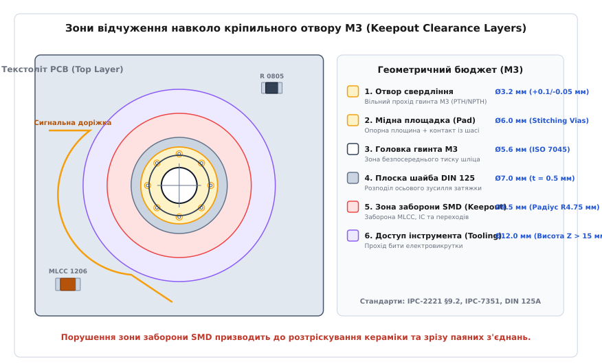
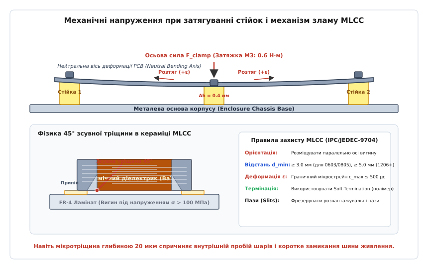

# Кріплення плати, стійки, допуски

<preknowlist>
- [Механічний конверт: габарити, кріплення, боки з роз'ємами](root:hw-pcb/mekhanichnyi-konvert) — базовий тривимірний бюджет плати, координати та формати обміну STEP/DXF.
- [Контур плати, кріплення і зони заборони](root:hw-pcb/kontur-platy-kriplennia-i-zony-zaborony) — технологічні зазори по краях текстоліту та обмеження фрезерування.
- [Зазори на платі: creepage та clearance](root:hw-pcb/creepage-clearance) — електричні повітряні зазори та шляхи витоку струму по діелектрику.
- [Шарування плати (PCB stackup)](root:hw-pcb/pcb-stackup) — фізичні властивості склотекстоліту FR-4, товщини шарів та модуль пружності.
</preknowlist>

При складанні серійного промислового контролера монтажник затягує чотири кутових кріпильних гвинти M3 ручним електрогайковертом із крутним моментом 0.6 Н·м. Через технологічну нерівномірність висоти литих алюмінієвих бобишок корпусу на 0.35 мм чотиришарова друкована плата товщиною 1.6 мм зазнає вимушеного просторового прогину, що створює на зовнішніх шарах текстоліту згинальне напруження понад 85 МПа та локальну деформацію розтягу 750 με. Багатошаровий керамічний конденсатор MLCC типорозміру 1206 у фільтрі первинного живлення 24 В, запаяний на відстані 1.8 мм від краю шайби гвинта перпендикулярно до лінії прогину, не витримує механічного навантаження: крихкий діелектрик титанату барію руйнується з утворенням внутрішньої 45-градусної зсувної тріщини. Через три доби експлуатації під час першого циклу нагрівання приладу до 50 °C волога з повітря конденсується в мікротріщині, викликаючи електроміграцію срібних електродів, міжфазний пробій діелектрика та катастрофічне коротке замикання шини живлення з вигоранням мідних доріжок.

Щоб запобігти подібним прихованим відмовам, інженер-розробник зобов'язаний розглядати механічну фіксацію друкованої плати не як формальне свердління випадкових отворів по кутах, а як прецизійну конструкційну систему. Ця система поєднує вибір типу опорних стійок, точний розрахунок зон відчуження навколо кріплення, узгодження коефіцієнтів теплового розширення матеріалів і контроль механічних деформацій за стандартами IPC.

---

### Типи опорних стійок та механічні способи фіксації плати

Механічне кріплення друкованої плати в корпусі виконує одночасно три функції: забезпечує жорстку просторову орієнтацію плати відносно вікон роз'ємів та елементів інтерфейсу, протистоїть вібраційним і ударним навантаженням, а також, за потреби, формує низькоомний електричний контакт із металевим шасі для захисного заземлення та екранування електромагнітних завад. Залежно від конструкції шасі, технології збирання та вимог до ізоляції застосовують чотири основні класи опорних елементів.

```
       РІЗЬБОВІ СТІЙКИ              ЗАПРЕСОВАНІ PEM                 SMT-СТІЙКИ                НЕЙЛОНОВІ ЗАСУВКИ
     (Латунь / Сталь)              (Листовий метал)             (Поверхневий монтаж)         (Гальванічна розв'язка)
   ┌──────────────────┐          ┌──────────────────┐           ┌──────────────────┐           ┌──────────────────┐
   │ ┌──────────────┐ │          │                  │           │   ┌──────────┐   │           │      ▲   ▲       │
   │ │ Гвинт ISO    │ │          │  ┌────────────┐  │           │   │Гвинт M2.5│   │           │     ╱ ╲ ╱ ╲      │
   │ └──────┬───────┘ │          │  │Гвинт M3    │  │           │   └────┬─────┘   │           │    │  Пружинні │ │
   │ ═══════╪════════ │          │ ═╪══════════════ │           │ ═══════╪════════ │           │ ═══╡   лапки  ╞═ │
   │   ┌────┴─────┐   │          │ ┌┴─────────────┐ │           │  ┌─────┴──────┐  │           │    │          │  │
   │   │ Стійка   │   │          │ │PEM Stud/Nut  │ │           │  │SMT Reel Pad│  │           │    │ Тіло     │  │
   │   │ Шестигран│   │          │ └┬─────────────┘ │           │  └─────┬──────┘  │           │    │ стійки   │  │
   │   └────┬─────┘   │          │ ═╪══════════════ │           │ ═══════╪════════ │           │    └────┬─────┘  │
   │ ═══════╪════════ │          │  Лист шасі       │           │  Текстоліт PCB   │           │ ═══════╪════════ │
   │    Шасі приладу  │          │  (SPCC/AL5052)   │           │  (Reflow пайка)  │           │    Шасі приладу  │
   └──────────────────┘          └──────────────────┘           └──────────────────┘           └──────────────────┘
```

#### 1. Різьбові металеві стійки (Threaded Metal Standoffs)

Традиційним і найбільш міцним типом опор є металеві шестигранні або циліндричні стійки з латуні (покриті нікелем або оловом), нержавіючої сталі чи алюмінію. Вони випускаються у трьох конструктивних виконаннях:
- **Female-Female (внутрішня-внутрішня різьба):** наскрізна або глуха різьба з обох боків; фіксується гвинтом знизу до шасі та гвинтом зверху крізь плату.
- **Male-Female (зовнішня-внутрішня різьба):** різьбовий хвостовик знизу вкручується безпосередньо в різьбовий отвір корпусу або фіксується гайкою, а друкована плата притискається гвинтом у верхню різьбу.
- **Male-Male (зовнішня-зовнішня різьба):** використовується для міжплатного багатоповерхового монтажу (Stacking architecture).

У промисловій та споживчій електроніці застосовують метричні різьби:
- **M2 та M2.5:** застосовуються в компактних мобільних пристроях, дронах та модулях розширення M.2. Відстань між центрами отворів витримується з точністю до ±0.05 мм.
- **M3:** загальноприйнятий індустріальний стандарт для плат автоматики, систем керування та блоків живлення. Забезпечує оптимальний баланс міцності та площі, яку займає кріплення на текстоліті.
- **M4:** застосовується у важких силових перетворювачах, сервопідсилювачах та приладах із підвищеними вібраційними навантаженнями.

Латунні стінки стійок забезпечують опір перехідного контакту менше 5 мОм, що дозволяє скидати струми електростатичних розрядів (ESD) безпосередньо на металевий корпус.

#### 2. Запресовані елементи кріплення (PEM Fasteners / Self-Clinching Standoffs)

При проектуванні приладів у корпусах із листового металу (холоднокатана сталь SPCC товщиною 0.8–1.5 мм або алюмінієві сплави AL5052/AL6061 товщиною 1.2–2.5 мм) нарізання різьби у тонкому листі неможливе через недостатню кількість витків. Замість приварювання стійок застосовують технологію запресування самоклінчувальних елементів (за назвою винахідника — PennEngineering, PEM).

Запресована стійка або гайка встановлюється у пробитий або висвердлений отвір шасі на гідравлічному пресі. Спеціальний рифлений поясок деталі деформує метал навколишнього листа, змушуючи його затікати в кільцеву канавку стійки. Це створює монолітне нерозбірне з'єднання з високим опором вириванню (Push-out force понад 1500–2500 Н) та крученню (Torque-out resistance понад 3.5–5.0 Н·м). Запресовані стійки гарантують строгу перпендикулярність осі різьби до площини шасі (відхилення менше 0.5°), усуваючи перекоси плати під час фіксації.

#### 3. Поверхнево-монтовані стійки (SMT Surface Mount Standoffs)

Для повного виключення ручних операцій при конвеєрному складанні використовують SMT-стійки (наприклад, серії Würth Elektronik WA-SMSI або Harwin SMT Spacers). Ці деталі виготовляються з лудженої сталі або латуні та постачаються у блістерних стрічках на котушках (Tape & Reel).

Автоматичний установник компонентів (Pick-and-Place) розміщує SMT-стійку безпосередньо на спеціальний кільцевий паяльний майданчик плати, вкритий паяльною пастою, після чого стійка припаюється в конвеєрній печі оплавлення (Reflow). При складанні кінцевого виробу плата просто прикручується гвинтом до корпусу або до іншої плати. Опір зсуву паяного з'єднання SMT-стійки M3 на стандартному мідному кільці становить від 300 до 600 Н. Основним обмеженням SMT-стійок є суворий контроль крутного моменту: при перевищенні моменту затяжки понад 0.4–0.5 Н·м виникає зсувний зрив мідного контактного майданчика від склотекстоліту.

#### 4. Нейлонові та поліамідні засувки (Nylon Snap-In Standoffs)

Коли друкована плата містить високовольтні гальванічно розв'язані кола або коли конструкція вимагає безінструментного швидкого монтажу без гвинтів, застосовують стійки з поліаміду (Nylon 6/6, UL94V-0). Вони фіксуються в отворах шасі та плати за допомогою конічних розтискних лапок (Reverse locking snap-in head).

Нейлон забезпечує електричну міцність ізоляції понад 15 кВ/мм та ефективно демпфує високочастотні вібрації. Проте поліаміди схильні до механічної повзучості під постійним навантаженням (Creep strain) та гігроскопічності: при зміні вологості від 10% до 90% лінійні розміри стійки можуть змінюватися на ±1.5%, а при температурах вище +85 °C жорсткість полімеру знижується втричі, що призводить до просідання плати.

---

### Анатомія кріпильного отвору та зони відчуження (Keepout Clearance)

Кріпильний отвір на друкованій платі не є просто механічною пустотою. Це складна багатошарова зона, де перетинаються вимоги механічної міцності, точності позиціювання, електромагнітної сумісності та електричної ізоляції.


*Зони відчуження навколо кріпильного отвору M3: геометричний бюджет діаметрів від свердління Ø3.2 мм та опорного мідного майданчика з віасами заземлення до зон заборони компонентів Ø9.5 мм і доступу монтажного інструмента Ø12.0 мм.*

#### Металізовані (PTH) та неметалізовані (NPTH) отвори

Конструктор повинен чітко розрізняти два типи кріпильних отворів:
1. **Неметалізований отвір (NPTH — Non-Plated Through Hole):** виконується на етапі вторинного свердління або фрезерування після гальванічного осадження міді. Стінки отвору складаються з чистого діелектрика. Використовується, коли необхідна повна гальванічна ізоляція між платою та корпусом або коли кріпильний гвинт проходить крізь внутрішні високовольтні шари, де пробій неприпустимий.
2. **Металізований отвір (PTH — Plated Through Hole):** висвердлюється на першому етапі виробництва та покривається міддю товщиною 20–25 мкм разом із перехідними отворами. Мідний циліндр отвору монолітно з'єднує зовнішні контактні майданчики на шарах Top і Bottom. Металізація значно підвищує опір текстоліту стисканню під головкою гвинта, запобігаючи розшаруванню ламінату.

#### Опорні мідні майданчики та зшивка шарів шасі

Для металізованого кріпильного отвору M3 зовнішній мідний майданчик (Annular Pad) виконується діаметром від 6.0 до 6.5 мм. Щоб забезпечити надійне відведення високочастотних струмів перешкод і вирівнювання потенціалів, навколо отвору формують масив перехідних отворів зшивки (Ground Stitching Vias) діаметром отвору 0.3 мм та площадки 0.6 мм, розташованих по колу діаметром 4.5–5.0 мм.

У багатошарових платах цей майданчик з'єднується з внутрішніми шарами цифрової землі (GND) безпосередньо або через спеціальний RC-ланцюг (паралельний резистор 1 МОм та високовольтний конденсатор 1–10 нФ 2 кВ) для запобігання утворенню паразитних низькочастотних контурів заземлення (Ground Loops).

#### Розміри отворів та допуски свердління за IPC-2221

Діаметр свердління отвору підбирається за стандартом IPC-2221 (Section 9.2) залежно від класу посадки гвинта. Застосування отвору, рівного номінальному діаметру гвинта (наприклад, отвір 3.0 мм для гвинта M3), є грубою помилкою проектування: через виробничі допуски гвинт не пройде в отвір без нарізання різьби по міді.

| Різьба гвинта | Номінальний діаметр гвинта d, мм | Діаметр отвору (Вільна посадка Close), мм | Діаметр отвору (Стандартна посадка Normal), мм | Діаметр головки гвинта ISO 7045, мм | Зовнішній діаметр шайби DIN 125A, мм |
|---|---|---|---|---|---|
| **M2** | 2.0 | 2.2 (+0.1/-0.05) | 2.4 (+0.1/-0.05) | 4.0 | 5.0 |
| **M2.5** | 2.5 | 2.7 (+0.1/-0.05) | 2.9 (+0.1/-0.05) | 5.0 | 6.0 |
| **M3** | 3.0 | 3.2 (+0.1/-0.05) | 3.4 (+0.1/-0.05) | 5.6 | 7.0 |
| **M4** | 4.0 | 4.3 (+0.15/-0.05) | 4.5 (+0.15/-0.05) | 7.0 | 9.0 |

#### Структура концентричних зон заборони (Keepout Layers)

Навколо кожного кріпильного отвору в САПР друкованих плат обов'язково налаштовуються п'ять концентричних зон обмеження:

1. **Зона маски (Solder Mask Clearance):** якщо отвір призначений для електричного контакту з шасі через стійку та головку гвинта, паяльна маска повністю видаляється на діаметрі, що дорівнює діаметру мідного майданчика (Ø6.0 мм для M3). Якщо отвір ізольований, маска навпаки повинна суцільно покривати мідь, заходячи всередину з відступом 0.1 мм від краю свердління.
2. **Зона паяльної пасти (Paste Mask Keepout):** нанесення паяльної пасти на кріпильний майданчик суворо заборонено (апертура трафарету 0%). Оплавлений припій під головкою гвинта утворює нерівну куполоподібну поверхню, яка під тиском гвинта пластично тече, призводячи до швидкого самовідгвинчування різьби при вібрації.
3. **Зона шайби та механічного тиску (Hardware Contact Zone):** кругова площадка, що відповідає зовнішньому діаметру металевої шайби або головки гвинта (Ø7.0 мм для DIN 125A M3 або Ø9.0 мм для збільшеної шайби DIN 9021). У цій зоні заборонено розташовувати будь-які елементи, крім опорної міді.
4. **Зона заборони SMD компонентів (Component Keepout Zone):** кільце радіусом не менше R_comp = R_washer + 1.25 мм (для M3 — діаметр не менше 9.5 мм). У цій зоні заборонено розміщувати SMD-резистори, конденсатори, діоди, мікросхеми та тестпоінти, оскільки при перекосі шайби або вигині плати монтажні компоненти будуть механічно роздавлені.
5. **Зона доступу монтажного інструмента (Tooling Access Keepout):** тривимірна зона циліндричної форми висотою Z ≥ 25 мм над платою та діаметром не менше 11.0–13.0 мм для проходу робочої головки динамометричної викрутки або торцевого ключа. Високі компоненти (електролітичні конденсатори, трансформатори, радіатори), розташовані ближче за цей радіус, унеможливлюють перпендикулярне встановлення біти інструмента, що призводить до злизування шліца та зісковзування викрутки з пошкодженням плати.

---

### Механіка затягування, вигин текстоліту та деформації

При затягуванні різьбового з'єднання обертальний крутний момент перетворюється на осьову силу натягу болта, яка стискає пакет між стійкою, платою та головкою гвинта.

#### Перетворення крутного моменту в осьову силу

Зв'язок між прикладеним крутним моментом T (Н·м) та виникаючою осьовою силою стискання F_clamp (Н) описується фундаментальним рівнянням різьбових з'єднань:

```
[Рівняння затяжки різьбового з'єднання]
T = K * F_clamp * d

де:
T       — крутний момент затягування [Н·м]
K       — коефіцієнт тертя різьби (Nut Factor) [безрозмірний]
F_clamp — осьове зусилля стискання пакета [Н]
d       — номінальний діаметр різьби [м]
```

Значення коефіцієнта тертя K залежить від матеріалу та покриття пари «гвинт-стійка»:
- Суха оцинкована сталь по сталі/латуні: K = 0.20..0.22;
- Нержавіюча сталь А2 без змащення: K = 0.25..0.30 (схильна до заїдання та схоплювання витків);
- Фосфатовані або кадмовані гвинти з мастилом: K = 0.14..0.16;
- Поліамідний нейлоновий гвинт: K = 0.10..0.12.

Для стандартного гвинта M3 (d = 0.003 м) при моменті затяжки T = 0.6 Н·м та коефіцієнті K = 0.20 осьова сила стискання становить:

```
[Розрахунок осьової сили для M3]
F_clamp = 0.6 / (0.20 * 0.003) = 1000 Н  [≈ 102 кгс]
```

Осьова сила в 1000 Н створює під шайбою DIN 125A (площа контакту з урахуванням отвору становить приблизно 30.4 мм²) контактний тиск стискання:

```
[Контактний тиск під шайбою]
P_contact = 1000 Н / (30.4 * 10^-6 м^2) = 32.9 МПа
```

#### Стопорні елементи, типи шайб та динамометричний інструмент

Надійність різьбового кріплення визначається не лише величиною моменту затяжки, а й стійкістю з'єднання до вібраційного самовідгвинчування та релаксації напружень:

1. **Плоскі шайби DIN 125A та збільшені DIN 9021:** основне призначення — рівномірний розподіл осьового тиску по мідному майданчику та захист паяльної маски від стирання обертовою головкою гвинта. Збільшена шайба DIN 9021 (зовнішній діаметр 9.0 мм для M3) знижує питомий тиск на текстоліт удвічі, що критично для тонких (0.8–1.0 мм) та гнучких плат.
2. **Пружинні зубчасті шайби DIN 6798A (із зовнішніми зубцями):** пружні загартовані зубці врізаються у площину головки гвинта та опорного майданчика, створюючи надійний багатоточковий електричний контакт для заземлення на шасі.
3. **Пружинні тарілчасті шайби Бельвіля (DIN 6796):** створюють постійне пружне осьове підтискання (Spring preload), що компенсує температурну усадку ламінату FR-4 та повзучість полімерів при термоциклуванні від -40 °C до +105 °C.
4. **Клинові стопорні шайби Nord-Lock:** пара шайб із радіальними клинами на внутрішніх поверхнях. Кут нахилу клинів більший за кут підйому різьби, тому будь-яка спроба самовідгвинчування гвинта призводить до миттєвого збільшення осьового натягу (Wedge-locking effect), що гарантує 100% захист від вібраційного розкручування в авіаційних та транспортних блоках.
5. **Чому заборонені пружинні гроверні шайби DIN 127:** стандарт DIN 25201 офіційно вилучив розрізні шайби DIN 127 з інженерного вжитку. Під час затягування гострий загартований кінець шайби прорізає мідний майданчик текстоліту аж до скловолокна, а при сплющуванні шайба втрачає пружність, діючи як звичайне нестопорне кільце.

#### Технологічна послідовність затягування багатоточкових кріплень

При закріпленні плати на чотирьох або більше стійках затягування гвинтів по колу (1 → 2 → 3 → 4) є неприпустимим: виникає накопичення зсувної деформації, і останній гвинт фіксує плату у викривленому стані.

Правильна цехова технологія вимагає **діагональної перехресної послідовності** (Cross-pattern / Star tightening) у два послідовні проходи:
- **Перший прохід (Позиціювання):** гвинти наживляються та затягуються динамометричною викруткою з моментом 30–40% від номіналу (0.20 Н·м для M3) у порядку діагоналей (H1 → H4 → H2 → H3). Плата вільно центрується на конусах зенкування та зазорах отворів.
- **Другий прохід (Фіксація):** затягування повним робочим моментом 100% (0.60 Н·м) у тій самій діагональній послідовності.

#### Міжплатні мезонінні з'єднання (Board-to-Board Stacking)

У багатоплатних модульних конструкціях плати об'єднуються у вертикальні пакети за допомогою високошвидкісних мезонінних роз'ємів (Board-to-Board Mezzanine Connectors, наприклад Samtec Q-Strip або Hirose FX10). Висота пакету жорстко задається висотою металевих стійок.

Критичною інженерною пасткою є конфлікт розмірних допусків висоти:
- Допуск висоти металевої різьбової стійки Male-Female складає зазвичай ±0.05 мм.
- Допустимий робочий діапазон глибини зчленування контактів роз'єму (Wiping length) становить ±0.15–0.25 мм.

Якщо довжина стійки менша за номінальну висоту спареного роз'єму на 0.20 мм, при затягуванні гвинтів друкована плата прогинається навколо роз'єму, вириваючи його SMT-контакти з контактних майданчиків. Якщо ж стійка довша за номінал, контакти роз'єму не заходять на повну глибину, що призводить до втрати сигналу при вібрації. Для компенсації допусків застосовують плаваючі роз'єми з механічною самокомпенсацією (Floating connectors) або встановлюють прецизійні калібровані стійки класу точності h6.

#### Модель пластинчастого вигину плати при різнорівневих стійках

Якщо стійки шасі закріплені з відхиленням по висоті Δh або якщо основа корпусу скручена "пропелером", затягування гвинтів силою F_clamp насильно притискає плату до опор, деформуючи її як пружну балку або пластину.

Для друкованої плати товщиною t, яка закріплена на двох опорах із прольотом L, стріла прогину Δh створює на зовнішній поверхні діелектрика максимальне згинальне напруження σ_bend та відносну деформацію ε_bend:

```
[Згинальне напруження плати при фіксованому прогині]
σ_bend = (6 * E_pcb * t * Δh) / (L^2)

[Відносна деформація поверхні текстоліту]
ε_bend = σ_bend / E_pcb = (6 * t * Δh) / (L^2)

де:
E_pcb  — модуль Юнга склотекстоліту FR-4 (18..22 ГПа вздовж основи) [Па]
t      — товщина друкованої плати (зазвичай 0.0016 м) [м]
Δh     — висотний перекіс стійок (стріла прогину) [м]
L      — відстань між сусідніми стійками [м]
```

При прольоті між стійками L = 50 мм, товщині плати t = 1.6 мм та дефекті площинності стійок Δh = 0.35 мм деформація на поверхні плати становить:

```
[Розрахунок відносної деформації]
ε_bend = (6 * 0.0016 * 0.00035) / (0.050^2) = 0.001344 = 1344 με
```


*Механічні напруження при затягуванні стійок і механізм зламу MLCC: схема прогину плати при різниці висот стійок Δh, перенесення напруження на паяний меніск і поширення 45-градусної зсувної тріщини в кераміці.*

#### Стандарт IPC/JEDEC-9704 та межі мікродеформації

Для оцінки ризику пошкодження електронних компонентів під час складання та експлуатації використовують стандарт **IPC/JEDEC-9704 (Printed Circuit Board Strain Gage Testing)**. Стандарт нормує максимально допустиму відносну деформацію розтягу/стиску в одиницях мікрострейн (με, де 1 με = 10⁻⁶ мм/мм = 0.0001%).

Граничні норми IPC/JEDEC-9704 для операцій механічного монтажу (закручування гвинтів, встановлення роз'ємів, вставка в пази корпусу):
- **Безпечна зона:** ε ≤ 500 με (деградація паяних з'єднань і кераміки відсутня);
- **Зона підвищеного ризику:** 500 < ε ≤ 800 με (вимагає застосування компонентів спеціального виконання Soft-Term);
- **Критична зона відмов:** ε > 1000 με (неминуче розтріскування керамічних конденсаторів 0805/1206 та втомний зріз крайніх кульок BGA-мікросхем).

Отримана у нашому розрахунку деформація 1344 με у 2.7 раза перевищує безпечний поріг стандарту, що гарантовано спричиняє руйнування компонентів.

---

### Механізм руйнування керамічних конденсаторів (MLCC)

Багатошарові керамічні конденсатори (MLCC — Multi-Layer Ceramic Capacitors) є найбільш вразливими до вигину елементами поверхневого монтажу. Основою діелектрика MLCC є крихка полікристалічна кераміка титанату барію (BaTiO₃), яка має високу міцність на стиск (понад 600 МПа), але надзвичайно низьку границю міцності на розтяг та зсув (лише 60–80 МПа).

```
         ┌───────────────────────────────────────────────────────────────┐
         │          АНАТОМІЯ ЗСУВНОЇ ТРІЩИНИ У КЕРАМІЦІ MLCC             │
         └───────────────────────────────────────────────────────────────┘
                     Керамічний діелектрик (BaTiO3)
                ┌─────────────────────────────────────────┐
                │ ═══════════════════════  Внутрішні      │
                │    ════════════════════  електроди      │
  Металева      │ ═══════════════════════                 │      Металева
  термінація    │    ════════════════════  Тріщина 45°    │      термінація
 ┌──────────────┼───────────────────────── ╲ ─────────────┼──────────────┐
 │              │                            ╲            │              │
 │              │                             ╲           │              │
 └──────┬───────┴──────────────────────────────●──────────┴───────┬──────┘
        │   ▲                                  ▲                  │
   Паяний   │ Меніск припою                    │ Точка концентрації│ Паяний
   меніск   │                                  │ напруження       │ меніск
        └───┴──────────────────────────────────┴──────────────────┘
       ═════════════════════════════════════════════════════════════
                       Прогнутий текстоліт FR-4
```

#### Фізика виникнення 45-градусної тріщини (Flex Crack)

Коли друкована плата прогинається під дією гвинта, верхні волокна текстоліту розтягуються. Жорсткий паяльний меніск безсвинцевого припою (SAC305, модуль Юнга E ≈ 50 ГПа) міцно з'єднує контактний майданчик плати з металевою термінацією конденсатора.

Оскільки модуль пружності кераміки (E ≈ 110 ГПа) значно вищий за модуль текстоліту (E ≈ 20 ГПа), конденсатор намагається протистояти вигину плати. У кутовій точці з'єднання між краєм термінації та тілом кераміки виникає колосальна концентрація зсувних напружень. Коли напруження перевищує 70 МПа, кераміка сколюється під кутом приблизно 45°, утворюючи так звану **зсувну тріщину вигину** (Flex Crack).

#### Чому дефект не виявляється на вихідному контролі

Тріщина вигину є найбільш підступним дефектом у радіоелектронному виробництві:
1. Одразу після паяння та монтажу електричний контакт між внутрішніми електродами зберігається за рахунок залишкового стискання. Контрольно-вимірювальний тестер (ICT) та функціональний контроль фіксують 100% номінальної ємності та опір ізоляції понад 10 ГОм.
2. Під час експлуатації, вібрацій та циклічного нагрівання тертя берегів тріщини руйнує діелектричний шар товщиною всього 2–4 мкм між протилежними обкладками.
3. Атмосферна волога разом із залишками флюсу проникає всередину мікропорожнини тріщини. Під дією постійної робочої напруги шини живлення виникає електролітична дисоціація та міграція іонів металу, яка перетворює тріщину на вузький вуглецево-металевий провідний місток.
4. Конденсатор раптово пробивається в короткий замикач із локальним виділенням теплової потужності в десятки ват, що призводить до обвуглювання плати та займання.

#### Конструктивні правила захисту MLCC від розтріскування

Щоб виключити руйнування кераміки поблизу кріпильних отворів, інженер застосовує такі правила компонування:

1. **Орієнтація відносно лінії вигину:** довга вісь конденсатора повинна бути строго **паралельною** лінії максимального прогину (тангенційно до кола кріпильного отвору). Розташування MLCC радіально (перпендикулярно до отвору) збільшує діюче напруження на розтяг у 3.5–4.0 рази.
2. **Мінімальні відстані розміщення:** мінімальна відстань d_min від краю шайби кріпильного отвору до контактного майданчика MLCC нормується залежно від типорозміру корпусу:
   - Типорозміри 0201 та 0402: d_min ≥ 1.5 мм (мала база, висока стійкість);
   - Типорозмір 0603: d_min ≥ 2.5 мм;
   - Типорозмір 0805: d_min ≥ 3.5 мм;
   - Типорозміри 1206, 1210: d_min ≥ 5.0 мм;
   - Типорозміри 1812, 2220: d_min ≥ 8.0 мм або повна заборона встановлення ближче 15 мм від кріплень.
3. **Застосування конденсаторів Soft-Termination (FlexiCap):** у критичних колах живлення поблизу кріплень слід застосовувати компоненти з гнучкою термінацією (наприклад, Murata GCJ series, TDK Soft Termination, KEMET FT-CAP). У цих конденсаторах між внутрішнім мідним шаром та зовнішнім нікель-олов'яним бар'єром введено шар струмопровідного еластичного полімеру зі срібним наповнювачем. Полімер деформується разом із платою, поглинаючи енергію зсуву та витримуючи вигин плати до 5 мм без утворення тріщин (проти 1 мм для звичайних MLCC).
4. **Розвантажувальні фрезеровані пази (Stress Relief Slots):** якщо трасування вимагає розміщення компонентів поблизу стійки, між зоною кріплення та сигнальною зоною фрезерується наскрізний паз шириною 1.0–1.5 мм. Паз механічно розриває суцільне тіло склотекстоліту, перешкоджаючи передачі напружень від затягнутого гвинта у внутрішні зони плати.

---

### Температурне розширення (CTE Mismatch) та розмірні ланцюги допусків

При зміні робочої температури приладу матеріали конструкції змінюють свої геометричні розміри з різною швидкістю. Неврахування різниці коефіцієнтів лінійного теплового розширення (CTE — Coefficient of Thermal Expansion) призводить до виникнення колосальних зрізних зусиль на стійках і викривлення плати в формі купола.

```
       ТЕПЛОВЕ РОЗШИРЕННЯ: АЛЮМІНІЄВЕ ШАСІ VS СКЛОТЕКСТОЛІТ FR-4
                         ΔT = +60 °C, База L = 200 мм

   [Холодний стан: T = 20 °C]
   Стійка A                                                    Стійка B
      │                                                           │
      ▼                                                           ▼
   ═══╤═══════════════════════════════════════════════════════════╤═══  PCB (200.00 мм)
   ═══╧═══════════════════════════════════════════════════════════╧═══  Шасі (200.00 мм)

   [Гарячий стан: T = 80 °C]
   Фіксована база                                              Зсув натягу ΔL = 0.096 мм
      │                                                           │      ◄── Зрізне зусилля
      ▼                                                           ▼
   ═══╤═══════════════════════════════════════════════════════════╤═══  PCB (200.18 мм)
   ═══╧═══════════════════════════════════════════════════════════════╤ Шасі (200.28 мм)
```

#### Коефіцієнти лінійного розширення конструкційних матеріалів

| Матеріал | CTE у площині XY (α_xy), ppm/K (10⁻⁶/K) | CTE по товщині Z (α_z), ppm/K | Модуль пружності Юнга E, ГПа |
|---|---|---|---|
| **Склотекстоліт FR-4 (стандартний)** | 14 .. 16 | 55 .. 70 | 18 .. 22 |
| **Алюмінієвий сплав AL6061-T6** | 23.2 | 23.2 | 69 |
| **Листова конструкційна сталь SPCC** | 11.8 | 11.8 | 205 |
| **Нержавіюча сталь AISI 304** | 16.5 | 16.5 | 193 |
| **Латунь ЛС59-1 (CW614N)** | 18.5 | 18.5 | 105 |
| **Полікарбонат (PC) / ABS пластик** | 65 .. 80 | 65 .. 80 | 2.2 .. 2.6 |

#### Розрахунок теплового подовження на міжцентровій базі

Різниця теплового подовження ΔL_thermal між двома опорними стійками, розташованими на відстані L_0, при перепаді температури ΔT = T_max - T_min розраховується за формулою:

```
[Різниця теплового розширення між платою та корпусом]
ΔL_thermal = L_0 * ΔT * |α_chassis - α_pcb|

де:
L_0         — номінальна відстань між осями кріпильних отворів [м]
ΔT          — температурний діапазон експлуатації [°C або K]
α_chassis   — коефіцієнт теплового розширення матеріалу корпусу [1/K]
α_pcb       — коефіцієнт теплового розширення склотекстоліту FR-4 [1/K]
```

Для плати промислового контролера з довжиною між стійками L_0 = 200 мм у литому алюмінієвому корпусі (α_chassis = 23 · 10⁻⁶ 1/K, α_pcb = 15 · 10⁻⁶ 1/K) при розширенні від монтажної температури +20 °C до робочої +80 °C (ΔT = 60 °C) розбіжність розмірів складе:

```
[Розрахунок теплового подовження]
ΔL_thermal = 0.200 * 60 * |23 - 15| * 10^-6 = 0.000096 м = 0.096 мм
```

Якщо ж плата встановлюється у пластиковий корпус із полікарбонату (α_chassis = 70 · 10⁻⁶ 1/K), то при охолодженні приладу до -40 °C (ΔT = 60 °C) пластик стискається значно сильніше за текстоліт, а розбіжність розмірів сягає:

```
[Розрахунок теплового стиснення для пластику]
ΔL_thermal = 0.200 * 60 * |70 - 15| * 10^-6 = 0.000660 м = 0.660 мм
```

Якщо обидва кріпильних отвори виконані круглими з мінімальним зазором, стиснення корпусу на 0.66 мм зріже гвинти або зігне плату з утворенням стріли прогину понад 3 мм.

#### Овальні пази (Slotted Holes) для компенсації теплового руху

Для нейтралізації температурних розширень на платах із міжцентровими відстанями понад 100 мм застосовують схему координування з плаваючими опорами:

```
              СХЕМА КООРДИНУВАННЯ ТА ТЕПЛОВОЇ КОМПЕНСАЦІЇ ПЛАТИ
   ┌──────────────────────────────────────────────────────────────────────┐
   │ (H1) Базовий отвір (Origin)             (H2) Горизонтальний паз     │
   │      Круглий отвір Ø3.2 мм                   Овальний паз 3.2 × 4.5 мм│
   │      Фіксує базу X=0, Y=0                    Дозволяє рух по осі X    │
   │      ┌───┐                                   ┌─────────┐              │
   │      │ O │                                   │ (     ) │              │
   │      └───┘                                   └─────────┘              │
   │                                                                       │
   │                                                                       │
   │      ┌───┐                                   ┌─────────┐              │
   │      │ O │                                   │ (     ) │              │
   │      └───┘                                   └─────────┘              │
   │ (H3) Вертикальний паз                   (H4) Вільний діагональний паз│
   │      Овальний паз 4.5 × 3.2 мм               Овальний паз 4.5 × 4.5 мм│
   │      Дозволяє рух по осі Y                   Повна свобода розширення │
   └──────────────────────────────────────────────────────────────────────┘
```

1. **Базовий опорний отвір H1 (Datum Hole):** стандартний круглий отвір Ø3.2 мм, який задає нульову точку відліку координат плати (0, 0).
2. **Направляючий паз H2 (Guiding Slot):** поздовжній овальний паз розміром 3.2 × (3.2 + ΔL_slot) мм, орієнтований вздовж осі X. Він фіксує кут повороту плати, але дозволяє вільно ковзати при нагріванні.
3. **Направляючий паз H3:** овальний паз, орієнтований вздовж осі Y.
4. **Плаваючий кутовий паз H4 (Free Floating Slot):** збільшений паз або отвір, що забезпечує вільне розширення плати по обох осях без виникнення внутрішніх напружень.

#### Розрахунок розмірного ланцюга допусків (Tolerance Stackup)

Зазор між кріпильним отвором і гвинтом повинен компенсувати суму всіх технологічних похибок виготовлення. Ланцюг розмірних допусків включає:
- Похибка координат свердління плати: δ_pcb_drill = ±0.08 мм;
- Похибка координат отворів у шасі (литво або ЧПК фрезерування): δ_chassis = ±0.15 мм;
- Похибка перпендикулярності осей стійок: δ_tilt = ±0.05 мм;
- Максимальне теплове подовження: ΔL_thermal = ±0.10 мм.

При статистичному розрахунку методом середньоквадратичного підсумовування (RSS — Root Sum of Squares) необхідне збільшення діаметра отвору становить:

```
[Статистичний допуск посадки RSS]
δ_RSS = sqrt(δ_pcb_drill^2 + δ_chassis^2 + δ_tilt^2 + ΔL_thermal^2)
δ_RSS = sqrt(0.08^2 + 0.15^2 + 0.05^2 + 0.10^2) = sqrt(0.0390) ≈ 0.197 мм
```

Таким чином, для гвинта M3 (номінальний діаметр 3.0 мм) мінімальний безпечний діаметр отвору повинен складати 3.0 + 2 · δ_RSS ≈ 3.4 мм, що відповідає стандартній посадці Normal за стандартом IPC-2221.

---

### Інженерні розрахунки в коді

Для автоматизованої перевірки зон відчуження, розрахунку осьового зусилля затягування та оцінки мікродеформацій плати використовують спеціалізовані модулі розрахунку. Нижче наведено порівняльну реалізацію розрахункового ядра мовами C99 та C++20.

Повний розбір математичних моделей деформації плати, алгоритми оптимізації розміщення компонентів та консольний інструмент розрахунку представлені у практичній вставці [калькулятор механічних напружень плати](root:hw-pcb/kriplennia-platy-stiiky-dopusky/proj-mounting-stress-calc.md).

:::tabs
@tab c99
```c
/*
 * mounting_mechanics.c — модуль перевірки механіки кріплення плати (C99).
 */

#include <stdio.h>
#include <stdbool.h>
#include <math.h>

#define IPC9704_MAX_MICROSTRAIN  500.0   /* Безпечна межа за IPC/JEDEC-9704 */
#define FR4_YOUNG_MODULUS_GPA    20.0    /* Модуль Юнга FR-4, ГПа */

typedef struct {
    double screw_diameter_mm;     /* Номінальний діаметр гвинта (наприклад, 3.0 для M3) */
    double washer_diameter_mm;    /* Зовнішній діаметр шайби (7.0 для DIN 125A) */
    double nut_factor_k;          /* Коефіцієнт тертя різьби (0.20 для цинкованої сталі) */
    double torque_nm;             /* Крутний момент затягування, Н·м */
    double pcb_thickness_mm;      /* Товщина текстоліту плати, мм */
    double standoff_span_mm;      /* Відстань між сусідніми стійками, мм */
    double standoff_height_err_mm;/* Висотне биття стійок (Δh), мм */
} MountingConfig;

typedef struct {
    double clamp_force_n;         /* Осьове стискаюче зусилля, Н */
    double contact_pressure_mpa;  /* Контактний тиск під шайбою, МПа */
    double surface_microstrain;   /* Відносна деформація поверхні плати, με */
    double min_keepout_radius_mm; /* Мінімальний радіус зони заборони SMD, мм */
    bool   is_safe_ipc9704;       /* Прапорець відповідності нормі IPC-9704 */
} MountingAnalysisResult;

/*
 * Розрахунок механічних параметрів кріпильного вузла
 */
MountingAnalysisResult analyze_mounting_node(const MountingConfig *cfg) {
    MountingAnalysisResult res;

    /* 1. Осьова сила стискання: F = T / (K * d) */
    double d_meters = cfg->screw_diameter_mm * 1e-3;
    res.clamp_force_n = cfg->torque_nm / (cfg->nut_factor_k * d_meters);

    /* 2. Площа контакту шайби: A = (pi/4) * (D_wash^2 - D_hole^2) */
    /* Приймаємо діаметр отвору як d_screw + 0.2 мм */
    double d_hole = cfg->screw_diameter_mm + 0.2;
    double area_mm2 = (M_PI / 4.0) * (pow(cfg->washer_diameter_mm, 2) - pow(d_hole, 2));
    res.contact_pressure_mpa = res.clamp_force_n / area_mm2;

    /* 3. Згинальна мікродеформація поверхні плати: ε = (6 * t * Δh) / L^2 */
    double t_m = cfg->pcb_thickness_mm * 1e-3;
    double dh_m = cfg->standoff_height_err_mm * 1e-3;
    double l_m = cfg->standoff_span_mm * 1e-3;
    
    double strain_abs = (6.0 * t_m * dh_m) / (l_m * l_m);
    res.surface_microstrain = strain_abs * 1e6; /* переведення в με */

    /* 4. Мінімальний радіус зони заборони (Keepout): R_washer + 1.25 мм */
    res.min_keepout_radius_mm = (cfg->washer_diameter_mm / 2.0) + 1.25;

    /* 5. Перевірка відповідності безпечному порогу IPC-9704 */
    res.is_safe_ipc9704 = (res.surface_microstrain <= IPC9704_MAX_MICROSTRAIN);

    return res;
}

int main(void) {
    MountingConfig m3_node = {
        .screw_diameter_mm      = 3.0,
        .washer_diameter_mm     = 7.0,
        .nut_factor_k           = 0.20,
        .torque_nm              = 0.60,
        .pcb_thickness_mm       = 1.60,
        .standoff_span_mm       = 60.0,
        .standoff_height_err_mm = 0.25
    };

    MountingAnalysisResult r = analyze_mounting_node(&m3_node);

    printf("=== АНАЛІЗ КРІПИЛЬНОГО ВУЗЛА M3 ===\n");
    printf("Осьове зусилля стискання F_clamp:   %.1f Н\n", r.clamp_force_n);
    printf("Контактний тиск під шайбою:       %.2f МПа\n", r.contact_pressure_mpa);
    printf("Поверхнева деформація текстоліту: %.1f με\n", r.surface_microstrain);
    printf("Радіус зони заборони SMD (Keepout): %.2f мм\n", r.min_keepout_radius_mm);
    printf("Статус IPC/JEDEC-9704 (<=500 με):  %s\n",
           r.is_safe_ipc9704 ? "БЕЗПЕЧНО" : "НЕБЕЗПЕЧНО: РИЗИК ЗЛАМУ MLCC");

    return 0;
}
```
@tab c++
```cpp
/*
 * mounting_mechanics.hpp / .cpp — об'єктно-орієнтований аналізатор кріплення (C++20).
 */

#include <iostream>
#include <cmath>
#include <numbers>
#include <string_view>
#include <format>

namespace pcb::mechanics {

constexpr double Ipc9704SafeMicrostrainThreshold = 500.0;

struct MountingParameters {
    double screw_diameter_mm{3.0};
    double washer_diameter_mm{7.0};
    double nut_friction_factor{0.20};
    double tightening_torque_nm{0.60};
    double pcb_thickness_mm{1.60};
    double span_between_standoffs_mm{60.0};
    double standoff_height_mismatch_mm{0.25};
};

struct CalculationReport {
    double clamping_force_n{0.0};
    double washer_pressure_mpa{0.0};
    double peak_microstrain{0.0};
    double recommended_keepout_radius_mm{0.0};
    bool is_ipc9704_compliant{false};

    [[nodiscard]] constexpr std::string_view status_string() const noexcept {
        return is_ipc9704_compliant ? "БЕЗПЕЧНО" : "НЕБЕЗПЕЧНО: РИЗИК ЗЛАМУ MLCC";
    }
};

class MountingNodeEvaluator {
public:
    [[nodiscard]] static constexpr CalculationReport evaluate(const MountingParameters& p) noexcept {
        CalculationReport report{};

        // 1. Осьове зусилля: F = T / (K * d)
        const double d_meters = p.screw_diameter_mm * 1e-3;
        report.clamping_force_n = p.tightening_torque_nm / (p.nut_friction_factor * d_meters);

        // 2. Тиск під шайбою
        const double hole_d = p.screw_diameter_mm + 0.2;
        const double contact_area_mm2 = (std::numbers::pi / 4.0) * 
            (std::pow(p.washer_diameter_mm, 2) - std::pow(hole_d, 2));
        report.washer_pressure_mpa = report.clamping_force_n / contact_area_mm2;

        // 3. Деформація розтягу плати: ε = (6 * t * Δh) / L^2
        const double t_m = p.pcb_thickness_mm * 1e-3;
        const double dh_m = p.standoff_height_mismatch_mm * 1e-3;
        const double l_m = p.span_between_standoffs_mm * 1e-3;

        const double strain_unitless = (6.0 * t_m * dh_m) / (l_m * l_m);
        report.peak_microstrain = strain_unitless * 1e6;

        // 4. Радіус заборони SMD
        report.recommended_keepout_radius_mm = (p.washer_diameter_mm / 2.0) + 1.25;

        // 5. Відповідність IPC-9704
        report.is_ipc9704_compliant = (report.peak_microstrain <= Ipc9704SafeMicrostrainThreshold);

        return report;
    }
};

} // namespace pcb::mechanics

int main() {
    using namespace pcb::mechanics;

    constexpr MountingParameters config{
        .screw_diameter_mm = 3.0,
        .washer_diameter_mm = 7.0,
        .nut_friction_factor = 0.20,
        .tightening_torque_nm = 0.60,
        .pcb_thickness_mm = 1.60,
        .span_between_standoffs_mm = 60.0,
        .standoff_height_mismatch_mm = 0.25
    };

    constexpr auto report = MountingNodeEvaluator::evaluate(config);

    std::cout << "=== АНАЛІЗ КРІПИЛЬНОГО ВУЗЛА M3 (C++20) ===\n";
    std::cout << std::format("Осьове зусилля стискання F_clamp:   {:.1f} Н\n", report.clamping_force_n);
    std::cout << std::format("Контактний тиск під шайбою:       {:.2f} МПа\n", report.washer_pressure_mpa);
    std::cout << std::format("Поверхнева деформація текстоліту: {:.1f} με\n", report.peak_microstrain);
    std::cout << std::format("Радіус зони заборони SMD (Keepout): {:.2f} мм\n", report.recommended_keepout_radius_mm);
    std::cout << std::format("Статус IPC/JEDEC-9704 (<=500 με):  {}\n", report.status_string());

    return 0;
}
```
:::

---

### Зведена таблиця правил трасування та монтажу кріпильних вузлів

| Параметр або елемент вузла | Рекомендоване значення для M2.5 | Рекомендоване значення для M3 | Механічне або електричне обґрунтування |
|---|---|---|---|
| **Діаметр свердління (PTH/NPTH)** | 2.7 мм (Close) / 2.9 мм (Normal) | 3.2 мм (Close) / 3.4 мм (Normal) | Компенсація допусків свердління та розташування стійок шасі |
| **Діаметр мідного майданчика (Pad)** | Ø5.0 .. 5.5 мм | Ø6.0 .. 6.5 мм | Забезпечення опори під головку гвинта / шайбу без продавлювання |
| **Зшивка заземлення (Stitching Vias)** | 4–6 отворів Ø0.3/0.6 мм | 6–8 отворів Ø0.3/0.6 мм | Низькоомний шлях стікання струмів ESD та екранування перешкод |
| **Зона паяльної пасти (Paste)** | 0% (Паста суворо заборонена) | 0% (Паста суворо заборонена) | Запобігання пластичній повзучості припою та самовідгвинчуванню |
| **Зона заборони SMD (Keepout)** | Радіус R ≥ 3.75 мм (Ø7.5 мм) | Радіус R ≥ 4.75 мм (Ø9.5 мм) | Захист кераміки MLCC та напівпровідників від роздавлювання шайбою |
| **Мінімальна відстань до MLCC 0805** | ≥ 3.0 мм від краю шайби | ≥ 3.5 мм від краю шайби | Зниження згинальних деформацій нижче порогу 500 με (IPC-9704) |
| **Орієнтація MLCC біля отвору** | Паралельно осі прогину плати | Паралельно осі прогину плати | Зниження зсувного напруження на паяльних менісках у 3–4 рази |
| **Крутний момент затягування (Сталь)** | 0.35 .. 0.40 Н·м | 0.55 .. 0.65 Н·м | Забезпечення самогальмування різьби без розриву текстоліту |
| **Компенсація CTE при прольоті >100 мм**| Паз 2.9 × 3.8 мм на дальньому куті | Паз 3.4 × 4.5 мм на дальньому куті | Усунення термічного вигину при розширенні алюмінію корпусу |
