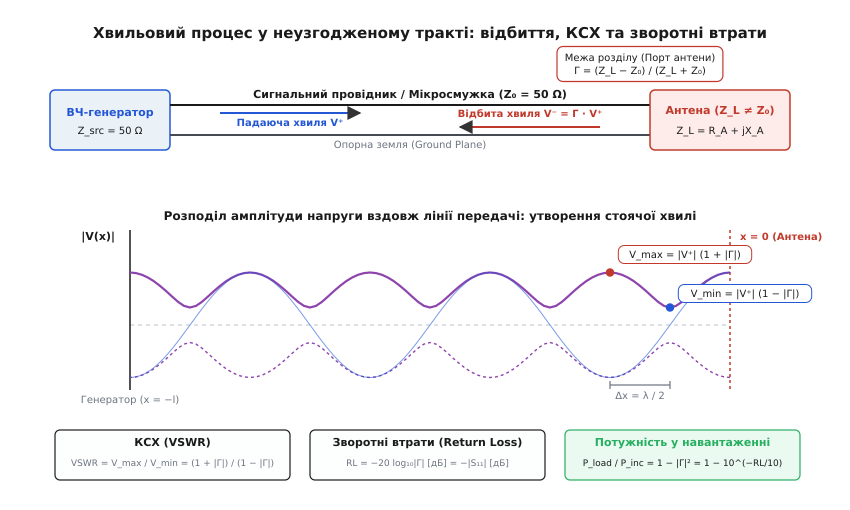
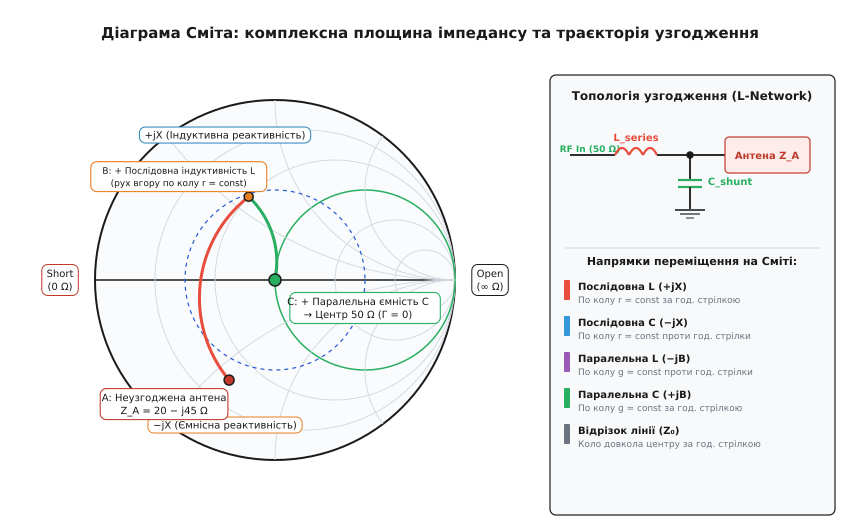

# КСХ, зворотні втрати й вимірювання антени

<preknowlist>
- [Стек PCB і характеристичний опір мікросмужки](root:hw-pcb/pcb-stackup-rf) — хвильовий опір лінії передачі Z₀ та розподілені параметри L′ і C′.
- [Реактивність](root:hw-components/reactance) — імпеданс котушки й конденсатора на змінному струмі (jωL та 1/(jωC)).
- [Довжина хвилі в середовищі](root:hw-pcb/wavelength-in-medium) — фазова швидкість, ефективна діелектрична проникність ε_eff та просторовий період електромагнітної хвилі.
- [Характеристичний імпеданс](root:com-medium/characteristic-impedance) — хвильова природа узгодження джерела, фідера й навантаження.
</preknowlist>

Коли вихідний каскад радіочастотного трансивера на частоті 2.44 ГГц (Bluetooth/Wi-Fi) чи 868 МГц (LoRa) видає сигнал потужністю 20 дБм (100 мВт) у мікросмужкову доріжку з хвильовим опором 50 Ом, а на іншому кінці доріжки друкована антена через вплив наближеного акумулятора або пластикового корпусу має вхідний опір 18 − j42 Ом, майже 60 % випромінюваної енергії не потрапляє в ефір. Вона відбивається від точки живлення антени, повертається лінією передачі назад до вихідних транзисторів підсилювача потужності (PA) і перетворюється на тепло або створює перенапруги на стоках, скорочуючи дальність зв'язку втричі та перевантажуючи каскад.

Доріжка друкованої плати, довжина якої перевищує десяту частину довжини хвилі в діелектрику (для FR-4 на частоті 2.4 ГГц це всього близько 6 мм), перестає бути зосередженим електричним вузлом із законів Кірхгофа. Вона перетворюється на просторово розподілену систему, у якій пряма та відбита електромагнітні хвилі накладаються одна на одну, формуючи просторовий рельєф напруг і струмів — стоячу хвилю. Щоб повернути енергію в антену, інженеру необхідно виміряти комплексний коефіцієнт відбиття, прочитати його на діаграмі Сміта та розрахувати реактивний узгоджувальний контур, що трансформує довільний імпеданс навантаження у чисті 50 Ом.

## Фізика відбиття у радіочастотному тракті

Розглянемо лінію передачі з хвильовим опором Z₀, підключену до генератора з внутрішнім опором Z_src = Z₀ на координаті x = −l та навантажену антеною з комплексним імпедансом Z_L = R_A + jX_A на координаті x = 0.

```
       x = -l                                       x = 0
  ┌──────────────┐         Лінія передачі Z₀    ┌──────────────┐
  │              ├───────> V⁺(x) = V₀⁺ e^{-jβx} ─>│              │
  │  Генератор   │                                │  Антена      │
  │ Z_src = 50 Ω │<─────── V⁻(x) = V₀⁻ e^{+jβx} ──│ Z_L = R+jX   │
  └──────────────┘                                └──────────────┘
```

Поширюючись уздовж координати x, напруга й струм у будь-якому перерізі лінії є сумою двох хвиль, що біжать у протилежних напрямках. Падаюча хвиля V⁺(x) рухається від джерела до антени, а відбита хвиля V⁻(x) виникає на межі навантаження через неможливість миттєво збалансувати граничні умови напруги та струму, якщо вхідний імпеданс антени відрізняється від хвильового опору тракту.

```
V(x) = V₀⁺ · e^{-jβx} + V₀⁻ · e^{+jβx}
I(x) = (V₀⁺ / Z₀) · e^{-jβx} − (V₀⁻ / Z₀) · e^{+jβx}
```

де β = 2π / λ — хвильове число (фазова стала) лінії передачі, а λ = v_p / f — довжина хвилі в середовищі плати при фазовій швидкості v_p = c / √(ε_eff).

На межі з'єднання антени (x = 0) повна напруга V(0) і повний струм I(0) пов'язані імпедансом навантаження законом Ома: V(0) = I(0) · Z_L. Підставивши координату x = 0 у хвильові рівняння:

```
V(0) = V₀⁺ + V₀⁻
I(0) = (V₀⁺ − V₀⁻) / Z₀
```

Розкриємо співвідношення V(0) / I(0) = Z_L через амплітуди прямих та зворотних хвиль:

```
(V₀⁺ + V₀⁻) / ( (V₀⁺ − V₀⁻) / Z₀ ) = Z_L               [закон Ома на клемах навантаження]
(V₀⁺ + V₀⁻) · Z₀ = (V₀⁺ − V₀⁻) · Z_L                   [множимо обидві частини на знаменник]
V₀⁺ · Z₀ + V₀⁻ · Z₀ = V₀⁺ · Z_L − V₀⁻ · Z_L             [розкриваємо дужки]
V₀⁻ · (Z_L + Z₀) = V₀⁺ · (Z_L − Z₀)                     [групуємо доданки з V₀⁻ зліва, V₀⁺ справа]
```

Звідси отримуємо фундаментальне визначення комплексного коефіцієнта відбиття за напругою на клемах антени:

```
Γ = V₀⁻ / V₀⁺ = (Z_L − Z₀) / (Z_L + Z₀)
```

Коефіцієнт відбиття є комплексним числом Γ = |Γ| · e^{jφ}. Його модуль |Γ| змінюється в діапазоні від 0 (ідеальне узгодження, відбиття відсутнє) до 1 (повне відбиття всієї енергії), а фазовий кут φ визначає зсув фази відбитої хвилі відносно падаючої безпосередньо в точці контакту.


*Хвильовий процес у неоднорідному НВЧ-тракті: інтерференція прямої хвилі V⁺ та відбитої V⁻ формує просторовий розподіл стоячої хвилі з пучностями V_max і вузлами V_min, визначаючи коефіцієнт стоячої хвилі (КСХ) та зворотні втрати S₁₁.*

Якщо імпеданс антени ідеально дорівнює хвильовому опору лінії (Z_L = 50 + j0 Ом), чисельник звертається в нуль: Γ = 0. Усі 100 % потужності падаючої хвилі передаються в антену й випромінюються в простір.

Якщо навантаження є коротким замиканням (Z_L = 0 Ом):

```
Γ_short = (0 − 50) / (0 + 50) = −1 = 1 · e^{jπ}
```

Відбита хвиля має таку саму амплітуду, як падаюча, але змінює фазу на 180 градусів.

Якщо навантаження є розривом кола (Z_L → ∞):

```
Γ_open = lim_{Z_L → ∞} (Z_L − Z₀) / (Z_L + Z₀) = +1 = 1 · e^{j0}
```

Відбита хвиля повертається з тією самою фазою без втрат амплітуди.

У реальній антені імпеданс завжди має як дійсну частину (опір випромінювання плюс опір теплових втрат), так і уявну реактивну частину (накопичена енергія ближнього електричного або магнітного поля): Z_L = R_A + jX_A. Це робить Γ комплексним вектором усередині одиничного кола на комплексній площині.

### Вплив втрат у лінії передачі на вимірювання відбиття

У реальній друкованій платі лінія передачі має власне згасання, яке описується комплексною сталою поширення:

```
γ = α + jβ
```

де α — коефіцієнт згасання (втрати в провіднику через скін-ефект плюс діелектричні втрати в матеріалі плати, вимірювані в Нп/м або дБ/м), а β — фазова стала.

Якщо лінія між вимірювальним портом і антеною має довжину l та загальне згасання A_line = α · l [дБ], то падаюча хвиля при русі до антени послаблюється на A_line дБ. Відбита від антени хвиля з амплітудою |Γ_ant| · V⁺, повертаючись назад до вимірювача, послаблюється ще раз на A_line дБ. У результаті коефіцієнт відбиття, виміряний на вході лінії, виявляється штучно заниженим:

```
|Γ_meas| = |Γ_ant| · e^{-2αl}
RL_meas [дБ] = RL_ant [дБ] + 2 · A_line [дБ]
```

Це явище створює небезпечну інженерну ілюзію: якщо підключити погано узгоджену антену з власним КСХ = 3.0 (|Γ| = 0.5, RL = 6.0 дБ) через тонкий коаксіальний кабель або тонку мікросмужку з власними втратами 3.0 дБ, то прилад на вході лінії зафіксує RL_meas = 6.0 + 6.0 = 12.0 дБ (КСХ_meas ≈ 1.67). Інженер може помилково вирішити, що антена добре узгоджена, хоча насправді 75 % випромінюваної енергії втрачається на нагрівання кабелю та мікросмужки. Тому вимірювання характеристик антени завжди має виконуватися безпосередньо на її клемах або з математичною компенсацією втрат фідера (De-embedding).

## Коефіцієнт стоячої хвилі (КСХ, VSWR) та зворотні втрати

Коли відбита хвиля рухається назустріч падаючій, у кожній точці лінії x їхні миттєві значення складаються. Амплітуда сумарної напруги вздовж лінії набуває вигляду:

```
|V(x)| = |V₀⁺ · e^{-jβx} + V₀⁻ · e^{+jβx}|
       = |V₀⁺| · |1 + Γ · e^{+j2βx}|         [винесення амплітуди падаючої хвилі]
       = |V₀⁺| · |1 + |Γ| · e^{j(2βx + φ)}|  [підстановка комплексної форми коефіцієнта відбиття]
```

Через множник e^{j2βx} у точках, де фази падаючої та відбитої хвиль збігаються (2βx + φ = 2πk), амплітуда досягає максимуму — формується пучність напруги:

```
V_max = |V₀⁺| · (1 + |Γ|)
```

У точках, де хвилі перебувають у протифазі (2βx + φ = π + 2πk), вони віднімаються — утворюється вузол напруги:

```
V_min = |V₀⁺| · (1 − |Γ|)
```

Відстань між двома сусідніми пучностями або двома вузлами становить рівно половину довжини хвилі в лінії: Δx = λ / 2. Відношення максимальної амплітуди напруги стоячої хвилі до мінімальної називають **коефіцієнтом стоячої хвилі за напругою** (КСХ, англ. VSWR — Voltage Standing Wave Ratio):

```
VSWR = V_max / V_min = ( |V₀⁺| · (1 + |Γ|) ) / ( |V₀⁺| · (1 − |Γ|) ) = (1 + |Γ|) / (1 − |Γ|)
```

Оскільки |Γ| змінюється від 0 до 1, значення КСХ перебуває в межах від 1.0 (ідеальний узгоджений режим) до нескінченності (повне відбиття, чиста стояча хвиля).

Зворотне перетворення дозволяє знайти модуль коефіцієнта відбиття за виміряним значенням КСХ:

```
|Γ| = (VSWR − 1) / (VSWR + 1)
```

### Логарифмічні міри: S₁₁ та Return Loss

В інженерній практиці та на екранах векторних аналізаторів кіл ступінь узгодження оцінюють через S-параметри матриці розсіювання (Scattering Matrix). Для однопортового навантаження, яким є антена, єдиним параметром є вхідний коефіцієнт відбиття S₁₁:

```
S₁₁ = Γ = (Z_L − Z₀) / (Z_L + Z₀)
```

Логарифмічне значення S₁₁ виражають у децибелах:

```
S₁₁ [дБ] = 20 · log₁₀ |Γ| = 20 · log₁₀ |S₁₁|
```

Оскільки |Γ| ≤ 1, логарифм log₁₀ |Γ| є недодатним, і значення S₁₁ у децибелах завжди від'ємне або нульове (наприклад, −10 дБ, −20 дБ).

Паралельно в літературі використовують термін **зворотні втрати** (Return Loss, RL), який є додатним числом і показує, на скільки децибелів відбита хвиля слабша за падаючу:

```
RL [дБ] = −S₁₁ [дБ] = −20 · log₁₀ |Γ|
```

### Енергетичний баланс та втрати потужності

Потужність падаючої електромагнітної хвилі P_inc ділиться в точці контакту на потужність, яка передається в антену P_load, і потужність, що відбивається назад P_ref:

```
P_ref = |Γ|² · P_inc
P_load = P_inc − P_ref = P_inc · (1 − |Γ|²)
```

Частка переданої потужності:

```
P_load / P_inc = 1 − |Γ|² = 1 − 10^{-RL / 10}
```

Втрати через неузгодження (Mismatch Loss, ML) визначають, яку частку потужності втрачає система у децибелах:

```
ML [дБ] = −10 · log₁₀ (1 − |Γ|²)
```

Таблиця інженерних співвідношень між параметрами узгодження:

| КСХ (VSWR) | \|Γ\| | S₁₁ [дБ] | Return Loss [дБ] | Відбита потужність | Випромінена/передана потужність | Mismatch Loss [дБ] | Інженерна оцінка |
|---|---|---|---|---|---|---|---|
| **1.00** | 0.000 | −∞ | +∞ | 0.00 % | 100.00 % | 0.000 | Ідеальне узгодження |
| **1.10** | 0.048 | −26.4 дБ | 26.4 дБ | 0.23 % | 99.77 % | 0.010 | Еталонний лабораторний тракт |
| **1.22** | 0.100 | −20.0 дБ | 20.0 дБ | 1.00 % | 99.00 % | 0.044 | Відмінне узгодження антени |
| **1.50** | 0.200 | −13.98 дБ | 13.98 дБ | 4.00 % | 96.00 % | 0.177 | Стандартний промисловий оптимум |
| **1.92** | 0.316 | −10.0 дБ | 10.0 дБ | 10.00 % | 90.00 % | 0.458 | Загальноприйнятна межа для IoT/SMD |
| **2.00** | 0.333 | −9.54 дБ | 9.54 дБ | 11.11 % | 88.89 % | 0.512 | Межа допустимого для мініатюрних антен |
| **3.00** | 0.500 | −6.02 дБ | 6.02 дБ | 25.00 % | 75.00 % | 1.249 | Незадовільно: втрата 25 % потужності |
| **5.83** | 0.707 | −3.01 дБ | 3.01 дБ | 50.00 % | 50.00 % | 3.010 | Критично: половина потужності відбивається |
| **∞** | 1.000 | 0.0 дБ | 0.0 дБ | 100.00 % | 0.00 % | +∞ | Повний розрив або коротке замикання |

У комерційних пристроях діапазонів 2.4 ГГц (BLE, Zigbee, Wi-Fi) та Sub-1 GHz (LoRa 868/915 МГц, 433 МГц) нормою вважають отримання S₁₁ ≤ −10 дБ (VSWR ≤ 1.92) у межах усієї робочої смуги частот. Це гарантує, що щонайменше 90 % вихідної потужності передавача передається в антенний елемент.

## Діаграма Сміта

Розрахунок реактивних кіл за аналітичними формулами на високих частотах є громіздким через наявність комплексних дробів. У 1939 році Філіп Сміт запропонував графічний метод, що базується на конформному відображенні правої півплощини комплексного імпедансу Z = R + jX (R ≥ 0) на внутрішню область одиничного круга коефіцієнта відбиття Γ = Γ_r + jΓ_i.

Нормуємо комплексний імпеданс навантаження відносно характеристичного опору лінії Z₀ (зазвичай 50 Ом):

```
z = Z / Z₀ = (R + jX) / Z₀ = r + jx
```

де r = R / Z₀ — нормований активний опір (резистанс), а x = X / Z₀ — нормований реактивний опір (реактанс).

Зв'язок між коефіцієнтом відбиття Γ = u + jv та нормованим імпедансом z виражається дробово-лінійним перетворенням:

```
u + jv = ( (r + jx) − 1 ) / ( (r + jx) + 1 )
```

Розкриємо цей вираз, помноживши чисельник і знаменник на комплексно-спряжене число до знаменника ((r + 1) − jx):

```
u + jv = [ ((r − 1) + jx) · ((r + 1) − jx) ] / [ (r + 1)² + x² ]
       = [ (r² − 1 + x²) + j(x(r + 1) − x(r − 1)) ] / [ (r + 1)² + x² ]
       = [ (r² + x² − 1) + j(2x) ] / [ (r + 1)² + x² ]
```

Звідси отримуємо вирази для дійсної частини u та уявної частини v коефіцієнта відбиття:

```
u = (r² + x² − 1) / ( (r + 1)² + x² )
v = 2x / ( (r + 1)² + x² )
```

Шляхом алгебраїчного виключення змінної x або змінної r з цих двох рівнянь отримуємо два канонічних сімейства кіл на площині (u, v):

1. **Кола постійного активного опору (r = const):**

```
( u − r / (r + 1) )² + v² = ( 1 / (r + 1) )²
```

Центри всіх кіл лежать на горизонтальній осі дійсної частини коефіцієнта відбиття в точках (r / (r + 1), 0), а їхні радіуси дорівнюють 1 / (r + 1). Усі ці кола проходять через крайню праву точку діаграми (1, 0), що відповідає розриву кола (r → ∞).

2. **Дуги постійного реактивного опору (x = const):**

```
(u − 1)² + ( v − 1 / x )² = (1 / x)²
```

Центри дуг лежать на вертикальній прямій u = 1 у точках (1, 1/x), а їхні радіуси становлять 1 / |x|.


*Комплексна площина діаграми Сміта: кола постійного опору r, дуги реактансу x та покрокова траєкторія переміщення точки імпедансу антени Z_A = 20 − j45 Ом до центру діаграми Z₀ = 50 Ом за допомогою послідовної індуктивності та паралельної ємності.*

### Анатомія площини діаграми Сміта

- **Центр кола (u = 0, v = 0):** відповідає z = 1.0 + j0, тобто ідеально узгодженому навантаженню Z = 50 + j0 Ом (Γ = 0, VSWR = 1.0).
- **Горизонтальна центральна лінія (v = 0):** вісь чисто активного опору (x = 0). Лівий край — коротке замикання (z = 0, Γ = −1). Правий край — нескінченний опір (z = ∞, Γ = +1).
- **Верхня півплощина (v > 0):** область індуктивного реактансу (+jx). Тут напруга випереджає струм.
- **Нижня півплощина (v < 0):** область ємнісного реактансу (−jx). Тут струм випереджає напругу.
- **Концентричні кола з центром у точці (0, 0):** кола постійного модуля коефіцієнта відбиття |Γ| = const, які є колами однакового КСХ.

### Діаграма провідностей (Admittance Smith Chart)

Для роботи з паралельно підключеними компонентами зручно використовувати комплексну провідність (адмітанс):

```
Y = 1 / Z = G + jB
```

де G — активна провідність (кондуктанс), а B — реактивна провідність (сусцептанс).

Нормований адмітанс y = Y / Y₀ = Y · Z₀ = g + jb. Зв'язок з коефіцієнтом відбиття:

```
y = (1 − Γ) / (1 + Γ)
```

Діаграма провідностей є дзеркальним відображенням імпедансної діаграми відносно центру: точка короткого замикання опиняється праворуч (g → ∞), а точка холостого ходу — ліворуч (g = 0).

### Правила навігації на комбінованій діаграмі (Impedance-Admittance Chart)

Додавання кожного пасивного елемента переміщує точку імпедансу уздовж відповідних координатних ліній:

1. **Послідовна індуктивність (+jωL):** збільшує реактанс x. Точка рухається **за годинниковою стрілкою** уздовж кола постійного активного опору r = const.
2. **Послідовна ємність (−j/(ωC)):** зменшує реактанс x. Точка рухається **проти годинникової стрілки** уздовж кола постійного активного опору r = const.
3. **Паралельна (шунтова) ємність (+jωC):** збільшує ємнісну провідність b. Точка рухається **за годинниковою стрілкою** уздовж кола постійної провідності g = const.
4. **Паралельна (шунтова) індуктивність (−j/(ωL)):** зменшує індуктивну провідність b. Точка рухається **проти годинникової стрілки** уздовж кола постійної провідності g = const.
5. **Відрізок лінії передачі з хвильовим опором Z₀ завдовжки l:** повертає точку навколо центру діаграми **за годинниковою стрілкою** (у бік генератора) на електричний кут θ = 2βl = 4πl / λ.

## Типові антени друкованих плат та їхні імпедансні профілі

Для проектування узгодження важливо розуміти, чому різні типи антен демонструють специфічні незбалансовані імпеданси:

```
  1. Двовимірна друкована антена (MIFA):   2. Чвертьхвильовий монополь (Monopole):
  ┌─┐ ┌─┐ ┌─┐ ┌─┐                             │
  │ └─┘ │ └─┘ │ └─ Антена                     │  Довжина ~ λ / 4
  │ ┌───┘                                     │
  ├─┴─────── Feed (Z_A ≈ 20 − j40 Ω)          ┴─── Точка живлення
  │ GND                                    ═══════ Земляний полігон (Counterpoise)
```

### 1. Друкована інвертована F-антена (IFA та MIFA)

Інвертована F-антена є стандартом де-факто для діапазону 2.4 ГГц у пристроях з обмеженим простором. Вона складається з випромінювального плеча завдовжки близько λ/4, закороченого на землю на одному кінці (Shorting Stub), та точки підключення фідера (Feed Tap), розташованої на невеликій відстані від закоротки.

Закорочений шлейф вводить паралельну індуктивність, яка компенсує власну ємність відкритого кінця антени. Зміною відстані між точкою заземлення та точкою живлення інженер може варіювати вхідний активний опір R_A від одиниць ом до сотень ом. У реальних виробах через вигинання провідника у змійку (Meandering для зменшення габаритів) опір випромінювання падає, і вхідний імпеданс MIFA без узгодження зазвичай становить Z_A ≈ 15..25 − j30..j60 Ом.

### 2. Чвертьхвильовий монополь над кінцевим земляним полігоном

Класичний монополь над нескінченною ідеально провідною землею має теоретичний вхідний імпеданс Z_{mono} = 36.5 + j21.25 Ом на резонансній довжині l = 0.24 λ.

На реальній друкованій платі розміром, наприклад, 60 × 30 мм (для 868 МГц λ ≈ 34.5 см, тобто довжина плати менша за λ/2), земляний полігон сам стає асиметричною частиною випромінювальної системи (противагою). Якщо земля недостатньо довга, опір випромінювання монополя знижується до R_A ≈ 10..20 Ом, а реактивна складова стає чутливою до підключення зовнішніх кабелів живлення чи USB.

### 3. Керамічні чип-антени (Ceramic Chip Antennas)

Керамічні антени використовують діелектричні підкладки з надвисокою проникністю (ε_r ≈ 20..85), що дозволяє зменшити геометричні розміри антени до 3 × 2 мм на частоті 2.4 ГГц.

Зворотним боком високої діелектричної проникності є надзвичайно висока добротність Q та вузька власна смуга пропускання (15–30 МГц). Якщо поруч із чип-антеною з'являється пластик корпусу або батарея, резонанс зміщується, і на робочій частоті імпеданс антени вилітає в область глибокої реактивності (Z_A ≈ 5 − j90 Ом). Робота з керамічними антенами практично завжди вимагає застосування повноцінного П-подібного контуру узгодження.

### 4. Малі рамкові (петльові) антени (Small Loop Antennas)

Мала рамка (периметр P < λ/3) є магнітним випромінювачем. Її опір випромінювання пропорційний четвертому степеню відношення площі до довжини хвилі:

```
R_{rad} = 31171 · ( A / λ² )²
```

Для рамки діаметром 15 мм на частоті 433 МГц (A ≈ 1.77 см², λ ≈ 69.3 см) опір випромінювання становить усього R_{rad} ≈ 0.002 Ом. Повний опір рамки визначається її власною індуктивністю L_{loop} та омічними втратами провідника: Z_A ≈ 0.1 + j80 Ом. Узгодження такої антени вимагає побудови вузькосмугового резонансного контуру з паралельною ємністю для підйому еквівалентного опору до 50 Ом.

## Топології узгоджувальних ланцюгів

Мета проектування узгоджувального ланцюга — трансформувати виміряний імпеданс антени Z_A = R_A + jX_A у центр діаграми Сміта Z_{in} = 50 + j0 Ом на робочій частоті f₀.

### Двоелементні L-контури (L-Networks)

L-контур є найпростішою неповною конфігурацією з двох реактивних елементів (один послідовний, один шунтовий). Існує 8 можливих топологій L-контуру: 4 конфігурації фільтра низьких частот (Low-Pass) та 4 конфігурації фільтра високих частот (High-Pass).

```
Топологія A (R_A < Z₀, Low-Pass):         Топологія B (R_A > Z₀, Low-Pass):

  RF In (50 Ω) ───[  L_s  ]───┬─── Ant       RF In (50 Ω) ──┬───[  L_s  ]─── Ant
                              │                             │
                           [ C_p ]                       [ C_p ]
                              │                             │
                             GND                           GND
```

#### Повний аналітичний розрахунок для R_A < Z₀ (Топологія A, Low-Pass)

1. Визначаємо необхідну добротність перетворення Q:

```
Q = \sqrt{ (Z₀ / R_A) − 1 }
```

2. Розраховуємо реактанс послідовної гілки X_s та реактивну провідність паралельної гілки B_p:

```
X_s = Q · R_A − X_A
B_p = Q / Z₀
```

3. Знаходимо номінали елементів для кругової частоти ω = 2π f₀:

```
L_s = X_s / ω = ( Q · R_A − X_A ) / ( 2π · f₀ )
C_p = B_p / ω = Q / ( 2π · f₀ · Z₀ )
```

Якщо величина X_s виходить від'ємною, це означає, що власна індуктивність антени X_A більша за необхідну величину Q · R_A. У цьому випадку послідовний елемент стає конденсатором із ємністю C_s = 1 / (ω · |X_s|).

#### Повний аналітичний розрахунок для R_A > Z₀ (Топологія B, Low-Pass)

1. Розраховуємо добротність перетворення Q:

```
Q = \sqrt{ (R_A / Z₀) − 1 }
```

2. Розраховуємо еквівалентний паралельний опір та сусцептанс шунтового елемента B_p, розташованого на стороні навантаження:

```
B_p = ( Q ∓ \sqrt{ (R_A / Z₀) · (1 + Q²) − 1 } ) / R_A
```

Для стандартного L-контуру з паралельною ємністю на стороні антени:

```
B_p = ( X_A + \sqrt{R_A / Z₀} · \sqrt{R_A² + X_A² − Z₀ · R_A} ) / ( R_A² + X_A² )
X_s = ( 1 / B_p ) + ( (X_A · Z₀) / R_A ) − ( Z₀ / (B_p · R_A) )
```

Звідси номінали:

```
C_p = B_p / ( 2π · f₀ )
L_s = X_s / ( 2π · f₀ )
```

### Трьохелементні контури: П-ланцюг та T-ланцюг

L-контур має фіксовану навантажену добротність Q, яка однозначно диктується співвідношенням R_A та Z₀. Це позбавляє інженера можливості керувати смугою пропускання узгодження.

Додавання третього елемента утворює П-контур (дві паралельні ємності й послідовна індуктивність) або T-контур (дві послідовні індуктивності й паралельна ємність). Це додає вільний параметр — навантажену добротність Q_L, що дозволяє досягти компромісу між шириною робочої смуги частот та ефективністю придушення вищих гармонік.

```
       Топологія П-контуру:                     Топологія T-контуру:

  RF In ───┬───[  L_s  ]───┬─── Ant       RF In ──[ L_s1 ]──┬──[ L_s2 ]── Ant
           │               │                                │
        [ C_p1 ]        [ C_p2 ]                         [ C_p ]
           │               │                                │
          GND             GND                              GND
```

#### Алгоритм синтезу П-контуру через віртуальний проміжний опір R_v

1. Задаємо навантажену добротність контуру Q_L (типово Q_L = 2..5 для забезпечення смуги пропускання 10–20 % від центральної частоти).
2. Визначаємо віртуальний внутрішній опір R_v, який повинен бути меншим за обидва граничні опори: R_v < \min(Z₀, R_A):

```
R_v = \min(Z₀, R_A) / (1 + Q_L²)
```

3. Розраховуємо перший L-контур (трансформація Z₀ у R_v):

```
Q₁ = \sqrt{ (Z₀ / R_v) − 1 }
B_{p1} = Q₁ / Z₀  ──>  C_{p1} = B_{p1} / ω
X_{s1} = Q₁ · R_v
```

4. Розраховуємо другий L-контур (трансформація R_v у комплексний опір антени Z_A = R_A + jX_A):

```
Q₂ = \sqrt{ (R_A / R_v) − 1 }
B_{p2} = Q₂ / R_A  ──>  C_{p2} = B_{p2} / ω
X_{s2} = Q₂ · R_v − X_A
```

5. Повна послідовна індуктивність П-контуру є сумою індуктивностей двох віртуальних секцій:

```
X_s = X_{s1} + X_{s2} = Q₁ · R_v + Q₂ · R_v − X_A
L_s = X_s / ω = X_s / (2π · f₀)
```

Для глибокого практичного освоєння алгоритмів синтезу зверніться до практичного матеріалу: [калькулятор узгодження імпедансу за даними S₁₁](root:hw-pcb/kskh-zvorotni-vtraty-i-vymiriuvannia-anteny/proj-s11-smith-matching-calc.md).

### Коефіцієнт корисної дії (ККД) узгоджувального контуру

Кожен реактивний елемент узгоджувального ланцюга має кінцеву власну добротність Q_0 (омічні втрати в міді котушки та діелектрику конденсатора). ККД узгоджувального контуру η_match оцінюється співвідношенням:

```
η_match ≈ 1 − ( Q_L / Q₀ )
Втрати [дБ] = −10 · log₁₀( η_match )
```

де Q_L — навантажена добротність контуру, а Q_0 — власна добротність найгіршого компонента (зазвичай котушки індуктивності, для якої Q_0 ≈ 30..50 на 2.4 ГГц).

Якщо інженер спробує спроектувати занадто вузькосмуговий П-контур із навантаженою добротністю Q_L = 15, використовуючи котушку індуктивності з Q_0 = 30, то ККД контуру складе:

```
η_match ≈ 1 − (15 / 30) = 0.50  (−3.01 дБ)
```

Половина вихідної потужності передавача розсіється у вигляді тепла на самій котушці узгоджувального контуру. **Інженерне правило:** для мінімізації втрат навантажена добротність узгоджувального ланцюга повинна бути якомога меншою (Q_L ≤ 2..3), достатньою лише для компенсації реактивності антени та придушення гармонік.

## Шлейфове узгодження на мікросмужкових лініях (Stub Matching)

На частотах вище 3–5 ГГц дискретні SMD-компоненти стають неефективними через паразитні параметри та технологічний розкид. У цьому діапазоні узгодження виконують за допомогою відрізків мікросмужкових ліній — шлейфів (Stubs).

```
                   l_line               Відкритий шлейф
  RF In (50 Ω) ─────────────┬─────────────[ Open Stub (l_stub) ]
                            │
                          Антена Z_A
```

Шлейф є відрізком мікросмужкової лінії з хвильовим опором Z₀, розімкненим (Open Stub) або закороченим на землю (Short Stub) на дальньому кінці. Вхідний адмітанс розімкненого шлейфа довжиною l_stub без втрат є чисто ємнісним:

```
Y_{stub\_open} = j · Y₀ · \tan(β · l_{stub})
```

Вхідний адмітанс закороченого шлейфа є чисто індуктивним:

```
Y_{stub\_short} = −j · Y₀ · \cot(β · l_{stub})
```

Принцип одношлейфового узгодження полягає у двох кроках:
1. Між антеною та точкою підключення шлейфа включається відрізок лінії довжиною l_line, який повертає точку імпедансу антени на діаграмі Сміта так, щоб активна частина нормованої провідності стала рівною одиниці: g_{in} = 1.0 (точка потрапляє на коло 1 + jb).
2. У цій точці паралельно підключається шлейф довжиною l_stub, реактивна провідність якого b_{stub} точно дорівнює за абсолютною величиною та протилежна за знаком реактивній провідності лінії: b_{stub} = −b_{line}.
3. Сумарна провідність вузла стає рівною y_{total} = g_{in} + j(b_{line} + b_{stub}) = 1.0 + j0, що відповідає точному узгодженню на 50 Ом.

## Неідеальності компонентів і плати на НВЧ

На частотах вище 500 МГц дискретні SMD-компоненти перестають поводитися як ідеальні L і C. Ігнорування їхніх паразитарних параметрів призводить до того, що розрахований контур зміщує резонанс антени на сотні мегагерців.

```
Еквівалентна схема SMD-конденсатора:     Еквівалентна схема SMD-індуктивності:

   ┌──[ ESR ]───[ C ]───[ ESL ]──┐          ┌───[  ESR  ]───[  L  ]───┐
───┤                             ├───    ───┤                         ├───
   └─────────────────────────────┘          └───────────[ C_p ]───────┘
```

### Паразитна індуктивність конденсаторів та власна резонансна частота (SRF)

Реальний керамічний SMD-конденсатор типорозміру 0402 має паразитну індуктивність виводів та внутрішніх електродів (Equivalent Series Inductance, ESL) близько 0.3–0.5 нГн. Послідовний опір втрат діелектрика та металізації (ESR) становить 0.05–0.3 Ом.

Повний імпеданс конденсатора:

```
Z_C(ω) = ESR + j( ω · ESL − 1 / (ω · C) )
```

На низьких частотах домінує ємнісна складова −j/(ωC). На частоті власного послідовного резонансу (Self-Resonant Frequency, SRF) індуктивний опір зрівнюється з ємнісним:

```
f_{SRF} = 1 / ( 2π · \sqrt{C · ESL} )
```

На частоті f_{SRF} імпеданс конденсатора є чисто активним і мінімальним: Z_C = ESR.

> ⚠️ **Критичний ефект:** На частотах вище f_{SRF} реактанс стає додатним (+jω ESL) — **конденсатор перетворюється на котушку індуктивності**. Якщо для узгодження на 2.44 ГГц вибрати конденсатор 47 пФ типорозміру 0603 з ESL = 0.8 нГн, його f_{SRF} ≈ 820 МГц, і на частоті 2.44 ГГц він буде працювати як паразитна індуктивність 0.7 нГн замість ємності.

Для радіочастотних кіл діапазону 2.4 ГГц слід застосовувати високочастотні конденсатори (High-Q MLCC, наприклад серій Murata GJM/GQM або TDK MHQ) типорозмірів 0402 або 0201, у яких f_{SRF} для ємностей до 10 пФ перевищує 5–8 ГГц.

### Параметри реальних індуктивностей

SMD-котушка індуктивності має міжвиткову паразитну ємність C_p (0.02–0.1 пФ) та активний опір проводу й скін-ефекту R_{dc}/R_{ac} (ESR). Її паралельний резонанс:

```
f_{SRF_L} = 1 / ( 2π · \sqrt{L · C_p} )
```

Вище f_{SRF_L} котушка індуктивності стає конденсатором. Добротність котушки визначається відношенням реактивного опору до активних втрат:

```
Q_L = (ω · L) / ESR
```

Чим вища добротність Q_L (для ВЧ-дроселів 0402 вона становить 30–60 на 2.4 ГГц), тим менше потужності передавача розсіюється у вигляді тепла в узгоджувальному контурі.

### Топологічні паразити друкованої плати

1. **Паразитна ємність контактних майданчиків (Pad Capacitance):** SMD-майданчик 0402 розміром 0.5 × 0.5 мм на платі з діелектриком FR-4 (ε_r = 4.2) товщиною h = 0.2 мм над суцільним шаром землі створює паразитну ємність на землю:

```
C_pad ≈ ε₀ · ε_r · (A / h) = 8.854 · 10^{-12} · 4.2 · (0.25 · 10^{-6} / 0.2 · 10^{-3}) ≈ 0.046 пФ
```

Два майданчики компонента та додаткові перехідні отвори додають до 0.1–0.2 пФ шунтової ємності на землю в кожному вузлі. На частоті 2.44 ГГц реактивний опір 0.2 пФ становить −j326 Ом, що суттєво зміщує траєкторію на діаграмі Сміта.

2. **Паразитна індуктивність перехідних отворів заземлення (Via Inductance):** Одиночний перехідний отвір діаметром 0.3 мм і висотою 1.0 мм має власну індуктивність близько 0.7–1.0 нГн. На частоті 2.44 ГГц X_{via} = ω L_{via} ≈ 10..15 Ом. Якщо шунтовий конденсатор заземлений через такий отвір, він з'єднаний із землею не безпосередньо, а через послідовний індуктивний опір, що деградує узгодження. **Правило:** заземлювальні майданчики RF-елементів повинні мати мінімум 2–3 паралельних перехідних отвори, розташованих впритул до майданчика.

3. **Виріз землі під компонентами узгодження (Ground Cutout):** Для мінімізації паразитної ємності майданчиків під високоомними вузлами узгоджувального контуру іноді видаляють суцільну землю на першому внутрішньому шарі безпосередньо під SMD-компонентами, відсуваючи опорну площину на наступний шар.

4. **Вплив товщини та діелектричних втрат паяльної маски (Solder Mask Effect):** Паяльна маска поверх високочастотної мікросмужки має діелектричну проникність ε_mask ≈ 3.5..3.8 та тангенс кута діелектричних втрат tanδ ≈ 0.02..0.03 (що значно гірше за якісний ВЧ-ламінат). Нанесення маски збільшує ефективну діелектричну проникність ε_eff, знижує хвильовий опір лінії на 1.5–3.0 Ом і зміщує резонанс антени вниз на 1–2 %. Для прецизійних радіотрактів ділянки друкованих антен та мікросмужок часто проектують відкритими від маски (Solder Mask Opening).

## Вимірювання антени та SOLT-калібрування VNA

Для вимірювання комплексного імпедансу та коефіцієнта відбиття антени використовують векторний аналізатор кіл (Vector Network Analyzer, VNA), такий як лабораторні прилади Keysight/Rohde&Schwarz або портативні пристрої на кшталт NanoVNA / DeepVNA.

```
       Векторний аналізатор кіл (VNA)
 ┌─────────────────────────────────────────┐
 │ Синтезатор      Спрямований             │
 │ частоти f ───>  відгалужувач            │
 │                     │     ▲             │
 │                     ▼     │             │
 │                  V_ref  V_meas          │
 └─────────────────────┬───────────────────┘
                       │ SMA Port
                  ┌────┴────┐
                  │ Кабель  │  Електрична довжина θ_cal
                  └────┬────┘
                       │ Площина вимірювального розриву
                  ┌────┴────┐
                  │ Плата   │  Доріжка PCB θ_pcb
                  └────┬────┘
                       │ Площина живлення антени (Reference Plane)
                  ┌────┴────┐
                  │ Антена  │  Z_A
                  └─────────┘
```

### Принцип дії VNA

VNA генерує зондувальний сигнал фіксованої частоти, спрямовує його через спрямований відгалужувач у вимірювальний порт і одночасно вимірює амплітуду й фазу падаючої хвилі a₁ та відбитої хвилі b₁. Відношення S₁₁ = b₁ / a₁ дає комплексний коефіцієнт відбиття.

### Проблема зміщення площини відліку (Reference Plane)

Вимірювальний тракт складається з коаксіального кабелю, роз'ємів, пайки та відрізка мікросмужкової лінії на друкованій платі. Відрізок лінії з електричною довжиною θ = βl діє як фазообертач:

```
Γ_{meas} = Γ_{ant} · e^{-j2θ}
```

Якщо підключити антену через 15-сантиметровий кабель RG-316 без калібрування, на частоті 2.44 ГГц (λ ≈ 12 см у повітрі, λ ≈ 8.5 см у кабелі з PTFE) кабель містить майже дві повні довжини хвилі. Точка на діаграмі Сміта зробить 4 повних оберти навколо центру. Будь-яка спроба розрахувати узгоджувальний контур за невідкаліброваними даними призведе до абсолютно хибних номіналів.

### Процедура калібрування SOLT (Short, Open, Load, Thru)

Метод SOLT базується на почерговому підключенні до кінця вимірювального кабелю трьох прецизійних калібрувальних стандартів:

1. **Short (Коротке замикання):** |Γ| = 1.0, фаза ∠Γ = 180°.
2. **Open (Холостий хід):** |Γ| = 1.0, фаза ∠Γ = 0° (з урахуванням крайової ємності роз'єму).
3. **Load (Узгоджене навантаження 50.0 Ом):** Γ = 0.0, уся потужність поглинається без відбиття.

VNA вирішує систему з трьох комплексних рівнянь моделі 12 похибок (Directivity, Source Match, Reflection Tracking) і математично переносить площину нульової фази на кінець кабелю.

### Калібрування за місцем: Port Extension та монтаж напівжорсткого кабелю

Калібрування стандартними коаксіальними ковпачками SMA закінчується на роз'ємі кабелю. Щоб виміряти справжній імпеданс антени на платі:

1. **Ізоляція радіотракту:** Вихідний каскад трансивера або мікросхеми SoC обов'язково відсікають, випаявши перший послідовний елемент узгоджувального ланцюга або перерізавши скальпелем доріжку перед місцем під узгодження.
2. **Підпайка напівжорсткого пігтейла (Semi-Rigid Coax Pigtail):** Тонкий коаксіальний кабель 50 Ом (наприклад, RG-178 або напівжорсткий 0.86 мм з мідною трубкою) зачищають на довжину не більше 1 мм. Центральну жилу припаюють безпосередньо до сигнального майданчика входу антени, а обплітку — коротким суцільним швом до найближчого полігону землі плати з обох боків.
3. **Компенсація затримки (Port Extension / Electrical Delay):** Якщо калібрування виконано на кінці SMA, а від пігтейла до антени залишається кілька міліметрів доріжки:
   - Тимчасово залишають порт антени розімкнутим і вмикають функцію **Port Extension** у меню VNA.
   - Додають час затримки (Electrical Delay, зазвичай 20–80 пс), спостерігаючи за точкою на діаграмі Сміта, поки дуга розімкнутого контуру не стиснеться в точку холостого ходу на правому краю горизонтальної осі (z → ∞).
   - Тепер площина вимірювання точно суміщена з вхідними контактними майданчиками антени.

### TRL (Thru-Reflect-Line) калібрування на друкованій платі

Для прецизійних розробок, де похибка напівжорсткого пігтейла є неприпустимою, на технологічному полі друкованої плати виготовляють спеціальні калібрувальні структури TRL:
1. **Thru (Пряме з'єднання):** нульовий або короткий відрізок 50-омної мікросмужки.
2. **Reflect (Відбивач):** розімкнена або закорочена доріжка тієї самої геометрії.
3. **Line (Лінія затримки):** відрізок мікросмужки, довший за Thru на чверть довжини хвилі (Δl = λ/4).

TRL-калібрування дозволяє повністю виключити паразитарний вплив перехідних отворів, контактних майданчиків роз'ємів і неоднорідностей плати, переносячи вимірювальну площину безпосередньо у внутрішні шари НВЧ-тракту.

## Протокол налаштування антени у реальному виробі

Вимірювання антени на «голій» друкованій платі у повітрі є грубою помилкою проектування. Вхідний імпеданс антени критично залежить від оточення:

1. **Пластиковий корпус:** Матеріали корпусу (ABS, полікарбонат, PLA) мають діелектричну проникність ε_r ≈ 2.5..3.5. Попадання антени в діелектричне середовище сповільнює фазову швидкість і **зсуває резонансну частоту антени вниз** на 30–150 МГц. Антена, налагоджена на столі на 2440 МГц, всередині корпусу зміщується на 2340 МГц, де її КСХ зростає до 3–4.
2. **Акумулятор та металеві деталі:** Літій-полімерна батарея в алюмінієвому корпусі, розташована ближче ніж 10–15 мм до антени, створює паразитне дзеркальне поле, знижуючи опір випромінювання R_A з 50 Ом до 10–15 Ом.
3. **Рука або тіло користувача (Human Body Effect):** Тканини людського тіла мають високу діелектричну проникність (ε_r ≈ 40..50) та значні втрати (σ ≈ 1.5 См/м), що призводить до розладнання контуру та прямого поглинання енергії.

### Покроковий алгоритм ітеративного тюнінгу

```
    ┌────────────────────────────────────────────────────────┐
    │ 1. Збірка прототипу у фінальному корпусі з батареєю    │
    └───────────────────────────┬────────────────────────────┘
                                │
    ┌───────────────────────────▼────────────────────────────┐
    │ 2. Підпайка коаксіального пігтейла у розрив тракту     │
    └───────────────────────────┬────────────────────────────┘
                                │
    ┌───────────────────────────▼────────────────────────────┐
    │ 3. Калібрування VNA та Port Extension до клем антени   │
    └───────────────────────────┬────────────────────────────┘
                                │
    ┌───────────────────────────▼────────────────────────────┐
    │ 4. Закриття корпусу та вимірювання Z_A(f₀) і S₁₁(f)    │
    └───────────────────────────┬────────────────────────────┘
                                │
    ┌───────────────────────────▼────────────────────────────┐
    │ 5. Розрахунок L/C номіналів узгоджувального ланцюга    │
    └───────────────────────────┬────────────────────────────┘
                                │
    ┌───────────────────────────▼────────────────────────────┐
    │ 6. Вибір найближчих стандартних номіналів ряду E24/E96 │
    └───────────────────────────┬────────────────────────────┘
                                │
    ┌───────────────────────────▼────────────────────────────┐
    │ 7. Запайка SMD 0402 High-Q компонентів на плату        │
    └───────────────────────────┬────────────────────────────┘
                                │
    ┌───────────────────────────▼────────────────────────────┐
    │ 8. Контрольне вимірювання S₁₁ у корпусі (S₁₁ ≤ -12 дБ) │
    └────────────────────────────────────────────────────────┘
```

## Типові інженерні помилки при проектуванні та вимірюванні антен

1. **Довгі незаземлені хвости коаксіального кабелю:** Якщо при підпайці вимірювального кабелю центральна жила або екран мають довжину понад 1.5–2.0 мм, їхня власна індуктивність (1 нГн/мм) додає до 3–5 нГн паразитної послідовної індуктивності, спотворюючи виміряний імпеданс.
2. **Відсутність синфазного дроселя (Balun/Ferrite Bead) на вимірювальному кабелі:** Коаксіальний кабель, підключений до несиметричної антени на платі, стає частиною антени — ВЧ-струм затікає на зовнішню поверхню обплітки кабелю. Положення кабелю в просторі починає змінювати показання VNA. Для усунення цього ефекту на вимірювальний кабель біля плати надягають 2–3 феритові намистини.
3. **Використання звичайних товстоплівкових резисторів та низькочастотної кераміки:** Резистори та конденсатори загального призначення (типу X7R/Y5V) на частотах 2.4 ГГц мають величезні діелектричні втрати та низьку точність (±10..20 %). У ВЧ-трактах дозволено застосовувати лише термостабільну кераміку NP0/C0G з допуском ±0.1 пФ або ±1 %.
4. **Ігнорування розриву земляного полігону під мікросмужкою живлення антени:** Якщо під ВЧ-доріжкою у внутрішньому шарі проходить цифрова шина або розрив землі, хвильовий опір лінії стрибає з 50 Ом до 120–150 Ом, перетворюючи саму доріжку живлення на паразитну випромінювальну щілину.

## Програмна реалізація розрахунків імпедансу та узгодження

Нижче наведено базовий інженерний модуль розрахунку параметрів відбиття та синтезу L-узгоджувального контуру мовами C99 та C++20.

:::tabs
@tab C99
```c
#include <stdio.h>
#include <math.h>
#include <stdbool.h>

#define PI 3.14159265358979323846

typedef struct {
    double real;
    double imag;
} ComplexZ;

typedef struct {
    double vswr;
    double gamma_mag;
    double gamma_phase_deg;
    double return_loss_db;
    double mismatch_loss_db;
    double radiated_power_percent;
} RfMetrics;

typedef struct {
    bool valid;
    bool series_first; // true: L_s -> C_p, false: C_p -> L_s
    double l_val_nh;
    double c_val_pf;
    double q_factor;
} LMatchResult;

RfMetrics rf_calc_metrics(ComplexZ z_load, double z0) {
    RfMetrics m;
    double num_r = z_load.real - z0;
    double num_i = z_load.imag;
    double den_r = z_load.real + z0;
    double den_i = z_load.imag;
    
    double den_mag_sq = den_r * den_r + den_i * den_i;
    double gamma_r = (num_r * den_r + num_i * den_i) / den_mag_sq;
    double gamma_i = (num_i * den_r - num_r * den_i) / den_mag_sq;
    
    m.gamma_mag = sqrt(gamma_r * gamma_r + gamma_i * gamma_i);
    m.gamma_phase_deg = atan2(gamma_i, gamma_r) * (180.0 / PI);
    
    if (m.gamma_mag >= 1.0) {
        m.vswr = 999.99;
        m.return_loss_db = 0.0;
        m.mismatch_loss_db = 999.99;
        m.radiated_power_percent = 0.0;
    } else {
        m.vswr = (1.0 + m.gamma_mag) / (1.0 - m.gamma_mag);
        m.return_loss_db = -20.0 * log10(m.gamma_mag > 1e-6 ? m.gamma_mag : 1e-6);
        double p_ratio = 1.0 - m.gamma_mag * m.gamma_mag;
        m.mismatch_loss_db = -10.0 * log10(p_ratio > 1e-6 ? p_ratio : 1e-6);
        m.radiated_power_percent = p_ratio * 100.0;
    }
    return m;
}

LMatchResult rf_calc_l_match(ComplexZ z_load, double z0, double freq_hz) {
    LMatchResult res = {0};
    double r_a = z_load.real;
    double x_a = z_load.imag;
    double omega = 2.0 * PI * freq_hz;
    
    if (r_a <= 0.0 || freq_hz <= 0.0 || z0 <= 0.0) return res;
    
    if (r_a < z0) {
        // Топологія: Low-Pass (Послідовна L, шунтова C на стороні генератора)
        double q = sqrt((z0 / r_a) - 1.0);
        double x_s = q * r_a - x_a;
        double b_p = q / z0;
        
        res.valid = true;
        res.series_first = true;
        res.q_factor = q;
        res.l_val_nh = (x_s / omega) * 1e9;
        res.c_val_pf = (b_p / omega) * 1e12;
    } else {
        // Топологія: Low-Pass (Шунтова C на стороні антени, послідовна L)
        double q = sqrt((r_a / z0) - 1.0);
        double b_p = q / r_a;
        double x_s = q * z0 - x_a;
        
        res.valid = true;
        res.series_first = false;
        res.q_factor = q;
        res.l_val_nh = (x_s / omega) * 1e9;
        res.c_val_pf = (b_p / omega) * 1e12;
    }
    return res;
}
```
@tab C++20
```cpp
#include <complex>
#include <numbers>
#include <cmath>
#include <optional>
#include <format>
#include <iostream>

struct RfMetrics {
    double vswr;
    double gamma_mag;
    double gamma_phase_deg;
    double return_loss_db;
    double mismatch_loss_db;
    double radiated_power_percent;
};

struct LMatchResult {
    bool series_first; // true: послідовна L до антени, паралельна C
    double l_val_nh;
    double c_val_pf;
    double q_factor;
};

class AntennaMatcher {
public:
    static constexpr double PI = std::numbers::pi;

    static RfMetrics calculate_metrics(std::complex<double> z_load, double z0 = 50.0) noexcept {
        const std::complex<double> gamma = (z_load - z0) / (z_load + z0);
        const double gamma_mag = std::abs(gamma);
        const double gamma_phase_deg = std::arg(gamma) * (180.0 / PI);

        if (gamma_mag >= 1.0) {
            return {
                .vswr = 999.99,
                .gamma_mag = gamma_mag,
                .gamma_phase_deg = gamma_phase_deg,
                .return_loss_db = 0.0,
                .mismatch_loss_db = 999.99,
                .radiated_power_percent = 0.0
            };
        }

        const double vswr = (1.0 + gamma_mag) / (1.0 - gamma_mag);
        const double return_loss = -20.0 * std::log10(std::max(gamma_mag, 1e-6));
        const double p_trans = 1.0 - (gamma_mag * gamma_mag);
        const double mismatch_loss = -10.0 * std::log10(std::max(p_trans, 1e-6));

        return {
            .vswr = vswr,
            .gamma_mag = gamma_mag,
            .gamma_phase_deg = gamma_phase_deg,
            .return_loss_db = return_loss,
            .mismatch_loss_db = mismatch_loss,
            .radiated_power_percent = p_trans * 100.0
        };
    }

    static std::optional<LMatchResult> synthesize_l_match(
        std::complex<double> z_load, 
        double freq_hz, 
        double z0 = 50.0) noexcept 
    {
        const double r_a = z_load.real();
        const double x_a = z_load.imag();
        const double omega = 2.0 * PI * freq_hz;

        if (r_a <= 0.0 || freq_hz <= 0.0 || z0 <= 0.0) {
            return std::nullopt;
        }

        if (r_a < z0) {
            const double q = std::sqrt((z0 / r_a) - 1.0);
            const double x_s = (q * r_a) - x_a;
            const double b_p = q / z0;

            return LMatchResult{
                .series_first = true,
                .l_val_nh = (x_s / omega) * 1e9,
                .c_val_pf = (b_p / omega) * 1e12,
                .q_factor = q
            };
        } else {
            const double q = std::sqrt((r_a / z0) - 1.0);
            const double b_p = q / r_a;
            const double x_s = (q * z0) - x_a;

            return LMatchResult{
                .series_first = false,
                .l_val_nh = (x_s / omega) * 1e9,
                .c_val_pf = (b_p / omega) * 1e12,
                .q_factor = q
            };
        }
    }
};
```
:::

## Симетрування та диференційне узгодження (Balun)

У багатьох сучасних мікросхемах радіочастотних трансиверів (наприклад, лінійках Nordic nRF52, TI CC13xx/CC26xx або Semtech SX1261/SX1262) вихідний каскад підсилювача потужності (PA) та вхід малошумлячого підсилювача (LNA) виконані у вигляді диференційної пари виводів RF_P та RF_N. Таке рішення дозволяє придушити синфазні завади від цифрової частини мікроконтролера та подвоїти розмах напруги на навантаженні при низькій напрузі живлення.

Диференційний вихідний імпеданс трансивера є комплексним числом і відрізняється від 50 Ом (наприклад, Z_{diff} = 25 + j175 Ом для діапазону 2.4 ГГц або Z_{diff} = 15 + j85 Ом для 868 МГц). Для підключення несиметричної антени з коаксіальним або мікросмужковим живленням 50 Ом необхідний спеціальний вузол — **балун** (Balun, від Balanced-to-Unbalanced), який одночасно вирішує три завдання:

1. Перетворює протифазний симетричний сигнал диференційної пари у несиметричний сигнал відносно землі друкованої плати.
2. Трансформує комплексну дійсну частину імпедансу (наприклад, 25 Ом) у стандартні 50 Ом.
3. Компенсує уявну реактивну частину вихідного каскаду трансивера (+j175 Ом).

```
   Диференційний вихід                 LC-балун (Lattice)              Несиметричний
        трансивера                                                       вихід 50 Ω
   RF_P ──[ +jX_diff/2 ]───┬─────────[  L_b  ]─────────┬───────────────> RF Out (50 Ω)
                           │                           │
                        [ C_b1 ]                    [ C_b2 ]
                           │                           │
   RF_N ──[ +jX_diff/2 ]───┴─────────[  C_b  ]─────────┴───────┬───────> GND
                                                               │
                                                              GND
```

### Топології дискретних LC-балунів (Lattice Balun)

Дискретний містковий LC-балун (ґратчастий балун) складається з двох діагональних гілок: індуктивної (з фазовим зсувом +90°) та ємнісної (з фазовим зсувом −90°). Різниця фаз між плечима становить рівно 180°, що забезпечує ідеальне симетрування.

Для трансформації диференційного активного опору R_{diff} у несиметричний опір R_{unbal} = 50 Ом характеристичний опір реактивних елементів балуна вибирають із геометричного середнього:

```
Z_{balun} = \sqrt{ R_{diff} · R_{unbal} } = \sqrt{ R_{diff} · 50 }
```

Номінали ємностей та індуктивностей для центральної частоти ω = 2π f₀:

```
L_b = Z_{balun} / ω
C_b = 1 / ( ω · Z_{balun} )
```

У сучасних малогабаритних виробах замість розсипу 4–6 дискретних компонентів дедалі частіше застосовують інтегровані керамічні балуни (LTCC Matched Baluns), які в корпусі типорозміру 0805 або 0605 містять багатошарову узгоджувально-симетруючу структуру, оптимізовану під конкретний чип трансивера.

### Проблема синфазного струму по екрану (Shield Current)

Якщо підключити симетричну антену (наприклад, напівхвильовий диполь або друковану рамку) напряму до несиметричної коаксіальної лінії або мікросмужки без балуна, виникає дисбаланс струмів. Струм центральної жили I₁ втікає в одне плече антени, а зворотний струм I₂ ділиться на дві гілки: одна частина повертається по внутрішній поверхні екрана, а друга затікає на зовнішню поверхню обплітки кабелю або земляного полігону плати:

```
I_{shield} = I₁ − I₂ ≠ 0
```

Струм на зовнішній поверхні землі перетворює весь корпус пристрою та вимірювальний кабель на паразитну антену. Це спотворює діаграму спрямованості, робить виміряний КСХ залежним від дотику руки оператора до приладу і створює паразитні випромінювання, що завалюють тести на електромагнітну сумісність (EMC). Застосування балуна або синфазного дроселя (Common-Mode Choke) є обов'язковою умовою коректної роботи симетричних антен.

## Температурний дрейф та технологічні допуски компонентів (DFM)

В умовах серійного виробництва електронних виробів номінали пасивних компонентів та параметри друкованої плати не є фіксованими величинами. Вони зазнають технологічного розкиду від партії до партії та дрейфують при зміні робочої температури від −40 °C до +85 °C.

### Температурний коефіцієнт діелектричної проникності (TCEr)

Стандартний склотекстоліт FR-4 має суттєву температурну нестабільність діелектричної проникності (TCEr ≈ +100..+250 ppm/°C) та значний розкид базового значення ε_r (від 3.9 до 4.5 залежно від співвідношення скловолокна та епоксидної смоли у конкретній партії препрегу).

Зміна ε_r на ±0.3 змінює фазову швидкість хвилі в мікросмужці та зміщує геометричний резонанс друкованої антени:

```
Δf₀ / f₀ ≈ −0.5 · ( Δε_{eff} / ε_{eff} )
```

Для антени на 2.44 ГГц зміна діелектричної проникності на 8 % спричиняє зсув центральної частоти на 100 МГц. Якщо вихідна смуга антени за рівнем КСХ ≤ 2.0 становила лише 80 МГц, то при зміні партії текстоліту вся партія виробів виявиться розладнаною.

### Вибір класу діелектрика конденсаторів

Для радіочастотних узгоджувальних ланцюгів категорично заборонено застосовувати конденсатори класів Class II/III (діелектрики X7R, X5R, Y5V). Конденсатор X7R має температурний розкид ємності до ±15 % у діапазоні температур, а його ємність падає на 20–40 % при подачі постійної напруги зміщення (DC Bias Effect). Крім того, тангенс діелектричних втрат X7R становить tanδ ≈ 0.02..0.05, що перетворює його на резистор з високими втратами.

У ВЧ-трактах використовують виключно конденсатори класу Class I (діелектрик **C0G / NP0**):
- Температурний коефіцієнт ємності: 0 ± 30 ppm/°C у діапазоні від −55 °C до +125 °C.
- Відсутність залежності ємності від напруги (нульовий DC Bias Effect).
- Тангенс втрат tanδ < 0.0005 (добротність Q > 1000 на низьких частотах та Q > 100..300 на 2.4 ГГц).

### Аналіз чутливості за методом Монте-Карло

Перед запуском плати у виробництво виконують моделювання узгоджувального ланцюга за методом Монте-Карло. Розрахунок повторюють 1000–5000 разів, при цьому значення кожного компонента випадково змінюється в межах його виробничого допуску (наприклад, ±2 % або ±0.1 пФ для конденсаторів, ±5 % для індуктивностей, ±5 % для ширини мікросмужки та ±0.2 для ε_r текстоліту).

Критерієм успішного проектування є показник **Yield ≥ 98 %**: не менше ніж 98 % змодельованих випадкових комбінацій повинні забезпечувати S₁₁ ≤ −10 дБ у межах усього робочого діапазону частот. Якщо вихід придатних виявляється нижчим за 95 %, інженер повинен зменшити навантажену добротність контуру Q_L, розширивши смугу пропускання ланцюга.

## Зв'язок між хвильовими параметрами та кінцевими характеристиками системи

Контроль КСХ та коефіцієнта відбиття антени визначає не лише енергетичну ефективність радіомодуля, але й стабільність роботи всієї вбудованої системи:

1. **Тепловий режим та надійність вихідного підсилювача (PA):** При високому КСХ (VSWR > 3.0) значна частина потужності відбивається в кристал трансивера. Вихідний каскад перегрівається, спрацьовує термозахист або деградує структура гетеропереходів GaN/GaAs/CMOS транзисторів.
2. **Зниження фазового шуму та стабільність синтезатора (VCO Pulling):** Відбита хвиля високої амплітуди через недостатню ізоляцію внутрішнього підсилювача проникає в генератор, керований напругою (VCO), викликаючи паразитну модуляцію частоти, розширення спектра випромінювання та зростання бітового рівня помилок (BER).
3. **Гармонійна фільтрація та сертифікація (RED/FCC):** Застосування П-подібних узгоджувальних ланцюгів дозволяє сумістити функцію узгодження імпедансу на основній гармоніці з глибоким придушенням позасмугових випромінювань на другій та третій гармоніках передавача, забезпечуючи відповідність вимогам стандартів електромагнітної сумісності без встановлення окремих дорогих керамічних фільтрів.
4. **Чутливість приймального тракту (LNA Noise Figure):** У режимі прийому неузгодженість антени збільшує коефіцієнт шуму малошумлячого підсилювача (LNA) трансивера. Втрата 1.5 дБ на неузгодженні еквівалентна падінню чутливості приймача на 1.5 дБм, що скорочує дальність прийому сигналу LoRa чи BLE на 20–30 %.
