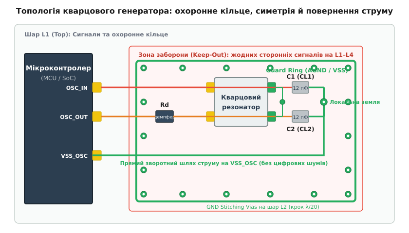
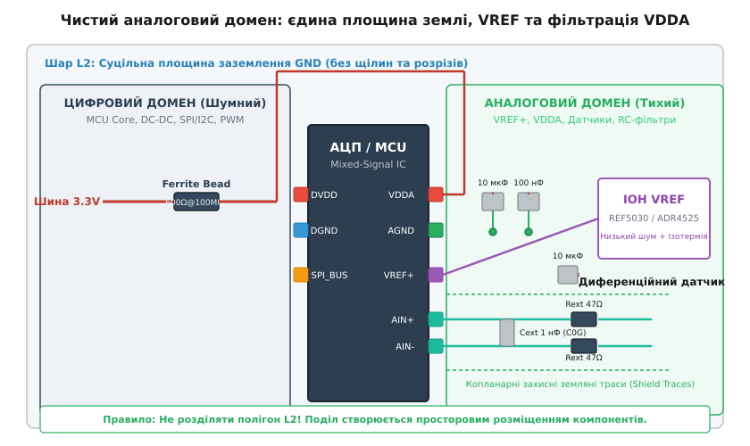

# 🔇 Кварц, опора й аналогові входи: тихі куточки плати

<preknowlist>
- [Топологія друкованих плат](root:hw-pcb/pcb-layout) — розміщення компонентів, правила розведення сигнальних і силових провідників.
- [Шлях зворотного струму](root:hw-pcb/current-return-path) — розподіл високочастотного струму в суцільних площинах заземлення.
- [Суцільна площина заземлення](root:hw-pcb/ground-plane-design) — екранування, мінімізація індуктивності та цілісність сигналів.
- [Генератор Пірса](root:hw-analog/pierce-oscillator) — інвертуючий підсилювач, кварцовий резонатор і зворотний зв'язок.
- [Джерела опорної напруги](root:hw-analog/voltage-reference-sources) — стабільність опорного рівня, шуми та температурний дрейф.
- [Фільтр захисту від накладання спектрів](root:hw-analog/anti-aliasing-filter) — обмеження смуги пропускання перед дискретизацією АЦП.
- [Феритові намистини](root:hw-components/ferrite-bead) — високочастотне поглинання завад у колах живлення.
</preknowlist>

На сучасній змішаній друкованій платі цифровий мікроконтролер із тактовою частотою ядер від 100 до 480 МГц перемикає вихідні буфери шин пам'яті та інтерфейсів із часом наростання фронту `t_rise = 0.8...2.0 нс`. При сумарному імпульсному струмі перемикання групи виводів `ΔI = 200 мА` швидкість зміни струму в контурах живлення сягає `di/dt = 10⁸...10⁹ А/с` (тобто від `0.1` до `1.0 А/нс`). Навіть мізерна паразитна індуктивність доріжки живлення чи одиничного перехідного отвору `L_via ≈ 1 нГн` породжує комутаційний стрибок напруги за формулою Фарадея:

```
V_bounce = L · (di/dt)
= 10⁻⁹ Гн · 10⁸ А/с      [індуктивність отвору на швидкість наростання струму]
= 0.1 В = 100 мВ        [амплітуда високочастотної завади на шині землі]
```

Поряд із цим цифровим джерелом завад на тій самій платі працює 16-розрядний аналогово-цифровий перетворювач (АЦП) із діапазоном перетворення `0...3.3 В`. Ціна одного молодшого значущого розряду (англ. *Least Significant Bit*, LSB) для нього становить:

```
1 LSB = V_ref / 2¹⁶
= 3.3 В / 65536         [опорна напруга поділена на кількість квантів]
≈ 50.35 мкВ             [вага одного розряду перетворення]
```

Комутаційний сплеск цифрової землі у 100 мВ перевищує вагу молодшого розряду майже у 2000 разів (`100 мВ / 50.35 мкВ ≈ 1986 LSB`). Якщо цей високочастотний шум за рахунок невдалого трасування чи спільного шляху зворотного струму просочиться в лінію опорної напруги, вхідний вимірювальний тракт або коливальний контур кварцового резонатора, вимірювальний прилад втратить точність, а кварцовий генератор отримає фазове тремтіння (англ. *jitter*) або збій лічби тактів. Фізичним інженерним розв'язанням цієї несумісності є створення на платі спеціальних **тихих куточків** (англ. *Sensitive / Quiet Layout Zones*) — зон просторової та електромагнітної ізоляції, де взаємний ємнісний, індуктивний та омічний зв'язок між вузлами зведено до розрахункового мінімуму.

---

### Фізика «тихих зон» та механізми проникнення завад

Друкована плата не є набором ізольованих провідників зі схеми. У реальному фізичному середовищі будь-які дві ділянки міді взаємодіють між собою через три фундаментальні механізми паразитного зв'язку:

1. **Гальванічний зв'язок по спільному імпедансу (Common-Impedance Coupling):** коли струм потужного цифрового споживача (наприклад, ядра мікроконтролера чи драйвера двигуна) тече крізь ту саму ділянку мідної площини заземлення або шини живлення, що й слабкий струм датчика. Спад напруги `ΔV = I_digital · Z_ground` на скінченному активному та індуктивному опорі міді безпосередньо додається до вимірюваного сигналу.
2. **Ємнісний зв'язок через електричне поле (Capacitive / Electric Field Coupling):** змінна напруга на цифровій лінії з високою швидкістю наростання `dv/dt` інжектує паразитний струм зміщення у сусідній високоомний аналоговий провідник через розподілену міжекранну ємність `C_mutual`:
   ```
   i_inject = C_mutual · (dv/dt)
   ```
   При `C_mutual = 0.5 пФ` та `dv/dt = 3.3 В / 1 нс = 3.3×10⁹ В/с` амплітуда струму інжекції становить `1.65 мА`. Протікаючи крізь вхідний опір сенсора `100 кОм`, такий струм створює катастрофічну похибку напруги `165 В` (яка обмежується лише захисними діодами, перевантажуючи вхід).
3. **Індуктивний зв'язок через магнітне поле (Inductive / Magnetic Field Coupling):** високочастотний контур струму площею `A_loop`, крізь який тече струм `i(t)`, створює змінний магнітний потік `Φ`. Цей потік пронизує сусідній аналоговий контур, наводячи електрорушійну силу за законом електромагнітної індукції Фарадея:
   ```
   V_ind = -M · (di/dt) = -μ₀ · A_loop · (dH/dt)
   ```

Проектування «тихої зони» полягає не в магічних екранах чи фізичному розрізанні плати на шматки, а в цілеспрямованому усуненні умов для кожного з цих трьох механізмів: мінімізації площі сигнальних контурів `A_loop`, збільшенні фізичної відстані до швидких цифрових трас (ослаблення `C_mutual` та `M`) і наданні кожному критичному вузлу власного незбуреного шляху повернення струму.

---

### Кварцові генератори та резонатори (HSE та LSE): боротьба за пікофаради

Кварцовий резонатор є електромеханічною коливальною системою, робота якої базується на прямому та зворотному п'єзоелектричному ефекті (від грец. *piezein* — стискати, тиснути) у монокристалі діоксиду кремнію (`SiO₂`). Еквівалентна електрична схема кварцового кристала описується класичною моделлю Баттерворта — Ван Дайка (англ. *Butterworth–Van Dyke model*, BVD):

```
       ┌───[ L_m ]───[ C_m ]───[ R_m ]───┐
──o────┤     L1        C1        ESR     ├────o──
  │    └─────────────────────────────────┘    │
  │                                           │
  └──────────────────[ C_0 ]──────────────────┘
```

* **Динамічна (мотальна) індуктивність `L_m`:** еквівалент інерційної маси коливної кварцової пластини (становить від одиниць мілігенрі до десятків генрі).
* **Динамічна ємність `C_m`:** еквівалент механічної пружності кристала (мізерна величина, типово `C_m = 1...40 фФ`, де `1 фФ = 10⁻¹⁵ Ф`).
* **Еквівалентний послідовний опір `R_m` (англ. *Equivalent Series Resistance*, ESR):** опір внутрішнього механічного тертя в кристалі та втрат у кріпленні електродів (від 15 Ом для високочастотних резонаторів до 90 кОм для годинникових кварців).
* **Статична паралельна ємність `C_0`:** електрична ємність між металевими електродами напилення на кварцовій пластині разом із ємністю тримача корпусу (типово `C_0 = 1...7 пФ`).

Кристал має дві характерні резонансні частоти: послідовного резонансу `f_s = 1 / (2π√(L_m C_m))`, де його опір мінімальний і чисто активний (`Z = ESR`), та паралельного (антирезонансу) `f_p = f_s · √(1 + C_m / C_0)`. У генераторах мікроконтролерів кристал завжди працює в індуктивній області між `f_s` та `f_p`, утворюючи паралельний коливальний контур із зовнішніми навантажувальними конденсаторами `C_1` та `C_2`.

#### Генератор Пірса в мікроконтролері

Більшість сучасних цифрових мікросхем (STM32, NXP LPC, TI MSPM0/C2000, Microchip SAM, ESP32) містять усередині один логічний інвертор (CMOS Inverter) між пінами `OSC_IN` та `OSC_OUT`. Інвертор охоплений внутрішнім високовольтним резистором зворотного зв'язку `R_f` (типово `1...10 МОм`), який зміщує робочу точку інвертора в лінійну область підсилення класу A.

Кварцовий кристал разом із конденсаторами `C_1` та `C_2` утворює ланцюг зворотного зв'язку Пірса типу «π-фільтр», що забезпечує зсув фази на 180° на робочій частоті. Разом із 180° фазового зсуву самого інвертора сумарний зсув фази по замкненому контуру становить рівно 360° (0°), виконуючи амплітудно-фазовий критерій балансу фаз Баркгаузена для виникнення незгасаючих коливань.

#### Розрахунок навантажувальних конденсаторів $C_L$

У паспорті на будь-який кварцовий резонатор виробник фіксує номінальну ємність навантаження `C_L` (англ. *Load Capacitance*), за якої калібрувалася резонансна частота (типово 6 пФ, 8 пФ, 12 пФ, 16 пФ, 20 пФ). Повна ємність навантаження, яку «бачить» резонатор між своїми виводами, складається з послідовного з'єднання двох зовнішніх конденсаторів `C_1`, `C_2` та сумарної паразитної ємності монтажу й виводів `C_stray`:

```
C_L = (C_1 · C_2) / (C_1 + C_2) + C_stray      [послідовне з'єднання двох гілок + паразитна ємність]
```

Для забезпечення симетрії амплітуди коливань на вході й виході зовнішні конденсатори завжди обирають рівними між собою: `C_1 = C_2 = C_ext`. Тоді формула спрощується:

```
C_L = (C_ext · C_ext) / (2 · C_ext) + C_stray
= C_ext / 2 + C_stray                          [еквівалентна ємність симетричного контуру]
```

Звідси формула для розрахунку номіналу конденсаторів, які необхідно змонтувати на платі:

```
C_ext = 2 · (C_L - C_stray)
```

Паразитна ємність `C_stray` — це фізична сума трьох складових:
* Ємність виводів корпусу мікроконтролера `C_pin` (типово `1.5...3.0 пФ` для корпусів LQFP/QFN);
* Ємність контактних площадок (падів) кварцу та конденсаторів відносно опорного шару заземлення на платі `C_pad` (`0.5...1.0 пФ`);
* Погонна ємність друкованих провідників `C_trace` на склотекстоліті FR-4 (при ширині доріжки 0.2 мм та відстані до шару заземлення 0.15 мм погонна ємність становить `≈ 1.0...1.5 пФ/см`).

Для компактного двошарового або чотиришарового монтажу типове значення `C_stray` лежить у межах `2.5...5.0 пФ`.

##### Розрахунковий приклад

Нехай обрано високочастотний резонатор 16 МГц із паспортом `C_L = 12 пФ`. Оцінимо паразитну ємність плати `C_stray = 3.5 пФ`.

```
C_ext = 2 · (12 пФ - 3.5 пФ)
= 2 · 8.5 пФ             [подвоєна різниця між паспортною та паразитною ємністю]
= 17 пФ                  [розрахунковий номінал зовнішніх конденсаторів C1 і C2]
```

Зі стандартного номінального ряду E24 обираємо керамічні SMD-конденсатори номіналом `18 пФ` або `15 пФ` з ультрастабільним діелектриком класу I (C0G / NP0). Застосування конденсаторів із сегнетоелектричним діелектриком класу II (X7R, X5R, Y5V) суворо заборонено: їхня ємність змінюється на 15–80% при коливаннях температури та під дією прикладеної напруги, що призведе до температурного відходу тактової частоти.

Чому помилка у виборі ємності конденсаторів небезпечна? Відхилення фактичної ємності `C_L_real` від паспортного значення `C_L_nom` зміщує генеровану частоту через ефект розтягування (англ. *pullability*):

```
Δf / f_0 = (C_m · (C_L_nom - C_L_real)) / (2 · (C_0 + C_L_nom) · (C_0 + C_L_real))
```

Якщо замість розрахункових 18 пФ помилково встановити конденсатори на 33 пФ, генератор змістить частоту вниз на 50–150 ppm (що зробить неможливою роботу точних інтерфейсів на зразок USB Full Speed, де потрібна точність краще ±500 ppm, або CAN/Ethernet). Якщо ж ємність занизити — частота піде вгору, а амплітуда коливань зросте до рівня перевантаження кристала.

#### Порівняння HSE та LSE: чому годинниковий кварц вимагає особливого ставлення

Мікроконтролери використовують два абсолютно різних класи зовнішніх кварців:

| Параметр | HSE (High-Speed External) | LSE (Low-Speed External) | Фізичний наслідок для трасування |
|---|---|---|---|
| **Номінальна частота** | 8 – 32 МГц | 32.768 кГц ($2^{15}$ Гц) | Період LSE у тисячу разів довший, ніж у HSE |
| **Еквівалентний опір ESR** | 20 – 60 Ом | 30 000 – 90 000 Ом (30–90 кОм) | Втрати в кристалі LSE у тисячі разів вищі |
| **Струм споживання генератора** | 1 – 5 мА | 0.25 – 1.0 мкА (наноамперний клас) | LSE генерує мізерну потужність розгойдування |
| **Вхідний імпеданс контуру** | `Z ≈ 500...2000 Ом` | `Z ≈ 500 кОм...1.5 МОм` | Вхід LSE надзвичайно чутливий до струмів витоку |
| **Допустима потужність збудження** | 100 – 500 мкВт | 0.1 – 0.5 мкВт (100–500 нВт) | Легко зруйнувати LSE надмірним рівнем збудження |
| **Головна загроза стабільності** | Випромінювання ВЧ-завад (EMI) | Проникнення завад, витоки вологи, зрив | Різна стратегія екранування |

Через колосальний імпеданс вузла `OSC32_IN` (`~1 МОм`) навіть незначний паразитний струм витоку `10 нА`, що протікає по поверхні плати через вологий пил чи залишки флюсу після паяння, створює паразитне падіння напруги `ΔV = 10 нА · 1 МОм = 10 мВ`, що повністю зриває слабкі мікропотужні коливання генератора годинника реального часу (RTC).

#### Запас по підсиленню (Gain Margin) та критерій збудження

Щоб коливання в генераторі надійно запускалися за будь-яких умов (при напрузі живлення на нижній межі, температурі -40 °C чи +105 °C, технологічному розкиді параметрів кремнію), коефіцієнт підсилення інвертора за замкненим контуром має значно перевищувати втрати в резонаторі.

Мірою підсилювальної здатності вбудованого CMOS-інвертора є його крутизна передачі `g_m` (англ. *transconductance*, вимірюється в мА/В або мкА/В). Критична крутизна `g_m_crit`, необхідна для підтримки коливань на межі зриву, вираховується за формулою:

```
g_m_crit = 4 · ESR · (2 · π · f)² · (C_0 + C_L)²
```

Коефіцієнт запасу по підсиленню (Gain Margin) визначається як співвідношення між крутизною інвертора мікроконтролера та критичною крутизною контуру:

```
Gain Margin = g_m / g_m_crit
```

Для надійного промислового виробу інженерним стандартом є вимога:
* `Gain Margin ≥ 5` — обов'язковий мінімум для кімнатних умов;
* `Gain Margin ≥ 8...10` — для автомобільних та промислових пристроїв з широким температурним діапазоном (оскільки при нагріванні крутизна польових транзисторів `g_m` падає через зниження рухливості носіїв заряду в кремнії, а ESR кристала зростає).

Якщо `Gain Margin < 3`, генератор запускатиметься нестабільно: час виходу на стабільну амплітуду коливань (англ. *startup time*) збільшиться з кількох мілісекунд до сотень мілісекунд або взагалі відбудеться зрив запуску при увімкненні на морозі.

#### Потужність збудження (Drive Level) та демпфуючий резистор $R_d$

Зворотним боком надмірно великої крутизни `g_m` є ризик перезбудження кварцового кристала. Потужність збудження (англ. *Drive Level*, DL), що розсіюється на кристалі, становить:

```
P_drive = 2 · ESR · (π · f · (C_0 + C_L) · V_pp)²
```

де `V_pp` — розмах синусоїдальної напруги на вході `OSC_IN`. Якщо фактична потужність `P_drive` перевищує паспортну межу `P_max` виробника резонатора (наприклад, 100 мкВт), у кварцовій пластині виникають надмірні механічні напруження. Це призводить до передчасного старіння кристала (дрейфу частоти), збудження на паразитних обертонах або фізичного руйнування (тріщини) п'єзоелемента.

Для обмеження струму збудження між виходом інвертора `OSC_OUT` та навантажувальним конденсатором `C_2` встановлюють послідовний демпфуючий резистор `R_d` (англ. *damping resistor*). Номінал `R_d` розраховується так, щоб його опір був близьким до ємнісного опору навантажувального конденсатора на робочій частоті:

```
R_d ≈ 1 / (2 · π · f · C_2)
```

Для резонатора 16 МГц та `C_2 = 18 пФ`:

```
R_d ≈ 1 / (2 · 3.14159 · 16×10⁶ Гц · 18×10⁻¹² Ф)
≈ 1 / 0.00181 Ом⁻¹
≈ 552 Ом                [орієнтовне значення демпфуючого опору]
```

Зазвичай номінал `R_d` обирають у межах від `47 Ом` до `470 Ом` для HSE (для LSE через високий власний ESR додатковий резистор часто не потрібен або обирається номіналом `100...330 кОм`, якщо генератор не має вбудованого атенюатора).

---

### Топологія кварцового вузла: Guard Ring, Keep-Out та повернення струму

Електричні кола кварцового генератора є водночас і джерелом високочастотних електромагнітних завад (HSE випромінює гармоніки тактової частоти через велике `dv/dt`), і надзвичайно чутливим приймачем наведених шумів (LSE ловить завади від сусідніх ліній). Тому фізичне трасування цього вузла підпорядковується суворим правилам.


*Топологія розміщення кварцового резонатора: охоронне кільце Guard Ring на верхньому шарі L1, навантажувальні конденсатори C1/C2 зі спільним поворотним провідником на пін VSS_OSC мікроконтролера та суцільна зона заборони трасування Keep-Out під контуром.*

#### Правила топології коливального вузла

1. **Мінімальна довжина трас:** Кварцовий резонатор і конденсатори повинні розміщуватися максимально близько до виводів мікроконтролера. Довжина доріжок не повинна перевищувати `5...10 мм`. Що коротша доріжка, то менша її паразитна індуктивність та антена здатність.
2. **Симетричне трасування (Symmetric Routing):** Доріжки від `OSC_IN` та `OSC_OUT` ведуться паралельно з однаковою шириною та довжиною для забезпечення однакової паразитної ємності відносно оточення.
3. **Локальна зірка заземлення конденсаторів (Dedicated Crystal GND):** Виводи заземлення конденсаторів `C_1` та `C_2` з'єднуються між собою короткою широкою доріжкою на шарі L1 (утворюючи локальну точку сходження) і повертаються окремим провідником безпосередньо на вивід заземлення генератора мікроконтролера (`VSS_OSC` або найближчий пін `VSS`). Підключати ці конденсатори до загального полігону плати у випадкових точках неприпустимо: зворотний високочастотний струм коливального контуру не повинен блукати загальною землею, так само як і цифрові шуми землі не повинні протікати через заземлення `C_1/C_2`.
4. **Охоронне кільце (Guard Ring):** На верхньому шарі (Layer 1) навколо всього кварцового вузла (резонатор, конденсатори `C_1/C_2`, резистор `R_d`, провідники `OSC_IN/OUT`) прокладається замкнене мідне охоронне кільце шириною `0.3...0.5 мм`. Кільце з'єднується з локальною землею генератора `VSS_OSC` і прошивається частими перехідними отворами (via stitching з кроком `2...3 мм`) до суцільної площини заземлення на шарі L2. Охоронне кільце працює як електростатичний екран (клітка Фарадея), перехоплюючи бічні лінії електричного поля від сусідніх сигнальних доріжок.
5. **Заземлення металевого корпусу резонатора:** Якщо використовується резонатор у 4-вивідному SMD-корпусі, його пади заземлення кришки (пади 2 і 4) з'єднуються безпосередньо з охоронним кільцем і землею L2. Металева кришка екранує кварцову пластину від зовнішнього випромінювання.
6. **Абсолютна зона заборони (Keep-Out Zone):**
   * Під резонатором і його доріжками на ВСІХ шарах плати (Top, Inner 1, Inner 2, Bottom) суворо заборонено проводити будь-які сторонні сигнальні лінії (шини UART/SPI/I2C, тактові сигнали, лінії ШІМ, траси живлення).
   * Безпосередньо під кварцовим вузлом на другому шарі (Layer 2) повинен бути суцільний нерозривний мідний полігон заземлення (Ground Plane). У цьому полігоні заборонені будь-які щілини, розрізи чи чужі перехідні отвори. Цей полігон слугує дзеркальним екраном, який замикає лінії магнітного поля на себе.

#### Дискретний резонатор проти готового генератора (Oscillator Module)

При проектуванні вузлів тактування інженер обирає між двома рішеннями:
* **Пасивний кварцовий резонатор (Crystal Unit):** 2- або 4-вивідний компонент, що містить лише кристал `SiO₂`. Потребує зовнішніх конденсаторів, внутрішнього інвертора мікроконтролера, ретельного розрахунку `C_L`, `g_m` та захисного трасування. Перевага: низька вартість (0.1–0.3$) та мале споживання.
* **Активний кварцовий генератор (Clock Oscillator Module — XO, TCXO, OCXO):** 4-вивідний автономний модуль, що містить усередині кристал, інтегральну схему генератора з транзисторами, термокомпенсацію (TCXO) або мікротермостат (OCXO) та вихідний буфер. Видає готовий логічний сигнал прямокутних імпульсів (CMOS/LVDS).
  * **Особливості топології модуля:** не потребує зовнішніх навантажувальних конденсаторів `C_1/C_2`. Натомість критично вимагає встановлення якісного керамічного блокувального конденсатора `100 нФ` (C0G або X7R) впритул між своїми виводами `VDD` та `GND`. На виході модуля поруч із виводом обов'язково встановлюють послідовний резистор узгодження `R_term = 22...33 Ом` для гасіння відбиттів у лінії передачі тактового сигналу.

---

### Джерела опорної напруги (VREF) та аналогове живлення (VDDA/VSSA)

Якщо кварцовий генератор задає часову шкалу роботи системи, то джерело опорної напруги (англ. *Voltage Reference*, ІОН) задає шкалу вимірювання амплітуди. Кожен мікровольт шуму, температурного дрейфу чи пульсації на лінії `VREF` безпосередньо транслюється в похибку кожного відліку аналогово-цифрового перетворення:

```
V_measured = (ADC_code / 2^N) · VREF
```

Якщо `VREF` просідає на 1% через імпульсне споживання мікроконтролера, всі виміряні значення штучно зростуть на 1%.

#### Фільтрація аналогового живлення VDDA/VSSA

У багатьох мікроконтролерах внутрішнє ядро споживає струм від загальної цифрової шини `VDD/VSS`, а внутрішні аналогові периферійні блоки (АЦП, ЦАП, компаратори, ОП, джерело опорної напруги Bandgap) живляться від виділених виводів `VDDA/VSSA`.

Цифрова шина `VDD` забруднена високочастотними шумами перемикання транзисторів ядра. Для очищення напруги `VDDA` застосовують LC- або RC-ланцюг фільтрації на базі феритової намистини (Ferrite Bead):

```
VDD_DIGITAL ───[ Ferrite Bead ]───┬──────────────┬───────────────> VDDA
               (R_dc < 0.1 Ом)    │ +            │               (до піна ІС)
                               [ C_bulk ]     [ C_hf ]
                                10 мкФ         100 нФ
                               (тантал/ESR)   (кераміка C0G)
                                  │              │
GND_SOLID ────────────────────────┴──────────────┴───────────────> VSSA
```

##### Небезпека антирезонансу феритової намистини (Q-Peaking)

Феритова намистина (Ferrite Bead) на низьких частотах (до 100 кГц — 1 МГц) поводиться як звичайна котушка індуктивності `L ≈ 1...5 мкГн` із малим активним опором `R_dc ≈ 0.05...0.2 Ом`. Її високий опір втрат (активне поглинання ВЧ-енергії) починає проявлятися лише на частотах вище 10–50 МГц (наприклад, `Z = 600 Ом @ 100 МГц`).

Якщо підключити феритову намистину послідовно з високоякісним керамічним конденсатором `C = 10 мкФ` з ультранизьким власним опором `ESR < 5 мОм`, утворюється високодобротний послідовний LC-контур. Добротність контуру становить:

```
Q = (1 / R_total) · √(L / C)
```

При `R_total = R_dc + ESR = 0.1 Ом + 0.005 Ом = 0.105 Ом`, `L = 2 мкГн`, `C = 10 мкФ`:

```
Q = (1 / 0.105) · √(2×10⁻⁶ / 10×10⁻⁶)
= 9.52 · √0.2
= 9.52 · 0.447 ≈ 4.26     [висока добротність коливального контуру]
```

Резонансна частота цього контуру:

```
f_res = 1 / (2 · π · √(L · C))
= 1 / (2 · 3.14159 · √(2×10⁻⁶ · 10×10⁻⁶))
= 1 / (6.283 · 4.47×10⁻⁶)
≈ 35.6 кГц                [частота резонансного сплеску]
```

На частоті `35.6 кГц` такий «фільтр» замість придушення завад навпаки **підсилює шум у 4.26 раза (+12.6 дБ)**! Будь-які пульсації від імпульсного перетворювача живлення (DC-DC) чи перемикання навантаження на частотах біля 35 кГц викличуть резонансний дзвін на шині `VDDA`.

##### Методи демпфування резонансу:
1. **Паралельне демпфування конденсатором з контрольованим ESR:** Замість чистої кераміки паралельно встановлюють танталовий, ніобієвий або полімерний конденсатор ємністю `10...22 мкФ` із власним опором `ESR = 0.5...1.5 Ом`. Цей опір ефективно знижує добротність до `Q ≤ 0.707` (критичне демпфування), повністю усуваючи резонансний горб.
2. **Послідовний демпфуючий резистор:** Якщо використовується суто керамічний конденсатор, послідовно з феритовою намистиною встановлюють малоомний резистор `R_damp = 0.5...1.0 Ом`.

#### Каскадна розв'язка за ємністю

Для перекриття широкого діапазону частот біля кожного виводу `VDDA` та `VREF+` розміщують каскад із двох або трьох паралельних конденсаторів:
* **Bulk-конденсатор `4.7...10 мкФ` (кераміка X7R або танталовий):** низькочастотний резервуар енергії;
* **Високочастотний конденсатор `100 нФ` (C0G або якісний X7R у корпусі 0402):** забезпечує низький імпеданс у діапазоні 1–50 МГц. Його слід монтувати на відстані не більше 1–2 мм від піна мікросхеми;
* **Ультрависокочастотний конденсатор `1 нФ / 100 пФ` (корпус 0201/0402, C0G):** придушує гігагерцові завади та має власну частоту послідовного резонансу (SRF) вище 200–500 МГц.

#### Буферизація джерел опорної напруги (VREF)

Прецизійні зовнішні джерела опорної напруги (наприклад, Texas Instruments REF5030, Analog Devices ADR4525 / LTC6655) мають ультранизький власний шум (менше `1...3 мкВ RMS` у смузі 0.1–10 Гц) та мінімальний температурний коефіцієнт (`1...3 ppm/°C`).

Проте вихідний каскад таких мікросхем має скінченний час реакції на швидкі динамічні зміни навантаження. Коли АЦП виконує комутацію внутрішніх конденсаторів вибірки (SAR ADC DAC network), з лінії `VREF` споживаються короткі наносекундні імпульси струму амплітудою до десятків міліампер. Якщо вихідний імпеданс джерела опорної напруги на високих частотах недостатньо малий, на лінії `VREF` виникає динамічне просідання напруги, що спотворює старші розряди перетворення.

Для вирішення цієї проблеми застосовують:
* **Пряме шунтування виходу ІОН масивною керамікою `10...47 мкФ` з діелектриком X7R/X5R:** мікросхема ІОН повинна бути спеціально спроектована для стабільної роботи з великою ємністю навантаження без втрати запасу по фазі (як, наприклад, REF50xx);
* **Зовнішній швидкодіючий буферний операційний підсилювач:** ОП із високою смугою пропускання (`GBW > 20...50 МГц`), ультранизьким шумом та можливістю роботи на ємнісне навантаження (наприклад, OPA350, ADA4805, AD8031).

#### Термоелектричні ефекти (ефект Зеєбека) та температурні градієнти

У прецизійних трактах із розрядністю 18–24 біти або при вимірюванні мікровольтових сигналів від термопар і тензомостів небезпечним джерелом похибки стає ефект Зеєбека (термоелектричний ефект, відкритий Томасом Зеєбеком 1821 року).

Будь-яке з'єднання двох різнорідних металів утворює контактну термопару. На друкованій платі типовими контактами є:
* Мідна доріжка плати (`Cu`) ↔ Олов'яно-свинцевий або безсвинцевий припій (`Sn-Pb` / `Sn-Ag-Cu`);
* Припій ↔ Вивід резистора чи мікросхеми (коваровий сплав, нікель, золото, латунь).

Коефіцієнт термо-ЕРС мідно-припійного переходу становить від `1` до `5 мкВ/°C`, а контакт із коваровими виводами (Kovar) сягає `30...40 мкВ/°C`.

Якщо на платі встановлено SMD-резистор, два його контакти утворюють дві зустрічно включені термопари:

```
[ Мідь плати ] ──(T1)──[ Резистор R ]──(T2)── [ Мідь плати ]
      │                                             │
      └─── Термопара 1               Термопара 2 ───┘
```

Якщо температура обох паяних з'єднань однакова (`T1 = T2`), термо-ЕРС обох переходів взаємно компенсуються: `V_th = S · (T1 - T2) = 0`. Проте якщо на платі присутній температурний градієнт (наприклад, поруч на відстані 15 мм розташовано лінійний стабілізатор LDO, силовий транзистор або процесор, що гріється до 60 °C), між протилежними виводами чіп-резистора розміром 0805 (довжина 2 мм) виникає різниця температур `ΔT = T1 - T2 ≈ 0.2...0.5 °C`.

При `ΔT = 0.3 °C` паразитна напруга становить:

```
V_thermo = S · ΔT
= 40 мкВ/°C · 0.3 °C     [термо-ЕРС коварового контакту на різницю температур]
= 12 мкВ                [паразитна постійна напруга зміщення]
```

Для 24-розрядного АЦП із `VREF = 2.5 В` вага 1 LSB становить всього `0.15 мкВ`. Паразитна термо-ЕРС у `12 мкВ` дає зміщення нуля на `80 LSB`! Причому це зміщення дрейфуватиме при зміні швидкості обдуву вентилятора чи коливаннях температури довкілля.

##### Правила ізотермічного трасування прецизійних зон:
1. **Орієнтація компонентів за ізотермами:** Прецизійні резистори дільників та вхідних ланцюгів орієнтують перпендикулярно до напрямку теплового потоку від гарячих елементів (щоб обидва виводи лежали на одній ізотермічній лінії й мали однакову температуру).
2. **Теплова симетрія паяних площадок:** Пади обох виводів повинні мати однакову геометричну форму та однакову кількість підключених теплопровідних полігонів і перехідних отворів (запобігання нерівномірному відведенню тепла).
3. **Фізичні теплові бар'єри:** Прорізання наскрізних фрезерованих пазів (англ. *thermal relief slots*) у склотекстоліті між гарячою цифровою/силовою зоною та тихою зоною VREF для блокування кондуктивного поширення тепла по платі.
4. **Захист від конвекції:** Накриття чутливого аналогового каскаду металевим або пластиковим захисним ковпачком для запобігання впливу локальних потоків повітря.

---

### Дискусія AGND проти DGND: міфи про розпил плати та фізика суцільної землі

Протягом десятиліть у підручниках і застарілих апнотах повторювалася порада: «Розріжте полігон заземлення плати на дві незалежні частини — аналогову землю AGND та цифрову DGND, і з'єднайте їх між собою в одній точці під мікросхемою АЦП».

У сучасних високошвидкісних змішаних системах цей підхід у 95% випадків є грубою помилкою, що призводить до катастрофічного зростання рівня електромагнітної емісії (EMI) та погіршення шумів АЦП. Розглянемо фізику процесів, щоб зрозуміти, чому це так.

#### Шлях повернення струму на низьких і високих частотах

Електричний струм завжди тече замкненим контуром: від джерела до навантаження по прямому провіднику і від навантаження назад до джерела по колу заземлення. Але шлях, який обирає зворотний струм у суцільній мідній площині, фундаментально залежить від частоти:

* **На постійному струмі та низьких частотах (f < 1 кГц):** Індуктивність не грає ролі. Зворотний струм розподіляється за законом найменшого активного опору (Path of Least Resistance). Він розтікається по всій площині найкоротшою прямою лінією між точкою навантаження та джерелом живлення.
* **На високих частотах (f > 100 кГц — 1 МГц):** Імпеданс визначається індуктивністю контуру `Z = R + jωL ≈ jωL`. Струм розподіляється за законом найменшої петлевої індуктивності (Path of Least Inductance). Індуктивність контуру мінімальна тоді, коли площа контуру між прямим і зворотним провідником мінімальна. Тому високочастотний зворотний струм у полігоні землі **тече строго під сигнальною доріжкою**, дзеркально повторюючи всі її повороти й вигини, незалежно від того, де розташоване джерело живлення!

Густина зворотного струму `J(x)` у площині заземлення під мікросмужковою лінією описується розподілом Гауса:

```
J(x) = I_0 / (π · h · (1 + (x / h)²))
```

де `h` — висота діелектрика між доріжкою та шаром землі, `x` — поперечна відстань від осі доріжки. На відстані `x = 3h` в обидва боки зосереджено понад 80% усього зворотного струму.

#### Що відбувається при розрізанні полігону землі

Нехай на платі створено розріз землі між аналоговою та цифровою зонами. Мікроконтролер передає тактовий сигнал або дані на АЦП по цифровій лінії керування (наприклад, шина SPI: `SCK`, `MOSI`, `CS`).

Сигнальна доріжка перетинає щілину в землі з шару L1. Прямий струм спокійно проходить по доріжці. Але високочастотний зворотний струм, який біг у полігоні L2 строго під цією доріжкою, натикається на повітряний розріз. Струм не може перестрибнути через щілину!

Зворотний струм змушений повернути праворуч або ліворуч і бігти вздовж усього краю розрізу до єдиної точки перемички між AGND та DGND, пройти крізь перемичку і повернутися вздовж іншого краю розрізу назад під доріжку.

У результаті утворюється гігантська просторова петля струму площею `A_loop`.

##### Наслідки утворення петлі:
1. **Щілинна антена (Slot Antenna):** Розріз у площині заземлення, крізь який протікає високочастотний струм зміщення, перетворюється на високоефективну щілинну антену. Плата починає інтенсивно випромінювати радіозавади на гармоніках тактової частоти (провал сертифікації EMC/EMI).
2. **Індуктивність розриву та шум землі (Ground Bounce):** Індуктивність петлі зростає з `1...2 нГн` до `20...100 нГн`. Кожен перепад цифрового сигналу наводить на аналоговій стороні імпульс напруги `V = L_loop · (di/dt)`.
3. **Спотворення цифрового фронту:** Лінія втрачає стабільний хвильовий імпеданс (відбувається стрибок із `50 Ом` до `150...200 Ом`), виникають сильні відбиття сигналу та дзвін.


*Топологія чистого аналогового домену: суцільна площина заземлення L2 без щілин і розрізів, просторовий поділ зон, фільтрація VDDA через феритову намистину та диференційний вхід АЦП з RC-ланцюгом.*

#### Сучасний стандарт: єдина нерозривна площина заземлення з просторовим розділенням

Сучасне високонадійне проектування базується на концепції **просторового поділу (Spatial Partitioning) на суцільній площині заземлення**:

1. **Єдиний суцільний полігон GND (Solid Ground Plane):** На другому шарі чотиришарової плати (Layer 2) формується абсолютно суцільний, нерозривний шар міді без жодних розрізів, щілин чи розділень.
2. **Географічне зонування компонентів на платі:**
   * Уся «шумна» цифрова периферія (процесорні ядра, пам'ять, драйвери шин, DC-DC перетворювачі, силові ключі) групується виключно в лівій/цифровій частині плати;
   * Уся «тиха» аналогова периферія (сенсори, ОП, фільтри, ІОН `VREF`) групується виключно в правій/аналоговій частині плати;
   * Змішані мікросхеми (АЦП, ЦАП, кодеки, MCU з вбудованим АЦП) встановлюються строго на межі між цими двома зонами.
3. **Локалізація струмів:** Оскільки високочастотні зворотні струми цифрових ліній течуть строго під своїми доріжками в цифровій зоні, вони фізично ніколи не затікають у правий аналоговий сектор!
4. **Підключення пінів ІС:** Виводи `AGND` та `DGND` змішаної мікросхеми підключаються найкоротшими індивідуальними перехідними отворами безпосередньо до суцільної площини заземлення прямо під корпусом мікросхеми.

#### Коли фізичне розділення земель (Star Ground) все ще виправдане?

Фізичне розділення земель за допомогою перемички 0 Ом або зіркового з'єднання (Star Ground) залишається необхідним лише в системах, де присутні **великі низькочастотні силові струми**:
* Силові інвертори приводів двигунів зі струмами комутації `10...100 А`;
* Потужні релейні та соленоїдні комутатори;
* Системи з гальванічною ізоляцією (де землі розділені бар'єром 2.5–5 кВ).

На постійному струмі та низьких частотах (де струм тече найкоротшим шляхом за активним опором) силовий струм у 20 А, протікаючи крізь спільний полігон товщиною 35 мкм (1 oz мідь, опір `0.5 мОм/□`), створює спад напруги `ΔV = 20 А · 0.5 мОм = 10 мВ`. Цей спад напруги безпосередньо змістить потенціал заземлення датчика. Лише в таких силових випадках силову землю відокремлюють від вимірювальної, з'єднуючи їх в єдиній точці — мінусовій клемі силового конденсатора живлення.

---

### Аналогові входи АЦП (ADC Inputs): динаміка комутації вибірки та антиаліасинг

Вхідний каскад сучасного SAR АЦП (або сигма-дельта перетворювача) не є високоомним резистором. На фізичному рівні він є схемою вибірки-зберігання (англ. *Sample-and-Hold*, S&H) на комутованих конденсаторах.

```
Вхідний пін ───[ R_on ]───┬───/ ───┬───[ C_sample ]─── GND_ANALOG
(AIN)          (внутрішній)│   Ключ │   (5...15 пФ)
                           │   S&H  │
                        [ C_pin ]   │
                         3...5 пФ   │ (Зарядний стрибок
                                    │  Charge Kickback)
```

#### Механізм зворотного викиду заряду (Charge Kickback)

Процес перетворення АЦП складається з двох фаз:
1. **Фаза утримання та перетворення (Hold/Convert Phase):** Ключ S&H розімкнено. Внутрішня схема попороздрядного наближення (SAR) або сигма-дельта модулятор визначає цифровий код за зарядом, збереженим на `C_sample`.
2. **Фаза вибірки (Acquisition / Tracking Phase):** Ключ S&H замикається на фіксований час `t_acq` (типово від `50 нс` до `1 мкс`). Конденсатор `C_sample` підключається до вхідного піна через опір відкритого ключа `R_on` (типово `100...2000 Ом`).

У момент замикання ключа на конденсаторі `C_sample` залишається залишковий заряд від попереднього вимірювання (яке могло бути на іншому каналі аналогового мультиплексора з напругою 3.3 В, тоді як поточний канал вимірює 0.1 В).

Виникає миттєвий перерозподіл заряду між внутрішньою ємністю `C_sample` та ємністю зовнішньої лінії зв'язку. Цей комутаційний імпульс струму зветься **зворотним викидом заряду** (англ. *Charge Kickback*). На вході АЦП виникає різкий наносекундний провал або викид напруги.

Якщо цей викид напруги не встигне повністю затухнути й встановитися до точного значення вимірюваної напруги за час фази вибірки `t_acq`, АЦП оцифрує спотворене перехідним процесом значення.

#### Зовнішній антиаліасинговий RC-фільтр

Для придушення високочастотного шуму, усунення накладання спектрів (Aliasing) та локалізації імпульсу Charge Kickback перед входом АЦП встановлюють зовнішній RC-ланцюг:

```
Джерело сигналу ───[ R_ext ]───┬───────> До піна AIN АЦП
                               │
                           [ C_ext ]
                          (C0G кераміка)
                               │
                          GND_ANALOG
```

Функції компонентів:
* **Зовнішній резервуарний конденсатор `C_ext`:** Працює як локальний накопичувач заряду. При замиканні ключа S&H заряд для перезаряджання `C_sample` береться безпосередньо з `C_ext`, а не тягнеться по довгій зовнішній лінії через опір джерела.
  * Щоб початкове просідання напруги на вході в момент комутації не перевищувало допустимого значення, ємність `C_ext` має значно перевищувати внутрішню ємність вибірки:
    ```
    C_ext ≥ 20...50 · C_sample
    ```
    При `C_sample = 10 пФ` обирають `C_ext = 470 пФ...2.2 нФ`. Конденсатор `C_ext` повинен мати діелектрик C0G/NP0 (ультранизька діелектрична абсорбція та відсутність п'єзоефекту).
* **Послідовний резистор `R_ext`:** Обмежує струм заряду, ізолює вихідний каскад зовнішнього буферного ОП від прямого ємнісного навантаження `C_ext` (запобігаючи збудженню ОП) та формує разом із `C_ext` фільтр низьких частот першого порядку.

#### Розрахунок бюджету часу встановлення (Settling Time Budget)

Перехідний процес встановлення напруги в еквівалентному RC-контурі під час фази вибірки `t_acq` описується експонентою:

```
V_error(t) = V_step · exp(-t / τ)
```

де стала часу контуру вибірки `τ` становить:

```
τ = (R_ext + R_on) · C_sample
```

Щоб похибка встановлення не перевищувала половини молодшого розряду (`< 0.5 LSB = 1 / 2^(N+1)`) для `N`-розрядного АЦП, має виконуватися умова:

```
exp(-t_acq / τ) ≤ 1 / 2^(N + 1)
```

Логарифмуючи обидві частини, отримуємо формулу мінімального необхідного часу вибірки:

```
t_acq ≥ (N + 1) · ln(2) · τ
= (N + 1) · 0.69315 · (R_ext + R_on) · C_sample
```

Кількість постійних часу `k = (N+1) · ln(2)`, необхідних для встановлення різної розрядності:
* **10-розрядний АЦП:** `k = 11 · 0.693 ≈ 7.6 · τ` (точність 0.05%);
* **12-розрядний АЦП:** `k = 13 · 0.693 ≈ 9.0 · τ` (точність 0.012%);
* **16-розрядний АЦП:** `k = 17 · 0.693 ≈ 11.8 · τ` (точність 0.00076% або 7.6 ppm);
* **24-розрядний АЦП:** `k = 25 · 0.693 ≈ 17.3 · τ` (точність 0.03 ppm).

##### Розрахунковий приклад для 16-розрядного SAR АЦП

Параметри: 16-бітний АЦП, `C_sample = 15 пФ`, `R_on = 500 Ом`. Зовнішній фільтр: `R_ext = 47 Ом`, `C_ext = 1 нФ`.

```
τ = (R_ext + R_on) · C_sample
= (47 Ом + 500 Ом) · 15×10⁻¹² Ф
= 547 Ом · 15×10⁻¹² Ф
≈ 8.205×10⁻⁹ с = 8.205 нс       [еквівалентна стала часу контуру вибірки]

t_acq_min = 11.8 · τ
= 11.8 · 8.205 нс
≈ 96.8 нс                      [мінімально необхідний час фази вибірки]
```

Якщо в регістрах мікроконтролера для АЦП сконфігуровано час вибірки `t_acq = 50 нс` (що менше за необхідні 96.8 нс), сигнал не встигне встановитися до кінця фази, і ефективна розрядність перетворювача (ENOB) впаде з 16 біт до 11–12 біт через виникнення нелінійних спотворень перехідного процесу.

Детальний числовий розрахунок навантаження кварцу, критерію запасу крутизни інвертора та часового бюджету комутації вибірки АЦП зведено у проектній вставці [Інженерний розрахунок контуру кварцу та аналогового тракту АЦП](root:hw-pcb/kvarts-opora-i-analohovi-vkhody/proj-crystal-load-calc.md).

#### Захист аналогових входів (ESD та перенапруга)

Аналогові виводи мікроконтролерів надзвичайно вразливі до електростатичних розрядів (ESD) та перенапруг. Вбудовані захисні діоди кремнієвої підкладки здатні витримувати струм не більше `2...10 мА`.

При проектуванні захисту вхідного каскаду застосовують трирівневу схему:
1. **Послідовний струмообмежувальний резистор `R_limit = 100...1000 Ом`:** обмежує струм через внутрішні або зовнішні діоди при виході вхідного сигналу за межі рейок живлення (`V_in < -0.3 В` або `V_in > VDDA + 0.3 В`).
2. **Зовнішні захисні діоди Шотткі з низьким падінням напруги (Schottky Clamping, наприклад BAT54S) або низьковитокові діодні збірки (BAV199):** перехоплюють струм перенапруги на шини `VDDA` та `VSSA` до того, як відкриються внутрішні діоди кристала.
3. **Критичність струму витоку (Leakage Current):** Звичайні захисні TVS-супресори чи діоди мають струм витоку при кімнатній температурі від `100 нА` до `5 мкА`, який експоненційно зростає при нагріванні. При опорі джерела сигналу `R_source = 10 кОм` струм витоку `1 мкА` створює падіння напруги `ΔV = 1 мкА · 10 кОм = 10 мВ = 200 LSB`! Для прецизійних кіл обирають спеціалізовані діодні збірки наднизького витоку (як BAV199 з `I_leak < 5 пА` при 25 °C).

#### Трасування аналогових провідників

* **Копланарні захисні земляні траси (Coplanar Ground Shields):** Аналогові сигнальні доріжки трасують на верхньому шарі L1. З обох боків від сигнальної доріжки на відстані `W_space = 2...3 · W_trace` прокладають паралельні доріжки заземлення, прошиті перехідними отворами до опорного шару L2 через кожні 3–5 мм. Це повністю усуває бічні ємнісні наводки від сусідніх сигналів.
* **Диференціальні пари (Differential Routing):** Якщо АЦП має диференціальний вхід (`AIN+`, `AIN-`), обидві доріжки трасуються строго симетрично, як диференціальна пара однакової довжини з фіксованим зазором. Це забезпечує однакове наведення синфазного шуму на обидва провідники, який згодом повністю пригнічується високим коефіцієнтом придушення синфазного сигналу (CMRR) перетворювача.
* **Узгодження довжини (Length Matching):** Різниця довжин диференціальних трас `AIN+` та `AIN-` не повинна перевищувати `0.5 мм`, щоб уникнути фазового перекосу при вимірюванні високочастотних складових сигналу.

#### Вхідне буферизування АЦП: драйвери SAR АЦП та стійкість підсилювача

Коли вихідний імпеданс первинного датчика є високим (понад 1–10 кОм, наприклад у датчиках pH, термопарах або тензометричних мостах), пряме підключення до комутованого входу АЦП неможливе: стала часу `τ = (R_source + R_on) · C_sample` виявиться настільки великою, що зарядний викид S&H не встигне затухнути навіть за кілька мікросекунд.

У таких випадках перед входом АЦП встановлюють прецизійний буферний операційний підсилювач — драйвер АЦП (англ. *ADC Driver / Buffer OpAmp*, наприклад OPA350, ADA4805, OPA836).

```
Датчик (High-Z) ───[ Буфер ОП ]───[ R_iso / R_ext ]───┬───> Вхід АЦП (AIN)
                     (Unity Gain)     (20...50 Ом)     │
                                                   [ C_ext ]
                                                   (1...2.2 нФ C0G)
                                                       │
                                                      GND
```

##### Проблема стійкості буферного підсилювача
Операційний підсилювач має вихідний опір у розімкненому контурі `R_out`. Підключення великої зовнішньої ємності `C_ext = 1...2.2 нФ` безпосередньо до виходу ОП утворює додатковий паразитний полюс на частоті:

```
f_pole = 1 / (2 · π · R_out · C_ext)
```

Цей полюс вносить додатковий фазовий зсув до 90° у петлю негативного зворотного зв'язку підсилювача. Фазовий запас стійкості (Phase Margin) падає нижче критичних 45°, підсилювач втрачає стабільність і починає самозбуджуватися (генерувати високочастотні коливання амплітудою десятки мілівольт або демонструвати сильний дзвін після кожного стрибка вибірки).

##### Роль резистора ізоляції R_iso (він же R_ext)
Послідовний резистор `R_iso` (20–50 Ом), встановлений між виходом ОП та конденсатором `C_ext`, фізично ізолює вихідний каскад підсилювача від прямого ємнісного навантаження. Він формує нуль передатної характеристики в петлі зворотного зв'язку, відновлюючи фазовий запас стійкості підсилювача до безпечного рівня `Phase Margin ≥ 60°`.

Водночас резистор `R_iso` бере участь у формуванні постійної часу встановлення напруги на внутрішньому конденсаторі вибірки `C_sample`, тому його номінал обирають компромісним: достатньо великим для забезпечення стійкості ОП (не менше 15–20 Ом) і достатньо малим для завершення вибірки за час `t_acq` (не більше 50–100 Ом).

#### Вплив структури шарів плати (Stackup) на паразитні параметри

Паразитні ємності та індуктивності критичних вузлів друкованої плати прямо залежать від геометрії структури шарів (англ. *PCB Stackup*).

У класичній чотиришаровій платі промислового стандарту розподіл шарів виглядає так:
* **Шар 1 (Top Layer):** Сигнали, компоненти, охоронні кільця Guard Ring;
* **Шар 2 (Inner Ground Layer):** Нерозривна суцільна площина заземлення GND;
* **Шар 3 (Inner Power Layer):** Площини живлення цифрових і аналогових шин;
* **Шар 4 (Bottom Layer):** Сигнали, другорядні компоненти.

Товщина шару діелектрика (препрегу) між L1 та L2 у сучасних платах становить `h = 0.1...0.15 мм` (100–150 мкм), тоді як між L2 та L3 товщина основи (Core) становить `0.8...1.2 мм`.

Мала відстань `h = 0.1 мм` між L1 та L2 дає дві вирішальні інженерні переваги:
1. **Мінімальна площа контуру та індуктивність:** Доріжка на L1 має мінімальну петльову індуктивність відносно зворотного струму в L2 (`L_loop ≈ 0.4...0.6 нГн/мм`), що різко пригнічує магнітне випромінювання.
2. **Ефективне екранування:** Високочастотне поле сигналу надійно локалізується між доріжкою та площиною L2, що знижує бічні перехресні завади (crosstalk) між сусідніми лініями.

Проте тонка ізоляція `h = 0.1 мм` збільшує паразитну ємність контактних площадок компонентів на землю. Наприклад, стандартний SMD-пад розміром `1.0 × 0.8 мм` (розмір чіпа 0603) відносно площини L2 на відстані 0.1 мм у діелектрику FR-4 (`ε_r ≈ 4.3`) має власну паразитну ємність:

```
C_pad = (ε_0 · ε_r · A) / h
= (8.854×10⁻¹² Ф/м · 4.3 · 0.8×10⁻⁶ м²) / 0.1×10⁻³ м
≈ 0.305 пФ               [паразитна ємність одного контактного паду]
```

Для кварцового резонатора з чотирма падами та двома навантажувальними конденсаторами сумарна ємність шести контактних площадок додає `≈ 1.8 пФ` до значення `C_stray`, що необхідно обов'язково враховувати при розрахунку зовнішніх конденсаторів `C_1/C_2`.

#### Методологія інструментального вимірювання коливань без спотворення контуру

Найпоширенішою помилкою при налагодженні кварцових генераторів та аналогових кіл є некоректне підключення вимірювальних приладів.

Стандартний пасивний щуп осцилографа з подільником 10X має вхідний опір `10 МОм` та власну ємність `C_probe = 10...15 пФ`. Довгий дріт заземлення зі стандартним крокодилом (довжина 10–15 см) має власну індуктивність `L_ground_lead ≈ 100...150 нГн`.

При спробі торкнутися таким щупом до виводу `OSC_IN` кварцового генератора:
1. Вхідна ємність щупа `15 пФ` підключається паралельно навантажувальному конденсатору 18 пФ, збільшуючи еквівалентну ємність контуру майже в півтора раза. Частота генерації зміщується на сотні ppm, а коефіцієнт запасу підсилення падає нижче одиниці — генератор миттєво зупиняється.
2. Індуктивність дроту заземлення `150 нГн` разом із ємністю щупа утворює резонансний контур на частоті біля 100 МГц, створюючи на екрані осцилографа фальшивий високочастотний дзвін, якого насправді на платі немає.

##### Правильна методика контролю генерації:
* **Непрямий контроль через вихід MCO:** Більшість мікроконтролерів дозволяють внутрішньо скомутувати тактовий сигнал HSE чи LSE на вихідний цифровий буфер GPIO (Master Clock Output, MCO). Вимірювання сигналу на цьому виводі не чинить жодного навантаження на чутливий кварцовий контур.
* **Застосування активних FET-щупів:** Якщо необхідно дослідити синусоїду безпосередньо на виводі `OSC_OUT`, застосовують спеціальний активний польовий пробник (Active FET Probe) із власною ємністю `C_in < 0.5...0.8 пФ` та коаксіальним пружинним контактом заземлення довжиною менше 3 мм.
* **Безконтактне вимірювання за допомогою петлі магнітного поля:** Невелика замкнена петля з коаксіального кабелю діаметром 5–10 мм (H-Field Probe), підключена до аналізатора спектра або осцилографа з входом 50 Ом, підноситься на відстань 2–3 мм над кварцовим резонатором. Вона фіксує випромінювання магнітного поля без прямого електричного контакту з контуром.

---

### Практичний розрахунок параметрів тактування та фільтрації

Наведений програмний модуль демонструє розрахунок ємностей кварцового контуру, запасу підсилення `Gain Margin`, параметрів демпфування `R_d` та перевірку часового бюджету встановлення RC-фільтра АЦП.

:::tabs
:::code kvarts-opora-i-analohovi-vkhody-d/c/main.c
:::code kvarts-opora-i-analohovi-vkhody-d/cpp/main.cpp
:::

---

### Зведений інженерний чеклист проектування «тихих зон»

Перед передачею проекту друкованої плати у виробництво інженер перевіряє топологію за наступними правилами:

1. **Суцільність землі:** Шар опорної землі L2 під аналоговою частиною, джерелом опорної напруги VREF та кварцовим генератором є повністю суцільним. Немає жодного сигнального перехідного отвору чи розрізу, який розриває шлях зворотного струму.
2. **Keep-Out під кварцом:** На всіх шарах плати безпосередньо під кварцовим резонатором і його конденсаторами відсутні сторонні траси (особливо шини тактування, інтерфейси SPI/I2C/UART та силові полігони).
3. **Охоронне кільце кварцу:** Навколо резонатора на шарі L1 прокладено охоронне кільце Guard Ring, підключене до виводу `VSS_OSC` мікроконтролера та прошите перехідними отворами до шару L2.
4. **Короткий поворотний провідник C1/C2:** Виводи заземлення навантажувальних конденсаторів з'єднані між собою та підключені прямою доріжкою до виводу `VSS_OSC`, а не підключені до загального полігону землі через випадкові перехідні отвори.
5. **Діелектрик C0G/NP0:** Усі навантажувальні конденсатори кварцу `C_1/C_2`, конденсатори антиаліасингових фільтрів АЦП `C_ext` та фільтри VREF виконані на основі кераміки класу I (C0G/NP0), а не X7R/Y5V.
6. **Демпфування феритових фільтрів VDDA:** Усі LC-фільтри на базі Ferrite Bead мають паралельний демпфуючий опір (танталовий конденсатор із `ESR ≈ 0.5...1.5 Ом` або послідовний резистор), що усуває резонансний сплеск Q-peaking на частотах 30–300 кГц.
7. **Близькість блокувальних конденсаторів:** Високочастотні керамічні конденсатори `100 нФ` ліній `VDDA` та `VREF+` встановлено на відстані не більше 1.5 мм від пінів мікросхеми безпосередньо над суцільною землею.
8. **Ізотермічне розміщення VREF:** Прецизійні ІОН та вхідні резистивні дільники віддалені від силових джерел тепла (стабілізатори, процесори, силові ключі), розміщені вздовж ізотермічних ліній і мають симетричні мідні контактні площадки.
9. **Захист від перенапруг:** Аналогові входи захищені послідовними резисторами обмеження струму та діодами наднизького витоку (`I_leak < 1 нА`, BAV199), щоб струм витоку не спотворював результати вимірювання при зміні температури.
10. **Час вибірки АЦП:** У програмному забезпеченні час фази вибірки `t_acq` налаштовано відповідно до розрахункового бюджету встановлення RC-ланцюга (`t_acq ≥ (N+1) · ln(2) · τ`), гарантуючи відсутність динамічної похибки вибірки.
