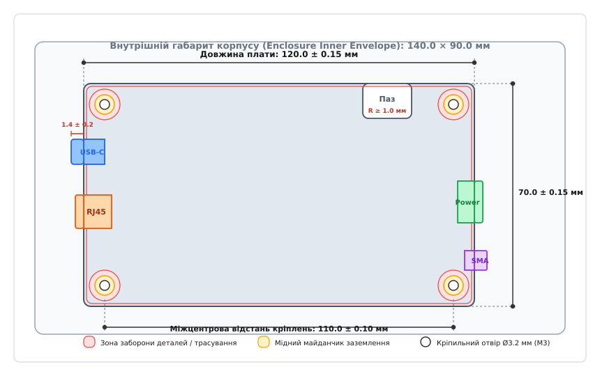
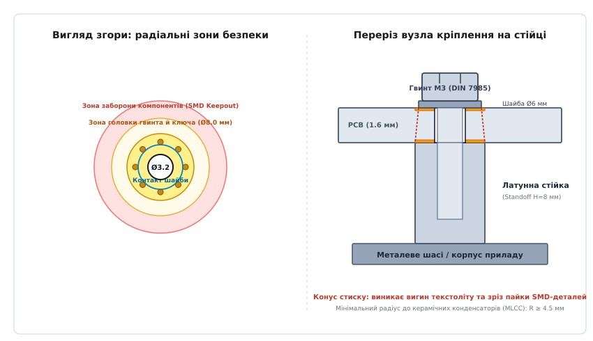

# Механічний конверт: габарити, кріплення, боки з роз'ємами

<preknowlist>
- [Друкована плата (PCB layout)](root:hw-pcb/pcb-layout) — призначення шарів, базові правила трасування та перехідні отвори.
- [Кабелі й конектори](root:hw-pcb/cables-connectors) — конструкція контактів, типи корпусів та механічні зусилля фіксації.
- [Зазори на платі: creepage та clearance](root:hw-pcb/creepage-clearance) — повітряні зазори та шляхи витоку струму по поверхні діелектрика.
- [Шарування плати (PCB stackup)](root:hw-pcb/pcb-stackup) — структура шарів ламінату FR-4, товщина міді та осердя.
</preknowlist>

Коли виготовлена друкована плата повертається з автоматизованої лінії поверхневого монтажу, її електричні кола можуть бездоганно відповідати принциповій схемі, проте якщо зовнішній кут текстоліту впирається у внутрішнє підсилювальне ребро литого алюмінієвого корпусу, кріпильний гвинт M3 при затягуванні розчавлює керамічний конденсатор шини живлення 12 В, а штекер кабелю USB-C не фіксується у гнізді через надмірну товщину фасадної панелі, прилад неможливо зібрати без браку або ручного доопрацювання. Усі ці проблеми вирішуються на етапі проектування визначенням **механічного конверта** (від фр. *enveloppe* — «оболонка»; англ. *mechanical envelope* або *keepout volume*) — тривимірного просторового бюджету, що встановлює точні геометричні межі друкованої плати, координати кріплень, зони заборони компонентів і провідників, граничні висоти деталей та положення інтерфейсних роз'ємів відносно стінок корпусу.

Механічний конверт є основним документом узгодження між інженером-електроніком та інженером-конструктором механіки. Без чітко заданого конверта електронна САПР (ECAD) розглядає плату як нескінченний плаский простір для прокладання доріжок, повністю ігноруючи фізичні обмеження реального корпусу, виробничі похибки фрезерування та динамічні навантаження під час експлуатації.

---

### Спільне проектування електроніки та механіки: ECAD / MCAD Co-design

Історично розробка електронного блоку велася послідовно: інженер-схемотехнік завершував трасування плати, експортував двовимірний кресленик і передавав його конструктору механіки, який намагався спроектувати коробку довкола готової плати. У сучасних щільно скомпонованих пристроях — від безпілотних авіаційних систем та радіолокаційних модулів до портативних медичних приладів — корпус проектується паралельно з платою або навіть задає первинні обмеження для електроніки. Такий підхід називають **спільним проектуванням електроніки та механіки** (англ. *ECAD / MCAD Co-design*).

Головна складність спільного проектування полягає у принциповій різниці математичного апарату двох класів САПР. Електронні САПР (Altium Designer, Cadence Allegro, KiCad, Siemens Xpedition) оперують площинними шарами фольги, сітками трасування, електричними нетлистами та спрощеними габаритними призматичними тілами деталей. Механічні САПР (SolidWorks, Autodesk Inventor, PTC Creo, Siemens NX, FreeCAD) оперують аналітичними тривимірними поверхнями граничного представлення (англ. *Boundary Representation*, B-Rep), твердотілими операціями, розрахунками маси, міцності та теплопровідності.

Для подолання цього бар'єра інженерна практика виробила чотири формати цифрового обміну даними:

1. **2D DXF (Drawing Exchange Format).** Найстаріший формат обміну плоскими векторними креслениками. Він передає виключно лінії, полілінії, дуги та кола контуру плати й центрів отворів. DXF не містить інформації про товщину текстоліту, висоти компонентів, шари металізації та назви сигналів. Будь-яка зміна положення отвору вимагає повторного ручного експорту й накладання шарів, що в складних проектах неминуче породжує помилки людського фактора.
2. **IDF v2.0 / v3.0 (Intermediate Data Format).** Текстовий формат, створений спеціально для зв'язку ECAD та MCAD. Він складається з пари файлів: `.emn` (описує плату: контур, товщину, отвори, зони заборони розміщення) та `.emp` (описує габарити деталей у вигляді спрощених екструдованих прямокутників або циліндрів із висотою `Z`). Недоліком IDF є спрощена геометрія деталей: роз'єм зі скошеними гранями або складною контактною групою відображається як суцільний паралелепіпед, що приховує реальні зазори.
3. **STEP AP214 / AP242 (Standard for the Exchange of Product model data).** Загальноприйнятий стандарт прямого твердотілого обміну. Сучасні ECAD дозволяють призначати кожному посадковому місцю (англ. *Footprint*) точну 3D STEP-модель деталі з урахуванням гнутих виводів, пластикових защіпок та контактних пелюсток. Експорт плати у форматі STEP формує повну 3D-збірку, яку конструктор механіки може завантажити в MCAD для перевірки колізій із точністю до мікронів.
4. **IDX (Incremental Data Exchange, стандарти ProSTEP iViP / IPC-2581).** Сучасний протокол динамічної колаборації. Замість передачі важких гігабайтних файлів збірки при кожній модифікації, IDX передає протокол змін у форматі XML: конструктор у MCAD пересуває роз'єм на 2.5 мм праворуч і натискає кнопку «Запропонувати зміну». Трасувальник в ECAD отримує спливаюче повідомлення, бачить підсвічений вектор зміщення і може натиснути «Прийняти» або «Відхилити» з коментарем щодо електричних обмежень.

#### Базова система координат та технологічний нуль

Фундаментом коректного обміну є суворе визначення точки відліку (англ. *Origin* `(0, 0, 0)`). Якщо інженер-трасувальник залишає початок координат у довільному кутку аркуша САПР, а конструктор корпусу бере за нуль центр симетрії плати, будь-який імпорт моделі зміщує плату в просторі.

Правило надійного проектування вимагає прив'язувати технологічний нуль `XY` до **центру базового кріпильного отвору H1** або до **вершини базового кута плати**, який фізично прилягає до базових упорів прес-форми корпусу. Початком відліку по осі `Z = 0` призначається верхня площина діелектрика первинного шару Top, а товщина плати спрямовується у від'ємну область `Z < 0`.

---

### Контур друкованої плати, радіуси фрезерування та розмірні ланцюги допусків

Контур друкованої плати (англ. *Board Outline*) визначає зовнішній геометричний периметр текстоліту та внутрішні вирізи під елементи корпусу. На креслениках та у файлах Gerber контур задається тонкою замкненою лінією нульової ширини на спеціальному механічному шарі (зазвичай `Mechanical 1` або `Edge.Cuts`).

#### Фізика контурного фрезерування та радіуси внутрішніх кутів

Друковані плати вирізаються з великих технологічних панелей (англ. *Production Panels*) на високошвидкісних свердлильно-фрезерувальних верстатах із числовим програмним керуванням (ЧПК). Різальним інструментом є циліндрична твердосплавна кінцева фреза (англ. *Router Bit*), яка обертається зі швидкістю 40 000–60 000 об/хв.

Через циліндричну форму фрези радіус інструмента `R_tool = d_tool / 2` накладає фундаментальне фізичне обмеження: **фреза не може сформувати гострий внутрішній кут 90°**. Зовнішній кут плати виходить гострим без проблем, але будь-який внутрішній кут завжди отримує радіус скруглення, рівний радіусу фрези.


*Креслення механічного конверта друкованої плати: показано габаритні допуски довжини та ширини, радіуси скруглення зовнішніх кутів, мінімальний радіус внутрішнього фрезерованого паза (R ≥ 1.0 мм), вильоти роз'ємів USB-C, RJ45, SMA та клемника живлення за край текстоліту, а також граничний контур внутрішнього об'єму корпусу.*

Типові діаметри фрез на фабриках друкованих плат становлять:
- **Стандартна фреза:** `d_tool = 2.0` мм (дає внутрішній радіус `R = 1.0` мм) або `d_tool = 2.4` мм (`R = 1.2` мм). Це найдешевший і найшвидший варіант обробки.
- **Тонка фреза:** `d_tool = 1.0` мм (`R = 0.5` мм) або `d_tool = 0.8` мм (`R = 0.4` мм). Зменшує радіус скруглення, але вимагає повільнішої подачі верстата, збільшує ризик зламу інструменту і додає націнку до вартості виготовлення.

Якщо плата повинна входити в прямокутний внутрішній паз корпусу з гострими кутами без люфту, внутрішній кут 90° на платі виконують за допомогою технологічного підрізання — **«собачої кістки»** (англ. *Dog-bone* / *T-bone corner relief*). Фреза виходить за межі кута на радіус інструмента убік, створюючи круглу кишеню, що дозволяє прямокутному виступу корпусу повністю сісти на своє місце без заклинювання на галтелі.

#### Розмірний ланцюг технологічних допусків (Tolerance Stackup)

Габарити виготовленої плати та корпусу ніколи не дорівнюють номінальним значенням. При проектуванні механічного конверта інженер зобов'язаний розрахувати накопичення похибок (англ. *Tolerance Stackup*), щоб забезпечити гарантований монтажний зазор у найгірших умовах виробництва.

Технологічний ланцюг похибок складається з таких ланок:

1. **Допуск фрезерування контуру плати `Δ_milling`:** типово ±0.15 мм (для прецизійного класу ±0.10 мм).
2. **Допуск розпилу або скрайбування (V-Scoring) `Δ_score`:** при розділенні плати дисковими ножами по лінії надрізу похибка становить ±0.30..±0.40 мм, а на торці залишається шорсткий технологічний виступ. Скрайбовані торці неприпустимо використовувати як бази точного позиціювання.
3. **Похибка центрів свердління отворів `Δ_drill`:** складається зі зміщення координат шпинделя (±0.05 мм) та усадки склотекстоліту при термопресуванні багатошарового пакету (±0.05 мм), сумарно ±0.08 мм.
4. **Допуск виготовлення внутрішньої порожнини корпусу `Δ_encl`:**
   - Лиття алюмінію під тиском: ±0.25..±0.40 мм;
   - Лиття пластику під тиском (термопластавтомат): ±0.15..±0.30 мм (з урахуванням коефіцієнта усадки полімеру);
   - Фрезерування з суцільної алюмінієвої плити: ±0.05..±0.10 мм;
   - 3D-друк (FDM/FFF): ±0.30..±0.50 мм.

Для перевірки зазору між краєм плати та внутрішньою стінкою корпусу розраховують мінімальний зазор `G_min` за двома методиками:

**1. Метод найгіршого випадку (Worst-Case Analysis):**
Передбачає, що всі деталі виготовилися з максимальними відхиленнями в найбільш несприятливий бік:

```text
G_min = (W_enclosure_nom - Δ_encl) - (W_pcb_nom + Δ_pcb)
```

**2. Статистичний метод середньоквадратичного відхилення (Root Sum Square, RSS):**
Базується на припущенні, що похибки підпорядковуються нормальному розподілу Гаусса (3σ). Статистичне відхилення ланцюга розраховується як:

```text
Δ_RSS = √(Δ_milling² + Δ_drill² + Δ_encl² + Δ_play²)
```

Якщо номінальний зазор між контуром плати і стінкою корпусу `G_nom = 1.0` мм, `Δ_milling = 0.15` мм, `Δ_drill = 0.08` мм, `Δ_encl = 0.30` мм, `Δ_play = 0.10` мм (люфт гвинта в отворі):

```text
Δ_RSS = √(0.15² + 0.08² + 0.30² + 0.10²)      [підстановка допусків фрезерування, свердління, корпусу та люфту]
      = √(0.0225 + 0.0064 + 0.0900 + 0.0100)  [піднесення до квадрата складових похибок]
      = √0.1289                               [сума квадратів технологічних допусків]
      ≈ 0.359 мм                              [видобування кореня: сумарне відхилення RSS]
```

Мінімальний гарантований статистичний зазор:

```text
G_min_RSS = G_nom - Δ_RSS                     [розрахункова формула статистичного зазору]
          = 1.0 - 0.36                        [підстановка номінального зазору та похибки RSS]
          = 0.64 мм                           [гарантований монтажний зазор > 0]
```

Отримане додатне значення `0.64 > 0` доводить, що за будь-яких серійних коливань розмірів плата гарантовано поміститься всередину корпусу без механічного тертя та заклинювання.

---

### Механічні кріплення: типи стійок, отвори під гвинти та зони безпеки

Надійна фіксація друкованої плати всередині корпусу запобігає її вібраційному прогину, ударам об внутрішні елементи конструкції та зрізу паяних контактів масивних деталей.

#### Типи опорних елементів і стійок

Для монтажу плати застосовують такі конструктивні елементи:

- **Металеві шестигранні стійки (англ. *Hex Threaded Standoffs*):** виготовляються з латуні з нікелевим покриттям, нержавіючої сталі або алюмінію. Мають внутрішню різьбу з обох боків (Female-Female) або внутрішню різьбу з одного боку і нарізний стрижень з іншого (Male-Female). Забезпечують високу механічну жорсткість та стабільне заземлення.
- **Запресовні різьбові втулки та шпильки (PEM Nuts / Studs):** запресовуються гідравлічним пресом у тонколистовий метал шасі або кришки корпусу. Виключають необхідність утримання гайки ключем зі зворотного боку під час складання.
- **Литі бобишки корпусу (англ. *Molded Bosses*):** круглі циліндричні виступи, що відливаються разом із корпусом. У пластикових корпусах у бобишку за допомогою ультразвуку або нагріву угвинчується різьбова латунна вставка (англ. *Threaded Brass Heat-Set Insert*) або застосовуються спеціальні самонарізні гвинти для пластмас (DIN 7500 / Plastite).
- **Пластикові дистанцери-защіпки (англ. *Snap-in Spacers*):** нейлонові стійки, які фіксуються в отворі плати пружними лапками. Зручні для швидкого безінструментального монтажу, але непридатні для пристроїв з високими ударно-вібраційними навантаженнями.

#### Металізовані (PTH) проти неметалізованих (NPTH) отворів

Отвори під кріпильні гвинти поділяються на дві принципові категорії:

```
┌──────────────────────────────────────┬──────────────────────────────────────┐
│  Неметалізовані отвори (NPTH)        │  Металізовані отвори (PTH)           │
├──────────────────────────────────────┼──────────────────────────────────────┤
│ • Стінки отвору — чистий склотекстоліт│ • Стінки покриті гальванічною міддю │
│ • Відсутній електричний контакт      │ • Забезпечують заземлення на шасі    │
│ • Вимагають відступу міді ≥ 0.5 мм   │ • Мають мідне контактне кільце       │
│ • Не деформують внутрішні мідні шари │ • Прошиваються масивом via-переходів │
└──────────────────────────────────────┴──────────────────────────────────────┘
```


*Анатомія кріпильного отвору: ліворуч — вигляд згори з радіальними зонами безпеки (діаметр свердла Ø3.2 мм під M3, мідний контактний майданчик заземлення шасі з via-прошивкою, зона шайби гвинта та зона повної заборони розміщення компонентів SMD R ≥ 4.5 мм); праворуч — поперечний переріз плати на стійці, де показано конус механічного напруження стиску під голівкою гвинта.*

**Неметалізований отвір (NPTH — Non-Plated Through-Hole)** застосовується у випадках, коли плата повинна бути повністю гальванічно ізольована від металевого шасі (наприклад, у вимірювальних приладах із плаваючою землею або у високовольтних блоках живлення з вимогами класу захисту від ураження струмом за IEC 62368-1). Головне правило трасування навколо NPTH-отвору: **мідні провідники та полігони на всіх шарах повинні відступати від стінки отвору не менше ніж на 0.5–0.8 мм**. Якщо прокласти внутрішній провідник упритул до отвору, сталевий гвинт при закручуванні або свердло при зміщенні зріже склотекстоліт і закоротить сигнал на корпус.

**Металізований отвір (PTH — Plated Through-Hole)** виконує одночасно функцію механічного кріплення та електричного з'єднання захисної землі плати (Protective Earth / Chassis Ground) з металевим корпусом. Для створення надійного низькоомного високочастотного контакту на зовнішніх шарах плати навколо отвору формують суцільний мідний майданчик (англ. *Annular Ring*), вільний від паяльної маски.

Для ефективного відведення завад електромагнітної сумісності (ЕМС) та стікання імпульсів електростатичного розряду (ESD) контактний майданчик PTH-отвору обов'язково прошивають по периметру **масивом перехідних отворів (Via Stitching)** діаметром 0.3/0.6 мм. Масив переходів зменшує паразитну індуктивність з'єднання до часток наногенрі, що запобігає високочастотному дзвону шасі відносно опорної площини плати.

При затягуванні кріплення для запобігання самовідгвинчуванню використовують пружинні шайби Гровера (DIN 127) або **зубчасті стопорні шайби (DIN 6798)**. Зубчаста шайба своїми пружними гострими кромками прорізає шар оксиду міді та іміджмейкерський олов'яний шар, створюючи надійний контакт "метал-до-металу".

#### Радіальні зони заборони навколо отворів (Keepout Zones)

Навколо кожного кріпильного отвору повинні бути строго налаштовані три концентричні зони заборони в правилах САПР (Design Rules):

1. **Зона прямого механічного контакту шайби та головки (`R_washer`):**
   Для типового гвинта M3 (діаметр головки 5.5 мм, діаметр плоскої шайби 6.0 мм) діаметр зони заборони міді (за винятком земляного кільця) та будь-яких вивідних деталей становить не менше **7.0 мм** (`R = 3.5` мм). У цій зоні заборонено нанесення шовкографії та маски, оскільки при обертанні шайба здирає фарбу, утворюючи пил і послаблюючи затяжку.
2. **Зона проходу складального інструменту (`R_tool`):**
   Для закручування гвинта монтажнику або промисловому роботу потрібен вільний доступ торцевої головки або біти викрутки. Діаметр стандартної торцевої головки під гвинт M3 становить 8.0–9.0 мм. Високі компоненти (алюмінієві електролітичні конденсатори, силові дроселі, реле, радіатори) повинні відступати від центру отвору мінімум на **5.0–6.0 мм**.
3. **Зона механічних напружень та захисту керамічних конденсаторів (`R_stress_keepout`):**
   При затягуванні гвинта M3 з крутним моментом 0.6 Н·м у платі завтовшки 1.6 мм виникає локальне напруження стиску й радіальний вигин текстоліту. Чіп-конденсатори MLCC типорозмірів 0603, 0805, 1206 та мікросхеми в безвивідних корпусах QFN/BGA надзвичайно чутливі до деформації вигину. Якщо відстань від краю шайби до контактного майданчика конденсатора менша ніж 2.5 товщини плати (2.5 × 1.6 = 4.0 мм), вигин плати викликає зсувні напруження у припої понад 15 МПа та розтріскування керамічного тіла конденсатора. Мінімальна безпечна відстань від центру отвору M3 до краю контактних майданчиків MLCC становить:

```text
R_mlcc = R_washer + 2.5 · T_pcb               [розрахункова формула зони безпеки від вигину]
       = 3.0 + 2.5 · 1.6                      [підстановка радіуса шайби M3 та товщини FR-4]
       = 7.0 мм                               [безпечний радіус MLCC (діаметр кола безпеки 14.0 мм)]
```

---

### Розміщення роз'ємів: вихід за край плати, монтаж на панель та динаміка зусиль

Зовнішні інтерфейсні роз'єми є головним мостом між внутрішнім світом плати та зовнішнім середовищем. Неправильне розміщення роз'єму призводить або до неможливості вставити кабель у зібраний прилад, або до виривання роз'єму з друкованої плати при першому ж ривку за провід.

#### Виліт роз'єму за край плати (Connector Overhang)

Більшість інтерфейсних роз'ємів прямокутного монтажу (Right-Angle Connectors) монтуються на край плати так, що їхня металева обичайка частково виступає за геометричний контур текстоліту. Цей виступ називають **вильотом** (англ. *Overhang*).

Величина вильоту розраховується з геометричного балансу:

```text
Overhang = T_panel + Gap_clearance - D_connector_flange
```

де `T_panel` — товщина стінки фасадної панелі корпусу (зазвичай 1.5–2.5 мм для литого алюмінію, 2.0–3.0 мм для пластику), `Gap_clearance` — гарантований технологічний зазор між фасадом і торцем роз'єму (0.2..0.5 мм), а `D_connector_flange` — глибина посадкового виступу самого роз'єму.

Якщо виліт роз'єму менший за товщину панелі, металевий кожух штекера кабелю (наприклад, USB-C) не зможе увійти на повну нормативну глибину 6.5 мм і впреться пластиковим молдингом у корпус приладу до того, як замкнуться електричні контакти.

#### Варіанти механічного сполучення з корпусом

За способом розподілу навантаження розрізняють три варіанти інтеграції роз'ємів:

1. **Монтаж суто на плату (Board Mount):** Роз'єм запаяний виключно на текстоліт і визирає назовні крізь вікно в панелі без прямого механічного контакту зі стінками корпусу. Усі зусилля вставляння та витягання кабелю повністю сприймаються платою та її кріпильними стійками.
2. **Монтаж на панель із кабельною розв'язкою (Panel Mount):** Герметичний роз'єм (наприклад, круглий роз'єм M12 або військовий 2РМ) кріпиться гайкою безпосередньо до металевої стінки корпусу. Зв'язок із друкованою платою здійснюється гнучким джгутом або шлейфом. Плата повністю механічно розв'язана від зовнішніх ударів і ривків кабелю.
3. **Гібридний монтаж із жорсткою фіксацією до панелі (Flange / Jackscrew Mount):** Роз'єм типу D-Sub (DB9), SMA або DisplayPort запаяний на плату і додатково притягується гвинтами або нарізними втулками до лицьової панелі. Такий варіант вимагає найсуворішого контролю розмірних ланцюгів: якщо висота стійок плати хоча б на 0.3 мм відрізняється від висоти центру вікна на панелі, при затягуванні кріпильних гвинтів плата отримує постійний руйнівний згинальний момент.

#### Динаміка зусиль сполучення (Mating and Extraction Forces)

При виборі посадкового місця роз'єму інженер зобов'язаний враховувати пікові зусилля, які прикладаються до роз'єму користувачем:

```
┌───────────────────────────┬─────────────────────────┬─────────────────────────┐
│  Тип інтерфейсного гнізда │  Зусилля вставляння (Н) │  Зусилля витягання (Н)  │
├───────────────────────────┼─────────────────────────┼─────────────────────────┤
│ • USB Type-C              │ до 35 Н (~3.5 кгс)      │ 8 .. 20 Н               │
│ • RJ45 (Ethernet)         │ 15 .. 25 Н              │ 15 .. 20 Н (із замком)  │
│ • Силовий DC Barrel Jack  │ 10 .. 20 Н              │ 8 .. 15 Н               │
│ • Термінальний клемник    │ Зусилля затяжки 0.5 Н·м │ Зсувний момент на плату │
└───────────────────────────┴─────────────────────────┴─────────────────────────┘
```

Якщо роз'єм USB Type-C змонтовано суто поверхневим монтажем (SMD) без наскрізних опорних штифтів, зусилля вставляння 35 Н створює напруження зрізу в паяних швах сигнальних виводів понад 14 МПа. Свинцево-вільний припой SAC305 під дією циклічного навантаження зазнає втомного руйнування (англ. *Solder Joint Fatigue*), і через кілька місяців експлуатації контактні площадки відриваються від текстоліту.

**Золоте правило DFM для роз'ємів:**
Будь-який роз'єм, що піддається зовнішнім зусиллям, зобов'язаний мати **наскрізні металізовані опорні лапи (Through-Hole Shield Anchor Tabs)**, які запаюються в об'єм отворів плати наскрізною пайкою хвилею або методом Paste-in-Hole (PiH). Наскрізний штифт передає вектор сили безпосередньо у внутрішні шари склотекстоліту, знімаючи механічне навантаження з мікроскопічних сигнальних SMD-виводів.

Крім того, найближча кріпильна стійка друкованої плати повинна розташовуватися на відстані **не більше 15–20 мм від центру навантаженого роз'єму**. Якщо роз'єм розміщено посередині довгого вільного краю плати без опорних гвинтів, зусилля вставляння 35 Н спричиняє консольний прогин текстоліту на 1.5–2.0 мм, що призводить до відриву кульок розташованих поруч мікросхем у корпусах BGA.

---

### Тепломеханічний конверт: термопрокладки (Gap Pads) та вигин текстоліту

У потужних пристроях механічний конверт друкованої плати повинен враховувати не лише сухі геометричні зазори, але й тепловий зв'язок між гарячими електронними компонентами та металевим шасі. Коли тепловиділення силових транзисторів, процесорів чи діодних мостів перевищує можливості природної конвекції на платі, тепло передають на металевий корпус за допомогою еластичних теплопровідних прокладок (англ. *Thermal Interface Material*, TIM або *Gap Pad*).

Термопрокладка має товщину від 0.5 до 3.0 мм та відносно низький модуль пружності. Проте для досягнення паспортного теплового опору `R_th` (типово 1.5–6.0 Вт/(м·К)) прокладка вимагає попереднього механічного стиснення на **20–30% від її початкової товщини**.

При стисненні термоінтерфейсу виникає зворотна сила реакції `F_TIM`, яка діє на плату знизу або згори:

```text
F_TIM = σ_compression(ε) · A_contact
```

де `σ_compression(ε)` — напруження пружного опору матеріалу при відносній деформації `ε ≈ 0.25` (для силіконових прокладок середньої твердості по Шору 00 це 0.15..0.35 МПа), а `A_contact` — площа контакту компонента або групи ключів.

Для силового модуля з площею радіатора `A = 40 × 30` мм = `1200` мм² (`1.2·10⁻³` м²) сумарна сила реакції прокладки становить:

```text
F_TIM = 0.25 · 10⁶ Па · 1.2 · 10⁻³ м² = 300 Н (≈ 30 кгс)
```

Сила в 300 Н, прикладена до центру друкованої плати, створює значний згинальний момент. Якщо кріпильні стійки плати рознесені надто далеко (наприклад, по кутах великої плати `150 × 100` мм), вигин текстоліту FR-4 під дією сили `F_TIM` може досягати 1.0–1.5 мм. Такий вигин призводить до двох важких наслідків:
1. Нерівномірний притиск термопрокладки: по краях зазор зменшується, а в центрі розширюється, що спричиняє перегрів центральних кристалів напівпровідників.
2. Руйнування паяних з'єднань BGA та відрив контактних майданчиків сусідніх мікросхем під дією циклічного термомеханічного напруження.

**Інженерне правило тепломеханічного конверта:**
Навколо будь-якої зони розміщення пружного термоінтерфейсу з площею `A > 400` мм² обов'язково розміщують **додаткові опорні кріпильні гвинти на відстані не більше 15–20 мм від межі контакту**, або застосовують масивний металевий контрфланець (англ. *Backplate*) з протилежного боку плати, який замикає вектор сили `F_TIM` всередині локального жорсткого металевого вузла, повністю розвантажуючи текстоліт від вигину.

---

### Технологічні ізоляційні пази та фрезерування внутрішніх щілин

У високовольтних блоках живлення, промислових контролерах та вимірювальних приладах механічний конверт плати часто включає внутрішні наскрізні прорізи — **ізоляційні пази** (англ. *Isolation Slots / Creepage Slots*).

Головне призначення ізоляційного паза — збільшення довжини шляху витоку струму по поверхні діелектрика (англ. *Creepage Distance*) відповідно до вимог стандартів електробезпеки IEC 62368-1 та IEC 60664-1. Якщо по прямій лінії між високовольтним первинним ланцюгом (AC 230 В) та безпечним вторинним ланцюгом SELV (DC 5 В) відстань становить лише 3.5 мм (що недостатньо для посиленої ізоляції, яка вимагає `≥ 5.0` мм), прорізання паза змушує струм витоку обходити фізичний повітряний розрив, збільшуючи еквівалентний шлях до необхідних 6.5–8.0 мм.

При проектуванні таких пазів у механічному конверті діють такі правила:
- **Мінімальна ширина паза:** повинна бути не меншою за 1.0 мм (оптимально 1.5–2.0 мм під стандартну фрезу `d_tool = 2.0` мм). Пази шириною менше 1.0 мм вимагають делікатних тонких фрез, що здорожчує виробництво, і можуть забиватися залишками флюсу або пилом під час експлуатації, що зводить нанівець їхню ізоляційну функцію.
- **Відступ мідних полігонів від краю паза:** на всіх внутрішніх та зовнішніх шарах мідь повинна відступати від краю прорізу мінімум на 0.5 мм (для високовольтних ланцюгів — з урахуванням напруги пробою по повітрю).
- **Збереження структурної міцності текстоліту:** довгі суцільні пази ділять друковану плату на окремі консольні пелюстки, що різко знижує її власну резонансну частоту та робить плату вразливою до вібраційного руйнування. Довгі щілини розбивають на секції з технологічними містками-перемичками завширшки не менше 4.0–5.0 мм.

---

### Розрахунок розмірних ланцюгів та перевірка зон безпеки

Для інженерного розрахунку допусків та зон безпеки нижче наведено програмний модуль, який виконує статистичний аналіз розмірного ланцюга зазору (Worst-Case проти RSS) та перевіряє мінімальний радіус розміщення крихких компонентів біля кріплень.

:::tabs
```c
#include <stdio.h>
#include <stdbool.h>
#include <math.h>

typedef struct {
    double nom_enclosure_width;
    double tol_enclosure;
    double nom_pcb_width;
    double tol_pcb_milling;
    double tol_drill_drift;
    double tol_screw_play;
} ToleranceChainInput;

typedef struct {
    double min_clearance_worst_case;
    double min_clearance_rss;
    double max_clearance_worst_case;
    double max_clearance_rss;
    bool is_assemblable;
} ToleranceReport;

ToleranceReport calculate_tolerance_stackup(const ToleranceChainInput* in) {
    ToleranceReport rep;

    double nom_clearance = in->nom_enclosure_width - in->nom_pcb_width;

    /* Метод найгіршого випадку (Worst-Case) */
    double sum_tol_worst = in->tol_enclosure + in->tol_pcb_milling + 
                           in->tol_drill_drift + in->tol_screw_play;

    rep.min_clearance_worst_case = nom_clearance - sum_tol_worst;
    rep.max_clearance_worst_case = nom_clearance + sum_tol_worst;

    /* Статистичний метод RSS (Root Sum Square) */
    double sum_sq = (in->tol_enclosure * in->tol_enclosure) +
                    (in->tol_pcb_milling * in->tol_pcb_milling) +
                    (in->tol_drill_drift * in->tol_drill_drift) +
                    (in->tol_screw_play * in->tol_screw_play);

    double sum_tol_rss = sqrt(sum_sq);

    rep.min_clearance_rss = nom_clearance - sum_tol_rss;
    rep.max_clearance_rss = nom_clearance + sum_tol_rss;

    rep.is_assemblable = (rep.min_clearance_rss > 0.15); /* Технологічний поріг 150 мкм */

    return rep;
}

double calculate_mlcc_safe_radius(double screw_head_radius, double pcb_thickness, double safety_factor) {
    /* R_safe = R_washer + k · T_pcb */
    return screw_head_radius + (safety_factor * pcb_thickness);
}

int main(void) {
    ToleranceChainInput input = {
        .nom_enclosure_width = 122.0, /* мм */
        .tol_enclosure       = 0.25,  /* лиття пластику ±0.25 мм */
        .nom_pcb_width       = 120.0, /* мм */
        .tol_pcb_milling     = 0.15,  /* фрезерування ЧПК ±0.15 мм */
        .tol_drill_drift     = 0.08,  /* зміщення отворів ±0.08 мм */
        .tol_screw_play      = 0.10   /* люфт гвинта в отворі ±0.10 мм */
    };

    ToleranceReport rep = calculate_tolerance_stackup(&input);

    printf("--- АНАЛІЗ РОЗМІРНИХ ЛАНЦЮГІВ ДРУКОВАНОЇ ПЛАТИ ---\n");
    printf("Номінальний зазор: %.2f мм\n", input.nom_enclosure_width - input.nom_pcb_width);
    printf("Worst-Case зазор : [%.3f .. %.3f] мм\n", rep.min_clearance_worst_case, rep.max_clearance_worst_case);
    printf("RSS зазор (3-sigma): [%.3f .. %.3f] мм\n", rep.min_clearance_rss, rep.max_clearance_rss);
    printf("Статус збирання  : %s\n\n", rep.is_assemblable ? "ПРИДАТНО (PASS)" : "РИЗИК ЗАКЛИНЮВАННЯ (FAIL)");

    double r_screw_m3 = 3.0; /* Радіус шайби під M3 = 3.0 мм */
    double t_pcb = 1.6;      /* Товщина FR-4 = 1.6 мм */
    double r_safe = calculate_mlcc_safe_radius(r_screw_m3, t_pcb, 2.5);

    printf("--- РОЗРАХУНОК ЗОНИ БЕЗПЕКИ MLCC (M3 ГВИНТ) ---\n");
    printf("Радіус шайби гвинта : %.2f мм\n", r_screw_m3);
    printf("Товщина діелектрика : %.2f мм\n", t_pcb);
    printf("Безпечний радіус MLCC: %.2f мм (діаметр заборони %.2f мм)\n", r_safe, r_safe * 2.0);

    return 0;
}
```
```cpp
#include <iostream>
#include <cmath>
#include <iomanip>
#include <string_view>

namespace mech {

struct ToleranceChainInput {
    double nom_enclosure_width{0.0};
    double tol_enclosure{0.0};
    double nom_pcb_width{0.0};
    double tol_pcb_milling{0.0};
    double tol_drill_drift{0.0};
    double tol_screw_play{0.0};
};

struct ToleranceReport {
    double min_clearance_worst_case{0.0};
    double min_clearance_rss{0.0};
    double max_clearance_worst_case{0.0};
    double max_clearance_rss{0.0};
    bool is_assemblable{false};
};

class ToleranceAnalyzer {
public:
    [[nodiscard]] static constexpr ToleranceReport evaluate(const ToleranceChainInput& in) noexcept {
        ToleranceReport rep{};
        const double nom_clearance = in.nom_enclosure_width - in.nom_pcb_width;

        // Worst-Case оцінка
        const double sum_tol_worst = in.tol_enclosure + in.tol_pcb_milling + 
                                     in.tol_drill_drift + in.tol_screw_play;
        rep.min_clearance_worst_case = nom_clearance - sum_tol_worst;
        rep.max_clearance_worst_case = nom_clearance + sum_tol_worst;

        // RSS статистична оцінка
        const double sum_sq = (in.tol_enclosure * in.tol_enclosure) +
                              (in.tol_pcb_milling * in.tol_pcb_milling) +
                              (in.tol_drill_drift * in.tol_drill_drift) +
                              (in.tol_screw_play * in.tol_screw_play);
        const double sum_tol_rss = std::sqrt(sum_sq);

        rep.min_clearance_rss = nom_clearance - sum_tol_rss;
        rep.max_clearance_rss = nom_clearance + sum_tol_rss;

        rep.is_assemblable = (rep.min_clearance_rss > 0.15); // Поріг 150 мкм
        return rep;
    }

    [[nodiscard]] static constexpr double calculate_mlcc_safe_radius(
        double screw_head_radius, double pcb_thickness, double safety_factor = 2.5) noexcept 
    {
        return screw_head_radius + (safety_factor * pcb_thickness);
    }
};

} // namespace mech

int main() {
    constexpr mech::ToleranceChainInput input{
        .nom_enclosure_width = 122.0,
        .tol_enclosure       = 0.25,
        .nom_pcb_width       = 120.0,
        .tol_pcb_milling     = 0.15,
        .tol_drill_drift     = 0.08,
        .tol_screw_play      = 0.10
    };

    const auto rep = mech::ToleranceAnalyzer::evaluate(input);

    std::cout << "--- АНАЛІЗ РОЗМІРНИХ ЛАНЦЮГІВ ДРУКОВАНОЇ ПЛАТИ (C++20) ---\n"
              << std::fixed << std::setprecision(3)
              << "Номінальний зазор: " << (input.nom_enclosure_width - input.nom_pcb_width) << " мм\n"
              << "Worst-Case зазор : [" << rep.min_clearance_worst_case << " .. " 
              << rep.max_clearance_worst_case << "] мм\n"
              << "RSS зазор (3-sigma): [" << rep.min_clearance_rss << " .. " 
              << rep.max_clearance_rss << "] мм\n"
              << "Статус збирання  : " << (rep.is_assemblable ? "ПРИДАТНО (PASS)" : "РИЗИК ЗАКЛИНЮВАННЯ (FAIL)") 
              << "\n\n";

    constexpr double r_screw_m3 = 3.0;
    constexpr double t_pcb = 1.6;
    constexpr double r_safe = mech::ToleranceAnalyzer::calculate_mlcc_safe_radius(r_screw_m3, t_pcb, 2.5);

    std::cout << "--- РОЗРАХУНОК ЗОНИ БЕЗПЕКИ MLCC (M3 ГВИНТ) ---\n"
              << "Радіус шайби гвинта : " << r_screw_m3 << " мм\n"
              << "Товщина діелектрика : " << t_pcb << " мм\n"
              << "Безпечний радіус MLCC: " << r_safe << " мм (діаметр заборони " 
              << (r_safe * 2.0) << " мм)\n";

    return 0;
}
```
:::

Як реалізувати повну автоматизовану перевірку геометрії плати з орієнтованими прямокутниками OBB, картами висотних зон корпусу та виявленням колізій на рівні вихідних файлів САПР розібрано у практичній вставці [proj-mechanical-envelope-checker.md](root:hw-pcb/mekhanichnyi-konvert/proj-mechanical-envelope-checker.md).

---

### Інженерний чек-лист верифікації механічного конверта перед запуском у виробництво

Перед передачею Gerber-файлів та документації на фабрику кожен проект друкованої плати повинен пройти наскрізну верифікацію за контрольною картою механічних параметрів:

1. **Контур і фрезерування:**
   - [ ] Контур плати замкнений, не має розривів або подвійних ліній нульової довжини.
   - [ ] Усі внутрішні кути мають радіус скруглення `R ≥ 1.0` мм або забезпечені розвантажувальними проточками "Dog-bone".
   - [ ] Відступ міді всіх шарів від краю плати становить не менше 0.5 мм (для V-Score — не менше 0.8 мм).
2. **Кріпильні отвори:**
   - [ ] Отвори під гвинти перевірені на сумісність із номіналом різьби (для M3 діаметр свердла 3.2–3.3 мм, для M2.5 — 2.7 мм).
   - [ ] Навколо кожного отвору витримано зону повної заборони компонентів SMD радіусом `R ≥ R_washer + 2.5·T_pcb`.
   - [ ] Для металізованих отворів заземлення контактне кільце прошите масивом перехідних отворів via stitching.
   - [ ] Для неметалізованих отворів ізоляції відступ внутрішніх полігонів міді становить не менше 0.6 мм.
3. **Роз'єми та фасадні елементи:**
   - [ ] Виліт металевої обичайки роз'ємів за контур плати строго узгоджений із товщиною стінки корпусу.
   - [ ] Навантажені роз'єми (USB, RJ45, живлення) мають наскрізні металізовані опорні лапи під пайку.
   - [ ] Відстань від центру навантаженого роз'єму до найближчої кріпильної стійки не перевищує 20 мм.
4. **Висотні обмеження (3D Clearance):**
   - [ ] Здійснено експорт повної твердотілої 3D STEP-моделі плати та виконано перевірку на колізії (Clash Detection) з корпусом у MCAD.
   - [ ] Перевірено зазори до ребер жорсткості корпусу, внутрішніх перегородок та електролітичних конденсаторів (`Gap_Z ≥ 0.8` мм).
